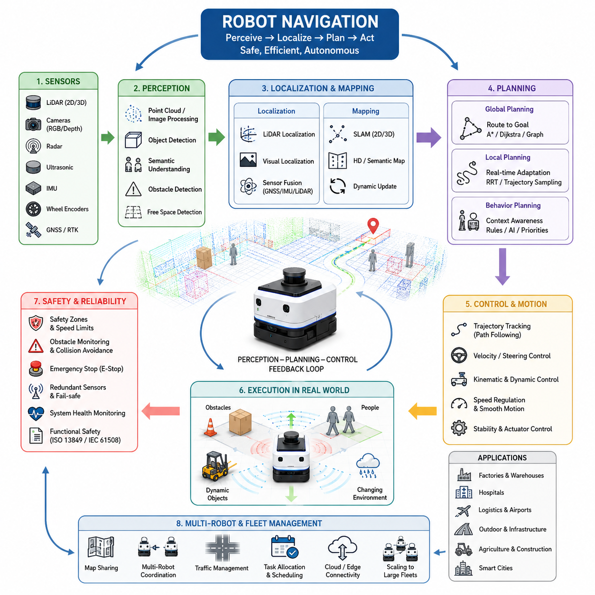
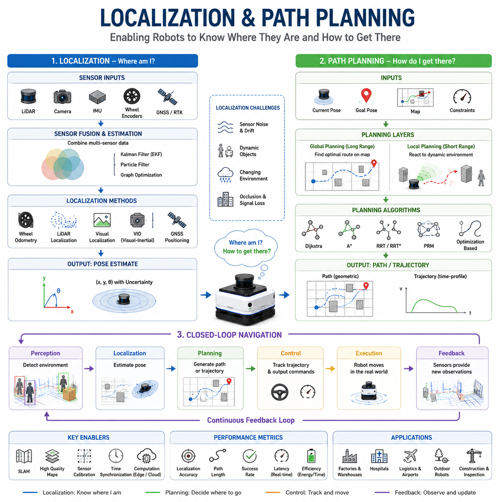
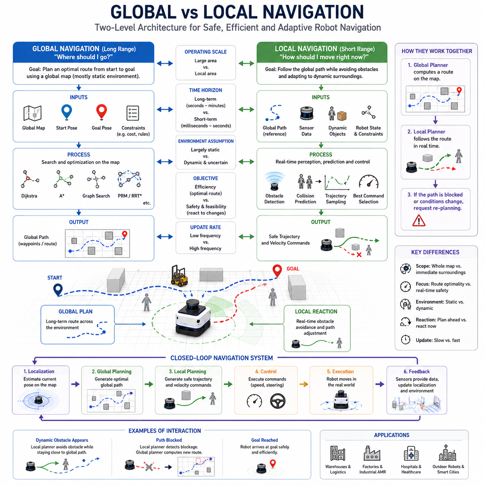
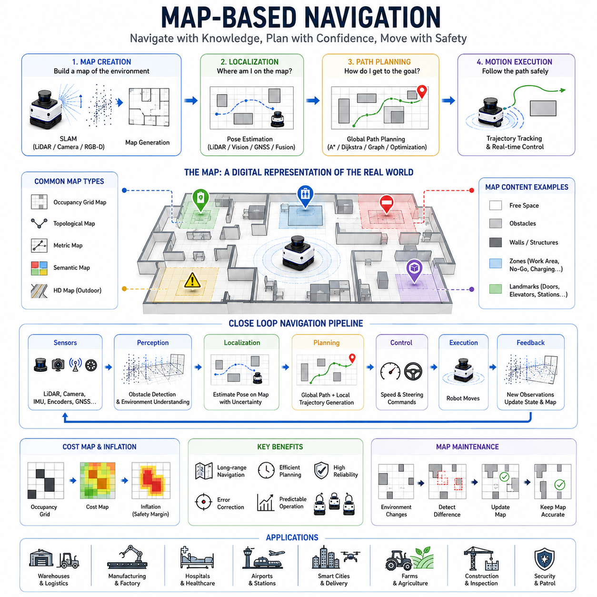
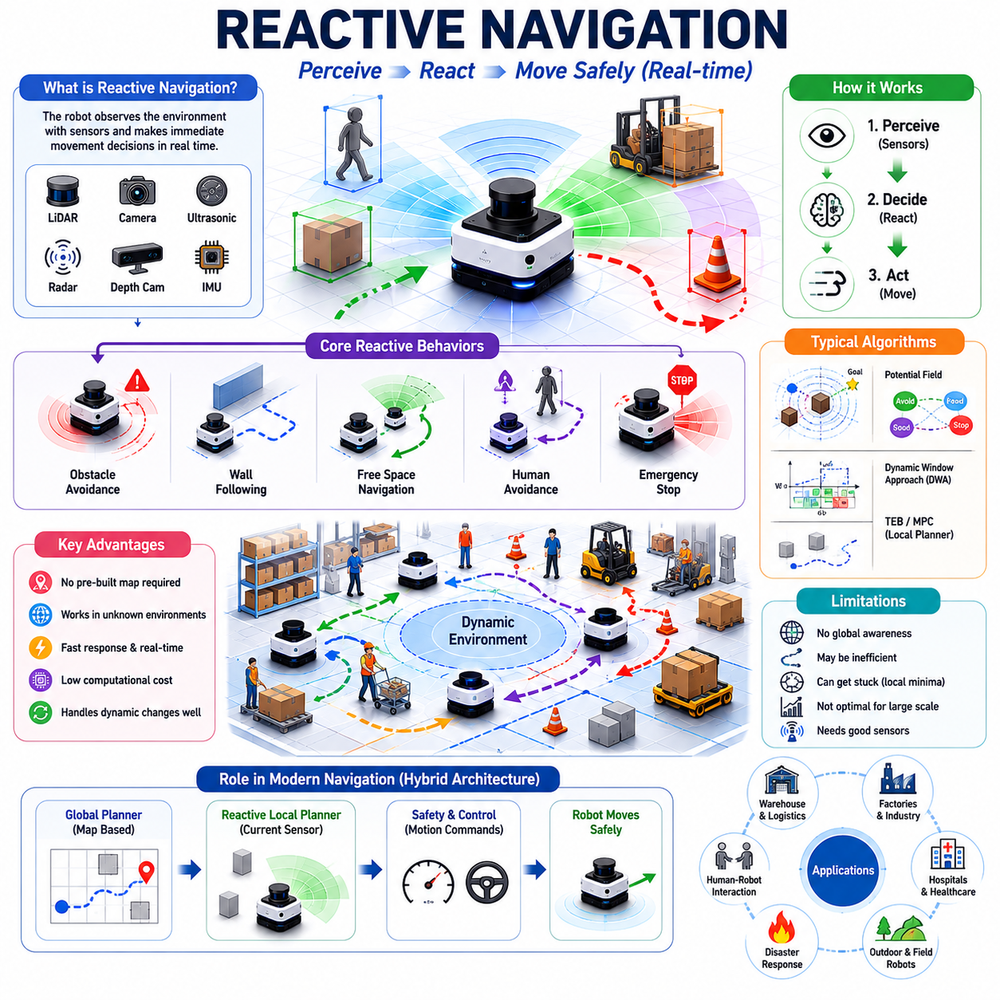
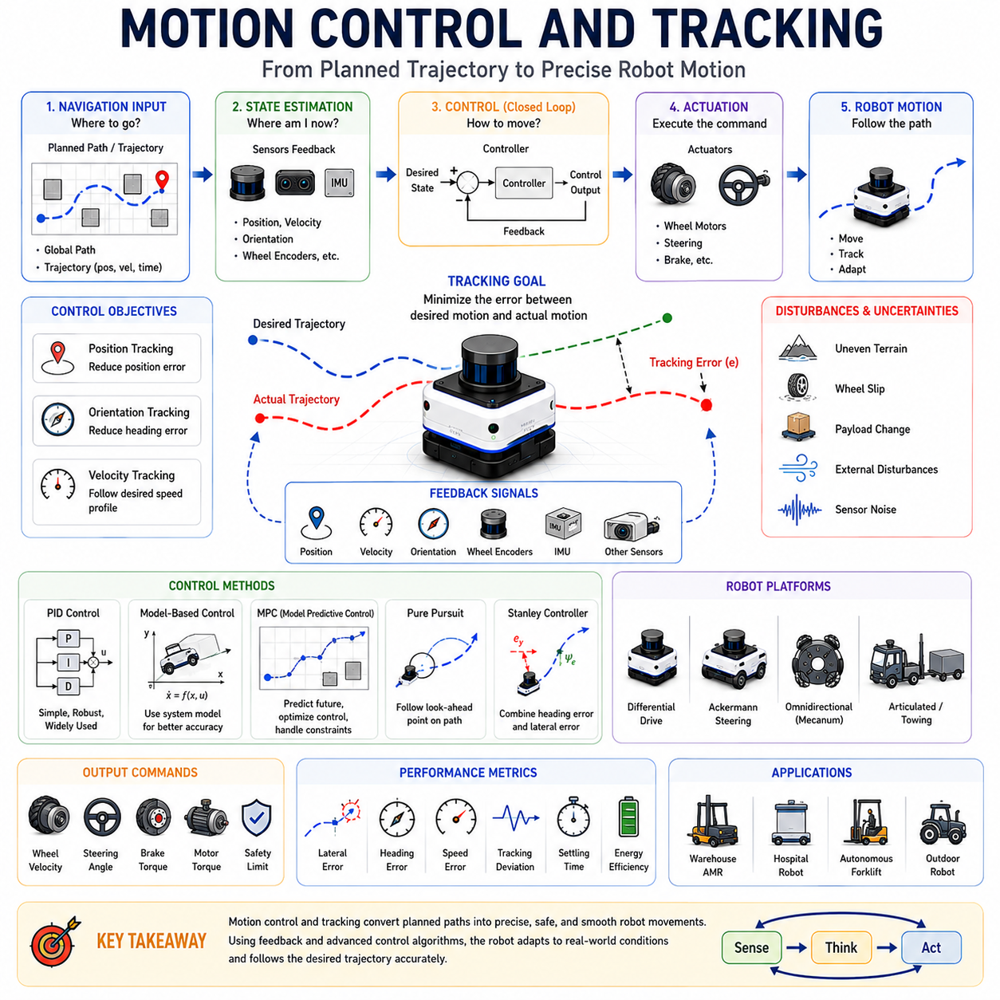
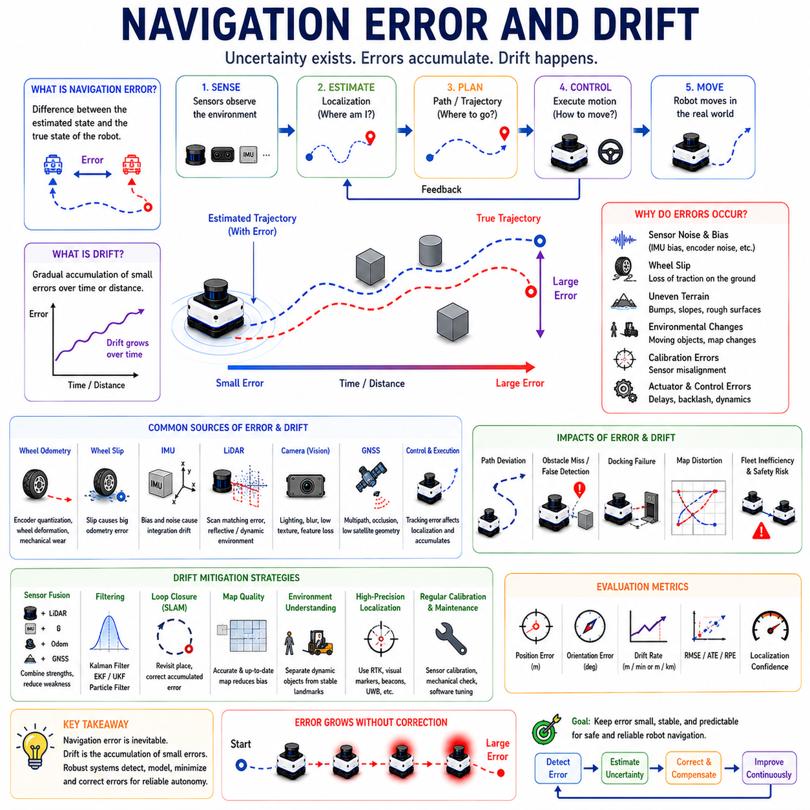
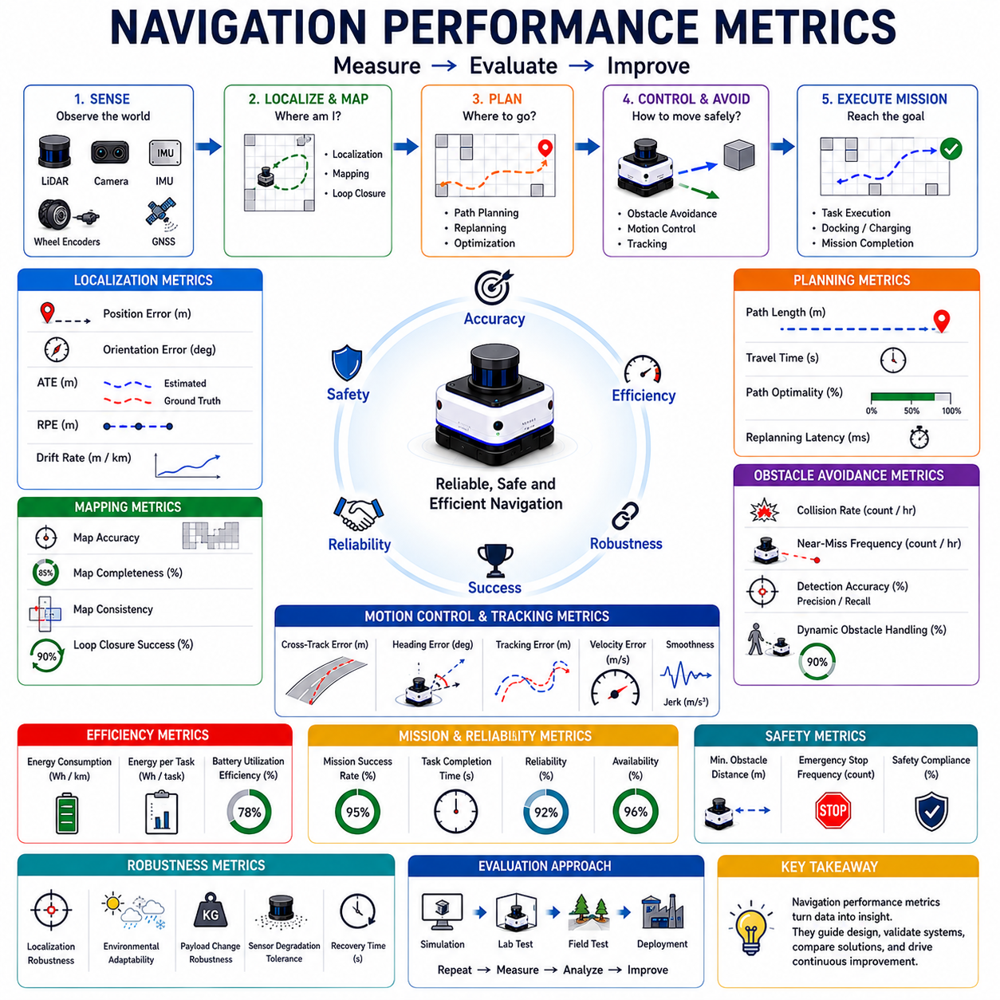

**Volume 05. Path Planning and Autonomous Navigation**


# Chapter 01. Navigation Fundamentals

##  

## 01.1 What is Robot Navigation?

{width="7.268055555555556in" height="7.268055555555556in"}

Robot navigation is one of the most fundamental capabilities that transforms a machine from a remotely controlled device into an autonomous system capable of operating in the real world. In the context of Autonomous Mobile Robots (AMRs), navigation refers to the complete process through which a robot understands its environment, determines its own location, plans a route toward a destination, and continuously controls its motion while avoiding obstacles and responding to environmental changes. Navigation is therefore much more than simply moving from one point to another. It is an integrated decision-making process that combines perception, localization, mapping, path planning, motion control, obstacle avoidance, and behavioral reasoning into a unified autonomous system. This topic serves as the foundation of the entire Navigation Fundamentals section and provides the conceptual basis for all subsequent discussions on localization, mapping, path planning, trajectory optimization, behavior planning, fleet navigation, and autonomous mobility.

The concept of robot navigation originates from a simple question: how can a robot determine where it is and where it should go? Humans naturally navigate using vision, memory, spatial awareness, and reasoning. When entering a building, a person can identify hallways, doors, elevators, and landmarks, creating a mental model of the environment. Robots must achieve similar capabilities using sensors, algorithms, and computational models. Unlike humans, robots rely on technologies such as LiDAR, cameras, radar, ultrasonic sensors, GNSS receivers, IMUs, wheel encoders, and depth sensors to perceive the world. The navigation system processes these sensor inputs and converts them into actionable information that allows autonomous movement.

Robot navigation can be viewed as the integration of three fundamental questions. The first question is localization: "Where am I?" The robot must continuously estimate its position and orientation within the environment. The second question is planning: "Where should I go?" The robot must determine a safe and efficient route to the destination. The third question is control: "How do I get there?" The robot must generate motor commands and steering actions that follow the planned route while maintaining safety and stability. Together, these three questions define the core framework of autonomous navigation.

In modern AMR systems, navigation is typically divided into several interconnected layers. At the lowest level, sensor systems gather information from the environment. These sensors may include two-dimensional LiDARs for obstacle detection, three-dimensional LiDARs for spatial mapping, RGB cameras for visual understanding, depth cameras for geometric measurements, GNSS receivers for outdoor positioning, and inertial sensors for motion estimation. Sensor data is then processed through perception pipelines that identify obstacles, free space, semantic objects, and environmental features. The resulting information becomes the basis for localization and mapping algorithms.

Localization is a critical component of navigation because a robot cannot effectively plan or move without knowing its current position. Localization algorithms estimate the robot's pose, which includes both position and orientation. Indoor robots frequently use LiDAR-based localization, visual localization, or SLAM-based localization. Outdoor robots may combine GNSS, RTK corrections, LiDAR localization, inertial navigation, and visual landmarks. The accuracy of localization directly affects navigation performance. Even small localization errors can cause significant path deviations, docking failures, or collisions.

Mapping provides the spatial representation that allows robots to understand their surroundings. A map can be as simple as a two-dimensional occupancy grid or as complex as a high-definition semantic world model. Maps contain information about obstacles, free space, structural boundaries, and environmental features. Navigation algorithms use maps to determine traversable areas and identify potential hazards. Depending on the application, maps may be static, dynamic, local, global, semantic, or continuously updated through SLAM systems.

Path planning is the process of generating a route from the current location to a target destination. A path planner analyzes the environment and determines a sequence of movements that satisfy safety, efficiency, and operational constraints. Classical path planning algorithms include Dijkstra, A\*, and graph-based search methods. More advanced techniques include Rapidly Exploring Random Trees (RRT), Probabilistic Roadmaps (PRM), trajectory optimization methods, and AI-driven planning approaches. The planner must account for obstacles, vehicle dimensions, turning radius limitations, dynamic constraints, and mission objectives.

Path planning itself can be divided into global planning and local planning. Global planning operates over large maps and generates an overall route toward the destination. Local planning focuses on immediate surroundings and adapts the robot's movement in real time. Global planners prioritize route optimality, while local planners prioritize safety and responsiveness. Together, they enable robots to navigate efficiently while responding to unexpected environmental changes.

Motion control converts navigation decisions into physical movement. Once a path has been generated, the robot must follow it accurately. Motion controllers calculate steering angles, wheel velocities, acceleration commands, braking actions, and actuator outputs. The control system must account for the robot's kinematic and dynamic properties. Different robot platforms require different control approaches. Differential-drive robots, Ackermann-steering vehicles, omnidirectional robots, skid-steering platforms, and articulated towing robots each have unique motion characteristics that influence navigation behavior.

Obstacle avoidance is another essential aspect of navigation. Real-world environments are rarely static. People walk through hallways, vehicles cross roads, objects are moved unexpectedly, and environmental conditions continuously change. Navigation systems must detect obstacles, predict their movements, assess collision risks, and generate avoidance maneuvers. Advanced navigation systems incorporate dynamic obstacle tracking, human-aware navigation, safety zones, and predictive collision avoidance strategies to ensure safe operation.

Safety is a central requirement in robot navigation. Industrial robots often operate near human workers, medical staff, patients, customers, or public pedestrians. Navigation systems must comply with functional safety requirements and regulatory standards. Safety mechanisms may include emergency stop systems, safety LiDARs, dynamic speed reduction zones, obstacle proximity monitoring, fail-safe braking, redundant sensing architectures, and continuous system health monitoring. A navigation system that reaches its destination efficiently but compromises safety cannot be considered successful.

The complexity of navigation increases significantly when robots operate in outdoor environments. Indoor navigation typically occurs within structured spaces where walls, corridors, and landmarks remain relatively stable. Outdoor environments introduce additional challenges such as changing weather, variable lighting conditions, GNSS signal degradation, uneven terrain, vegetation, moving vehicles, pedestrians, construction zones, and large-scale operating areas. Outdoor navigation therefore often requires sensor fusion approaches that combine GNSS, LiDAR, vision, IMU, and semantic perception technologies.

Modern navigation systems increasingly incorporate artificial intelligence. Traditional navigation methods rely heavily on geometric algorithms and handcrafted rules. AI-based navigation systems introduce learning capabilities that allow robots to adapt to complex environments. Machine learning can improve obstacle classification, semantic understanding, behavioral decision-making, trajectory prediction, and environment interpretation. Large-scale world models and foundation models for robotics are beginning to influence how future navigation systems reason about their surroundings.

Another important aspect of navigation is behavior planning. Navigation is not merely about reaching a destination; it also involves determining appropriate actions during operation. For example, a hospital delivery robot may need to wait for a crowded elevator, yield to medical personnel, avoid restricted areas, and prioritize emergency routes. An industrial towing robot may need to coordinate with forklifts, obey traffic rules, and manage trailer dynamics. Behavior planning adds context-awareness and decision-making capabilities that extend beyond simple path following.

Multi-robot navigation introduces additional complexity. In modern factories, hospitals, warehouses, airports, and logistics centers, dozens or even hundreds of robots may operate simultaneously. These robots share maps, coordinate routes, avoid collisions, and participate in fleet-level traffic management. Navigation systems must therefore support communication, scheduling, resource allocation, congestion management, and cooperative decision-making. Fleet-level navigation transforms navigation from an individual robot problem into a system-wide optimization challenge.

Simulation plays a major role in navigation development. Before deploying robots in real environments, engineers often validate navigation algorithms using simulation platforms such as Gazebo, Isaac Sim, and digital twin environments. Simulation enables large-scale testing, failure analysis, parameter tuning, and safety verification without risking physical equipment. Modern navigation development workflows typically combine simulation testing with real-world field validation to ensure reliability and robustness.

Navigation performance can be evaluated using several metrics. Common performance indicators include localization accuracy, path efficiency, trajectory smoothness, travel time, obstacle avoidance success rate, computational latency, energy consumption, safety compliance, and mission completion rate. These metrics help engineers quantify navigation quality and identify areas for improvement. High-performance navigation systems achieve a balance between efficiency, safety, reliability, scalability, and computational feasibility.

The evolution of robot navigation reflects the broader evolution of robotics itself. Early mobile robots relied on predefined paths and simple obstacle sensors. Modern autonomous robots can build maps, localize themselves, understand semantic environments, coordinate with fleets, and make intelligent decisions in dynamic situations. Future navigation systems are expected to integrate real-time world models, cloud-based intelligence, large-scale semantic understanding, embodied AI, and advanced reasoning capabilities. Robots may eventually navigate environments with human-level adaptability, understanding not only geometry but also context, intent, and social interactions.

Within the overall AMR development architecture, navigation serves as the bridge between perception and action. Sensors provide awareness of the environment, navigation transforms that awareness into decisions, and control systems execute those decisions through physical motion. Without navigation, perception data remains passive information and motion systems lack purposeful direction. Navigation therefore represents the central intelligence layer that enables autonomous behavior.

As the scope of autonomous robotics expands from warehouses and factories to hospitals, smart cities, farms, industrial plants, airports, logistics hubs, and outdoor infrastructure inspection systems, navigation becomes increasingly important. Advanced navigation capabilities are essential for achieving reliable autonomy, large-scale deployment, operational efficiency, and safe human-robot coexistence. Understanding the principles of robot navigation is therefore the first step toward mastering autonomous mobile robotics and forms the conceptual foundation for all subsequent topics in localization, mapping, path planning, obstacle avoidance, behavior planning, fleet management, and future intelligent robotic systems.

로봇 내비게이션(Robot Navigation)은 기계를 단순한 원격 조종 장치에서 실제 환경에서 스스로 움직이고 작업할 수 있는 자율 시스템으로 발전시키는 가장 핵심적인 기술 중 하나이다. 자율이동로봇(AMR) 관점에서 내비게이션은 로봇이 주변 환경을 이해하고, 자신의 위치를 파악하며, 목적지까지의 경로를 계획하고, 이동 중 장애물을 회피하면서 지속적으로 움직임을 제어하는 전체 과정을 의미한다. 따라서 내비게이션은 단순히 한 지점에서 다른 지점으로 이동하는 기능이 아니라, 인지(Perception), 위치 추정(Localization), 지도 작성(Mapping), 경로 계획(Path Planning), 운동 제어(Motion Control), 장애물 회피(Obstacle Avoidance), 행동 계획(Behavior Planning)을 통합하는 종합적인 자율 의사결정 시스템이라 할 수 있다.

로봇 내비게이션의 본질은 "로봇이 현재 어디에 있으며, 어디로 가야 하는가?"라는 질문에서 시작된다. 인간은 시각, 기억, 공간 감각, 경험을 이용하여 자연스럽게 길을 찾는다. 건물 안에 들어가면 복도, 계단, 엘리베이터, 출입문 등을 인식하고 머릿속에 공간 구조를 형성한 후 이동한다. 반면 로봇은 LiDAR, 카메라, 레이더, 초음파 센서, GNSS, IMU, 휠 엔코더 등의 센서를 이용하여 환경을 인식하고, 이를 알고리즘으로 처리하여 공간 정보를 구축한다. 이러한 과정이 바로 내비게이션 시스템의 핵심이다.

내비게이션은 크게 세 가지 기본 질문으로 설명할 수 있다. 첫 번째는 "나는 어디에 있는가?"라는 위치 추정 문제이다. 두 번째는 "어디로 가야 하는가?"라는 경로 계획 문제이다. 세 번째는 "어떻게 이동할 것인가?"라는 제어 문제이다. 로봇은 이 세 가지 문제를 지속적으로 해결하면서 자율 주행을 수행한다.

현대의 AMR 시스템에서 내비게이션은 여러 계층으로 구성된다. 가장 아래 계층에서는 센서가 환경 정보를 수집한다. 2D LiDAR는 장애물 검출에 사용되고, 3D LiDAR는 공간 구조를 인식하는 데 활용된다. RGB 카메라는 시각 정보를 제공하며, Depth Camera는 거리 정보를 획득한다. GNSS는 실외 위치 정보를 제공하고, IMU는 자세와 가속도 정보를 측정한다. 이러한 센서 데이터는 인지 알고리즘을 통해 처리되며, 장애물, 이동 가능 공간, 환경 특징점, 의미 정보(Semantic Information) 등으로 변환된다.

위치 추정(Localization)은 내비게이션의 핵심 요소이다. 로봇은 자신의 위치와 방향(Pose)을 정확하게 알아야 목적지까지 올바르게 이동할 수 있다. 실내 환경에서는 LiDAR 기반 위치 추정, Visual Localization, SLAM 기반 위치 추정이 널리 사용된다. 실외 환경에서는 GNSS, RTK, IMU, LiDAR Localization, Visual Landmark 등을 결합한 센서 융합 방식이 활용된다. 위치 추정 정확도가 낮아지면 경로 추종 오차가 증가하고, 도킹 실패나 충돌 위험이 발생할 수 있다.

지도 작성(Mapping)은 로봇이 주변 공간을 이해하기 위한 기반이 된다. 지도는 단순한 2차원 점유 격자 지도(Occupancy Grid Map)일 수도 있고, 의미 정보가 포함된 고정밀 HD Map일 수도 있다. 지도에는 장애물 위치, 이동 가능 영역, 건물 구조, 도로 정보 등이 포함된다. 내비게이션 알고리즘은 이러한 정보를 기반으로 안전하고 효율적인 경로를 생성한다. 지도는 정적일 수도 있고 동적일 수도 있으며, SLAM 시스템을 통해 지속적으로 갱신될 수도 있다.

경로 계획(Path Planning)은 현재 위치에서 목적지까지 이동하기 위한 최적 경로를 생성하는 과정이다. 경로 계획 알고리즘은 장애물 위치, 로봇 크기, 회전 반경, 이동 비용 등을 고려하여 가장 적절한 경로를 찾는다. 대표적인 알고리즘으로는 Dijkstra, A\*, Graph Search, RRT(Rapidly Exploring Random Tree), PRM(Probabilistic Roadmap), Trajectory Optimization 등이 있다. 최근에는 AI 기반 경로 계획 기술도 활발히 연구되고 있다.

경로 계획은 일반적으로 Global Planning과 Local Planning으로 구분된다. Global Planner는 전체 지도 기반으로 목적지까지의 전역 경로를 생성한다. 반면 Local Planner는 실시간 센서 정보를 활용하여 주변 장애물을 회피하고 경로를 수정한다. 전역 경로 계획은 효율성을 중요시하며, 지역 경로 계획은 안전성과 실시간성을 중요시한다. 두 기능이 함께 동작해야 실제 환경에서 안정적인 자율 주행이 가능하다.

운동 제어(Motion Control)는 계획된 경로를 실제 주행 명령으로 변환하는 역할을 한다. 로봇은 경로를 따라 이동하기 위해 모터 속도, 조향각, 가속도, 감속도 등을 지속적으로 계산해야 한다. 제어기는 로봇의 운동학(Kinematics)과 동역학(Dynamics)을 고려하여 최적의 제어 명령을 생성한다. 차동 구동(Differential Drive), 아커만 조향(Ackermann Steering), 전방향 이동(Omnidirectional Drive), 스키드 스티어링(Skid Steering), 견인형 로봇(Towing AMR) 등 플랫폼 구조에 따라 제어 방식은 달라진다.

장애물 회피(Obstacle Avoidance)는 내비게이션 시스템의 또 다른 핵심 기능이다. 실제 환경은 항상 변화한다. 사람이 지나가고, 차량이 이동하며, 물체가 예상치 못하게 배치될 수 있다. 따라서 로봇은 장애물을 탐지하고, 이동 방향을 예측하며, 충돌 가능성을 계산한 후 적절한 회피 경로를 생성해야 한다. 최신 시스템은 단순한 장애물 회피를 넘어 사람의 움직임을 고려하는 Human-Aware Navigation과 충돌 예측 기반 회피 기술을 적용하고 있다.

안전성(Safety)은 모든 내비게이션 시스템에서 가장 중요한 요소 중 하나이다. 산업용 AMR은 작업자와 함께 작업하며, 병원 로봇은 의료진과 환자 주변을 이동한다. 따라서 안전 LiDAR, 비상 정지(E-Stop), 속도 제한 구역, 보호 영역(Safety Zone), 중복 센서 구조, 안전 브레이크 시스템 등이 적용된다. 목적지에 도달하더라도 안전을 보장하지 못한다면 그 내비게이션 시스템은 성공적이라고 할 수 없다.

실외 환경에서는 내비게이션의 난이도가 더욱 높아진다. 실내 환경은 벽, 복도, 출입문과 같은 구조물이 비교적 고정되어 있지만, 실외 환경은 날씨, 조명 변화, GNSS 음영 지역, 울퉁불퉁한 지형, 차량, 보행자, 공사 구간 등 다양한 변수들이 존재한다. 따라서 실외 자율주행 로봇은 GNSS, RTK, LiDAR, 카메라, IMU 등을 결합한 고도화된 센서 융합 기술이 필요하다.

최근에는 인공지능 기술이 내비게이션 분야에 빠르게 도입되고 있다. 전통적인 내비게이션은 기하학적 모델과 규칙 기반 알고리즘에 의존하였지만, AI 기반 내비게이션은 학습을 통해 환경에 적응할 수 있다. AI는 장애물 분류, 장면 이해, 행동 결정, 이동 객체 예측, 의미 기반 공간 이해 등의 기능을 향상시키고 있다. 미래에는 Foundation Model, World Model, Embodied AI 기술이 내비게이션 시스템과 결합되어 더욱 높은 수준의 자율성을 제공할 것으로 예상된다.

행동 계획(Behavior Planning)은 단순한 경로 생성 이상의 의미를 가진다. 병원 배송 로봇은 엘리베이터를 기다려야 할 수도 있고, 의료진에게 우선 통행권을 양보해야 할 수도 있다. 공장 내 견인 로봇은 교차로에서 다른 차량을 먼저 보내야 하거나 특정 작업 우선순위를 고려해야 한다. 행동 계획은 이러한 상황을 판단하고 적절한 행동을 결정하는 상위 계층 기능이다.

다수의 로봇이 동시에 운용되는 환경에서는 다중 로봇 내비게이션(Multi-Robot Navigation)이 필요하다. 물류센터, 공장, 병원 등에서는 수십 대에서 수백 대의 로봇이 동시에 운영될 수 있다. 이 경우 로봇들은 지도를 공유하고, 충돌을 방지하며, 교통 흐름을 최적화해야 한다. 따라서 내비게이션은 단일 로봇 문제를 넘어 플릿(Fleet) 수준의 최적화 문제로 확장된다.

시뮬레이션은 내비게이션 개발 과정에서 매우 중요한 역할을 한다. 실제 환경에서 바로 시험하는 것은 비용과 위험이 크기 때문에 Gazebo, Isaac Sim, Digital Twin 환경을 활용하여 다양한 상황을 사전에 검증한다. 시뮬레이션을 통해 알고리즘 성능을 평가하고, 실패 상황을 재현하며, 파라미터를 최적화할 수 있다.

내비게이션 성능은 다양한 지표를 통해 평가된다. 위치 추정 정확도, 경로 길이, 이동 시간, 장애물 회피 성공률, 충돌 발생 횟수, 계산 지연 시간, 에너지 소비량, 임무 성공률 등이 대표적인 평가 지표이다. 우수한 내비게이션 시스템은 효율성, 안전성, 신뢰성, 확장성, 실시간성을 균형 있게 만족해야 한다.

로봇 내비게이션 기술은 로봇 산업의 발전과 함께 지속적으로 진화해 왔다. 초기의 로봇은 단순한 고정 경로 주행만 가능했지만, 현재의 AMR은 스스로 지도를 생성하고, 위치를 추정하며, 환경을 이해하고, 다른 로봇과 협력하면서 복잡한 환경에서 자율적으로 임무를 수행할 수 있다. 미래의 내비게이션 시스템은 실시간 세계 모델(World Model), 클라우드 기반 지능, 의미 기반 공간 이해, Embodied AI를 통합하여 인간 수준의 환경 이해와 의사결정 능력을 갖추게 될 것으로 예상된다.

결국 내비게이션은 로봇의 "눈"과 "두뇌" 그리고 "다리"를 연결하는 핵심 기술이다. 센서는 세상을 인식하고, 내비게이션은 이를 기반으로 판단하며, 제어 시스템은 실제 움직임을 수행한다. 내비게이션이 없다면 센서는 단순한 데이터 수집 장치에 불과하고, 구동 시스템은 목적 없는 움직임만 수행하게 된다.

따라서 로봇 내비게이션은 자율주행 로봇 기술의 중심에 위치하는 핵심 분야이며, 위치 추정, 지도 작성, 경로 계획, 장애물 회피, 행동 계획, 플릿 관리, 그리고 미래의 지능형 자율 시스템으로 이어지는 모든 기술의 출발점이라 할 수 있다. 이는 향후 스마트 공장, 병원, 물류센터, 스마트 시티, 농업, 건설, 인프라 점검 로봇 등 다양한 분야에서 자율 로봇이 성공적으로 운영되기 위한 가장 중요한 기반 기술이 된다.

##  

## 01.2 Localization and Path Planning

{width="7.268055555555556in" height="7.268055555555556in"}

Localization and path planning are two of the most fundamental capabilities in autonomous robot navigation. Together, they enable a robot to understand where it is, determine where it needs to go, and decide how to reach its destination safely and efficiently. While perception provides awareness of the surrounding environment and motion control executes movement commands, localization and path planning form the central decision-making layer that transforms sensor data into purposeful autonomous motion. Without accurate localization, a robot cannot determine its position relative to the world. Without effective path planning, a robot cannot determine how to reach a desired destination. The integration of these two functions lies at the heart of every successful Autonomous Mobile Robot (AMR) deployment.

Localization is the process of estimating a robot's position and orientation within an environment. In robotics, position alone is not sufficient. A robot must know both its location and its heading direction, collectively referred to as its pose. Pose estimation allows the robot to understand its relationship to surrounding objects, maps, landmarks, and destinations. Every navigation decision depends on the accuracy of this pose estimate. If localization becomes inaccurate, even the most advanced planning algorithms may generate incorrect routes or unsafe behaviors.

The localization problem can be described as answering a simple question: "Where am I?" However, solving this question computationally is one of the most challenging problems in robotics. Real-world environments contain uncertainty, sensor noise, changing conditions, and dynamic objects. A robot must continuously combine information from multiple sensors while compensating for errors and disturbances. Localization therefore becomes a probabilistic estimation problem rather than a deterministic calculation.

One of the earliest localization methods is dead reckoning. Dead reckoning estimates current position by integrating previous movements over time. Wheel encoders measure wheel rotations, and the robot calculates displacement and orientation changes based on kinematic models. While dead reckoning is computationally efficient and easy to implement, it accumulates errors over time. Small measurement inaccuracies gradually grow into significant position drift, making dead reckoning unsuitable as a standalone localization method for long-duration missions.

To reduce drift, modern robots incorporate inertial measurement units (IMUs). IMUs provide acceleration and angular velocity measurements that help estimate changes in motion. Although IMUs improve short-term localization performance, they also suffer from bias accumulation and sensor drift. Consequently, wheel odometry and inertial measurements are often fused together to achieve more robust motion estimation.

Localization accuracy improves significantly when robots utilize environmental observations. LiDAR-based localization compares observed laser scans against previously constructed maps. By matching environmental features, the robot can determine its pose relative to known structures. This approach is widely used in industrial AMRs because it provides high accuracy and robustness under varying lighting conditions. In warehouse environments, factories, hospitals, and logistics centers, LiDAR localization often serves as the primary positioning technology.

Vision-based localization uses cameras to recognize visual landmarks, textures, and environmental features. Cameras offer rich environmental information and enable semantic understanding in addition to geometric positioning. Visual localization can operate using monocular cameras, stereo cameras, RGB-D sensors, or advanced visual-inertial systems. Modern Visual SLAM systems combine visual observations with inertial measurements to provide accurate localization even in complex environments.

Outdoor robots frequently utilize Global Navigation Satellite Systems (GNSS) for localization. GNSS receivers estimate global position using satellite signals. Standard GNSS typically provides meter-level accuracy, while Real-Time Kinematic (RTK) systems improve positioning precision to the centimeter level. However, GNSS signals can be degraded by buildings, tunnels, dense vegetation, atmospheric effects, and multipath reflections. Consequently, outdoor robots often combine GNSS with LiDAR, cameras, IMUs, and wheel odometry through sensor fusion techniques.

Sensor fusion is one of the most important concepts in modern localization systems. No individual sensor can provide perfect information under all conditions. Wheel encoders suffer from slippage. IMUs accumulate drift. Cameras are affected by lighting conditions. LiDAR performance can degrade in adverse weather. GNSS signals may become unavailable in urban environments. Sensor fusion algorithms combine multiple information sources to achieve greater robustness and reliability than any single sensor could provide.

Probabilistic estimation methods play a central role in localization. The Kalman Filter and its variants provide efficient solutions for estimating system states under uncertainty. Extended Kalman Filters accommodate nonlinear motion models commonly encountered in robotics. Particle Filters represent localization uncertainty using multiple pose hypotheses and are particularly effective in global localization scenarios where the robot's initial position may be unknown. These probabilistic approaches allow robots to maintain accurate position estimates despite noisy measurements and incomplete information.

Localization becomes even more complex in dynamic environments. Industrial facilities, hospitals, airports, and public spaces contain moving people, vehicles, carts, and temporary obstacles. Environmental features may appear, disappear, or change over time. Robust localization systems must distinguish between stable landmarks useful for positioning and transient objects that should be ignored. Advanced localization algorithms incorporate semantic understanding to identify reliable environmental features while filtering out dynamic elements.

Simultaneous Localization and Mapping, commonly known as SLAM, represents one of the most significant advances in autonomous navigation. SLAM enables robots to build maps while simultaneously localizing within those maps. Rather than relying on pre-existing environmental information, a robot can autonomously explore unknown areas and create its own representation of the world. SLAM has become a foundational technology for autonomous robotics, enabling deployment in environments where maps are unavailable or continuously changing.

While localization answers the question of where the robot is, path planning answers the question of where the robot should go and how it should get there. Path planning involves generating a sequence of movements that guide the robot from its current location to a desired destination while satisfying safety, efficiency, and operational constraints.

Path planning begins with defining a goal location. The navigation system must then analyze the environment and identify feasible routes that connect the current position to the destination. These routes must avoid obstacles, respect robot kinematics, minimize travel costs, and satisfy mission objectives. Depending on the application, path planning may prioritize shortest distance, minimum travel time, energy efficiency, safety margins, or operational productivity.

One of the most widely used path planning algorithms is Dijkstra's algorithm. Dijkstra systematically explores all possible paths and guarantees the discovery of the shortest route. While highly reliable, Dijkstra can become computationally expensive in large environments. To improve efficiency, many navigation systems utilize the A\* algorithm, which introduces heuristic guidance to focus the search toward the destination. A\* maintains optimality under appropriate heuristic conditions while significantly reducing computational requirements.

Grid-based planning represents the environment as a collection of discrete cells. Each cell contains information about occupancy, traversal cost, and obstacle status. Grid-based methods are intuitive and compatible with occupancy maps generated by SLAM systems. However, large environments can produce massive grids that require substantial computational resources.

Graph-based planning represents navigable environments as interconnected nodes and edges. Graph representations are highly efficient for large-scale navigation because they abstract environmental structure into compact mathematical forms. Road networks, corridors, warehouse aisles, and transportation infrastructures are often represented using graph models.

Sampling-based planning methods such as Rapidly Exploring Random Trees (RRT) and Probabilistic Roadmaps (PRM) address challenges associated with high-dimensional configuration spaces. These methods are particularly useful for robots with complex kinematic constraints or articulated structures. Instead of exhaustively exploring every possible state, sampling-based planners generate representative samples that efficiently approximate feasible paths.

Path planning can be divided into global planning and local planning. Global planning operates over the entire map and generates a route from the current location to the destination. This route typically considers static environmental structures and long-range objectives. Global planning emphasizes optimality and strategic route selection.

Local planning operates in real time using current sensor observations. It focuses on immediate surroundings and adapts robot behavior to dynamic conditions. Local planners respond to moving obstacles, temporary hazards, traffic congestion, and unexpected environmental changes. They continuously modify trajectories while preserving overall mission objectives.

The relationship between localization and path planning is deeply interconnected. Path planning depends on accurate localization to determine the robot's starting position. Localization depends on successful navigation to maintain consistent environmental observations. Errors in localization directly influence planning performance. If the robot believes it is located several meters away from its actual position, planned routes may intersect obstacles or miss important navigation targets.

Navigation systems therefore continuously exchange information between localization and planning modules. Localization updates refine position estimates. Planning algorithms generate routes based on these estimates. Motion controllers execute planned trajectories. Sensor observations provide feedback that updates localization. This closed-loop architecture enables autonomous operation under uncertain real-world conditions.

Trajectory generation extends traditional path planning by incorporating time-dependent motion constraints. A path specifies geometric movement through space, whereas a trajectory specifies both spatial and temporal characteristics. Trajectory planners consider velocity limits, acceleration constraints, steering capabilities, passenger comfort, energy efficiency, and safety requirements. Modern autonomous systems increasingly rely on trajectory optimization rather than purely geometric path planning.

Safety considerations strongly influence path planning decisions. Industrial robots operating near humans must maintain safe distances, reduce speed in crowded areas, and comply with functional safety regulations. Human-aware navigation introduces additional constraints that account for social behavior, personal space, visibility, and interaction preferences. Safe navigation often requires selecting routes that are not necessarily the shortest but provide greater operational reliability and human acceptance.

Multi-robot environments introduce further planning complexity. Fleet management systems coordinate multiple robots that share maps, corridors, intersections, elevators, and charging stations. Path planning must consider traffic flow, task priorities, congestion management, and collision avoidance among robots. Centralized fleet managers and distributed coordination algorithms work together to optimize system-wide performance.

Modern AI technologies are increasingly influencing localization and path planning. Deep learning models enhance feature extraction, semantic understanding, place recognition, and environmental interpretation. Foundation models and embodied AI systems are beginning to integrate perception, reasoning, localization, and planning into unified architectures. Future navigation systems may rely less on handcrafted rules and more on learned representations of the world.

Simulation platforms such as Isaac Sim, Gazebo, and digital twin environments have become essential tools for developing localization and path planning systems. Engineers use simulation to validate algorithms, analyze failures, optimize parameters, and evaluate performance under diverse scenarios before field deployment. Simulation reduces development cost while improving safety and reliability.

As autonomous robots expand into factories, hospitals, warehouses, airports, farms, construction sites, smart cities, and infrastructure inspection applications, the importance of localization and path planning continues to grow. These technologies form the core intelligence that allows robots to transform perception into purposeful action. Accurate localization provides situational awareness, while effective path planning transforms that awareness into safe and efficient movement. Together, they establish the foundation upon which all higher-level navigation capabilities are built, enabling autonomous systems to operate reliably in increasingly complex and dynamic environments.

위치 추정(Localization)과 경로 계획(Path Planning)은 자율주행 로봇 내비게이션의 가장 핵심적인 기능이다. 이 두 기술이 결합되어야만 로봇은 현재 자신의 위치를 이해하고, 목적지를 결정하며, 안전하고 효율적으로 목적지까지 이동할 수 있다. 인지(Perception)가 주변 환경을 이해하게 해주고, 운동 제어(Motion Control)가 실제 움직임을 수행하게 한다면, 위치 추정과 경로 계획은 이러한 정보를 바탕으로 의사결정을 수행하는 내비게이션의 중심 계층이라 할 수 있다. 정확한 위치 추정이 없다면 로봇은 자신의 위치를 알 수 없으며, 효과적인 경로 계획이 없다면 목적지까지 이동할 방법을 결정할 수 없다. 따라서 이 두 기능의 통합은 모든 자율이동로봇(AMR)의 핵심 기반이 된다.

위치 추정은 로봇이 환경 내에서 자신의 위치와 방향을 계산하는 과정이다. 로봇에게는 단순한 위치 정보만으로는 충분하지 않다. 현재 어느 좌표에 있는지뿐만 아니라 어느 방향을 바라보고 있는지도 알아야 한다. 이러한 위치와 방향을 합쳐서 포즈(Pose)라고 부른다. 포즈를 정확히 추정해야만 로봇은 주변 환경과 자신의 관계를 이해하고 올바른 내비게이션 결정을 내릴 수 있다.

위치 추정 문제는 본질적으로 "나는 어디에 있는가?"라는 질문에 대한 답을 찾는 과정이다. 하지만 실제 환경에서는 센서 노이즈, 환경 변화, 측정 오차, 동적 장애물 등 다양한 불확실성이 존재하기 때문에 이를 해결하는 것은 매우 어려운 문제이다. 따라서 위치 추정은 단순한 계산이 아니라 확률적 추정 문제로 다루어진다.

초기의 위치 추정 방법 중 하나는 데드 레코닝(Dead Reckoning)이다. 데드 레코닝은 이전 위치와 이동량을 이용하여 현재 위치를 계산한다. 휠 엔코더를 이용하여 바퀴 회전량을 측정하고, 이를 운동학 모델에 적용하여 이동 거리를 추정한다. 구현이 간단하고 계산량이 적다는 장점이 있지만 시간이 지날수록 오차가 누적되는 문제가 있다. 작은 오차도 장시간 주행 시에는 큰 위치 오차로 확대될 수 있기 때문에 단독으로는 사용하기 어렵다.

이러한 문제를 보완하기 위해 IMU(Inertial Measurement Unit)가 사용된다. IMU는 가속도와 각속도를 측정하여 로봇의 움직임 변화를 추정한다. IMU는 단기적으로 높은 정확도를 제공하지만 장시간 사용 시에는 센서 바이어스와 누적 오차가 발생한다. 따라서 실제 시스템에서는 휠 오도메트리와 IMU 데이터를 결합하여 보다 안정적인 위치 추정을 수행한다.

보다 높은 정확도를 위해 로봇은 주변 환경을 활용한 위치 추정을 수행한다. LiDAR 기반 위치 추정은 현재 측정된 레이저 스캔 데이터를 기존 지도와 비교하여 위치를 계산한다. 건물 벽, 기둥, 통로와 같은 구조물을 기준으로 위치를 추정하기 때문에 높은 정확도를 제공한다. 이러한 이유로 공장, 창고, 병원, 물류센터와 같은 산업용 환경에서는 LiDAR Localization이 가장 널리 사용되고 있다.

비전 기반 위치 추정은 카메라를 활용하여 주변 특징점을 인식하고 위치를 계산하는 방법이다. 카메라는 단순한 거리 정보뿐 아니라 풍부한 시각 정보를 제공할 수 있다. 단안 카메라, 스테레오 카메라, RGB-D 카메라 등이 활용되며, 최근에는 Visual-Inertial SLAM 기술이 널리 사용되고 있다. 카메라 기반 방식은 환경의 의미 정보를 함께 활용할 수 있다는 장점이 있다.

실외 환경에서는 GNSS(Global Navigation Satellite System)가 중요한 역할을 한다. GNSS는 위성 신호를 이용하여 전역 위치를 계산한다. 일반 GNSS는 수 미터 수준의 오차를 가지지만 RTK(Real-Time Kinematic)를 적용하면 센티미터 수준의 정밀도를 확보할 수 있다. 그러나 고층 건물, 터널, 나무가 많은 지역에서는 신호가 약해질 수 있으므로 LiDAR, 카메라, IMU와 함께 사용하는 센서 융합 방식이 일반적이다.

센서 융합(Sensor Fusion)은 현대 위치 추정 시스템의 핵심 기술이다. 어떤 센서도 모든 환경에서 완벽한 성능을 제공할 수는 없다. 휠 엔코더는 미끄러짐에 영향을 받으며, IMU는 드리프트가 발생하고, 카메라는 조명 변화에 민감하며, LiDAR는 악천후 상황에서 성능이 저하될 수 있다. 따라서 여러 센서의 장점을 결합하여 보다 정확하고 안정적인 위치 정보를 생성하는 것이 중요하다.

위치 추정에는 다양한 확률 기반 알고리즘이 사용된다. 칼만 필터(Kalman Filter)는 가장 널리 사용되는 상태 추정 기법이며, 비선형 시스템에는 확장 칼만 필터(Extended Kalman Filter)가 사용된다. 파티클 필터(Particle Filter)는 여러 개의 위치 가설을 유지하면서 가장 가능성이 높은 위치를 추정하는 방식으로, 초기 위치가 불확실한 경우에도 효과적으로 동작한다.

실제 환경은 끊임없이 변화하기 때문에 위치 추정은 더욱 어려워진다. 병원, 공장, 공항, 물류센터에는 사람, 차량, 카트 등이 계속 이동한다. 이러한 동적 객체는 위치 추정에 혼란을 줄 수 있다. 따라서 최신 위치 추정 시스템은 안정적인 랜드마크만 선택하고 이동하는 객체는 무시할 수 있도록 설계된다.

SLAM(Simultaneous Localization and Mapping)은 위치 추정과 지도 생성을 동시에 수행하는 기술이다. 기존에는 미리 만들어진 지도가 필요했지만, SLAM은 로봇이 새로운 환경을 탐색하면서 스스로 지도를 생성하고 동시에 자신의 위치를 추정할 수 있도록 해준다. 오늘날 대부분의 자율주행 로봇은 다양한 형태의 SLAM 기술을 활용하고 있다.

위치 추정이 "현재 어디에 있는가?"에 대한 답이라면, 경로 계획은 "어떻게 목적지까지 갈 것인가?"에 대한 답이다. 경로 계획은 현재 위치와 목표 위치를 연결하는 이동 경로를 생성하는 과정이다. 경로는 안전해야 하고, 효율적이어야 하며, 로봇의 운동 특성을 고려해야 한다.

경로 계획은 먼저 목적지를 정의하는 것에서 시작된다. 이후 로봇은 환경을 분석하여 현재 위치와 목적지를 연결하는 가능한 경로들을 탐색한다. 이 과정에서 장애물 회피, 이동 비용 최소화, 안전 거리 확보, 주행 효율 향상 등의 조건이 고려된다.

대표적인 경로 계획 알고리즘으로는 다익스트라(Dijkstra) 알고리즘이 있다. 다익스트라는 가능한 모든 경로를 탐색하여 최단 경로를 보장한다. 그러나 계산량이 많기 때문에 대규모 환경에서는 비효율적일 수 있다. 이를 개선한 것이 A\* 알고리즘이다. A\*는 휴리스틱(Heuristic)을 사용하여 목적지 방향으로 탐색을 유도함으로써 계산량을 크게 줄인다.

격자 기반(Grid-Based) 경로 계획은 환경을 작은 셀(Cell) 단위로 나누어 탐색한다. 각 셀에는 장애물 여부와 이동 비용 정보가 저장된다. 이 방식은 Occupancy Grid Map과 매우 잘 결합되기 때문에 실내 AMR 시스템에서 널리 사용된다.

그래프 기반(Graph-Based) 경로 계획은 환경을 노드(Node)와 엣지(Edge)로 표현한다. 복도, 도로, 통로와 같은 구조적 환경에서는 매우 효율적인 표현 방식이며 대규모 공간에서도 계산량을 크게 줄일 수 있다.

RRT(Rapidly Exploring Random Tree)와 PRM(Probabilistic Roadmap)은 샘플링 기반 경로 계획 알고리즘이다. 이들은 모든 공간을 탐색하지 않고 일부 대표 지점을 선택하여 경로를 생성한다. 특히 자유도가 높은 로봇이나 복잡한 환경에서 효과적으로 사용된다.

경로 계획은 일반적으로 전역 경로 계획(Global Planning)과 지역 경로 계획(Local Planning)으로 구분된다. 전역 경로 계획은 전체 지도 기반으로 최적 경로를 생성한다. 반면 지역 경로 계획은 실시간 센서 데이터를 이용하여 장애물을 회피하고 경로를 수정한다. 전역 계획은 전략적 경로를 결정하고, 지역 계획은 실시간 환경 변화에 대응한다.

위치 추정과 경로 계획은 서로 긴밀하게 연결되어 있다. 경로 계획은 정확한 현재 위치를 알아야 시작할 수 있으며, 위치 추정은 경로를 따라 이동하면서 지속적으로 업데이트된다. 만약 위치 추정 오차가 크다면 경로 계획 결과도 잘못될 가능성이 높아진다. 따라서 내비게이션 시스템은 위치 추정과 경로 계획 사이에서 지속적으로 정보를 교환한다.

최근에는 단순한 경로(Path)를 넘어서 궤적(Trajectory) 생성이 중요해지고 있다. 경로는 단순히 공간상의 이동 경로를 의미하지만, 궤적은 시간 정보까지 포함한다. 즉 어느 시점에 어느 위치를 얼마나 빠르게 통과할 것인지까지 고려한다. 이를 통해 속도 제한, 가속도 제한, 에너지 효율, 승차감 등을 동시에 최적화할 수 있다.

안전성은 경로 계획에서도 중요한 요소이다. 사람과 함께 작업하는 산업용 로봇은 안전 거리를 유지해야 하며, 혼잡한 지역에서는 속도를 줄여야 한다. 최근에는 Human-Aware Navigation 기술이 발전하면서 사람의 행동과 심리적 공간까지 고려한 경로 생성이 가능해지고 있다.

다수의 로봇이 함께 운용되는 환경에서는 경로 계획이 더욱 복잡해진다. 여러 대의 로봇이 동일한 통로와 교차로를 공유하기 때문에 교통 관리, 우선순위 제어, 충돌 방지, 작업 스케줄링 등이 함께 고려되어야 한다. 이러한 문제는 플릿 관리(Fleet Management) 시스템과 연계되어 해결된다.

최근 인공지능 기술은 위치 추정과 경로 계획 분야에도 빠르게 적용되고 있다. 딥러닝은 장소 인식, 특징 추출, 의미 기반 환경 이해를 향상시키고 있으며, Foundation Model과 Embodied AI는 위치 추정과 경로 계획을 하나의 통합된 지능 시스템으로 발전시키고 있다.

또한 Isaac Sim, Gazebo, Digital Twin과 같은 시뮬레이션 환경은 위치 추정 및 경로 계획 알고리즘 개발에 필수적인 도구가 되었다. 개발자는 다양한 환경과 실패 시나리오를 시뮬레이션하여 실제 배포 전에 성능을 검증할 수 있다.

결론적으로 위치 추정과 경로 계획은 자율주행 로봇의 핵심 두 축이다. 위치 추정은 로봇에게 현재 상황에 대한 인식을 제공하며, 경로 계획은 그 인식을 바탕으로 목적지까지의 행동 계획을 생성한다. 이 두 기술이 결합되어야만 로봇은 단순히 움직이는 기계를 넘어 스스로 판단하고 안전하게 임무를 수행하는 진정한 자율 시스템으로 발전할 수 있다. 앞으로 스마트 공장, 병원, 물류센터, 농업, 건설, 스마트 시티, 인프라 점검 로봇 등 다양한 분야에서 이 기술의 중요성은 더욱 커질 것이며, 미래 자율주행 기술의 핵심 기반으로 자리 잡게 될 것이다.

##  

## 01.3 Global vs Local Navigation

{width="7.268055555555556in" height="7.268055555555556in"}

Global navigation and local navigation are two fundamental components of autonomous robot navigation systems. Together they enable robots to move intelligently through complex environments while maintaining safety, efficiency, and adaptability. Although both functions contribute to the same objective of guiding a robot from its current position to a desired destination, they operate at different spatial scales, time horizons, and decision-making levels. Understanding the distinction between global and local navigation is essential for designing robust Autonomous Mobile Robot (AMR) systems capable of operating in real-world industrial, commercial, and outdoor environments.

At the highest level, global navigation is concerned with long-range route planning across an entire environment, while local navigation focuses on real-time movement within the robot's immediate surroundings. Global navigation answers the question, "What is the best route to reach the destination?" Local navigation answers the question, "How should I move right now to safely follow that route?" The two systems work together continuously, creating a hierarchical navigation architecture that combines strategic planning with tactical execution.

A useful analogy can be found in human driving. Before beginning a journey, a driver typically determines an overall route using a map or navigation application. This route may include highways, intersections, and major roads leading to the destination. This process resembles global navigation. However, while driving, the driver must also respond to nearby vehicles, pedestrians, road construction, traffic signals, and unexpected hazards. These real-time reactions resemble local navigation. Both levels are necessary for successful travel.

Global navigation operates using a map-based representation of the environment. The navigation system uses a known map to calculate a path between the robot's current location and the destination. This map may be a two-dimensional occupancy grid, a topological map, a graph-based representation, a semantic map, or a high-definition map depending on the application. The objective of global planning is to generate an efficient route that avoids known obstacles while minimizing travel cost according to predefined optimization criteria.

Global navigation generally assumes that the environment is largely static. Walls, buildings, permanent structures, road boundaries, corridors, and work zones are considered stable elements of the environment. Because these features change infrequently, they can be incorporated into a global map and used for long-term route planning. The resulting path often represents the shortest route, the fastest route, the safest route, or a combination of these objectives.

Several classical algorithms are commonly used for global navigation. Dijkstra's algorithm systematically explores all possible routes and guarantees the shortest path. A\* improves computational efficiency through heuristic guidance toward the destination. Graph-based search algorithms represent navigable areas as nodes and edges, enabling efficient route calculation in large environments. More advanced approaches may incorporate probabilistic planning, optimization techniques, or AI-driven route generation.

The output of global navigation is usually a geometric path composed of waypoints, poses, or route segments. This path represents the desired route through the environment but does not directly account for every real-time obstacle the robot may encounter during execution. Consequently, global planning provides strategic guidance rather than direct motion commands.

Local navigation operates at a completely different level. Instead of considering the entire environment, local navigation focuses on the robot's immediate surroundings. It continuously processes sensor data from LiDARs, cameras, radars, depth sensors, ultrasonic sensors, and other perception systems. The objective is to generate safe motion commands that allow the robot to follow the global path while adapting to current environmental conditions.

Unlike global navigation, local navigation assumes that the environment is dynamic and uncertain. People may suddenly walk into the robot's path. Vehicles may cross intersections. Equipment may be temporarily placed in corridors. Environmental conditions may change unexpectedly. Local navigation must therefore react quickly to maintain safe operation.

A local planner receives the global path as a reference and attempts to follow it while avoiding obstacles and satisfying motion constraints. The planner continuously evaluates possible trajectories, predicts future collisions, and selects the safest and most efficient movement strategy. Because these calculations occur in real time, local planning algorithms must be computationally efficient and highly responsive.

One of the most widely used local planning approaches is the Dynamic Window Approach (DWA). DWA evaluates candidate velocity commands based on safety, obstacle avoidance, path alignment, and goal progress. Another popular method is the Timed Elastic Band (TEB) planner, which optimizes trajectories while considering timing constraints, obstacle locations, and robot kinematics. More advanced systems may employ Model Predictive Control (MPC), reinforcement learning, or AI-based decision-making algorithms.

The distinction between global and local navigation becomes particularly important in environments containing dynamic obstacles. Consider a warehouse robot delivering materials across a factory floor. The global planner may generate an optimal route through a corridor based on the facility map. However, if a worker temporarily blocks the corridor, the local planner must slow down, stop, or navigate around the worker while still attempting to follow the overall route. Once the obstacle disappears, the robot can return to the globally planned path.

Another important difference lies in the frequency of operation. Global navigation typically operates at lower frequencies because environmental structure changes slowly. Route calculations may occur once every few seconds or only when significant changes occur. Local navigation operates at much higher frequencies, often updating multiple times per second. Rapid updates are necessary for responding to moving obstacles and changing environmental conditions.

Global navigation and local navigation also differ in their optimization objectives. Global planning focuses primarily on route efficiency. It attempts to minimize distance, travel time, energy consumption, operational cost, or other mission-level objectives. Local planning focuses primarily on safety and feasibility. Even if a locally generated trajectory is slightly longer or less efficient, it may be preferred if it improves safety and reduces collision risk.

The interaction between global and local navigation forms a hierarchical control architecture. The global planner provides strategic guidance by identifying a desired route. The local planner translates that route into executable motion commands while adapting to real-world conditions. Feedback from sensors continuously updates both layers. If local planners repeatedly encounter obstacles that prevent progress, the global planner may be instructed to generate a new route.

This process is commonly known as replanning. Replanning occurs when environmental conditions invalidate the current route. In a warehouse, an aisle may become blocked by equipment. In an outdoor environment, a road may become inaccessible due to construction. In a hospital, a corridor may become unavailable because of emergency activities. When such situations occur, the navigation system must calculate alternative routes that satisfy operational requirements.

Localization plays a critical role in both global and local navigation. Global planners require accurate position estimates to determine the robot's location on the map. Local planners require precise pose information to evaluate nearby obstacles and generate safe trajectories. Localization errors can negatively affect both planning layers. If the robot's estimated position deviates significantly from reality, the global planner may select incorrect routes and the local planner may generate unsafe motions.

Map quality is another important factor influencing navigation performance. Global navigation depends heavily on accurate environmental maps. Errors in map generation can lead to incorrect route planning and operational failures. Local navigation is less dependent on perfect maps because it relies heavily on real-time sensor observations. Nevertheless, local planners still benefit from accurate environmental information and contextual awareness.

Indoor and outdoor navigation systems often emphasize different aspects of global and local navigation. Indoor robots typically operate in highly structured environments where global maps are accurate and stable. As a result, global planning often plays a dominant role. Outdoor robots operate in larger and more dynamic environments where local adaptation becomes increasingly important. Weather conditions, terrain variations, pedestrians, vehicles, and changing infrastructure require sophisticated local navigation capabilities.

The rise of semantic navigation is introducing additional layers of intelligence into both global and local planning. Traditional navigation systems primarily consider geometric information such as walls, obstacles, and free space. Semantic navigation incorporates contextual understanding. A robot may recognize doors, elevators, workstations, charging stations, emergency exits, pedestrian zones, or restricted areas. This semantic knowledge enables more intelligent route selection and behavioral adaptation.

Human-aware navigation further extends local navigation capabilities. In environments shared with people, robots must consider social behavior in addition to physical obstacle avoidance. Humans expect robots to maintain comfortable distances, avoid abrupt movements, yield when appropriate, and behave predictably. Human-aware local planners incorporate social constraints that improve safety and acceptance in public and industrial environments.

Multi-robot systems introduce additional challenges for both global and local navigation. Fleet-level navigation systems coordinate routes among multiple robots to avoid congestion, collisions, and deadlocks. Global planners may reserve pathways or allocate traffic priorities across an entire facility. Local planners continue to manage immediate interactions between robots and dynamic obstacles. Effective coordination requires communication between navigation layers operating at both fleet and individual robot levels.

Modern artificial intelligence technologies are increasingly influencing navigation architectures. Machine learning models improve perception accuracy, obstacle classification, trajectory prediction, and semantic understanding. Reinforcement learning approaches enable robots to learn navigation behaviors through experience. Foundation models and embodied AI systems are beginning to integrate perception, localization, planning, and decision-making into unified architectures capable of more adaptive and intelligent behavior.

Simulation environments such as Isaac Sim, Gazebo, Webots, and digital twins provide valuable platforms for studying the interaction between global and local navigation. Engineers can evaluate route planning performance, obstacle avoidance behavior, replanning strategies, and system robustness under diverse operating conditions. Simulation enables extensive testing before deployment in real-world environments, reducing risk and improving reliability.

As autonomous robots become increasingly common in factories, warehouses, hospitals, airports, smart cities, farms, construction sites, and infrastructure inspection applications, the integration of global and local navigation becomes even more important. Large-scale deployments require navigation systems capable of balancing long-term efficiency with short-term adaptability. Robots must follow strategic routes while continuously responding to changing environmental conditions.

Ultimately, global navigation and local navigation should not be viewed as competing approaches but as complementary components of a unified navigation framework. Global navigation provides long-range intelligence and mission-level optimization. Local navigation provides real-time responsiveness and operational safety. Together they form the foundation of modern autonomous mobility systems, enabling robots to navigate complex environments with reliability, efficiency, and adaptability. The successful integration of these two navigation layers represents one of the most important achievements in autonomous robotics and serves as the cornerstone of advanced AMR navigation architectures.

전역 내비게이션(Global Navigation)과 지역 내비게이션(Local Navigation)은 자율주행 로봇 시스템을 구성하는 가장 핵심적인 두 축이다. 두 기능은 모두 로봇을 현재 위치에서 목표 지점까지 이동시키기 위한 것이지만, 서로 다른 범위와 시간 규모, 그리고 의사결정 수준에서 동작한다. 전역 내비게이션은 목적지까지의 전체 경로를 계획하는 역할을 담당하며, 지역 내비게이션은 현재 주변 상황을 고려하여 실제 이동을 수행하는 역할을 담당한다. 따라서 두 기술은 경쟁 관계가 아니라 상호 보완적인 관계에 있으며, 현대 자율이동로봇(AMR)의 내비게이션 구조는 대부분 이 두 계층을 기반으로 구성된다.

쉽게 설명하면 전역 내비게이션은 "어떤 길로 갈 것인가?"를 결정하는 기능이며, 지역 내비게이션은 "지금 이 순간 어떻게 움직여야 하는가?"를 결정하는 기능이다. 사람이 자동차를 운전할 때도 출발하기 전에 내비게이션 앱을 이용하여 목적지까지의 전체 경로를 확인한다. 이것이 전역 내비게이션에 해당한다. 그러나 실제 운전 중에는 앞차, 보행자, 신호등, 공사 구간 등을 고려하여 즉각적으로 조향하고 가속 및 감속을 수행한다. 이것이 지역 내비게이션에 해당한다.

전역 내비게이션은 일반적으로 지도(Map)를 기반으로 동작한다. 로봇은 현재 위치와 목표 위치를 알고 있으며, 이미 구축된 환경 지도를 이용하여 최적의 경로를 계산한다. 여기서 사용되는 지도는 2D Occupancy Grid Map일 수도 있고, Topological Map, Graph Map, Semantic Map, HD Map일 수도 있다. 전역 내비게이션의 목표는 알려진 환경 내에서 가장 효율적이고 안전한 경로를 찾는 것이다.

전역 내비게이션은 환경이 비교적 정적(Static)이라고 가정한다. 벽, 기둥, 건물, 도로 경계, 복도와 같은 구조물은 자주 변하지 않기 때문에 지도에 포함되어 장기적인 경로 계획에 활용된다. 전역 계획기는 이러한 정보를 기반으로 최단 거리, 최소 시간, 최소 에너지 소비 또는 최대 안전성을 만족하는 경로를 계산한다.

대표적인 전역 경로 계획 알고리즘으로는 다익스트라(Dijkstra) 알고리즘과 A\* 알고리즘이 있다. 다익스트라는 모든 가능한 경로를 탐색하여 최단 경로를 보장한다. A\* 알고리즘은 휴리스틱 정보를 활용하여 탐색 범위를 줄임으로써 계산 효율을 향상시킨다. 또한 그래프 기반 탐색 기법은 대규모 환경에서도 효율적인 경로 계산을 가능하게 한다.

전역 내비게이션의 결과는 일반적으로 Waypoint 또는 경유점들의 집합으로 표현된다. 이 경로는 목적지까지의 이상적인 이동 경로를 의미하지만, 실제 환경에서 발생하는 모든 상황을 고려하는 것은 아니다. 따라서 전역 경로는 전략적인 계획이며 실제 이동을 직접 수행하는 것은 아니다.

반면 지역 내비게이션은 전혀 다른 수준에서 동작한다. 지역 내비게이션은 로봇 주변의 즉각적인 환경을 분석하고 현재 순간의 이동 방향과 속도를 결정한다. LiDAR, 카메라, 레이더, 초음파 센서, Depth Camera 등에서 입력되는 실시간 데이터를 이용하여 장애물을 탐지하고 충돌 위험을 평가한다.

지역 내비게이션은 환경이 동적(Dynamic)이라고 가정한다. 사람, 차량, 카트, 지게차, 이동 장비 등은 언제든지 로봇의 이동 경로에 나타날 수 있다. 따라서 지역 계획기는 항상 변화하는 상황에 대응해야 한다. 전역 경로가 아무리 완벽하게 생성되었더라도 실제 환경에서 장애물이 나타나면 지역 계획기가 즉시 대응해야 한다.

지역 계획기는 전역 경로를 참조하면서 실시간 센서 데이터를 기반으로 안전한 이동 궤적(Trajectory)을 생성한다. 이 과정에서 장애물 회피, 충돌 예측, 속도 조절, 조향 제어 등이 수행된다. 지역 계획은 매우 빠른 주기로 반복 실행되어야 하며, 일반적으로 초당 수 회에서 수십 회 이상 업데이트된다.

대표적인 지역 계획 알고리즘으로는 DWA(Dynamic Window Approach)가 있다. DWA는 현재 가능한 속도와 회전 속도 조합을 평가하여 가장 안전하고 효율적인 이동 명령을 선택한다. 또 다른 대표적인 알고리즘인 TEB(Timed Elastic Band)는 경로를 탄성 밴드처럼 최적화하여 시간 제약과 장애물 회피를 동시에 고려한다. 최근에는 MPC(Model Predictive Control)나 AI 기반 계획기들도 많이 활용되고 있다.

전역 내비게이션과 지역 내비게이션의 차이는 동적 장애물이 존재하는 환경에서 더욱 명확하게 나타난다. 예를 들어 공장 내에서 물류를 운반하는 AMR이 있다고 가정해 보자. 전역 계획기는 공장 전체 지도를 분석하여 가장 효율적인 통로를 선택한다. 그러나 이동 중 작업자가 통로를 가로막고 있다면 지역 계획기는 속도를 줄이거나 정지하거나 우회 경로를 생성해야 한다. 장애물이 사라지면 다시 전역 경로로 복귀하게 된다.

또한 두 시스템은 동작 주기에서도 차이를 가진다. 전역 내비게이션은 상대적으로 느린 주기로 동작한다. 환경 구조는 자주 변하지 않기 때문에 몇 초 또는 수십 초 단위로 경로를 재계산해도 충분한 경우가 많다. 반면 지역 내비게이션은 매우 빠른 응답성이 요구되기 때문에 수십 밀리초 수준으로 반복 수행된다.

최적화 목표 역시 다르다. 전역 계획은 이동 거리, 이동 시간, 에너지 소비량 등 전체 임무의 효율성을 최적화한다. 반면 지역 계획은 충돌 방지와 안전성 확보를 최우선 목표로 한다. 따라서 지역 계획은 때때로 전역 경로보다 조금 더 긴 경로를 선택하더라도 안전한 이동을 우선시한다.

전역 내비게이션과 지역 내비게이션은 계층적(Hierarchical) 구조로 연결된다. 전역 계획기가 목적지까지의 전략적 경로를 생성하면, 지역 계획기는 이를 따라갈 수 있도록 실제 주행 명령을 생성한다. 센서 피드백은 지속적으로 두 계층에 전달된다. 만약 지역 계획기가 반복적으로 장애물에 의해 이동하지 못하는 상황이 발생하면 전역 계획기는 새로운 경로를 계산하게 된다.

이러한 과정을 재계획(Replanning)이라고 한다. 예를 들어 창고 통로가 적재물로 막히거나, 병원 복도가 응급 상황으로 통제되거나, 실외 도로가 공사로 인해 폐쇄될 수 있다. 이런 경우 기존 전역 경로는 사용할 수 없게 되며 새로운 경로가 생성되어야 한다.

위치 추정(Localization)은 전역 및 지역 내비게이션 모두에서 핵심적인 역할을 한다. 전역 계획기는 현재 위치를 정확히 알아야 지도 상에서 경로를 생성할 수 있다. 지역 계획기는 현재 자세(Pose)를 정확히 알아야 장애물과의 상대 위치를 계산할 수 있다. 따라서 위치 추정 오차는 두 내비게이션 계층 모두에 직접적인 영향을 미친다.

지도의 품질 또한 매우 중요하다. 전역 내비게이션은 지도 품질에 크게 의존한다. 지도에 오류가 있다면 잘못된 경로가 생성될 수 있다. 반면 지역 내비게이션은 실시간 센서 데이터를 적극적으로 활용하기 때문에 지도 의존성이 상대적으로 낮다. 그러나 정확한 지도는 여전히 성능 향상에 큰 도움을 준다.

실내 환경과 실외 환경에서도 전역 및 지역 내비게이션의 중요도는 다르게 나타난다. 실내 환경은 구조가 비교적 고정되어 있으므로 전역 계획의 중요성이 높다. 반면 실외 환경은 날씨 변화, 보행자, 차량, 지형 변화 등 예측하기 어려운 요소가 많아 지역 내비게이션의 중요성이 더욱 커진다.

최근에는 Semantic Navigation이 발전하면서 전역 및 지역 내비게이션 모두에 의미 정보가 추가되고 있다. 과거에는 벽과 장애물 같은 기하학적 정보만 사용했지만, 현재는 문(Door), 엘리베이터(Elevator), 작업 구역(Workstation), 충전 스테이션(Charging Station), 출입 금지 구역(Restricted Area) 등의 의미 정보를 함께 활용한다. 이를 통해 보다 지능적인 경로 선택이 가능해지고 있다.

사람과 함께 작업하는 환경에서는 Human-Aware Navigation이 중요해지고 있다. 단순히 사람을 장애물로 인식하는 것이 아니라 사회적 거리 유지, 우선 통행권 양보, 자연스러운 이동 경로 생성 등을 고려한다. 이러한 기능은 주로 지역 내비게이션 계층에서 구현된다.

다중 로봇 시스템에서는 전역 및 지역 내비게이션 모두가 더욱 복잡해진다. 플릿 관리 시스템은 여러 로봇의 경로를 조정하고 교통 혼잡을 방지하며 우선순위를 관리한다. 전역 계획기는 전체 시스템 차원의 최적화를 수행하고, 지역 계획기는 개별 로봇 수준에서 즉각적인 충돌 방지를 담당한다.

최근 인공지능 기술은 전역 및 지역 내비게이션 모두에 적용되고 있다. 딥러닝은 장애물 인식, 의미 기반 환경 이해, 이동 객체 예측 성능을 향상시키고 있다. 강화학습은 로봇이 경험을 통해 더 나은 이동 전략을 학습할 수 있도록 한다. 또한 Foundation Model과 Embodied AI는 인지, 위치 추정, 경로 계획, 행동 계획을 하나의 통합된 지능 시스템으로 발전시키고 있다.

Isaac Sim, Gazebo, Digital Twin과 같은 시뮬레이션 환경은 전역 및 지역 내비게이션 연구에 매우 중요한 역할을 한다. 개발자는 다양한 시나리오를 시험하면서 경로 생성, 장애물 회피, 재계획 성능을 평가할 수 있으며 실제 환경 배포 전에 충분한 검증을 수행할 수 있다.

결국 전역 내비게이션과 지역 내비게이션은 서로 대체하는 기술이 아니라 하나의 통합된 내비게이션 시스템을 구성하는 두 개의 핵심 계층이다. 전역 내비게이션은 장기적인 목표와 전략을 제공하고, 지역 내비게이션은 실시간 안전성과 적응성을 제공한다. 두 기능이 긴밀하게 결합될 때 비로소 자율주행 로봇은 복잡한 환경에서도 안전하고 효율적으로 임무를 수행할 수 있다. 이러한 계층적 구조는 현대 AMR 내비게이션 시스템의 표준 아키텍처로 자리 잡고 있으며, 미래의 지능형 자율주행 로봇에서도 핵심 기반 기술로 계속 발전해 나갈 것이다.

##  

## 01.4 Map-Based Navigation

{width="7.268055555555556in" height="7.268055555555556in"}

Map-based navigation is one of the most important and widely adopted navigation paradigms in autonomous robotics. It enables a robot to move intelligently within an environment by utilizing a previously constructed spatial representation of the world. Rather than relying solely on immediate sensor observations or reactive obstacle avoidance, a map-based navigation system leverages knowledge of the surrounding environment to determine its location, plan routes, predict future movement possibilities, and execute navigation tasks with a higher degree of efficiency and reliability. In modern Autonomous Mobile Robots (AMRs), map-based navigation serves as the foundation upon which localization, path planning, obstacle avoidance, traffic management, and mission execution are built.

The fundamental concept of map-based navigation is relatively simple. A robot first acquires or generates a map of its environment. This map acts as a digital representation of the physical world. During operation, the robot continuously estimates its position within the map and uses this information to determine how to move toward a destination. The map provides context that extends beyond the robot's immediate field of view, allowing navigation decisions to be made using both local observations and global environmental knowledge.

Humans naturally use map-based navigation in everyday life. When traveling to an unfamiliar location, a person often consults a map application, identifies their current position, determines the destination, and follows a route suggested by the navigation system. The person does not rely solely on visible surroundings but instead uses an abstract representation of the environment to guide movement. Autonomous robots perform a similar process, although the representation is mathematical rather than cognitive.

Map-based navigation is fundamentally composed of four major elements. The first element is the map itself. The second element is localization, which determines the robot's position within the map. The third element is path planning, which calculates a route from the current position to the destination. The fourth element is motion execution, which enables the robot to physically follow the planned route while responding to environmental conditions.

The quality of the map directly influences navigation performance. A high-quality map provides accurate spatial information, clearly identifies navigable areas, and contains sufficient detail for reliable localization and planning. Poor map quality can lead to localization failures, incorrect route generation, navigation inefficiencies, and safety risks. Consequently, map creation is often considered one of the most critical stages in the development of autonomous navigation systems.

Several types of maps are commonly used in robotics. The most widely used representation is the occupancy grid map. An occupancy grid divides the environment into small cells and assigns each cell a probability indicating whether it is occupied by an obstacle or free for traversal. Occupancy grids are intuitive, computationally efficient, and highly compatible with LiDAR-based mapping and navigation systems. Many indoor AMRs rely heavily on occupancy grid maps because they provide a straightforward representation of walls, corridors, equipment, and obstacles.

Another important map representation is the topological map. Rather than storing detailed geometric information, a topological map represents the environment as a network of connected locations. Nodes represent meaningful places such as rooms, intersections, workstations, or charging stations, while edges represent navigable connections between them. Topological maps are efficient for large-scale navigation because they reduce computational complexity and focus on connectivity rather than precise geometry.

Metric maps provide precise geometric measurements of the environment. These maps preserve accurate spatial relationships and support detailed path planning and localization. Most SLAM-generated maps belong to this category. Metric maps are particularly useful in environments where precise positioning is required, such as docking stations, automated warehouses, manufacturing facilities, and hospital corridors.

As navigation systems become more advanced, semantic maps are increasingly being adopted. Semantic maps extend traditional geometric representations by incorporating contextual information about objects and locations. Instead of representing only walls and obstacles, a semantic map may identify elevators, doors, charging stations, work areas, emergency exits, pedestrian zones, storage racks, and restricted areas. This additional knowledge allows robots to make more intelligent navigation decisions.

High-definition maps represent another important category, particularly in outdoor autonomous systems. HD maps contain highly detailed information about roads, lanes, signs, landmarks, traffic infrastructure, terrain characteristics, and environmental features. Autonomous vehicles and outdoor mobile robots frequently use HD maps to achieve centimeter-level navigation accuracy in large-scale environments.

Once a map exists, localization becomes the next critical component of map-based navigation. Localization determines where the robot is located within the map. This process typically involves comparing current sensor observations with stored map information. For example, a LiDAR scanner may observe surrounding walls and compare them to a previously generated occupancy map. By finding the best match, the robot can estimate its position and orientation.

Map-based localization provides significant advantages over pure odometry. Wheel encoders and IMUs accumulate errors over time due to sensor noise, wheel slippage, and environmental disturbances. By continuously referencing a map, the robot can correct these accumulated errors and maintain accurate position estimates during extended missions.

Localization techniques used in map-based navigation vary depending on the sensing technology. LiDAR localization uses scan matching techniques to align current sensor observations with stored maps. Visual localization relies on image features, landmarks, and scene recognition. GNSS-based localization references global coordinate systems and is commonly used in outdoor environments. Sensor fusion approaches combine multiple localization methods to achieve greater robustness and accuracy.

Path planning is another essential function enabled by map-based navigation. Once the robot knows its position within the map, it can calculate a route toward a destination. Because the map provides knowledge of obstacles, corridors, pathways, and environmental structure, planning algorithms can identify efficient routes before movement begins. This capability distinguishes map-based navigation from purely reactive navigation approaches.

Global path planning typically operates on the map level. Algorithms such as Dijkstra, A\*, graph search, and optimization-based planners calculate routes that minimize travel distance, travel time, energy consumption, or operational cost. The resulting path often consists of waypoints or trajectory segments that guide the robot toward its objective.

Map-based planning offers several important advantages. First, it allows long-range navigation across environments that extend far beyond the robot's immediate sensor range. Second, it enables optimization because the planner can evaluate multiple possible routes before selecting the most suitable one. Third, it improves mission predictability because routes are generated using known environmental information rather than purely reactive behaviors.

The concept of cost maps plays a central role in map-based navigation. A cost map extends the basic occupancy map by assigning traversal costs to different areas. Obstacles typically receive extremely high costs, while free space receives low costs. Additional costs may be assigned to narrow passages, high-risk areas, crowded zones, slopes, rough terrain, or safety-sensitive locations. Path planners use cost maps to generate routes that balance efficiency and safety.

Inflation layers are frequently applied to cost maps to account for robot dimensions and safety margins. Since robots occupy physical space, planning directly adjacent to obstacles may create collision risks. Inflation layers expand obstacle boundaries to create buffer zones, ensuring that generated paths maintain safe clearance from surrounding objects.

Despite the advantages of map-based navigation, maps are rarely perfect representations of reality. Real environments change over time. Furniture may be moved, pallets may be relocated, doors may be opened or closed, construction may occur, and temporary obstacles may appear unexpectedly. Consequently, modern navigation systems combine map-based planning with real-time perception and obstacle avoidance.

This integration creates a hierarchical navigation architecture. The map provides global environmental knowledge and strategic planning capabilities. Sensors provide real-time situational awareness. Local planners bridge these two layers by adapting planned routes to current conditions. The result is a navigation system capable of both long-term planning and short-term responsiveness.

Dynamic environments present unique challenges for map-based navigation. Hospitals, airports, logistics centers, factories, and public spaces contain constantly changing obstacles and moving people. Static maps alone cannot represent these dynamic elements. Therefore, navigation systems must continuously update local environmental representations while maintaining consistency with the global map.

Map maintenance becomes increasingly important as deployment duration increases. Long-term autonomous operation requires maps to remain accurate despite environmental changes. Some systems periodically rebuild maps, while others perform continuous map updates using online SLAM techniques. Advanced systems may maintain multiple map versions or adapt maps dynamically based on operational observations.

Outdoor map-based navigation introduces additional complexity. Unlike indoor environments, outdoor spaces may span large geographic regions and contain variable terrain, changing weather conditions, vegetation growth, seasonal changes, and dynamic infrastructure. Outdoor robots often combine GNSS positioning, LiDAR mapping, visual localization, and HD maps to achieve reliable navigation performance.

Multi-floor navigation systems frequently utilize map-based approaches as well. Buildings with elevators, stairways, and multiple levels require specialized map structures capable of representing vertical transitions. Navigation systems must understand not only horizontal movement but also how to transition between floors while maintaining localization continuity.

Fleet-level navigation also relies heavily on maps. In large facilities containing dozens or hundreds of robots, maps provide a common spatial framework shared by all vehicles. Fleet management systems use maps to coordinate routes, manage traffic flow, prevent congestion, allocate tasks, and optimize overall operational efficiency. Shared maps enable robots to operate cooperatively within a unified navigation ecosystem.

Artificial intelligence is increasingly enhancing map-based navigation. Machine learning models improve map generation, semantic labeling, environmental understanding, and localization robustness. Deep learning techniques assist in place recognition, landmark detection, obstacle classification, and map maintenance. Emerging embodied AI systems may eventually learn navigation strategies directly from semantic world models rather than relying solely on manually designed navigation pipelines.

Digital twins and simulation platforms have become valuable tools for map-based navigation development. Environments created in Isaac Sim, Gazebo, and other simulation systems allow engineers to generate maps, validate localization algorithms, test planning strategies, and evaluate navigation performance before field deployment. These virtual environments significantly reduce development costs and accelerate system validation.

The future of map-based navigation is likely to involve increasingly rich environmental representations. Traditional occupancy maps will gradually evolve into semantic world models that combine geometry, context, behavior prediction, and environmental understanding. Robots will not only know where obstacles are located but also understand what those obstacles represent, how they behave, and how navigation strategies should adapt accordingly.

As autonomous robots expand into warehouses, factories, hospitals, logistics hubs, airports, farms, construction sites, smart cities, and infrastructure inspection applications, map-based navigation will continue to serve as a foundational technology. It provides the environmental awareness, spatial understanding, and planning capability necessary for reliable autonomous operation. By combining accurate maps, robust localization, intelligent path planning, and real-time adaptation, map-based navigation enables robots to move purposefully, safely, and efficiently through complex real-world environments. Ultimately, it represents one of the most important pillars of modern autonomous mobility and remains central to the development of future intelligent robotic systems.

지도 기반 내비게이션(Map-Based Navigation)은 자율주행 로봇 분야에서 가장 널리 사용되고 있는 내비게이션 방식 중 하나이다. 이 방법은 로봇이 미리 구축된 공간 정보를 활용하여 자신의 위치를 파악하고, 목적지까지의 경로를 계획하며, 효율적이고 안전하게 이동할 수 있도록 한다. 단순히 센서가 감지하는 주변 환경에만 의존하는 반응형(Reactive) 방식과 달리, 지도 기반 내비게이션은 환경 전체에 대한 정보를 활용하기 때문에 보다 안정적이고 지능적인 이동이 가능하다. 현대의 자율이동로봇(AMR)에서는 위치 추정, 경로 계획, 장애물 회피, 교통 관리, 작업 수행 등 거의 모든 내비게이션 기능이 지도 기반 구조 위에서 동작한다.

지도 기반 내비게이션의 기본 개념은 비교적 단순하다. 먼저 로봇은 환경의 지도를 생성하거나 획득한다. 이 지도는 실제 세계를 디지털 형태로 표현한 것이다. 이후 로봇은 지속적으로 자신의 위치를 지도 상에서 추정하고, 현재 위치와 목표 위치를 기반으로 이동 경로를 계산한다. 지도는 로봇이 현재 센서로 볼 수 없는 영역까지도 이해할 수 있도록 해주기 때문에 단순한 반응형 주행보다 훨씬 높은 수준의 의사결정을 가능하게 한다.

인간도 일상생활에서 지도 기반 내비게이션을 사용한다. 처음 방문하는 장소로 이동할 때 스마트폰 지도 앱을 확인하고 현재 위치와 목적지를 파악한 후 최적의 경로를 따라 이동한다. 이때 사람은 눈앞의 상황만 보고 움직이는 것이 아니라 전체 공간 구조를 이해하면서 이동한다. 로봇의 지도 기반 내비게이션도 본질적으로 이와 유사한 원리로 동작한다.

지도 기반 내비게이션은 크게 지도(Map), 위치 추정(Localization), 경로 계획(Path Planning), 그리고 이동 실행(Motion Execution)의 네 가지 요소로 구성된다. 지도는 환경 정보를 제공하고, 위치 추정은 현재 위치를 계산하며, 경로 계획은 목적지까지의 이동 경로를 생성한다. 마지막으로 제어 및 주행 시스템이 실제 이동을 수행한다.

지도의 품질은 내비게이션 성능에 직접적인 영향을 준다. 정확하고 세밀한 지도는 안정적인 위치 추정과 효율적인 경로 계획을 가능하게 한다. 반대로 부정확한 지도는 위치 추정 실패, 잘못된 경로 생성, 비효율적인 주행, 심지어 충돌 사고까지 유발할 수 있다. 따라서 지도 생성은 자율주행 시스템 개발 과정에서 가장 중요한 단계 중 하나로 간주된다.

로봇 분야에서는 다양한 형태의 지도가 사용된다. 가장 일반적인 형태는 점유 격자 지도(Occupancy Grid Map)이다. 점유 격자 지도는 공간을 작은 셀(Cell) 단위로 나누고 각 셀에 장애물 존재 여부를 저장한다. 이러한 방식은 LiDAR 기반 SLAM 시스템과 매우 잘 결합되며 실내 AMR에서 가장 널리 사용된다. 공장, 병원, 물류센터, 창고 등에서는 대부분 Occupancy Grid 기반 내비게이션을 사용한다.

위상 지도(Topological Map)는 또 다른 중요한 지도 표현 방식이다. 이 방식은 환경의 정확한 기하학적 구조보다는 장소 간 연결 관계를 표현하는 데 중점을 둔다. 지도는 노드(Node)와 엣지(Edge)로 구성되며, 노드는 방, 교차로, 작업장, 충전 스테이션 등을 의미하고 엣지는 이들 사이의 이동 가능 경로를 나타낸다. 위상 지도는 대규모 환경에서 계산 효율성이 높다는 장점이 있다.

정량 지도(Metric Map)는 실제 환경의 거리와 위치 정보를 정밀하게 표현한다. 대부분의 SLAM 시스템이 생성하는 지도는 정량 지도에 속한다. 이러한 지도는 도킹, 자동 주차, 정밀 위치 제어와 같은 작업에 필수적이다.

최근에는 의미 지도(Semantic Map)의 활용이 증가하고 있다. 의미 지도는 단순히 벽과 장애물만 표현하는 것이 아니라, 공간에 대한 의미 정보를 함께 저장한다. 예를 들어 문(Door), 엘리베이터(Elevator), 충전 스테이션(Charging Station), 응급 출구(Emergency Exit), 작업 구역(Work Area), 출입 금지 구역(Restricted Area) 등의 정보를 포함한다. 이를 통해 로봇은 단순히 이동하는 수준을 넘어 환경을 이해하며 행동할 수 있다.

실외 자율주행 시스템에서는 HD Map(High Definition Map)이 중요하게 사용된다. HD Map은 차선, 도로 경계, 교통 표지판, 랜드마크, 지형 정보 등 매우 세밀한 정보를 포함한다. 자율주행 차량이나 실외 자율주행 로봇은 이러한 HD Map을 활용하여 센티미터 수준의 정밀 내비게이션을 수행한다.

지도가 구축되면 다음 단계는 위치 추정(Localization)이다. 위치 추정은 현재 로봇이 지도 상의 어느 위치에 있는지를 계산하는 과정이다. 일반적으로 현재 센서 데이터와 저장된 지도 정보를 비교하여 위치를 추정한다. 예를 들어 LiDAR는 현재 스캔한 벽과 구조물을 지도와 비교하여 가장 일치하는 위치를 찾는다.

지도 기반 위치 추정은 오도메트리만 사용하는 방식보다 훨씬 정확하다. 휠 엔코더와 IMU는 시간이 지남에 따라 오차가 누적되지만, 지도와 지속적으로 비교하면 이러한 오차를 보정할 수 있기 때문이다. 따라서 장시간 주행에서도 높은 위치 정확도를 유지할 수 있다.

지도 기반 위치 추정에는 다양한 기술이 사용된다. LiDAR Localization은 스캔 매칭(Scan Matching)을 통해 위치를 계산한다. Visual Localization은 카메라 이미지와 랜드마크를 활용한다. GNSS Localization은 위성 기반 위치 정보를 사용한다. 실제 시스템에서는 이러한 기술들을 센서 융합 방식으로 결합하여 높은 신뢰성을 확보한다.

경로 계획(Path Planning)은 지도 기반 내비게이션의 또 다른 핵심 요소이다. 로봇이 자신의 위치를 알게 되면 현재 위치에서 목적지까지 이동하기 위한 최적의 경로를 생성할 수 있다. 지도가 존재하기 때문에 로봇은 눈앞에 보이지 않는 먼 거리까지도 고려하여 경로를 계획할 수 있다.

전역 경로 계획(Global Path Planning)은 전체 지도를 활용하여 목적지까지의 최적 경로를 계산한다. 대표적으로 Dijkstra, A\*, Graph Search, 최적화 기반 알고리즘 등이 사용된다. 생성된 경로는 Waypoint 집합 또는 Trajectory 형태로 표현된다.

지도 기반 경로 계획은 여러 가지 장점을 가진다. 첫째, 센서 범위를 넘어서는 장거리 경로 계획이 가능하다. 둘째, 여러 후보 경로를 비교하여 최적의 경로를 선택할 수 있다. 셋째, 이동 경로를 사전에 예측할 수 있기 때문에 전체 작업 효율을 높일 수 있다.

비용 지도(Cost Map)는 지도 기반 내비게이션에서 매우 중요한 역할을 한다. Cost Map은 단순히 장애물 정보를 저장하는 것이 아니라 각 영역의 이동 비용을 표현한다. 장애물은 매우 높은 비용을 가지며, 자유 공간은 낮은 비용을 가진다. 좁은 통로, 경사면, 위험 구역, 혼잡 지역 등은 추가 비용이 부여될 수 있다. 경로 계획기는 이러한 비용 정보를 이용하여 안전성과 효율성을 동시에 고려한 경로를 생성한다.

비용 지도에는 일반적으로 인플레이션 레이어(Inflation Layer)가 적용된다. 로봇은 실제 크기를 가지고 있기 때문에 장애물 바로 옆을 지나가는 것은 위험할 수 있다. 인플레이션 레이어는 장애물 주변에 안전 여유 공간을 추가하여 경로가 충분한 안전 거리를 유지하도록 한다.

그러나 지도는 현실을 완벽하게 표현할 수 없다. 실제 환경은 끊임없이 변화한다. 물류 창고에서는 팔레트가 이동하고, 병원에서는 카트와 침대가 이동하며, 공장에서는 장비가 재배치될 수 있다. 따라서 지도 기반 내비게이션은 실시간 센서 기반 장애물 회피 기능과 반드시 결합되어야 한다.

이러한 구조는 계층형 내비게이션(Hierarchical Navigation) 아키텍처를 형성한다. 지도는 전역적인 공간 정보를 제공하고, 센서는 현재 상황을 제공하며, 지역 계획기(Local Planner)는 이 둘을 결합하여 실제 이동 명령을 생성한다. 이를 통해 장기적인 계획과 단기적인 반응 능력을 동시에 확보할 수 있다.

동적 환경에서는 지도 기반 내비게이션의 난이도가 더욱 높아진다. 병원, 공항, 공장, 물류센터와 같이 사람이 지속적으로 이동하는 환경에서는 정적인 지도만으로는 충분하지 않다. 따라서 로봇은 현재 환경을 지속적으로 업데이트하면서 전역 지도와의 일관성을 유지해야 한다.

장기간 운용되는 시스템에서는 지도 유지 관리(Map Maintenance)도 중요하다. 환경이 변화하면 기존 지도는 점차 현실과 차이가 발생한다. 일부 시스템은 주기적으로 지도를 다시 생성하며, 일부 시스템은 온라인 SLAM을 이용하여 지속적으로 지도를 업데이트한다.

실외 지도 기반 내비게이션은 더욱 복잡하다. 실외 환경은 수 킬로미터 이상의 넓은 영역을 포함하며 날씨, 계절 변화, 식생 변화, 도로 상태 변화 등 다양한 요소가 존재한다. 따라서 GNSS, RTK, LiDAR, 카메라, HD Map 등을 결합한 복합적인 구조가 사용된다.

다층 건물 내비게이션 역시 지도 기반 접근 방식이 필요하다. 여러 층을 포함하는 건물에서는 엘리베이터, 계단, 연결 통로 등을 지도에 표현해야 하며, 로봇은 층 간 이동 시에도 위치 추정을 유지해야 한다.

플릿(Fleet) 기반 내비게이션에서도 지도는 핵심 역할을 한다. 수십 대 또는 수백 대의 로봇이 동일한 지도를 공유하면서 경로를 조정하고 교통을 관리한다. 이를 통해 전체 시스템의 생산성과 효율성을 극대화할 수 있다.

최근 인공지능 기술은 지도 기반 내비게이션을 더욱 발전시키고 있다. 딥러닝은 의미 정보 생성, 장소 인식, 랜드마크 검출, 지도 갱신 등에 활용되고 있다. 향후 Embodied AI와 World Model 기술은 단순한 점유 지도 수준을 넘어 공간의 의미와 행동 예측까지 포함하는 지능형 환경 모델로 발전할 것으로 예상된다.

Isaac Sim, Gazebo, Digital Twin과 같은 시뮬레이션 플랫폼은 지도 기반 내비게이션 개발에 매우 중요한 역할을 한다. 개발자는 가상 환경에서 지도를 생성하고 위치 추정 및 경로 계획 알고리즘을 검증할 수 있으며, 실제 배포 전에 다양한 시나리오를 시험할 수 있다.

결국 지도 기반 내비게이션은 자율주행 로봇이 복잡한 환경을 이해하고 효율적으로 이동할 수 있도록 하는 핵심 기술이다. 정확한 지도, 안정적인 위치 추정, 효율적인 경로 계획, 그리고 실시간 환경 적응 기능이 결합될 때 비로소 로봇은 안전하고 신뢰성 있는 자율 이동을 수행할 수 있다. 앞으로 스마트 공장, 병원, 물류센터, 스마트 시티, 농업, 건설, 인프라 점검 로봇 등 다양한 분야에서 지도 기반 내비게이션은 자율주행 기술의 핵심 기반으로 계속 발전하게 될 것이다.

##  

## 01.5 Reactive Navigation

{width="7.268055555555556in" height="7.268055555555556in"}

Reactive navigation is one of the most fundamental navigation paradigms in autonomous robotics. Unlike map-based navigation, which relies on prior knowledge of the environment, reactive navigation enables a robot to make movement decisions directly from current sensor observations. The robot continuously perceives its surroundings, evaluates nearby obstacles and free space, and generates immediate motion commands without necessarily relying on a global map or long-term path plan. Reactive navigation is therefore often described as a perception-driven navigation approach in which behavior emerges from real-time interactions between the robot and its environment. It represents one of the earliest forms of autonomous navigation and continues to play a critical role in modern robotic systems.

The central principle of reactive navigation is simple: observe the environment, respond to what is currently visible, and continuously adapt movement as conditions change. Rather than asking, "What is the optimal route through the entire facility?" a reactive navigation system asks, "What is the safest and most appropriate action right now?" This distinction makes reactive navigation highly responsive and computationally efficient, particularly in environments where conditions change rapidly.

Human behavior provides a useful analogy. Imagine walking through a crowded airport terminal. Although you may have a destination in mind, much of your movement is determined by immediate observations. You avoid people walking toward you, move around luggage left on the floor, slow down when the crowd becomes dense, and change direction when obstacles appear unexpectedly. These moment-to-moment decisions are examples of reactive navigation. Humans constantly combine perception and action without calculating a complete path through the entire environment.

In robotics, reactive navigation emerged before the widespread adoption of advanced mapping and localization systems. Early autonomous robots possessed limited computational resources and lacked the capability to construct detailed maps. Instead, they relied on simple sensor inputs and rule-based responses. Despite their simplicity, these systems demonstrated that meaningful autonomous behavior could emerge from direct sensor-action relationships.

One of the major advantages of reactive navigation is that it does not require a preexisting map. A robot can operate in unknown environments without performing extensive mapping procedures. This capability is particularly valuable in exploration missions, disaster response scenarios, military operations, planetary exploration, agricultural applications, and other situations where environmental information may be unavailable or continuously changing.

Reactive navigation relies heavily on perception systems. Sensors continuously observe the environment and provide information about nearby obstacles, free space, surface conditions, and dynamic objects. Common sensors include LiDAR, ultrasonic sensors, depth cameras, stereo cameras, radar systems, RGB cameras, infrared sensors, and proximity sensors. The quality of sensor information directly influences navigation performance because decisions are based almost entirely on current observations.

Obstacle avoidance is the most recognizable application of reactive navigation. When an obstacle appears in the robot's path, the navigation system immediately generates corrective actions. The robot may slow down, stop, steer away, or select an alternative local trajectory. Unlike map-based planning systems that calculate routes over large areas, reactive obstacle avoidance focuses on short-term safety and immediate collision prevention.

One of the earliest reactive navigation methods is the potential field approach. In this method, the goal generates an attractive force that pulls the robot toward the destination, while obstacles generate repulsive forces that push the robot away. The resulting motion is determined by the combined effect of these virtual forces. Potential field methods are conceptually elegant and computationally efficient, making them attractive for real-time navigation applications.

Despite their simplicity, potential field methods suffer from several limitations. Local minima represent one of the most significant challenges. A robot may become trapped in locations where attractive and repulsive forces balance each other, preventing further progress toward the goal. Engineers have developed numerous variations and enhancements to address these issues, but local minima remain a fundamental challenge in force-based navigation methods.

Behavior-based navigation represents another important category of reactive navigation. Rather than computing explicit paths, behavior-based systems organize robot actions into independent behavioral modules. Typical behaviors may include obstacle avoidance, wall following, target seeking, corridor traversal, human avoidance, and emergency stopping. Each behavior generates motion recommendations, and a coordination mechanism determines the final action.

Behavior-based navigation gained significant attention through the subsumption architecture developed in mobile robotics research. In this framework, higher-level behaviors can be overridden by lower-level safety behaviors. For example, a robot may be moving toward a goal, but obstacle avoidance immediately takes control if a collision risk is detected. This layered structure provides robustness and responsiveness while maintaining relatively simple system design.

Wall-following behavior is one of the most common reactive navigation strategies. When operating in unknown environments, robots may follow walls until a path toward the destination becomes available. Wall following has proven particularly effective in indoor environments such as corridors, tunnels, and structured industrial spaces. It also serves as a useful recovery behavior when more sophisticated navigation methods encounter difficulties.

Reactive navigation systems often use free-space detection as a primary decision-making mechanism. Sensors identify traversable regions in front of the robot, and motion commands are generated to steer toward open areas. This approach allows robots to move safely even without explicit knowledge of environmental structure. Modern depth cameras and LiDAR systems significantly enhance free-space detection capabilities by providing dense geometric information about the surrounding environment.

Dynamic environments represent one of the strongest use cases for reactive navigation. Warehouses, hospitals, airports, factories, and public spaces contain continuously changing obstacles. People move unpredictably, vehicles enter and exit work zones, equipment is relocated, and temporary barriers appear unexpectedly. Reactive navigation excels in these situations because it prioritizes current observations rather than relying solely on precomputed plans.

Human-aware navigation extends reactive navigation concepts to environments shared with people. Humans behave differently from static obstacles. They move unpredictably, change direction suddenly, and respond to social interactions. Human-aware reactive navigation systems continuously monitor human motion and adjust robot behavior accordingly. The robot may reduce speed, increase safety distance, yield right of way, or modify its trajectory to maintain socially acceptable behavior.

Sensor latency and computational latency significantly influence reactive navigation performance. Because decisions are made in real time, delays between sensing and action can reduce safety and effectiveness. High-speed robots require low-latency perception pipelines, fast obstacle detection algorithms, and efficient control loops. System designers must carefully balance computational complexity against response time requirements.

Reactive navigation typically operates within a local reference frame. The robot focuses on nearby obstacles and immediate movement opportunities rather than considering the entire environment. This local perspective enables rapid decision-making but also introduces limitations. A robot may successfully avoid nearby obstacles yet fail to identify globally efficient routes. Consequently, purely reactive systems may exhibit inefficient or repetitive behaviors in complex environments.

The distinction between reactive navigation and deliberative navigation is particularly important. Deliberative navigation relies on reasoning, planning, mapping, and optimization. Reactive navigation relies on immediate perception and action. Deliberative systems emphasize long-term optimization, while reactive systems emphasize short-term responsiveness. Modern autonomous robots generally combine both approaches to achieve balanced performance.

Hybrid navigation architectures have become the dominant approach in contemporary robotics. In these systems, global planners generate long-term routes using maps and localization information. Reactive navigation modules operate simultaneously to handle dynamic obstacles and unexpected environmental changes. The combination provides both strategic intelligence and tactical adaptability.

Local planners used in modern robot navigation systems often incorporate reactive principles. Algorithms such as the Dynamic Window Approach (DWA), Timed Elastic Band (TEB), and various Model Predictive Control (MPC) frameworks continuously evaluate local environmental conditions while generating motion commands. Although these planners may utilize information from global paths, their real-time decision-making processes are fundamentally reactive.

Outdoor navigation presents unique challenges for reactive systems. Terrain conditions, weather effects, vegetation, animals, vehicles, and pedestrians create highly dynamic environments. Reactive navigation helps robots adapt to unexpected conditions that may not be represented in maps. Agricultural robots, outdoor inspection robots, autonomous delivery vehicles, and defense platforms often rely heavily on reactive behaviors to maintain operational safety.

Reactive navigation also plays an important role in safety systems. Emergency stopping mechanisms, collision avoidance systems, safety LiDAR controllers, and protective field monitoring systems are inherently reactive. These systems prioritize immediate hazard response over mission objectives. If a person enters a protected safety zone, the robot must react instantly regardless of its planned route or current task.

Multi-robot environments introduce additional reactive navigation requirements. Robots operating in shared spaces must continuously monitor nearby robots and adjust their behavior accordingly. Even when fleet-level coordination exists, local reactive responses remain necessary to prevent collisions caused by communication delays, localization errors, or unexpected movements.

Artificial intelligence is increasingly enhancing reactive navigation capabilities. Deep learning models improve obstacle recognition, free-space estimation, human motion prediction, and environmental understanding. Reinforcement learning enables robots to learn reactive behaviors through trial and error within simulation environments. Vision-language-action models may eventually allow robots to combine semantic reasoning with reactive control in highly complex environments.

Simulation platforms such as Isaac Sim, Gazebo, Webots, and digital twins provide valuable environments for developing and validating reactive navigation systems. Engineers can create dynamic obstacle scenarios, evaluate response times, analyze failure modes, and optimize control parameters before deployment in real-world environments. Simulation significantly improves safety and accelerates development cycles.

The limitations of reactive navigation become apparent when operating in large-scale environments requiring long-term planning. A robot relying solely on reactive behaviors may become trapped in dead ends, repeatedly circle obstacles, or fail to identify efficient routes. Because it lacks global environmental awareness, it cannot reason about distant opportunities or future consequences. This limitation explains why modern navigation systems rarely rely exclusively on reactive methods.

Nevertheless, reactive navigation remains indispensable in autonomous robotics. Even the most advanced map-based navigation systems depend on reactive behaviors for collision avoidance, safety monitoring, dynamic obstacle handling, and real-time adaptation. The ability to respond immediately to environmental changes is essential for reliable operation in real-world conditions.

As autonomous robots continue expanding into warehouses, factories, hospitals, logistics centers, farms, smart cities, construction sites, and infrastructure inspection applications, reactive navigation will remain a foundational capability. It provides the responsiveness, adaptability, and safety necessary for operation in unpredictable environments. When integrated with localization, mapping, path planning, behavior planning, and artificial intelligence, reactive navigation becomes a powerful component of a comprehensive autonomous navigation architecture. Rather than serving as a replacement for planning-based methods, reactive navigation functions as the real-time execution layer that allows robots to interact safely and intelligently with the constantly changing world around them.

반응형 내비게이션(Reactive Navigation)은 자율주행 로봇 분야에서 가장 기본적이고 중요한 내비게이션 방식 중 하나이다. 지도 기반 내비게이션(Map-Based Navigation)이 사전에 구축된 지도와 환경 정보를 활용하는 것과 달리, 반응형 내비게이션은 현재 센서가 관측한 정보만을 기반으로 즉각적인 이동 결정을 수행한다. 로봇은 주변 환경을 지속적으로 감지하고, 장애물과 이동 가능한 공간을 분석한 후, 실시간으로 이동 방향과 속도를 결정한다. 즉, 전체 경로를 미리 계획하기보다는 현재 상황에 즉시 반응하면서 움직이는 방식이다.

반응형 내비게이션의 핵심 개념은 매우 단순하다. 환경을 관찰하고, 현재 보이는 상황에 반응하며, 환경 변화에 따라 지속적으로 움직임을 수정하는 것이다. 지도 기반 내비게이션이 "목적지까지 가장 좋은 경로는 무엇인가?"를 고민한다면, 반응형 내비게이션은 "지금 이 순간 가장 안전한 행동은 무엇인가?"를 판단한다. 이러한 특성 때문에 반응형 내비게이션은 매우 빠른 응답성을 가지며 계산량도 상대적으로 적다.

사람이 붐비는 공항이나 쇼핑몰을 걷는 상황을 생각해 보면 이해하기 쉽다. 목적지는 정해져 있지만 실제 걸음은 주변 사람들의 움직임, 가방, 장애물, 혼잡도 등에 따라 계속 수정된다. 사람들은 매 순간 주변 상황을 보고 판단하며 이동한다. 이러한 행동이 바로 반응형 내비게이션과 유사하다.

초기의 자율주행 로봇은 현재와 같은 강력한 컴퓨팅 성능이나 정교한 SLAM 기술이 없었기 때문에 대부분 반응형 내비게이션에 의존하였다. 센서 입력에 따라 단순한 규칙 기반 행동을 수행했지만, 이러한 방식만으로도 의미 있는 자율 행동이 가능하다는 사실이 입증되었다.

반응형 내비게이션의 가장 큰 장점 중 하나는 사전 지도가 필요 없다는 것이다. 로봇은 처음 방문하는 환경에서도 동작할 수 있으며, 환경이 지속적으로 변화하는 경우에도 유연하게 대응할 수 있다. 이러한 특성은 재난 현장, 탐사 로봇, 군사용 로봇, 농업용 로봇, 건설 현장 로봇과 같이 환경 정보를 사전에 확보하기 어려운 분야에서 매우 유용하다.

반응형 내비게이션은 센서 시스템에 크게 의존한다. LiDAR, 초음파 센서, 스테레오 카메라, Depth Camera, 레이더, RGB 카메라, 적외선 센서 등이 대표적으로 사용된다. 로봇은 이러한 센서를 통해 주변 장애물, 자유 공간, 이동 객체, 지형 정보를 실시간으로 획득한다. 센서 성능이 곧 내비게이션 성능으로 연결되기 때문에 고품질의 센서 데이터는 매우 중요하다.

장애물 회피(Obstacle Avoidance)는 반응형 내비게이션의 가장 대표적인 기능이다. 로봇의 진행 방향에 장애물이 나타나면 즉시 감속하거나 정지하거나 회피 경로를 생성한다. 지도 기반 시스템처럼 전체 환경을 고려하지는 않지만, 충돌을 방지하는 데 매우 효과적이다.

반응형 내비게이션의 대표적인 알고리즘 중 하나는 포텐셜 필드(Potential Field) 방식이다. 이 방법에서는 목표 지점이 로봇을 끌어당기는 인력(Attractive Force)을 생성하고, 장애물은 밀어내는 척력(Repulsive Force)을 생성한다. 로봇은 이 두 힘의 합력 방향으로 이동하게 된다. 포텐셜 필드는 계산이 간단하고 실시간 구현이 쉬운 장점이 있다.

하지만 포텐셜 필드는 국소 최소점(Local Minimum) 문제를 가진다. 특정 위치에서는 목표 방향으로 가는 힘과 장애물이 밀어내는 힘이 균형을 이루어 로봇이 움직이지 못하는 상황이 발생할 수 있다. 이러한 문제를 해결하기 위해 다양한 개선 기법들이 연구되어 왔다.

행동 기반 내비게이션(Behavior-Based Navigation)은 또 다른 대표적인 반응형 접근 방식이다. 이 방식에서는 로봇의 행동을 여러 개의 독립적인 행동 모듈로 나눈다. 예를 들어 장애물 회피, 벽 따라가기, 목표 추종, 사람 회피, 비상 정지 등의 행동이 각각 독립적으로 동작한다. 이후 우선순위나 행동 조합 규칙에 따라 최종 이동 명령이 결정된다.

행동 기반 내비게이션은 로드니 브룩스(Rodney Brooks)의 서브섬션 아키텍처(Subsumption Architecture)를 통해 널리 알려졌다. 이 구조에서는 상위 행동보다 안전과 관련된 하위 행동이 우선권을 가진다. 예를 들어 목적지로 이동 중이라도 장애물이 발견되면 장애물 회피 행동이 즉시 모든 다른 행동보다 우선적으로 실행된다. 이러한 구조는 높은 안정성과 빠른 반응성을 제공한다.

벽 따라가기(Wall Following)는 가장 오래된 반응형 내비게이션 전략 중 하나이다. 로봇은 벽과 일정 거리를 유지하면서 이동하며, 목표 방향으로 갈 수 있는 경로가 발견되면 벽 추종을 종료한다. 복도나 터널과 같은 구조적 환경에서는 매우 효과적인 방식이다.

자유 공간 탐색(Free Space Navigation) 역시 널리 사용된다. 센서가 탐지한 공간 중 이동 가능한 영역을 찾아 그 방향으로 이동하는 방식이다. 특히 LiDAR와 Depth Camera의 발전으로 자유 공간 탐지 성능이 크게 향상되었으며, 많은 모바일 로봇에서 기본 기능으로 사용되고 있다.

반응형 내비게이션은 동적 환경에서 특히 강력한 성능을 발휘한다. 공장, 병원, 공항, 물류센터, 쇼핑몰 등에서는 사람과 차량, 이동 장비가 끊임없이 움직인다. 이러한 환경에서는 미리 계획된 경로만으로는 충분하지 않다. 반응형 내비게이션은 현재 상황을 최우선으로 고려하기 때문에 예기치 못한 장애물에도 빠르게 대응할 수 있다.

사람과 함께 작업하는 환경에서는 Human-Aware Navigation이 중요해진다. 사람은 단순한 장애물이 아니라 예측하기 어려운 행동을 수행하는 동적인 존재이다. 따라서 로봇은 사람의 이동 방향을 예측하고 안전 거리를 유지하며, 필요하면 양보하거나 우회해야 한다. 이러한 기능은 대부분 반응형 내비게이션 계층에서 수행된다.

반응형 내비게이션은 센서 지연(Sensor Latency)과 계산 지연(Computation Latency)에 매우 민감하다. 센서 입력과 제어 명령 사이의 시간이 길어질수록 충돌 위험이 증가한다. 특히 고속 주행 로봇은 초저지연 인지 및 제어 시스템이 필수적이다.

일반적으로 반응형 내비게이션은 로컬 좌표계(Local Frame)에서 동작한다. 로봇은 가까운 영역만 고려하며 먼 미래의 상황은 고려하지 않는다. 이러한 특성은 빠른 의사결정을 가능하게 하지만, 동시에 한계를 만든다. 예를 들어 장애물을 반복적으로 회피하다가 비효율적인 경로를 선택하거나 막다른 길에 갇힐 수 있다.

이러한 이유로 반응형 내비게이션과 계획 기반 내비게이션(Deliberative Navigation)은 종종 비교된다. 계획 기반 내비게이션은 지도, 위치 추정, 경로 계획을 활용하여 장기적인 최적화를 수행한다. 반응형 내비게이션은 현재 상황에 대한 즉각적인 대응에 집중한다. 하나는 전략적이고 다른 하나는 전술적이라고 볼 수 있다.

현대 자율주행 로봇은 대부분 하이브리드 내비게이션(Hybrid Navigation) 구조를 사용한다. 전역 계획기(Global Planner)가 장기 경로를 생성하고, 반응형 내비게이션 기반 지역 계획기(Local Planner)가 실시간 장애물 회피를 수행한다. 이러한 구조는 장기 효율성과 단기 안전성을 동시에 확보할 수 있게 한다.

현재 ROS2 Navigation Stack에서 사용되는 DWA(Dynamic Window Approach), TEB(Timed Elastic Band), MPC(Model Predictive Control)와 같은 지역 계획기들은 모두 반응형 내비게이션 개념을 포함하고 있다. 이들은 실시간 센서 정보를 기반으로 이동 경로를 지속적으로 수정하면서 안전한 이동을 보장한다.

실외 환경에서는 반응형 내비게이션의 중요성이 더욱 커진다. 농업용 로봇은 사람, 동물, 식생, 돌, 농기계를 피해야 한다. 인프라 점검 로봇은 예상치 못한 지형 변화에 대응해야 한다. 군사용 또는 방범 로봇은 복잡한 환경에서 즉각적인 회피 행동을 수행해야 한다. 이러한 모든 상황에서 반응형 내비게이션은 필수적인 기능이다.

안전 시스템 역시 본질적으로 반응형 구조를 가진다. 비상 정지(E-Stop), 충돌 방지 시스템, 안전 LiDAR 보호 영역, 안전 거리 유지 기능은 모두 위험이 감지되면 즉시 반응하도록 설계되어 있다. 이러한 기능은 목적지 도달보다 안전을 우선시한다.

다중 로봇 환경에서도 반응형 내비게이션은 중요하다. 플릿 관리 시스템이 전체 경로를 조정하더라도 실제 현장에서는 로봇 간의 예기치 못한 움직임이 발생할 수 있다. 따라서 각 로봇은 주변 로봇을 감지하고 즉시 반응할 수 있어야 한다.

최근에는 인공지능 기술이 반응형 내비게이션 성능을 크게 향상시키고 있다. 딥러닝은 장애물 인식, 자유 공간 탐지, 사람 행동 예측, 환경 이해 능력을 향상시키고 있다. 강화학습은 시뮬레이션 환경에서 로봇이 스스로 반응 전략을 학습할 수 있도록 해준다. 미래에는 Vision-Language-Action(VLA) 모델과 Embodied AI 기술이 반응형 내비게이션과 결합되어 더욱 지능적인 행동을 가능하게 할 것으로 기대된다.

Isaac Sim, Gazebo, Webots, Digital Twin 환경은 반응형 내비게이션 개발에 매우 유용하다. 다양한 동적 장애물 시나리오를 생성하여 반응 속도와 안정성을 평가할 수 있으며, 실제 환경에 배포하기 전에 충분한 검증을 수행할 수 있다.

물론 반응형 내비게이션만으로는 대규모 환경에서 최적의 성능을 달성하기 어렵다. 전체 환경을 이해하지 못하기 때문에 비효율적인 경로를 선택하거나 반복적인 회피 행동을 수행할 수 있다. 따라서 현대 자율주행 시스템은 반응형 내비게이션을 단독으로 사용하기보다는 지도 기반 내비게이션과 결합하여 사용한다.

결론적으로 반응형 내비게이션은 자율주행 로봇의 가장 중요한 실시간 행동 계층이다. 위치 추정과 지도, 경로 계획이 장기적인 전략을 제공한다면, 반응형 내비게이션은 현재 상황에 즉시 대응하는 실행 계층 역할을 수행한다. 장애물 회피, 안전 제어, 동적 환경 적응, 사람과의 상호작용 등은 모두 반응형 내비게이션의 핵심 기능이다. 앞으로 스마트 공장, 병원, 물류센터, 농업, 건설, 스마트 시티, 인프라 점검 로봇 등 다양한 분야에서 반응형 내비게이션은 지도 기반 내비게이션과 함께 자율주행 기술의 필수 구성 요소로 계속 발전해 나갈 것이다.

##  

## 01.6 Motion Control and Tracking

{width="7.268055555555556in" height="7.268055555555556in"}

Motion control and tracking form the final execution layer of an autonomous navigation system. While localization determines where the robot is and path planning determines where the robot should go, motion control determines how the robot physically moves to follow the planned path. A navigation system may generate a perfectly optimized trajectory, but without an effective control system the robot cannot accurately execute the desired motion. Consequently, motion control and tracking serve as the bridge between high-level navigation decisions and low-level actuator commands. They transform planned trajectories into wheel velocities, steering commands, motor torques, braking actions, and other physical control outputs that drive the robot through the environment.

The purpose of motion control is to minimize the difference between the desired motion and the actual motion of the robot. This difference is commonly referred to as tracking error. Tracking errors may occur due to wheel slip, uneven terrain, sensor inaccuracies, actuator limitations, dynamic disturbances, payload variations, environmental interactions, and modeling uncertainties. The control system continuously measures these errors and generates corrective actions that keep the robot aligned with its intended path.

Motion tracking refers to the process of following a predefined trajectory or path as accurately as possible. A path typically specifies a sequence of spatial positions, while a trajectory specifies both position and timing information. The tracking system must therefore ensure that the robot reaches the correct locations while also maintaining appropriate velocity, acceleration, and orientation profiles. Successful tracking requires accurate feedback, robust control algorithms, and reliable actuator performance.

The importance of motion control becomes evident when considering real-world robotic systems. Industrial AMRs operate in narrow warehouse aisles, hospital delivery robots navigate crowded corridors, autonomous forklifts transport heavy loads, and outdoor autonomous vehicles travel across rough terrain. In all these applications, even small tracking errors can lead to collisions, docking failures, reduced efficiency, or safety risks. Motion control ensures that navigation plans are executed safely and reliably under varying operating conditions.

The motion control problem can be viewed as a closed-loop feedback system. The navigation planner provides a desired path or trajectory. Sensors measure the robot's current state, including position, velocity, orientation, and other relevant variables. The controller compares the current state with the desired state and calculates corrective control actions. These actions are applied through motors, steering systems, brakes, or other actuators. The resulting motion is measured again, creating a continuous feedback cycle that repeats throughout operation.

Feedback is one of the most important concepts in motion control. Without feedback, a robot would operate in an open-loop manner, assuming that every command produces exactly the intended result. In reality, external disturbances and system uncertainties make open-loop control unreliable. Feedback enables the robot to detect deviations and automatically compensate for them. This capability dramatically improves tracking accuracy and operational robustness.

Position tracking is one of the most common control objectives. The robot attempts to reach specific target positions while minimizing positional error. In path-following applications, position tracking ensures that the robot remains close to the planned route. Position errors are typically measured relative to the nearest point on the path or trajectory and are used as inputs to the control algorithm.

Orientation tracking is equally important. A robot must not only be at the correct location but also face the correct direction. Orientation errors can cause significant navigation problems, particularly during docking, trailer coupling, pallet handling, charging operations, elevator entry, and narrow passage navigation. Motion controllers therefore continuously regulate both translational and rotational motion.

Velocity control represents another fundamental aspect of motion control. Navigation systems often specify desired velocities along different segments of a path. The controller must ensure that actual velocity follows the desired profile while respecting acceleration limits, actuator constraints, and safety requirements. Smooth velocity regulation improves passenger comfort, reduces mechanical wear, minimizes energy consumption, and enhances overall system stability.

Acceleration control becomes increasingly important in high-performance autonomous systems. Sudden acceleration changes can cause instability, wheel slip, cargo movement, passenger discomfort, and increased mechanical stress. Motion control systems therefore frequently incorporate acceleration constraints and jerk minimization techniques to ensure smooth operation.

The kinematic characteristics of a robot significantly influence motion control design. Different robot architectures require different control approaches. Differential-drive robots, Ackermann-steering vehicles, omnidirectional robots, skid-steering platforms, articulated vehicles, and towing robots each possess unique motion constraints. Controllers must account for these constraints when generating motion commands.

Differential-drive robots are among the most common mobile robot platforms. Motion is controlled through independent left and right wheel velocities. Steering occurs by adjusting the speed difference between the two sides. Differential-drive control is relatively simple but requires careful handling of rotational dynamics and wheel slip effects.

Ackermann-steering vehicles, commonly used in outdoor autonomous robots and autonomous vehicles, introduce additional complexity. These systems utilize steering mechanisms similar to conventional automobiles. Motion controllers must manage steering angles, vehicle curvature, lateral dynamics, and turning constraints. Accurate path tracking often requires sophisticated vehicle models and predictive control strategies.

Omnidirectional robots offer greater maneuverability because they can move in multiple directions without changing orientation. However, this flexibility introduces additional control complexity. Controllers must coordinate multiple wheel actuators while maintaining stability and tracking accuracy.

Towing AMRs present particularly challenging control problems. The dynamics of the trailer significantly influence system behavior. Forward motion may be relatively straightforward, but reverse motion introduces nonlinear instability. Trailer articulation angles must be carefully controlled to prevent jackknifing and ensure accurate tracking. Advanced control algorithms are often required to manage towing operations safely and efficiently.

One of the most widely used control techniques in robotics is the Proportional-Integral-Derivative (PID) controller. PID controllers generate control outputs based on position errors, accumulated errors over time, and error rate changes. Their simplicity, effectiveness, and ease of implementation have made them a standard component of industrial control systems. Despite the emergence of more advanced methods, PID controllers remain widely used in mobile robotics.

Proportional control generates corrective actions proportional to the current error. Larger errors produce stronger corrections. Integral control compensates for persistent steady-state errors by accumulating error history. Derivative control predicts future error trends based on error rate changes and helps reduce overshoot and oscillations. Together, these three components provide stable and responsive control behavior.

Although PID controllers are effective in many applications, they have limitations when dealing with highly nonlinear systems, dynamic environments, or complex vehicle dynamics. Consequently, more advanced control techniques are frequently employed in modern autonomous robots.

Model-based control incorporates mathematical representations of robot dynamics into the control process. By predicting future system behavior, model-based controllers can generate more accurate control actions. These methods often improve tracking performance, particularly in systems operating at higher speeds or under significant dynamic constraints.

Model Predictive Control (MPC) has gained considerable attention in autonomous navigation. MPC predicts future system states over a finite planning horizon and optimizes control actions accordingly. The controller explicitly considers constraints such as steering limits, acceleration bounds, obstacle proximity, and dynamic stability requirements. This predictive capability makes MPC particularly suitable for autonomous vehicles and advanced mobile robots.

Pure Pursuit is another widely used path-tracking algorithm. The controller identifies a target point located ahead of the robot along the planned path and generates steering commands that guide the robot toward that point. Pure Pursuit is computationally efficient and performs well in many practical applications. However, tracking performance depends on selecting appropriate look-ahead distances.

The Stanley Controller represents another important path-tracking method, particularly in autonomous vehicle applications. This controller combines heading error and lateral position error to generate steering commands. Stanley-based tracking has demonstrated strong performance in both structured and unstructured outdoor environments.

Lateral control and longitudinal control are often treated as separate subsystems. Lateral control manages steering and path-following accuracy, while longitudinal control regulates speed and acceleration. Separating these control functions simplifies system design and allows specialized optimization of each component.

Tracking performance is influenced by numerous environmental factors. Uneven terrain, slippery surfaces, wind disturbances, tire deformation, wheel slip, payload shifts, mechanical wear, and sensor noise can all degrade tracking accuracy. Robust control systems must compensate for these uncertainties while maintaining stable operation.

Wheel slip represents one of the most common challenges in mobile robot control. When wheels lose traction, commanded motion no longer corresponds directly to actual movement. Slip can occur on wet surfaces, loose gravel, mud, snow, sand, or steep slopes. Motion controllers often integrate slip detection mechanisms and traction control strategies to mitigate these effects.

Outdoor robots encounter additional challenges due to terrain variability. Unlike indoor environments with relatively smooth floors, outdoor environments contain slopes, potholes, curbs, rocks, vegetation, and uneven surfaces. Controllers must adapt continuously to changing terrain conditions while preserving path-tracking performance.

Motion control also plays a critical role in safety. Safe operation requires speed regulation, emergency braking, stability monitoring, rollover prevention, and collision mitigation. Controllers must enforce operational limits and respond immediately when hazardous conditions arise. Safety-related control functions often operate independently of higher-level navigation systems to ensure rapid response times.

Human-aware motion control introduces additional requirements in shared environments. Robots operating near people must move predictably, smoothly, and comfortably. Abrupt maneuvers may startle pedestrians or create unsafe situations. Consequently, controllers often incorporate social navigation constraints that prioritize natural and understandable behavior.

Multi-robot systems require coordinated motion control as well. Even when fleet managers assign routes and schedules, individual robots must execute those plans accurately while responding to nearby robots and dynamic obstacles. Local control systems therefore contribute directly to overall fleet efficiency and safety.

Artificial intelligence is increasingly influencing motion control and tracking. Machine learning techniques can improve system identification, adaptive parameter tuning, disturbance estimation, and predictive modeling. Reinforcement learning has demonstrated the ability to learn complex control policies directly from experience. Emerging embodied AI systems may eventually integrate perception, planning, and control into unified learning-based architectures.

Simulation environments such as Isaac Sim, Gazebo, Webots, CARLA, and digital twins provide powerful tools for developing and validating motion control systems. Engineers can evaluate tracking accuracy, stability margins, controller robustness, and safety performance under diverse operating conditions before deploying robots in real-world environments. Simulation significantly reduces development costs while improving reliability.

Performance evaluation is an essential part of motion control engineering. Common metrics include position error, orientation error, velocity error, trajectory deviation, overshoot, settling time, control effort, energy consumption, ride comfort, stability margins, and mission completion success rate. These metrics help engineers quantify controller performance and identify areas for improvement.

As autonomous robots become increasingly common in warehouses, hospitals, factories, logistics centers, farms, construction sites, infrastructure inspection systems, and smart cities, the importance of motion control and tracking continues to grow. Navigation systems can only be as effective as their ability to execute planned motions accurately. Motion control transforms navigation intelligence into physical action, ensuring that robots move safely, efficiently, and reliably in complex real-world environments.

Ultimately, motion control and tracking represent the final step in the autonomous navigation pipeline. Localization determines where the robot is, path planning determines where it should go, and motion control determines how it gets there. Together, these components form a complete navigation architecture that enables autonomous robots to operate with precision, safety, and adaptability across a wide range of applications.

운동 제어(Motion Control)와 추종(Tracking)은 자율주행 시스템의 최종 실행 계층에 해당한다. 위치 추정(Localization)이 로봇이 어디에 있는지를 결정하고, 경로 계획(Path Planning)이 어디로 가야 하는지를 결정한다면, 운동 제어는 실제로 어떻게 움직일 것인지를 결정한다. 아무리 완벽한 경로가 생성되더라도 이를 정확하게 따라갈 수 없다면 자율주행은 성공할 수 없다. 따라서 운동 제어와 추종은 상위 계층의 내비게이션 의사결정과 실제 구동 시스템 사이를 연결하는 핵심 기술이다. 이 계층은 계획된 경로를 휠 속도, 조향각, 모터 토크, 브레이크 제어 등 실제 구동 명령으로 변환하여 로봇을 움직이게 한다.

운동 제어의 목적은 계획된 움직임과 실제 움직임 사이의 차이를 최소화하는 것이다. 이러한 차이를 추종 오차(Tracking Error)라고 한다. 추종 오차는 휠 슬립, 지형 변화, 센서 오차, 액추에이터 한계, 외란, 적재 중량 변화 등 다양한 원인으로 발생한다. 운동 제어 시스템은 이러한 오차를 지속적으로 측정하고 보정하여 로봇이 목표 경로를 유지하도록 한다.

추종(Tracking)은 로봇이 미리 생성된 경로나 궤적(Trajectory)을 가능한 한 정확하게 따라가는 과정이다. 경로(Path)는 공간상의 위치 집합을 의미하며, 궤적(Trajectory)은 위치뿐 아니라 시간 정보까지 포함한다. 따라서 추종 시스템은 특정 위치를 통과하는 것뿐 아니라 정해진 속도와 방향을 유지하면서 이동해야 한다. 이를 위해서는 정확한 센서 피드백, 안정적인 제어 알고리즘, 그리고 신뢰성 있는 구동 시스템이 필요하다.

실제 산업 현장에서는 운동 제어의 중요성이 매우 크다. 물류센터의 AMR은 좁은 통로를 따라 정확하게 이동해야 하며, 병원 배송 로봇은 복도와 엘리베이터를 통과해야 한다. 자율주행 지게차는 무거운 화물을 운반해야 하고, 실외 자율주행 로봇은 거친 지형을 주행해야 한다. 이러한 환경에서 작은 추종 오차도 충돌, 도킹 실패, 생산성 저하, 안전 문제로 이어질 수 있다.

운동 제어는 기본적으로 폐루프 제어(Closed-Loop Control) 시스템이다. 경로 계획기가 목표 경로나 궤적을 생성하면 센서가 현재 상태를 측정한다. 제어기는 현재 상태와 목표 상태를 비교하여 오차를 계산하고, 이를 줄이기 위한 제어 명령을 생성한다. 모터와 조향 장치는 이 명령을 실행하며, 결과는 다시 센서를 통해 측정된다. 이러한 과정이 지속적으로 반복되면서 정확한 추종이 이루어진다.

피드백(Feedback)은 운동 제어의 핵심 개념이다. 만약 피드백이 없다면 로봇은 개방 루프(Open-Loop) 방식으로 동작하게 되며, 모든 명령이 정확히 실행된다고 가정해야 한다. 그러나 실제 환경에서는 외란과 불확실성이 존재하기 때문에 개방 루프 방식은 신뢰성이 매우 낮다. 피드백은 이러한 오차를 실시간으로 감지하고 자동으로 보정할 수 있게 해준다.

위치 추종(Position Tracking)은 가장 일반적인 제어 목표이다. 로봇은 특정 목표 위치에 도달하거나 계획된 경로를 따라 이동해야 한다. 제어기는 현재 위치와 목표 위치 사이의 오차를 계산하고 이를 최소화하도록 동작한다.

방향 추종(Orientation Tracking)도 매우 중요하다. 로봇은 올바른 위치에 도달하는 것뿐 아니라 올바른 방향을 유지해야 한다. 특히 자동 도킹, 충전, 트레일러 연결, 팔레트 적재, 엘리베이터 진입과 같은 작업에서는 방향 오차가 매우 큰 문제를 일으킬 수 있다. 따라서 제어기는 위치뿐 아니라 자세(Orientation)도 지속적으로 조정한다.

속도 제어(Velocity Control)는 이동 과정에서 중요한 역할을 한다. 경로 계획기는 특정 구간에서 원하는 속도를 제공하며, 운동 제어기는 실제 속도가 목표 속도를 따라가도록 조절한다. 안정적인 속도 제어는 승차감을 향상시키고 기계 마모를 줄이며 에너지 효율을 높인다.

가속도 제어(Acceleration Control)는 고성능 자율주행 시스템에서 더욱 중요해진다. 급격한 가속이나 감속은 적재물 이동, 휠 슬립, 기계적 충격, 승차감 저하 등을 유발할 수 있다. 따라서 현대 제어 시스템은 가속도뿐 아니라 저크(Jerk)까지 고려하여 부드러운 움직임을 생성한다.

로봇의 구조는 운동 제어 설계에 직접적인 영향을 미친다. 차동 구동(Differential Drive), 아커만 조향(Ackermann Steering), 전방향 이동(Omnidirectional Drive), 스키드 스티어링(Skid Steering), 관절형 차량(Articulated Vehicle), 견인형 AMR(Towing AMR) 등은 각각 다른 운동 특성을 가진다.

차동 구동 로봇은 가장 일반적인 형태 중 하나이다. 좌우 바퀴의 속도 차이를 이용하여 방향을 제어한다. 구조가 단순하고 구현이 쉬운 장점이 있지만 회전 시 휠 슬립과 자세 제어에 대한 고려가 필요하다.

아커만 조향 방식은 자동차와 유사한 구조를 가진다. 실외 자율주행 로봇과 자율주행 차량에서 주로 사용된다. 이 경우 제어기는 조향각, 회전 반경, 차량 동역학 등을 고려해야 한다. 따라서 보다 정교한 모델 기반 제어 기법이 요구된다.

전방향 이동 로봇은 방향을 바꾸지 않고도 다양한 방향으로 이동할 수 있다. 높은 기동성을 제공하지만 여러 개의 휠을 동시에 제어해야 하기 때문에 제어 알고리즘이 더욱 복잡해진다.

견인형 AMR은 특히 어려운 제어 문제를 가진다. 트레일러의 움직임이 전체 시스템에 영향을 미치기 때문이다. 전진 주행은 비교적 쉽지만 후진 주행은 매우 불안정한 비선형 문제를 가진다. 따라서 잭나이프(Jackknife) 현상을 방지하기 위한 고급 제어 알고리즘이 필요하다.

로봇 제어 분야에서 가장 널리 사용되는 알고리즘은 PID(Proportional-Integral-Derivative) 제어기이다. PID 제어기는 현재 오차, 누적 오차, 오차 변화율을 이용하여 제어 출력을 생성한다. 구조가 단순하면서도 뛰어난 성능을 제공하기 때문에 산업용 제어 시스템에서 오랫동안 사용되어 왔다.

비례 제어(Proportional Control)는 현재 오차에 비례하여 제어력을 생성한다. 적분 제어(Integral Control)는 지속적으로 발생하는 오차를 제거한다. 미분 제어(Derivative Control)는 오차 변화 속도를 이용하여 미래 오차를 예측하고 진동을 줄인다. 세 요소가 결합되어 안정적이고 빠른 제어 성능을 제공한다.

그러나 PID 제어는 복잡한 비선형 시스템에서는 한계를 가진다. 따라서 최근에는 보다 고급 제어 기법이 많이 사용되고 있다.

모델 기반 제어(Model-Based Control)는 로봇의 동역학 모델을 이용하여 미래 상태를 예측한다. 이를 통해 보다 정확한 제어 명령을 생성할 수 있으며 고속 주행이나 복잡한 환경에서 우수한 성능을 제공한다.

MPC(Model Predictive Control)는 최근 자율주행 분야에서 가장 주목받는 제어 기법 중 하나이다. MPC는 미래 일정 시간 동안의 시스템 상태를 예측하고 최적의 제어 입력을 계산한다. 속도 제한, 조향 한계, 장애물 회피, 안정성 조건 등을 동시에 고려할 수 있기 때문에 고성능 자율주행 시스템에 적합하다.

Pure Pursuit 알고리즘은 대표적인 경로 추종 기법이다. 경로 상의 일정 거리 앞에 있는 목표점을 선택하고, 해당 점을 향하도록 조향각을 계산한다. 계산량이 적고 구현이 간단하여 많은 AMR 시스템에서 사용된다.

Stanley Controller 역시 자율주행 차량 분야에서 널리 사용되는 경로 추종 기법이다. 경로와의 횡방향 오차(Lateral Error)와 방향 오차(Heading Error)를 동시에 고려하여 조향 명령을 생성한다.

운동 제어는 일반적으로 횡방향 제어(Lateral Control)와 종방향 제어(Longitudinal Control)로 나뉜다. 횡방향 제어는 경로를 얼마나 정확히 따라가는지를 담당하며, 종방향 제어는 속도와 가속도를 담당한다. 이러한 분리는 시스템 설계를 단순화하고 성능 최적화를 쉽게 한다.

추종 성능은 다양한 외부 요인에 의해 영향을 받는다. 노면 상태, 바람, 지형 변화, 휠 변형, 적재물 이동, 센서 노이즈, 기계 마모 등이 모두 추종 오차를 증가시킬 수 있다. 따라서 강인한(Robust) 제어 시스템이 필요하다.

휠 슬립은 가장 흔한 문제 중 하나이다. 바퀴가 미끄러지면 제어기가 예상한 움직임과 실제 움직임이 달라진다. 특히 젖은 노면, 모래, 자갈, 진흙, 눈길, 경사로에서는 슬립이 빈번하게 발생한다. 이를 해결하기 위해 트랙션 제어(Traction Control)와 슬립 감지 알고리즘이 사용된다.

실외 자율주행 로봇은 추가적인 어려움을 가진다. 실내와 달리 지면이 고르지 않고 경사, 홈, 돌, 식생 등이 존재한다. 따라서 제어기는 환경 변화에 적응하면서도 경로 추종 성능을 유지해야 한다.

운동 제어는 안전과도 밀접하게 관련된다. 속도 제한, 비상 정지, 전복 방지, 경사면 안정성 제어, 충돌 방지 기능은 모두 운동 제어 계층에서 구현된다. 특히 안전 관련 기능은 상위 내비게이션 시스템과 독립적으로 동작하여 위험 상황에 즉시 대응할 수 있어야 한다.

사람과 함께 작업하는 환경에서는 Human-Aware Motion Control이 중요하다. 로봇은 사람 주변에서 부드럽고 예측 가능한 움직임을 보여야 한다. 갑작스러운 방향 전환이나 급정지는 사람에게 불안감을 줄 수 있기 때문이다.

다중 로봇 환경에서도 운동 제어는 중요한 역할을 한다. 플릿 관리 시스템이 전체 경로를 계획하더라도 각 로봇은 주변 로봇과 장애물에 대응하면서 계획된 경로를 정확하게 수행해야 한다.

최근 인공지능은 운동 제어 분야에도 적용되고 있다. 머신러닝은 모델 식별, 파라미터 자동 조정, 외란 예측 등에 활용되고 있다. 강화학습은 복잡한 제어 정책을 데이터 기반으로 학습할 수 있도록 해준다. 향후 Embodied AI는 인지, 계획, 제어를 하나의 통합된 구조로 결합할 가능성이 높다.

Isaac Sim, Gazebo, Webots, CARLA, Digital Twin과 같은 시뮬레이션 플랫폼은 운동 제어 개발에 매우 유용하다. 개발자는 다양한 환경에서 제어 성능, 안정성, 강인성, 안전성을 검증할 수 있으며 실제 로봇에 적용하기 전에 충분한 시험을 수행할 수 있다.

운동 제어 성능은 위치 오차, 방향 오차, 속도 오차, 경로 편차, 오버슈트(Overshoot), 정착 시간(Settling Time), 에너지 소비량, 안정성, 승차감 등 다양한 지표를 통해 평가된다. 이러한 지표는 제어기의 품질을 정량적으로 분석하는 데 사용된다.

결국 운동 제어와 추종은 자율주행 시스템의 마지막 실행 단계이다. 위치 추정이 현재 위치를 알려주고, 경로 계획이 목적지를 향한 길을 제시한다면, 운동 제어는 실제로 그 길을 따라 움직이게 한다. 이 세 요소가 유기적으로 결합될 때 비로소 자율주행 로봇은 복잡한 환경에서도 정확하고 안전하며 신뢰성 있게 임무를 수행할 수 있다. 따라서 운동 제어와 추종은 현대 AMR, 자율주행 차량, 실외 자율주행 로봇, 견인형 로봇, 물류 로봇 등 모든 이동형 로봇 시스템의 핵심 기반 기술이라고 할 수 있다.

##  

## 01.7 Navigation Error and Drift

{width="7.268055555555556in" height="7.268055555555556in"}

Navigation error and drift are among the most important challenges in autonomous robot navigation. Regardless of how advanced a robot's sensors, algorithms, maps, or control systems may be, navigation is never perfectly accurate. Every measurement, calculation, and motion execution process contains uncertainty. Over time, these uncertainties accumulate and produce deviations between the robot's estimated state and its actual state. These deviations are collectively referred to as navigation errors, while the gradual accumulation of such errors over time is known as drift.

Understanding navigation error and drift is essential because they directly influence localization accuracy, path-following performance, obstacle avoidance effectiveness, docking precision, fleet coordination, and overall mission success. A robot may possess an accurate map and a sophisticated path planner, but if its position estimate drifts significantly from reality, navigation performance will degrade rapidly. Consequently, error analysis and drift mitigation are fundamental components of every autonomous navigation system.

Navigation error can be defined as the difference between the robot's estimated state and its true state. The state typically includes position, orientation, velocity, acceleration, and other motion-related variables. Since the true state is often unknown during operation, navigation systems estimate it using sensor measurements and mathematical models. Errors arise whenever these estimates differ from reality.

In practical terms, navigation error may appear as a robot believing it is several centimeters away from its actual location, facing a slightly different direction than expected, or moving at a velocity that differs from the commanded value. Small errors may appear insignificant initially, but their impact often grows over time. Even a minor orientation error can eventually result in large positional deviations after long-distance travel.

Drift is a special type of navigation error characterized by gradual accumulation. Unlike sudden errors caused by sensor failures or environmental disturbances, drift develops slowly as small inaccuracies accumulate over time. A robot may begin a mission with highly accurate localization, yet after several hours of operation, its estimated position may differ significantly from its true position due to accumulated drift.

One of the most common sources of drift is wheel odometry. Wheel encoders estimate robot movement by measuring wheel rotations. The navigation system converts these rotations into position and orientation estimates using kinematic models. However, wheel measurements are never perfectly accurate. Tire deformation, uneven surfaces, wheel slip, mechanical wear, and encoder quantization introduce small errors into each measurement. Although individual errors may be negligible, they accumulate continuously during operation.

Wheel slip represents one of the largest contributors to odometry drift. When wheels lose traction, rotational measurements no longer correspond directly to actual movement. A wheel may rotate without producing equivalent forward motion, or the robot may slide laterally despite limited wheel rotation. Slip commonly occurs on wet floors, polished surfaces, gravel, sand, mud, snow, ramps, and uneven terrain. In outdoor environments, wheel slip often becomes the dominant source of navigation error.

Inertial Measurement Units (IMUs) provide another important source of navigation information. IMUs measure acceleration and angular velocity, allowing robots to estimate changes in motion. Although IMUs offer high-frequency updates and excellent short-term accuracy, they are susceptible to bias errors and sensor noise. Integrating these measurements over time inevitably produces drift. Even tiny biases can lead to substantial position errors after extended operation.

Gyroscope drift is particularly significant in navigation systems. Small orientation errors accumulate continuously and gradually alter the robot's estimated heading. Since positional calculations depend heavily on orientation estimates, heading drift often causes substantial long-term localization errors. A heading error of only one degree can produce several meters of positional deviation over long travel distances.

Accelerometer drift introduces additional challenges. Position estimates derived from acceleration measurements require double integration, making them extremely sensitive to measurement noise and bias. Consequently, inertial navigation systems typically require periodic correction from external references such as maps, landmarks, GNSS signals, or visual observations.

LiDAR-based navigation systems experience different types of errors. Although LiDAR sensors generally provide highly accurate geometric measurements, environmental conditions can affect performance. Reflective surfaces, transparent materials, dust, fog, rain, smoke, and dynamic obstacles may introduce measurement inaccuracies. Scan-matching algorithms can occasionally align observations incorrectly, resulting in localization errors that propagate through the navigation system.

Visual navigation systems are similarly vulnerable to environmental influences. Cameras depend heavily on lighting conditions, texture availability, and environmental visibility. Bright sunlight, shadows, reflections, motion blur, low-light conditions, repetitive textures, and weather effects can reduce localization accuracy. Visual feature extraction may fail under challenging conditions, leading to tracking loss or position drift.

Global Navigation Satellite Systems (GNSS) introduce another category of navigation error. Standard GNSS receivers often exhibit meter-level positioning errors due to atmospheric effects, satellite geometry, signal noise, and multipath reflections. Urban canyons, tunnels, dense forests, and large industrial structures further degrade GNSS performance. Even Real-Time Kinematic (RTK) systems, which achieve centimeter-level accuracy under ideal conditions, remain vulnerable to signal interruptions and correction failures.

Sensor fusion is widely employed to reduce navigation error and drift. Different sensors possess different strengths and weaknesses. Wheel encoders provide accurate short-term motion estimates but accumulate drift. IMUs offer high-frequency updates but suffer from bias accumulation. LiDAR and cameras provide environmental references but depend on external conditions. GNSS offers global positioning but may experience signal degradation. By combining these sensors, navigation systems can compensate for individual weaknesses and improve overall accuracy.

Kalman Filters are among the most commonly used tools for navigation error reduction. These algorithms estimate system states by combining sensor measurements with mathematical motion models. Kalman Filters continuously update position estimates while accounting for measurement uncertainty and process noise. Extended Kalman Filters and Unscented Kalman Filters further extend this approach to nonlinear robotic systems.

Particle Filters provide an alternative probabilistic framework for localization. Rather than maintaining a single position estimate, Particle Filters represent multiple hypotheses about the robot's location. These hypotheses evolve as sensor measurements become available. This approach is particularly effective in environments where localization ambiguity exists or initial position uncertainty is large.

Simultaneous Localization and Mapping (SLAM) systems address drift through continuous map-based correction. As a robot revisits previously observed locations, SLAM algorithms detect loop closures and use them to correct accumulated errors. Loop closure represents one of the most powerful mechanisms for long-term drift reduction. By recognizing that a previously visited location has been encountered again, the navigation system can adjust its internal map and position estimates to improve consistency.

Loop closure is especially important in large-scale environments. Without periodic correction, odometry drift accumulates indefinitely. Over long missions, maps become distorted, and localization accuracy deteriorates. Successful loop closure detection allows the system to distribute corrections throughout the map, reducing accumulated errors and improving overall navigation accuracy.

Map quality significantly influences navigation error. Inaccurate maps introduce systematic localization biases. Environmental changes further complicate the situation. Furniture may be relocated, warehouse shelves may move, doors may change state, construction may alter layouts, and temporary obstacles may appear unexpectedly. These discrepancies between stored maps and actual environments can reduce localization reliability and increase navigation errors.

Dynamic environments introduce additional challenges. Moving people, forklifts, vehicles, carts, and equipment continuously alter sensor observations. Localization algorithms must distinguish between stable environmental features and transient objects. Failure to perform this separation effectively may cause erroneous position estimates and increased drift.

Motion control errors also contribute to navigation inaccuracies. Even when localization is accurate, imperfect path tracking can cause deviations from planned trajectories. Steering errors, actuator delays, motor response limitations, mechanical backlash, tire deformation, and control system imperfections all affect navigation performance. Tracking errors may subsequently influence localization estimates, creating feedback effects throughout the navigation system.

Environmental conditions play a major role in navigation accuracy. Indoor environments generally provide stable surfaces and predictable structures, reducing error sources. Outdoor environments introduce additional complexity through weather changes, uneven terrain, vegetation, lighting variations, wind disturbances, and seasonal transformations. These factors significantly increase uncertainty and make error management more challenging.

Heavy payloads create another source of navigation error. As payload mass changes, vehicle dynamics change as well. Acceleration response, braking performance, steering behavior, wheel slip characteristics, and suspension behavior may all vary. Navigation systems designed for unloaded conditions may exhibit increased errors when operating under heavy loads unless appropriate compensation mechanisms are implemented.

Navigation error becomes particularly critical during precision operations. Docking stations, charging interfaces, elevator entry, trailer coupling, pallet handling, automated parking, and robotic manipulation all require high positional accuracy. Errors that may be acceptable during normal navigation become unacceptable in these scenarios. Consequently, many systems employ specialized high-precision localization techniques during final approach operations.

Safety considerations require continuous monitoring of navigation error. Autonomous robots operating near humans must maintain reliable position estimates. Excessive localization uncertainty can increase collision risk and compromise safe operation. Safety systems therefore often monitor localization confidence and trigger protective actions when uncertainty exceeds predefined thresholds.

Error modeling plays a fundamental role in navigation system design. Engineers characterize sensor noise, actuator uncertainty, environmental disturbances, and computational limitations to predict system performance. Statistical models help estimate expected error growth and identify conditions likely to produce navigation failures. These models support algorithm design, system validation, and risk assessment.

Simulation provides valuable tools for studying navigation error and drift. Platforms such as Isaac Sim, Gazebo, CARLA, Webots, and digital twins allow engineers to inject controlled sensor noise, wheel slip, environmental disturbances, and localization errors into virtual systems. By analyzing system responses under controlled conditions, developers can evaluate robustness and optimize error mitigation strategies before real-world deployment.

Field testing remains essential because real environments contain complexities that are difficult to reproduce in simulation. Engineers often perform long-duration navigation trials, repeated route tests, docking accuracy evaluations, loop closure experiments, and outdoor validation campaigns to quantify navigation performance under operational conditions.

Navigation accuracy is typically evaluated using several metrics. Position error measures the difference between estimated and true position. Orientation error measures heading deviations. Drift rate quantifies how quickly errors accumulate over time or distance traveled. Root Mean Square Error (RMSE), Absolute Trajectory Error (ATE), Relative Pose Error (RPE), localization confidence, and mission completion accuracy are commonly used performance indicators.

Artificial intelligence is increasingly being applied to navigation error reduction. Machine learning models improve sensor calibration, anomaly detection, landmark recognition, uncertainty estimation, and drift compensation. Deep learning techniques can identify environmental features that provide stable localization references and reject observations likely to produce errors. Future navigation systems may continuously learn from operational experience and adapt their error models dynamically.

As autonomous robots expand into warehouses, hospitals, factories, airports, farms, construction sites, smart cities, logistics networks, and infrastructure inspection applications, managing navigation error and drift becomes increasingly important. Reliable navigation depends not only on generating paths and executing motions but also on understanding uncertainty and continuously correcting accumulated errors.

Ultimately, navigation error and drift are unavoidable aspects of autonomous robotics. Every sensor, actuator, algorithm, and environment introduces uncertainty. The objective of modern navigation systems is not to eliminate error entirely, which is impossible, but rather to detect, model, minimize, and compensate for errors sufficiently to maintain safe, reliable, and accurate operation. Understanding the mechanisms of navigation error and drift is therefore essential for designing robust autonomous systems capable of performing effectively in real-world environments.

내비게이션 오차와 드리프트는 자율주행 로봇 시스템에서 반드시 이해하고 해결해야 하는 가장 중요한 문제 중 하나이다. 아무리 우수한 센서와 알고리즘, 지도, 제어 시스템을 사용하더라도 내비게이션은 완벽하게 정확할 수 없다. 모든 센서 측정값과 계산 과정에는 불확실성이 존재하며, 이러한 불확실성은 시간이 지남에 따라 누적된다. 이로 인해 로봇이 계산한 위치와 실제 위치 사이에 차이가 발생하게 되는데, 이를 내비게이션 오차라고 하며, 이러한 오차가 점진적으로 누적되는 현상을 드리프트라고 부른다.

내비게이션 오차와 드리프트를 이해하는 것은 매우 중요하다. 이들은 위치 추정(Localization)의 정확도, 경로 추종(Path Tracking) 성능, 장애물 회피 능력, 도킹 성공률, 플릿 운영 효율성, 그리고 전체 임무 성공률에 직접적인 영향을 미친다. 아무리 정교한 지도와 경로 계획기를 갖추고 있더라도 위치 추정 결과가 실제 위치와 크게 차이가 난다면 내비게이션 성능은 급격히 저하될 수밖에 없다.

내비게이션 오차는 일반적으로 로봇이 추정한 상태(State)와 실제 상태 사이의 차이로 정의된다. 상태에는 위치(Position), 자세(Orientation), 속도(Velocity), 가속도(Acceleration) 등이 포함된다. 실제 상태는 완벽하게 알 수 없기 때문에 로봇은 센서와 수학적 모델을 이용하여 상태를 추정한다. 이 과정에서 추정값과 실제값의 차이가 발생하며 이것이 내비게이션 오차가 된다.

실제 환경에서 내비게이션 오차는 다양한 형태로 나타난다. 로봇이 실제 위치보다 몇 센티미터 또는 몇 미터 떨어진 위치에 있다고 판단할 수도 있고, 실제보다 약간 다른 방향을 바라보고 있다고 추정할 수도 있다. 초기에는 매우 작은 오차일지라도 장시간 이동하면서 점차 커질 수 있다. 특히 방향 오차는 장거리 이동 시 매우 큰 위치 오차로 확대될 수 있다.

드리프트는 내비게이션 오차 중에서도 누적되는 특성을 가진 오차를 의미한다. 갑작스러운 센서 고장이나 충격으로 발생하는 순간적인 오차와 달리, 드리프트는 작은 오차들이 지속적으로 쌓여 발생한다. 임무 시작 시에는 위치 정확도가 높더라도 수 시간 동안 이동하면 실제 위치와 추정 위치 사이의 차이가 점점 커질 수 있다.

드리프트의 가장 대표적인 원인은 휠 오도메트리(Wheel Odometry)이다. 휠 엔코더는 바퀴 회전량을 측정하여 이동 거리를 계산한다. 그러나 바퀴의 변형, 노면 상태 변화, 엔코더 분해능 한계, 기계적 마모 등의 이유로 측정 오차가 발생한다. 개별 오차는 매우 작지만 이동이 반복될수록 누적되어 큰 위치 오차를 만든다.

특히 휠 슬립(Wheel Slip)은 오도메트리 드리프트의 가장 큰 원인 중 하나이다. 바퀴가 헛돌면 엔코더는 이동했다고 판단하지만 실제로는 충분히 이동하지 못한다. 반대로 측면 미끄러짐이 발생하면 엔코더로는 감지할 수 없는 위치 변화가 발생한다. 젖은 바닥, 자갈길, 모래, 진흙, 눈길, 경사로, 울퉁불퉁한 지형에서는 이러한 현상이 더욱 심해진다.

IMU(Inertial Measurement Unit) 역시 드리프트의 원인이 될 수 있다. IMU는 가속도와 각속도를 측정하여 자세와 위치를 계산한다. 매우 높은 주기로 데이터를 제공하기 때문에 단기적으로는 정확하지만, 센서 바이어스(Bias)와 노이즈가 존재한다. 이러한 작은 오차가 적분 과정에서 계속 누적되면서 드리프트를 발생시킨다.

특히 자이로스코프(Gyroscope) 드리프트는 매우 중요하다. 자세 추정에서 발생한 작은 각도 오차는 시간이 지나면서 점점 커진다. 방향 오차는 위치 계산에도 영향을 미치기 때문에 장거리 이동 시 수 미터 이상의 위치 오차를 유발할 수 있다. 예를 들어 단지 1도의 방향 오차만 있어도 수백 미터 이동 후에는 상당한 위치 편차가 발생할 수 있다.

가속도계(Accelerometer)의 경우에는 문제가 더욱 심각하다. 가속도를 적분하여 속도를 구하고, 다시 적분하여 위치를 계산해야 하기 때문에 아주 작은 측정 오차도 시간이 지나면서 크게 확대된다. 따라서 순수 관성항법(Inertial Navigation)만으로는 장기간 정확한 위치 추정을 유지하기 어렵다.

LiDAR 기반 내비게이션에서도 오차는 발생한다. LiDAR는 일반적으로 매우 높은 거리 측정 정확도를 제공하지만 반사율이 높은 물체, 유리, 안개, 비, 먼지, 연기 등의 환경에서는 측정 오차가 증가할 수 있다. 또한 스캔 매칭(Scan Matching) 과정에서 잘못된 정합이 발생하면 위치 추정 오류가 누적될 수 있다.

카메라 기반 비전 내비게이션 역시 다양한 오차 요인을 가진다. 카메라는 조명 변화에 매우 민감하다. 강한 햇빛, 그림자, 역광, 저조도 환경, 반복적인 패턴, 모션 블러 등은 특징점 추출 성능을 저하시킨다. 이로 인해 위치 추정 정확도가 감소하거나 추적이 끊어질 수 있다.

GNSS(Global Navigation Satellite System) 기반 위치 추정도 완벽하지 않다. 일반 GNSS는 수 미터 수준의 오차를 가진다. 대기 영향, 위성 배치, 전파 노이즈, 다중 경로(Multipath) 현상 등이 원인이 된다. 도심지의 고층 건물 사이, 터널, 숲, 대형 산업 시설 주변에서는 정확도가 더욱 떨어진다. RTK를 사용하면 센티미터 수준의 정확도를 확보할 수 있지만 신호 손실이나 보정 데이터 문제는 여전히 발생할 수 있다.

이러한 문제를 해결하기 위해 현대 내비게이션 시스템은 센서 융합(Sensor Fusion)을 사용한다. 각 센서는 서로 다른 장점과 단점을 가진다. 휠 엔코더는 단기 이동량 추정에 강하지만 드리프트가 크고, IMU는 고주기 데이터를 제공하지만 바이어스가 존재한다. LiDAR와 카메라는 환경 기준점을 제공하며, GNSS는 전역 위치 정보를 제공한다. 여러 센서를 결합하면 각각의 약점을 보완할 수 있다.

칼만 필터(Kalman Filter)는 내비게이션 오차 감소를 위해 가장 널리 사용되는 방법 중 하나이다. 칼만 필터는 센서 측정값과 시스템 모델을 결합하여 최적의 상태 추정을 수행한다. 이를 통해 센서 노이즈와 오차의 영향을 줄일 수 있다. 비선형 시스템에서는 EKF(Extended Kalman Filter)나 UKF(Unscented Kalman Filter)가 자주 사용된다.

파티클 필터(Particle Filter)는 또 다른 확률 기반 위치 추정 방법이다. 하나의 위치를 추정하는 대신 여러 개의 위치 가설을 유지하면서 가장 가능성이 높은 위치를 선택한다. 초기 위치가 불확실하거나 환경이 복잡한 경우에 매우 효과적이다.

SLAM(Simultaneous Localization and Mapping)은 드리프트를 줄이는 강력한 방법 중 하나이다. SLAM은 로봇이 이동하면서 지도를 생성하고 동시에 자신의 위치를 추정한다. 특히 루프 클로저(Loop Closure) 기능은 누적된 드리프트를 보정하는 데 매우 중요한 역할을 한다.

루프 클로저는 로봇이 이전에 방문했던 장소를 다시 인식하는 과정이다. 동일한 장소를 재방문했다는 사실을 확인하면 그동안 누적된 오차를 계산하여 전체 지도와 위치 추정 결과를 수정할 수 있다. 이는 장거리 이동에서 드리프트를 크게 줄여준다.

지도 품질 역시 내비게이션 오차에 큰 영향을 준다. 지도가 부정확하거나 오래되었다면 위치 추정 성능이 저하될 수 있다. 창고에서 선반 위치가 변경되거나 병원에서 장비 배치가 바뀌는 경우에도 위치 추정 정확도가 감소할 수 있다.

동적 환경은 내비게이션 오차를 더욱 증가시킨다. 사람, 차량, 지게차, 카트 등의 움직이는 객체는 센서 데이터를 변화시키며 위치 추정을 어렵게 만든다. 따라서 안정적인 랜드마크와 이동 객체를 구분하는 기술이 필요하다.

운동 제어(Motion Control) 오차 역시 내비게이션 오차에 영향을 준다. 위치 추정이 정확하더라도 조향 오차, 액추에이터 지연, 모터 응답 특성, 기계적 백래시(Backlash), 타이어 변형 등이 발생하면 경로 추종 오차가 발생한다. 이러한 오차는 다시 위치 추정 과정에 영향을 미치는 악순환을 만들 수 있다.

실외 환경은 실내보다 훨씬 많은 오차 요인을 가진다. 날씨 변화, 비, 눈, 안개, 강풍, 식생 변화, 지형 변화 등이 모두 내비게이션 정확도에 영향을 준다. 따라서 실외 자율주행 로봇은 보다 강인한(Robust) 위치 추정 기술이 필요하다.

적재물(Payload) 변화도 중요한 요소이다. 무거운 적재물을 운반하면 가속도 응답, 제동 거리, 조향 특성이 변한다. 따라서 적재 상태를 고려하지 않으면 내비게이션 오차가 증가할 수 있다.

도킹, 충전, 엘리베이터 진입, 자동 주차, 트레일러 연결과 같은 정밀 작업에서는 내비게이션 오차가 특히 중요하다. 일반 주행에서는 허용 가능한 수십 센티미터 수준의 오차도 이러한 작업에서는 허용되지 않는다. 따라서 최종 접근 단계에서는 고정밀 위치 추정 기술이 추가로 사용된다.

안전 측면에서도 내비게이션 오차는 매우 중요하다. 사람과 함께 작업하는 로봇은 자신의 위치를 정확하게 알아야 한다. 위치 불확실성이 일정 수준 이상 증가하면 충돌 위험이 높아지므로 안전 시스템은 위치 신뢰도를 지속적으로 모니터링한다.

오차 모델링(Error Modeling)은 내비게이션 시스템 설계 과정에서 필수적이다. 엔지니어는 센서 노이즈, 액추에이터 오차, 환경 외란 등을 수학적으로 모델링하여 시스템 성능을 예측한다. 이를 통해 오차 발생 가능성을 사전에 분석하고 적절한 보정 전략을 설계할 수 있다.

Isaac Sim, Gazebo, CARLA, Webots, Digital Twin과 같은 시뮬레이션 환경은 내비게이션 오차 연구에 매우 유용하다. 센서 노이즈, 휠 슬립, 환경 변화 등을 인위적으로 추가하여 시스템의 강인성을 평가할 수 있다.

그러나 실제 환경 시험 역시 필수적이다. 장시간 주행 시험, 반복 경로 시험, 도킹 정확도 평가, 루프 클로저 검증, 실외 필드 테스트 등을 통해 실제 환경에서의 오차 특성을 분석해야 한다.

내비게이션 정확도는 위치 오차(Position Error), 자세 오차(Orientation Error), 드리프트율(Drift Rate), RMSE(Root Mean Square Error), ATE(Absolute Trajectory Error), RPE(Relative Pose Error) 등의 다양한 지표로 평가된다. 이러한 지표는 내비게이션 시스템의 성능을 정량적으로 분석하는 데 사용된다.

최근에는 인공지능 기술도 오차 감소에 활용되고 있다. 딥러닝은 센서 보정, 이상 탐지, 랜드마크 인식, 불확실성 추정 등에 사용된다. 미래의 자율주행 시스템은 운영 경험을 학습하여 스스로 오차 모델을 개선하고 드리프트를 줄이는 방향으로 발전할 것으로 예상된다.

결국 내비게이션 오차와 드리프트는 자율주행 시스템에서 완전히 제거할 수 없는 본질적인 문제이다. 모든 센서와 액추에이터, 알고리즘, 환경에는 불확실성이 존재한다. 따라서 현대 내비게이션 시스템의 목표는 오차를 완전히 제거하는 것이 아니라, 오차를 탐지하고 모델링하며 최소화하고 보정하여 안전하고 신뢰성 있는 자율주행을 유지하는 것이다. 내비게이션 오차와 드리프트를 정확히 이해하는 것은 고성능 AMR, 자율주행 차량, 실외 자율주행 로봇, 물류 로봇, 인프라 점검 로봇을 설계하기 위한 필수적인 기반 지식이라 할 수 있다.

##  

## 01.8 Navigation Performance Metrics

{width="7.268055555555556in" height="7.268055555555556in"}

Navigation performance metrics provide the quantitative foundation for evaluating autonomous robot navigation systems. While navigation algorithms may appear effective during demonstrations or simulations, objective performance metrics are necessary to determine whether a system truly meets operational requirements. In autonomous robotics, performance cannot be judged solely by whether a robot reaches its destination. Engineers must evaluate how accurately, safely, efficiently, robustly, and consistently the robot completes navigation tasks under varying environmental conditions. Navigation performance metrics transform subjective observations into measurable indicators that support system design, validation, optimization, benchmarking, and deployment decisions.

The purpose of navigation performance evaluation is to answer a fundamental question: how well does the navigation system perform compared to its intended objectives? Different applications may prioritize different performance characteristics. A warehouse AMR may emphasize efficiency and throughput. A hospital delivery robot may prioritize safety and reliability. An outdoor infrastructure inspection robot may require robustness under challenging environmental conditions. Regardless of the application, performance metrics provide a common framework for assessing navigation quality.

Navigation performance evaluation typically encompasses multiple subsystems, including localization, mapping, path planning, obstacle avoidance, motion control, safety management, and mission execution. Since navigation is a complex interaction among these components, no single metric can fully describe overall performance. Instead, engineers evaluate a collection of complementary metrics that together provide a comprehensive understanding of system behavior.

Localization accuracy is one of the most important navigation performance indicators. Since nearly all navigation decisions depend on position estimates, localization quality directly influences overall navigation effectiveness. Localization accuracy measures the difference between the robot's estimated position and its true position. Smaller errors indicate higher localization performance. Accurate localization enables reliable path planning, obstacle avoidance, docking, fleet coordination, and task execution.

Position error is commonly measured using Euclidean distance between estimated and ground-truth locations. In indoor industrial environments, localization errors may be expected to remain within a few centimeters. Outdoor systems operating over larger areas may tolerate larger errors depending on mission requirements. Position accuracy is often evaluated continuously throughout a mission rather than at isolated points.

Orientation accuracy represents another critical localization metric. Even if positional accuracy is high, orientation errors can significantly affect navigation performance. Docking operations, trailer coupling, pallet handling, charging station alignment, elevator entry, and narrow corridor navigation often require highly accurate orientation estimates. Orientation error is typically expressed in degrees or radians and evaluated relative to known reference orientations.

Absolute Trajectory Error (ATE) is widely used in robotics research and SLAM evaluation. ATE measures the deviation between the estimated trajectory and the true trajectory over an entire navigation mission. Rather than evaluating isolated position estimates, ATE assesses overall trajectory consistency. Lower ATE values indicate more accurate long-term localization performance.

Relative Pose Error (RPE) focuses on short-term motion estimation accuracy. Instead of comparing entire trajectories, RPE evaluates local movement consistency between consecutive poses. This metric is particularly useful for analyzing drift behavior and motion estimation performance over shorter intervals.

Drift rate is another essential navigation metric. Drift refers to the accumulation of localization errors over time or distance traveled. Drift rate quantifies how quickly these errors grow. A navigation system with low drift maintains accurate localization over extended missions, while a system with high drift may gradually lose positional accuracy. Drift is often expressed in meters per kilometer traveled, percentage of traveled distance, or positional error growth per unit time.

Mapping performance is equally important in navigation evaluation. Maps serve as the environmental foundation for localization and path planning. Map accuracy measures how closely the generated map corresponds to the actual environment. Mapping errors may result in localization failures, inefficient routing, obstacle misidentification, and navigation instability.

Map completeness evaluates whether the navigation system successfully captures all relevant environmental features. Missing walls, corridors, obstacles, or structural elements reduce navigation reliability. Completeness is especially important in large-scale environments where partial maps may limit operational coverage.

Map consistency measures how accurately different sections of a map align with one another. Loop closure performance significantly influences consistency. Poor loop closure handling can produce distorted maps, duplicated structures, and geometric inconsistencies that negatively affect navigation performance.

Path planning performance focuses on route generation quality. One of the most common metrics is path length. Shorter paths generally indicate more efficient navigation, although the shortest path is not always the safest or most practical. Path length is often compared against theoretically optimal routes to evaluate planning efficiency.

Travel time provides another important planning metric. While path length measures distance, travel time reflects operational efficiency. Congestion, obstacle avoidance, speed limitations, acceleration constraints, and environmental conditions all influence travel time. In many industrial applications, reducing mission duration is a primary objective.

Path optimality evaluates how closely a planned route approaches the best possible solution according to defined criteria. Depending on the application, optimality may consider distance, energy consumption, safety margins, traffic flow, terrain difficulty, or operational cost.

Replanning performance is increasingly important in dynamic environments. Real-world conditions frequently invalidate existing routes. Effective navigation systems must detect environmental changes and generate alternative paths efficiently. Replanning latency measures the time required to calculate new routes when circumstances change.

Obstacle avoidance performance represents another major category of navigation evaluation. Collision rate measures how frequently navigation failures result in physical contact with obstacles. Ideally, collision rates should approach zero in operational environments.

Near-miss frequency provides additional insight into safety performance. Even when collisions do not occur, repeated near-collision situations may indicate inadequate obstacle avoidance behavior. Monitoring near misses helps identify safety concerns before actual incidents occur.

Obstacle detection accuracy evaluates how reliably the system identifies environmental hazards. False negatives occur when obstacles are missed, potentially leading to collisions. False positives occur when safe regions are incorrectly classified as obstacles, reducing navigation efficiency. Both types of errors affect overall system performance.

Dynamic obstacle handling performance is particularly important in environments shared with people and vehicles. Robots must detect moving objects, predict future trajectories, and generate safe avoidance behaviors. Metrics often include prediction accuracy, avoidance success rate, minimum separation distance, and response time.

Motion control and trajectory tracking performance significantly influence navigation quality. Tracking error measures the difference between planned and actual motion. Smaller tracking errors indicate more precise execution of navigation commands. Tracking accuracy directly affects docking performance, maneuverability, and operational efficiency.

Cross-track error measures lateral deviation from the intended path. This metric is widely used in autonomous vehicles, outdoor robots, and industrial AMRs. Maintaining low cross-track error ensures that robots remain close to planned trajectories.

Heading error quantifies orientation deviations during path following. Excessive heading errors can cause unstable behavior, inefficient motion, and navigation failures. Controllers are typically optimized to minimize both cross-track and heading errors simultaneously.

Velocity tracking accuracy evaluates how well actual speeds follow desired speed profiles. Consistent velocity tracking improves energy efficiency, ride quality, and control stability. Velocity errors may indicate actuator limitations, controller deficiencies, or environmental disturbances.

Smoothness is an increasingly important navigation metric. Smooth trajectories reduce mechanical wear, improve passenger comfort, protect transported payloads, and enhance safety. Smoothness is often evaluated using acceleration profiles, jerk measurements, steering rate changes, and trajectory curvature continuity.

Energy efficiency represents a critical operational consideration for mobile robots. Navigation systems influence battery consumption through route selection, speed regulation, acceleration management, and obstacle avoidance behavior. Energy efficiency metrics typically evaluate energy consumed per distance traveled, per task completed, or per mission executed.

Battery utilization efficiency becomes particularly important for large fleets of autonomous robots. Improved navigation efficiency can significantly reduce charging requirements, increase operational availability, and lower overall operating costs.

Mission success rate serves as one of the most comprehensive navigation performance indicators. A mission is considered successful when the robot reaches its destination while satisfying operational requirements and avoiding unacceptable failures. Success rate integrates the combined effects of localization, planning, control, obstacle avoidance, and environmental adaptation.

Task completion time measures the duration required to complete navigation objectives. In logistics and manufacturing environments, shorter completion times often translate directly into higher productivity and throughput.

Reliability metrics evaluate consistency across repeated missions. A navigation system that performs exceptionally well once but inconsistently thereafter may not be suitable for deployment. Reliability assessments often involve repeated testing under identical conditions to quantify performance variability.

Robustness measures a navigation system's ability to maintain acceptable performance despite disturbances and uncertainty. Environmental changes, sensor degradation, payload variations, weather conditions, communication disruptions, and dynamic obstacles all challenge robustness. Robust systems continue operating effectively despite such challenges.

Availability represents another important operational metric. Availability measures the percentage of time during which navigation functionality remains operational. Frequent navigation failures, localization loss events, or planning interruptions reduce system availability and impact productivity.

Recovery performance evaluates how effectively the navigation system responds to failures. Even advanced systems occasionally encounter localization loss, blocked routes, sensor faults, or unexpected environmental conditions. Recovery metrics assess detection speed, recovery success rate, and time required to resume normal operation.

Safety metrics are among the most critical navigation performance indicators. Collision frequency, emergency stop activations, minimum obstacle clearance, human safety compliance, and risk exposure are commonly monitored. Safety performance often takes precedence over efficiency metrics in environments shared with humans.

Human-aware navigation introduces additional evaluation criteria. Social acceptance, comfort distance maintenance, pedestrian interaction quality, predictability, and perceived safety become important factors when robots operate in public environments.

Fleet-level navigation performance requires specialized metrics. Throughput measures the number of completed tasks over time. Traffic efficiency evaluates congestion levels and route coordination quality. Resource utilization assesses how effectively navigation systems allocate robots to tasks and routes.

Simulation-based evaluation has become increasingly important in navigation development. Platforms such as Isaac Sim, Gazebo, Webots, CARLA, and digital twins enable large-scale performance testing under controlled conditions. Simulation supports repeatability, scalability, and safe exploration of failure scenarios.

However, simulation results alone are insufficient. Real-world validation remains essential because actual environments introduce complexities that are difficult to model accurately. Consequently, navigation systems are typically evaluated through a combination of simulation experiments, laboratory testing, controlled field trials, and operational deployment studies.

Benchmark datasets and standardized evaluation procedures provide additional value. Common benchmarks enable objective comparisons among navigation algorithms developed by different research groups and companies. Standardized metrics facilitate reproducibility and accelerate technological progress.

Artificial intelligence is increasingly contributing to navigation performance analysis. Machine learning techniques can identify performance degradation patterns, predict navigation failures, optimize controller parameters, and adapt navigation strategies dynamically. Future autonomous systems may continuously evaluate their own performance and automatically adjust behavior to maintain optimal operation.

As autonomous robots become more common in warehouses, hospitals, factories, logistics centers, airports, farms, construction sites, infrastructure inspection systems, and smart city applications, navigation performance metrics become increasingly important. Reliable deployment requires objective evidence that navigation systems satisfy operational requirements under realistic conditions.

Ultimately, navigation performance metrics provide the quantitative language through which navigation systems are designed, evaluated, improved, and certified. They enable engineers to move beyond subjective impressions and rigorously assess system behavior. By measuring localization accuracy, drift, mapping quality, planning efficiency, obstacle avoidance effectiveness, tracking precision, energy consumption, safety performance, robustness, and mission success, engineers can develop navigation systems capable of operating safely and reliably in complex real-world environments. These metrics therefore form the foundation of continuous improvement and technological advancement in autonomous robot navigation.

내비게이션 성능 평가 지표는 자율주행 로봇 시스템의 성능을 정량적으로 평가하기 위한 핵심 기준이다. 내비게이션 알고리즘이 시뮬레이션이나 데모 환경에서 잘 동작하는 것처럼 보일 수는 있지만, 실제 현장에 적용하기 위해서는 객관적인 수치로 성능을 검증해야 한다. 단순히 로봇이 목적지에 도착했다는 사실만으로 내비게이션 성능이 우수하다고 판단할 수는 없다. 얼마나 정확하게 이동했는지, 얼마나 안전하게 동작했는지, 얼마나 효율적으로 경로를 생성했는지, 다양한 환경 변화 속에서도 안정적으로 작동했는지를 종합적으로 평가해야 한다. 내비게이션 성능 지표는 이러한 평가를 가능하게 하며, 시스템 설계와 개선, 검증, 인증 과정의 핵심 기준이 된다.

내비게이션 성능 평가는 "이 내비게이션 시스템이 얼마나 잘 동작하는가?"라는 질문에 답하기 위한 과정이다. 물류센터의 AMR은 처리량과 이동 효율이 중요할 수 있고, 병원 배송 로봇은 안전성과 신뢰성이 중요할 수 있다. 실외 인프라 점검 로봇은 악천후와 복잡한 환경에서도 안정적으로 동작할 수 있는 강인성이 중요할 수 있다. 따라서 적용 분야에 따라 중요하게 평가되는 성능 항목은 달라질 수 있지만, 기본적으로는 공통된 성능 평가 체계를 사용한다.

내비게이션 성능은 위치 추정(Localization), 지도 작성(Mapping), 경로 계획(Path Planning), 장애물 회피(Obstacle Avoidance), 운동 제어(Motion Control), 안전 관리(Safety Management), 임무 수행(Mission Execution) 등 다양한 요소의 조합으로 결정된다. 따라서 단 하나의 수치만으로 전체 성능을 평가할 수는 없으며, 여러 지표를 종합적으로 분석해야 한다.

위치 추정 정확도(Localization Accuracy)는 가장 중요한 내비게이션 성능 지표 중 하나이다. 위치 추정 결과는 경로 계획과 장애물 회피, 도킹, 플릿 운영 등 거의 모든 기능의 기반이 되기 때문이다. 위치 정확도는 로봇이 추정한 위치와 실제 위치 사이의 차이로 정의된다. 이 오차가 작을수록 위치 추정 성능이 우수하다고 판단한다.

위치 오차(Position Error)는 일반적으로 실제 위치와 추정 위치 사이의 유클리드 거리(Euclidean Distance)로 계산한다. 실내 AMR에서는 수 센티미터 수준의 오차가 요구되는 경우가 많으며, 실외 환경에서는 적용 분야에 따라 허용 범위가 달라진다. 위치 정확도는 특정 시점뿐 아니라 전체 임무 수행 동안 지속적으로 평가된다.

방향 정확도(Orientation Accuracy) 역시 매우 중요하다. 위치 오차가 작더라도 방향 오차가 크면 충전 스테이션 도킹, 트레일러 연결, 팔레트 적재, 엘리베이터 진입 등에서 문제가 발생할 수 있다. 방향 오차는 일반적으로 도(degree) 또는 라디안(radian) 단위로 표현된다.

ATE(Absolute Trajectory Error)는 SLAM 및 내비게이션 연구 분야에서 가장 널리 사용되는 지표 중 하나이다. ATE는 로봇이 이동한 전체 경로에 대해 추정된 궤적과 실제 궤적의 차이를 계산한다. 특정 위치에서의 오차가 아니라 전체 이동 경로의 정확성을 평가한다는 점에서 의미가 크다.

RPE(Relative Pose Error)는 연속된 두 위치 사이의 상대적인 오차를 평가하는 지표이다. 이는 장기적인 누적 오차보다 단기적인 위치 추정 성능과 드리프트 특성을 분석하는 데 유용하다.

드리프트율(Drift Rate)은 내비게이션 시스템의 장기 안정성을 평가하는 중요한 지표이다. 드리프트는 시간이 지남에 따라 누적되는 오차를 의미하며, 드리프트율은 오차가 얼마나 빠르게 증가하는지를 나타낸다. 일반적으로 이동 거리 대비 오차 비율, 시간당 오차 증가량 등의 형태로 표현된다. 드리프트율이 낮을수록 장시간 임무 수행에 유리하다.

지도 성능(Mapping Performance)도 중요한 평가 요소이다. 지도는 위치 추정과 경로 계획의 기반이 되기 때문에 지도 품질이 낮으면 전체 내비게이션 성능이 저하된다. 지도 정확도(Map Accuracy)는 생성된 지도가 실제 환경을 얼마나 정확하게 표현하는지를 평가한다.

지도 완전성(Map Completeness)은 환경 내의 중요한 구조물과 특징들이 얼마나 빠짐없이 포함되었는지를 나타낸다. 벽, 통로, 장애물, 작업 공간 등이 누락되면 내비게이션 신뢰성이 떨어질 수 있다.

지도 일관성(Map Consistency)은 서로 다른 지도 영역이 얼마나 정확하게 연결되는지를 평가한다. 특히 루프 클로저(Loop Closure) 성능은 지도 일관성에 직접적인 영향을 미친다. 루프 클로저가 제대로 동작하지 않으면 지도 왜곡이나 구조 중복 현상이 발생할 수 있다.

경로 계획(Path Planning) 성능은 생성된 경로의 품질을 평가한다. 가장 기본적인 지표는 경로 길이(Path Length)이다. 일반적으로 더 짧은 경로가 효율적이라고 평가되지만, 항상 최단 경로가 최적 경로는 아니다. 안전성이나 에너지 소비 등을 함께 고려해야 한다.

이동 시간(Travel Time)은 실제 업무 효율성과 직접적으로 연결되는 지표이다. 경로 길이가 짧더라도 혼잡 구간이나 잦은 정지로 인해 시간이 오래 걸릴 수 있다. 따라서 실제 이동 시간은 매우 중요한 성능 지표가 된다.

경로 최적성(Path Optimality)은 생성된 경로가 이론적인 최적 경로에 얼마나 가까운지를 평가한다. 거리, 시간, 에너지, 안전성 등 다양한 기준을 사용할 수 있다.

재계획 성능(Replanning Performance)은 동적 환경에서 매우 중요하다. 환경 변화로 인해 기존 경로를 사용할 수 없게 되었을 때 새로운 경로를 얼마나 빠르게 생성할 수 있는지를 평가한다. 재계획 지연 시간(Replanning Latency)이 짧을수록 우수한 시스템으로 평가된다.

장애물 회피 성능(Obstacle Avoidance Performance)은 안전성과 직결되는 요소이다. 충돌률(Collision Rate)은 내비게이션 실패로 인해 실제 충돌이 발생한 빈도를 의미한다. 이상적으로는 0에 가까워야 한다.

근접 사고 빈도(Near-Miss Frequency)는 실제 충돌은 발생하지 않았지만 매우 위험한 상황이 얼마나 자주 발생했는지를 나타낸다. 이는 안전성을 사전에 평가하는 데 중요한 지표이다.

장애물 검출 정확도(Obstacle Detection Accuracy)는 장애물을 얼마나 정확하게 인식하는지를 평가한다. 장애물을 놓치는 경우(False Negative)는 충돌 위험을 증가시키고, 없는 장애물을 있다고 판단하는 경우(False Positive)는 이동 효율을 떨어뜨린다.

동적 장애물 처리 성능(Dynamic Obstacle Handling Performance)은 사람, 차량, 지게차 등 움직이는 객체를 얼마나 잘 인식하고 대응하는지를 평가한다. 객체 예측 정확도, 회피 성공률, 최소 안전 거리 유지 성능 등이 주요 평가 항목이다.

운동 제어와 경로 추종 성능(Motion Control and Tracking Performance) 역시 중요한 평가 대상이다. 추종 오차(Tracking Error)는 계획된 경로와 실제 이동 경로 사이의 차이를 의미한다. 추종 오차가 작을수록 제어 성능이 우수하다.

횡방향 오차(Cross-Track Error)는 경로 중심선으로부터 얼마나 벗어났는지를 나타낸다. 실외 자율주행 차량과 AMR에서 널리 사용되는 평가 지표이다.

방향 오차(Heading Error)는 이동 중 목표 방향과 실제 방향의 차이를 의미한다. 방향 오차가 크면 경로 추종 성능이 저하되고 불안정한 움직임이 발생할 수 있다.

속도 추종 정확도(Velocity Tracking Accuracy)는 실제 속도가 목표 속도를 얼마나 잘 따라가는지를 평가한다. 속도 오차가 작을수록 안정적이고 효율적인 주행이 가능하다.

궤적의 부드러움(Smoothness)도 최근 매우 중요하게 평가된다. 부드러운 움직임은 기계 마모를 줄이고 승차감을 향상시키며 적재물의 안정성을 높인다. 일반적으로 가속도, 저크(Jerk), 조향 변화율 등을 통해 평가한다.

에너지 효율(Energy Efficiency)은 모바일 로봇 운영 비용에 직접적인 영향을 준다. 이동 거리당 소비 전력, 임무당 에너지 소비량, 배터리 효율 등이 대표적인 지표이다.

플릿 운영 환경에서는 에너지 효율이 더욱 중요하다. 내비게이션 알고리즘이 효율적일수록 충전 횟수를 줄일 수 있으며 전체 시스템 가동률을 향상시킬 수 있다.

임무 성공률(Mission Success Rate)은 가장 포괄적인 성능 지표 중 하나이다. 로봇이 주어진 임무를 정상적으로 완료한 비율을 의미한다. 위치 추정, 경로 계획, 장애물 회피, 제어 등 모든 요소의 영향을 종합적으로 반영한다.

작업 완료 시간(Task Completion Time)은 물류와 제조 환경에서 매우 중요한 생산성 지표이다. 동일한 작업을 더 짧은 시간 안에 수행할 수 있다면 생산성이 높다고 평가할 수 있다.

신뢰성(Reliability)은 동일한 조건에서 반복적으로 시험했을 때 얼마나 일관된 성능을 보이는지를 평가한다. 한 번은 잘 동작하고 다음에는 실패하는 시스템은 실환경 적용이 어렵다.

강인성(Robustness)은 센서 오차, 환경 변화, 적재물 변화, 날씨 변화 등 다양한 외란이 존재하더라도 성능을 유지할 수 있는 능력을 의미한다. 실외 자율주행 로봇에서는 특히 중요한 지표이다.

가용성(Availability)은 전체 운영 시간 중 내비게이션 기능이 정상적으로 동작한 비율을 의미한다. 위치 추정 실패, 경로 생성 실패, 센서 오류 등은 가용성을 저하시킨다.

복구 성능(Recovery Performance)은 시스템이 오류 상황에서 얼마나 빠르게 정상 상태로 복귀하는지를 평가한다. 위치 추정 손실, 경로 차단, 센서 장애 등이 발생했을 때 복구 시간과 복구 성공률을 측정한다.

안전성(Safety)은 가장 중요한 성능 평가 항목 중 하나이다. 충돌 횟수, 비상 정지 빈도, 최소 장애물 거리, 사람과의 안전 거리 유지 등이 주요 평가 지표이다. 실제 환경에서는 효율성보다 안전성이 우선되는 경우가 많다.

사람과 함께 작업하는 환경에서는 Human-Aware Navigation 성능도 평가된다. 사람과의 거리 유지, 사회적 규범 준수, 예측 가능한 움직임, 심리적 안정감 등이 평가 대상이 된다.

다중 로봇 시스템에서는 플릿 수준의 성능 평가가 필요하다. 처리량(Throughput), 교통 효율(Traffic Efficiency), 자원 활용도(Resource Utilization) 등이 대표적인 지표이다.

Isaac Sim, Gazebo, Webots, CARLA, Digital Twin과 같은 시뮬레이션 플랫폼은 내비게이션 성능 평가에 매우 유용하다. 다양한 조건을 반복적으로 시험할 수 있으며 위험한 상황도 안전하게 재현할 수 있다.

그러나 시뮬레이션만으로는 충분하지 않다. 실제 환경에서는 예측하기 어려운 변수들이 존재하기 때문에 실험실 시험, 현장 시험, 장기 운영 시험 등을 통해 추가 검증이 필요하다.

최근에는 벤치마크 데이터셋과 표준 평가 절차도 널리 사용되고 있다. 이를 통해 서로 다른 기업과 연구기관이 개발한 내비게이션 기술을 객관적으로 비교할 수 있다.

인공지능은 성능 분석 분야에도 활용되고 있다. 머신러닝은 성능 저하 패턴을 탐지하고, 실패 가능성을 예측하며, 제어 파라미터를 자동으로 최적화할 수 있다. 미래에는 로봇이 스스로 자신의 내비게이션 성능을 평가하고 개선하는 방향으로 발전할 것으로 예상된다.

결국 내비게이션 성능 평가 지표는 자율주행 시스템의 품질을 수치로 표현하는 언어라고 할 수 있다. 위치 정확도, 드리프트율, 지도 품질, 경로 효율성, 장애물 회피 능력, 추종 정확도, 에너지 효율, 안전성, 강인성, 임무 성공률 등을 종합적으로 평가함으로써 엔지니어는 시스템의 장점과 한계를 정확하게 파악할 수 있다. 이러한 성능 지표는 자율주행 로봇의 설계, 검증, 개선, 인증, 그리고 상용화를 위한 가장 중요한 기반이라고 할 수 있다.
