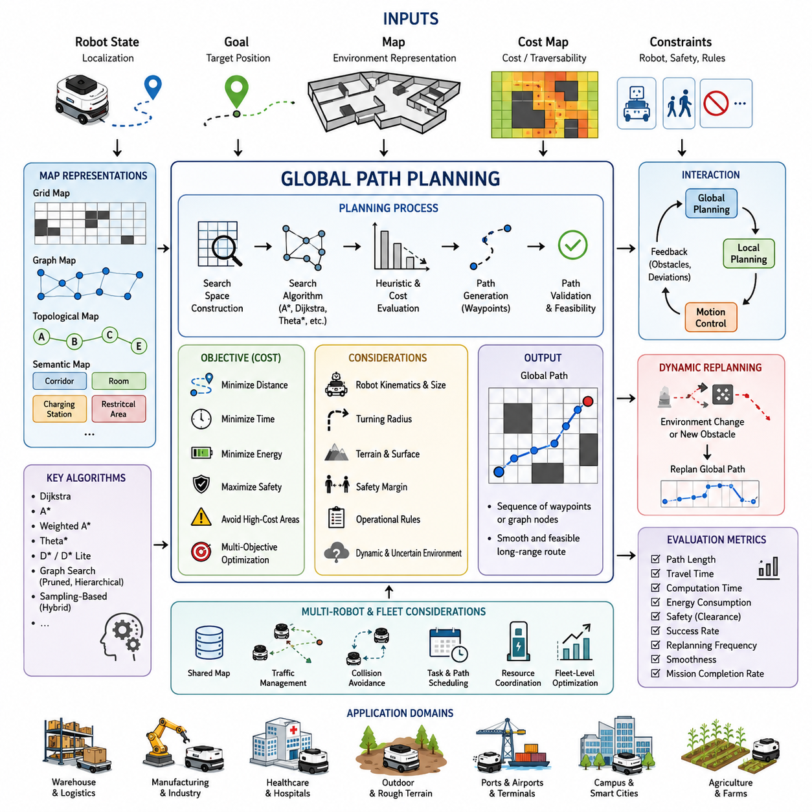
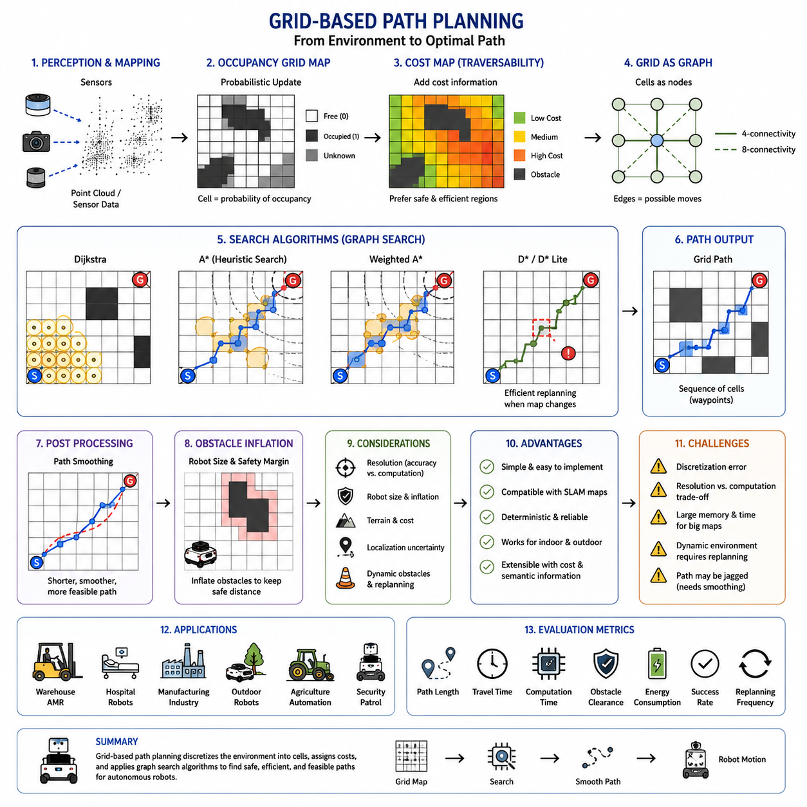
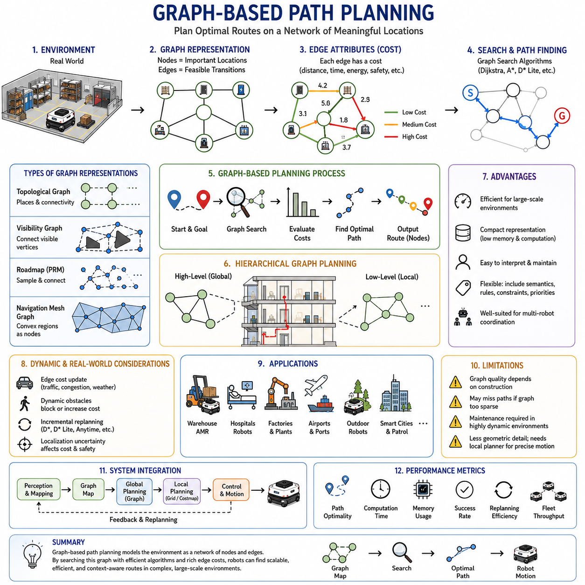
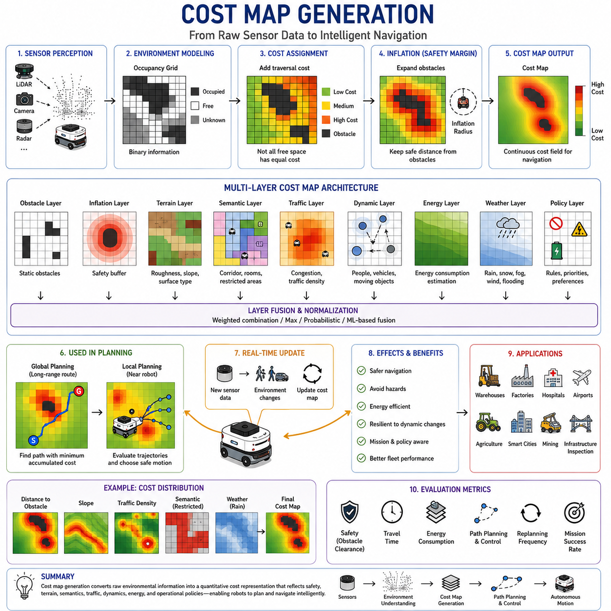
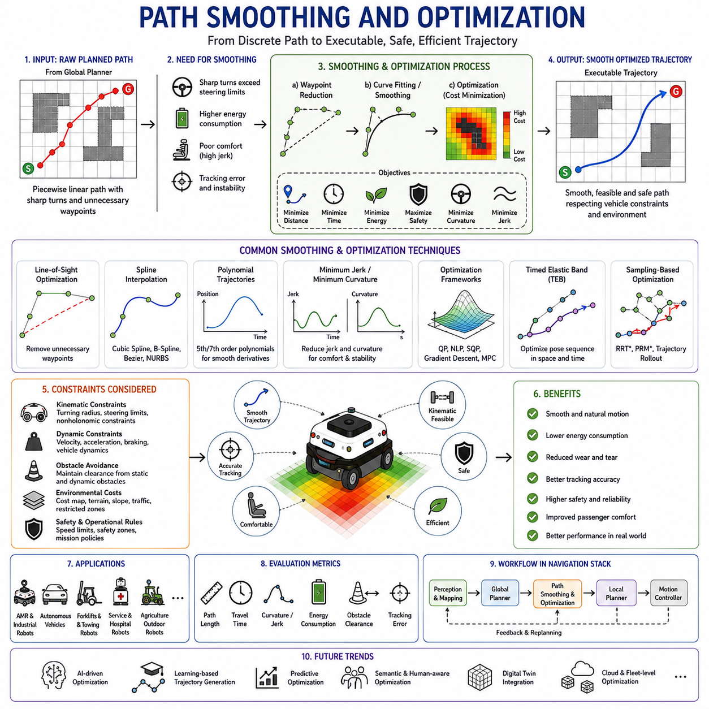
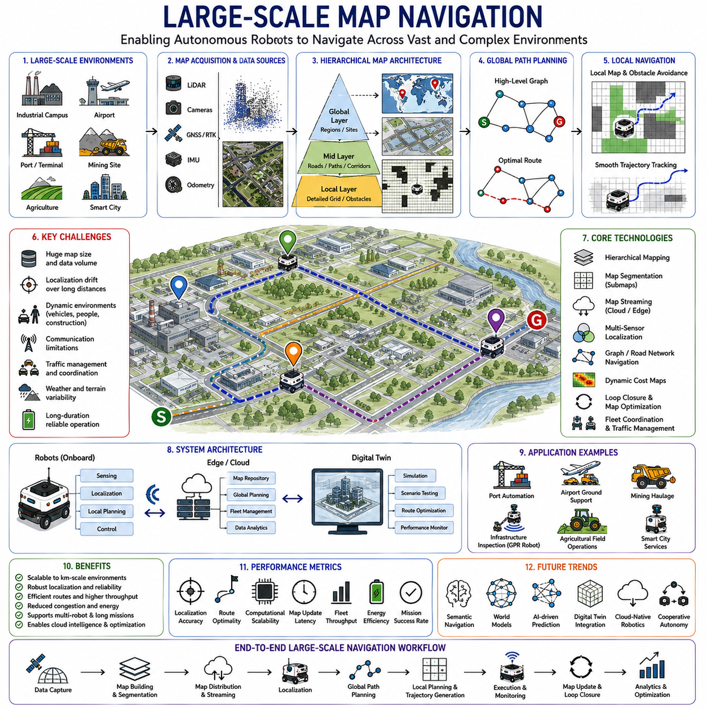
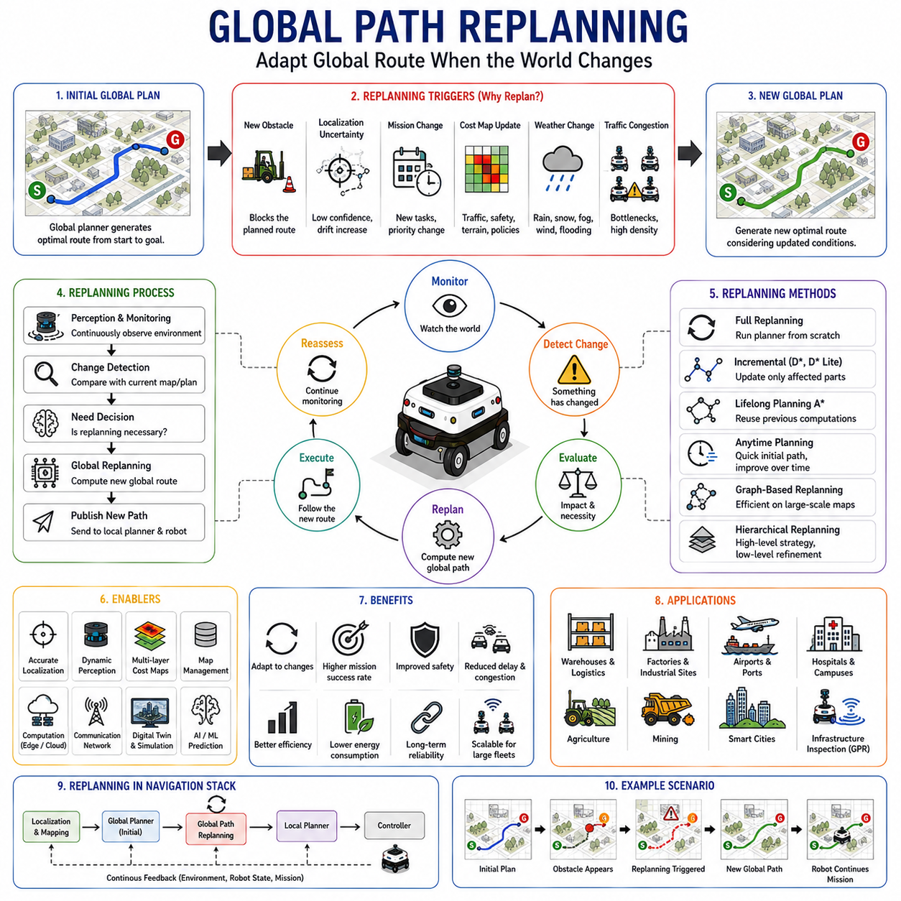
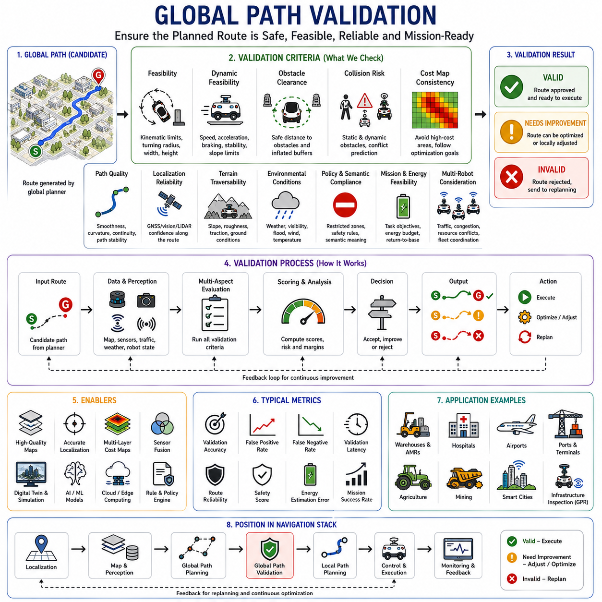

**Volume 05. Path Planning and Autonomous Navigation**


# Chapter 02. Global Path Planning

# 

##  

## 02.1 Global Path Planning Concepts

{width="7.268055555555556in" height="7.268055555555556in"}

Global path planning is one of the most fundamental capabilities in autonomous mobile robots and intelligent navigation systems. It serves as the strategic layer of navigation responsible for determining how a robot moves from its current position to a distant destination while considering the structure of the environment, operational constraints, mission objectives, and safety requirements. Within the navigation hierarchy of an autonomous robot, global path planning operates above local planning and motion control, providing a high-level route that guides the robot through known or partially known environments. In modern AMR systems, global path planning is the foundation upon which reliable autonomous navigation is built. It transforms environmental information into actionable routes that enable robots to perform transportation, inspection, delivery, patrol, surveillance, mapping, and industrial automation tasks efficiently and safely. The topic is positioned within the Global Path Planning section of the Path Planning and Autonomous Navigation volume and serves as the conceptual basis for subsequent discussions on grid-based planning, graph-based planning, cost map generation, path optimization, and replanning methodologies.

At its core, global path planning answers a simple question: how can a robot travel from a start location to a goal location through an environment while minimizing cost and avoiding obstacles? Although the question appears straightforward, solving it efficiently in real-world environments involves complex computational reasoning. A robot must interpret maps, understand navigable regions, evaluate alternative routes, predict traversal costs, and generate a path that satisfies mission objectives. Depending on the application, optimization criteria may include shortest distance, minimum travel time, lowest energy consumption, maximum safety margin, minimal terrain difficulty, or a balanced combination of several objectives.

The concept of global path planning originates from classical graph theory, operations research, artificial intelligence, and robotics. Historically, route planning problems were studied in transportation networks, logistics systems, and communication networks. Many of the mathematical foundations developed in these fields later became essential components of robotic navigation. As mobile robots evolved from structured factory environments into dynamic indoor and outdoor spaces, global path planning expanded to incorporate map representations, uncertainty modeling, environmental semantics, and real-time adaptation.

A global planner typically assumes that a map of the environment is available. This map may be generated through SLAM, obtained from CAD drawings, derived from digital twins, or downloaded from cloud-based mapping services. The map serves as a representation of navigable and non-navigable areas. Obstacles such as walls, machinery, shelves, vehicles, fences, buildings, and terrain hazards are encoded within the map so that the planner can avoid them during route generation.

Different map representations influence how global planning algorithms operate. Occupancy grids represent environments as discrete cells that indicate free space, occupied space, or unknown regions. Topological maps describe environments using nodes and connectivity relationships. Graph maps represent navigation spaces as vertices and edges. Semantic maps incorporate contextual information such as rooms, corridors, roads, charging stations, elevators, loading docks, pedestrian zones, and restricted areas. Each representation offers advantages and limitations depending on the scale and complexity of the application.

Global path planning differs significantly from local path planning. The global planner focuses on strategic route selection over long distances using complete or semi-complete environmental knowledge. The local planner operates at a shorter time horizon and reacts to immediate obstacles, dynamic changes, and motion constraints. The global planner may compute a route spanning hundreds of meters or even kilometers, while the local planner continuously adjusts motion commands over a range of only a few meters. Together, these layers form a hierarchical navigation architecture commonly used in industrial AMRs, autonomous vehicles, outdoor robots, warehouse systems, agricultural robots, and service robots.

The concept of optimality is central to global path planning. A path is considered optimal when it minimizes a defined objective function. The simplest objective is geometric distance, where the shortest route is selected. However, practical robotic systems often require more sophisticated optimization criteria. A path passing through narrow corridors may be shorter but less safe. A path crossing rough terrain may increase mechanical wear. A route through congested regions may increase travel time. Therefore, modern planners frequently use weighted cost functions that incorporate multiple factors including distance, safety, energy consumption, terrain quality, traffic density, and operational priorities.

Cost maps play a critical role in implementing these concepts. A cost map assigns numerical values to different regions of the environment. Low-cost regions represent preferred traversal areas, while high-cost regions indicate obstacles, hazards, or undesirable locations. During planning, the robot seeks routes that minimize accumulated cost rather than simply minimizing geometric distance. This approach enables robots to make intelligent decisions that align with operational objectives.

In industrial warehouse environments, global planning often emphasizes efficiency and throughput. Robots must navigate among shelves, workstations, loading zones, and charging stations while minimizing travel distance and avoiding congestion. In hospitals, planners must consider patient safety, elevator integration, restricted medical areas, and pedestrian interactions. Outdoor autonomous robots may incorporate terrain slope, weather conditions, road quality, GNSS availability, and environmental risk factors into planning decisions. Each application domain introduces unique requirements that influence planning strategies.

The planning process generally begins with localization. Before a path can be generated, the robot must estimate its position within the map. Localization systems may rely on LiDAR, cameras, GNSS, IMUs, wheel odometry, radar, or multi-sensor fusion techniques. Once the robot\'s current pose and target location are known, the planner searches the map to identify a feasible route connecting the two locations. The resulting route is typically represented as a sequence of waypoints, graph nodes, or continuous trajectories that guide subsequent navigation modules.

Search algorithms are fundamental components of global planning systems. Algorithms such as Dijkstra, A\*, Weighted A\*, Theta\*, D\*, D\* Lite, and various graph-search methods evaluate potential paths and identify optimal or near-optimal solutions. These algorithms differ in computational complexity, memory requirements, optimality guarantees, and responsiveness to environmental changes. A\* has become one of the most widely adopted methods because it efficiently balances optimality and computational performance through the use of heuristic functions.

Heuristics represent another important concept in global path planning. A heuristic estimates the remaining cost from a given position to the goal. By incorporating informed estimates into the search process, planners can significantly reduce computation time while maintaining solution quality. The effectiveness of a heuristic often determines the practical performance of a planning algorithm, especially in large-scale environments containing millions of navigable cells or graph nodes.

Scalability is a major challenge in modern robotic systems. As operational environments grow larger, planning complexity increases dramatically. A warehouse containing thousands of storage locations, a hospital spanning multiple floors, or an outdoor industrial site covering several square kilometers may contain vast navigation spaces. Efficient global planning requires hierarchical representations, graph abstraction techniques, map partitioning strategies, and computational optimization methods that allow rapid route generation despite increasing environmental complexity.

Another important concept is feasibility. A mathematically optimal route may not be physically executable by a robot. Vehicle dimensions, turning radius, wheelbase, steering mechanisms, acceleration limits, braking capabilities, payload conditions, and terrain interactions must all be considered. Therefore, practical global planners often incorporate vehicle constraints directly into the planning process. For example, an outdoor autonomous robot with a heavy payload may require wider turning paths than a compact indoor AMR. Similarly, towing robots must account for trailer dynamics and articulation constraints during route generation.

Safety considerations influence nearly every aspect of global path planning. Autonomous systems must maintain safe distances from obstacles, avoid restricted zones, comply with operational regulations, and preserve stability during navigation. Industrial environments frequently include safety corridors, pedestrian crossings, emergency access routes, and protected work areas. Cost maps and planning constraints are often designed to ensure that generated routes remain consistent with functional safety requirements and organizational policies.

Environmental uncertainty presents another challenge. Real-world maps are never perfect representations of reality. Objects may move, construction may alter layouts, temporary obstacles may appear, and sensor errors may introduce inaccuracies. Global planning systems therefore operate under varying degrees of uncertainty. Some planners assume static environments, while more advanced systems incorporate probabilistic representations and dynamic replanning capabilities. The ability to update routes in response to changing conditions is essential for maintaining operational robustness.

Global path planning also interacts closely with fleet management systems. In multi-robot environments, route selection cannot be performed independently for each robot. Shared resources such as corridors, intersections, loading stations, elevators, and charging areas require coordinated planning. Fleet-level optimization considers traffic flow, resource allocation, task priorities, and congestion management to ensure efficient operation of large robotic deployments.

Modern cloud-connected robotics platforms increasingly support distributed planning architectures. In these systems, computationally intensive planning operations may be performed on edge servers, cloud infrastructure, or centralized fleet controllers. Individual robots receive optimized routes while maintaining local autonomy for obstacle avoidance and motion control. This architecture enables large-scale deployment of autonomous systems across factories, hospitals, campuses, logistics centers, ports, airports, and smart city environments.

The emergence of AI-driven navigation introduces additional dimensions to global planning. Machine learning models can predict environmental changes, estimate traversal costs, recognize semantic context, and improve planning efficiency. Semantic navigation systems allow robots to understand concepts such as offices, hallways, entrances, storage areas, and delivery zones. Rather than planning solely through geometric spaces, future navigation systems will increasingly reason about functional and contextual relationships within environments.

Digital twins are becoming valuable tools for global path planning development and validation. Engineers can construct virtual replicas of operational environments and evaluate planning algorithms under controlled conditions. Simulation platforms enable testing across diverse scenarios, including rare edge cases that may be difficult or dangerous to reproduce in physical environments. This approach accelerates development while improving reliability and safety.

Validation of global planning performance requires quantitative metrics. Common evaluation criteria include path length, travel time, computational latency, memory utilization, energy efficiency, obstacle clearance, route smoothness, success rate, replanning frequency, and mission completion rate. Benchmarking against these metrics allows engineers to compare planning algorithms objectively and identify areas for improvement.

As autonomous systems continue to evolve, global path planning is expanding beyond traditional route generation. Future systems will integrate perception, reasoning, prediction, world modeling, and decision-making into unified navigation frameworks. Robots will not only determine where to go but also understand why certain routes are preferable, anticipate future environmental changes, coordinate with other agents, and adapt dynamically to mission objectives. Advanced planning architectures will combine classical optimization techniques with AI-based reasoning to create more intelligent, scalable, and resilient navigation systems.

In the broader context of autonomous navigation, global path planning serves as the strategic intelligence layer that transforms maps into missions and destinations into executable routes. It provides the long-range guidance necessary for safe, efficient, and autonomous operation across industrial, commercial, healthcare, logistics, agricultural, and smart city applications. Understanding the concepts underlying global path planning is therefore essential for robotics engineers, AI developers, system architects, and researchers seeking to build next-generation autonomous robotic platforms capable of operating reliably in increasingly complex environments. This conceptual foundation naturally leads to deeper exploration of grid-based methods, graph-based methods, cost map generation, optimization techniques, replanning strategies, and large-scale navigation systems that form the remainder of the Global Path Planning chapter.

글로벌 경로 계획(Global Path Planning)은 자율주행 로봇과 지능형 내비게이션 시스템의 가장 핵심적인 기능 중 하나이다. 이는 내비게이션 계층 구조에서 전략적(Strategic) 수준을 담당하며, 로봇이 현재 위치에서 목표 지점까지 이동하는 최적의 경로를 결정하는 역할을 수행한다. 이 과정에서는 환경 구조, 운영 조건, 임무 목표, 안전 요구사항 등을 종합적으로 고려한다. 자율주행 로봇의 내비게이션 시스템에서 글로벌 경로 계획은 로컬 경로 계획(Local Planning)과 모션 제어(Motion Control)의 상위 계층에 위치하며, 전체 이동 경로를 설계하는 역할을 담당한다. 현대의 AMR(Autonomous Mobile Robot) 시스템에서 글로벌 경로 계획은 신뢰성 있는 자율주행을 가능하게 하는 핵심 기술로 자리 잡고 있다. 이는 환경 정보를 실제 이동 가능한 경로로 변환하여 물류 운송, 시설 점검, 순찰, 배송, 감시, 지도 작성 및 산업 자동화 작업을 효율적이고 안전하게 수행할 수 있도록 한다.

글로벌 경로 계획의 가장 기본적인 목적은 "로봇이 시작 위치에서 목표 위치까지 장애물을 피하면서 최소 비용으로 이동할 수 있는 경로를 찾는 것"이다. 이 문제는 단순해 보이지만 실제 환경에서는 매우 복잡한 계산과 의사결정이 필요하다. 로봇은 지도를 해석하고, 이동 가능한 영역을 판단하며, 여러 경로를 비교하고, 각 경로의 비용을 평가한 뒤 최적의 경로를 선택해야 한다. 상황에 따라 최적화 목표는 최단 거리일 수도 있고, 최소 이동 시간, 최소 에너지 소비, 최대 안전성 확보, 최소 지형 위험도 또는 이들의 조합일 수도 있다.

글로벌 경로 계획의 개념은 그래프 이론(Graph Theory), 운영 연구(Operations Research), 인공지능(AI), 그리고 로보틱스 분야에서 발전해 왔다. 초기에는 물류 네트워크, 교통 시스템, 통신망 등의 경로 탐색 문제를 해결하기 위해 연구되었으며, 이후 이러한 수학적 기반이 로봇 내비게이션 기술로 확장되었다. 이동형 로봇이 단순한 공장 환경을 벗어나 복잡한 실내외 공간에서 동작하게 되면서 글로벌 경로 계획은 지도 표현, 불확실성 모델링, 환경 의미 이해(Semantics), 실시간 적응 기능 등을 포함하는 방향으로 발전하였다.

일반적으로 글로벌 경로 계획은 지도(Map)가 존재한다고 가정한다. 지도는 SLAM을 통해 생성될 수도 있고, CAD 도면이나 디지털 트윈에서 가져올 수도 있으며, 클라우드 기반 지도 서비스에서 제공받을 수도 있다. 지도는 이동 가능한 공간과 이동 불가능한 공간을 구분하여 표현한다. 벽, 기계 설비, 선반, 차량, 건물, 울타리, 지형 장애물 등은 장애물 영역으로 표시되며, 글로벌 플래너는 이러한 정보를 기반으로 안전한 이동 경로를 생성한다.

지도 표현 방식은 글로벌 경로 계획 알고리즘의 성능과 특성에 큰 영향을 미친다. 점유 격자 지도(Occupancy Grid Map)는 환경을 작은 셀(Cell) 단위로 분할하여 각 셀이 비어 있는지, 점유되어 있는지, 또는 미확인 상태인지를 표현한다. 위상 지도(Topological Map)는 공간을 노드와 연결 관계로 표현한다. 그래프 지도(Graph Map)는 정점(Vertex)과 간선(Edge) 구조를 사용하여 경로 탐색을 수행한다. 의미 지도(Semantic Map)는 단순한 공간 정보를 넘어 복도, 방, 도로, 충전소, 엘리베이터, 적재 구역, 출입 제한 구역 등 환경의 의미적 정보를 포함한다. 각 방식은 적용 환경과 요구사항에 따라 장단점을 가진다.

글로벌 경로 계획은 로컬 경로 계획과 명확히 구분된다. 글로벌 플래너는 장거리 이동을 위한 전략적 경로를 생성하며, 환경에 대한 전체 또는 부분적인 정보를 활용한다. 반면 로컬 플래너는 로봇 주변 수 미터 이내의 영역을 대상으로 동작하며, 실시간 장애물 회피와 동적 환경 대응을 담당한다. 글로벌 플래너가 수백 미터 또는 수 킬로미터에 이르는 경로를 생성한다면, 로컬 플래너는 수 초 이내의 움직임을 결정하며 경로를 지속적으로 수정한다. 이러한 계층적 구조는 산업용 AMR, 자율주행차, 실외 자율주행 로봇, 물류 로봇 및 서비스 로봇에서 널리 사용된다.

최적성(Optimality)은 글로벌 경로 계획의 핵심 개념이다. 최적 경로란 정의된 목적 함수를 최소화하는 경로를 의미한다. 가장 단순한 목적 함수는 이동 거리이다. 그러나 실제 환경에서는 단순히 짧은 경로가 항상 좋은 경로는 아니다. 좁은 통로를 통과하는 경로는 거리는 짧지만 위험할 수 있다. 거친 지형을 통과하는 경로는 장비 마모를 증가시킬 수 있다. 교통량이 많은 구역은 이동 시간을 늘릴 수 있다. 따라서 현대의 경로 계획 시스템은 거리, 안전성, 에너지 소비, 지형 품질, 교통 밀도, 작업 우선순위 등을 통합한 복합 비용 함수(Cost Function)를 사용한다.

비용 지도(Cost Map)는 이러한 최적화를 구현하는 핵심 도구이다. 비용 지도에서는 환경의 각 영역에 비용 값이 부여된다. 이동하기 좋은 구역은 낮은 비용을 가지며, 위험 지역이나 장애물 근처는 높은 비용을 가진다. 글로벌 플래너는 단순히 가장 짧은 거리를 찾는 것이 아니라 전체 비용의 합이 최소가 되는 경로를 선택한다. 이를 통해 로봇은 보다 안전하고 효율적인 의사결정을 수행할 수 있다.

산업용 창고에서는 이동 효율성과 처리량(Throughput)이 중요한 기준이 된다. 로봇은 선반, 작업장, 적재 구역, 충전소 사이를 최소 거리로 이동하면서도 교통 혼잡을 최소화해야 한다. 병원에서는 환자 안전, 엘리베이터 연동, 의료 구역 접근 제한, 보행자와의 상호작용 등을 고려해야 한다. 실외 자율주행 로봇은 경사도, 노면 상태, GNSS 신호 품질, 날씨 조건, 환경 위험도 등을 추가적으로 고려해야 한다. 이처럼 적용 분야에 따라 글로벌 경로 계획의 요구사항은 크게 달라진다.

경로 계획은 일반적으로 위치 추정(Localization) 단계 이후에 수행된다. 로봇은 먼저 자신의 위치를 지도 상에서 정확히 파악해야 한다. 이를 위해 LiDAR, 카메라, GNSS, IMU, 휠 오도메트리, 레이더 및 센서 융합 기술이 사용된다. 현재 위치와 목표 위치가 결정되면 글로벌 플래너는 두 지점을 연결하는 경로를 탐색한다. 결과 경로는 일반적으로 웨이포인트(Waypoint), 그래프 노드 또는 연속적인 경로 곡선 형태로 표현되며 이후의 내비게이션 모듈에 전달된다.

탐색 알고리즘(Search Algorithm)은 글로벌 경로 계획의 핵심 구성 요소이다. 대표적으로 Dijkstra, A\*, Weighted A\*, Theta\*, D\*, D\* Lite 등이 사용된다. 이 알고리즘들은 최적 경로를 탐색하는 방식, 계산량, 메모리 사용량, 실시간 대응 능력 측면에서 차이를 가진다. 그중 A\* 알고리즘은 휴리스틱(Heuristic)을 활용하여 탐색 속도와 최적성의 균형을 제공하기 때문에 가장 널리 사용되는 방법 중 하나이다.

휴리스틱은 현재 위치에서 목표 지점까지의 예상 비용을 의미한다. 적절한 휴리스틱을 사용하면 탐색 범위를 크게 줄일 수 있으며, 결과적으로 계산 속도가 향상된다. 특히 수백만 개 이상의 셀이나 노드로 구성된 대규모 지도에서는 휴리스틱의 성능이 전체 시스템 효율에 결정적인 영향을 미친다.

현대 로봇 시스템에서 확장성(Scalability)은 매우 중요한 과제이다. 창고, 병원, 공항, 항만, 산업 단지와 같이 넓은 환경에서는 지도 크기가 매우 커진다. 이러한 환경에서는 계층적 지도 구조, 그래프 추상화, 지도 분할 기술, 계산 최적화 기법 등이 필요하다. 이를 통해 대규모 환경에서도 빠른 경로 생성이 가능해진다.

경로의 실행 가능성(Feasibility)도 중요한 고려 요소이다. 수학적으로 최적의 경로가 반드시 실제로 주행 가능한 것은 아니다. 로봇의 크기, 회전 반경, 조향 방식, 가속도 제한, 제동 성능, 적재 상태 및 지형 특성이 고려되어야 한다. 예를 들어 대형 실외 자율주행 로봇이나 사용자가 개발 중인 F160 Heavy와 같은 중량 플랫폼은 좁은 회전 경로를 따라갈 수 없으며, 더 넓은 곡률의 경로가 필요하다. 견인형 AMR의 경우에는 트레일러의 동역학 특성까지 고려한 경로 생성이 요구된다.

안전성은 글로벌 경로 계획의 모든 단계에 영향을 미친다. 로봇은 장애물과 충분한 안전 거리를 유지해야 하며, 위험 구역을 피하고, 관련 안전 규정을 준수해야 한다. 산업 현장에서는 보행자 통로, 비상 대피 경로, 안전 구역 등이 존재하므로 경로 생성 과정에서 이러한 요소들이 반드시 반영되어야 한다.

실제 환경은 항상 불확실성을 포함한다. 지도는 현실을 완벽하게 반영하지 못하며, 물체의 이동, 공사 작업, 임시 장애물, 센서 오차 등이 발생할 수 있다. 따라서 글로벌 경로 계획 시스템은 불확실성을 고려해야 한다. 일부 시스템은 정적 환경을 가정하지만, 보다 발전된 시스템은 확률 기반 모델과 동적 재계획(Replanning) 기능을 활용하여 환경 변화에 대응한다.

다중 로봇 환경에서는 글로벌 경로 계획이 더욱 복잡해진다. 복도, 교차로, 충전소, 엘리베이터와 같은 자원은 여러 로봇이 공유해야 한다. 따라서 개별 로봇의 경로 최적화뿐만 아니라 전체 플릿(Fleet)의 교통 흐름, 작업 우선순위, 자원 할당 및 혼잡 관리까지 고려해야 한다.

최근에는 클라우드 기반 로봇 아키텍처가 확산되면서 글로벌 경로 계획도 분산 구조로 발전하고 있다. 복잡한 경로 계산은 클라우드나 엣지 서버에서 수행하고, 로봇은 결과 경로를 수신하여 주행한다. 이러한 구조는 대규모 공장, 병원, 물류 센터, 공항, 스마트 시티 등에서 수백 대 이상의 로봇을 효율적으로 운영할 수 있도록 지원한다.

인공지능 기반 내비게이션은 글로벌 경로 계획의 새로운 방향을 제시하고 있다. AI 모델은 환경 변화를 예측하고, 이동 비용을 추정하며, 의미 정보를 이해하고, 경로 품질을 향상시킬 수 있다. 미래의 로봇은 단순히 "어디로 갈 것인가"를 결정하는 수준을 넘어 "왜 그 경로가 더 적합한가"를 이해하고 설명할 수 있는 수준으로 발전할 것이다.

디지털 트윈 기술은 글로벌 경로 계획의 개발과 검증에 중요한 역할을 하고 있다. 실제 환경의 가상 복제본을 생성하여 다양한 시나리오를 시험할 수 있으며, 위험하거나 드문 상황도 안전하게 검증할 수 있다. 이를 통해 개발 기간을 단축하고 시스템 신뢰성을 향상시킬 수 있다.

글로벌 경로 계획의 성능 평가는 경로 길이, 이동 시간, 계산 지연 시간, 메모리 사용량, 에너지 효율, 장애물 이격 거리, 경로 부드러움, 성공률, 재계획 빈도, 임무 완료율 등의 지표를 기반으로 수행된다. 이러한 지표들은 알고리즘 비교와 시스템 개선의 기준이 된다.

미래의 글로벌 경로 계획은 단순한 경로 생성 기능을 넘어 지각, 추론, 예측, 월드 모델(World Model), 의사결정 기능과 통합될 것이다. 로봇은 환경 변화를 예측하고, 다른 로봇과 협력하며, 임무 목표에 따라 스스로 전략을 수정하는 수준으로 발전할 것이다. 전통적인 최적화 기법과 AI 기반 추론 기술이 결합되면서 더욱 지능적이고 확장 가능하며 강인한 내비게이션 시스템이 등장할 것으로 예상된다.

결국 글로벌 경로 계획은 지도 정보를 실제 임무 수행 경로로 변환하는 전략적 지능 계층이다. 이는 산업용 AMR, 물류 로봇, 병원 서비스 로봇, 실외 자율주행 로봇, 농업 로봇, 스마트 시티 로봇 등 다양한 분야에서 안전하고 효율적인 자율주행을 가능하게 하는 핵심 기술이다. 글로벌 경로 계획의 개념을 이해하는 것은 향후 다루게 될 Grid-Based Planning, Graph-Based Planning, Cost Map Generation, Path Optimization, Global Replanning 등 모든 고급 경로 계획 기술을 이해하기 위한 필수적인 기초가 된다.

##  

## 02.2 Grid-Based Path Planning

{width="7.268055555555556in" height="7.268055555555556in"}

Grid-Based Path Planning is one of the most fundamental and widely adopted approaches in autonomous robot navigation. It provides a structured method for representing environments and computing feasible routes between a start location and a destination. The approach is particularly important because it serves as the foundation for many classical path planning algorithms, including Dijkstra, A\*, Weighted A\*, Theta\*, D\*, and numerous variants that have become standard components of modern autonomous mobile robot systems. In both academic research and industrial applications, grid-based planning remains a dominant methodology due to its simplicity, robustness, and compatibility with occupancy maps generated by SLAM systems. Within the broader navigation architecture of an AMR, grid-based path planning forms a critical bridge between environmental perception and autonomous decision-making.

The central concept behind grid-based path planning is the discretization of the environment into a collection of uniformly sized cells. Instead of representing space as a continuous geometric area, the environment is divided into a two-dimensional or three-dimensional lattice where each cell contains information about its occupancy state. A cell may represent free space, occupied space, unknown space, or a cost value associated with traversing that location. This discretized representation transforms a continuous navigation problem into a graph search problem, enabling the use of efficient computational algorithms for route generation.

Grid maps are particularly attractive because they can be directly generated from sensor data. LiDAR scans, depth cameras, radar systems, stereo vision sensors, and SLAM algorithms naturally produce occupancy information that can be stored within a grid structure. Each cell becomes a compact representation of environmental knowledge. As a result, grid maps provide a universal framework for integrating perception, mapping, localization, obstacle avoidance, and path planning into a unified navigation system.

The process begins with environmental sensing. Sensors collect information about surrounding objects and free space. The data is then converted into an occupancy grid map where each cell contains a probability indicating whether the area is occupied by an obstacle. Probabilistic occupancy mapping is particularly useful because sensor measurements inherently contain uncertainty. Instead of classifying cells as simply occupied or free, probabilistic approaches maintain confidence values that improve map reliability and support more robust planning decisions.

Grid resolution plays a crucial role in planning performance. A high-resolution grid contains small cells and provides detailed environmental representation. Such maps can accurately capture narrow passages, small obstacles, and complex geometries. However, higher resolution significantly increases memory consumption and computational requirements. A low-resolution grid reduces computational burden but may fail to represent critical environmental details. Selecting an appropriate grid size requires balancing accuracy, computational efficiency, and operational requirements.

For indoor AMRs operating in warehouses, hospitals, and factories, grid resolutions between five and twenty centimeters are commonly used. These values provide sufficient accuracy while maintaining real-time planning performance. Outdoor autonomous robots often employ larger cell sizes because they operate in expansive environments where computational scalability becomes more important than fine geometric detail. In large industrial sites, agricultural fields, mining areas, and infrastructure inspection applications, cell sizes ranging from twenty centimeters to several meters may be appropriate depending on the mission objectives.

Once the environment has been discretized, each grid cell can be interpreted as a node within a graph. Neighboring cells are connected through edges that represent possible movements. The resulting graph structure allows classical search algorithms to compute optimal routes. Four-connectivity and eight-connectivity are the most common neighborhood configurations in two-dimensional planning. Four-connectivity allows movement only in horizontal and vertical directions, while eight-connectivity additionally permits diagonal motion. The choice affects path quality, computational complexity, and motion realism.

The concept of traversability is fundamental in grid-based planning. Not all free cells are equally desirable for navigation. A cell located near an obstacle may be technically traversable but poses greater collision risk. Similarly, uneven terrain, slippery surfaces, steep slopes, pedestrian zones, and restricted areas may require special consideration. Therefore, modern grid-based systems often augment occupancy information with traversal costs. These costs influence path selection and enable the planner to generate safer and more efficient routes.

Cost maps extend the occupancy grid concept by assigning numerical penalties to individual cells. Low-cost cells represent preferred travel areas, while high-cost cells indicate undesirable regions. The global planner attempts to minimize the accumulated cost of the route rather than merely minimizing geometric distance. This capability allows robots to maintain safe distances from obstacles, avoid congested regions, reduce energy consumption, and comply with operational constraints.

Obstacle inflation is another essential concept. Robots possess physical dimensions and cannot be treated as point objects. To account for vehicle size, occupancy maps are often expanded through an inflation process. Cells surrounding obstacles are assigned elevated costs or marked as non-traversable. The inflation radius depends on robot dimensions, localization uncertainty, sensor accuracy, and required safety margins. Proper inflation ensures that generated paths remain executable under real-world operating conditions.

Grid-based path planning provides several important advantages. One of its greatest strengths is simplicity. The underlying data structures are easy to understand, implement, debug, and maintain. This simplicity has contributed to widespread adoption across robotics platforms ranging from educational robots to industrial AMRs and autonomous vehicles. Another advantage is compatibility with diverse sensor technologies and mapping systems. Since occupancy grids can be generated from virtually any perception modality, grid-based planners are highly adaptable to different environments and operational requirements.

The method also offers deterministic behavior. Given the same map, start location, and goal location, a grid-based planner consistently generates the same solution. Deterministic planning is particularly valuable in safety-critical industrial applications where predictability and repeatability are essential. Validation, certification, and debugging activities become more manageable when navigation behavior remains consistent across repeated trials.

Despite these strengths, grid-based planning introduces several challenges. The most significant limitation arises from discretization itself. Continuous environments are approximated by discrete cells, introducing representation errors. Narrow corridors may disappear if grid resolution is too coarse. Obstacle boundaries become stair-stepped approximations rather than smooth curves. Consequently, generated paths may contain unnecessary turns and geometric artifacts that require post-processing before execution.

Path smoothness is therefore an important consideration. Classical grid search algorithms often produce jagged routes consisting of multiple directional changes. While mathematically valid, such paths may not be suitable for physical robots. Excessive steering activity increases mechanical wear, energy consumption, and trajectory tracking errors. Path smoothing algorithms are commonly applied after route generation to create more continuous and dynamically feasible trajectories.

Computational complexity represents another challenge. Large environments can contain millions of cells. Search algorithms must evaluate numerous candidate paths before identifying an optimal solution. As map size increases, memory usage and computation time grow significantly. Hierarchical planning methods, map partitioning strategies, multiresolution grids, and heuristic search algorithms have been developed to address scalability limitations.

Dynamic environments introduce additional complexity. Traditional grid-based planning assumes static maps. However, real-world environments continuously change as people, vehicles, machinery, and temporary obstacles move through operational spaces. Dynamic obstacle integration requires planners to update occupancy information and re-evaluate routes whenever significant environmental changes occur. This capability is commonly referred to as replanning.

Incremental planning methods have emerged to support efficient replanning. Instead of recomputing an entire route from scratch, these algorithms update only affected portions of the search space. Techniques such as D\* and D\* Lite are particularly effective in environments where map changes occur frequently. They enable robots to adapt to evolving conditions while maintaining real-time navigation performance.

Grid-based planning is closely connected to robot localization. The planner assumes that the robot\'s position within the grid is known with reasonable accuracy. Localization errors can cause deviations between planned and actual trajectories. Consequently, modern navigation systems integrate localization confidence measures into planning processes. Areas with high localization uncertainty may receive elevated traversal costs to reduce navigation risk.

The approach is equally applicable to indoor and outdoor environments. Indoor facilities typically provide structured layouts consisting of corridors, rooms, workstations, shelves, and charging stations. Grid representations effectively capture these geometries and support reliable route generation. Outdoor environments present additional challenges including vegetation, rough terrain, GNSS uncertainty, weather effects, and changing surface conditions. Nevertheless, grid-based methods remain widely used because they can incorporate environmental costs and terrain information directly into map representations.

For outdoor autonomous robots performing infrastructure inspection, agricultural automation, security patrol, mining operations, or smart city services, grid maps may include elevation information, terrain classifications, slope estimates, vegetation density, soil characteristics, and weather-related hazards. Such enriched grid representations enable robots to select routes that balance safety, efficiency, and operational effectiveness.

Multi-layer grid maps further enhance planning capabilities. Instead of storing a single occupancy value per cell, advanced systems maintain multiple information layers. One layer may contain obstacle data, another may store terrain characteristics, while additional layers represent traffic density, semantic information, safety restrictions, or energy consumption estimates. The planner combines these layers to generate context-aware navigation strategies.

Semantic grid maps represent an important evolution of traditional occupancy grids. In addition to geometric information, cells may contain semantic labels such as corridor, office, warehouse aisle, charging zone, pedestrian area, restricted zone, loading dock, or emergency exit. These labels allow planners to incorporate contextual reasoning into route selection. For example, a hospital robot may prioritize public corridors while avoiding sensitive clinical areas whenever possible.

Grid-based planning also serves as a foundation for fleet-level navigation. In environments containing multiple robots, shared grid maps provide a common representation for traffic management and coordination. Fleet management systems can reserve cells, predict congestion, coordinate route assignments, and optimize overall traffic flow. Such capabilities are increasingly important in large-scale warehouse automation, hospital logistics systems, manufacturing facilities, airports, and distribution centers.

Simulation plays a major role in the development and validation of grid-based planning systems. Platforms such as ROS 2 Navigation Stack, Gazebo, Isaac Sim, and digital twin environments allow engineers to evaluate planning performance under controlled conditions. Simulated environments facilitate testing across thousands of scenarios, including rare edge cases that may be difficult to reproduce in physical deployments. Through simulation, planners can be benchmarked for computational efficiency, path quality, obstacle avoidance effectiveness, safety margins, and mission success rates.

Performance evaluation typically focuses on several key metrics. Path length measures route efficiency. Travel time evaluates operational productivity. Computation latency assesses responsiveness. Path smoothness reflects motion quality. Obstacle clearance indicates safety performance. Energy consumption estimates operational efficiency. Success rate measures navigation reliability. Replanning frequency reflects environmental adaptability. Together, these metrics provide a comprehensive assessment of planner effectiveness.

Recent advances in artificial intelligence are expanding the capabilities of grid-based planning systems. Machine learning models can predict environmental changes, estimate traversal costs, infer semantic information, and improve search efficiency. Hybrid architectures combine classical graph-search algorithms with AI-based prediction systems, leveraging the strengths of both approaches. Rather than replacing grid-based planning, AI increasingly acts as an enhancement layer that improves decision quality and adaptability.

Future grid-based path planning systems will likely become more hierarchical, semantic, predictive, and collaborative. Multi-resolution maps will support large-scale environments while maintaining local detail. Semantic reasoning will enable context-aware navigation. Predictive models will anticipate future obstacles and traffic conditions. Fleet-wide optimization will coordinate hundreds or thousands of robots simultaneously. Integration with digital twins, cloud robotics, embodied AI, and world models will further transform how autonomous systems understand and navigate their environments.

Grid-based path planning remains one of the most important technologies in autonomous navigation because it provides a practical balance between mathematical rigor, computational efficiency, implementation simplicity, and operational reliability. It forms the conceptual and technological foundation for many modern navigation systems and continues to evolve alongside advances in robotics, artificial intelligence, sensor technology, and autonomous mobility. Understanding grid-based planning is therefore essential for robotics engineers, navigation developers, AI researchers, and system architects seeking to design robust and scalable autonomous robot platforms capable of operating effectively in real-world environments.

격자 기반 경로 계획(Grid-Based Path Planning)은 자율주행 로봇 내비게이션 분야에서 가장 널리 사용되는 경로 계획 방법 중 하나이다. 이 방법은 환경을 구조적으로 표현하고 시작 위치에서 목표 위치까지 이동 가능한 경로를 계산하기 위한 체계적인 접근법을 제공한다. 특히 Dijkstra, A\*, Weighted A\*, Theta\*, D\*와 같은 대표적인 경로 탐색 알고리즘들의 기반이 되는 기술로서 중요한 의미를 가진다. 학계뿐만 아니라 산업용 자율주행 로봇 분야에서도 광범위하게 사용되고 있으며, 단순성, 안정성, 그리고 SLAM 기반 점유 지도(Occupancy Map)와의 높은 호환성 덕분에 현대 AMR 시스템의 핵심 기술로 자리 잡고 있다. 자율주행 시스템 전체 구조에서 격자 기반 경로 계획은 환경 인식과 자율 의사결정을 연결하는 중요한 역할을 수행한다.

격자 기반 경로 계획의 핵심 개념은 환경을 일정한 크기의 셀(Cell)로 분할하는 것이다. 연속적인 공간을 그대로 사용하는 대신 환경을 작은 격자 구조로 나누어 각 셀에 정보를 저장한다. 각 셀은 자유 공간(Free Space), 장애물(Occupied Space), 미확인 공간(Unknown Space), 또는 특정 이동 비용(Cost)을 나타낼 수 있다. 이러한 공간 이산화(Discretization)를 통해 연속적인 경로 계획 문제를 그래프 탐색 문제로 변환할 수 있으며, 효율적인 탐색 알고리즘을 적용할 수 있게 된다.

격자 지도(Grid Map)는 센서 데이터를 직접 반영할 수 있다는 점에서 매우 유용하다. LiDAR, 깊이 카메라, 레이더, 스테레오 카메라, SLAM 시스템 등에서 생성되는 환경 정보를 그대로 격자 구조에 저장할 수 있다. 각 셀은 주변 환경에 대한 정보를 압축하여 표현하는 단위가 되며, 결과적으로 격자 지도는 인지(Perception), 지도 작성(Mapping), 위치 추정(Localization), 장애물 회피(Obstacle Avoidance), 경로 계획(Path Planning)을 하나의 통합된 프레임워크 안에서 연결할 수 있게 해준다.

격자 지도의 생성은 환경 인식으로부터 시작된다. 센서가 수집한 데이터를 바탕으로 각 셀에 장애물이 존재할 확률을 저장한다. 이를 점유 확률 지도(Probabilistic Occupancy Grid Map)라고 한다. 실제 센서는 항상 오차를 포함하고 있으므로 셀을 단순히 장애물 또는 비장애물로 구분하는 것보다 확률값을 저장하는 방식이 훨씬 안정적이다. 이러한 확률 기반 표현은 센서 노이즈에 강하며 더욱 신뢰성 있는 경로 계획을 가능하게 한다.

격자의 해상도(Grid Resolution)는 경로 계획 성능에 매우 큰 영향을 준다. 작은 셀을 사용하는 고해상도 지도는 복잡한 구조와 작은 장애물을 정확하게 표현할 수 있다. 좁은 통로와 복잡한 환경을 세밀하게 표현할 수 있다는 장점이 있다. 하지만 셀 개수가 급격히 증가하여 메모리 사용량과 계산량이 크게 늘어난다. 반대로 큰 셀을 사용하는 저해상도 지도는 계산 효율이 높지만 환경을 세밀하게 표현하지 못할 수 있다. 따라서 적절한 해상도를 선택하는 것은 정확도와 계산 효율성 사이의 균형 문제이다.

창고, 병원, 공장과 같은 실내 AMR 환경에서는 일반적으로 5cm에서 20cm 정도의 셀 크기가 사용된다. 이러한 크기는 충분한 위치 정확도를 제공하면서도 실시간 경로 계획이 가능하도록 한다. 반면 농업용 로봇, 인프라 점검 로봇, 광산 로봇, 스마트 시티 로봇과 같은 실외 환경에서는 수십 센티미터에서 수 미터 수준의 셀 크기가 사용되기도 한다. 실외 환경은 매우 넓기 때문에 계산 효율성이 더욱 중요해지기 때문이다.

환경이 격자로 표현되면 각 셀은 그래프의 노드(Node)로 간주될 수 있다. 인접한 셀들은 간선(Edge)으로 연결되며, 이를 기반으로 탐색 알고리즘이 최적 경로를 찾는다. 일반적으로 4방향 연결(Four Connectivity)과 8방향 연결(Eight Connectivity)이 사용된다. 4방향 연결은 상하좌우 이동만 허용하며, 8방향 연결은 대각선 이동까지 허용한다. 연결 방식에 따라 경로의 품질과 계산량이 달라질 수 있다.

이동 가능성(Traversability)은 격자 기반 경로 계획의 중요한 개념이다. 모든 자유 공간이 동일하게 좋은 경로는 아니다. 장애물 근처 셀은 통과 가능하더라도 충돌 위험이 높다. 또한 경사로, 미끄러운 노면, 거친 지형, 보행자 구역, 제한 구역 등은 특별한 고려가 필요하다. 따라서 현대의 경로 계획 시스템은 단순한 점유 정보뿐만 아니라 이동 비용 정보를 함께 사용한다.

비용 지도(Cost Map)는 점유 지도를 확장한 개념이다. 각 셀에 이동 비용을 부여하여 경로 탐색 시 고려하도록 만든다. 비용이 낮은 셀은 선호되는 영역이며, 비용이 높은 셀은 회피가 필요한 영역이다. 글로벌 플래너는 단순히 가장 짧은 경로를 찾는 것이 아니라 누적 비용이 최소가 되는 경로를 탐색한다. 이를 통해 장애물과 충분한 거리를 유지하고, 혼잡 지역을 피하며, 에너지 소비를 줄이고, 운영 정책을 반영할 수 있다.

장애물 팽창(Obstacle Inflation)은 실제 로봇의 크기를 고려하기 위한 필수 과정이다. 경로 계획 알고리즘은 로봇을 점(Point)으로 취급하지만 실제 로봇은 폭과 길이를 가진다. 따라서 장애물 주변 셀에 추가 비용을 부여하거나 통행 불가능한 영역으로 확장하여 로봇의 물리적 크기를 반영한다. 팽창 반경은 로봇 크기, 위치 오차, 센서 오차 및 안전 거리 요구사항에 따라 결정된다. 적절한 장애물 팽창은 실제 환경에서 안전하게 주행할 수 있는 경로를 생성하는 데 필수적이다.

격자 기반 경로 계획의 가장 큰 장점은 단순성과 직관성이다. 데이터 구조가 이해하기 쉽고 구현이 간단하며 디버깅과 유지보수가 용이하다. 이러한 이유로 교육용 로봇부터 대형 산업용 AMR까지 매우 폭넓게 사용된다. 또한 다양한 센서와 높은 호환성을 제공하기 때문에 환경에 관계없이 적용할 수 있다는 장점이 있다.

또 다른 장점은 결정론적(Deterministic) 특성이다. 동일한 지도와 시작점 및 목표점이 주어지면 항상 동일한 결과를 생성한다. 이러한 특성은 안전성이 중요한 산업 현장에서 매우 유용하다. 반복 시험과 검증이 가능하며 시스템 인증 과정에서도 유리하다.

반면 격자 기반 경로 계획에는 몇 가지 한계도 존재한다. 가장 큰 문제는 공간을 셀 단위로 근사화한다는 점이다. 실제 환경은 연속적이지만 격자는 이를 단순화하여 표현한다. 해상도가 낮을 경우 좁은 통로가 사라질 수 있으며, 장애물 경계가 계단 형태로 표현된다. 따라서 생성된 경로는 종종 불필요한 방향 전환과 비효율적인 움직임을 포함하게 된다.

이러한 문제를 해결하기 위해 경로 평활화(Path Smoothing)가 사용된다. 탐색 알고리즘이 생성한 경로를 후처리하여 부드러운 곡선 형태로 변환한다. 부드러운 경로는 조향 동작을 줄이고 에너지 소비를 감소시키며 경로 추종 성능을 향상시킨다.

계산 복잡성 또한 중요한 문제이다. 대규모 환경에서는 수백만 개 이상의 셀이 존재할 수 있으며, 탐색 알고리즘은 많은 후보 경로를 평가해야 한다. 이에 따라 메모리 사용량과 계산 시간이 증가한다. 이를 해결하기 위해 계층적 경로 계획(Hierarchical Planning), 다중 해상도 지도(Multi-Resolution Map), 지도 분할(Map Partitioning), 휴리스틱 탐색 기법 등이 활용된다.

동적 환경은 또 다른 도전 과제이다. 전통적인 격자 기반 경로 계획은 정적 환경을 가정한다. 그러나 실제 환경에서는 사람, 차량, 장비, 임시 장애물이 지속적으로 이동한다. 따라서 경로 계획 시스템은 환경 변화에 따라 지도를 갱신하고 경로를 다시 계산해야 한다. 이러한 기능을 재계획(Replanning)이라고 한다.

재계획을 효율적으로 수행하기 위해 증분 탐색(Incremental Planning) 기법이 사용된다. D와 D Lite 알고리즘은 전체 경로를 처음부터 다시 계산하지 않고 변경된 영역만 업데이트한다. 이를 통해 동적 환경에서도 실시간 성능을 유지할 수 있다.

격자 기반 경로 계획은 위치 추정(Localization)과도 밀접하게 연결되어 있다. 경로 계획기는 로봇의 위치가 정확히 알려져 있다고 가정한다. 만약 위치 오차가 커지면 실제 이동 경로와 계획 경로 간의 차이가 발생할 수 있다. 따라서 현대의 내비게이션 시스템은 위치 추정 신뢰도를 고려하여 경로 비용을 조정하기도 한다.

실내 환경에서는 복도, 방, 작업 공간, 선반, 충전소 등을 격자로 효과적으로 표현할 수 있다. 실외 환경에서는 여기에 더하여 지형 정보, 경사도, GNSS 품질, 기상 조건 등을 포함할 수 있다. 특히 실외 자율주행 로봇에서는 고도(Elevation), 토양 상태, 식생 밀도, 지형 난이도와 같은 추가 정보가 포함된 격자 지도가 자주 사용된다.

고급 시스템에서는 다층 격자 지도(Multi-Layer Grid Map)를 사용한다. 하나의 셀에 단순 점유 정보만 저장하는 것이 아니라 장애물 정보, 지형 정보, 교통량 정보, 안전 구역 정보, 에너지 비용 정보 등을 각각의 레이어로 저장한다. 글로벌 플래너는 이러한 정보를 종합하여 더욱 지능적인 경로를 생성한다.

의미 기반 격자 지도(Semantic Grid Map)는 최근 중요한 연구 분야이다. 각 셀에 복도, 사무실, 창고 통로, 충전 구역, 보행자 구역, 위험 구역 등의 의미 정보를 추가한다. 이를 통해 로봇은 단순히 이동 가능한 경로를 찾는 것이 아니라 환경의 맥락(Context)을 이해하면서 경로를 계획할 수 있다.

격자 기반 경로 계획은 다중 로봇 시스템에서도 중요한 역할을 수행한다. 여러 대의 로봇이 동일한 지도를 공유하면서 이동할 경우 플릿 관리 시스템은 각 셀의 점유 상태를 관리하고 교통 혼잡을 예측하며 충돌을 방지할 수 있다. 이러한 기능은 대규모 물류 창고, 병원, 공장, 공항 등의 운영에서 필수적이다.

시뮬레이션은 격자 기반 경로 계획의 개발과 검증에 중요한 역할을 한다. ROS 2 Navigation Stack, Gazebo, Isaac Sim, 디지털 트윈 플랫폼 등을 이용하면 수천 개의 시나리오를 시험할 수 있다. 실제 환경에서 발생하기 어려운 극단적인 상황도 안전하게 검증할 수 있으며, 이를 통해 시스템 신뢰성을 향상시킬 수 있다.

성능 평가는 경로 길이, 이동 시간, 계산 지연 시간, 경로 부드러움, 장애물 이격 거리, 에너지 소비량, 성공률, 재계획 빈도, 임무 완료율 등의 지표를 사용하여 수행된다. 이러한 지표는 알고리즘 간 비교와 시스템 최적화의 기준이 된다.

최근 인공지능 기술은 격자 기반 경로 계획을 더욱 발전시키고 있다. AI는 환경 변화를 예측하고, 이동 비용을 추정하며, 의미 정보를 자동으로 생성하고, 탐색 효율을 향상시킬 수 있다. 미래의 시스템은 전통적인 그래프 탐색 알고리즘과 AI 기반 예측 모델을 결합한 하이브리드 구조로 발전할 것으로 예상된다.

앞으로의 격자 기반 경로 계획은 더욱 계층적이고 의미 기반이며 예측 중심적인 방향으로 발전할 것이다. 다중 해상도 지도는 대규모 환경과 세밀한 환경 표현을 동시에 지원할 것이며, 의미 정보는 상황 인식 기반 의사결정을 가능하게 할 것이다. 또한 클라우드 로보틱스, 디지털 트윈, Embodied AI, World Model과의 통합을 통해 수백 대 이상의 로봇이 협력하는 대규모 자율주행 시스템으로 발전할 것으로 기대된다.

결론적으로 격자 기반 경로 계획은 수학적 안정성, 구현 용이성, 계산 효율성, 높은 신뢰성을 균형 있게 제공하는 가장 실용적인 경로 계획 기술 중 하나이다. 현대 자율주행 로봇 시스템의 핵심 기반 기술이며, 향후에도 다양한 AI 및 자율주행 기술과 결합하여 지속적으로 발전할 것으로 예상된다. 로봇 개발자, 내비게이션 엔지니어, AI 연구자, 시스템 설계자에게 격자 기반 경로 계획은 반드시 이해해야 할 필수 기술이라고 할 수 있다.

##  

## 02.3 Graph-Based Path Planning

{width="7.268055555555556in" height="7.268055555555556in"}

Graph-Based Path Planning is one of the most important methodologies in autonomous robot navigation and intelligent transportation systems. Unlike grid-based approaches that discretize the environment into uniformly sized cells, graph-based planning represents the environment as a collection of interconnected nodes and edges. This representation provides a more compact and computationally efficient abstraction of navigable space, making it particularly suitable for large-scale environments, structured facilities, transportation networks, and complex robotic systems. Graph-based planning forms the mathematical foundation of many modern navigation architectures and is widely used in autonomous mobile robots, autonomous vehicles, warehouse automation systems, fleet management platforms, service robots, and outdoor autonomous machines.

The fundamental idea behind graph-based path planning is to model the environment as a graph. A graph consists of vertices, commonly referred to as nodes, and connections between those nodes known as edges. Each node represents a meaningful location within the environment, while edges represent feasible transitions between locations. The planning problem then becomes a graph search problem in which the objective is to find an optimal sequence of nodes connecting the start location to the goal location.

Graph representations offer significant advantages over dense grid maps. Rather than evaluating every small region of space, graph-based planners focus only on strategically important locations. This dramatically reduces memory requirements and computational complexity, particularly in large environments. For example, a warehouse occupying tens of thousands of square meters may require millions of grid cells but only hundreds or thousands of graph nodes. This reduction enables efficient route planning while preserving essential navigation information.

The concept of graph representation originates from graph theory, one of the most important branches of discrete mathematics. Graph theory provides a formal framework for modeling connectivity, relationships, and movement through structured spaces. Many path planning algorithms used in robotics today are direct applications of graph-theoretical principles originally developed for transportation networks, communication systems, logistics optimization, and operations research.

Nodes serve as the primary building blocks of graph-based navigation. A node may represent a room, corridor intersection, doorway, charging station, loading dock, waypoint, inspection point, parking location, or any other meaningful position within an environment. The selection of node locations significantly influences navigation performance. Too few nodes may oversimplify the environment and limit path quality, while too many nodes can increase computational burden and reduce the advantages of graph abstraction.

Edges define how nodes are connected. Each edge represents a feasible path segment between two locations. Edges may contain various attributes such as distance, travel time, energy cost, terrain difficulty, safety level, traffic density, or operational constraints. By incorporating these attributes into planning calculations, graph-based systems can optimize routes according to diverse mission objectives rather than simply minimizing geometric distance.

The weight assigned to an edge plays a critical role in route selection. Edge weights represent traversal costs and influence how search algorithms evaluate alternative paths. In the simplest case, edge weights correspond to physical distance. More advanced systems incorporate additional factors such as energy consumption, vehicle dynamics, terrain quality, congestion levels, safety margins, weather conditions, or business priorities. The resulting weighted graph provides a flexible framework for multi-objective optimization.

Graph construction is one of the most important aspects of graph-based path planning. Several approaches can be used to generate navigation graphs. Manual graph creation is common in structured industrial facilities where engineers define navigation routes and connectivity relationships. Automated graph generation techniques derive graphs from occupancy maps, SLAM outputs, CAD drawings, digital twins, or sensor data. Hybrid approaches combine human expertise with automated processing to achieve optimal results.

Topological maps represent one of the most common forms of graph-based navigation. In topological mapping, nodes correspond to significant places and edges describe connectivity between those places. Unlike metric maps that focus on precise geometric coordinates, topological maps emphasize relationships and accessibility. This abstraction allows efficient navigation in environments where exact spatial detail is less important than connectivity structure.

Visibility graphs constitute another important graph representation. In a visibility graph, nodes are placed at obstacle vertices and edges connect nodes that can directly see each other without obstruction. Visibility graphs often produce near-optimal shortest paths in polygonal environments. However, they can become computationally expensive in highly complex scenes containing numerous obstacles.

Roadmap-based planning methods extend graph concepts further. Probabilistic Roadmaps, commonly known as PRMs, construct graphs by randomly sampling navigable space and connecting feasible configurations. These methods are particularly effective in high-dimensional planning problems involving robotic manipulators, articulated vehicles, and complex motion constraints. Once a roadmap has been constructed, multiple planning queries can be answered efficiently using graph search techniques.

Navigation meshes represent another graph-oriented approach frequently used in robotics and simulation environments. Rather than representing space as grids, navigation meshes partition free space into convex regions. Each region becomes a node within a navigation graph. This representation often produces smoother and more natural paths while reducing memory requirements compared to occupancy grids.

Graph-based planning naturally supports hierarchical navigation architectures. Large environments can be represented using multiple graph layers. High-level graphs describe connectivity between buildings, floors, sectors, or operational zones. Lower-level graphs provide detailed navigation within local regions. Hierarchical planning significantly improves scalability by reducing the search space associated with long-distance route planning.

Search algorithms are central components of graph-based planning systems. Dijkstra's algorithm remains one of the most fundamental approaches. It systematically explores the graph and guarantees identification of the shortest path in weighted graphs with non-negative edge costs. Although computationally robust, Dijkstra's algorithm may become inefficient in large environments because it explores many unnecessary nodes.

The A\* algorithm improves efficiency by incorporating heuristic estimates of remaining travel cost. Rather than treating all nodes equally, A\* prioritizes nodes that appear closer to the goal. This heuristic guidance significantly reduces computational effort while preserving optimality under appropriate conditions. As a result, A\* has become one of the most widely deployed algorithms in autonomous navigation systems.

Weighted A\*, Theta\*, D\*, D\* Lite, Anytime Repairing A\*, Lifelong Planning A\*, and numerous other variants further extend graph-search capabilities. These algorithms address challenges such as dynamic environments, real-time replanning, computational constraints, and large-scale deployments. Their continued evolution reflects the growing complexity of modern autonomous systems.

One of the greatest strengths of graph-based planning is computational efficiency. Because the graph contains only essential navigation information, search algorithms evaluate significantly fewer states compared to dense grid representations. This efficiency becomes increasingly valuable as environment size grows. Large industrial campuses, airports, ports, hospitals, logistics centers, smart cities, and agricultural operations benefit substantially from graph abstraction.

Graph-based planning also provides superior interpretability. Human operators can easily understand graph structures because nodes often correspond to meaningful locations. Routes generated through graph navigation are intuitive and align naturally with operational workflows. This characteristic simplifies debugging, validation, maintenance, and fleet management activities.

Flexibility represents another important advantage. Graphs can incorporate diverse information beyond geometry. Semantic attributes, operational policies, traffic rules, safety constraints, maintenance schedules, restricted zones, charging infrastructure, and task priorities can all be encoded within graph structures. This capability enables sophisticated decision-making that extends beyond shortest-path optimization.

For industrial AMRs operating in factories and warehouses, graph-based planning often uses predefined transportation corridors and operational zones. Nodes may represent storage areas, production stations, quality inspection points, loading docks, charging stations, and maintenance facilities. By incorporating operational semantics directly into the graph, navigation behavior becomes more aligned with business processes.

In hospital environments, graph nodes may represent patient rooms, nursing stations, elevators, pharmacies, laboratories, operating rooms, and supply areas. Edges can incorporate restrictions related to infection control, patient privacy, emergency operations, or traffic management. Graph-based planning enables healthcare robots to navigate efficiently while complying with complex operational requirements.

Outdoor autonomous robots also benefit from graph representations. Inspection robots, agricultural platforms, mining vehicles, security patrol systems, and infrastructure maintenance robots often operate across extensive geographic regions. Graphs can represent roads, pathways, service routes, inspection checkpoints, charging locations, and operational zones. Compared to dense grids, graph representations significantly reduce computational requirements for long-distance navigation.

Dynamic environments introduce additional challenges. Real-world environments continuously change due to moving people, vehicles, equipment, and temporary obstacles. Graph-based systems address these challenges through dynamic edge updates, adaptive weighting mechanisms, and incremental replanning algorithms. When environmental conditions change, only affected graph components need to be updated, improving computational efficiency compared to complete map reconstruction.

Multi-robot systems further highlight the advantages of graph-based planning. Shared navigation graphs provide a common framework for coordinating fleets of robots. Traffic management systems can reserve graph edges, schedule route assignments, prevent collisions, minimize congestion, and optimize overall fleet performance. These capabilities are particularly important in large logistics facilities and smart factories where hundreds of robots may operate simultaneously.

Cloud robotics and fleet management platforms increasingly rely on graph-based navigation. Centralized servers maintain global navigation graphs while individual robots perform local navigation and obstacle avoidance. This architecture supports scalable deployment across distributed facilities and enables coordinated operation of large robot fleets.

Graph-based planning also integrates naturally with digital twin technologies. Virtual representations of facilities can be converted directly into navigation graphs, allowing planners to evaluate routes, optimize operations, and test new configurations before physical deployment. Digital twins facilitate simulation-based validation and reduce deployment risk.

Recent advances in artificial intelligence have expanded the capabilities of graph-based navigation. Graph Neural Networks, commonly referred to as GNNs, enable machine learning models to operate directly on graph structures. These models can predict traffic patterns, estimate traversal costs, optimize route selection, detect anomalies, and improve navigation performance. AI-enhanced graph planning represents a rapidly growing research area with significant industrial potential.

Semantic graph representations further extend navigation intelligence. Nodes and edges can contain contextual information describing environmental functions, operational significance, human activity patterns, or mission relevance. This semantic layer allows robots to make decisions based not only on geometric connectivity but also on environmental meaning and operational context.

Despite its many strengths, graph-based planning has limitations. Graph quality depends heavily on graph construction. Poorly designed graphs may omit important navigation opportunities or introduce inefficient routes. Maintaining accurate graphs in rapidly changing environments can also be challenging. Additionally, graph abstraction may remove geometric details that are important for precise motion planning. Consequently, graph-based planners are often combined with local planners and continuous trajectory optimization modules.

Hybrid navigation architectures are increasingly common. High-level route planning is performed using graph-based methods, while local navigation relies on grid maps, cost maps, obstacle avoidance algorithms, and trajectory optimization techniques. This combination leverages the scalability of graph planning and the precision of local navigation systems.

Performance evaluation of graph-based planning systems typically considers path optimality, planning latency, memory consumption, scalability, success rate, route smoothness, replanning efficiency, fleet throughput, congestion reduction, and mission completion rates. These metrics provide objective measures of planner effectiveness across different operational scenarios.

The future of graph-based path planning is closely connected to developments in AI, digital twins, cloud robotics, semantic navigation, and embodied intelligence. Navigation graphs will become increasingly dynamic, context-aware, and predictive. Future systems will continuously update graph structures based on real-time observations, operational feedback, environmental predictions, and collaborative information sharing among robots.

Ultimately, graph-based path planning provides a powerful and scalable framework for autonomous navigation. By representing environments as interconnected networks of meaningful locations, graph-based systems achieve efficient route planning, intuitive interpretation, operational flexibility, and large-scale scalability. As autonomous robots continue to expand into factories, hospitals, cities, transportation systems, agricultural environments, and infrastructure applications, graph-based planning will remain one of the foundational technologies enabling intelligent and reliable autonomous mobility.

그래프 기반 경로 계획(Graph-Based Path Planning)은 자율주행 로봇 내비게이션과 지능형 교통 시스템에서 가장 중요한 경로 계획 방법론 중 하나이다. 격자 기반(Grid-Based) 경로 계획이 환경을 동일한 크기의 셀로 분할하여 표현하는 것과 달리, 그래프 기반 경로 계획은 환경을 노드(Node)와 엣지(Edge)의 연결 구조로 표현한다. 이러한 방식은 이동 가능한 공간을 보다 압축적이고 효율적으로 표현할 수 있기 때문에 대규모 환경, 구조화된 시설, 교통 네트워크, 물류 시스템 및 복잡한 로봇 시스템에 매우 적합하다. 오늘날 산업용 AMR, 자율주행차, 창고 자동화 시스템, 플릿 관리 시스템, 서비스 로봇, 실외 자율주행 플랫폼 등 다양한 분야에서 널리 활용되고 있다.

그래프 기반 경로 계획의 핵심 개념은 환경을 그래프(Graph)로 모델링하는 것이다. 그래프는 노드와 노드 사이를 연결하는 엣지로 구성된다. 노드는 환경 내에서 의미 있는 위치를 나타내며, 엣지는 두 위치 사이의 이동 가능 경로를 의미한다. 따라서 경로 계획 문제는 시작 노드에서 목표 노드까지 연결되는 최적의 노드 시퀀스를 찾는 그래프 탐색 문제로 변환된다.

그래프 표현 방식은 격자 지도에 비해 큰 장점을 가진다. 격자 지도에서는 모든 셀을 고려해야 하지만 그래프는 중요한 위치만을 노드로 표현한다. 따라서 메모리 사용량과 계산량이 크게 감소한다. 예를 들어 수만 제곱미터 규모의 창고는 수백만 개의 격자 셀을 필요로 할 수 있지만, 그래프 기반 표현에서는 수백 개 또는 수천 개의 노드만으로 동일한 환경을 표현할 수 있다. 이러한 압축성은 대규모 환경에서 매우 큰 장점을 제공한다.

그래프 표현의 이론적 기반은 그래프 이론(Graph Theory)이다. 그래프 이론은 연결성, 관계성, 네트워크 구조를 연구하는 수학 분야로, 교통망, 통신망, 물류 최적화 및 운영 연구 분야에서 오랫동안 활용되어 왔다. 오늘날 로봇 내비게이션에서 사용되는 많은 경로 계획 알고리즘은 이러한 그래프 이론을 기반으로 한다.

노드는 그래프 기반 내비게이션의 기본 단위이다. 노드는 방(Room), 복도 교차점(Corridor Intersection), 출입문(Doorway), 충전소(Charging Station), 적재 구역(Loading Dock), 검사 지점(Inspection Point), 주차 위치(Parking Location) 등 환경 내의 의미 있는 위치를 나타낸다. 노드의 배치 방법은 경로 계획 성능에 큰 영향을 준다. 노드 수가 너무 적으면 환경 표현이 단순화되어 경로 품질이 떨어질 수 있으며, 반대로 노드 수가 지나치게 많으면 계산량이 증가하여 그래프 기반 방식의 장점이 감소할 수 있다.

엣지는 노드 간의 연결 관계를 정의한다. 각 엣지는 두 위치 사이의 이동 가능 경로를 의미하며, 거리, 이동 시간, 에너지 소비량, 지형 난이도, 안전도, 교통량 등 다양한 속성을 포함할 수 있다. 이러한 속성을 활용하면 단순한 최단 거리 탐색이 아니라 다양한 운영 목적을 고려한 최적 경로를 생성할 수 있다.

엣지에 부여되는 가중치(Weight)는 경로 선택 과정에서 매우 중요한 역할을 한다. 가장 단순한 경우 가중치는 이동 거리를 의미하지만, 실제 시스템에서는 에너지 소비, 경사도, 노면 상태, 혼잡도, 안전도, 날씨 조건, 업무 우선순위 등을 반영할 수 있다. 이러한 가중치 기반 그래프는 다목적 최적화(Multi-Objective Optimization)를 가능하게 한다.

그래프 생성(Graph Construction)은 그래프 기반 경로 계획에서 가장 중요한 과정 중 하나이다. 구조화된 산업 현장에서는 엔지니어가 직접 노드와 연결 관계를 정의하는 수동 생성 방식이 사용되기도 한다. 반면 자동 생성 방식은 점유 지도, SLAM 결과, CAD 도면, 디지털 트윈 또는 센서 데이터로부터 그래프를 생성한다. 실제 산업 현장에서는 전문가의 경험과 자동 생성 기술을 결합한 하이브리드 방식이 자주 사용된다.

위상 지도(Topological Map)는 그래프 기반 내비게이션의 대표적인 형태이다. 위상 지도에서는 노드가 중요한 장소를 나타내고 엣지가 연결 관계를 표현한다. 거리와 좌표 같은 정확한 기하학적 정보보다는 장소 간 연결성과 접근 가능성에 초점을 둔다. 따라서 환경 구조를 간결하게 표현할 수 있으며 효율적인 경로 계획이 가능하다.

가시성 그래프(Visibility Graph)는 또 다른 중요한 그래프 표현 방식이다. 장애물의 꼭짓점을 노드로 사용하고 서로 직선으로 연결 가능한 노드들을 엣지로 연결한다. 가시성 그래프는 다각형 기반 환경에서 최단 경로에 가까운 결과를 생성할 수 있지만 장애물이 많아질수록 그래프 규모가 커지는 단점이 있다.

로드맵 기반 경로 계획(Roadmap-Based Planning)은 그래프 개념을 더욱 확장한 방식이다. 대표적으로 PRM(Probabilistic Roadmap)은 이동 가능한 공간을 무작위로 샘플링하여 노드를 생성하고 연결 가능한 노드들을 엣지로 연결한다. 이러한 방식은 로봇 팔, 다관절 로봇, 복잡한 차량 모델 등 고차원 경로 계획 문제에서 매우 효과적이다.

내비게이션 메시(Navigation Mesh)는 게임 엔진과 시뮬레이션 환경에서 널리 사용되는 그래프 기반 표현이다. 자유 공간을 볼록 다각형 영역으로 분할하고 각 영역을 노드로 사용한다. 이는 격자 기반 표현보다 부드럽고 자연스러운 경로를 생성할 수 있으며 메모리 효율성도 높다.

그래프 기반 경로 계획은 계층적(Hierarchical) 구조를 구성하기에도 적합하다. 대규모 환경에서는 여러 계층의 그래프를 사용할 수 있다. 상위 계층 그래프는 건물, 층, 구역 간의 연결 관계를 표현하고, 하위 계층 그래프는 각 구역 내부의 세부 경로를 담당한다. 이러한 계층적 구조는 장거리 경로 계획 시 계산량을 크게 줄여준다.

그래프 기반 경로 계획에서 탐색 알고리즘은 핵심 요소이다. Dijkstra 알고리즘은 가장 기본적인 방법으로 모든 가능한 경로를 체계적으로 탐색하여 최단 경로를 보장한다. 그러나 대규모 환경에서는 불필요한 노드까지 탐색하기 때문에 계산 효율성이 떨어질 수 있다.

A\* 알고리즘은 휴리스틱(Heuristic)을 활용하여 목표 방향으로 탐색을 유도한다. 이를 통해 탐색 범위를 줄이고 계산 속도를 크게 향상시킬 수 있다. 최적성을 유지하면서도 효율성이 높기 때문에 현재 가장 널리 사용되는 그래프 탐색 알고리즘 중 하나이다.

Weighted A\*, Theta\*, D\*, D\* Lite, Anytime Repairing A\*, Lifelong Planning A\* 등 다양한 확장 알고리즘도 개발되어 있다. 이들은 동적 환경, 실시간 재계획, 계산 제약, 대규모 환경과 같은 다양한 문제를 해결하기 위해 설계되었다.

그래프 기반 경로 계획의 가장 큰 장점은 계산 효율성이다. 그래프는 중요한 위치만을 포함하기 때문에 탐색 알고리즘이 평가해야 하는 상태 수가 매우 적다. 환경 규모가 커질수록 이러한 장점은 더욱 두드러진다. 공항, 항만, 병원, 물류 센터, 스마트 시티, 산업 단지와 같은 대규모 환경에서 특히 효과적이다.

또한 그래프 기반 경로는 사람이 이해하기 쉽다는 장점이 있다. 노드가 실제 장소를 나타내므로 운영자 입장에서 경로를 직관적으로 해석할 수 있다. 이는 디버깅, 검증, 유지보수 및 플릿 관리에 매우 유리하다.

그래프 구조는 단순한 기하학적 정보뿐만 아니라 다양한 의미 정보를 포함할 수 있다. 예를 들어 안전 구역, 제한 구역, 충전소, 유지보수 구역, 교통 규칙, 작업 우선순위 등을 그래프에 직접 포함할 수 있다. 이를 통해 단순 최단 경로 탐색을 넘어 보다 지능적인 의사결정이 가능해진다.

공장 및 물류 창고에서는 그래프 노드가 생산 설비, 적재 구역, 품질 검사 지점, 충전소, 유지보수 구역 등을 나타낼 수 있다. 병원에서는 환자 병실, 간호사 스테이션, 약국, 검사실, 수술실, 엘리베이터 등을 노드로 정의할 수 있다. 이러한 의미 기반 그래프는 실제 업무 프로세스와 밀접하게 연계된 내비게이션을 가능하게 한다.

실외 자율주행 로봇에서도 그래프 기반 경로 계획은 매우 유용하다. 사용자가 개발 중인 GPR 지하 인프라 점검 로봇, 농업용 로봇, 보안 순찰 로봇, 광산 로봇, 스마트 시티 로봇 등은 넓은 지역을 이동해야 한다. 이러한 경우 도로, 점검 구간, 충전 위치, 작업 구역 등을 그래프로 표현하면 계산량을 크게 줄일 수 있다.

동적 환경에서는 사람, 차량, 장비 등이 지속적으로 이동하므로 그래프도 지속적으로 업데이트되어야 한다. 그래프 기반 시스템은 엣지 가중치를 변경하거나 일부 노드를 추가·삭제하는 방식으로 환경 변화를 반영한다. 이러한 방식은 전체 지도를 다시 생성하는 것보다 훨씬 효율적이다.

다중 로봇 환경에서는 그래프 기반 경로 계획의 장점이 더욱 커진다. 여러 로봇이 동일한 그래프를 공유하면서 이동하기 때문에 교통 관리 시스템은 특정 엣지를 예약하거나 우선순위를 부여하여 충돌을 방지하고 혼잡을 최소화할 수 있다. 이는 대규모 물류 센터나 스마트 팩토리에서 필수적인 기능이다.

최근 클라우드 로보틱스와 플릿 관리 시스템도 그래프 기반 내비게이션을 적극 활용하고 있다. 중앙 서버가 전체 그래프를 관리하고 각 로봇은 필요한 경로만 수신하여 실행한다. 이를 통해 수백 대 이상의 로봇을 효율적으로 운영할 수 있다.

디지털 트윈 환경 역시 그래프 기반 경로 계획과 매우 잘 결합된다. CAD 모델이나 디지털 트윈으로부터 직접 그래프를 생성할 수 있으며, 실제 배치 전에 다양한 시나리오를 시뮬레이션하고 최적화할 수 있다.

최근에는 Graph Neural Network(GNN) 기술이 등장하면서 그래프 기반 내비게이션이 새로운 단계로 발전하고 있다. GNN은 그래프 구조 자체를 학습하여 교통량 예측, 이동 비용 추정, 이상 상황 감지, 경로 최적화 등을 수행할 수 있다. 이는 향후 그래프 기반 경로 계획의 중요한 발전 방향이 될 것으로 예상된다.

의미 기반 그래프(Semantic Graph)는 노드와 엣지에 장소의 의미, 운영 중요도, 사람의 활동 패턴, 작업 관련성 등의 정보를 포함한다. 이를 통해 로봇은 단순한 연결 관계를 넘어 환경의 의미를 이해하면서 의사결정을 수행할 수 있다.

물론 그래프 기반 경로 계획에도 한계는 존재한다. 그래프의 품질은 그래프 생성 과정에 크게 의존한다. 잘못 설계된 그래프는 좋은 경로를 놓칠 수 있으며, 빠르게 변화하는 환경에서는 그래프 유지보수가 어려울 수 있다. 또한 그래프는 세부적인 기하학 정보를 생략하기 때문에 정밀한 모션 계획에는 적합하지 않을 수 있다.

따라서 실제 시스템에서는 하이브리드 구조가 많이 사용된다. 글로벌 경로 계획은 그래프 기반으로 수행하고, 로컬 경로 계획은 격자 지도와 비용 지도를 사용한다. 이를 통해 그래프 기반 방식의 확장성과 로컬 플래너의 정밀성을 동시에 확보할 수 있다.

성능 평가는 경로 최적성, 계산 시간, 메모리 사용량, 확장성, 성공률, 경로 부드러움, 재계획 효율성, 플릿 처리량, 혼잡 감소 효과, 임무 완료율 등의 지표를 통해 수행된다.

미래의 그래프 기반 경로 계획은 AI, 디지털 트윈, 클라우드 로보틱스, 의미 기반 내비게이션, Embodied AI와 더욱 긴밀하게 결합될 것이다. 그래프는 실시간으로 변화하고, 상황을 이해하며, 미래를 예측하고, 여러 로봇 간 정보를 공유하는 방향으로 발전할 것이다.

결론적으로 그래프 기반 경로 계획은 환경을 의미 있는 위치와 연결 관계의 네트워크로 표현함으로써 높은 계산 효율성, 우수한 확장성, 직관적인 해석 가능성, 그리고 뛰어난 운영 유연성을 제공하는 강력한 내비게이션 기술이다. 공장, 병원, 물류 센터, 스마트 시티, 농업, 인프라 점검 분야 등에서 앞으로도 핵심적인 자율주행 기술로 활용될 것이며, 특히 대규모 실외 자율주행 로봇과 플릿 운영 시스템에서 더욱 중요한 역할을 수행하게 될 것이다.

##  

## 02.4 Cost Map Generation

{width="7.268055555555556in" height="7.268055555555556in"}

Cost Map Generation is one of the most critical components in autonomous navigation systems because it transforms raw environmental information into a navigational representation that enables intelligent path planning and motion decision-making. While occupancy maps identify whether a location is free or occupied, cost maps provide a richer representation by assigning numerical traversal costs to different regions of the environment. These costs allow autonomous mobile robots to evaluate alternative routes based not only on geometric distance but also on safety, efficiency, energy consumption, terrain difficulty, operational constraints, and mission objectives. As a result, cost maps serve as the fundamental bridge between environmental perception and optimal navigation behavior.

In modern AMR systems, cost maps are used extensively in both global path planning and local path planning. The global planner utilizes cost maps to determine long-range routes across the environment, while the local planner continuously evaluates nearby regions to generate safe and feasible motion commands. Without a cost map, a planner would simply seek the shortest path. With a cost map, the planner can select routes that balance multiple objectives and better reflect real-world operating conditions.

The concept of a cost map originates from the observation that not all traversable locations are equally desirable. Two paths may both connect the same start and goal locations, but one path may pass dangerously close to obstacles, traverse rough terrain, enter congested areas, or consume more energy. Cost maps quantify these differences by assigning higher costs to less desirable regions and lower costs to preferred regions. Path planning algorithms then seek routes that minimize accumulated traversal cost rather than merely minimizing physical distance.

At its most basic level, a cost map is a two-dimensional or three-dimensional spatial representation in which every cell, node, or region is associated with a numerical value. These values represent the relative difficulty, risk, or expense of traversing a particular location. High-cost regions discourage navigation, while low-cost regions attract navigation. Obstacles are typically assigned extremely high costs or treated as completely non-traversable areas.

The generation of a cost map begins with environmental perception. Sensors such as LiDAR, RGB cameras, depth cameras, stereo vision systems, radar sensors, ultrasonic sensors, GNSS receivers, and IMUs continuously collect information about the surrounding environment. This raw sensor data is processed through perception algorithms that identify obstacles, free space, terrain characteristics, dynamic objects, and environmental features. The resulting information forms the foundation upon which cost values are assigned.

Occupancy grids often serve as the starting point for cost map generation. An occupancy grid indicates whether individual cells are occupied, free, or unknown. Cost map generation extends this representation by introducing varying traversal penalties. Instead of representing space with binary occupancy values, each cell receives a continuous or discrete cost value that reflects navigation preferences and constraints.

Obstacle information is one of the most important contributors to cost maps. Areas containing physical obstacles such as walls, machinery, shelving systems, vehicles, barriers, trees, rocks, poles, or infrastructure elements are assigned very high costs. These regions effectively become forbidden zones that path planners avoid. However, the influence of obstacles often extends beyond their physical boundaries through a process known as obstacle inflation.

Obstacle inflation accounts for the physical dimensions of the robot and the uncertainties associated with localization, sensing, and control. Rather than treating obstacles as infinitely thin boundaries, surrounding cells are assigned gradually increasing costs as they approach obstacle surfaces. This creates safety buffers that encourage planners to maintain adequate clearance during navigation. The inflation radius depends on robot size, sensor accuracy, operational speed, stopping distance, and safety requirements.

The inflation process is particularly important in industrial environments where collisions can damage equipment, interrupt operations, or endanger personnel. For large outdoor autonomous robots carrying heavy payloads, inflation distances may be significantly larger than those used for compact indoor AMRs. In high-speed applications, safety margins often increase further because greater stopping distances are required.

Distance transforms are commonly used to compute obstacle-related costs. These algorithms calculate the distance from every cell to the nearest obstacle. Cost values are then derived from these distances using mathematical functions such as exponential decay, linear scaling, Gaussian distributions, or custom safety models. The resulting cost gradients guide robots toward safer regions while maintaining navigational flexibility.

Terrain characteristics represent another important factor in cost map generation. In outdoor environments, not all surfaces are equally suitable for traversal. Asphalt roads, concrete pathways, compact soil, gravel surfaces, grass fields, mud, sand, and rocky terrain may each impose different traversal costs. Terrain-aware cost maps allow robots to select routes that minimize risk, energy consumption, and mechanical stress.

For agricultural robots, cost maps may incorporate crop locations, irrigation systems, soil moisture levels, vegetation density, and field boundaries. Mining robots may consider slope stability, ground hardness, equipment traffic zones, and hazardous regions. Infrastructure inspection robots may incorporate road conditions, shoulder accessibility, construction zones, and utility access points. These specialized cost layers enable mission-specific optimization.

Elevation information frequently contributes to outdoor cost maps. Slopes increase energy consumption, reduce stability, and introduce rollover risks for mobile robots. Cells associated with steep inclines may therefore receive elevated costs. More sophisticated systems evaluate terrain gradients, curvature, roughness, and vehicle dynamics simultaneously. This approach supports safer navigation across challenging outdoor environments.

Dynamic objects introduce additional complexity into cost map generation. Humans, vehicles, forklifts, mobile equipment, and other moving entities continuously alter environmental conditions. Dynamic cost maps update in real time to reflect changing obstacle positions and predicted motion trajectories. Cells associated with moving objects receive temporary cost increases that influence path planning decisions.

Human-aware navigation systems often assign specialized costs around people. Rather than merely avoiding collisions, robots maintain socially acceptable distances and behaviors. Cost values may increase near pedestrian pathways, gathering areas, waiting zones, or workstations. Such considerations improve safety, comfort, and acceptance in shared human-robot environments.

Semantic information significantly enhances modern cost maps. Traditional cost maps focus primarily on geometric obstacles and physical traversability. Semantic cost maps incorporate contextual understanding of the environment. Hospitals, warehouses, factories, airports, and office buildings contain locations with different operational significance. Corridors, patient rooms, emergency exits, loading docks, elevators, clean rooms, hazardous areas, and restricted zones may each receive customized cost values reflecting organizational policies and mission objectives.

Traffic conditions also influence cost map generation. In multi-robot systems and large industrial facilities, congestion can significantly impact operational efficiency. Traffic-aware cost maps assign higher costs to frequently occupied areas, busy intersections, bottlenecks, or heavily utilized corridors. This encourages route diversification and improves overall fleet throughput.

Energy-aware navigation represents another important application. Mobile robots operating on batteries must carefully manage power consumption. Cost maps can estimate the energy required to traverse different regions based on terrain, slope, surface type, speed limits, and vehicle dynamics. Energy-aware planners then generate routes that maximize operational efficiency while preserving battery life.

Weather conditions may also affect cost maps in outdoor applications. Rain, snow, fog, ice, strong winds, flooding, and reduced visibility can alter navigation safety and performance. Dynamic weather-aware cost maps allow robots to adapt route selection according to environmental conditions. For example, slippery surfaces may receive increased costs during rain events, while flooded regions may become temporarily inaccessible.

Multi-layer cost map architectures have become standard in modern navigation systems. Rather than maintaining a single cost representation, advanced systems utilize multiple layers that contribute independently to overall navigation cost. Common layers include obstacle layers, inflation layers, terrain layers, semantic layers, traffic layers, dynamic object layers, weather layers, and operational policy layers. The final cost map is generated by combining these layers through weighted fusion mechanisms.

Layer fusion strategies vary according to application requirements. Some systems use additive cost accumulation, while others employ maximum-value selection, probabilistic fusion, fuzzy logic, or machine-learning-based approaches. The choice of fusion method significantly influences navigation behavior and system performance.

Cost normalization plays an important role in multi-layer systems. Different data sources may generate costs with varying numerical ranges and units. Normalization ensures that cost contributions remain balanced and meaningful when combined. Without proper normalization, one layer may dominate the planning process and suppress important information from other layers.

Real-time updating is essential for effective cost map generation. Autonomous robots operate in continuously changing environments. Sensor updates, localization corrections, dynamic obstacles, traffic conditions, and mission changes all require ongoing cost map maintenance. Modern navigation systems often update local cost maps at frequencies ranging from several hertz to tens of hertz, ensuring that planners operate using current environmental information.

Computational efficiency represents a major design consideration. Large environments may contain millions of cells, each requiring cost calculations and updates. Efficient data structures, parallel processing, GPU acceleration, hierarchical representations, and region-of-interest updates help maintain real-time performance while preserving map quality.

Cost maps are closely integrated with path planning algorithms. Global planners such as Dijkstra, A\*, Weighted A\*, Theta\*, and D\* evaluate cumulative traversal costs during route generation. Local planners such as Dynamic Window Approach, Timed Elastic Band, Model Predictive Control, and sampling-based methods use cost maps to evaluate candidate trajectories and select safe motions.

Simulation environments provide valuable platforms for cost map development and validation. Tools such as ROS 2 Navigation Stack, Gazebo, Isaac Sim, digital twins, and custom simulation frameworks enable engineers to visualize cost distributions, evaluate navigation behavior, and optimize parameter settings before deployment. Visualization tools often display cost maps using color gradients that highlight low-cost and high-cost regions, making debugging and tuning more intuitive.

Performance evaluation of cost map systems typically considers navigation safety, obstacle clearance, path optimality, travel time, computational efficiency, energy consumption, collision avoidance effectiveness, replanning frequency, and mission success rate. Sensitivity analysis is often performed to determine how cost parameters influence overall navigation performance.

Artificial intelligence is increasingly being incorporated into cost map generation. Machine learning models can estimate traversability, predict environmental changes, infer semantic context, recognize hazards, and automatically optimize cost parameters. Deep learning approaches enable robots to learn navigation preferences directly from operational experience, reducing the need for manually tuned cost functions.

Future cost map systems are expected to become more predictive, adaptive, and context-aware. Rather than reacting only to current environmental conditions, next-generation systems will anticipate future events, predict traffic flows, estimate risk evolution, and optimize navigation decisions proactively. Integration with world models, digital twins, cloud robotics, fleet management platforms, and embodied AI architectures will further enhance cost map intelligence.

In advanced autonomous systems, cost maps will evolve from static navigation aids into dynamic decision-making frameworks that continuously synthesize perception, prediction, semantics, operations, and safety considerations. They will not merely describe the environment but actively guide intelligent behavior across complex and changing operational landscapes.

Ultimately, cost map generation serves as the decision-making foundation of autonomous navigation. By converting environmental observations into quantitative measures of traversal desirability, cost maps enable robots to reason about safety, efficiency, risk, and operational objectives simultaneously. Whether operating inside warehouses, hospitals, factories, airports, ports, farms, mining sites, smart cities, or infrastructure inspection corridors, autonomous robots rely on cost maps to transform environmental understanding into intelligent navigation behavior. As robotic systems become increasingly autonomous and intelligent, cost map generation will remain one of the most essential technologies underlying reliable and effective autonomous mobility.

비용 지도 생성(Cost Map Generation)은 자율주행 내비게이션 시스템에서 가장 중요한 구성 요소 중 하나이다. 비용 지도는 단순한 환경 정보를 로봇이 실제로 경로 계획과 이동 의사결정을 수행할 수 있는 형태로 변환해 주는 역할을 한다. 점유 지도(Occupancy Map)가 특정 위치가 장애물인지 아닌지를 알려준다면, 비용 지도(Cost Map)는 해당 위치를 통과하는 것이 얼마나 안전하고 효율적인지를 수치적으로 표현한다. 이를 통해 자율주행 로봇은 단순히 최단 거리를 찾는 것이 아니라 안전성, 에너지 소비, 지형 난이도, 운영 정책, 작업 목표 등을 종합적으로 고려하여 최적의 경로를 선택할 수 있다. 따라서 비용 지도는 환경 인식(Perception)과 경로 계획(Path Planning)을 연결하는 핵심 기술이라고 할 수 있다.

현대 AMR 시스템에서 비용 지도는 글로벌 경로 계획(Global Planning)과 로컬 경로 계획(Local Planning) 모두에서 사용된다. 글로벌 플래너는 장거리 이동 경로를 생성하기 위해 비용 지도를 활용하고, 로컬 플래너는 로봇 주변의 환경을 지속적으로 분석하여 안전한 주행 명령을 생성한다. 만약 비용 지도가 없다면 경로 계획기는 단순히 가장 짧은 경로를 선택하게 되지만, 비용 지도가 존재하면 여러 가지 요소를 고려한 지능적인 경로 선택이 가능해진다.

비용 지도의 기본 개념은 "모든 이동 가능한 공간이 동일한 가치를 가지는 것은 아니다"라는 사실에서 출발한다. 동일한 출발점과 목적지를 연결하는 두 개의 경로가 있다고 가정하자. 하나는 장애물 바로 옆을 지나가고, 다른 하나는 충분한 안전 거리를 확보하면서 이동한다. 또한 어떤 경로는 거친 지형을 통과해야 하고, 다른 경로는 평탄한 도로를 이용할 수 있다. 비용 지도는 이러한 차이를 수치로 표현하여 로봇이 더 안전하고 효율적인 경로를 선택할 수 있도록 한다.

비용 지도는 일반적으로 2차원 또는 3차원 공간 표현 구조로 구현된다. 각 셀(Cell), 노드(Node), 또는 공간 영역에는 특정 비용 값(Cost Value)이 할당된다. 비용 값은 해당 위치를 통과하는 데 필요한 위험도, 난이도, 에너지 소비량 또는 운영 비용을 의미한다. 높은 비용은 해당 영역을 회피하도록 유도하며, 낮은 비용은 선호되는 이동 경로를 의미한다. 장애물은 일반적으로 매우 높은 비용을 가지거나 통행 불가 영역으로 정의된다.

비용 지도 생성은 환경 인식 단계에서 시작된다. LiDAR, RGB 카메라, 깊이 카메라, 스테레오 카메라, 레이더, 초음파 센서, GNSS, IMU 등 다양한 센서들이 주변 환경 정보를 수집한다. 이후 인지 알고리즘이 장애물, 자유 공간, 지형 특성, 동적 객체 및 환경 요소를 분석하고 이를 기반으로 비용 값을 생성한다.

대부분의 비용 지도는 점유 격자 지도(Occupancy Grid Map)를 기반으로 생성된다. 점유 지도는 특정 셀이 장애물인지 자유 공간인지 여부만을 표현하지만, 비용 지도는 여기에 이동 비용 개념을 추가한다. 즉, 모든 자유 공간을 동일하게 취급하지 않고 각 공간의 특성에 따라 서로 다른 비용을 부여한다.

장애물 정보는 비용 지도의 가장 중요한 구성 요소 중 하나이다. 벽, 기계 설비, 선반, 차량, 나무, 바위, 기둥, 건물 등의 물체는 높은 비용을 부여받는다. 일반적으로 이러한 영역은 주행 금지 구역으로 처리된다. 하지만 실제 비용 지도에서는 장애물 자체뿐 아니라 장애물 주변 영역도 중요하게 다루어진다.

이를 장애물 팽창(Obstacle Inflation)이라고 한다. 실제 로봇은 크기를 가지며 위치 오차와 제어 오차도 존재하기 때문에 장애물 바로 옆을 통과하는 것은 위험하다. 따라서 장애물 주변 셀에도 점진적으로 증가하는 비용을 부여하여 안전 거리를 확보한다. 이러한 팽창 영역은 로봇의 크기, 위치 추정 정확도, 센서 오차, 주행 속도 및 안전 요구사항에 따라 결정된다.

산업 현장에서는 장애물 팽창이 매우 중요하다. 충돌은 설비 손상, 작업 중단, 인명 사고로 이어질 수 있기 때문이다. 특히 대형 실외 자율주행 로봇이나 중량 화물 운반 로봇은 일반 실내 AMR보다 훨씬 넓은 안전 거리가 필요하다. 속도가 높아질수록 제동 거리도 증가하므로 팽창 영역 역시 더욱 넓어져야 한다.

장애물 비용 계산에는 거리 변환(Distance Transform) 기법이 자주 사용된다. 각 셀에서 가장 가까운 장애물까지의 거리를 계산하고, 거리 값에 따라 비용을 부여한다. 이때 선형 함수, 지수 함수, 가우시안 함수 등의 수학적 모델이 사용된다. 결과적으로 장애물에 가까울수록 비용이 높고 멀어질수록 비용이 낮아지는 연속적인 비용 분포가 생성된다.

실외 환경에서는 지형 특성(Terrain Characteristics)도 매우 중요한 비용 요소가 된다. 아스팔트, 콘크리트, 자갈, 흙길, 잔디, 진흙, 모래, 암석 지형은 각각 다른 주행 특성을 가진다. 따라서 각 지형에 서로 다른 비용을 부여하여 로봇이 보다 안정적이고 효율적인 경로를 선택하도록 한다.

농업용 로봇은 작물 위치, 관개 시설, 토양 수분 상태, 식생 밀도 등을 고려할 수 있다. 광산 로봇은 지반 강도, 경사 안정성, 중장비 이동 구역 등을 고려한다. 도로 점검 로봇이나 GPR 기반 지하 인프라 점검 로봇은 노면 상태, 갓길 접근성, 공사 구역, 유지보수 구역 등을 비용 지도에 반영할 수 있다.

고도 정보(Elevation Information) 역시 실외 환경에서 중요한 요소이다. 경사는 에너지 소비를 증가시키고 전복 위험을 높이며 주행 안정성을 감소시킨다. 따라서 급경사 구간은 높은 비용을 부여받는다. 보다 발전된 시스템은 경사도뿐만 아니라 지형 곡률, 노면 거칠기, 차량 동역학까지 함께 고려한다.

동적 객체(Dynamic Object)는 비용 지도 생성 과정에서 추가적인 복잡성을 유발한다. 사람, 차량, 지게차, 이동 장비 등은 지속적으로 위치가 변한다. 따라서 비용 지도는 실시간으로 업데이트되어야 하며, 동적 객체 주변에는 일시적으로 높은 비용이 부여된다. 이를 통해 로봇은 변화하는 환경에 적응하면서 안전하게 이동할 수 있다.

사람과 함께 작업하는 환경에서는 인간 중심 비용 지도(Human-Aware Cost Map)가 사용된다. 단순히 충돌을 피하는 것이 아니라 사회적으로 적절한 거리와 행동을 유지해야 한다. 보행자 통로, 대기 공간, 작업 공간 주변에는 추가 비용을 부여하여 로봇이 자연스럽고 안전하게 행동하도록 만든다.

최근에는 의미 기반 비용 지도(Semantic Cost Map)가 중요한 연구 분야로 발전하고 있다. 전통적인 비용 지도는 주로 기하학적 정보에 의존했지만, 의미 기반 비용 지도에서는 공간의 기능과 역할을 고려한다. 병원, 공장, 창고, 공항, 사무실에는 각각 중요한 공간과 제한 공간이 존재한다. 복도, 병실, 비상구, 적재장, 엘리베이터, 클린룸, 위험 구역 등에 서로 다른 비용을 부여하여 운영 정책을 반영할 수 있다.

교통량(Traffic Density) 역시 비용 지도에 반영될 수 있다. 다수의 로봇이 동시에 운용되는 환경에서는 특정 통로와 교차로에 혼잡이 발생한다. 교통량 정보를 기반으로 비용을 부여하면 로봇들은 자연스럽게 경로를 분산시키고 전체 플릿 효율을 향상시킬 수 있다.

에너지 기반 경로 계획(Energy-Aware Navigation)도 비용 지도의 중요한 활용 사례이다. 배터리 기반 AMR은 전력 소비를 최소화해야 한다. 따라서 경사도, 노면 상태, 속도 제한, 차량 동역학 등을 고려하여 예상 에너지 소비량을 비용으로 표현할 수 있다. 이러한 방식은 배터리 수명을 연장하고 운영 효율성을 향상시킨다.

실외 환경에서는 기상 조건(Weather Condition)도 비용에 영향을 준다. 비, 눈, 안개, 얼음, 강풍, 침수 등은 이동 안전성을 감소시킨다. 따라서 날씨에 따라 비용 지도를 동적으로 변경하여 위험 지역을 회피할 수 있다.

현대 내비게이션 시스템에서는 다층 비용 지도(Multi-Layer Cost Map)가 표준 구조로 사용된다. 장애물 레이어, 팽창 레이어, 지형 레이어, 의미 정보 레이어, 교통 레이어, 동적 객체 레이어, 날씨 레이어, 운영 정책 레이어 등을 각각 관리하고 최종적으로 통합하여 하나의 비용 지도를 생성한다.

레이어 통합(Fusion)은 응용 분야에 따라 다양한 방법이 사용된다. 단순 합산 방식, 최대값 선택 방식, 확률 기반 융합, 퍼지 논리(Fuzzy Logic), 머신러닝 기반 융합 등이 대표적이다. 융합 방식은 최종 경로 계획 성능에 큰 영향을 미친다.

다층 구조에서는 비용 정규화(Cost Normalization)가 매우 중요하다. 서로 다른 레이어가 다른 범위의 비용 값을 생성하기 때문에 적절한 정규화가 없으면 특정 레이어만 지나치게 영향을 미칠 수 있다.

실시간 업데이트 역시 필수적이다. 로봇은 끊임없이 변화하는 환경에서 동작하므로 센서 데이터, 위치 추정 결과, 장애물 변화, 교통 상황 등을 지속적으로 반영해야 한다. 일반적으로 로컬 비용 지도는 초당 수 회에서 수십 회까지 업데이트된다.

계산 효율성은 비용 지도 설계의 핵심 과제이다. 대규모 환경에서는 수백만 개 이상의 셀을 관리해야 하므로 GPU 가속, 병렬 처리, 계층적 구조, 관심 영역(ROI) 기반 업데이트 기법 등이 활용된다.

비용 지도는 경로 계획 알고리즘과 직접 연결된다. Dijkstra, A\*, Weighted A\*, Theta\*, D\* 등의 글로벌 플래너는 누적 비용을 최소화하는 경로를 탐색한다. Dynamic Window Approach(DWA), Timed Elastic Band(TEB), MPC(Model Predictive Control) 등의 로컬 플래너는 비용 지도를 이용해 후보 경로를 평가한다.

시뮬레이션 환경은 비용 지도 개발에 매우 중요한 역할을 한다. ROS 2 Navigation Stack, Gazebo, Isaac Sim, 디지털 트윈 플랫폼 등을 활용하면 비용 분포를 시각화하고 파라미터를 최적화할 수 있다. 일반적으로 비용 지도는 색상 그라데이션으로 표현되어 높은 비용과 낮은 비용 영역을 쉽게 확인할 수 있다.

성능 평가는 안전성, 장애물 이격 거리, 경로 최적성, 이동 시간, 계산 효율성, 에너지 소비량, 충돌 회피 성능, 재계획 빈도, 임무 성공률 등을 기준으로 수행된다.

최근에는 인공지능이 비용 지도 생성에도 적용되고 있다. 머신러닝 모델은 이동 가능성을 예측하고, 환경 변화를 추정하며, 의미 정보를 자동 생성하고, 비용 파라미터를 최적화할 수 있다. 딥러닝 기반 시스템은 실제 운용 데이터를 학습하여 자동으로 비용 함수를 생성하기도 한다.

미래의 비용 지도는 더욱 예측적(Predictive)이고 적응적(Adaptive)이며 상황 인식(Context-Aware) 기반으로 발전할 것이다. 단순히 현재 환경을 반영하는 것이 아니라 미래 교통량, 위험도 변화, 작업 우선순위를 예측하여 경로를 생성하게 될 것이다. 또한 디지털 트윈, 클라우드 로보틱스, 플릿 관리 시스템, World Model, Embodied AI와의 통합이 이루어질 것으로 예상된다.

결론적으로 비용 지도 생성은 자율주행 내비게이션의 의사결정 기반 기술이다. 비용 지도는 환경 정보를 정량적인 이동 가치로 변환하여 로봇이 안전성, 효율성, 위험도, 운영 목표를 동시에 고려할 수 있도록 한다. 창고, 병원, 공장, 공항, 항만, 농장, 광산, 스마트 시티, GPR 기반 인프라 점검 로봇 등 다양한 분야에서 비용 지도는 지능형 경로 계획의 핵심 역할을 수행하며, 미래의 고도화된 자율주행 시스템에서도 가장 중요한 기술 중 하나로 남게 될 것이다.

##  

## 02.5 Path Smoothing and Optimization

{width="7.268055555555556in" height="7.268055555555556in"}

Path Smoothing and Optimization is a critical stage in autonomous navigation systems that transforms a mathematically valid path into a physically executable, safe, efficient, and comfortable trajectory. While global path planning algorithms such as A\*, Dijkstra, Graph Search, and Grid-Based Planning are highly effective at finding collision-free routes, the resulting paths often contain abrupt turns, jagged segments, unnecessary waypoints, and discontinuities that are not suitable for real-world robot motion. Path smoothing and optimization address these limitations by refining the planned route into a trajectory that respects vehicle kinematics, dynamics, safety constraints, operational objectives, and environmental conditions. Within the overall navigation architecture, this process serves as a bridge between path planning and motion control, ensuring that a robot can accurately follow the planned route while maintaining stability, efficiency, and reliability.

The need for path smoothing arises from the discrete nature of many planning algorithms. Grid-based planners represent the environment as collections of cells, while graph-based planners operate on networks of nodes and edges. As a result, the generated paths frequently consist of piecewise linear segments connected by sharp directional changes. Although these paths may be optimal from a graph-search perspective, they often require excessive steering actions, sudden velocity changes, and unrealistic motion commands. Such behavior increases energy consumption, mechanical wear, tracking errors, passenger discomfort, and safety risks. Therefore, smoothing transforms the geometric path into a continuous and more natural trajectory.

The concept of path optimization extends beyond smoothing alone. Optimization seeks to improve overall path quality according to one or more objective functions. These objectives may include minimizing travel distance, reducing travel time, lowering energy consumption, maximizing safety margins, minimizing steering effort, reducing curvature, limiting acceleration changes, improving stability, or balancing multiple competing requirements simultaneously. Optimization algorithms evaluate candidate trajectories and select solutions that best satisfy the chosen objectives while respecting all operational constraints.

Path smoothing begins with the observation that a robot cannot instantaneously change direction. Every mobile robot possesses physical limitations related to steering geometry, wheel configuration, vehicle dimensions, and dynamic response. Differential-drive robots, Ackermann-steering vehicles, omnidirectional platforms, tracked vehicles, articulated robots, towing robots, and autonomous forklifts each have unique motion characteristics. The generated trajectory must be compatible with these characteristics to ensure successful execution.

Curvature is one of the most important concepts in path smoothing. Curvature describes how rapidly a path changes direction at a given point. High curvature corresponds to sharp turns, while low curvature corresponds to gentle curves. Excessive curvature may exceed the steering capabilities of the robot, cause wheel slip, reduce stability, or increase passenger discomfort. Smoothing algorithms therefore seek to reduce curvature while maintaining adherence to environmental constraints.

Continuity is another fundamental property of smooth trajectories. A continuous path exhibits gradual transitions in position, heading, velocity, acceleration, and higher-order motion derivatives. Discontinuities can create control challenges and degrade navigation performance. Modern trajectory optimization techniques often enforce multiple levels of continuity to ensure physically realistic robot motion.

One of the simplest smoothing approaches involves waypoint reduction. Many planned paths contain redundant intermediate points that do not contribute meaningfully to navigation. By removing unnecessary waypoints while preserving obstacle clearance, planners can significantly simplify the trajectory. This process often serves as an initial preprocessing step before more advanced optimization techniques are applied.

Line-of-sight optimization is a commonly used technique in waypoint reduction. If two non-adjacent waypoints can be connected directly without intersecting obstacles, intermediate points may be removed. This approach shortens path length and reduces unnecessary directional changes. Algorithms such as Theta\* incorporate line-of-sight reasoning directly into the planning process, producing smoother paths than traditional grid-based methods.

Spline interpolation represents one of the most widely used path smoothing techniques. Splines generate smooth curves that pass through or near a sequence of control points. Cubic splines, B-splines, Bezier curves, and NURBS are commonly used in robotics applications. These mathematical representations provide continuous derivatives and allow smooth transitions between path segments. Spline-based methods are computationally efficient and suitable for both offline planning and real-time applications.

Bezier curves are particularly attractive because they offer intuitive geometric control through a set of control points. By adjusting these points, engineers can influence path shape while maintaining smoothness. Bezier-based trajectories are frequently used in mobile robots, autonomous vehicles, and industrial automation systems.

B-splines provide greater flexibility and local control compared to standard Bezier curves. Modifying one control point affects only a limited portion of the trajectory rather than the entire curve. This property makes B-splines well suited for dynamic environments where localized path modifications may be required.

Polynomial trajectory generation constitutes another major category of smoothing techniques. Polynomial functions describe position as a function of time, allowing explicit control over velocity, acceleration, jerk, and higher-order motion characteristics. Fifth-order and seventh-order polynomials are particularly common because they provide sufficient degrees of freedom to satisfy multiple boundary conditions while ensuring smooth motion profiles.

Minimum-jerk optimization has become an important concept in autonomous navigation. Jerk refers to the rate of change of acceleration. High jerk values produce abrupt and uncomfortable motions, increase mechanical stress, and reduce tracking performance. Minimum-jerk trajectories seek to minimize these effects by generating smooth acceleration transitions. Such trajectories are especially important for service robots, hospital robots, passenger transportation systems, and collaborative robots operating near humans.

Minimum-curvature optimization is another widely used objective. Rather than minimizing distance alone, the planner seeks trajectories with gentle directional changes. This approach improves vehicle stability, reduces steering effort, and enhances passenger comfort. In autonomous driving applications, curvature minimization often plays a central role in trajectory generation.

Vehicle kinematic constraints must be incorporated into optimization processes. Every vehicle possesses a minimum turning radius determined by its steering geometry and wheelbase. Trajectories that violate these constraints cannot be executed in practice. Kinematic optimization ensures that generated paths remain feasible for the target platform. This consideration is particularly important for large outdoor autonomous robots, heavy industrial vehicles, autonomous forklifts, and towing AMRs.

Dynamic constraints introduce additional complexity. Kinematic feasibility alone does not guarantee safe execution. Vehicle mass, inertia, tire-ground interaction, payload distribution, acceleration limits, braking capabilities, and actuator response characteristics all influence trajectory execution. Dynamic optimization considers these factors to ensure that generated paths remain stable and controllable under real operating conditions.

Obstacle avoidance remains a fundamental requirement during smoothing and optimization. A path that becomes smoother but violates obstacle clearance requirements is unacceptable. Modern optimization frameworks therefore include collision constraints that maintain safe distances from static and dynamic obstacles throughout the optimization process. Cost functions often incorporate obstacle proximity penalties to encourage safer trajectories.

Cost maps play a significant role in path optimization. Rather than optimizing solely based on geometry, trajectories are evaluated according to environmental costs. High-cost regions associated with obstacles, hazards, congestion, rough terrain, restricted zones, or operational risks influence optimization outcomes. The resulting trajectories balance efficiency and safety while respecting environmental preferences.

Trajectory optimization frequently involves solving constrained optimization problems. Objective functions define desired behaviors, while constraints define acceptable solutions. Mathematical optimization techniques such as gradient descent, quadratic programming, sequential convex optimization, nonlinear programming, and stochastic optimization are commonly employed. The choice of optimization framework depends on computational resources, real-time requirements, and problem complexity.

Model Predictive Control (MPC) has emerged as one of the most powerful approaches for trajectory optimization. MPC predicts future vehicle behavior over a finite time horizon and continuously solves optimization problems to generate control commands. By incorporating vehicle dynamics, obstacle information, and operational objectives, MPC produces highly optimized trajectories that adapt to changing conditions in real time.

Timed Elastic Band (TEB) optimization is another influential technique widely used in ROS-based navigation systems. TEB treats the trajectory as a deformable structure consisting of interconnected states. Optimization adjusts these states to satisfy kinematic constraints, obstacle avoidance requirements, and temporal objectives. The resulting trajectories are smooth, dynamically feasible, and computationally efficient.

Sampling-based optimization approaches offer additional flexibility. Methods such as RRT\*, PRM\*, and trajectory rollout generate multiple candidate trajectories and evaluate them according to cost functions. The best trajectory is then selected for execution. These approaches are particularly useful in high-dimensional or highly constrained environments.

Energy-aware optimization is becoming increasingly important in battery-powered robots. Trajectories influence power consumption through acceleration patterns, terrain interactions, steering activity, and travel distance. Optimization frameworks can explicitly minimize estimated energy consumption, extending operational endurance and improving overall system efficiency.

Safety considerations strongly influence optimization objectives. Autonomous robots must maintain adequate obstacle clearance, respect safety zones, comply with speed limits, and preserve stability margins. Safety-aware optimization incorporates these requirements directly into cost functions and constraints. Industrial applications often prioritize safety over absolute efficiency.

Human-aware trajectory optimization extends safety considerations further. Robots operating near people must generate motions that appear predictable, comfortable, and socially acceptable. Sudden direction changes, aggressive maneuvers, or close approaches may reduce trust and acceptance. Human-aware optimization therefore includes social navigation objectives that encourage natural interactions.

Outdoor autonomous navigation introduces additional optimization challenges. Terrain variability, weather conditions, GNSS uncertainty, slope gradients, vegetation, surface roughness, and environmental hazards all influence trajectory quality. Optimization frameworks for outdoor robots often incorporate terrain-aware costs, stability constraints, and environmental risk assessments.

For heavy-duty outdoor robots such as infrastructure inspection platforms, agricultural robots, mining vehicles, and towing AMRs, optimization becomes even more important. Large vehicle dimensions, significant payloads, high inertia, and challenging terrain conditions require careful trajectory design to ensure safe and efficient operation.

Multi-robot environments add another layer of complexity. Individual trajectory optimization must consider interactions with other robots. Traffic management systems, collision avoidance mechanisms, shared resource constraints, and fleet-level objectives influence optimization decisions. Coordinated trajectory optimization can significantly improve overall fleet efficiency.

Simulation environments play a vital role in path smoothing and optimization development. Platforms such as ROS 2 Navigation Stack, Gazebo, Isaac Sim, and digital twins allow engineers to evaluate trajectory quality under controlled conditions. Simulation supports parameter tuning, algorithm comparison, safety validation, and performance benchmarking before deployment in physical environments.

Performance evaluation typically considers path length, travel time, smoothness, curvature, jerk, obstacle clearance, energy consumption, computational latency, tracking accuracy, mission success rate, and passenger comfort. These metrics provide objective measures of optimization effectiveness and support systematic algorithm improvement.

Artificial intelligence is increasingly enhancing trajectory optimization. Machine learning models can predict future environmental conditions, estimate traversability, learn driving preferences, and automatically tune optimization parameters. Reinforcement learning approaches can generate highly optimized navigation behaviors based on experience rather than manually designed cost functions.

Future path smoothing and optimization systems are expected to become more predictive, adaptive, and intelligent. Integration with semantic navigation, world models, digital twins, cloud robotics, embodied AI, and large-scale fleet management platforms will enable robots to generate trajectories that consider not only current environmental conditions but also future events, operational goals, and collaborative opportunities.

Ultimately, path smoothing and optimization transform navigation from a purely geometric planning problem into a comprehensive motion intelligence framework. They ensure that paths generated by global planners become safe, efficient, comfortable, dynamically feasible, and operationally effective trajectories. As autonomous robots continue to expand into factories, hospitals, logistics centers, smart cities, agricultural environments, infrastructure inspection projects, and complex outdoor operations, path smoothing and optimization will remain essential technologies enabling reliable and intelligent autonomous mobility.

경로 평활화 및 최적화(Path Smoothing and Optimization)는 자율주행 내비게이션 시스템에서 매우 중요한 단계로, 수학적으로는 유효하지만 실제 로봇이 주행하기에는 적합하지 않은 경로를 물리적으로 실행 가능한 부드럽고 효율적인 궤적으로 변환하는 과정이다. A\*, Dijkstra, 그래프 기반 탐색, 격자 기반 경로 계획과 같은 글로벌 경로 계획 알고리즘은 충돌 없는 경로를 생성할 수 있지만, 생성된 결과는 종종 급격한 방향 전환, 지그재그 형태의 경로, 불필요한 웨이포인트, 불연속적인 이동 구간 등을 포함한다. 이러한 경로는 실제 로봇이 주행하기에는 비효율적이며, 제어 성능 저하와 안전 문제를 유발할 수 있다. 따라서 경로 평활화 및 최적화는 계획된 경로를 차량의 운동학적 특성, 동역학적 특성, 안전 요구사항, 운영 목표 및 환경 조건에 적합한 형태로 개선하는 역할을 수행한다. 내비게이션 시스템 전체 구조에서 보면 이는 경로 계획(Path Planning)과 모션 제어(Motion Control)를 연결하는 핵심 단계라고 할 수 있다.

경로 평활화가 필요한 가장 큰 이유는 많은 경로 계획 알고리즘이 이산화된 공간을 기반으로 동작하기 때문이다. 격자 기반 경로 계획은 셀(Cell)을 사용하고, 그래프 기반 경로 계획은 노드(Node)와 엣지(Edge)를 사용한다. 따라서 생성된 경로는 여러 개의 직선 구간이 연결된 형태가 되며, 방향이 갑자기 바뀌는 구간이 자주 발생한다. 이러한 경로는 수학적으로는 최적일 수 있지만 실제 로봇이 그대로 따라가기에는 적절하지 않다. 급격한 조향은 에너지 소비를 증가시키고, 기계적 마모를 유발하며, 위치 추종 오차를 증가시키고, 승차감을 저하시킬 수 있다. 따라서 경로 평활화는 이러한 문제를 해결하기 위해 연속적이고 자연스러운 경로를 생성한다.

경로 최적화(Path Optimization)는 단순히 경로를 부드럽게 만드는 것 이상의 의미를 가진다. 최적화는 다양한 목적 함수를 기준으로 경로의 품질을 향상시키는 과정이다. 최적화 목표에는 이동 거리 최소화, 이동 시간 최소화, 에너지 소비 감소, 안전 거리 확보, 조향량 감소, 곡률 감소, 가속도 변화 최소화, 안정성 향상 등이 포함될 수 있다. 실제 시스템에서는 이러한 여러 요소를 동시에 고려하는 다목적 최적화(Multi-Objective Optimization)가 자주 사용된다.

경로 평활화의 출발점은 로봇이 순간적으로 방향을 바꿀 수 없다는 사실이다. 모든 이동형 로봇은 조향 구조와 운동학적 제약을 가진다. 차동 구동(Differential Drive), 애커만 조향(Ackermann Steering), 전방향 이동(Omnidirectional), 트랙형 차량, 견인 로봇, 자율 지게차 등은 각각 다른 운동 특성을 가진다. 따라서 생성되는 경로는 반드시 해당 차량이 실제로 주행 가능한 형태여야 한다.

곡률(Curvature)은 경로 평활화에서 가장 중요한 개념 중 하나이다. 곡률은 경로가 얼마나 급격하게 방향을 바꾸는지를 나타낸다. 높은 곡률은 급회전을 의미하고 낮은 곡률은 완만한 곡선을 의미한다. 지나치게 높은 곡률은 조향 한계를 초과하거나 바퀴 미끄러짐을 유발하며 차량 안정성을 저하시킬 수 있다. 따라서 평활화 알고리즘은 가능한 한 곡률을 감소시키는 방향으로 동작한다.

연속성(Continuity) 또한 매우 중요한 특성이다. 좋은 경로는 위치(Position), 방향(Heading), 속도(Velocity), 가속도(Acceleration), 그리고 그 이상의 고차 미분 값까지도 부드럽게 변화해야 한다. 이러한 연속성이 확보되어야 제어기가 안정적으로 동작할 수 있으며 실제 주행 성능도 향상된다.

가장 단순한 평활화 기법 중 하나는 웨이포인트 감소(Waypoint Reduction)이다. 많은 경로는 실제로 필요하지 않은 중간 경유점을 포함하고 있다. 이러한 불필요한 점들을 제거하면 경로가 단순해지고 계산량도 감소한다. 이는 고급 최적화 알고리즘을 적용하기 전에 수행되는 전처리 단계로 자주 사용된다.

시야 기반 최적화(Line-of-Sight Optimization)는 대표적인 웨이포인트 감소 기법이다. 두 개의 웨이포인트를 직선으로 연결했을 때 장애물과 충돌하지 않는다면 중간 점들을 제거할 수 있다. Theta\* 알고리즘은 이러한 개념을 경로 탐색 과정에 직접 적용하여 일반적인 A\*보다 더욱 부드러운 경로를 생성한다.

스플라인 보간(Spline Interpolation)은 가장 널리 사용되는 경로 평활화 기술 중 하나이다. 스플라인은 여러 개의 제어점을 이용하여 부드러운 곡선을 생성한다. Cubic Spline, B-Spline, Bezier Curve, NURBS 등이 대표적이다. 이러한 방법은 연속적인 미분 특성을 제공하며 자연스럽고 부드러운 경로를 생성할 수 있다.

Bezier 곡선은 제어점을 직관적으로 조정할 수 있다는 장점이 있다. 따라서 모바일 로봇, 자율주행차, 산업용 자동화 시스템에서 널리 사용된다.

B-Spline은 Bezier 곡선보다 더 높은 유연성을 제공한다. 특정 제어점을 수정해도 전체 곡선이 변하지 않고 일부 구간만 영향을 받는다. 따라서 동적 환경에서 경로를 부분적으로 수정해야 하는 경우 매우 유용하다.

다항식 기반 궤적 생성(Polynomial Trajectory Generation) 역시 중요한 방법이다. 위치를 시간의 함수로 표현함으로써 속도, 가속도, 저크(Jerk) 등을 직접 제어할 수 있다. 특히 5차 다항식과 7차 다항식은 다양한 경계 조건을 만족하면서도 매우 부드러운 궤적을 생성할 수 있어 널리 사용된다.

최소 저크(Minimum Jerk) 최적화는 최근 자율주행 분야에서 중요한 연구 주제이다. 저크는 가속도의 변화율을 의미한다. 저크가 크면 차량이 갑자기 흔들리거나 충격이 발생한다. 이는 기계적 부하를 증가시키고 승차감을 저하시킨다. 따라서 최소 저크 궤적은 보다 자연스럽고 편안한 움직임을 제공한다. 병원 로봇, 서비스 로봇, 사람을 탑승시키는 자율주행 시스템에서 특히 중요하다.

최소 곡률(Minimum Curvature) 최적화 역시 널리 사용된다. 단순히 최단 거리를 찾는 것이 아니라 곡률을 최소화하여 보다 부드러운 경로를 생성하는 것이다. 이는 조향 부하를 감소시키고 차량 안정성을 향상시킨다.

운동학적 제약(Kinematic Constraints)은 최적화 과정에서 반드시 고려되어야 한다. 모든 차량은 최소 회전 반경(Minimum Turning Radius)을 가진다. 생성된 경로가 이 한계를 초과하면 실제 주행이 불가능하다. 따라서 경로 최적화는 차량의 조향 구조와 회전 특성을 반드시 반영해야 한다. 특히 대형 실외 자율주행 로봇, 자율 지게차, 견인형 AMR과 같은 시스템에서는 매우 중요한 요소이다.

동역학적 제약(Dynamic Constraints)은 한 단계 더 나아간 개념이다. 차량의 질량, 관성, 노면 마찰, 적재 상태, 가속도 제한, 제동 성능 등을 고려해야 한다. 운동학적으로는 가능한 경로라도 실제 차량이 안전하게 주행할 수 없는 경우가 있기 때문이다.

장애물 회피는 최적화 과정에서도 반드시 유지되어야 한다. 아무리 부드러운 경로라도 장애물과 충돌한다면 의미가 없다. 따라서 최적화 과정에서는 장애물과의 최소 이격 거리를 유지하도록 제약 조건을 추가한다. 비용 함수에는 장애물 근접 패널티가 포함되는 경우가 많다.

비용 지도(Cost Map)는 경로 최적화에서 매우 중요한 역할을 한다. 경로는 단순한 기하학적 거리뿐 아니라 비용 지도의 영향을 받는다. 장애물, 위험 지역, 혼잡 구역, 거친 지형, 제한 구역 등은 높은 비용을 가지며, 최적화 알고리즘은 이를 회피하는 방향으로 동작한다.

경로 최적화는 일반적으로 제약 조건이 포함된 수학적 최적화 문제로 표현된다. 목적 함수는 원하는 성능을 정의하고, 제약 조건은 반드시 만족해야 하는 조건을 정의한다. 이를 해결하기 위해 Gradient Descent, Quadratic Programming, Nonlinear Programming, Sequential Convex Optimization 등 다양한 최적화 기법이 사용된다.

모델 예측 제어(Model Predictive Control, MPC)는 현재 가장 강력한 최적화 기법 중 하나이다. MPC는 미래의 차량 상태를 예측하면서 최적의 제어 입력을 지속적으로 계산한다. 차량 동역학, 장애물 정보, 목표 경로를 동시에 고려할 수 있기 때문에 매우 높은 성능을 제공한다.

Timed Elastic Band(TEB)는 ROS 기반 내비게이션 시스템에서 널리 사용되는 최적화 기법이다. 경로를 탄성 밴드처럼 모델링하여 장애물 회피, 시간 최적화, 운동학적 제약 등을 동시에 고려한다. ROS2 Nav2 환경에서도 중요한 로컬 플래너 중 하나이다.

샘플링 기반 최적화(Sampling-Based Optimization)는 여러 후보 경로를 생성하고 평가하는 방식이다. RRT\*, PRM\*, Trajectory Rollout 등이 대표적인 예이다. 이러한 방식은 고차원 공간이나 복잡한 환경에서 매우 효과적이다.

배터리 기반 로봇에서는 에너지 최적화(Energy Optimization)가 점점 중요해지고 있다. 경로에 따라 전력 소비가 크게 달라질 수 있기 때문이다. 따라서 경사도, 속도 변화, 조향량 등을 고려하여 에너지 소비를 최소화하는 경로를 생성할 수 있다.

안전성(Safety)은 최적화의 핵심 요소이다. 안전 구역 유지, 장애물 이격 거리 확보, 속도 제한 준수, 차량 안정성 확보 등이 비용 함수와 제약 조건에 포함된다. 산업 현장에서는 종종 효율성보다 안전성이 우선시된다.

사람과 함께 동작하는 환경에서는 인간 중심 최적화(Human-Aware Optimization)가 중요하다. 사람에게 갑작스럽게 접근하거나 예측하기 어려운 움직임을 보이는 것은 위험할 수 있다. 따라서 사회적으로 자연스럽고 예측 가능한 경로를 생성하는 것이 중요하다.

실외 자율주행에서는 지형 변화, 날씨, GNSS 오차, 경사도, 식생, 노면 상태 등이 추가적인 최적화 요소가 된다. 특히 사용자가 개발 중인 GPR 기반 지하 인프라 점검 로봇, 농업용 플랫폼, 중량급 F160 Heavy 플랫폼과 같은 실외 로봇은 경사도와 안정성을 반드시 고려해야 한다.

대형 차량과 중량 플랫폼은 높은 관성과 적재 하중을 가지므로 더욱 정교한 최적화가 필요하다. 회전 반경, 전복 위험, 제동 거리, 하중 이동 등이 모두 고려되어야 한다.

다중 로봇 환경에서는 다른 로봇과의 상호작용까지 고려해야 한다. 교통 관리, 충돌 회피, 자원 공유, 플릿 최적화 등이 개별 경로 최적화에 영향을 준다. 이를 통해 전체 시스템의 효율성을 향상시킬 수 있다.

시뮬레이션은 경로 평활화 및 최적화 알고리즘 개발에 매우 중요한 역할을 한다. ROS2 Navigation Stack, Gazebo, Isaac Sim, 디지털 트윈 환경 등을 활용하여 다양한 시나리오를 시험할 수 있다. 이를 통해 실제 배치 이전에 알고리즘 성능을 검증할 수 있다.

성능 평가는 경로 길이, 이동 시간, 곡률, 저크, 장애물 이격 거리, 에너지 소비량, 계산 시간, 추종 오차, 성공률, 승차감 등을 기준으로 수행된다.

최근에는 인공지능이 경로 최적화에도 활용되고 있다. 머신러닝은 환경 변화를 예측하고, 최적화 파라미터를 자동 조정하며, 운행 경험을 학습하여 더욱 효율적인 경로를 생성할 수 있다. 강화학습(Reinforcement Learning)은 사람이 설계한 비용 함수 없이도 최적의 주행 전략을 학습할 수 있는 가능성을 보여주고 있다.

미래의 경로 평활화 및 최적화 시스템은 더욱 지능적이고 예측적인 방향으로 발전할 것이다. 의미 기반 내비게이션(Semantic Navigation), 디지털 트윈, 클라우드 로보틱스, World Model, Embodied AI와 결합하여 현재 상황뿐 아니라 미래 상황까지 고려하는 경로를 생성하게 될 것이다.

결론적으로 경로 평활화 및 최적화는 단순히 경로를 부드럽게 만드는 기술이 아니라, 계획된 경로를 실제 주행 가능한 지능형 궤적으로 변환하는 핵심 기술이다. 이는 안전성, 효율성, 승차감, 안정성, 에너지 효율, 운영 목표를 동시에 만족시키는 역할을 수행하며, 공장, 병원, 물류센터, 스마트 시티, 농업, 광산, GPR 기반 인프라 점검 로봇과 같은 다양한 자율주행 응용 분야에서 필수적인 기술로 자리 잡고 있다.

##  

## 02.6 Large Scale Map Navigation

{width="7.268055555555556in" height="7.268055555555556in"}

Large-Scale Map Navigation refers to the set of technologies, algorithms, architectures, and operational strategies that enable autonomous robots to navigate efficiently and reliably across extensive environments that may span hundreds of meters, several kilometers, multiple buildings, industrial campuses, logistics centers, airports, ports, mines, agricultural fields, smart cities, and critical infrastructure networks. While traditional navigation systems are often designed for relatively compact environments such as single warehouses or office floors, large-scale navigation introduces unique challenges related to map size, computational scalability, localization robustness, communication infrastructure, environmental variability, and long-duration autonomous operation. As autonomous mobile robots continue expanding into industrial, commercial, and public environments, large-scale map navigation has become one of the most important disciplines within modern autonomous navigation systems. It represents a natural extension of global path planning and serves as a foundational capability for next-generation outdoor autonomous robots, multi-site AMR deployments, and smart city robotic ecosystems.

The primary objective of large-scale map navigation is to enable a robot to understand, localize within, and navigate across extensive environments while maintaining operational efficiency, safety, and reliability. Unlike small indoor facilities where maps may contain only a few thousand square meters of navigable space, large-scale environments often contain millions of map elements, numerous operational zones, multiple navigation layers, dynamic environmental conditions, and complex infrastructure interactions. Navigation systems must therefore be designed with scalability as a fundamental requirement.

One of the defining characteristics of large-scale navigation is map size. As environmental coverage increases, the amount of data required to represent the environment grows significantly. High-resolution occupancy grids that work well in small facilities may become computationally impractical when applied to industrial campuses, transportation hubs, or outdoor infrastructure networks. A map covering several square kilometers at centimeter-level resolution may require enormous memory resources and processing power. Consequently, large-scale navigation systems employ specialized map representations and hierarchical architectures to manage complexity.

Hierarchical mapping is one of the most important concepts in large-scale navigation. Instead of representing the entire environment using a single navigation layer, the environment is divided into multiple levels of abstraction. High-level maps represent major regions, buildings, roads, sectors, or operational zones. Mid-level maps describe corridors, pathways, transportation routes, and connections between regions. Low-level maps provide detailed local geometry for obstacle avoidance and precise motion control. This hierarchical structure significantly reduces computational burden while preserving navigation accuracy.

Map segmentation is another widely used strategy. Large environments are partitioned into smaller manageable regions called submaps. Each submap contains detailed information for a localized area while maintaining connectivity information with neighboring regions. Robots load only the portions of the map that are relevant to their current location and mission objectives. This approach reduces memory consumption and improves computational efficiency.

The concept of map streaming has emerged as an important technology for large-scale autonomous systems. Rather than storing the entire environment locally, robots dynamically download and update map segments as needed. Cloud-connected navigation architectures support this approach by maintaining centralized map repositories while distributing relevant map data to robots operating in the field. This enables navigation across environments that would otherwise exceed onboard storage limitations.

Localization becomes significantly more challenging as environment size increases. Small localization errors that are acceptable in limited spaces can accumulate over long distances and eventually result in substantial navigation failures. Large-scale navigation systems therefore rely on robust localization technologies including LiDAR localization, Visual Localization, GNSS positioning, RTK corrections, IMU integration, wheel odometry, radar localization, and multi-sensor fusion frameworks. The combination of multiple sensing modalities improves localization robustness and reduces drift over extended operations.

Outdoor navigation often depends heavily on GNSS technologies. Standard GNSS provides global positioning capabilities but may suffer from meter-level inaccuracies. RTK GNSS improves positioning accuracy to centimeter-level precision under favorable conditions. However, GNSS alone is insufficient for reliable autonomous navigation because signal degradation can occur near buildings, trees, tunnels, bridges, industrial structures, and urban canyons. Consequently, large-scale navigation systems typically integrate GNSS with LiDAR, vision, IMU, and map-based localization methods.

Long-term localization stability is particularly important in large-scale deployments. Robots operating continuously for hours or days must maintain accurate positioning despite environmental changes, sensor drift, and dynamic conditions. Techniques such as loop closure, map correction, pose graph optimization, and periodic localization recalibration are commonly employed to maintain long-term accuracy.

Global path planning in large-scale environments presents unique computational challenges. Traditional search algorithms such as Dijkstra and A\* can become computationally expensive when applied directly to very large maps. Hierarchical path planning addresses this issue by separating strategic routing from local navigation. High-level planners determine major route segments across regions, while local planners generate detailed trajectories within each region. This significantly reduces search complexity while maintaining route quality.

Graph-based navigation plays a central role in large-scale systems. Instead of planning through dense occupancy grids, environments are often represented using topological graphs, road networks, navigation meshes, or transportation graphs. Nodes represent meaningful locations such as intersections, buildings, loading zones, charging stations, checkpoints, inspection points, or infrastructure assets. Edges represent traversable connections between locations. Graph-based representations dramatically reduce computational requirements while preserving essential navigational information.

Road network navigation is especially important in outdoor robotic systems. Industrial campuses, airports, seaports, logistics facilities, agricultural sites, and smart cities often contain extensive road infrastructures. Navigation systems can leverage these structured transportation networks to simplify route planning and improve scalability. Routes are generated using road connectivity information rather than exhaustive grid searches.

Cost map management becomes increasingly important in large-scale navigation. Environmental conditions vary across different regions. Terrain quality, traffic density, weather effects, safety constraints, infrastructure restrictions, and operational priorities may differ significantly from one area to another. Large-scale navigation systems often maintain regional cost maps that adapt dynamically to local conditions while remaining integrated within the overall navigation framework.

Dynamic environments introduce additional complexity. Large-scale operational spaces are rarely static. Vehicles, people, construction activities, maintenance operations, temporary barriers, and environmental changes continuously alter navigation conditions. Dynamic map updating mechanisms enable navigation systems to incorporate these changes without requiring complete map reconstruction. Incremental updates improve efficiency and maintain operational continuity.

Fleet-level navigation becomes particularly important in large-scale deployments. Multiple robots frequently operate within the same environment and must coordinate movement efficiently. Fleet management systems optimize traffic flow, allocate resources, assign tasks, manage charging schedules, and prevent congestion. Navigation decisions are therefore influenced not only by individual robot objectives but also by overall system performance.

Traffic management represents a critical component of large-scale navigation architectures. High-density robot deployments may experience congestion at intersections, corridors, loading zones, elevators, charging stations, and shared infrastructure resources. Traffic-aware navigation systems monitor resource utilization and dynamically adjust routes to improve throughput and reduce delays.

Communication infrastructure plays a major role in large-scale navigation. Robots operating across extensive environments often rely on wireless networks for map updates, fleet coordination, remote monitoring, and cloud services. Wi-Fi, private 5G, LTE, mesh networks, and industrial wireless systems may all contribute to navigation support. Navigation architectures must remain robust even when communication quality varies across different regions.

Cloud robotics has become an increasingly important enabler of large-scale navigation. Cloud platforms provide centralized map management, fleet coordination, route optimization, analytics, digital twin integration, and computational offloading. Robots maintain local autonomy while leveraging cloud resources for large-scale operational optimization.

Digital twins offer powerful capabilities for large-scale map navigation. A digital twin serves as a virtual representation of the operational environment, continuously synchronized with real-world conditions. Navigation planners can evaluate routes, test operational scenarios, simulate infrastructure changes, and optimize fleet operations within the digital twin before implementing decisions in the physical environment.

Industrial applications provide compelling examples of large-scale navigation challenges. In ports and container terminals, autonomous vehicles must navigate extensive transportation networks while coordinating with cranes, trucks, ships, and logistics infrastructure. Airports require navigation across runways, service roads, terminals, maintenance areas, and cargo facilities. Mining operations involve navigation through vast open environments with changing terrain conditions. Agricultural robots may operate across hundreds or thousands of hectares while interacting with crops, equipment, and environmental factors.

Infrastructure inspection represents another important application domain. Inspection robots responsible for pipelines, railways, highways, utility corridors, power networks, and underground infrastructure frequently operate across large geographic regions. Navigation systems must support long-distance autonomy while maintaining precise positioning at inspection targets. For GPR-based infrastructure inspection robots, accurate localization and large-scale route management are particularly critical because collected inspection data must be accurately associated with geographic locations.

Large-scale navigation is also highly relevant to outdoor autonomous robot platforms such as industrial patrol robots, agricultural robots, smart city service robots, security robots, and autonomous delivery systems. These platforms must navigate across environments that are orders of magnitude larger than typical indoor AMR deployments. Scalability therefore becomes a primary design objective rather than a secondary consideration.

Simulation and validation play essential roles in large-scale navigation development. Testing extensive operational environments physically can be expensive, time-consuming, and potentially unsafe. Simulation platforms such as Isaac Sim, Gazebo, and digital twin environments allow engineers to evaluate navigation performance across large maps, multiple robots, dynamic obstacles, communication failures, and environmental uncertainties. Large-scale simulation supports algorithm development, benchmarking, and operational planning before deployment.

Performance evaluation for large-scale navigation typically includes route optimality, localization accuracy, computational scalability, memory utilization, communication efficiency, map update latency, mission completion rate, fleet throughput, traffic congestion levels, energy consumption, and long-term operational reliability. These metrics provide quantitative measures of navigation effectiveness and system scalability.

Artificial intelligence is increasingly influencing large-scale navigation architectures. AI models can predict traffic patterns, estimate environmental changes, identify navigation bottlenecks, optimize fleet operations, and improve route selection. Machine learning approaches also support adaptive localization, terrain classification, risk assessment, and predictive maintenance. These capabilities enhance the efficiency and resilience of large-scale autonomous systems.

Future large-scale navigation systems are expected to integrate world models, semantic understanding, digital twins, cloud-native architectures, foundation models, and embodied AI technologies. Rather than navigating solely through geometric maps, robots will increasingly reason about environmental context, operational objectives, infrastructure relationships, and future events. Navigation systems will become more predictive, collaborative, and intelligent, enabling coordinated operation across entire industrial campuses, transportation networks, smart cities, and national-scale infrastructure systems.

Ultimately, large-scale map navigation extends autonomous mobility beyond the confines of individual buildings and localized environments. It provides the architectural foundation necessary for robots to operate effectively across vast and complex operational landscapes. As autonomous systems continue expanding into logistics, agriculture, infrastructure inspection, mining, transportation, healthcare, defense, and smart city applications, large-scale map navigation will remain a fundamental technology enabling reliable, scalable, and intelligent autonomous operations.

대규모 지도 내비게이션(Large-Scale Map Navigation)은 자율주행 로봇이 수백 미터에서 수 킬로미터에 이르는 광범위한 환경에서 효율적이고 안정적으로 이동할 수 있도록 하는 기술, 알고리즘, 시스템 구조 및 운영 전략을 의미한다. 이러한 환경에는 대규모 공장 단지, 물류 센터, 공항, 항만, 광산, 농업 지역, 스마트 시티, 철도망, 도로 인프라, 전력망, 지하 시설 네트워크 등이 포함된다. 일반적인 실내 AMR이 단일 창고나 건물 내부를 대상으로 한다면, 대규모 지도 내비게이션은 여러 건물, 넓은 야외 공간, 복잡한 교통망 및 다양한 운영 구역을 포함하는 환경을 대상으로 한다. 따라서 지도 크기, 계산 복잡도, 위치 추정 안정성, 통신 인프라, 환경 변화 대응, 장시간 자율운행 등의 문제가 핵심 과제가 된다. 이러한 기술은 글로벌 경로 계획(Global Path Planning)의 확장 개념이며, 차세대 실외 자율주행 로봇과 스마트 시티 로봇 시스템의 핵심 기반 기술이다.

대규모 지도 내비게이션의 가장 중요한 목표는 로봇이 넓은 환경을 이해하고, 자신의 위치를 정확하게 파악하며, 장거리 이동을 안전하고 효율적으로 수행할 수 있도록 하는 것이다. 작은 실내 환경에서는 수천 제곱미터 정도의 공간만 다루면 되지만, 대규모 환경에서는 수백만 개 이상의 지도 요소와 수많은 운영 구역, 다양한 이동 경로, 그리고 지속적으로 변화하는 환경 조건을 처리해야 한다. 따라서 확장성(Scalability)은 시스템 설계의 가장 중요한 요소 중 하나가 된다.

대규모 내비게이션의 가장 큰 특징 중 하나는 지도 크기(Map Size)이다. 환경 범위가 증가할수록 지도 데이터의 양도 기하급수적으로 증가한다. 실내 환경에서 사용되는 고해상도 점유 격자 지도(Occupancy Grid Map)는 대규모 환경에서는 메모리와 계산량 측면에서 비효율적일 수 있다. 예를 들어 수 제곱킬로미터 규모의 지역을 센티미터 단위 해상도로 표현하려면 매우 큰 저장 공간과 계산 자원이 필요하다. 따라서 대규모 내비게이션 시스템은 계층적 구조와 특수한 지도 표현 방식을 사용하여 이러한 문제를 해결한다.

계층적 지도(Hierarchical Map)는 대규모 내비게이션의 핵심 개념이다. 전체 환경을 하나의 단일 지도로 표현하는 대신 여러 계층으로 나누어 표현한다. 최상위 계층은 건물, 도로, 구역, 산업 단지 등의 큰 영역을 표현한다. 중간 계층은 주요 통로, 이동 경로, 연결 구간을 나타낸다. 최하위 계층은 장애물 회피와 정밀 제어를 위한 상세한 기하학 정보를 포함한다. 이러한 구조는 계산량을 크게 줄이면서도 높은 정확도를 유지할 수 있게 해준다.

지도 분할(Map Segmentation) 또한 널리 사용되는 기법이다. 대규모 환경을 여러 개의 서브맵(Submap)으로 나누어 관리한다. 각 서브맵은 특정 지역에 대한 상세 정보를 포함하며, 인접한 서브맵과의 연결 관계를 유지한다. 로봇은 현재 위치와 임무에 필요한 지도만 메모리에 로드하여 사용하므로 메모리 사용량과 계산량을 줄일 수 있다.

최근에는 지도 스트리밍(Map Streaming) 기술도 중요해지고 있다. 모든 지도를 로봇 내부에 저장하는 대신 필요한 구간만 클라우드나 서버에서 다운로드하여 사용한다. 클라우드 기반 지도 서버는 전체 지도를 관리하고, 로봇은 현재 위치와 목적지에 필요한 데이터만 수신한다. 이를 통해 매우 넓은 환경에서도 제한된 하드웨어 자원으로 내비게이션이 가능해진다.

위치 추정(Localization)은 대규모 환경에서 더욱 어려운 문제가 된다. 짧은 거리에서는 무시할 수 있는 작은 오차도 장거리 이동에서는 크게 누적될 수 있기 때문이다. 따라서 대규모 내비게이션 시스템은 LiDAR 기반 위치 추정, 비전 기반 위치 추정, GNSS, RTK, IMU, 휠 오도메트리, 레이더 및 다중 센서 융합(Multi-Sensor Fusion)을 함께 사용한다. 다양한 센서를 통합함으로써 장거리 운행에서도 높은 위치 정확도를 유지할 수 있다.

실외 환경에서는 GNSS 기술이 중요한 역할을 수행한다. 일반 GNSS는 수 미터 수준의 오차를 가지지만 RTK GNSS를 사용하면 수 센티미터 수준의 정밀도를 확보할 수 있다. 그러나 건물 밀집 지역, 터널, 교량, 숲, 산업 설비 주변에서는 GNSS 신호 품질이 저하될 수 있다. 따라서 실제 시스템에서는 GNSS만 사용하는 것이 아니라 LiDAR 지도 매칭, Visual Localization, IMU 기반 Dead Reckoning 등을 함께 사용한다.

장기 위치 안정성(Long-Term Localization Stability)은 대규모 내비게이션에서 매우 중요하다. 로봇이 수 시간 또는 수일 동안 연속적으로 운영될 경우 센서 오차와 환경 변화가 누적될 수 있다. 이를 해결하기 위해 루프 클로저(Loop Closure), 포즈 그래프 최적화(Pose Graph Optimization), 지도 보정(Map Correction), 재초기화(Recalibration) 등의 기술이 사용된다.

대규모 환경에서 글로벌 경로 계획 역시 새로운 도전에 직면한다. A\*나 Dijkstra와 같은 알고리즘을 거대한 지도 전체에 직접 적용하면 계산량이 매우 커질 수 있다. 이를 해결하기 위해 계층적 경로 계획(Hierarchical Path Planning)이 사용된다. 상위 계층에서는 장거리 이동 경로를 계획하고, 하위 계층에서는 세부 경로를 생성한다. 이를 통해 계산 복잡도를 크게 감소시킬 수 있다.

그래프 기반 내비게이션(Graph-Based Navigation)은 대규모 환경에서 특히 중요한 역할을 한다. 전체 공간을 세밀한 격자로 표현하는 대신 도로망, 통로, 건물 연결 구조를 그래프로 표현한다. 노드는 교차로, 건물, 충전소, 점검 지점, 작업 구역 등을 나타내며, 엣지는 이들 사이의 이동 경로를 의미한다. 그래프 기반 표현은 메모리 사용량을 크게 줄이고 탐색 속도를 향상시킨다.

도로망 기반 내비게이션(Road Network Navigation)은 실외 자율주행 시스템에서 매우 중요하다. 산업 단지, 공항, 항만, 스마트 시티는 이미 도로와 통행 경로가 존재하기 때문에 이를 그대로 활용할 수 있다. 로봇은 도로망 그래프를 따라 이동하며 효율적인 경로를 생성할 수 있다.

비용 지도(Cost Map) 관리 또한 대규모 환경에서 중요하다. 각 지역은 서로 다른 특성을 가진다. 어떤 지역은 교통량이 많고, 어떤 지역은 위험 구역일 수 있으며, 어떤 지역은 에너지 소비가 높은 지형일 수 있다. 따라서 지역별 비용 지도를 관리하고 이를 통합하여 전체 내비게이션 시스템에 반영해야 한다.

동적 환경(Dynamic Environment)은 대규모 내비게이션의 또 다른 도전 과제이다. 차량, 사람, 건설 작업, 임시 장애물, 유지보수 활동 등은 지속적으로 환경을 변화시킨다. 따라서 지도는 실시간으로 업데이트되어야 하며, 전체 지도를 다시 생성하지 않고 필요한 부분만 수정하는 증분 업데이트(Incremental Update) 기술이 사용된다.

대규모 환경에서는 다중 로봇 운용(Multi-Robot Operation)이 일반적이다. 여러 대의 로봇이 동시에 운행되기 때문에 플릿 관리(Fleet Management)가 필수적이다. 플릿 시스템은 작업 할당, 교통 흐름 관리, 충전 스케줄링, 자원 공유 등을 최적화하여 전체 운영 효율을 향상시킨다.

교통 관리(Traffic Management)는 대규모 내비게이션의 핵심 구성 요소이다. 교차로, 좁은 통로, 충전소, 적재 구역과 같은 공유 자원에서는 혼잡이 발생할 수 있다. 교통 관리 시스템은 이러한 구역을 모니터링하고 경로를 조정하여 전체 처리량을 향상시킨다.

통신 인프라(Communication Infrastructure)도 중요한 역할을 한다. 넓은 환경에서 운용되는 로봇은 지도 업데이트, 플릿 관리, 원격 모니터링을 위해 무선 통신을 사용한다. Wi-Fi, LTE, Private 5G, Mesh Network 등 다양한 기술이 활용된다. 또한 통신 장애가 발생하더라도 로봇이 독립적으로 동작할 수 있도록 설계되어야 한다.

클라우드 로보틱스(Cloud Robotics)는 대규모 내비게이션을 지원하는 핵심 기술이다. 클라우드는 지도 관리, 플릿 최적화, 디지털 트윈 연동, 데이터 분석, 경로 최적화를 담당한다. 반면 로봇은 로컬 수준의 자율성을 유지하면서 실시간 장애물 회피와 제어를 수행한다.

디지털 트윈(Digital Twin)은 대규모 내비게이션에서 매우 강력한 도구이다. 실제 환경을 가상 공간에 그대로 재현하여 경로를 시험하고, 교통 흐름을 분석하며, 운영 전략을 검증할 수 있다. 이는 실제 배치 이전에 다양한 시나리오를 시험할 수 있게 해준다.

항만, 공항, 물류센터, 광산은 대규모 내비게이션의 대표적인 응용 분야이다. 항만에서는 크레인, 트럭, 선박과 연계된 복잡한 이동 경로를 관리해야 한다. 공항은 활주로, 서비스 도로, 화물 구역, 정비 구역을 포함한다. 광산은 넓은 지역과 지속적으로 변화하는 지형을 다루어야 한다.

인프라 점검 로봇 또한 대규모 내비게이션의 중요한 응용 분야이다. 철도, 도로, 송전선, 파이프라인, 지하 시설을 점검하는 로봇은 매우 긴 구간을 이동해야 한다. 사용자가 개발 중인 GPR 기반 지하 인프라 점검 로봇 역시 이러한 범주에 속한다. 이 경우 수집된 GPR 데이터와 정확한 위치 정보를 연결하는 것이 매우 중요하다.

실외 자율주행 로봇, 농업용 로봇, 보안 순찰 로봇, 스마트 시티 서비스 로봇 역시 대규모 내비게이션 기술을 필요로 한다. 이들은 일반적인 실내 AMR보다 수십 배에서 수백 배 더 넓은 환경을 대상으로 운영되기 때문이다.

시뮬레이션과 검증은 대규모 내비게이션 개발에서 필수적이다. 실제 환경 전체를 시험하는 것은 비용과 시간이 많이 들기 때문에 Isaac Sim, Gazebo, 디지털 트윈 등을 이용하여 대규모 지도, 다중 로봇, 통신 장애, 동적 장애물 등의 시나리오를 시험한다.

성능 평가는 경로 최적성, 위치 정확도, 계산 효율성, 메모리 사용량, 통신 효율, 지도 업데이트 지연 시간, 임무 성공률, 플릿 처리량, 혼잡도, 에너지 소비량, 장기 운영 안정성 등을 기준으로 수행된다.

최근 인공지능은 대규모 내비게이션에도 적용되고 있다. AI는 교통량을 예측하고, 환경 변화를 분석하며, 병목 현상을 찾아내고, 플릿 운영을 최적화할 수 있다. 또한 적응형 위치 추정, 지형 분류, 위험도 평가, 예지 정비에도 활용되고 있다.

미래의 대규모 내비게이션 시스템은 World Model, Semantic Navigation, Digital Twin, Cloud-Native Robotics, Foundation Model, Embodied AI와 결합될 것이다. 로봇은 단순히 지도를 따라 이동하는 것이 아니라 환경의 의미를 이해하고, 미래 상황을 예측하며, 다른 로봇과 협력하면서 더욱 지능적으로 이동하게 될 것이다.

결론적으로 대규모 지도 내비게이션은 자율주행 로봇이 단일 건물 수준을 넘어 산업 단지, 도시, 국가 기반시설 수준의 광범위한 환경에서 안정적으로 운용될 수 있도록 하는 핵심 기술이다. 특히 사용자가 개발 중인 GPR 기반 지하 인프라 점검 로봇, F100/F120/F140/F160 실외 자율주행 플랫폼, 스마트 시티 로봇, 농업용 로봇과 같은 장거리 운용 시스템에서는 필수적인 기술이며, 향후 자율주행 산업의 확장과 함께 더욱 중요한 역할을 수행하게 될 것이다.

##  

## 02.7 Global Path Replanning

{width="7.268055555555556in" height="7.268055555555556in"}

Global Path Replanning is a fundamental capability in modern autonomous navigation systems that enables robots to modify previously generated global routes when environmental conditions, mission objectives, operational constraints, or system states change. While traditional global path planning assumes that a valid route can be generated once and followed until the destination is reached, real-world environments are rarely static. Roads become blocked, obstacles appear unexpectedly, traffic conditions evolve, localization uncertainty increases, weather conditions change, and mission priorities shift. Global Path Replanning addresses these realities by allowing autonomous systems to continuously reassess and update navigation strategies throughout mission execution.

In the hierarchical navigation architecture of autonomous robots, global replanning serves as the strategic decision-making layer responsible for long-range route adaptation. Local planners typically react to nearby obstacles and short-term environmental changes, while global replanning evaluates the overall route structure and determines whether a fundamentally different path should be selected. This distinction is important because local obstacle avoidance alone may not be sufficient when significant environmental changes occur. In many cases, the optimal solution requires revisiting the entire route and generating a new global navigation strategy.

The need for replanning arises from the dynamic nature of operational environments. Warehouses continuously change due to forklift traffic, temporary storage locations, and human activities. Hospitals experience fluctuating pedestrian densities and restricted-access zones. Airports, ports, and industrial facilities frequently modify operational routes because of maintenance activities or equipment movement. Outdoor environments are even more dynamic, with weather, terrain conditions, construction zones, and traffic patterns affecting navigation feasibility. A route that was optimal at the beginning of a mission may become inefficient or completely unusable later.

Global replanning can be viewed as a continuous optimization process rather than a one-time computation. Instead of assuming that the world remains unchanged after planning, modern navigation systems maintain a persistent awareness of environmental conditions and periodically evaluate whether the current route remains appropriate. If significant deviations from expected conditions are detected, the system initiates replanning procedures to generate a more suitable path.

One of the most common triggers for global replanning is obstacle discovery. During execution, sensors may detect obstacles that were not present in the original map. These obstacles may include parked vehicles, construction barriers, fallen objects, equipment, temporary fencing, or unexpected environmental changes. When such obstacles block critical portions of the planned route, replanning becomes necessary to maintain mission continuity.

Localization uncertainty is another important replanning trigger. Autonomous navigation depends heavily on accurate position estimation. If localization confidence decreases due to sensor degradation, poor environmental features, GNSS signal loss, visual ambiguity, or accumulated drift, the robot may need to modify its route to improve localization reliability. For example, a robot operating in a featureless outdoor environment may choose a route closer to known landmarks to improve localization accuracy.

Mission changes frequently require global replanning. In industrial operations, delivery priorities may change dynamically. Inspection robots may receive additional tasks while already executing a route. Fleet management systems may redirect robots to higher-priority assignments. Emergency situations may require immediate route modifications. In such cases, replanning ensures that navigation behavior remains aligned with operational objectives.

Cost map updates represent another major driver of replanning decisions. Modern navigation systems maintain dynamic cost maps that incorporate obstacles, traffic conditions, safety zones, terrain information, and operational policies. As cost distributions evolve, previously optimal routes may become suboptimal. Replanning allows the robot to continuously adapt its route according to the latest environmental cost information.

Weather conditions can significantly influence outdoor navigation and often necessitate replanning. Heavy rain, snow, flooding, fog, ice, strong winds, and reduced visibility can alter terrain traversability and safety characteristics. Routes that are normally preferred may become hazardous under adverse weather conditions. Weather-aware replanning systems adjust navigation strategies to maintain safety and operational effectiveness.

Traffic congestion plays an increasingly important role in large-scale robotic deployments. Multi-robot systems frequently encounter bottlenecks at intersections, charging stations, loading docks, elevators, and shared corridors. Fleet-level traffic management systems may initiate replanning to distribute robots more evenly across available routes, reducing congestion and improving overall throughput.

The concept of replanning frequency is a critical design consideration. Some systems perform replanning at fixed intervals, such as every few seconds or minutes. Others employ event-driven strategies that trigger replanning only when significant changes occur. Hybrid approaches combine periodic monitoring with event-based activation. The optimal strategy depends on environmental dynamics, computational resources, mission requirements, and system architecture.

Frequent replanning provides greater adaptability but increases computational demand and may lead to route instability. Excessive route changes can confuse operators, reduce predictability, and create inefficient behavior. Conversely, infrequent replanning may cause robots to continue following suboptimal routes for extended periods. Balancing responsiveness and stability is therefore a key challenge.

Path stability is an important consideration in global replanning. While adapting to environmental changes is desirable, excessive route modifications can introduce unnecessary complexity. Modern replanning algorithms often include stability terms within optimization objectives to discourage unnecessary deviations from existing routes unless significant benefits can be achieved.

Several algorithmic approaches support global replanning. Classical replanning methods repeatedly execute traditional planning algorithms such as A\* or Dijkstra whenever environmental changes occur. Although conceptually simple, complete replanning can become computationally expensive in large environments.

Incremental planning algorithms provide more efficient alternatives. Rather than recomputing the entire route from scratch, these methods update only affected portions of the search space. D\* and D\* Lite are among the most widely used incremental replanning algorithms. Originally developed for dynamic environments, they efficiently incorporate map changes while preserving previously computed information.

Lifelong Planning A\* extends traditional A\* by supporting repeated planning operations within changing environments. Instead of discarding prior computations after each planning cycle, the algorithm reuses relevant information to accelerate future updates. This significantly improves computational efficiency in environments where changes occur frequently.

Anytime planning algorithms provide another important approach. These methods generate an initial feasible solution quickly and then progressively improve route quality as additional computation time becomes available. In highly dynamic environments, anytime planners allow robots to react immediately while continuing to optimize navigation performance in the background.

Graph-based replanning is particularly effective in large-scale environments. Since graph representations contain significantly fewer states than dense occupancy grids, route modifications can often be computed rapidly. Transportation networks, road systems, industrial campuses, and logistics facilities frequently employ graph-based replanning architectures to support scalable navigation.

Hierarchical replanning further improves scalability. High-level planners evaluate strategic route alternatives across large geographic regions, while local planners manage detailed navigation within individual areas. This separation allows long-distance route changes to be evaluated efficiently without requiring complete reanalysis of low-level map details.

Global replanning relies heavily on environmental perception. Sensors continuously provide information regarding obstacles, traffic conditions, terrain changes, and operational status. Perception systems must accurately distinguish temporary changes from persistent environmental modifications. Incorrect classifications can result in unnecessary replanning or failure to respond to genuine hazards.

Map management systems play a central role in replanning architectures. As environmental observations accumulate, maps must be updated consistently and efficiently. Dynamic obstacles may be represented differently from permanent map changes. Temporary barriers, construction zones, weather effects, and traffic conditions may require specialized map layers that influence replanning decisions without permanently altering the underlying map.

Multi-layer cost maps are particularly valuable in replanning systems. Obstacle layers, traffic layers, weather layers, semantic layers, safety layers, and operational policy layers can all contribute to route selection. Replanning algorithms evaluate these layers collectively to determine whether alternative routes provide meaningful advantages.

Fleet management systems often perform centralized global replanning. Instead of each robot making independent decisions, a centralized coordinator evaluates overall system performance and assigns optimized routes across the fleet. This approach improves resource utilization, reduces congestion, and enhances operational efficiency in large deployments.

Cloud robotics further expands replanning capabilities. Computationally intensive replanning tasks can be performed on edge servers or cloud platforms while robots focus on local execution and obstacle avoidance. Cloud-based architectures enable large-scale optimization across extensive environments and robot fleets.

Digital twins provide powerful support for global replanning. Virtual representations of operational environments allow planners to evaluate route alternatives before implementation. Simulation-based prediction enables navigation systems to anticipate congestion, infrastructure conflicts, and environmental risks. Digital twins effectively transform replanning from a reactive process into a predictive decision-making framework.

Artificial intelligence is increasingly integrated into global replanning systems. Machine learning models can predict future traffic patterns, estimate obstacle persistence, forecast weather impacts, identify operational bottlenecks, and anticipate environmental changes. By incorporating predictive information, replanning systems can proactively select routes that remain effective over longer time horizons.

Predictive replanning represents one of the most promising directions in autonomous navigation. Rather than reacting only after changes occur, predictive systems anticipate future events and modify routes before problems arise. This capability improves efficiency, reduces delays, and enhances overall mission success rates.

Semantic understanding further enriches replanning decisions. Modern navigation systems increasingly incorporate contextual information regarding environmental function, operational significance, human activity patterns, and mission priorities. Replanning decisions can therefore consider not only geometric feasibility but also operational meaning and organizational objectives.

Outdoor autonomous robots particularly benefit from advanced replanning capabilities. Infrastructure inspection robots, agricultural robots, mining vehicles, security patrol systems, and smart city service robots often operate across large geographic regions where environmental variability is significant. Replanning allows these systems to adapt continuously to changing operational conditions.

For GPR-based underground infrastructure inspection robots, replanning is especially important because inspection missions often span long distances and involve dynamic field conditions. Construction activities, traffic disruptions, restricted-access zones, weather effects, and safety requirements may require frequent route modifications. Efficient replanning ensures that inspection coverage remains complete while maintaining operational efficiency.

Performance evaluation of replanning systems typically includes route optimality, replanning latency, computational efficiency, mission completion rate, navigation reliability, traffic reduction effectiveness, energy consumption, path stability, and overall operational productivity. These metrics help quantify the effectiveness of replanning strategies under realistic conditions.

Future global replanning systems will increasingly integrate world models, semantic navigation, digital twins, cloud-native architectures, foundation models, and embodied AI. Replanning will evolve from reactive route adjustment into a comprehensive predictive decision-making capability that continuously balances environmental conditions, operational objectives, fleet coordination, infrastructure constraints, and future uncertainties.

Ultimately, Global Path Replanning transforms autonomous navigation from a static planning problem into a dynamic and adaptive intelligence process. It enables robots to respond effectively to changing environments, evolving missions, and operational uncertainties while maintaining safety, efficiency, and reliability. As autonomous systems become more widespread across factories, hospitals, logistics centers, smart cities, transportation networks, agricultural environments, and infrastructure inspection operations, global replanning will remain a foundational technology enabling robust and resilient autonomous mobility.

글로벌 경로 재계획(Global Path Replanning)은 현대 자율주행 시스템의 핵심 기능 중 하나로, 이미 생성된 글로벌 경로를 환경 변화, 임무 변경, 운영 조건 변화 또는 시스템 상태 변화에 따라 다시 계산하고 수정하는 기술이다. 전통적인 글로벌 경로 계획은 한 번 생성된 경로를 목적지까지 그대로 따라가는 것을 가정하지만, 실제 환경은 끊임없이 변화한다. 도로가 차단될 수 있고, 새로운 장애물이 나타날 수 있으며, 교통 상황이 바뀌고, 위치 추정 정확도가 저하되거나, 날씨가 변하거나, 임무 우선순위가 변경될 수도 있다. 글로벌 경로 재계획은 이러한 현실적인 상황에 대응하기 위해 로봇이 이동 중에도 지속적으로 경로를 재평가하고 최적의 경로를 다시 생성할 수 있도록 한다.

자율주행 내비게이션 구조에서 글로벌 경로 재계획은 전략적 의사결정 계층에 해당한다. 로컬 플래너(Local Planner)가 로봇 주변의 단기적인 장애물 회피와 즉각적인 대응을 담당한다면, 글로벌 재계획은 전체 이동 경로를 다시 검토하고 필요할 경우 새로운 장거리 경로를 생성하는 역할을 수행한다. 이러한 구분은 매우 중요하다. 단순한 장애물 회피만으로 해결할 수 없는 상황에서는 전체 경로 자체를 변경해야 할 수 있기 때문이다.

재계획이 필요한 가장 큰 이유는 환경이 동적(Dynamic)이라는 점이다. 물류 창고에서는 지게차와 작업자가 지속적으로 이동하며, 병원에서는 환자와 의료진의 이동량이 시간에 따라 달라진다. 공항과 항만은 작업 일정에 따라 이동 경로가 변경될 수 있으며, 공장에서는 유지보수 작업으로 특정 구역이 일시적으로 폐쇄될 수 있다. 실외 환경에서는 기상 변화, 공사 구간, 차량 통행, 지형 변화 등이 발생한다. 따라서 출발 시점에는 최적이었던 경로가 시간이 지나면서 비효율적이거나 사용할 수 없는 경로가 될 수 있다.

글로벌 재계획은 단순한 경로 재생성이 아니라 지속적인 최적화 과정으로 볼 수 있다. 현대 자율주행 시스템은 환경 상태를 지속적으로 모니터링하며 현재 경로가 여전히 최적의 선택인지 평가한다. 만약 환경 변화가 일정 기준을 초과하면 새로운 글로벌 경로를 생성한다.

재계획의 가장 대표적인 원인은 새로운 장애물의 발견이다. 이동 중에 로봇의 센서가 기존 지도에 없던 장애물을 발견할 수 있다. 예를 들어 주차된 차량, 공사 장벽, 떨어진 물체, 이동식 장비, 임시 펜스 등이 경로를 차단할 수 있다. 이러한 장애물이 기존 경로를 사용할 수 없게 만들 경우 재계획이 수행된다.

위치 추정(Localization)의 불확실성 또한 중요한 재계획 원인이다. GNSS 신호가 약해지거나, 시각적 특징이 부족한 구역에 진입하거나, 센서 이상으로 위치 추정 신뢰도가 감소할 수 있다. 이 경우 로봇은 보다 안정적인 위치 추정이 가능한 지역을 통과하도록 경로를 변경할 수 있다. 예를 들어 실외 환경에서는 랜드마크가 많은 지역을 우선적으로 선택하는 경로가 생성될 수 있다.

임무 변경(Mission Change)도 재계획을 유발한다. 물류 시스템에서는 배송 우선순위가 변경될 수 있으며, 점검 로봇은 이동 중 새로운 점검 지시를 받을 수 있다. 플릿 관리 시스템은 더 중요한 작업을 수행하기 위해 로봇의 목적지를 변경할 수도 있다. 긴급 상황에서는 즉시 새로운 경로가 필요할 수도 있다. 이러한 경우 글로벌 재계획은 운영 목표에 맞추어 경로를 수정한다.

비용 지도(Cost Map)의 변화 역시 중요한 재계획 요인이다. 현대 자율주행 시스템은 장애물, 교통량, 안전 구역, 지형 정보, 운영 정책 등을 포함한 동적 비용 지도를 사용한다. 비용 구조가 변화하면 기존 최적 경로가 더 이상 최적이 아닐 수 있다. 재계획은 최신 비용 정보를 반영하여 더 나은 경로를 생성한다.

실외 환경에서는 날씨 변화가 재계획의 주요 원인이 된다. 비, 눈, 안개, 침수, 강풍, 결빙 등은 이동 안전성을 크게 변화시킨다. 평소에는 안전한 경로라도 악천후 상황에서는 위험해질 수 있다. 날씨 기반 재계획 시스템은 이러한 조건을 고려하여 안전한 경로를 선택한다.

교통 혼잡(Traffic Congestion)도 점점 더 중요한 재계획 요소가 되고 있다. 다수의 로봇이 동시에 운행되는 환경에서는 교차로, 충전소, 적재 구역, 엘리베이터 등에서 병목 현상이 발생할 수 있다. 플릿 관리 시스템은 혼잡을 줄이기 위해 일부 로봇의 경로를 변경하여 전체 처리량을 향상시킬 수 있다.

재계획 빈도(Replanning Frequency)는 중요한 설계 요소이다. 일부 시스템은 일정 시간마다 재계획을 수행하고, 다른 시스템은 특정 이벤트가 발생했을 때만 재계획을 수행한다. 또한 주기적 감시와 이벤트 기반 재계획을 결합한 하이브리드 방식도 사용된다. 환경 변화가 빠른 경우에는 빈번한 재계획이 필요하지만, 지나치게 자주 수행하면 계산 부하가 증가하고 경로가 불안정해질 수 있다.

과도한 재계획은 경로 안정성(Path Stability)을 저하시킬 수 있다. 경로가 너무 자주 변경되면 운영자 입장에서 예측이 어려워지고, 로봇의 움직임도 비효율적이 될 수 있다. 따라서 현대 재계획 알고리즘은 기존 경로를 최대한 유지하면서 충분한 이득이 있을 때만 경로를 변경하는 안정성 항목을 포함한다.

가장 단순한 재계획 방법은 기존의 A\* 또는 Dijkstra 알고리즘을 다시 실행하는 것이다. 하지만 대규모 환경에서는 전체 경로를 처음부터 다시 계산하는 것이 비효율적일 수 있다.

이를 해결하기 위해 증분 계획(Incremental Planning) 알고리즘이 개발되었다. 대표적으로 D와 D Lite 알고리즘은 변경된 부분만 업데이트하여 전체 계산량을 크게 줄인다. 이러한 방식은 동적 환경에서 매우 효과적이다.

Lifelong Planning A\*는 반복적인 경로 계획을 위해 설계된 알고리즘이다. 이전 계산 결과를 재사용함으로써 새로운 경로 계산 속도를 크게 향상시킨다. 환경 변화가 자주 발생하는 경우 매우 유용하다.

Anytime Planning 알고리즘은 또 다른 접근 방식이다. 먼저 빠르게 실행 가능한 경로를 생성하고, 이후 추가 시간이 있을 때 경로 품질을 지속적으로 향상시킨다. 이는 실시간 대응과 최적화 성능을 동시에 확보할 수 있게 해준다.

그래프 기반 재계획(Graph-Based Replanning)은 대규모 환경에서 특히 효과적이다. 그래프는 격자 지도보다 훨씬 적은 상태 수를 가지므로 경로 변경을 빠르게 계산할 수 있다. 산업 단지, 공항, 물류 센터, 스마트 시티와 같은 대규모 환경에서 널리 사용된다.

계층적 재계획(Hierarchical Replanning)은 더욱 높은 확장성을 제공한다. 상위 계층은 장거리 전략 경로를 관리하고, 하위 계층은 지역 내 세부 경로를 담당한다. 이를 통해 전체 환경을 다시 계산하지 않고도 효율적인 재계획이 가능하다.

글로벌 재계획은 환경 인식(Perception)에 크게 의존한다. 센서는 장애물, 교통 상황, 지형 변화, 운영 상태 등을 지속적으로 감시한다. 또한 시스템은 일시적인 변화와 영구적인 환경 변화를 구분해야 한다. 잘못된 판단은 불필요한 재계획 또는 위험 상황을 초래할 수 있다.

지도 관리(Map Management)도 핵심 요소이다. 새로운 환경 정보가 수집되면 지도가 적절히 업데이트되어야 한다. 동적 장애물, 공사 구역, 기상 정보 등은 별도의 지도 레이어로 관리되며 재계획 과정에 반영된다.

다층 비용 지도(Multi-Layer Cost Map)는 글로벌 재계획에서 중요한 역할을 한다. 장애물 레이어, 교통 레이어, 기상 레이어, 의미 정보 레이어, 안전 레이어, 운영 정책 레이어 등을 종합적으로 고려하여 새로운 경로를 결정한다.

플릿 관리 시스템은 중앙 집중식 재계획(Centralized Replanning)을 수행할 수 있다. 각 로봇이 독립적으로 경로를 계산하는 대신 중앙 서버가 전체 플릿을 최적화하여 경로를 할당한다. 이를 통해 자원 활용도와 운영 효율성을 크게 향상시킬 수 있다.

클라우드 로보틱스 역시 재계획 성능을 향상시킨다. 복잡한 재계획 연산은 클라우드 또는 엣지 서버에서 수행하고, 로봇은 로컬 실행에 집중한다. 이를 통해 대규모 환경에서도 높은 성능을 유지할 수 있다.

디지털 트윈(Digital Twin)은 재계획의 강력한 도구이다. 가상 환경에서 여러 경로를 시뮬레이션하여 최적의 선택을 검증한 후 실제 환경에 적용할 수 있다. 이를 통해 재계획은 단순한 반응형 기능이 아니라 예측 기반 의사결정 도구로 발전하고 있다.

최근에는 인공지능이 글로벌 재계획에 적극적으로 적용되고 있다. AI는 미래 교통량을 예측하고, 장애물 지속 시간을 추정하며, 기상 영향을 분석하고, 병목 현상을 예측할 수 있다. 이를 통해 문제가 발생한 후 대응하는 것이 아니라 문제가 발생하기 전에 경로를 수정하는 예측적 재계획(Predictive Replanning)이 가능해진다.

의미 기반 내비게이션(Semantic Navigation)도 재계획을 더욱 지능적으로 만든다. 단순히 기하학적 경로만 고려하는 것이 아니라 장소의 의미, 운영 중요도, 작업 우선순위, 인간 활동 패턴 등을 함께 고려할 수 있다.

실외 자율주행 로봇은 특히 재계획의 혜택을 많이 받는다. 농업 로봇, 광산 로봇, 보안 순찰 로봇, 스마트 시티 서비스 로봇, 인프라 점검 로봇 등은 매우 넓고 변화가 심한 환경에서 운용되기 때문이다.

특히 사용자가 개발 중인 GPR 기반 지하 인프라 점검 로봇의 경우 글로벌 재계획은 매우 중요하다. 점검 구간이 수 킬로미터 이상일 수 있으며, 공사 구간, 교통 통제, 접근 제한 지역, 기상 변화 등 다양한 변수에 대응해야 한다. 효율적인 재계획은 점검 누락 없이 임무를 완료하고 운영 효율성을 향상시키는 핵심 요소가 된다.

재계획 시스템의 성능 평가는 경로 최적성, 재계획 지연 시간, 계산 효율성, 임무 성공률, 내비게이션 안정성, 교통 감소 효과, 에너지 소비량, 경로 안정성 및 전체 운영 생산성 등을 기준으로 수행된다.

미래의 글로벌 재계획 시스템은 World Model, Semantic Navigation, Digital Twin, Cloud-Native Robotics, Foundation Model, Embodied AI와 통합될 것이다. 재계획은 단순한 경로 수정 기능을 넘어 환경 변화, 운영 목표, 플릿 상태, 미래 위험 요소를 종합적으로 고려하는 예측 기반 의사결정 시스템으로 발전할 것이다.

결론적으로 글로벌 경로 재계획은 자율주행을 정적인 경로 추종 문제에서 동적인 지능형 의사결정 문제로 확장시키는 핵심 기술이다. 환경 변화, 임무 변화, 운영 불확실성에 대응하면서도 안전성, 효율성, 신뢰성을 유지할 수 있도록 지원한다. 공장, 병원, 물류센터, 스마트 시티, 농업, 광산, 그리고 GPR 기반 지하 인프라 점검 로봇과 같은 대규모 실외 자율주행 시스템에서 글로벌 경로 재계획은 필수적인 핵심 기술로 자리 잡고 있으며, 미래 자율주행 시스템의 지능화를 이끄는 중요한 기반 기술이 될 것이다.

##  

## 02.8 Global Path Validation

{width="7.268055555555556in" height="7.268055555555556in"}

Global Path Validation is a critical process within autonomous navigation systems that ensures a generated global route is safe, feasible, reliable, efficient, and executable before it is transmitted to downstream navigation modules. While global path planning focuses on finding a route from a starting position to a destination, validation determines whether the generated route satisfies all operational, environmental, kinematic, dynamic, safety, and mission-specific requirements. In modern autonomous systems, path generation alone is insufficient because a mathematically optimal route may still be impractical, unsafe, inefficient, or impossible for a real robot to execute. Global Path Validation therefore acts as a quality assurance mechanism that evaluates planned routes before and during mission execution.

The importance of path validation increases as autonomous systems move from controlled laboratory environments into complex real-world applications. Warehouses, hospitals, factories, airports, ports, agricultural fields, mining sites, transportation corridors, and infrastructure inspection environments all contain uncertainties, dynamic changes, operational constraints, and safety requirements that cannot be fully addressed by path planning algorithms alone. Validation provides a final assessment layer that ensures navigation decisions remain trustworthy under realistic conditions.

The primary objective of Global Path Validation is to determine whether a planned route satisfies predefined acceptance criteria. These criteria may include obstacle clearance requirements, path continuity, vehicle kinematic feasibility, dynamic stability, localization reliability, operational policy compliance, environmental safety, mission efficiency, and regulatory constraints. A route that fails validation may be modified, optimized, rejected, or replaced through replanning procedures.

Validation begins immediately after global path generation. The planner produces a candidate route connecting the start location and destination. This route is then passed to validation modules that analyze its characteristics using various evaluation methods. Validation may occur as a single-stage process or as a multi-stage pipeline depending on system complexity.

Path feasibility represents one of the most fundamental validation criteria. A generated route must be physically traversable by the target robot. Even if a route appears valid on a map, it may violate vehicle-specific constraints such as turning radius limitations, steering geometry restrictions, width requirements, height clearances, articulation limits, or towing constraints. Feasibility validation ensures that the robot can actually execute the planned motion without exceeding physical capabilities.

Vehicle kinematics play a central role in feasibility assessment. Different robotic platforms possess different motion characteristics. Differential-drive robots can rotate in place but may experience tracking difficulties in narrow spaces. Ackermann-steering vehicles require larger turning radii. Omnidirectional robots support lateral movement but may have limitations related to payload stability. Autonomous forklifts, towing vehicles, and heavy-duty outdoor robots introduce additional constraints. Validation systems must account for these differences when evaluating routes.

Dynamic feasibility extends beyond kinematic constraints. A path that satisfies geometric requirements may still be dynamically unsafe. Factors such as vehicle mass, inertia, acceleration limits, braking performance, tire-ground interaction, payload distribution, suspension characteristics, and terrain conditions influence execution safety. Dynamic validation evaluates whether the robot can safely follow the route under expected operating conditions.

Obstacle clearance analysis represents another critical validation function. Path planning algorithms often generate routes that maximize efficiency while maintaining minimum obstacle avoidance requirements. Validation systems verify that sufficient safety margins exist throughout the route. Clearance requirements may vary depending on robot size, operational speed, localization uncertainty, environmental risk, and organizational safety policies.

Obstacle inflation models are frequently incorporated into validation procedures. Rather than evaluating only direct obstacle collisions, validation assesses proximity to hazards and ensures compliance with required buffer zones. In industrial environments, these buffers may protect equipment, personnel, infrastructure assets, or sensitive operational areas.

Collision risk assessment is particularly important in dynamic environments. Static validation examines fixed obstacles represented within the map, while dynamic validation considers moving objects such as pedestrians, vehicles, forklifts, service equipment, and other robots. Predictive models may estimate future object movements and identify potential conflicts before they occur.

Cost map validation evaluates route quality relative to environmental costs. Modern navigation systems often generate paths based on multi-layer cost maps that incorporate obstacles, terrain conditions, safety constraints, traffic density, weather effects, operational policies, and semantic information. Validation ensures that the route remains consistent with cost optimization objectives and does not traverse excessively expensive regions without justification.

Path continuity is another important validation criterion. Navigation systems generally require smooth and continuous trajectories to support stable control performance. Abrupt heading changes, sharp corners, excessive curvature, discontinuous segments, or unrealistic waypoint distributions may degrade execution quality. Validation algorithms assess path smoothness and identify segments that may require further optimization.

Curvature analysis plays a particularly significant role in path quality assessment. Excessive curvature may exceed steering capabilities, increase energy consumption, reduce stability, or compromise passenger comfort. Validation systems compute curvature metrics and verify compliance with vehicle-specific operational limits.

Localization reliability assessment has become increasingly important in modern autonomous systems. A route that passes through regions with poor localization performance may introduce navigation risks even if the geometric path itself appears valid. Areas with weak GNSS coverage, sparse visual features, repetitive structures, reflective surfaces, or limited LiDAR observability may reduce localization confidence. Validation systems evaluate expected localization performance along the planned route and may recommend alternatives when reliability falls below acceptable thresholds.

Large-scale navigation environments often require special localization validation procedures. Long-distance missions introduce cumulative localization drift and environmental variability. Validation systems assess whether localization support remains sufficient throughout the route and identify areas requiring additional caution or corrective strategies.

Terrain validation is particularly important for outdoor autonomous robots. Unlike structured indoor environments, outdoor terrain may vary significantly in slope, roughness, traction, vegetation density, moisture content, and surface stability. Validation systems evaluate terrain traversability and determine whether route segments remain compatible with vehicle capabilities.

Slope analysis represents a common component of terrain validation. Excessive inclines may increase rollover risk, reduce traction, increase energy consumption, or exceed vehicle climbing capabilities. Heavy-duty autonomous robots operating in mining, agriculture, construction, or infrastructure inspection environments often require detailed terrain validation before route approval.

Environmental conditions influence route validity as well. Weather-aware validation systems evaluate the impact of rain, snow, ice, flooding, fog, wind, temperature extremes, and visibility conditions. Environmental factors can significantly alter navigation safety and performance. Validation frameworks therefore incorporate dynamic environmental assessments to maintain operational reliability.

Operational policy compliance forms another major aspect of Global Path Validation. Many environments contain organizational rules governing robot behavior. Hospitals may restrict access to sensitive areas. Airports may enforce operational boundaries. Industrial facilities may designate safety zones, hazardous regions, pedestrian corridors, and restricted-access areas. Validation systems verify that generated routes comply with all applicable policies and regulations.

Semantic validation extends policy compliance by considering the functional meaning of different locations. A route may be geometrically feasible yet operationally undesirable. For example, a logistics robot may be prohibited from entering patient care areas within a hospital or pedestrian-dense regions during peak hours. Semantic validation ensures that navigation decisions align with organizational objectives and environmental context.

Multi-robot environments introduce additional validation requirements. Routes that appear valid for a single robot may create conflicts when multiple robots share the same operational space. Fleet-level validation examines traffic interactions, resource conflicts, congestion risks, charging station availability, intersection management, and shared infrastructure utilization. Coordinated validation improves overall system performance and prevents emergent navigation problems.

Traffic-aware validation evaluates expected route congestion and throughput impacts. High-density robotic deployments often experience bottlenecks near elevators, loading docks, charging stations, intersections, and narrow corridors. Validation systems identify potential congestion points and recommend alternative routing strategies when necessary.

Mission-level validation considers task objectives and operational priorities. Different missions may impose different navigation requirements. Emergency response robots prioritize speed and accessibility. Inspection robots prioritize coverage and positioning accuracy. Delivery robots emphasize efficiency and reliability. Security patrol robots focus on surveillance coverage. Validation frameworks adapt evaluation criteria according to mission objectives.

Energy validation has become increasingly important in battery-powered robotic systems. Route characteristics directly influence power consumption through travel distance, terrain interactions, acceleration demands, steering activity, and environmental conditions. Validation systems estimate energy requirements and ensure that available battery capacity remains sufficient for mission completion.

Long-duration missions often require battery reserve validation. Navigation plans must account for contingency operations, unexpected delays, localization recovery procedures, and return-to-base requirements. Energy-aware validation reduces the likelihood of mission interruptions caused by power limitations.

Global Path Validation frequently relies on simulation technologies. Digital twins, physics simulators, and virtual environments provide opportunities to evaluate route performance before physical execution. Simulation-based validation can identify safety risks, performance limitations, and operational inefficiencies under diverse scenarios.

Platforms such as ROS 2 Navigation Stack, Gazebo, Isaac Sim, and industrial digital twin systems support extensive validation workflows. Engineers can evaluate route feasibility, obstacle interactions, localization performance, fleet coordination behavior, and mission outcomes within controlled simulation environments.

Monte Carlo validation techniques are increasingly used in autonomous navigation. Rather than evaluating a single deterministic scenario, Monte Carlo methods simulate numerous variations involving sensor noise, localization uncertainty, environmental changes, and operational disturbances. Statistical analysis of these simulations provides more robust assessments of route reliability.

Formal verification methods represent another emerging area. Mathematical verification techniques analyze navigation plans against safety requirements and system specifications. Although computationally intensive, formal methods provide strong guarantees regarding route correctness and safety properties.

Artificial intelligence is increasingly contributing to path validation processes. Machine learning models can estimate route risk, predict obstacle behavior, evaluate terrain traversability, assess localization confidence, and identify potential navigation failures. AI-enhanced validation systems often detect issues that are difficult to capture using purely rule-based approaches.

Predictive validation represents an important future direction. Traditional validation focuses primarily on current environmental conditions. Predictive systems anticipate future changes such as traffic evolution, weather impacts, infrastructure availability, and mission interactions. This forward-looking perspective enables more robust navigation decisions.

Digital twin integration further enhances validation capabilities. Continuously synchronized virtual environments allow navigation systems to evaluate route performance against evolving real-world conditions. Validation becomes an ongoing process rather than a one-time approval step.

For large-scale outdoor autonomous robots such as agricultural platforms, mining vehicles, infrastructure inspection systems, and GPR-based underground utility inspection robots, validation assumes exceptional importance. These systems often operate over long distances, encounter highly variable terrain, experience changing environmental conditions, and perform safety-critical tasks. Comprehensive validation ensures mission success while minimizing operational risk.

Performance evaluation of Global Path Validation systems typically includes validation accuracy, false-positive rates, false-negative rates, computational efficiency, route reliability, safety performance, mission success rates, localization robustness, energy prediction accuracy, and operational productivity. These metrics help quantify validation effectiveness and guide continuous improvement efforts.

Future validation frameworks will likely combine classical rule-based verification, physics-based simulation, machine learning prediction, semantic reasoning, world models, digital twins, cloud robotics, and embodied AI. Validation will evolve from simple route checking into a comprehensive decision intelligence capability capable of evaluating complex operational consequences before navigation actions are executed.

Ultimately, Global Path Validation serves as the final quality assurance layer within autonomous navigation systems. It ensures that planned routes are not only mathematically correct but also physically feasible, operationally appropriate, environmentally safe, mission-effective, and robust against uncertainty. As autonomous robots continue expanding into increasingly complex environments, Global Path Validation will remain an essential technology for achieving trustworthy, reliable, and scalable autonomous mobility.

글로벌 경로 검증(Global Path Validation)은 자율주행 내비게이션 시스템에서 생성된 글로벌 경로가 실제로 안전하고, 실행 가능하며, 신뢰할 수 있고, 효율적이며, 운영 목적에 적합한지를 확인하는 핵심 과정이다. 글로벌 경로 계획(Global Path Planning)이 출발점에서 목적지까지의 경로를 생성하는 과정이라면, 글로벌 경로 검증은 생성된 경로가 실제 환경에서 문제없이 수행될 수 있는지를 판단하는 품질 보증(Quality Assurance) 단계라고 할 수 있다. 수학적으로 최적의 경로라고 해서 반드시 실제 로봇이 안전하게 주행할 수 있는 것은 아니다. 따라서 경로 검증은 계획 결과를 실제 운영 전에 점검하는 마지막 안전 장치 역할을 수행한다.

자율주행 기술이 연구실 수준을 넘어 공장, 물류센터, 병원, 공항, 항만, 농업 현장, 광산, 스마트 시티, 인프라 점검 현장과 같은 실제 환경으로 확대되면서 경로 검증의 중요성은 더욱 커지고 있다. 실제 환경은 항상 변화하며 다양한 불확실성이 존재한다. 따라서 단순히 경로를 생성하는 것만으로는 충분하지 않으며, 생성된 경로가 실제 운행 조건을 만족하는지 반드시 검증해야 한다.

글로벌 경로 검증의 주요 목적은 계획된 경로가 사전에 정의된 승인 기준(Acceptance Criteria)을 만족하는지 판단하는 것이다. 이러한 기준에는 장애물 회피 능력, 차량 운동학적 제약, 동역학적 안정성, 위치 추정 신뢰도, 운영 정책 준수 여부, 환경 안전성, 에너지 효율성, 임무 수행 가능성 등이 포함된다. 검증에 실패한 경로는 수정되거나 재최적화되며, 경우에 따라서는 완전히 새로운 경로가 다시 생성된다.

경로 검증은 일반적으로 글로벌 플래너가 경로를 생성한 직후 시작된다. 생성된 후보 경로(Candidate Route)는 다양한 검증 모듈을 통과하며 품질 평가를 받는다. 단순한 시스템에서는 단일 검증 단계만 존재할 수 있지만, 복잡한 자율주행 시스템에서는 여러 단계의 검증 파이프라인을 사용한다.

가장 기본적인 검증 항목은 경로 실행 가능성(Path Feasibility)이다. 생성된 경로가 실제 로봇에 의해 주행 가능한지를 확인하는 과정이다. 지도 상에서는 문제가 없어 보이는 경로라도 차량의 최소 회전 반경, 차체 폭, 높이 제한, 관절 각도 제한, 견인 조건 등의 제약을 위반할 수 있다. 따라서 경로가 물리적으로 실행 가능한지 확인하는 것이 매우 중요하다.

운동학적 검증(Kinematic Validation)은 실행 가능성 검증의 핵심 부분이다. 차동 구동(Differential Drive) 로봇, 애커만 조향(Ackermann Steering) 차량, 전방향 이동 로봇, 자율 지게차, 견인형 AMR, 대형 실외 자율주행 로봇 등은 각각 다른 이동 특성을 가진다. 동일한 경로라도 어떤 차량에는 적합하지만 다른 차량에는 실행 불가능할 수 있다. 검증 시스템은 이러한 차이를 고려하여 경로를 평가한다.

동역학적 검증(Dynamic Validation)은 한 단계 더 발전된 개념이다. 단순히 차량이 해당 경로를 따라갈 수 있는지만 확인하는 것이 아니라, 안전하게 따라갈 수 있는지도 평가한다. 차량 질량, 관성, 제동 성능, 타이어 접지력, 적재 상태, 서스펜션 특성 등이 모두 고려된다. 기하학적으로 가능한 경로라 하더라도 실제 주행 시 전복 위험이나 제동 문제를 유발할 수 있기 때문이다.

장애물 이격 거리(Obstacle Clearance) 검증 역시 매우 중요하다. 경로 계획 알고리즘은 일반적으로 최소한의 안전 거리를 확보하면서 효율적인 경로를 생성한다. 그러나 실제 운영에서는 보다 넓은 안전 여유가 필요할 수 있다. 검증 시스템은 경로 전체에 걸쳐 충분한 안전 거리가 확보되어 있는지를 확인한다.

장애물 팽창(Obstacle Inflation) 모델은 검증 과정에서 자주 사용된다. 단순히 충돌 여부만 확인하는 것이 아니라 장애물 주변의 위험 구역까지 고려한다. 공장이나 물류센터에서는 작업자, 설비, 차량 등을 보호하기 위해 넓은 안전 구역을 유지해야 한다.

충돌 위험도(Collision Risk Assessment)는 특히 동적 환경에서 중요하다. 정적 검증은 고정 장애물만 고려하지만, 동적 검증은 사람, 차량, 지게차, 이동 장비, 다른 로봇과의 상호작용까지 고려한다. 예측 모델을 사용하여 미래의 충돌 가능성까지 평가할 수 있다.

비용 지도(Cost Map) 검증도 중요한 역할을 한다. 현대 자율주행 시스템은 장애물, 지형, 교통량, 날씨, 운영 정책, 의미 정보 등을 포함한 다층 비용 지도를 사용한다. 검증 과정에서는 생성된 경로가 이러한 비용 구조와 일관성을 유지하는지 평가한다. 특별한 이유 없이 지나치게 높은 비용 지역을 통과하는 경우 경로는 재검토 대상이 된다.

경로 연속성(Path Continuity)은 제어 성능과 직접적으로 관련된다. 급격한 방향 전환, 날카로운 코너, 과도한 곡률, 불연속적인 웨이포인트는 실제 주행 성능을 저하시킬 수 있다. 따라서 검증 시스템은 경로의 부드러움과 연속성을 평가한다.

곡률(Curvature) 분석은 경로 품질 평가에서 중요한 항목이다. 과도한 곡률은 조향 한계를 초과하거나 에너지 소비를 증가시키고 차량 안정성을 저하시킬 수 있다. 따라서 차량의 특성에 맞는 곡률 범위를 만족하는지 확인해야 한다.

위치 추정 신뢰도(Localization Reliability) 검증은 최근 점점 더 중요해지고 있다. 경로 자체는 완벽하더라도 위치 추정이 어려운 구간을 통과한다면 내비게이션 실패 가능성이 증가한다. GNSS 음영 지역, 특징점이 부족한 공간, 반복 구조가 많은 구역, 반사체가 많은 환경 등은 위치 추정 성능을 저하시킬 수 있다. 검증 시스템은 경로 전 구간에 걸쳐 예상 위치 추정 신뢰도를 평가한다.

대규모 환경에서는 장거리 이동에 따른 위치 오차 누적 문제도 발생한다. 따라서 장거리 임무에서는 위치 보정 지점이나 랜드마크 활용 가능성을 함께 검토한다.

실외 자율주행에서는 지형 검증(Terrain Validation)이 매우 중요하다. 실내 환경과 달리 실외 환경은 경사도, 노면 상태, 식생 밀도, 습도, 토양 상태 등이 다양하게 변화한다. 따라서 지형이 차량의 주행 능력 범위 내에 있는지를 평가해야 한다.

경사도(Slope) 분석은 지형 검증의 대표적인 요소이다. 급경사는 전복 위험을 증가시키고 에너지 소비를 높이며 견인력을 감소시킬 수 있다. 광산, 농업, 건설 현장, 인프라 점검 분야의 대형 로봇은 경사도 검증이 필수적이다.

환경 조건(Environmental Conditions) 역시 경로 유효성에 큰 영향을 미친다. 비, 눈, 안개, 결빙, 침수, 강풍, 고온, 저온 등은 주행 성능을 변화시킨다. 기상 정보를 반영한 검증 시스템은 이러한 영향을 고려하여 경로 안전성을 평가한다.

운영 정책 준수(Operational Policy Compliance)는 기업이나 조직의 규칙을 반영하는 과정이다. 병원은 특정 구역 출입을 제한할 수 있으며, 공항은 운영 구역 경계를 엄격히 관리한다. 공장은 위험 구역, 작업자 통로, 안전 구역을 지정할 수 있다. 검증 시스템은 경로가 이러한 정책을 준수하는지 확인한다.

의미 기반 검증(Semantic Validation)은 단순한 기하학적 검증을 넘어 공간의 의미를 고려한다. 예를 들어 병원의 환자 병동은 물류 로봇에게 적절하지 않은 경로일 수 있다. 사람 밀집 지역 역시 특정 시간대에는 회피 대상이 될 수 있다. 의미 기반 검증은 이러한 운영 목적을 반영한다.

다중 로봇 환경에서는 플릿 수준의 검증이 필요하다. 개별 로봇에게는 문제가 없는 경로라도 여러 대의 로봇이 동시에 사용하면 충돌이나 혼잡이 발생할 수 있다. 따라서 교통 흐름, 자원 공유, 충전소 사용 계획, 교차로 관리 등을 고려한 검증이 수행된다.

교통 기반 검증(Traffic-Aware Validation)은 예상 혼잡도를 분석한다. 엘리베이터, 적재 구역, 충전소, 좁은 통로 등은 병목 구간이 될 수 있다. 검증 시스템은 이러한 위험 요소를 사전에 식별하고 대체 경로를 제안할 수 있다.

임무 수준 검증(Mission-Level Validation)은 작업 목적에 따라 평가 기준을 변경한다. 응급 대응 로봇은 속도를 우선시하고, 점검 로봇은 위치 정확도와 커버리지를 중시하며, 배송 로봇은 효율성과 신뢰성을 우선시한다. 따라서 동일한 경로라도 임무에 따라 평가 결과가 달라질 수 있다.

배터리 기반 로봇에서는 에너지 검증(Energy Validation)이 중요하다. 이동 거리, 지형, 가속도 변화, 조향량 등은 전력 소비에 영향을 미친다. 검증 시스템은 예상 에너지 소비량을 계산하여 임무 완료 가능 여부를 평가한다.

장시간 임무에서는 예비 전력까지 고려해야 한다. 예상치 못한 지연, 재계획, 복귀 임무 등을 고려하여 충분한 에너지가 확보되어 있는지 확인한다.

시뮬레이션은 글로벌 경로 검증에서 매우 중요한 도구이다. 디지털 트윈, 물리 기반 시뮬레이터, 가상 환경을 활용하여 실제 실행 전에 경로를 평가할 수 있다. ROS 2 Navigation Stack, Gazebo, Isaac Sim, 디지털 트윈 플랫폼은 다양한 검증 시나리오를 지원한다.

몬테카를로(Monte Carlo) 기반 검증은 수많은 가상 시나리오를 생성하여 경로의 신뢰성을 통계적으로 분석한다. 센서 노이즈, 위치 오차, 환경 변화 등을 반복적으로 시뮬레이션하여 경로의 강건성을 평가한다.

형식 검증(Formal Verification)은 수학적 방법을 사용하여 경로의 안전성을 증명하는 기술이다. 계산량은 크지만 매우 높은 수준의 안전 보장을 제공할 수 있다.

최근에는 인공지능이 경로 검증에도 활용되고 있다. AI는 위험도를 예측하고, 지형 주행 가능성을 평가하며, 위치 추정 신뢰도를 분석하고, 잠재적인 실패 가능성을 탐지할 수 있다. 규칙 기반 시스템이 발견하기 어려운 문제도 찾아낼 수 있다.

미래의 경로 검증 시스템은 예측 기반(Predictive Validation)으로 발전할 것이다. 현재 상태만 평가하는 것이 아니라 미래의 교통량, 날씨 변화, 인프라 사용 가능성, 임무 충돌 등을 예측하여 경로를 검증하게 된다.

디지털 트윈과의 통합은 이러한 예측 능력을 더욱 강화한다. 실시간으로 동기화된 가상 환경을 활용하여 경로의 미래 성능을 미리 평가할 수 있다.

특히 사용자가 개발 중인 GPR 기반 지하 인프라 점검 로봇, F100/F120/F140/F160 실외 자율주행 플랫폼, 농업용 로봇, 광산 로봇과 같은 대규모 실외 시스템에서는 글로벌 경로 검증의 중요성이 매우 크다. 장거리 이동, 복잡한 지형, 변화하는 환경 조건, 안전 요구사항을 모두 만족해야 하기 때문이다.

결론적으로 글로벌 경로 검증은 자율주행 시스템의 최종 품질 보증 계층이다. 생성된 경로가 단순히 수학적으로 올바른 것에 그치지 않고 실제로 실행 가능하며, 안전하고, 효율적이며, 운영 목적에 적합하고, 다양한 불확실성에도 견딜 수 있는지를 확인한다. 향후 World Model, Semantic Navigation, Digital Twin, Cloud Robotics, Foundation Model, Embodied AI와 결합하면서 글로벌 경로 검증은 단순한 경로 검사 기능을 넘어 자율주행 시스템의 핵심 의사결정 기술로 발전하게 될 것이다. 특히 대규모 실외 자율주행 로봇과 GPR 기반 인프라 점검 로봇 분야에서는 필수적인 핵심 기술로 자리매김할 것이다.
