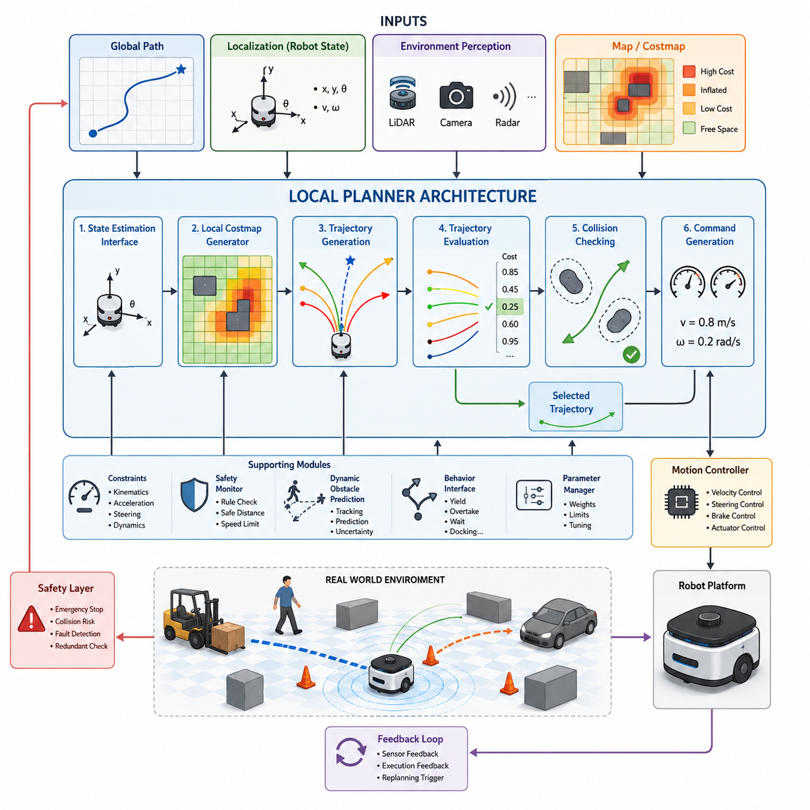
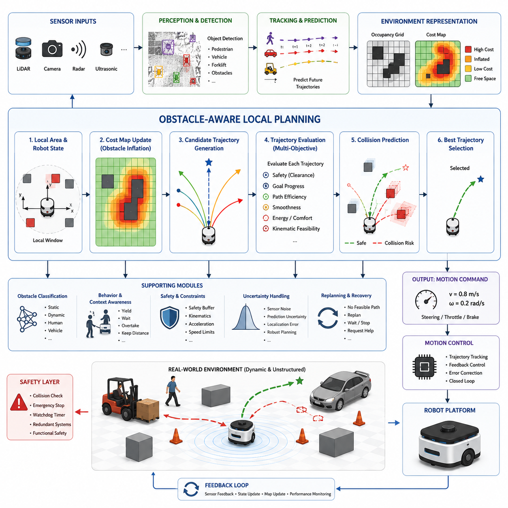
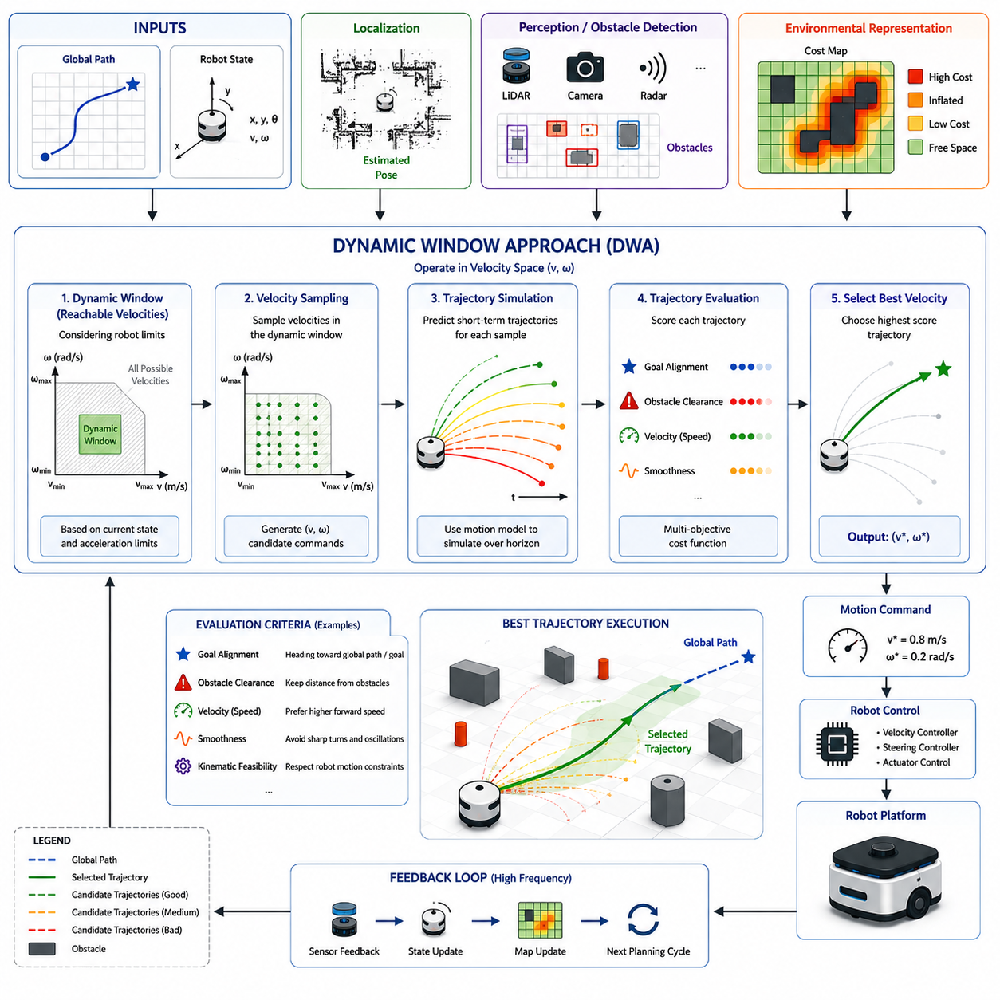
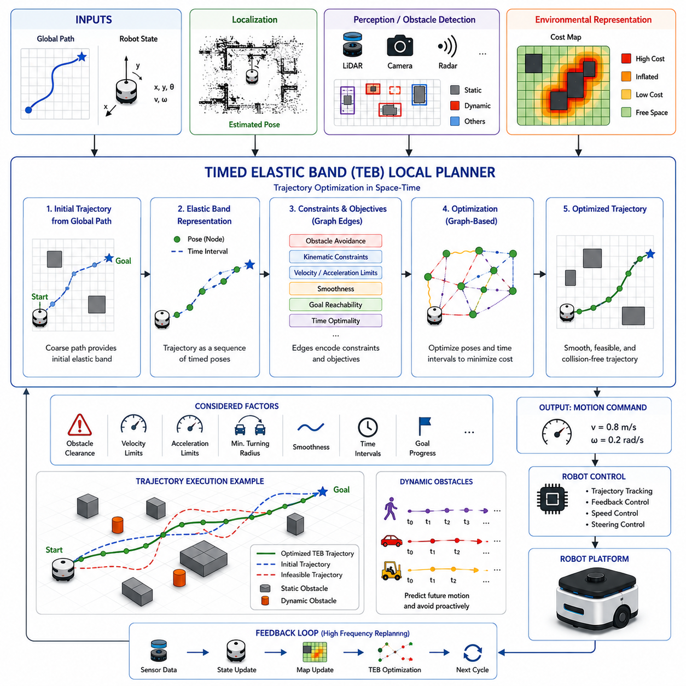
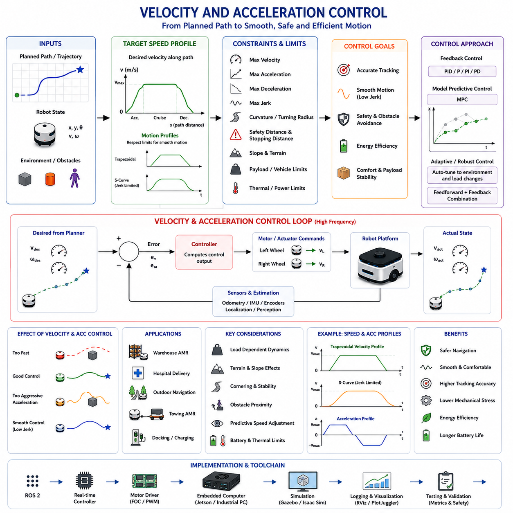
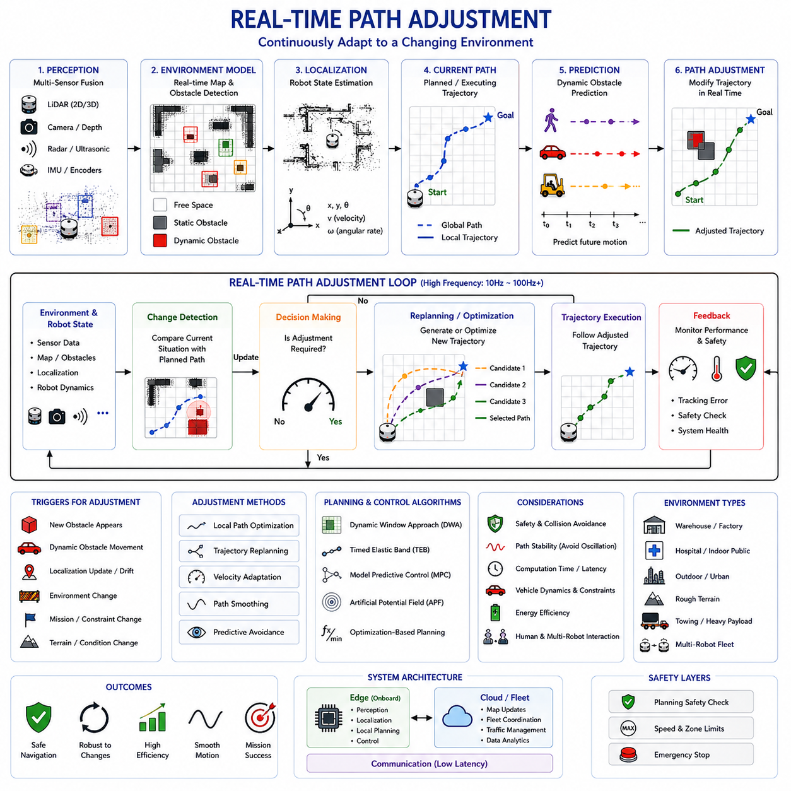
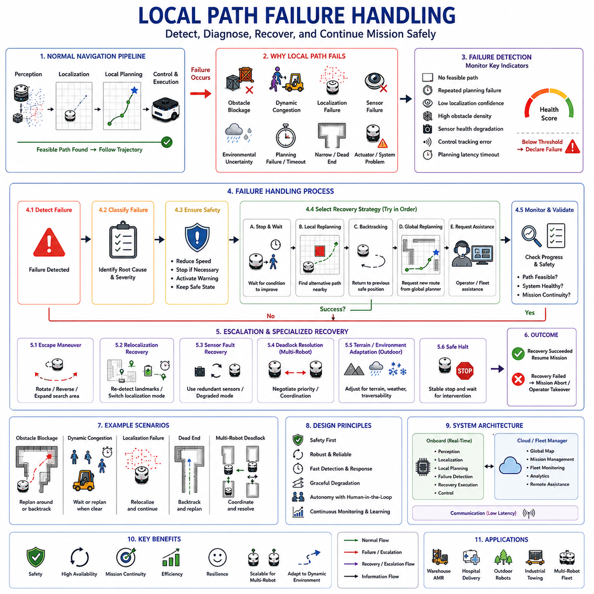
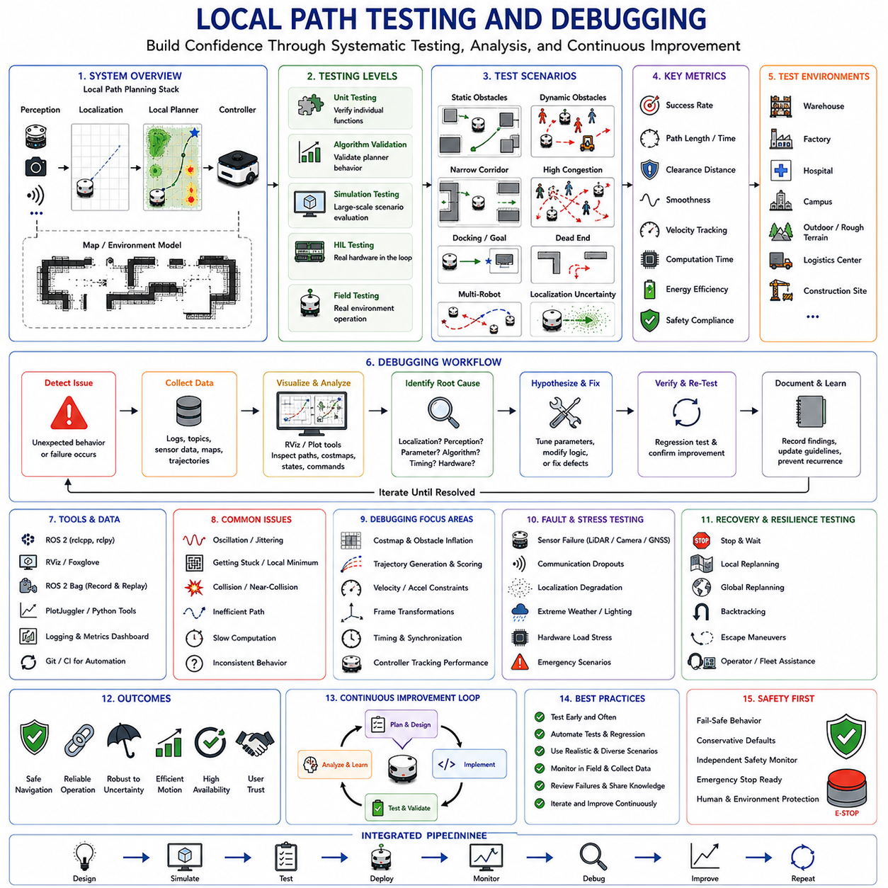

**Volume 05. Path Planning and Autonomous Navigation**


# Chapter 03. Local Path Planning

##  

## 03.1 Local Planner Architecture

{width="7.268055555555556in" height="7.268055555555556in"}

Local Planner Architecture is one of the most critical components in an autonomous mobile robot navigation system because it directly determines how the robot moves through its environment in real time. While a global planner generates a long-range route from the current position to a target destination, the local planner is responsible for transforming that route into executable motion commands that respect the robot's kinematic limitations, dynamic constraints, safety requirements, and environmental conditions. The local planner operates continuously during robot movement and serves as the bridge between high-level path planning and low-level motion control. Within the overall navigation stack, it functions as the decision-making layer that evaluates nearby obstacles, predicts potential collisions, selects safe trajectories, and generates velocity commands that guide the robot toward its goal. The importance of the local planner becomes increasingly evident in dynamic environments where unexpected obstacles, moving people, vehicles, or changing terrain conditions can invalidate previously planned routes.

The architecture of a local planner typically begins with the reception of information from multiple upstream subsystems. These inputs generally include the global path generated by the global planner, the current robot pose provided by the localization system, environmental representations such as occupancy grids or cost maps, and real-time obstacle information obtained through perception sensors. The local planner continuously combines these data sources to maintain an updated understanding of the robot's immediate surroundings. Unlike the global planner, which may compute a route over hundreds of meters or even kilometers, the local planner focuses only on a limited region surrounding the robot. This local operational window enables high-frequency updates and rapid reaction to environmental changes.

One of the primary functions of the local planner is trajectory generation. Rather than following the global path exactly, the planner creates multiple candidate trajectories that are physically feasible for the robot. These trajectories represent possible future motions based on the robot's current position, velocity, steering angle, acceleration limits, and dynamic characteristics. Candidate trajectories are evaluated against a variety of criteria including safety, efficiency, smoothness, energy consumption, goal alignment, and obstacle avoidance. The planner then selects the most suitable trajectory and converts it into velocity commands for execution by the motion controller.

A typical local planner architecture contains several interconnected modules. The first module is the state estimation interface. This component receives position, orientation, velocity, and acceleration estimates from localization and sensor fusion systems. Accurate state estimation is essential because all subsequent planning calculations depend on the robot's current state. Any localization error directly affects trajectory prediction and may lead to navigation failures. Therefore, local planners are often tightly integrated with localization systems such as SLAM, GNSS-RTK, LiDAR localization, visual localization, or multi-sensor fusion frameworks.

The second module is environmental perception integration. This subsystem receives obstacle information from various sensors including 2D LiDAR, 3D LiDAR, RGB cameras, depth cameras, radar systems, ultrasonic sensors, and thermal cameras. Sensor fusion algorithms combine observations into a unified environmental representation. The resulting obstacle map allows the planner to identify free space, occupied regions, dynamic objects, and navigation hazards. In industrial environments, additional information may include restricted areas, safety zones, loading docks, pedestrian crossings, and operational boundaries.

The third module is the local cost map generator. Cost maps are fundamental elements of most navigation architectures because they transform raw sensor observations into a structured representation suitable for planning. Each cell in the cost map contains a numerical value representing traversal difficulty or collision risk. Obstacles typically receive high costs while free space receives low costs. Inflation layers are often added around obstacles to maintain safe clearance distances. Dynamic cost updates allow the system to respond immediately to environmental changes. Cost maps can incorporate not only obstacle information but also terrain roughness, slope conditions, traffic rules, and operational constraints.

Trajectory generation is the next major component within the local planner architecture. Various algorithms can be used to generate candidate trajectories. Some planners rely on sampling methods that explore possible velocity combinations. Others use optimization-based approaches that minimize objective functions. The Dynamic Window Approach generates trajectories by evaluating feasible velocity commands within the robot's acceleration limits. Timed Elastic Band optimization treats trajectory planning as a constrained optimization problem and continuously adjusts path points to satisfy obstacle avoidance and kinematic constraints. Model Predictive Control predicts future robot behavior over a finite horizon and computes optimal control actions. Regardless of the specific method, the trajectory generation module seeks to identify safe and efficient motion candidates.

Trajectory evaluation forms another critical subsystem. Once candidate trajectories have been generated, each option must be scored according to predefined criteria. Safety is generally the highest priority. Trajectories that intersect obstacles or violate safety margins are immediately rejected. Remaining candidates are evaluated based on factors such as distance to obstacles, alignment with the global path, progress toward the goal, smoothness of motion, energy efficiency, passenger comfort for human-carrying robots, and stability constraints for heavy-load vehicles. Multi-objective cost functions are often employed to balance competing requirements. The trajectory with the lowest overall cost is selected for execution.

Collision checking is deeply integrated into the trajectory evaluation process. Every candidate trajectory is projected into the future and tested against predicted obstacle positions. Static obstacle checking verifies clearance from fixed structures such as walls, machinery, or infrastructure. Dynamic obstacle checking predicts the future motion of moving objects including pedestrians, vehicles, forklifts, and other robots. Advanced planners incorporate uncertainty models to account for sensor noise and prediction inaccuracies. Collision avoidance mechanisms ensure that the robot maintains safe operating distances under all conditions.

The command generation module converts the selected trajectory into executable motion commands. Depending on the robot platform, these commands may consist of linear velocity and angular velocity, steering angle and speed commands, wheel velocity references, or more complex actuator control signals. Motion commands are transmitted to the vehicle control layer, which executes them through motor controllers, steering actuators, braking systems, and drive mechanisms. Continuous feedback monitoring ensures that actual robot motion matches planned motion.

A key architectural characteristic of local planners is their real-time operation. Unlike global planners that may update once every few seconds, local planners often operate at frequencies between 10 Hz and 100 Hz. High-frequency operation is necessary to maintain responsiveness in dynamic environments. Real-time constraints impose strict requirements on computational efficiency. Algorithms must generate, evaluate, and select trajectories within milliseconds. Hardware acceleration using GPUs, dedicated AI processors, or optimized numerical libraries is increasingly used to support advanced planning algorithms.

Dynamic obstacle handling represents one of the most challenging aspects of local planner design. Traditional planners assume static environments, but modern autonomous robots frequently operate among humans, vehicles, and other moving entities. Dynamic obstacle handling requires object detection, tracking, behavior prediction, and trajectory adaptation. The planner must anticipate future interactions rather than merely reacting to current observations. Predictive planning techniques estimate future obstacle positions and proactively adjust robot trajectories to avoid conflicts before they occur.

Safety architecture is another essential element. Local planners are often integrated with multiple safety layers. A safety monitor continuously verifies that planned trajectories comply with operational constraints. Emergency stop systems override planning outputs when imminent collisions are detected. Safety LiDAR zones can dynamically adjust allowable robot speeds based on obstacle proximity. Functional safety architectures frequently include redundant monitoring systems that independently validate navigation decisions. This layered approach ensures robust operation even when individual components experience failures.

For outdoor autonomous robots, local planner architecture becomes even more complex. Environmental conditions may include uneven terrain, slopes, loose surfaces, vegetation, weather effects, and GNSS uncertainties. The planner must account for vehicle stability, wheel slip, traction limitations, and terrain traversability. Terrain-aware cost maps are often employed to represent navigational risks associated with different surface conditions. Heavy-duty outdoor robots may additionally incorporate rollover prevention constraints, payload stability considerations, and slope safety limits.

In towing AMRs and trailer-based autonomous systems, local planning requires specialized trajectory generation mechanisms. The planner must consider articulation angles, trailer dynamics, off-tracking effects, and reverse driving behaviors. Simple path-following approaches are insufficient because trailer motion introduces nonlinear constraints. Advanced planners utilize vehicle models that capture the coupled behavior of the tractor and trailer. Reverse parking, docking, and coupling operations require extremely precise local planning capabilities.

The integration between local planning and behavior planning is another important architectural consideration. Behavior planners operate at a higher decision-making level and determine navigation objectives such as yielding, overtaking, waiting, docking, charging, or rerouting. The local planner executes these behavioral decisions by generating appropriate motion trajectories. Clear interfaces between behavior planning and local planning simplify system design and improve scalability.

Modern navigation architectures increasingly incorporate artificial intelligence into local planning systems. Machine learning models can predict obstacle behavior, estimate traversability, optimize trajectory selection, and improve navigation performance through experience. Reinforcement learning approaches enable robots to learn navigation policies directly from interaction with the environment. Hybrid architectures combine classical optimization methods with AI-based prediction systems to achieve both reliability and adaptability.

Cloud and edge computing are also influencing local planner architectures. Although trajectory generation typically remains on the robot due to latency requirements, cloud systems can provide additional situational awareness, traffic coordination, map updates, and fleet-level optimization. Edge computing platforms such as NVIDIA Jetson systems enable sophisticated local planning algorithms to operate directly on the robot while maintaining real-time performance.

Testing and validation are essential components of local planner development. Simulation environments such as Gazebo, Isaac Sim, and digital twin platforms allow engineers to evaluate planner behavior under diverse scenarios before field deployment. Validation typically includes obstacle avoidance tests, dynamic interaction scenarios, narrow corridor navigation, emergency stop performance, docking accuracy, rough terrain traversal, slope handling, and multi-robot coordination. Performance metrics often include trajectory smoothness, path tracking accuracy, computation latency, obstacle clearance, success rate, and recovery capability.

Ultimately, Local Planner Architecture serves as the operational intelligence layer that transforms navigation objectives into safe and efficient robot motion. It continuously interprets environmental information, evaluates potential actions, predicts future interactions, and generates executable trajectories that guide the robot toward its destination. As autonomous robots become more capable and are deployed in increasingly complex environments, local planner architectures will continue to evolve toward greater intelligence, adaptability, safety, and autonomy. Their role as the real-time decision-making core of navigation systems ensures that they remain one of the most important technologies in the development of modern AMRs, autonomous vehicles, service robots, industrial robots, outdoor autonomous platforms, and next-generation embodied AI systems.

로컬 플래너(Local Planner)는 자율주행 로봇 내비게이션 시스템에서 가장 중요한 구성 요소 중 하나이다. 글로벌 플래너(Global Planner)가 현재 위치에서 목표 지점까지의 장거리 경로를 생성한다면, 로컬 플래너는 이를 실제 주행 가능한 움직임으로 변환하는 역할을 수행한다. 로컬 플래너는 로봇의 운동학적 제약, 동역학적 특성, 안전 요구사항, 그리고 주변 환경 조건을 고려하여 실시간으로 주행 명령을 생성한다. 따라서 로컬 플래너는 고수준 경로 계획과 저수준 차량 제어 사이를 연결하는 핵심 계층이라고 할 수 있다.

로컬 플래너는 로봇이 이동하는 동안 지속적으로 동작하며, 주변 장애물의 상태를 분석하고 충돌 가능성을 예측하며, 안전한 주행 궤적을 선택하고, 최종적으로 속도 명령을 생성하여 로봇을 목표 방향으로 유도한다. 특히 사람, 차량, 다른 로봇 등이 존재하는 동적 환경에서는 사전에 생성된 글로벌 경로만으로는 안전한 주행이 불가능하기 때문에 로컬 플래너의 중요성이 더욱 커진다.

일반적인 로컬 플래너 아키텍처는 여러 상위 시스템으로부터 정보를 입력받는 구조로 구성된다. 대표적인 입력 데이터는 글로벌 플래너가 생성한 경로, 위치추정 시스템이 제공하는 현재 로봇 위치, 점유격자지도(Occupancy Grid)나 코스트맵(Cost Map)과 같은 환경 정보, 그리고 센서를 통해 획득한 실시간 장애물 정보이다. 로컬 플래너는 이러한 데이터를 지속적으로 통합하여 로봇 주변의 상황을 실시간으로 이해한다.

글로벌 플래너가 수백 미터 또는 수 킬로미터 범위의 경로를 계산하는 반면, 로컬 플래너는 로봇 주변의 제한된 영역만을 대상으로 계획을 수행한다. 이러한 국소 영역(Local Window) 기반 접근 방식은 빠른 갱신 주기와 높은 반응성을 가능하게 한다.

로컬 플래너의 핵심 기능 중 하나는 궤적 생성(Trajectory Generation)이다. 로컬 플래너는 글로벌 경로를 단순히 따라가는 것이 아니라, 현재 상태에서 실제로 주행 가능한 여러 개의 후보 궤적을 생성한다. 이 후보 궤적들은 로봇의 위치, 속도, 가속도 제한, 조향각, 차량 동역학 등을 고려하여 만들어진다. 생성된 후보 궤적들은 안전성, 효율성, 부드러운 움직임, 에너지 소비, 목표 방향 일치도, 장애물 회피 능력 등의 기준으로 평가된다. 이후 가장 적합한 궤적이 선택되어 실제 주행 명령으로 변환된다.

로컬 플래너 아키텍처의 첫 번째 구성 요소는 상태 추정 인터페이스(State Estimation Interface)이다. 이 모듈은 위치추정 시스템으로부터 위치, 자세, 속도, 가속도 정보를 수신한다. 정확한 상태 추정은 매우 중요하며, 위치 오차는 이후 모든 경로 계획 결과에 직접적인 영향을 미친다. 따라서 로컬 플래너는 SLAM, GNSS-RTK, LiDAR 기반 위치추정, 비전 기반 위치추정, 다중 센서 융합 시스템 등과 긴밀하게 연동된다.

두 번째 구성 요소는 환경 인지 통합(Environment Perception Integration) 모듈이다. 이 모듈은 2D LiDAR, 3D LiDAR, RGB 카메라, Depth Camera, Radar, 초음파 센서, 열화상 카메라 등으로부터 장애물 정보를 수집한다. 센서 융합 알고리즘은 이러한 정보를 통합하여 일관된 환경 표현을 생성한다. 이를 통해 로봇은 자유 공간, 장애물 영역, 이동 물체, 위험 요소 등을 식별할 수 있다. 산업 현장에서는 안전 구역, 작업 구역, 차량 통행 구역, 출입 제한 구역 등의 정보도 함께 반영될 수 있다.

세 번째 구성 요소는 로컬 코스트맵 생성기(Local Cost Map Generator)이다. 코스트맵은 원시 센서 데이터를 경로 계획에 적합한 형태로 변환하는 역할을 수행한다. 각 셀은 이동 위험도 또는 통과 비용을 나타내며, 장애물은 높은 비용을 부여받고 자유 공간은 낮은 비용을 가진다. 또한 장애물 주변에는 안전거리를 확보하기 위한 Inflation Layer가 생성된다. 최신 코스트맵은 장애물뿐만 아니라 경사도, 노면 상태, 교통 규칙, 작업 제약 조건 등도 포함할 수 있다.

다음 단계는 후보 궤적 생성이다. 이를 위해 다양한 알고리즘이 사용된다. 일부는 가능한 속도 조합을 샘플링하는 방식이며, 일부는 최적화 기법을 사용한다. 대표적으로 Dynamic Window Approach(DWA)는 로봇이 실제로 생성 가능한 속도 범위 내에서 후보 경로를 탐색한다. TEB(Timed Elastic Band)는 경로를 최적화 문제로 정의하여 장애물 회피와 운동학적 제약을 동시에 만족하도록 경로를 수정한다. MPC(Model Predictive Control)는 미래 일정 시간 동안의 로봇 상태를 예측하여 최적 제어 입력을 계산한다.

후보 궤적이 생성되면 평가 단계가 수행된다. 가장 중요한 평가 요소는 안전성이다. 장애물과 충돌하거나 안전 거리를 침범하는 궤적은 즉시 제거된다. 나머지 후보들은 장애물과의 거리, 글로벌 경로와의 정렬 정도, 목표까지의 진행 효율성, 이동의 부드러움, 에너지 효율, 승차감, 차량 안정성 등의 기준으로 평가된다. 일반적으로 다중 목적 비용 함수(Multi-Objective Cost Function)가 사용되며, 최종적으로 가장 낮은 비용을 가진 궤적이 선택된다.

충돌 검사(Collision Checking)는 궤적 평가 과정의 핵심이다. 모든 후보 궤적은 미래 시점까지 예측되어 장애물과의 충돌 여부를 검사한다. 정적 장애물뿐 아니라 보행자, 차량, 지게차, 다른 로봇과 같은 동적 장애물도 고려된다. 최신 시스템은 센서 오차와 예측 불확실성까지 반영하여 더욱 안전한 계획을 수행한다.

선택된 궤적은 명령 생성(Command Generation) 모듈로 전달된다. 이 모듈은 궤적을 실제 차량 제어 명령으로 변환한다. 차동구동 로봇의 경우 선속도와 각속도 명령이 생성되며, 자동차형 플랫폼의 경우 조향각과 차량 속도가 생성된다. 생성된 명령은 모터 제어기, 조향 시스템, 제동 시스템 등을 통해 실제 차량에 적용된다.

로컬 플래너의 가장 큰 특징 중 하나는 실시간성이다. 글로벌 플래너가 수 초 단위로 동작하는 경우가 많은 반면, 로컬 플래너는 일반적으로 10Hz에서 100Hz 이상의 주기로 실행된다. 따라서 모든 계산은 수 밀리초 이내에 완료되어야 하며, 높은 계산 효율성이 요구된다. 최근에는 GPU 가속, AI 가속기, 고성능 임베디드 컴퓨팅 플랫폼이 활용되고 있다.

동적 장애물 처리(Dynamic Obstacle Handling)는 현대 로컬 플래너의 핵심 과제 중 하나이다. 과거에는 정적 환경을 가정하는 경우가 많았지만, 실제 산업 환경에서는 사람, 차량, 지게차, 이동형 장비가 지속적으로 움직인다. 따라서 로컬 플래너는 단순히 현재 상태만 보는 것이 아니라 미래의 이동 경로를 예측하여 충돌을 사전에 방지해야 한다.

안전 아키텍처 역시 매우 중요하다. 일반적으로 로컬 플래너는 다중 안전 계층과 함께 동작한다. 안전 모니터는 계획된 궤적이 안전 규칙을 만족하는지 확인하고, 비상 정지 시스템은 충돌 위험이 감지되면 즉시 로봇을 정지시킨다. 안전 LiDAR는 장애물 거리와 속도에 따라 보호 영역을 동적으로 조정할 수 있다. 산업용 시스템에서는 독립적인 안전 검증 계층을 추가하여 신뢰성을 높인다.

실외 자율주행 로봇에서는 로컬 플래너의 복잡성이 더욱 증가한다. 노면 상태, 경사면, 비포장 도로, 초목, 기상 변화, GNSS 오차 등을 고려해야 한다. 따라서 지형 분석 기반 코스트맵, 전복 방지 제약조건, 미끄럼 제어, 견인력 분석 등이 함께 적용된다.

견인형 AMR(Towing AMR)에서는 일반 로봇보다 더욱 복잡한 계획이 필요하다. 트레일러의 관절각, 후행 궤적(Off-Tracking), 후진 주행 특성 등을 고려해야 한다. 특히 후진 주차나 자동 결합(Coupling) 작업은 매우 정밀한 로컬 계획 능력을 요구한다.

로컬 플래너는 행동 계획기(Behavior Planner)와도 긴밀하게 연동된다. 행동 계획기는 양보, 추월, 대기, 충전, 도킹 등의 상위 의사결정을 수행하며, 로컬 플래너는 이를 실제 이동 경로로 변환한다. 이러한 계층적 구조는 시스템의 확장성과 유지보수성을 향상시킨다.

최근에는 인공지능 기술도 로컬 플래너에 적극적으로 도입되고 있다. AI는 보행자 행동 예측, 주행 가능 영역 추정, 최적 경로 선택, 상황 인식 기반 의사결정 등에 활용된다. 강화학습 기반 로컬 플래너는 경험을 통해 더 효율적인 주행 정책을 학습할 수 있다. 또한 전통적인 최적화 기반 방법과 AI 기반 예측 모델을 결합한 하이브리드 구조도 활발히 연구되고 있다.

클라우드와 엣지 컴퓨팅 역시 로컬 플래너 발전에 영향을 주고 있다. 실시간 궤적 생성은 일반적으로 로봇 내부에서 수행되지만, 클라우드는 교통 정보 공유, 지도 업데이트, 다중 로봇 협조 제어, 플릿 최적화 등을 지원할 수 있다. Jetson Orin NX, Jetson Thor와 같은 고성능 엣지 컴퓨팅 플랫폼은 복잡한 로컬 계획 알고리즘을 실시간으로 실행할 수 있도록 지원한다.

로컬 플래너의 개발 과정에서는 철저한 시험과 검증이 필수적이다. Gazebo, Isaac Sim, 디지털 트윈 환경을 활용하여 다양한 시나리오를 검증할 수 있다. 시험 항목에는 장애물 회피, 동적 환경 대응, 협소 통로 통과, 도킹 정확도, 비상 정지 성능, 경사면 주행, 험지 주행, 다중 로봇 협업 등이 포함된다. 주요 성능 지표는 경로 추종 오차, 계산 지연시간, 장애물 최소 거리, 성공률, 회복 능력, 에너지 효율 등이다.

결론적으로 로컬 플래너 아키텍처는 자율주행 로봇의 실시간 의사결정 엔진이라고 할 수 있다. 로컬 플래너는 주변 환경을 지속적으로 분석하고, 가능한 행동을 평가하며, 미래 상황을 예측하고, 안전하고 효율적인 주행 궤적을 생성한다. AMR, 자율주행 차량, 실외 자율주행 로봇, 산업용 로봇, 서비스 로봇, 차세대 Embodied AI 시스템이 발전할수록 로컬 플래너는 더욱 지능적이고 적응적이며 안전한 방향으로 진화하게 될 것이다. 그만큼 로컬 플래너는 현대 자율주행 시스템의 핵심 기술로 자리 잡고 있다.

##  

## 03.2 Obstacle-Aware Local Planning

{width="7.268055555555556in" height="7.268055555555556in"}

Obstacle-Aware Local Planning is a fundamental capability of autonomous mobile robots because it enables safe navigation in environments containing static and dynamic obstacles. While global path planning determines a long-range route toward a destination, obstacle-aware local planning focuses on the robot's immediate surroundings and continuously modifies motion commands to avoid collisions while maintaining progress toward the goal. In real-world environments, obstacles rarely remain fixed or predictable. People walk through corridors, forklifts move across warehouses, vehicles enter roadways, construction equipment appears unexpectedly, and environmental conditions change continuously. As a result, a robot must possess the ability to perceive obstacles, evaluate risks, predict future interactions, and generate safe trajectories in real time. Obstacle-aware local planning provides this capability and serves as one of the most critical operational layers within modern autonomous navigation systems.

The primary objective of obstacle-aware local planning is to transform environmental awareness into safe motion decisions. This process begins with obstacle perception. The navigation system receives information from multiple sensors including LiDAR, cameras, radar, ultrasonic sensors, depth cameras, thermal sensors, and GNSS-supported perception systems. These sensors provide observations about the environment surrounding the robot. Sensor fusion algorithms combine the incoming information into a coherent representation of nearby objects, free space, navigation hazards, and environmental boundaries. The resulting environmental model serves as the foundation for local planning decisions.

Obstacle-aware planning differs significantly from traditional path-following approaches. A simple path-following controller attempts to remain close to a predefined route regardless of environmental conditions. Such systems often fail when unexpected obstacles appear. Obstacle-aware planners, however, continuously evaluate the local environment and modify trajectories whenever necessary. Rather than blindly following the global path, the planner dynamically balances multiple objectives including obstacle avoidance, path efficiency, goal progression, motion smoothness, energy efficiency, and safety compliance.

One of the most important concepts in obstacle-aware planning is environmental representation. Raw sensor data alone cannot support efficient decision making. The planner requires a structured model that describes obstacle locations and navigation costs. Cost maps are among the most widely used representations. A cost map divides the environment into cells, assigning each cell a numerical value that represents traversal difficulty or collision risk. Free space receives low costs, while obstacles receive high costs. Inflation layers expand obstacle boundaries to ensure safe clearance distances. Dynamic updates allow the cost map to reflect changing environmental conditions in real time.

Occupancy grids are another common environmental representation. In an occupancy grid, each cell stores the probability that the corresponding area is occupied by an obstacle. As new sensor observations become available, probabilities are continuously updated. Occupancy grids provide a probabilistic framework that helps manage sensor uncertainty and incomplete observations. This approach is especially valuable in crowded environments where obstacle positions may change frequently.

Obstacle-aware local planning relies heavily on accurate obstacle detection. Detection systems identify the presence, location, size, and shape of objects within the robot's operating environment. Traditional methods often use geometric processing of LiDAR point clouds, while modern systems increasingly employ deep learning models for object detection and classification. Detection algorithms can identify pedestrians, vehicles, forklifts, pallets, machinery, walls, barriers, and other navigation-relevant entities. Accurate detection is essential because planning quality depends directly on environmental understanding.

After obstacles are detected, tracking systems estimate their motion over time. Static obstacle avoidance is relatively straightforward because obstacle positions remain fixed. Dynamic obstacle avoidance is significantly more complex because moving objects require future state prediction. Tracking algorithms estimate object velocity, direction, acceleration, and behavioral patterns. Kalman Filters, Extended Kalman Filters, Particle Filters, and advanced AI-based tracking systems are commonly used to maintain continuous estimates of object motion.

Prediction plays a central role in obstacle-aware planning. The planner must anticipate where obstacles will be located in the future rather than merely reacting to their current positions. Human pedestrians may suddenly change direction. Forklifts may enter intersections unexpectedly. Vehicles may accelerate or decelerate without warning. Prediction models estimate likely future trajectories of dynamic objects and provide critical information for collision avoidance. Advanced systems incorporate uncertainty estimation to account for unpredictable behavior and sensor noise.

Collision prediction mechanisms continuously evaluate future interactions between the robot and surrounding obstacles. The planner projects candidate robot trajectories into the future and compares them against predicted obstacle movements. Potential collisions are identified before they occur, enabling proactive avoidance behavior. This predictive approach significantly improves safety compared to purely reactive systems that respond only after obstacles enter predefined danger zones.

Trajectory generation is one of the core functions within obstacle-aware local planning. The planner generates multiple feasible trajectories that satisfy vehicle kinematic and dynamic constraints. Each candidate trajectory represents a possible future motion. Candidate trajectories may differ in curvature, speed profile, steering behavior, obstacle clearance, and travel time. The planning algorithm evaluates these alternatives and selects the trajectory that best satisfies navigation objectives while maintaining safety.

Various planning algorithms are used for obstacle-aware local navigation. The Dynamic Window Approach evaluates feasible velocity combinations and selects commands that maximize progress while avoiding obstacles. Timed Elastic Band planners optimize path geometry while respecting obstacle constraints and vehicle dynamics. Model Predictive Control predicts future system behavior over a finite horizon and computes optimal control inputs. Artificial Potential Field methods use virtual attractive and repulsive forces to guide navigation. Hybrid approaches often combine multiple techniques to achieve improved robustness and performance.

Obstacle avoidance decisions depend on both obstacle proximity and obstacle behavior. Nearby static obstacles require precise path adjustment, while moving obstacles may require more complex decision-making. For example, a robot approaching a pedestrian may need to slow down, stop temporarily, yield right-of-way, or select an alternate route. Obstacle-aware planners therefore incorporate behavioral reasoning mechanisms that adapt navigation strategies according to environmental context.

Human-aware navigation represents a specialized area of obstacle-aware planning. Humans are fundamentally different from static obstacles because their behavior is unpredictable and influenced by social expectations. Robots operating in hospitals, airports, offices, and public spaces must navigate in ways that humans perceive as safe and comfortable. Human-aware planners maintain larger safety margins around people, avoid sudden movements, predict pedestrian intentions, and generate socially acceptable trajectories. Such capabilities improve user acceptance and operational safety.

Industrial environments introduce unique challenges for obstacle-aware planning. Warehouses contain forklifts, moving pallets, automated equipment, storage racks, and human workers. Factories may include restricted zones, production machinery, and narrow pathways. Construction sites involve constantly changing layouts and unpredictable equipment movements. Effective obstacle-aware planning systems must accommodate these complex operational conditions while maintaining high productivity and safety.

Outdoor autonomous robots face even greater planning challenges. Environmental conditions may include uneven terrain, vegetation, weather effects, slopes, mud, gravel, and unstructured obstacles. Outdoor obstacle-aware planners often integrate terrain analysis, traversability estimation, and environmental classification into the planning process. A path that is physically obstacle-free may still be unsafe if the terrain cannot support stable vehicle operation. Consequently, outdoor planners must consider both geometric obstacles and terrain-related risks.

Heavy-duty autonomous vehicles and towing robots require additional considerations. Large payloads increase stopping distances and reduce maneuverability. Towing systems introduce trailer dynamics and articulation constraints that affect obstacle avoidance behavior. The planner must account for the full vehicle footprint rather than only the primary robot chassis. During turning maneuvers, trailer off-tracking can create collision risks that would not be apparent when considering only the towing vehicle. Obstacle-aware planning for such systems therefore requires advanced vehicle modeling and predictive control.

Safety is the highest priority within obstacle-aware local planning architectures. Every candidate trajectory undergoes extensive safety evaluation before execution. Collision checking algorithms verify obstacle clearance throughout the predicted motion horizon. Safety buffers compensate for localization uncertainty, sensor noise, and control inaccuracies. Emergency stop systems continuously monitor collision risk and intervene when necessary. Many industrial systems employ redundant safety layers that independently validate planner outputs to ensure compliance with functional safety requirements.

The relationship between obstacle-aware planning and robot control is highly interconnected. Planning algorithms generate desired trajectories, but successful execution depends on accurate vehicle control. Deviations between planned and actual motion can compromise safety. Feedback control systems continuously monitor vehicle state and adjust commands to minimize tracking error. This closed-loop interaction ensures that planned trajectories remain achievable under real-world operating conditions.

Modern obstacle-aware planning increasingly incorporates artificial intelligence and machine learning. Deep neural networks improve obstacle detection accuracy and enable semantic understanding of environmental context. Reinforcement learning algorithms can learn obstacle avoidance policies through simulation and real-world experience. World models provide predictive representations of future environmental states. However, most industrial systems continue to combine AI techniques with traditional planning algorithms to maintain reliability, interpretability, and safety certification compatibility.

Cloud-connected navigation systems are also expanding the capabilities of obstacle-aware planning. Fleet management platforms can share obstacle information among multiple robots. Cloud services can provide updated maps, traffic information, and global situational awareness. Nevertheless, obstacle-aware local planning remains primarily an edge-computing function because collision avoidance decisions require extremely low latency and high reliability. Real-time execution on platforms such as Jetson Orin, Jetson Thor, or industrial edge computers is therefore essential.

Simulation plays a critical role in developing obstacle-aware planning systems. Digital twins and simulation platforms such as Isaac Sim and Gazebo allow engineers to evaluate planner behavior under thousands of scenarios before deployment. Simulated environments can include moving pedestrians, vehicles, forklifts, narrow corridors, intersections, blind corners, and emergency situations. Such testing enables comprehensive validation without exposing people or equipment to unnecessary risk.

Performance evaluation typically focuses on several key metrics. Collision-free navigation is the most fundamental requirement. Additional metrics include obstacle clearance distance, path efficiency, computation latency, navigation success rate, trajectory smoothness, energy consumption, recovery capability, and human comfort. Industrial deployments often establish strict acceptance criteria for each metric before operational approval.

Failure handling is another essential component of obstacle-aware planning. Situations may arise in which no safe trajectory can be found. Environmental congestion, blocked pathways, sensor failures, or localization uncertainties may prevent normal operation. Recovery behaviors allow the robot to stop safely, wait for obstacles to clear, perform local replanning, request assistance from fleet management systems, or return to a predefined safe state. Robust recovery mechanisms are critical for maintaining operational reliability in complex environments.

As autonomous robotics continues to advance, obstacle-aware local planning is evolving toward increasingly intelligent and predictive systems. Future planners will combine perception, prediction, semantic understanding, world models, and decision-making into unified navigation frameworks. These systems will not simply avoid obstacles but will understand environmental intent, anticipate future interactions, coordinate with humans and other robots, and optimize navigation behavior across entire fleets. Such developments will enable safer, more efficient, and more autonomous operation in factories, hospitals, logistics centers, smart cities, agricultural environments, construction sites, and next-generation autonomous robotic ecosystems.

장애물 인지 기반 로컬 경로 계획(Obstacle-Aware Local Planning)은 자율주행 이동 로봇이 정적 및 동적 장애물이 존재하는 환경에서 안전하게 이동하기 위한 핵심 기술이다. 글로벌 경로 계획(Global Path Planning)이 목적지까지의 장거리 경로를 생성하는 역할을 수행한다면, 장애물 인지 기반 로컬 경로 계획은 로봇 주변의 즉각적인 환경을 분석하고 충돌을 회피하면서 목표 지점으로 계속 이동할 수 있도록 실시간으로 주행 명령을 수정한다. 실제 환경에서는 장애물이 고정되어 있지 않으며 예측하기 어려운 경우가 많다. 보행자는 복도를 이동하고, 지게차는 창고를 가로질러 이동하며, 차량은 도로에 진입하고, 공사 장비는 예기치 않게 나타날 수 있다. 또한 환경 조건도 지속적으로 변화한다. 따라서 로봇은 장애물을 인식하고, 위험을 평가하며, 미래의 상호작용을 예측하고, 안전한 주행 경로를 실시간으로 생성할 수 있어야 한다. 이러한 역할을 수행하는 것이 바로 장애물 인지 기반 로컬 경로 계획 시스템이다.

장애물 인지 기반 로컬 경로 계획의 가장 중요한 목적은 환경에 대한 인지 정보를 안전한 주행 의사결정으로 변환하는 것이다. 이 과정은 장애물 인지(Obstacle Perception)에서 시작된다. 내비게이션 시스템은 LiDAR, 카메라, 레이더, 초음파 센서, 깊이 카메라, 열화상 센서, GNSS 기반 센서 등 다양한 장치로부터 정보를 수집한다. 센서 융합 알고리즘은 이러한 정보를 통합하여 주변 물체, 자유 공간, 위험 지역, 환경 경계 등에 대한 일관된 환경 모델을 생성한다. 이 환경 모델은 이후 로컬 경로 계획의 기초 자료로 활용된다.

장애물 인지 기반 계획은 단순 경로 추종(Path Following) 방식과 근본적으로 다르다. 단순 경로 추종 시스템은 환경 변화와 관계없이 미리 정의된 경로를 따라가려고 한다. 그러나 예상치 못한 장애물이 나타나면 쉽게 실패할 수 있다. 반면 장애물 인지 기반 플래너는 주변 환경을 지속적으로 분석하면서 필요 시 경로를 수정한다. 글로벌 경로를 무조건 따르는 것이 아니라 장애물 회피, 이동 효율성, 목표 접근성, 주행 부드러움, 에너지 효율, 안전성 등을 종합적으로 고려하여 최적의 경로를 선택한다.

이러한 계획을 수행하기 위해서는 환경을 구조적으로 표현하는 방법이 필요하다. 원시 센서 데이터만으로는 효율적인 의사결정이 어렵기 때문이다. 가장 널리 사용되는 방법 중 하나가 코스트맵(Cost Map)이다. 코스트맵은 환경을 셀(Cell) 단위로 나누고 각 셀에 이동 비용 또는 위험도를 부여한다. 자유 공간은 낮은 비용을 가지며 장애물은 높은 비용을 가진다. 또한 장애물 주변에는 안전거리를 확보하기 위한 Inflation Layer가 생성된다. 최신 시스템에서는 장애물뿐 아니라 경사도, 노면 상태, 작업 구역, 교통 규칙 등의 정보도 코스트맵에 반영된다.

점유 격자 지도(Occupancy Grid) 역시 널리 사용되는 환경 표현 방식이다. 각 셀은 해당 위치가 장애물에 의해 점유되어 있을 확률을 저장한다. 새로운 센서 데이터가 들어오면 확률이 지속적으로 갱신된다. 이 방식은 센서 오차와 관측 불확실성을 효과적으로 처리할 수 있어 복잡한 환경에서 매우 유용하다.

장애물 인지 기반 로컬 계획의 핵심은 정확한 장애물 검출이다. 검출 시스템은 장애물의 존재 여부뿐 아니라 위치, 크기, 형상 등을 추정한다. 전통적으로는 LiDAR 포인트 클라우드의 기하학적 분석이 사용되었지만 최근에는 딥러닝 기반 객체 검출 모델이 널리 사용되고 있다. 이를 통해 사람, 차량, 지게차, 팔레트, 기계 장비, 벽체, 안전 펜스 등 다양한 객체를 인식할 수 있다. 정확한 장애물 검출은 계획 성능의 기반이 되므로 매우 중요하다.

장애물이 검출되면 추적(Tracking) 단계가 수행된다. 정적 장애물은 위치가 변하지 않으므로 비교적 쉽게 처리할 수 있지만, 동적 장애물은 미래 위치를 예측해야 하므로 훨씬 복잡하다. 추적 시스템은 물체의 속도, 이동 방향, 가속도, 행동 패턴 등을 추정한다. Kalman Filter, Extended Kalman Filter, Particle Filter 및 AI 기반 추적 알고리즘이 널리 사용된다.

예측(Prediction)은 장애물 인지 기반 계획에서 매우 중요한 역할을 수행한다. 로봇은 현재 위치만 보는 것이 아니라 미래의 장애물 위치를 예측해야 한다. 보행자는 갑자기 방향을 바꿀 수 있고, 지게차는 교차로에 진입할 수 있으며, 차량은 예고 없이 가속하거나 감속할 수 있다. 따라서 예측 모델은 장애물의 미래 이동 경로를 추정하고 충돌 가능성을 사전에 평가한다. 최신 시스템은 불확실성까지 함께 계산하여 보다 보수적이고 안전한 계획을 수행한다.

충돌 예측(Collision Prediction)은 로봇의 미래 경로와 장애물의 미래 경로를 비교하여 잠재적인 충돌 가능성을 탐지한다. 후보 경로들은 일정 시간 동안 미래로 시뮬레이션되며 장애물의 예측 경로와 비교된다. 충돌 가능성이 발견되면 해당 경로는 제거되거나 수정된다. 이러한 예측 기반 접근은 단순 반응형 시스템보다 훨씬 높은 안전성을 제공한다.

후보 궤적 생성(Trajectory Generation)은 장애물 인지 기반 로컬 계획의 핵심 기능이다. 로봇의 운동학적 제약과 동역학적 제약을 만족하는 여러 개의 후보 경로가 생성된다. 각 후보 경로는 곡률, 속도, 조향 특성, 장애물과의 거리, 이동 시간 등이 다르다. 계획 알고리즘은 이러한 후보 경로를 평가하여 최적의 경로를 선택한다.

대표적인 알고리즘으로는 Dynamic Window Approach(DWA), Timed Elastic Band(TEB), Model Predictive Control(MPC), Artificial Potential Field(APF) 등이 있다. DWA는 가능한 속도 조합을 평가하여 안전하고 효율적인 경로를 선택한다. TEB는 경로 자체를 최적화 문제로 정의하여 지속적으로 수정한다. MPC는 미래 상태를 예측하여 최적 제어 명령을 계산한다. APF는 목표점에 대한 인력과 장애물에 대한 척력을 사용하여 경로를 생성한다. 실제 산업 시스템에서는 여러 알고리즘을 결합한 하이브리드 방식도 많이 사용된다.

장애물 회피는 단순히 거리만 고려하는 것이 아니라 장애물의 특성과 행동을 함께 고려한다. 정적 장애물은 우회 경로를 선택하면 되지만, 움직이는 장애물은 보다 복잡한 의사결정이 필요하다. 예를 들어 보행자가 접근하는 경우 속도를 줄이거나, 일시 정지하거나, 우선권을 양보하거나, 새로운 경로를 선택할 수 있다. 따라서 현대의 로컬 플래너는 상황 인지 기반 행동 결정 기능도 포함하고 있다.

사람 중심 내비게이션(Human-Aware Navigation)은 장애물 인지 기반 계획의 중요한 응용 분야이다. 사람은 단순 장애물이 아니라 행동이 예측하기 어려운 존재이다. 병원, 공항, 사무실, 호텔과 같은 환경에서는 로봇이 사람에게 불쾌감을 주지 않도록 움직여야 한다. 이를 위해 사람 주변에 더 큰 안전거리를 유지하고, 급격한 움직임을 피하며, 보행자의 의도를 예측하고, 사회적으로 수용 가능한 경로를 생성한다.

산업 환경에서는 또 다른 도전 과제가 존재한다. 창고에는 지게차, 이동형 팔레트, 작업자, 자동화 장비가 존재하며, 공장에는 생산 설비와 제한 구역이 존재한다. 건설 현장은 구조가 지속적으로 변한다. 따라서 장애물 인지 기반 계획 시스템은 이러한 복잡한 환경 속에서도 높은 생산성과 안전성을 동시에 유지해야 한다.

실외 자율주행 로봇은 더욱 어려운 환경에 직면한다. 울퉁불퉁한 지형, 식생, 비포장 도로, 비와 눈, 경사면, 진흙, 자갈 등 다양한 조건을 고려해야 한다. 따라서 실외 플래너는 단순한 장애물 회피뿐 아니라 주행 가능성 분석(Traversability Analysis), 지형 분류(Terrain Classification), 안정성 평가(Stability Evaluation)까지 함께 수행한다.

대형 자율주행 차량이나 견인형 AMR은 추가적인 고려 사항이 필요하다. 적재 중량이 증가하면 제동거리가 길어지고 기동성이 감소한다. 트레일러를 견인하는 경우에는 관절각과 후행 궤적(Off-Tracking)도 고려해야 한다. 따라서 로컬 플래너는 차량 본체뿐 아니라 전체 시스템의 실제 점유 공간을 고려하여 충돌을 예측해야 한다.

안전성은 장애물 인지 기반 계획의 최우선 목표이다. 모든 후보 경로는 충돌 검사와 안전성 검증을 거친다. 안전 마진은 위치 오차, 센서 오차, 제어 오차를 고려하여 설정된다. 비상 정지 시스템은 충돌 위험이 높아지면 즉시 로봇을 정지시킨다. 산업용 시스템에서는 독립적인 안전 검증 계층을 추가하여 기능 안전(Functional Safety)을 강화한다.

장애물 인지 기반 계획과 차량 제어는 밀접하게 연결되어 있다. 계획기가 생성한 경로를 차량 제어기가 정확히 따라가지 못하면 안전성이 저하될 수 있다. 따라서 피드백 제어 시스템은 실제 주행 상태를 지속적으로 모니터링하면서 추종 오차를 최소화한다.

최근에는 인공지능과 머신러닝 기술이 적극적으로 도입되고 있다. 딥러닝은 장애물 검출 정확도를 향상시키고, 강화학습은 회피 정책을 학습하며, 월드 모델(World Model)은 미래 환경을 예측한다. 그러나 산업용 시스템에서는 신뢰성과 설명 가능성을 확보하기 위해 전통적인 알고리즘과 AI를 결합한 하이브리드 구조가 주로 사용된다.

클라우드 기반 내비게이션 시스템도 발전하고 있다. 플릿 관리 시스템은 여러 로봇 간에 장애물 정보를 공유할 수 있으며, 클라우드는 교통 정보와 지도 업데이트를 제공할 수 있다. 그러나 충돌 회피는 매우 짧은 응답 시간이 필요하므로 대부분의 장애물 인지 기반 계획은 Jetson Orin NX, Jetson Thor, 산업용 Edge Computer와 같은 로컬 컴퓨팅 플랫폼에서 수행된다.

시뮬레이션은 이러한 시스템을 개발하는 데 필수적이다. Isaac Sim, Gazebo, Digital Twin 환경을 이용하여 수천 개의 시나리오를 시험할 수 있다. 보행자, 차량, 지게차, 교차로, 협소 통로, 비상 상황 등을 재현하여 계획기의 성능을 검증한다.

성능 평가는 충돌 없는 주행 여부를 가장 중요한 기준으로 삼는다. 또한 장애물과의 최소 거리, 경로 효율성, 계산 지연 시간, 성공률, 경로 부드러움, 에너지 소비, 복구 능력, 인간 친화성 등의 지표가 함께 사용된다.

실제 운영 중에는 안전한 경로를 찾을 수 없는 상황도 발생한다. 통로가 완전히 막히거나, 센서가 고장 나거나, 위치추정 오차가 커질 수 있다. 이러한 경우 복구 전략(Recovery Strategy)이 필요하다. 로봇은 안전하게 정지하고, 장애물이 사라질 때까지 대기하거나, 새로운 경로를 재계산하거나, 플릿 관리 시스템에 도움을 요청할 수 있어야 한다.

미래의 장애물 인지 기반 로컬 경로 계획은 더욱 지능화될 것이다. 인지, 예측, 의미 이해, 월드 모델, 의사결정 기능이 하나의 통합 프레임워크로 결합될 것이다. 미래의 로봇은 단순히 장애물을 피하는 수준을 넘어 환경의 의도를 이해하고, 인간과 협력하며, 다수의 로봇과 협조하고, 전체 플릿 수준에서 최적화된 행동을 수행하게 될 것이다. 이러한 발전은 공장, 병원, 물류센터, 스마트시티, 농업 현장, 건설 현장 등 다양한 분야에서 더욱 안전하고 효율적인 자율주행 로봇 생태계를 가능하게 할 것이다.

##  

## 03.3 Dynamic Window Approach

{width="7.268055555555556in" height="7.268055555555556in"}

Dynamic Window Approach (DWA) is one of the most widely used local path planning algorithms in autonomous mobile robots and autonomous navigation systems. It was originally developed to address the challenge of generating safe and feasible motion commands in dynamic environments while respecting the kinematic and dynamic constraints of the robot. Unlike traditional path planning algorithms that generate complete paths before execution, DWA operates in real time and continuously evaluates the robot\'s current state, surrounding environment, and motion capabilities to determine the most appropriate velocity command. Because of its computational efficiency, robustness, and ability to react quickly to changing conditions, DWA has become a standard component in many commercial AMRs, service robots, warehouse robots, hospital delivery robots, and outdoor autonomous platforms.

The fundamental idea behind Dynamic Window Approach is that a robot should only consider motions that it can physically achieve within a short time horizon. Rather than searching the entire configuration space or generating long trajectories, DWA evaluates a limited set of velocity commands that are dynamically reachable based on the robot's current velocity, acceleration limits, and control capabilities. This restriction significantly reduces computational complexity and allows the algorithm to operate at high frequencies suitable for real-time navigation.

The Dynamic Window Approach operates within the local planning layer of the navigation stack. The global planner provides a long-range path from the current position to the destination. The localization system continuously estimates the robot's pose using technologies such as LiDAR SLAM, Visual SLAM, GNSS-RTK, odometry, IMU fusion, or multi-sensor localization frameworks. The perception system provides information about nearby obstacles using sensors such as LiDAR, cameras, radar, depth sensors, and ultrasonic sensors. DWA integrates these inputs and computes motion commands that move the robot safely toward its goal while avoiding collisions.

A key concept in DWA is the velocity space representation. Instead of planning directly in Cartesian space, DWA performs planning in velocity space. The robot's possible movements are represented by combinations of linear velocity and angular velocity. For car-like vehicles, steering angles and vehicle speeds may also be included. The algorithm searches this velocity space and identifies candidate motion commands that satisfy dynamic constraints and navigation objectives.

The dynamic window itself represents the set of velocities that the robot can reach within a given control cycle. Every robot has acceleration and deceleration limits. Even if a robot is theoretically capable of traveling at high speed, it cannot instantly change from one velocity to another. DWA accounts for these physical limitations by restricting the search space to reachable velocities. This ensures that generated commands are physically executable and prevents unrealistic motion planning.

The process begins by defining the robot's current velocity state. The planner determines the range of linear and angular velocities that can be achieved during the next planning interval. These limits are computed using maximum acceleration, maximum deceleration, current speed, and actuator constraints. The resulting velocity region forms the dynamic window. Only velocity commands within this window are considered for evaluation.

Once the dynamic window has been established, the planner generates candidate velocity samples. Each sample represents a possible motion command. For every candidate, the planner simulates the robot's future motion over a prediction horizon. The resulting trajectory is analyzed to determine its suitability. Hundreds or even thousands of candidate trajectories may be evaluated during a single planning cycle.

Trajectory simulation is a critical component of DWA. Each velocity sample is propagated forward using the robot's motion model. Differential drive robots, skid-steer platforms, omnidirectional robots, Ackermann steering vehicles, and articulated systems require different motion models. The simulation predicts where the robot will be located if a particular velocity command is executed for a specified duration. The generated trajectory forms the basis for subsequent evaluation.

Obstacle avoidance is one of the most important functions of Dynamic Window Approach. During trajectory evaluation, the planner checks whether simulated trajectories intersect with obstacles. Collision detection algorithms calculate the minimum distance between the robot and nearby obstacles. Unsafe trajectories are discarded immediately. Safe trajectories receive scores based on obstacle clearance. Trajectories that maintain larger distances from obstacles are generally preferred because they provide greater safety margins and robustness against uncertainty.

Goal-directed behavior is another essential component of DWA. The planner must not only avoid obstacles but also make progress toward the destination. Therefore, candidate trajectories are evaluated according to how effectively they guide the robot toward the goal. Trajectories that align with the global path and reduce the remaining distance to the destination receive higher scores. This balancing of obstacle avoidance and goal progression allows the robot to navigate efficiently while maintaining safety.

Velocity optimization is also incorporated into the evaluation process. Higher speeds generally improve operational efficiency and reduce travel time. However, excessive speed can compromise safety and reduce obstacle avoidance performance. DWA uses scoring functions to balance speed, safety, and navigation effectiveness. The optimal trajectory is selected by maximizing an objective function that combines multiple evaluation criteria.

The standard DWA objective function typically consists of three primary components. The first component evaluates heading alignment toward the goal. The second component evaluates obstacle clearance and collision risk. The third component evaluates forward velocity and travel efficiency. Weighted combinations of these factors produce an overall score for each candidate trajectory. The trajectory with the highest score becomes the selected motion command.

One of the greatest advantages of DWA is its computational efficiency. Because planning occurs directly in velocity space and considers only dynamically reachable motions, the algorithm can execute at frequencies ranging from 10 Hz to over 100 Hz depending on hardware capabilities. This real-time responsiveness makes DWA particularly suitable for environments containing moving obstacles and rapidly changing conditions.

Dynamic obstacle avoidance introduces additional complexity into the planning process. Traditional DWA was originally designed primarily for static obstacles. Modern implementations extend the algorithm to handle moving objects such as pedestrians, forklifts, vehicles, and other robots. Dynamic obstacle tracking systems estimate future obstacle positions, allowing trajectory evaluation to account for predicted interactions rather than only current obstacle locations.

In human-populated environments, DWA often incorporates human-aware navigation principles. Pedestrians exhibit unpredictable behavior and require larger safety margins. Modern implementations may dynamically adjust obstacle costs around humans, reduce robot speed in crowded environments, and generate trajectories that appear more natural and socially acceptable. These enhancements improve both safety and user acceptance.

The integration of DWA with cost maps is fundamental to its operation. Cost maps provide a structured representation of environmental risk. Static obstacles, restricted zones, inflation layers, and dynamic objects are encoded into the cost map. During trajectory evaluation, candidate motions are scored according to the accumulated costs encountered along their predicted paths. This allows DWA to naturally incorporate environmental constraints into navigation decisions.

Localization accuracy significantly influences DWA performance. Because trajectory generation depends on the robot's estimated position and orientation, localization errors can lead to poor navigation decisions. Modern navigation systems therefore combine DWA with highly accurate localization technologies such as LiDAR-based localization, Visual-Inertial Odometry, GNSS-RTK, and multi-sensor fusion frameworks. Improved localization accuracy directly enhances obstacle avoidance reliability and path tracking performance.

The Dynamic Window Approach is particularly effective for indoor autonomous mobile robots. Warehouses, factories, hospitals, airports, and office environments often contain structured layouts and relatively predictable obstacle configurations. In such settings, DWA provides an excellent balance between computational efficiency, safety, and navigation performance. Many ROS and ROS 2 navigation stacks have historically used DWA as a default local planner because of its proven reliability.

Outdoor autonomous robots present additional challenges for DWA. Rough terrain, variable traction, weather effects, slopes, vegetation, and large open spaces require more sophisticated environmental understanding. Traditional DWA may not fully account for terrain traversability or vehicle stability constraints. Consequently, outdoor implementations often extend DWA by incorporating terrain costs, slope limitations, traction estimation, and rollover prevention mechanisms.

Heavy-duty industrial robots and autonomous vehicles also require modifications to the standard DWA framework. Large vehicles possess longer stopping distances and more complex dynamic behavior. Simple velocity-space planning may not adequately capture vehicle dynamics under high-speed operation. Hybrid approaches that combine DWA with Model Predictive Control are frequently employed to improve performance in such applications.

Towing AMRs introduce even greater complexity. Trailer dynamics, articulation angles, reverse driving behavior, and off-tracking effects significantly affect trajectory feasibility. Standard DWA assumes relatively simple robot kinematics and may not directly support towing systems. Specialized extensions are therefore required to account for multi-body vehicle dynamics and trailer constraints.

One limitation of DWA is its local nature. Because the planner focuses on short-term motion decisions, it can occasionally become trapped in local minima. For example, the robot may repeatedly oscillate near obstacles or fail to find a path through narrow passages even when a valid solution exists. Integration with a robust global planner helps mitigate these limitations. Recovery behaviors, replanning mechanisms, and behavior-level decision making further improve overall navigation reliability.

Another challenge involves parameter tuning. DWA performance depends heavily on parameters such as velocity limits, acceleration limits, prediction horizon length, obstacle weighting, goal weighting, and sampling density. Improper parameter settings can lead to overly conservative behavior, excessive oscillation, inefficient motion, or increased collision risk. Extensive simulation and field testing are therefore necessary to achieve optimal performance.

Simulation environments play a crucial role in DWA development and validation. Platforms such as Gazebo, Isaac Sim, Webots, and digital twin systems allow engineers to evaluate planner behavior across thousands of scenarios. Dynamic obstacles, narrow corridors, crowded environments, intersections, docking operations, and emergency situations can be reproduced safely within simulation. Performance metrics typically include obstacle clearance, navigation success rate, path efficiency, computational latency, travel time, energy consumption, and recovery capability.

Recent advances in artificial intelligence are influencing the future evolution of Dynamic Window Approach. Machine learning techniques can optimize parameter selection, improve obstacle prediction, and enhance trajectory evaluation. Reinforcement learning may be used to learn improved scoring functions. Hybrid AI-assisted DWA architectures combine the reliability of classical planning methods with the adaptability of data-driven approaches.

Cloud and edge computing technologies further extend DWA capabilities. Edge computing platforms such as NVIDIA Jetson Orin NX, Jetson AGX Orin, Jetson Thor, and industrial GPU systems provide sufficient computational resources for high-frequency trajectory evaluation. Cloud systems can provide fleet-level coordination, traffic optimization, shared obstacle information, and map updates while preserving real-time local decision making on the robot itself.

As autonomous robotics continues to evolve, Dynamic Window Approach remains one of the most influential and practical local planning algorithms ever developed. Its ability to generate dynamically feasible motions, react rapidly to environmental changes, integrate naturally with obstacle avoidance systems, and operate efficiently on embedded hardware has ensured its widespread adoption across numerous robotic domains. Future navigation systems will likely continue to build upon the principles established by DWA, combining them with advanced perception, prediction, artificial intelligence, and world modeling technologies to create increasingly intelligent, safe, and autonomous robotic platforms.

동적 윈도우 접근법(Dynamic Window Approach, DWA)은 자율주행 이동 로봇과 자율 내비게이션 시스템에서 가장 널리 사용되는 로컬 경로 계획 알고리즘 중 하나이다. DWA는 동적 환경에서 로봇의 운동학적 및 동역학적 제약을 고려하면서 안전하고 실행 가능한 주행 명령을 생성하기 위해 개발되었다. 전통적인 경로 계획 알고리즘이 전체 경로를 먼저 생성한 후 이를 따라가는 방식이라면, DWA는 실시간으로 로봇의 현재 상태와 주변 환경, 그리고 이동 가능성을 분석하여 가장 적절한 속도 명령을 선택한다. 높은 계산 효율성과 우수한 안정성, 그리고 빠른 반응성을 제공하기 때문에 물류 AMR, 병원 배송 로봇, 서비스 로봇, 창고 로봇, 실외 자율주행 플랫폼 등 다양한 분야에서 표준적인 로컬 플래너로 활용되고 있다.

DWA의 핵심 개념은 로봇이 실제로 실행 가능한 움직임만 고려해야 한다는 것이다. 전체 구성 공간(Configuration Space)을 탐색하거나 긴 경로를 생성하는 대신, 현재 속도와 가속도 한계, 제어 능력을 고려하여 짧은 시간 내에 도달 가능한 속도 집합만을 평가한다. 이러한 제한은 계산량을 크게 줄여주며 실시간 내비게이션에 적합한 고속 동작을 가능하게 한다.

DWA는 내비게이션 스택의 로컬 플래닝 계층에서 동작한다. 글로벌 플래너는 현재 위치에서 목표 지점까지의 전체 경로를 제공한다. 위치추정 시스템은 LiDAR SLAM, Visual SLAM, GNSS-RTK, 휠 오도메트리, IMU 융합 등의 기술을 활용하여 로봇의 위치와 자세를 지속적으로 계산한다. 인지 시스템은 LiDAR, 카메라, 레이더, 깊이 센서, 초음파 센서 등을 이용하여 장애물 정보를 제공한다. DWA는 이러한 입력을 통합하여 안전하게 목표 방향으로 이동할 수 있는 속도 명령을 계산한다.

DWA의 중요한 특징 중 하나는 속도 공간(Velocity Space)에서 계획을 수행한다는 점이다. 일반적인 경로 계획은 좌표 공간(Cartesian Space)에서 이루어지지만, DWA는 선속도와 각속도 조합을 기반으로 계획을 수행한다. 자동차형 플랫폼에서는 차량 속도와 조향각이 사용될 수도 있다. 알고리즘은 속도 공간을 탐색하여 로봇의 동적 제약 조건을 만족하는 최적의 이동 명령을 찾는다.

Dynamic Window는 로봇이 현재 시점에서 실제로 도달 가능한 속도 범위를 의미한다. 모든 로봇은 최대 가속도와 감속도 제한을 가진다. 예를 들어 최고 속도가 20km/h인 로봇이라 하더라도 순간적으로 0km/h에서 최고 속도로 가속할 수는 없다. DWA는 이러한 물리적 제약을 고려하여 현재 속도에서 일정 시간 내에 도달 가능한 속도 범위만 탐색한다. 이를 통해 실제로 실행 불가능한 경로를 배제하고 현실적인 주행 명령만 생성한다.

알고리즘은 먼저 현재 속도 상태를 기준으로 다음 제어 주기 동안 도달 가능한 선속도와 각속도의 범위를 계산한다. 이 범위는 최대 가속도, 최대 감속도, 현재 속도, 모터 및 구동기 한계 등을 고려하여 산출된다. 이렇게 계산된 영역이 바로 Dynamic Window이다.

Dynamic Window가 생성되면 그 안에서 다양한 속도 샘플이 생성된다. 각 샘플은 하나의 후보 주행 명령을 의미한다. 알고리즘은 각 후보 속도에 대해 미래의 로봇 움직임을 시뮬레이션한다. 수백 개에서 수천 개의 후보 궤적이 단일 계획 주기 내에서 평가될 수 있다.

궤적 시뮬레이션은 DWA의 핵심 요소이다. 각 속도 조합은 로봇의 운동 모델을 사용하여 미래 위치를 예측한다. 차동구동 로봇, 스키드 스티어 차량, 전방향 이동 로봇, Ackermann 조향 차량, 관절형 차량 등은 각각 다른 운동 모델을 사용한다. 시뮬레이션 결과는 해당 속도 명령을 일정 시간 동안 실행했을 때의 예상 경로를 생성한다.

장애물 회피는 DWA의 가장 중요한 기능 중 하나이다. 생성된 모든 궤적은 장애물과의 충돌 여부를 검사한다. 충돌 검사 알고리즘은 로봇과 주변 장애물 간의 최소 거리를 계산한다. 충돌 위험이 있는 경로는 즉시 제거된다. 안전한 경로는 장애물과의 거리에 따라 점수를 부여받는다. 일반적으로 장애물과 더 넓은 간격을 유지하는 경로가 더 높은 점수를 받는다.

목표 지향성(Goal-Oriented Behavior)도 매우 중요하다. 로봇은 단순히 장애물을 피하는 것만으로는 충분하지 않으며 목적지 방향으로 지속적으로 전진해야 한다. 따라서 후보 궤적은 목표 방향과의 정렬 정도, 글로벌 경로와의 일치성, 목적지까지의 거리 감소 효과 등을 기준으로 평가된다. 이를 통해 안전성과 목표 도달 효율성을 동시에 달성할 수 있다.

속도 최적화도 평가 과정에 포함된다. 일반적으로 높은 속도는 작업 효율성을 향상시키고 이동 시간을 줄여준다. 그러나 지나치게 빠른 속도는 안전성을 저하시킬 수 있다. DWA는 속도, 안전성, 목표 도달성을 동시에 고려하는 평가 함수를 사용하여 최적의 경로를 선택한다.

전형적인 DWA 평가 함수는 세 가지 주요 요소로 구성된다. 첫 번째는 목표 방향 정렬도(Heading Score)이다. 두 번째는 장애물과의 거리(Obstacle Clearance)이다. 세 번째는 전진 속도(Forward Velocity)이다. 각 요소는 가중치를 통해 조정되며, 최종 점수가 가장 높은 궤적이 선택된다.

DWA의 가장 큰 장점은 계산 효율성이다. 속도 공간에서만 탐색을 수행하고, 도달 가능한 속도만 평가하기 때문에 매우 빠르게 동작할 수 있다. 일반적으로 10Hz에서 100Hz 이상의 주기로 실행 가능하며, 이는 동적 환경에서도 실시간 반응을 가능하게 한다.

동적 장애물 회피는 DWA를 더욱 복잡하게 만든다. 초기 DWA는 주로 정적 장애물을 대상으로 설계되었다. 그러나 현대의 구현은 보행자, 차량, 지게차, 다른 로봇과 같은 이동 객체도 처리할 수 있도록 확장되었다. 이를 위해 객체 추적 시스템은 장애물의 미래 위치를 예측하고, DWA는 이러한 예측 결과를 활용하여 충돌 가능성을 계산한다.

사람이 존재하는 환경에서는 Human-Aware Navigation 기능도 추가된다. 보행자는 예측하기 어려운 행동을 보이기 때문에 일반 장애물보다 더 큰 안전거리가 필요하다. 최신 DWA는 사람 주변의 비용을 높게 설정하고, 혼잡한 환경에서는 속도를 자동으로 줄이며, 보다 자연스럽고 사회적으로 수용 가능한 경로를 생성한다.

DWA는 코스트맵과 매우 긴밀하게 연동된다. 코스트맵에는 장애물, 제한 구역, 안전 영역, 동적 객체 정보가 포함된다. 각 후보 경로는 통과하는 영역의 비용을 누적 계산하여 평가된다. 따라서 DWA는 환경의 위험도를 자연스럽게 내비게이션 의사결정에 반영할 수 있다.

위치추정 정확도는 DWA 성능에 직접적인 영향을 미친다. 궤적 생성은 현재 위치와 자세를 기반으로 수행되기 때문에 위치 오차가 크면 잘못된 의사결정이 발생할 수 있다. 따라서 최신 시스템은 LiDAR Localization, Visual-Inertial Odometry, GNSS-RTK, 다중 센서 융합 등을 통해 높은 위치 정확도를 확보한다.

DWA는 특히 실내 AMR 환경에서 매우 효과적이다. 창고, 공장, 병원, 공항, 사무실과 같은 구조화된 환경에서는 계산 효율성과 안정성, 성능 사이의 균형이 우수하기 때문이다. 실제로 ROS와 ROS 2의 Navigation Stack에서도 오랫동안 기본 로컬 플래너로 사용되어 왔다.

실외 자율주행 로봇에서는 추가적인 고려 사항이 필요하다. 험지, 경사면, 미끄러운 노면, 비와 눈, 초목, 넓은 개방 공간 등이 존재하기 때문이다. 따라서 실외 환경에서는 지형 비용(Terrain Cost), 경사 제한(Slope Constraint), 견인력 분석(Traction Estimation), 전복 방지(Rollover Prevention) 기능이 추가된 확장형 DWA가 사용된다.

대형 산업용 차량이나 자율주행 차량은 더욱 복잡한 동역학을 가진다. 제동 거리가 길고 고속 주행이 가능하기 때문에 단순 속도 공간 기반 계획만으로는 충분하지 않을 수 있다. 따라서 MPC(Model Predictive Control)와 DWA를 결합한 하이브리드 방식이 자주 사용된다.

견인형 AMR(Towing AMR)은 더욱 복잡하다. 트레일러의 관절각, 후행 궤적(Off-Tracking), 후진 주행 특성 등이 궤적의 실행 가능성에 영향을 미친다. 표준 DWA는 이러한 다물체 차량 동역학을 고려하지 않기 때문에 별도의 확장 모델이 필요하다.

DWA의 한계 중 하나는 국소적(Local) 계획 알고리즘이라는 점이다. 짧은 미래만 고려하기 때문에 지역 최적해(Local Minimum)에 빠질 수 있다. 예를 들어 좁은 통로에서 진동하거나 장애물 주변을 맴도는 현상이 발생할 수 있다. 이를 해결하기 위해 강력한 글로벌 플래너와 연계하거나 Recovery Behavior, 재계획(Replanning), 행동 계획(Behavior Planning) 계층을 함께 사용한다.

또 다른 문제는 파라미터 튜닝이다. 속도 제한, 가속도 제한, 예측 시간, 장애물 가중치, 목표 가중치, 샘플링 밀도 등 수많은 파라미터가 성능에 영향을 미친다. 잘못된 설정은 지나치게 보수적이거나 불안정한 동작을 유발할 수 있다. 따라서 시뮬레이션과 실제 환경 시험을 통해 최적의 파라미터를 찾아야 한다.

Gazebo, Isaac Sim, Webots, Digital Twin 환경은 DWA 개발과 검증에 매우 중요하다. 엔지니어는 수천 개의 시나리오에서 DWA의 성능을 시험할 수 있다. 동적 장애물, 혼잡한 환경, 교차로, 도킹 작업, 비상 상황 등을 안전하게 재현할 수 있다. 주요 평가 지표는 장애물과의 거리, 성공률, 경로 효율성, 계산 시간, 이동 시간, 에너지 소비, 복구 능력 등이다.

최근 인공지능 기술은 DWA의 발전에도 영향을 미치고 있다. 머신러닝은 파라미터 최적화와 장애물 예측을 지원하며, 강화학습은 보다 우수한 평가 함수를 학습할 수 있다. AI 기반 DWA는 전통적인 계획 알고리즘의 신뢰성과 데이터 기반 학습의 적응성을 결합하는 방향으로 발전하고 있다.

클라우드 및 엣지 컴퓨팅 역시 DWA를 더욱 강력하게 만들고 있다. NVIDIA Jetson Orin NX, Jetson AGX Orin, Jetson Thor, 산업용 GPU 컴퓨터는 고주파수 궤적 평가를 수행할 수 있는 충분한 성능을 제공한다. 클라우드는 플릿 수준 교통 최적화, 장애물 정보 공유, 지도 업데이트 등을 제공하며, 실제 충돌 회피와 로컬 의사결정은 로봇 내부에서 수행된다.

자율주행 로봇 기술이 발전하는 현재에도 DWA는 가장 실용적이고 영향력 있는 로컬 플래너 중 하나로 남아 있다. 동적으로 실행 가능한 경로를 생성하고, 환경 변화에 빠르게 대응하며, 장애물 회피 기능과 자연스럽게 통합되고, 임베디드 하드웨어에서도 효율적으로 동작할 수 있기 때문이다. 미래의 내비게이션 시스템은 DWA의 핵심 원리를 기반으로 인공지능, 고급 인지 기술, 월드 모델, 예측 시스템과 결합하여 더욱 지능적이고 안전한 자율주행 플랫폼으로 발전하게 될 것이다.

##  

## 03.4 TEB Local Planner

{width="7.268055555555556in" height="7.268055555555556in"}

The Timed Elastic Band (TEB) Local Planner is one of the most advanced and widely adopted local path planning algorithms in modern autonomous mobile robot navigation systems. Unlike traditional local planners that primarily operate in velocity space, TEB approaches navigation as a trajectory optimization problem. It simultaneously considers the robot's kinematic constraints, dynamic constraints, obstacle avoidance requirements, temporal behavior, and goal-reaching objectives within a unified optimization framework. Because of its ability to generate smooth, efficient, and dynamically feasible trajectories, TEB has become a popular choice for autonomous mobile robots operating in complex environments such as warehouses, factories, hospitals, logistics centers, service facilities, and outdoor autonomous platforms.

The fundamental idea behind TEB is to represent a robot trajectory as an elastic band stretched between the robot's current position and the target location. The trajectory consists of a sequence of poses connected by temporal intervals. Instead of treating the path as a fixed geometric curve, TEB treats it as a flexible structure that can be continuously deformed and optimized. The planner adjusts both the spatial arrangement of trajectory points and the timing between them, allowing it to find a trajectory that satisfies multiple constraints simultaneously.

The name "Timed Elastic Band" originates from this representation. The elastic band analogy reflects the ability of the trajectory to stretch, compress, bend, and reshape itself in response to environmental conditions. The time component differentiates TEB from purely geometric path planners by explicitly incorporating temporal information into the optimization process. As a result, TEB can reason not only about where the robot should move but also about when it should occupy specific positions along its path.

Within a typical navigation architecture, the global planner first generates a coarse path from the robot's current position to the destination. This global path serves as a reference rather than a strict trajectory. The TEB planner receives the global path, the robot's current state, environmental information from perception systems, and various motion constraints. Using these inputs, it constructs an initial trajectory and continuously optimizes it as the robot moves through the environment.

A distinguishing feature of TEB is its graph-based optimization formulation. The trajectory is represented as a graph in which nodes correspond to robot poses and temporal intervals. Edges represent constraints and objectives that influence the trajectory. Examples include obstacle avoidance constraints, velocity limits, acceleration limits, turning radius constraints, goal-reaching objectives, path smoothness requirements, and timing optimization criteria. The optimization process attempts to minimize a global objective function that incorporates all these factors.

Trajectory optimization in TEB is performed iteratively. Starting from an initial path, the optimizer continuously adjusts the positions of trajectory points and their associated time intervals. The optimization seeks to minimize trajectory cost while satisfying all constraints. This process is repeated at high frequency, allowing the planner to react dynamically to environmental changes. The resulting trajectory is both spatially and temporally optimized.

One of the major advantages of TEB is its ability to explicitly handle robot kinematics. Different robots possess different motion capabilities. Differential-drive robots, skid-steer platforms, omnidirectional robots, Ackermann steering vehicles, and articulated systems all have unique kinematic constraints. TEB incorporates these constraints directly into the optimization process. Generated trajectories therefore remain physically feasible and executable by the actual robot platform.

Obstacle avoidance is deeply integrated into the TEB optimization framework. Obstacles are represented as constraints that exert virtual repulsive forces on the trajectory. When obstacles are detected, the optimizer automatically modifies the trajectory to maintain safe clearance distances. Unlike reactive obstacle avoidance methods that make local corrections after trajectory generation, TEB incorporates obstacle information directly into the trajectory optimization process. This often produces smoother and more efficient navigation behavior.

The planner supports both static and dynamic obstacle avoidance. Static obstacles such as walls, machinery, shelving units, barriers, and infrastructure elements are incorporated into the optimization problem through geometric constraints. Dynamic obstacles such as pedestrians, vehicles, forklifts, and other robots require prediction of future motion. TEB can integrate dynamic obstacle tracking information and modify trajectories proactively based on predicted future interactions rather than reacting only to current obstacle positions.

Temporal optimization is one of the defining characteristics of TEB. Traditional path planners often focus solely on geometric path quality. TEB optimizes both trajectory geometry and execution timing. The planner determines not only the shape of the path but also the speed profile along the path. This allows the robot to accelerate, decelerate, or pause when necessary. The explicit treatment of time enables smoother motion and more natural obstacle avoidance behavior.

Velocity and acceleration constraints play an important role in the optimization process. Every robot has maximum velocity, acceleration, deceleration, and angular velocity limits. Exceeding these limits may result in unstable motion or mechanical stress. TEB incorporates these constraints directly into the optimization objective, ensuring that generated trajectories remain within safe operational boundaries.

Trajectory smoothness is another critical objective. Sudden changes in velocity, acceleration, or curvature can negatively affect navigation performance, passenger comfort, payload stability, and energy efficiency. TEB minimizes abrupt trajectory changes and generates smooth continuous motion. This characteristic is particularly valuable for robots carrying sensitive payloads, medical equipment, or fragile materials.

The ability to handle narrow passages is one of TEB's most recognized strengths. Traditional local planners often struggle in constrained environments because they evaluate only short-term motion commands. TEB considers an entire optimized trajectory and can therefore reason about future spatial constraints. This allows the planner to navigate effectively through doorways, corridors, docking stations, storage aisles, and other confined spaces.

TEB performs exceptionally well in environments requiring precise maneuvering. Docking operations, charging station alignment, elevator entry, automatic parking, trailer positioning, and pallet engagement often demand highly accurate motion planning. The optimization-based nature of TEB allows it to generate trajectories that satisfy strict positional and orientation requirements while maintaining smooth motion characteristics.

Multi-objective optimization forms the foundation of TEB's decision-making process. Numerous factors influence trajectory quality simultaneously. These include obstacle clearance, travel time, trajectory length, smoothness, energy consumption, goal progression, velocity limits, acceleration limits, and vehicle-specific constraints. TEB combines these objectives into a unified optimization framework and searches for solutions that balance competing requirements.

The optimization engine typically relies on sparse graph optimization techniques. Libraries such as g2o are commonly used to solve the underlying optimization problem efficiently. Sparse optimization methods enable real-time performance despite the complexity of the optimization process. The graph structure allows TEB to scale effectively while maintaining computational efficiency suitable for embedded robotic systems.

A significant advantage of TEB compared with Dynamic Window Approach is its ability to reason over an entire trajectory horizon rather than evaluating isolated velocity commands. DWA focuses primarily on short-term motion selection, whereas TEB optimizes a complete future trajectory. This broader planning horizon often results in smoother navigation, improved obstacle avoidance, and more efficient goal-reaching behavior.

Localization accuracy directly affects TEB performance. The planner assumes that the robot's current pose estimate is sufficiently accurate. Errors in localization can distort trajectory optimization and lead to suboptimal navigation decisions. Consequently, TEB is frequently combined with advanced localization technologies including LiDAR localization, Visual SLAM, GNSS-RTK, Visual-Inertial Odometry, and multi-sensor fusion systems.

TEB is widely used in ROS and ROS 2 navigation frameworks. It became especially popular as an alternative to DWA because of its superior trajectory quality and enhanced support for complex kinematic constraints. Many industrial robotics companies have adopted TEB for production systems requiring smooth navigation, reliable obstacle avoidance, and advanced maneuvering capabilities.

Outdoor autonomous robots can also benefit from TEB, although additional considerations are often required. Outdoor environments introduce terrain variability, slope conditions, traction limitations, weather effects, and large-scale navigation challenges. Extended TEB implementations may incorporate terrain costs, stability constraints, slope limitations, and traversability analysis into the optimization framework.

Heavy-duty autonomous vehicles and industrial robots present additional complexity. Large robots possess significant inertia and longer stopping distances. TEB can incorporate these characteristics through velocity and acceleration constraints. More advanced implementations may integrate vehicle dynamics models to further improve planning accuracy for high-mass systems.

Towing AMRs represent a particularly challenging application. Trailer articulation introduces nonlinear constraints that cannot be adequately addressed using simple kinematic models. Specialized TEB extensions can model trailer geometry, articulation angles, off-tracking behavior, and reverse-driving dynamics. These capabilities make TEB suitable for advanced logistics and industrial towing applications.

Dynamic obstacle avoidance benefits greatly from TEB's predictive capabilities. By incorporating future obstacle motion into the optimization process, the planner can generate trajectories that proactively avoid conflicts. This predictive behavior improves safety and reduces abrupt trajectory modifications. In crowded environments, the robot can anticipate pedestrian movements and adjust its path smoothly rather than reacting suddenly.

Human-aware navigation can also be integrated into the TEB framework. Social navigation constraints encourage the robot to maintain comfortable distances from people, avoid cutting across pedestrian paths, and exhibit predictable motion behavior. These enhancements improve safety, user acceptance, and overall operational quality in public environments.

One challenge associated with TEB is parameter tuning. The optimization framework contains numerous weighting factors that influence planner behavior. Improper parameter selection can result in overly aggressive trajectories, excessive conservatism, oscillatory motion, or reduced obstacle clearance. Achieving optimal performance often requires extensive simulation and field testing.

Computational complexity is another consideration. Although sparse graph optimization enables real-time execution, TEB generally requires more computational resources than simpler local planners such as DWA. Modern edge computing platforms including NVIDIA Jetson Orin NX, Jetson AGX Orin, Jetson Thor, and industrial GPU-based systems provide sufficient performance for most practical deployments.

Simulation plays a critical role in TEB development and validation. Environments such as Isaac Sim, Gazebo, Webots, and digital twin platforms allow engineers to evaluate planner behavior across thousands of scenarios. Testing typically includes obstacle avoidance, narrow corridor navigation, docking operations, dynamic obstacle interaction, emergency situations, recovery behaviors, and multi-robot coordination.

Performance evaluation focuses on trajectory smoothness, obstacle clearance, computational latency, navigation success rate, travel time, energy efficiency, path tracking accuracy, and recovery capability. Comparative studies frequently demonstrate that TEB produces smoother trajectories and better obstacle avoidance performance than many traditional local planning approaches.

Recent developments in artificial intelligence are influencing the future evolution of TEB. Machine learning techniques can improve obstacle prediction, optimize parameter tuning, and enhance trajectory evaluation. Hybrid architectures combining optimization-based planning with AI-driven perception and prediction systems are becoming increasingly common. These approaches preserve the reliability of classical optimization while leveraging the adaptability of data-driven methods.

As autonomous navigation systems continue to advance, TEB remains one of the most sophisticated and practical local planning algorithms available. Its ability to optimize complete trajectories, explicitly model temporal behavior, handle complex kinematic constraints, and integrate obstacle avoidance within a unified optimization framework makes it exceptionally well suited for modern autonomous robots. Future robotic systems will likely continue building upon the principles established by TEB, combining optimization, perception, prediction, and artificial intelligence to achieve increasingly intelligent, safe, and efficient autonomous navigation.

TEB(Timed Elastic Band) Local Planner는 현대 자율주행 이동 로봇 내비게이션 시스템에서 가장 진보적이고 널리 사용되는 로컬 경로 계획 알고리즘 중 하나이다. 전통적인 로컬 플래너가 주로 속도 공간(Velocity Space)에서 경로를 생성하는 반면, TEB는 경로 계획 문제를 궤적 최적화(Trajectory Optimization) 문제로 접근한다. 로봇의 운동학적 제약, 동역학적 제약, 장애물 회피 요구사항, 시간적 요소, 목표 도달 조건 등을 하나의 통합된 최적화 프레임워크 안에서 동시에 고려한다. 이러한 특성 덕분에 TEB는 부드럽고 효율적이며 실제 실행 가능한 궤적을 생성할 수 있어 창고, 공장, 병원, 물류센터, 서비스 로봇, 실외 자율주행 플랫폼 등 다양한 분야에서 널리 활용되고 있다.

TEB의 기본 개념은 로봇의 현재 위치와 목표 위치 사이를 연결하는 탄성 밴드(Elastic Band)로 경로를 표현하는 것이다. 이 궤적은 여러 개의 자세(Pose)와 그 사이의 시간 간격으로 구성된다. 경로를 단순한 기하학적 선으로 취급하지 않고, 주변 환경에 따라 늘어나고 줄어들며 형태가 변할 수 있는 유연한 구조로 취급한다. 최적화 과정에서 궤적의 공간적 위치뿐 아니라 각 구간의 시간 정보도 함께 조정된다.

TEB라는 이름은 바로 이러한 구조에서 유래하였다. Elastic Band는 경로가 환경 변화에 따라 자유롭게 변형될 수 있다는 의미이며, Timed는 경로의 시간 요소를 명시적으로 포함한다는 의미이다. 따라서 TEB는 단순히 어디로 이동할 것인가뿐 아니라 언제 그 위치를 통과할 것인가까지 함께 고려한다.

일반적인 내비게이션 구조에서 글로벌 플래너는 현재 위치에서 목표 지점까지의 대략적인 경로를 생성한다. 이 경로는 참고용 경로일 뿐 최종 경로는 아니다. TEB는 글로벌 경로, 현재 로봇 상태, 환경 정보, 그리고 다양한 운동 제약 조건을 입력으로 받아 초기 궤적을 생성한 후 지속적으로 최적화한다.

TEB의 가장 큰 특징 중 하나는 그래프 기반 최적화(Graph-Based Optimization) 방식이다. 궤적은 그래프 형태로 표현되며 각 노드는 로봇의 위치와 시간 정보를 나타낸다. 노드 사이의 엣지(Edge)는 다양한 제약 조건과 목표 함수를 나타낸다. 예를 들어 장애물 회피, 속도 제한, 가속도 제한, 최소 회전 반경, 목표 도달 조건, 경로 부드러움, 시간 최적화 등이 모두 그래프 구조 안에 포함된다.

궤적 최적화는 반복적으로 수행된다. 초기 경로가 생성되면 최적화기는 각 포즈와 시간 간격을 지속적으로 수정하여 전체 비용 함수를 최소화한다. 이러한 과정은 높은 주기로 반복되며, 로봇이 이동하는 동안 실시간으로 수행된다. 결과적으로 생성되는 경로는 공간적으로도 최적화되고 시간적으로도 최적화된 궤적이 된다.

TEB의 중요한 장점은 로봇의 운동학(Kinematics)을 직접 고려할 수 있다는 점이다. 차동구동(Differential Drive), 스키드 스티어(Skid-Steer), 전방향 이동(Omnidirectional), Ackermann 조향 차량, 관절형 차량 등은 각각 다른 운동 특성을 가진다. TEB는 이러한 제약을 최적화 문제에 직접 포함시켜 실제 로봇이 실행 가능한 경로만 생성한다.

장애물 회피 역시 TEB 최적화 과정에 깊게 통합되어 있다. 장애물은 경로를 밀어내는 가상의 반발력(Repulsive Force)으로 표현된다. 새로운 장애물이 발견되면 최적화기는 경로를 자동으로 수정하여 안전 거리를 확보한다. 단순한 반응형 회피 알고리즘과 달리 TEB는 경로 생성 단계부터 장애물을 고려하기 때문에 보다 자연스럽고 효율적인 회피 동작을 생성할 수 있다.

TEB는 정적 장애물과 동적 장애물을 모두 처리할 수 있다. 벽, 기계, 선반, 구조물과 같은 정적 장애물은 기하학적 제약으로 표현된다. 보행자, 차량, 지게차, 다른 로봇과 같은 동적 장애물은 미래 이동 경로를 예측한 후 최적화 과정에 포함된다. 이를 통해 단순히 현재 위치를 피하는 것이 아니라 미래 충돌 가능성까지 고려할 수 있다.

시간 최적화는 TEB의 가장 차별화된 특징 중 하나이다. 많은 경로 계획 알고리즘이 경로의 형태만 최적화하는 반면, TEB는 경로와 속도 프로파일을 동시에 최적화한다. 따라서 필요 시 가속, 감속, 일시 정지 등을 자연스럽게 수행할 수 있으며, 더욱 부드러운 주행이 가능해진다.

속도와 가속도 제한 역시 최적화 과정에 직접 포함된다. 모든 로봇은 최대 속도, 최대 가속도, 최대 감속도, 최대 각속도 등의 물리적 한계를 가진다. TEB는 이러한 한계를 위반하지 않는 범위에서 최적 경로를 생성하여 기계적 안정성과 제어 안정성을 확보한다.

경로의 부드러움(Smoothness) 또한 중요한 최적화 목표이다. 급격한 방향 전환이나 속도 변화는 차량 안정성, 에너지 효율, 적재물 안정성, 승차감 등에 부정적인 영향을 준다. TEB는 경로 곡률과 속도 변화를 최소화하여 연속적이고 부드러운 움직임을 생성한다.

좁은 통로(Narrow Passage)를 통과하는 능력은 TEB의 대표적인 장점 중 하나이다. 전통적인 로컬 플래너는 좁은 공간에서 진동하거나 경로를 찾지 못하는 경우가 많다. 반면 TEB는 전체 궤적을 최적화하기 때문에 미래 공간 제약을 미리 고려할 수 있으며, 문, 복도, 도킹 스테이션, 창고 통로 등 협소한 환경에서도 안정적으로 주행할 수 있다.

정밀한 기동이 필요한 작업에서도 TEB는 뛰어난 성능을 보인다. 자동 도킹, 충전 스테이션 정렬, 엘리베이터 진입, 자동 주차, 팔레트 접근, 트레일러 결합 등은 매우 높은 위치 정확도를 요구한다. TEB는 위치와 자세 조건을 동시에 최적화하여 이러한 작업을 수행할 수 있다.

TEB는 다목적 최적화(Multi-Objective Optimization)를 기반으로 한다. 장애물과의 거리, 이동 시간, 경로 길이, 부드러움, 에너지 소비, 목표 접근성, 속도 제한, 가속도 제한 등 다양한 요소를 동시에 고려한다. 최종적으로는 이들 요소를 균형 있게 만족하는 최적의 경로를 선택한다.

최적화 엔진은 일반적으로 희소 그래프 최적화(Sparse Graph Optimization)를 사용한다. 대표적으로 g2o 라이브러리가 많이 활용된다. 희소 행렬 기반 계산 덕분에 복잡한 최적화 문제도 실시간으로 해결할 수 있다.

TEB가 DWA(Dynamic Window Approach)에 비해 가지는 가장 큰 장점은 전체 궤적을 대상으로 최적화를 수행한다는 점이다. DWA는 개별 속도 명령을 평가하지만, TEB는 미래 전체 경로를 고려한다. 따라서 더 부드러운 경로, 더 안정적인 장애물 회피, 더 효율적인 목표 접근이 가능하다.

위치추정 정확도는 TEB 성능에 큰 영향을 미친다. 현재 위치가 잘못 추정되면 최적화 결과도 왜곡될 수 있다. 따라서 TEB는 LiDAR Localization, Visual SLAM, GNSS-RTK, Visual-Inertial Odometry, 다중 센서 융합 시스템 등과 함께 사용되는 경우가 많다.

TEB는 ROS 및 ROS 2 내비게이션 프레임워크에서 매우 널리 사용된다. 특히 DWA의 대안으로 인기를 얻었으며, 보다 부드러운 경로 생성과 복잡한 차량 운동학 지원 능력 덕분에 산업용 로봇 기업에서도 많이 채택하고 있다.

실외 자율주행 로봇에서도 TEB를 사용할 수 있다. 다만 실외 환경은 지형 변화, 경사도, 미끄럼, 기상 조건, 넓은 공간 등의 요소를 고려해야 한다. 따라서 확장형 TEB는 지형 비용, 안정성 제약, 경사 제한, 주행 가능성 분석 등을 추가적으로 포함한다.

대형 산업용 로봇이나 중장비 차량은 큰 관성과 긴 제동거리를 가진다. TEB는 속도 및 가속도 제약을 통해 이러한 특성을 반영할 수 있으며, 필요에 따라 차량 동역학 모델을 추가로 포함할 수도 있다.

견인형 AMR(Towing AMR)은 TEB의 또 다른 중요한 응용 분야이다. 트레일러의 관절각, 후행 궤적(Off-Tracking), 후진 주행 특성 등은 비선형 제약 조건을 만든다. TEB 확장 모델은 이러한 다물체 시스템을 고려하여 복잡한 물류 작업을 수행할 수 있다.

동적 장애물 회피에서는 TEB의 예측 능력이 큰 장점이 된다. 미래의 장애물 이동 경로를 최적화 과정에 포함함으로써 충돌을 사전에 회피할 수 있다. 따라서 혼잡한 환경에서도 갑작스러운 방향 전환 없이 자연스럽게 움직일 수 있다.

Human-Aware Navigation도 TEB에 통합될 수 있다. 사람과의 편안한 거리 유지, 보행 경로 차단 방지, 예측 가능한 움직임 생성 등의 사회적 제약 조건을 포함할 수 있다. 이를 통해 병원, 공항, 쇼핑몰과 같은 공공 환경에서도 자연스러운 로봇 이동이 가능하다.

TEB의 단점 중 하나는 파라미터 튜닝이 복잡하다는 점이다. 각 비용 함수의 가중치가 성능에 큰 영향을 미친다. 잘못 설정된 경우 지나치게 공격적이거나 반대로 너무 보수적인 경로가 생성될 수 있다. 따라서 충분한 시뮬레이션과 현장 시험이 필요하다.

또한 DWA에 비해 계산량이 많다. 그러나 NVIDIA Jetson Orin NX, Jetson AGX Orin, Jetson Thor, 산업용 GPU 시스템과 같은 최신 엣지 컴퓨팅 플랫폼은 대부분의 실제 응용에서 충분한 성능을 제공한다.

Isaac Sim, Gazebo, Webots, Digital Twin 환경은 TEB 개발 및 검증에 매우 중요한 역할을 한다. 장애물 회피, 좁은 통로 주행, 도킹, 동적 장애물 대응, 비상 상황, 다중 로봇 협업 등의 다양한 시나리오를 시험할 수 있다.

성능 평가는 경로 부드러움, 장애물 안전 거리, 계산 지연 시간, 성공률, 이동 시간, 에너지 효율, 경로 추종 오차, 복구 능력 등을 기준으로 수행된다. 많은 연구 결과에서 TEB는 전통적인 로컬 플래너보다 더 부드럽고 효율적인 경로를 생성하는 것으로 보고되고 있다.

최근에는 인공지능 기술도 TEB 발전에 영향을 주고 있다. 머신러닝은 장애물 예측과 파라미터 자동 최적화를 지원하며, AI 기반 인지 시스템과 결합된 하이브리드 구조가 증가하고 있다. 이러한 방식은 최적화 기반 접근의 신뢰성과 AI의 적응성을 동시에 활용할 수 있다.

자율주행 기술이 발전함에 따라 TEB는 여전히 가장 강력하고 실용적인 로컬 플래너 중 하나로 평가받고 있다. 전체 궤적 최적화, 시간 요소 고려, 복잡한 차량 운동학 지원, 장애물 회피 통합 능력 덕분에 현대 AMR과 자율주행 로봇에 매우 적합하다. 앞으로의 자율주행 시스템은 TEB의 핵심 개념을 기반으로 인공지능, 월드 모델, 고급 인지 기술과 결합되어 더욱 지능적이고 안전하며 효율적인 내비게이션 시스템으로 발전할 것으로 예상된다.

##  

## 03.5 Velocity and Acceleration Control

{width="7.268055555555556in" height="7.268055555555556in"}

Velocity and Acceleration Control is one of the most fundamental components of autonomous mobile robot navigation because it directly determines how a robot moves through its environment. While path planning algorithms define where the robot should travel, velocity and acceleration control determine how the robot follows the planned path safely, efficiently, and smoothly. Even the most sophisticated path planner becomes ineffective if the robot cannot accurately execute the generated trajectory. Therefore, velocity and acceleration control serve as the bridge between navigation planning and physical vehicle motion, transforming planned trajectories into executable motor commands. This topic belongs to the Local Path Planning section because real-time speed regulation and acceleration management are critical elements of local trajectory execution and obstacle-aware navigation.

In autonomous navigation systems, velocity refers to the rate of positional change over time, while acceleration refers to the rate of velocity change. Both quantities must be controlled continuously throughout robot operation. Velocity determines how fast the robot travels, whereas acceleration governs how quickly the robot can increase or decrease speed. Together, these variables influence safety, efficiency, comfort, energy consumption, mechanical stress, and overall navigation performance.

The importance of velocity and acceleration control becomes evident when considering real-world operating conditions. Robots rarely move at constant speed. They must accelerate when departing from a stationary position, decelerate when approaching goals, slow down near obstacles, stop at intersections, adjust speed when encountering pedestrians, and modify acceleration according to environmental conditions. Effective navigation therefore requires continuous regulation of both velocity and acceleration rather than simple speed commands.

Modern navigation architectures typically separate planning and control into multiple layers. Global planners generate long-range routes. Local planners generate collision-free trajectories. Velocity and acceleration controllers execute these trajectories while respecting robot dynamics and environmental constraints. This layered structure allows each subsystem to focus on specific aspects of navigation while maintaining overall system stability.

Velocity control begins with the definition of desired speed profiles. A speed profile describes how the robot\'s velocity should evolve along a planned trajectory. Instead of moving at maximum speed continuously, the robot follows a velocity schedule that accounts for path curvature, obstacle proximity, safety requirements, vehicle limitations, and operational objectives. The resulting motion is smoother, safer, and more energy efficient.

Trajectory-following controllers continuously compare desired velocity with actual velocity. Any discrepancy generates corrective control actions. Feedback control systems such as PID controllers, Model Predictive Controllers, adaptive controllers, and robust control algorithms are commonly used to minimize tracking error. Accurate velocity tracking ensures that the robot follows the intended trajectory with high precision.

Acceleration control is equally important because sudden changes in velocity can create instability and discomfort. Excessive acceleration may cause wheel slip, payload movement, mechanical stress, or loss of traction. Excessive deceleration may create dangerous stopping behavior or destabilize carried loads. Acceleration constraints therefore serve as essential safety and performance boundaries.

A key concept in velocity and acceleration control is motion profiling. Motion profiles define how velocity changes over time while respecting acceleration limits. Common profiles include trapezoidal velocity profiles and S-curve velocity profiles. Trapezoidal profiles consist of acceleration, constant velocity, and deceleration phases. S-curve profiles introduce smooth transitions between acceleration phases, reducing jerk and improving motion quality.

Jerk represents the rate of change of acceleration. Although often overlooked in basic navigation systems, jerk significantly influences ride quality, mechanical wear, and payload stability. Abrupt acceleration changes can produce vibrations, oscillations, and discomfort. Advanced velocity controllers therefore incorporate jerk limitations to generate smoother motion trajectories.

Path curvature strongly influences velocity selection. When a robot travels along a straight path, higher velocities are generally permissible. As path curvature increases, velocity must be reduced to maintain stability and avoid excessive lateral forces. This relationship becomes especially important for high-speed autonomous vehicles and outdoor mobile robots operating on uneven terrain.

Cornering behavior illustrates the interaction between velocity and acceleration control. During turns, centripetal acceleration increases with both velocity and curvature. If speed is too high, the robot may experience wheel slip, reduced steering performance, or rollover risk. Navigation systems therefore calculate safe cornering velocities based on vehicle dynamics and environmental conditions.

Differential-drive robots, omnidirectional robots, skid-steer vehicles, Ackermann steering platforms, and articulated systems each require different velocity control strategies. Differential-drive robots regulate left and right wheel velocities independently. Omnidirectional robots coordinate multiple wheel vectors simultaneously. Ackermann vehicles control steering angles and forward velocity together. Articulated systems introduce additional dynamic constraints related to joint motion and multi-body interactions.

Industrial AMRs operating in warehouses and factories often use velocity control to balance productivity and safety. High speeds improve throughput and reduce task completion times. However, increased velocity reduces reaction time and increases stopping distance. Industrial navigation systems therefore dynamically adjust velocity according to environmental context, maintaining efficient operation without compromising safety.

Obstacle-aware velocity control is an important feature of modern navigation systems. As obstacles approach, the robot gradually reduces speed rather than waiting until emergency braking becomes necessary. Dynamic safety zones expand and contract according to velocity, ensuring that stopping distances remain sufficient under all operating conditions. This behavior improves both safety and motion smoothness.

Human-aware navigation introduces additional velocity constraints. Robots operating near people must move predictably and comfortably. Sudden acceleration or abrupt braking may startle pedestrians and reduce trust in robotic systems. Human-aware controllers therefore employ conservative acceleration profiles, reduced velocities, and smoother trajectory execution when humans are nearby.

Stopping distance is a critical consideration in velocity control. Stopping distance depends on current velocity, deceleration capability, surface traction, payload mass, and environmental conditions. Accurate estimation of stopping distance allows navigation systems to determine safe operating speeds and maintain sufficient obstacle clearance.

Outdoor autonomous robots face unique velocity control challenges. Terrain conditions, slopes, weather effects, surface friction, vegetation, mud, gravel, and uneven ground all influence vehicle dynamics. Velocity limits must adapt continuously to environmental conditions. Traversability analysis and terrain classification systems often provide input to velocity controllers, allowing robots to reduce speed in difficult terrain.

Slope navigation requires special attention. Uphill travel demands increased propulsion effort, while downhill travel requires controlled braking. Excessive downhill acceleration can create safety hazards, especially for heavy robots. Velocity control systems therefore incorporate slope estimation and gravity compensation mechanisms to maintain stable operation.

Heavy-payload robots present additional challenges because vehicle mass directly affects acceleration and braking performance. A robot carrying a 500 kg payload behaves differently from the same robot operating without load. Navigation systems must account for load-dependent dynamics when calculating velocity and acceleration limits. Failure to do so may result in unsafe stopping behavior or trajectory tracking errors.

Towing AMRs represent one of the most demanding applications of velocity and acceleration control. When towing trailers weighing several tons, acceleration capability decreases significantly while stopping distance increases. Trailer dynamics introduce oscillations, articulation constraints, and off-tracking effects. Velocity controllers must therefore coordinate towing vehicle motion with trailer behavior to maintain stability and safety.

Model Predictive Control has become increasingly popular for advanced velocity and acceleration regulation. MPC predicts future system behavior over a finite horizon and optimizes control inputs accordingly. Unlike traditional feedback controllers that react primarily to current errors, MPC anticipates future conditions and generates proactive control actions. This predictive capability improves trajectory tracking accuracy and dynamic performance.

Adaptive control methods further enhance navigation performance by adjusting controller parameters in response to changing operating conditions. Vehicle mass, terrain characteristics, tire wear, payload distribution, and environmental factors may all vary during operation. Adaptive controllers compensate for these variations automatically, maintaining consistent performance across diverse scenarios.

Artificial intelligence is increasingly influencing velocity control strategies. Machine learning models can estimate terrain properties, predict vehicle behavior, optimize speed profiles, and improve energy efficiency. Reinforcement learning approaches can learn optimal velocity control policies through simulation and real-world experience. Nevertheless, safety-critical industrial systems typically combine AI techniques with conventional control theory to ensure reliability and predictability.

Energy efficiency is closely related to velocity and acceleration control. Aggressive acceleration consumes more energy and increases battery usage. Frequent stop-and-go behavior reduces operational efficiency. Smooth acceleration profiles, optimized cruising speeds, and predictive deceleration strategies can significantly extend battery life and increase operational range.

Thermal management considerations also influence velocity control. High acceleration demands increase motor current consumption and generate additional heat. Prolonged operation at high speeds may elevate temperatures within motors, motor drivers, batteries, and power electronics. Advanced control systems monitor thermal conditions and adjust performance limits when necessary to prevent overheating.

Safety-certified navigation systems often incorporate multiple layers of velocity supervision. Functional safety controllers independently monitor speed limits and acceleration constraints. If primary control systems fail or generate unsafe commands, safety controllers intervene to reduce speed or initiate emergency stops. This layered architecture is essential for compliance with industrial safety standards.

Real-time implementation requires high-frequency control loops. Velocity controllers commonly operate at frequencies ranging from tens to hundreds of Hertz. Motor controllers may run at even higher rates. Low-latency communication between navigation, control, and actuation subsystems ensures accurate and responsive motion execution.

Simulation plays a critical role in developing velocity and acceleration control systems. Platforms such as Isaac Sim, Gazebo, Webots, and digital twin environments allow engineers to evaluate controller behavior under a wide variety of conditions. Acceleration performance, braking behavior, obstacle interactions, payload variations, slope navigation, emergency stopping, and fault conditions can all be tested before field deployment.

Performance evaluation typically includes velocity tracking error, acceleration tracking error, stopping distance accuracy, energy efficiency, passenger comfort, payload stability, response time, overshoot, settling time, and safety compliance. These metrics provide quantitative measures of controller effectiveness and support system validation activities.

Debugging velocity control systems often involves analysis of recorded telemetry data. Engineers examine commanded velocity, measured velocity, acceleration profiles, motor currents, steering angles, localization accuracy, and obstacle information. ROS 2 bag files, control logs, simulation replay tools, and visualization platforms provide valuable insight into system behavior and facilitate root-cause analysis.

In large-scale robotic fleets, velocity control becomes part of a broader traffic management strategy. Fleet management systems may impose speed restrictions in specific zones, coordinate robot interactions at intersections, and optimize overall traffic flow. Local velocity controllers then enforce these constraints while maintaining smooth and safe motion execution.

Future velocity and acceleration control systems will become increasingly intelligent and predictive. Integration with world models, semantic understanding, AI-based behavior planning, and fleet-level optimization will allow robots to anticipate environmental changes before they occur. Rather than simply responding to immediate conditions, future systems will proactively adjust velocity profiles according to predicted human behavior, traffic patterns, mission priorities, weather conditions, and operational objectives.

As autonomous mobile robots continue to expand into factories, hospitals, logistics centers, outdoor industrial sites, agricultural environments, smart cities, and infrastructure inspection applications, velocity and acceleration control will remain one of the most critical elements of autonomous navigation. It serves as the final layer that converts planning decisions into physical motion, ensuring that robots move safely, efficiently, comfortably, and reliably while operating in increasingly complex real-world environments.

속도 및 가속도 제어(Velocity and Acceleration Control)는 자율주행 이동 로봇 내비게이션 시스템의 가장 기본적이면서도 중요한 구성 요소 중 하나이다. 경로 계획 알고리즘이 로봇이 어디로 이동해야 하는지를 결정한다면, 속도 및 가속도 제어는 로봇이 계획된 경로를 얼마나 안전하고 효율적이며 부드럽게 따라갈 것인지를 결정한다. 아무리 뛰어난 경로 계획 알고리즘이 존재하더라도 실제 로봇이 해당 경로를 정확하게 따라갈 수 없다면 전체 내비게이션 시스템은 제대로 동작할 수 없다. 따라서 속도 및 가속도 제어는 경로 계획과 실제 차량 운동 사이를 연결하는 핵심 계층이며, 계획된 궤적을 실제 모터 명령으로 변환하는 역할을 수행한다. 이러한 이유로 속도 및 가속도 제어는 로컬 경로 계획(Local Path Planning)의 중요한 구성 요소로 간주된다.

속도(Velocity)는 단위 시간당 위치 변화량을 의미하며, 가속도(Acceleration)는 단위 시간당 속도 변화량을 의미한다. 자율주행 로봇은 이동 중 지속적으로 두 값을 제어해야 한다. 속도는 로봇이 얼마나 빠르게 이동하는지를 결정하며, 가속도는 얼마나 빠르게 속도를 증가시키거나 감소시킬 수 있는지를 결정한다. 이 두 요소는 안전성, 에너지 효율, 주행 성능, 승차감, 기계적 내구성, 그리고 전체 시스템의 안정성에 직접적인 영향을 미친다.

실제 환경에서 로봇은 일정한 속도로만 이동하지 않는다. 정지 상태에서 출발할 때는 가속해야 하고, 목표 지점에 접근할 때는 감속해야 하며, 장애물을 만나면 속도를 줄여야 한다. 교차로에서는 정지해야 하고, 보행자가 근처에 있으면 더욱 낮은 속도로 이동해야 한다. 따라서 현대 자율주행 시스템에서는 단순한 속도 명령이 아니라 속도와 가속도를 동시에 관리하는 정교한 제어가 필요하다.

일반적인 내비게이션 아키텍처에서는 경로 계획과 제어를 여러 계층으로 분리한다. 글로벌 플래너는 전체 경로를 생성하고, 로컬 플래너는 충돌을 회피하는 궤적을 생성한다. 이후 속도 및 가속도 제어기는 생성된 궤적을 실제 차량이 따라갈 수 있도록 속도 명령과 제어 명령을 생성한다. 이러한 계층 구조는 각 모듈이 자신의 역할에 집중하면서도 전체 시스템의 안정성을 유지하도록 해준다.

속도 제어는 일반적으로 목표 속도 프로파일(Speed Profile)을 정의하는 것에서 시작된다. 속도 프로파일은 경로를 따라 이동하는 동안 속도가 어떻게 변화해야 하는지를 나타낸다. 로봇은 항상 최고 속도로 이동하는 것이 아니라 경로 곡률, 장애물 거리, 안전 요구사항, 차량 특성, 작업 목적 등을 고려하여 적절한 속도를 선택한다. 결과적으로 보다 안전하고 효율적인 주행이 가능해진다.

궤적 추종 제어기(Trajectory Tracking Controller)는 목표 속도와 실제 속도를 지속적으로 비교한다. 두 값 사이의 차이가 발생하면 제어 명령을 수정하여 오차를 최소화한다. 이를 위해 PID 제어기, Model Predictive Control(MPC), 적응 제어(Adaptive Control), 강인 제어(Robust Control) 등이 사용된다. 정확한 속도 추종은 계획된 경로를 안정적으로 따라가기 위한 필수 요소이다.

가속도 제어 또한 매우 중요하다. 급격한 가속은 휠 슬립을 유발할 수 있으며, 적재물이 흔들리거나 차량 안정성이 저하될 수 있다. 반대로 과도한 감속은 위험한 제동 상황을 만들거나 적재물을 손상시킬 수 있다. 따라서 가속도 제한은 안전성과 성능을 동시에 보장하기 위한 필수 조건이다.

속도 및 가속도 제어에서 중요한 개념 중 하나는 모션 프로파일(Motion Profile)이다. 모션 프로파일은 속도가 시간에 따라 어떻게 변화할 것인지를 정의한다. 대표적으로 사다리꼴 속도 프로파일(Trapezoidal Velocity Profile)과 S-Curve 프로파일이 사용된다. 사다리꼴 프로파일은 가속, 정속, 감속 구간으로 구성되며 구현이 간단하다. S-Curve 프로파일은 가속 변화 자체를 부드럽게 만들어 더욱 안정적인 움직임을 제공한다.

Jerk는 가속도의 변화율을 의미한다. 기본적인 제어 시스템에서는 자주 간과되지만 실제 산업 환경에서는 매우 중요한 요소이다. Jerk가 크면 진동, 기계적 마모, 적재물 흔들림, 승차감 저하가 발생할 수 있다. 따라서 고급 내비게이션 시스템은 Jerk까지 제한하여 더욱 부드러운 움직임을 생성한다.

경로 곡률(Path Curvature)은 속도 결정에 직접적인 영향을 준다. 직선 구간에서는 높은 속도를 사용할 수 있지만 곡선 구간에서는 속도를 줄여야 한다. 곡률이 커질수록 원심 가속도가 증가하기 때문이다. 이는 고속 자율주행 차량뿐 아니라 실외 자율주행 로봇에서도 매우 중요한 요소이다.

회전 주행은 속도와 가속도 제어의 대표적인 사례이다. 차량이 회전할 때는 구심 가속도가 발생하며, 속도가 너무 높으면 타이어 슬립, 조향 성능 저하, 심지어 전복 위험까지 발생할 수 있다. 따라서 내비게이션 시스템은 경로 곡률과 차량 특성을 고려하여 안전한 회전 속도를 계산한다.

차동구동 로봇, 전방향 이동 로봇, 스키드 스티어 차량, Ackermann 조향 차량, 관절형 차량은 각각 다른 제어 방식을 필요로 한다. 차동구동 로봇은 좌우 바퀴 속도를 독립적으로 제어하고, 전방향 이동 로봇은 여러 휠 벡터를 동시에 제어한다. Ackermann 차량은 조향각과 차량 속도를 함께 제어해야 하며, 관절형 차량은 추가적인 관절 운동 제약까지 고려해야 한다.

창고나 공장에서 운용되는 산업용 AMR은 생산성과 안전성 사이의 균형을 유지해야 한다. 높은 속도는 작업 처리량을 증가시키지만 반응 시간을 줄이고 제동거리를 증가시킨다. 따라서 산업용 내비게이션 시스템은 주변 환경에 따라 속도를 동적으로 조절한다.

장애물 인지 기반 속도 제어는 현대 내비게이션 시스템의 핵심 기능 중 하나이다. 장애물이 가까워질수록 로봇은 점진적으로 속도를 줄인다. 이러한 방식은 갑작스러운 비상 정지를 줄이고 보다 자연스러운 움직임을 제공한다. 또한 속도가 증가할수록 안전 영역(Safety Zone)을 확대하여 충분한 제동거리를 확보한다.

사람이 존재하는 환경에서는 Human-Aware Velocity Control이 필요하다. 사람 주변에서 로봇이 갑자기 가속하거나 급정지하면 불안감을 줄 수 있다. 따라서 보행자 주변에서는 더욱 낮은 속도와 완만한 가속 프로파일을 사용한다. 이러한 접근은 안전성뿐 아니라 사용자 신뢰도 향상에도 기여한다.

정지 거리(Stopping Distance)는 속도 제어에서 매우 중요한 요소이다. 정지 거리는 현재 속도, 감속 능력, 노면 상태, 차량 중량, 적재 하중 등에 따라 달라진다. 정확한 정지 거리 계산은 안전한 속도 제한과 장애물 회피의 기반이 된다.

실외 자율주행 로봇은 더욱 복잡한 속도 제어 문제를 가진다. 경사면, 비포장 도로, 진흙, 자갈, 식생, 눈, 비 등 다양한 환경 조건이 차량 운동에 영향을 준다. 따라서 실외 로봇은 지형 분석(Terrain Analysis)과 주행 가능성 분석(Traversability Analysis)을 통해 속도를 동적으로 조절해야 한다.

경사면 주행에서는 중력 효과를 고려해야 한다. 오르막에서는 더 많은 추진력이 필요하며, 내리막에서는 제동 제어가 중요해진다. 특히 중량이 큰 차량은 내리막에서 과도한 가속이 발생할 수 있기 때문에 경사 보상(Slope Compensation) 기능이 필수적이다.

중량물 운반 로봇은 적재 상태에 따라 동적 특성이 크게 변한다. 예를 들어 동일한 로봇이라도 500kg 화물을 적재한 경우와 빈 상태에서는 가속 성능과 제동 거리가 완전히 달라진다. 따라서 속도 및 가속도 제어기는 적재 하중을 고려하여 제어 파라미터를 조정해야 한다.

견인형 AMR(Towing AMR)은 속도 및 가속도 제어가 가장 어려운 응용 분야 중 하나이다. 수 톤의 트레일러를 견인하는 경우 가속 능력은 감소하고 제동 거리는 증가한다. 또한 트레일러 진동, 관절각 변화, 후행 궤적(Off-Tracking) 현상 등이 발생한다. 따라서 차량과 트레일러를 함께 고려하는 통합 제어가 필요하다.

Model Predictive Control(MPC)은 고급 속도 및 가속도 제어에 널리 사용되고 있다. MPC는 미래의 차량 상태를 예측하고 최적의 제어 입력을 계산한다. 기존 PID 제어가 현재 오차에 반응하는 방식이라면 MPC는 미래 상황까지 고려하여 선제적으로 제어할 수 있다. 이러한 특성은 고속 주행과 복잡한 환경에서 특히 유리하다.

적응 제어(Adaptive Control)는 차량 특성이 변화하더라도 성능을 유지하도록 설계된다. 차량 중량, 노면 상태, 타이어 마모, 적재물 위치 등이 변할 수 있기 때문이다. 적응 제어기는 이러한 변화를 자동으로 보상하여 안정적인 성능을 유지한다.

인공지능 기술도 속도 제어에 적용되고 있다. 머신러닝 모델은 지형 특성을 분석하고, 차량 동역학을 예측하며, 에너지 효율적인 속도 프로파일을 생성할 수 있다. 강화학습은 최적의 속도 제어 정책을 학습할 수 있다. 그러나 산업용 시스템에서는 신뢰성과 안전성을 위해 전통적인 제어 이론과 AI를 결합하는 방식이 주로 사용된다.

에너지 효율은 속도 및 가속도 제어와 밀접하게 관련되어 있다. 급가속은 많은 전력을 소비하며, 빈번한 정지와 출발은 배터리 효율을 저하시킨다. 부드러운 가속과 예측 기반 감속은 배터리 수명을 연장하고 운용 시간을 증가시킬 수 있다.

열 관리(Thermal Management) 또한 중요한 요소이다. 높은 가속은 모터 전류를 증가시키고 발열을 유발한다. 장시간 고속 주행은 모터, 드라이버, 배터리, 전력 장치의 온도를 상승시킬 수 있다. 따라서 최신 시스템은 온도 상태를 모니터링하고 필요 시 속도를 제한한다.

기능 안전(Functional Safety)이 요구되는 산업 환경에서는 독립적인 속도 감시 계층이 존재한다. 메인 제어기가 오류를 발생시키더라도 안전 제어기는 속도 제한을 감시하며 위험 시 비상 정지를 수행한다. 이러한 다중 안전 구조는 산업용 로봇의 필수 요소이다.

실시간 구현을 위해 속도 제어 루프는 일반적으로 수십 Hz에서 수백 Hz로 동작한다. 모터 제어기는 이보다 훨씬 높은 주기로 동작하기도 한다. 내비게이션 시스템과 제어 시스템 간의 지연을 최소화하는 것이 중요하다.

Isaac Sim, Gazebo, Webots, Digital Twin 환경은 속도 및 가속도 제어 알고리즘을 검증하는 데 매우 유용하다. 가속 성능, 제동 거리, 장애물 회피, 적재물 변화, 경사면 주행, 비상 정지 상황 등을 실제 적용 전에 시험할 수 있다.

성능 평가는 속도 추종 오차, 가속도 추종 오차, 정지 거리 정확도, 에너지 효율, 승차감, 적재물 안정성, 응답 시간, 오버슈트, 정착 시간, 안전 기준 충족 여부 등을 기반으로 수행된다.

디버깅 과정에서는 명령 속도, 실제 속도, 가속도 프로파일, 모터 전류, 조향각, 위치추정 데이터, 장애물 정보를 분석한다. ROS 2 Bag 파일, 로그 데이터, 시뮬레이션 재생 기능 등을 활용하여 문제 원인을 파악할 수 있다.

대규모 플릿 환경에서는 속도 제어가 교통 관리 시스템과 연계된다. 플릿 관리 시스템은 특정 구역의 속도 제한을 지정하거나 교차로 통행 우선순위를 조정할 수 있다. 로컬 속도 제어기는 이러한 정책을 반영하여 안전하고 부드러운 움직임을 유지한다.

미래의 속도 및 가속도 제어 시스템은 더욱 지능적이고 예측적인 방향으로 발전할 것이다. 월드 모델(World Model), 의미 기반 환경 이해(Semantic Understanding), AI 기반 행동 계획, 플릿 수준 최적화와 통합되어 인간 행동, 교통 상황, 날씨 변화, 작업 우선순위 등을 미리 예측하고 최적의 속도 프로파일을 생성하게 될 것이다.

자율주행 이동 로봇이 공장, 병원, 물류센터, 농업, 스마트시티, 인프라 점검 로봇, 실외 자율주행 플랫폼 등 다양한 분야로 확대됨에 따라 속도 및 가속도 제어는 더욱 중요한 기술이 될 것이다. 이는 경로 계획 결과를 실제 물리적 움직임으로 변환하는 마지막 단계이며, 로봇이 안전하고 효율적이며 신뢰성 있게 이동하도록 만드는 핵심 기술이다.

##  

## 03.6 Real-Time Path Adjustment

{width="7.268055555555556in" height="7.268055555555556in"}

Real-Time Path Adjustment is a critical capability within autonomous navigation systems that enables robots to continuously modify their planned trajectories in response to changing environmental conditions. While global path planning determines a long-range route from a starting position to a destination and local planning generates executable trajectories within a limited horizon, real-time path adjustment provides the dynamic adaptation layer that allows robots to respond immediately to unexpected events, newly detected obstacles, environmental changes, localization updates, and operational constraints. Without real-time path adjustment, even the most accurate path planner would become ineffective in real-world environments where conditions continuously evolve.

The fundamental purpose of real-time path adjustment is to maintain safe, efficient, and reliable navigation despite uncertainty and environmental variability. Autonomous robots rarely operate in perfectly static environments. Warehouses contain moving forklifts and workers. Hospitals experience continuous pedestrian traffic. Outdoor environments include vehicles, weather changes, animals, vegetation, and terrain variations. Industrial facilities frequently change layouts due to operational activities. In such environments, precomputed paths rapidly become outdated. Real-time path adjustment allows the navigation system to update its trajectory continuously while maintaining progress toward mission objectives.

At the highest level, real-time path adjustment can be viewed as a closed-loop navigation process. Sensors continuously observe the environment. Perception systems interpret sensor data and construct an environmental model. Localization systems estimate the robot's current state. Planning algorithms compare the planned trajectory with the current situation and determine whether adjustments are required. Updated trajectories are generated and immediately executed by the control system. This continuous feedback loop enables autonomous navigation under dynamic and uncertain conditions.

A key characteristic of real-time path adjustment is responsiveness. The navigation system must detect environmental changes and modify its trajectory within a sufficiently short period of time. Delayed reactions can result in inefficient navigation, collision risks, mission failure, or unsafe operation. Consequently, real-time path adjustment algorithms are designed to operate at high frequencies, often ranging from 10 Hz to over 100 Hz depending on the application and computational resources available.

Environmental perception serves as the foundation of real-time path adjustment. The robot must first understand its surroundings before any trajectory modifications can be made. Modern robots utilize a diverse sensor suite that may include 2D LiDAR, 3D LiDAR, RGB cameras, depth cameras, radar systems, ultrasonic sensors, thermal cameras, GNSS receivers, IMUs, and wheel encoders. Sensor fusion algorithms combine these heterogeneous data sources into a coherent environmental representation that supports navigation decision-making.

Localization updates are another important trigger for path adjustment. Even highly accurate localization systems experience small estimation errors. As the robot moves, accumulated uncertainty may alter the estimated position relative to the original planned trajectory. Real-time path adjustment continuously incorporates updated localization information, ensuring that navigation decisions remain consistent with the robot's actual position and orientation.

Obstacle detection is one of the most common reasons for trajectory modification. When a previously unknown obstacle appears within the planned path, the navigation system must rapidly generate an alternative route. Static obstacles such as pallets, equipment, barriers, and construction materials may block previously accessible areas. Dynamic obstacles including pedestrians, vehicles, forklifts, and other robots introduce additional complexity because their positions continue to change over time.

Dynamic obstacle handling requires predictive capabilities. Reactive avoidance alone is often insufficient because by the time a moving obstacle reaches a dangerous position, it may be too late to generate a safe response. Real-time path adjustment systems therefore incorporate prediction models that estimate future obstacle trajectories. These predictions allow the robot to anticipate interactions and modify its path proactively rather than reactively.

Trajectory replanning is a central mechanism within real-time path adjustment. Replanning may involve minor modifications to an existing trajectory or complete regeneration of a new local path. The choice depends on the severity of environmental changes. Small deviations can often be handled through local optimization, while significant environmental disruptions may require substantial path restructuring.

Local path optimization plays an important role in maintaining smooth navigation behavior. Rather than generating entirely new paths for every environmental update, many systems optimize existing trajectories incrementally. This approach reduces computational overhead and prevents unnecessary path oscillations. Optimization algorithms continuously adjust trajectory geometry, timing, velocity profiles, and obstacle clearance while preserving overall navigation objectives.

Real-time path adjustment is closely related to obstacle-aware local planning. Algorithms such as Dynamic Window Approach, Timed Elastic Band, Model Predictive Control, Artificial Potential Fields, and optimization-based planners all incorporate path adjustment mechanisms. These algorithms continuously evaluate candidate trajectories and select those that best satisfy current environmental conditions and operational constraints.

Model Predictive Control provides particularly powerful real-time adjustment capabilities. MPC predicts future vehicle behavior over a finite horizon and repeatedly solves an optimization problem using updated environmental information. Because optimization is performed continuously, the generated trajectory automatically adapts to changing conditions. This predictive framework allows MPC to anticipate future disturbances and generate smooth corrective actions.

Timed Elastic Band planners also excel at real-time path adjustment. The trajectory is represented as an elastic structure that can deform in response to obstacles, environmental changes, and updated constraints. Rather than generating entirely new trajectories, TEB continuously reshapes the existing trajectory, producing smooth navigation behavior while maintaining computational efficiency.

Velocity adaptation represents another essential aspect of real-time path adjustment. Not all adjustments require geometric path changes. In many cases, modifying velocity profiles alone can resolve potential conflicts. For example, slowing down may allow a pedestrian to pass safely without requiring a path deviation. Similarly, acceleration adjustments can improve safety near obstacles, intersections, or narrow passages.

Human-aware navigation introduces additional adjustment requirements. Humans exhibit unpredictable behavior and often move in socially meaningful ways. Robots operating near people must adapt not only to physical obstacles but also to social expectations. Real-time path adjustment systems may modify speed, trajectory shape, clearance distance, and motion timing to ensure comfortable and socially acceptable interactions.

Multi-robot environments create another layer of complexity. Warehouses, factories, hospitals, and logistics centers increasingly deploy fleets of autonomous robots operating simultaneously. Each robot becomes a dynamic obstacle for other robots. Real-time path adjustment therefore extends beyond individual navigation and becomes part of coordinated traffic management. Fleet management systems often provide shared situational awareness and traffic coordination information that influences local trajectory modifications.

Industrial environments present unique path adjustment challenges. Temporary work zones, moving machinery, material handling equipment, and changing operational conditions frequently alter navigable space. Real-time path adjustment allows robots to continue operating safely despite these changes without requiring complete remapping or mission interruption.

Outdoor autonomous robots encounter even greater variability. Terrain conditions may change due to weather, erosion, vegetation growth, mud, snow, or debris. GNSS quality may fluctuate. New obstacles may appear unexpectedly. Real-time path adjustment systems must therefore integrate terrain analysis, traversability estimation, and environmental classification into the trajectory modification process.

Terrain-aware adjustment becomes particularly important for outdoor navigation. A path that appears geometrically feasible may become unsafe due to slippery surfaces, excessive slope angles, unstable ground, or soft soil conditions. Real-time traversability analysis enables robots to identify such hazards and modify trajectories accordingly.

Heavy-duty autonomous vehicles require special consideration because of their substantial inertia and longer stopping distances. Path adjustments must account for vehicle dynamics, braking performance, load distribution, and stability constraints. Aggressive maneuvers that may be acceptable for lightweight robots can become unsafe for heavy industrial platforms.

Towing robots introduce additional complexity because the motion of the trailer must be considered alongside the towing vehicle. Trailer articulation angles, off-tracking effects, reverse driving constraints, and multi-body dynamics influence feasible path adjustments. Advanced planning systems incorporate these factors into real-time trajectory modification algorithms.

Safety remains the highest priority throughout the path adjustment process. Every candidate trajectory must satisfy collision avoidance requirements, vehicle dynamic constraints, operational safety margins, and regulatory standards. Independent safety monitors often validate adjusted trajectories before execution. Emergency stop systems remain active as a final protection layer should planning algorithms fail to generate safe alternatives.

Path stability is another important consideration. Excessively frequent trajectory changes can produce oscillatory behavior, reduced efficiency, passenger discomfort, and unpredictable robot motion. Real-time adjustment systems therefore balance responsiveness with stability. Minor environmental fluctuations should not trigger unnecessary path modifications. Instead, planners use filtering, hysteresis mechanisms, and confidence thresholds to determine when adjustments are truly necessary.

Computational efficiency directly influences adjustment quality. Because environmental conditions may change rapidly, planning algorithms must generate updated trajectories within strict time constraints. High-performance embedded computing platforms such as NVIDIA Jetson Orin NX, Jetson AGX Orin, Jetson Thor, and industrial GPU-based computers enable increasingly sophisticated real-time adjustment algorithms while maintaining low latency.

Artificial intelligence is becoming increasingly important within real-time path adjustment systems. Machine learning models improve obstacle detection, motion prediction, environmental understanding, and trajectory evaluation. Reinforcement learning approaches can learn adaptive adjustment policies through simulation and operational experience. World models provide predictive representations of future environmental states that support proactive navigation decisions.

Cloud and edge computing architectures further enhance path adjustment capabilities. Edge systems perform latency-sensitive local computations, while cloud systems provide fleet coordination, shared environmental knowledge, traffic optimization, and map updates. This hybrid architecture combines real-time responsiveness with large-scale situational awareness.

Simulation plays a vital role in developing and validating real-time path adjustment algorithms. Platforms such as Isaac Sim, Gazebo, Webots, CARLA, and digital twin environments allow engineers to test thousands of scenarios involving dynamic obstacles, changing environments, traffic interactions, emergency situations, and complex operational conditions. Such testing improves reliability while reducing development risk.

Performance evaluation focuses on metrics such as trajectory smoothness, obstacle clearance, navigation success rate, path efficiency, computation latency, recovery capability, energy consumption, mission completion time, and safety compliance. These metrics provide quantitative evidence of adjustment effectiveness under diverse operating conditions.

Failure recovery mechanisms are closely linked to real-time path adjustment. Situations may arise in which no safe trajectory can be found due to congestion, environmental uncertainty, localization failure, or blocked routes. Recovery strategies may include stopping safely, waiting for obstacles to clear, performing local exploration, requesting fleet assistance, or triggering higher-level mission replanning. Robust recovery capabilities are essential for long-term autonomous operation.

As autonomous navigation technology continues to advance, real-time path adjustment is evolving from reactive trajectory modification toward predictive and intelligent adaptation. Future systems will combine perception, localization, planning, prediction, world models, semantic understanding, and artificial intelligence into unified navigation architectures capable of anticipating environmental changes before they occur. Rather than merely responding to immediate obstacles, future robots will understand environmental intent, predict future interactions, coordinate with humans and other robots, and optimize trajectories continuously at both local and fleet-wide levels.

In modern autonomous robots, real-time path adjustment represents the operational intelligence that transforms static plans into adaptive behavior. It enables robots to function safely and effectively within complex, dynamic, and unpredictable environments while maintaining efficiency, reliability, and mission success. As robotics systems become more capable and widely deployed, real-time path adjustment will remain one of the foundational technologies that enable truly autonomous navigation.

실시간 경로 조정(Real-Time Path Adjustment)은 자율주행 내비게이션 시스템의 핵심 기능 중 하나로, 로봇이 변화하는 환경 조건에 따라 계획된 경로를 지속적으로 수정할 수 있도록 해준다. 글로벌 경로 계획(Global Path Planning)이 출발지에서 목적지까지의 장거리 경로를 생성하고, 로컬 경로 계획(Local Path Planning)이 실행 가능한 궤적을 생성한다면, 실시간 경로 조정은 예상치 못한 장애물, 환경 변화, 위치추정 정보의 갱신, 운영 조건의 변화 등에 대응하여 경로를 즉시 수정하는 적응 계층이라고 할 수 있다. 실제 환경에서는 상황이 끊임없이 변화하기 때문에 실시간 경로 조정이 없다면 아무리 정교한 경로 계획 알고리즘도 실제 환경에서 제대로 동작하기 어렵다.

실시간 경로 조정의 가장 중요한 목적은 불확실성과 환경 변화 속에서도 안전하고 효율적이며 신뢰성 있는 주행을 유지하는 것이다. 자율주행 로봇은 대부분 정적인 환경이 아니라 동적인 환경에서 운용된다. 창고에는 지게차와 작업자가 이동하고, 병원에는 많은 보행자가 존재하며, 실외 환경에는 차량, 동물, 식생, 기상 변화 등이 존재한다. 또한 산업 현장은 설비 배치와 작업 환경이 수시로 변할 수 있다. 이러한 환경에서는 사전에 계산된 경로가 금세 유효성을 잃게 된다. 실시간 경로 조정은 이러한 변화에 적응하면서도 목표 지점으로의 이동을 지속적으로 유지하도록 해준다.

실시간 경로 조정은 기본적으로 폐루프(Closed-Loop) 내비게이션 구조로 이해할 수 있다. 센서는 주변 환경을 지속적으로 관측하고, 인지 시스템은 이를 분석하여 환경 모델을 생성한다. 위치추정 시스템은 로봇의 현재 상태를 계산하며, 경로 계획 시스템은 기존 경로와 현재 상황을 비교하여 수정이 필요한지를 판단한다. 이후 새로운 경로 또는 수정된 궤적이 생성되고 즉시 실행된다. 이러한 과정이 반복적으로 수행되면서 로봇은 변화하는 환경에서도 안정적으로 주행할 수 있다.

실시간 경로 조정의 핵심 특징은 높은 반응성(Responsiveness)이다. 환경 변화가 발생했을 때 로봇은 매우 짧은 시간 안에 새로운 경로를 생성해야 한다. 반응이 늦어지면 충돌 위험이 증가하고 이동 효율이 저하될 수 있다. 따라서 대부분의 실시간 경로 조정 시스템은 10Hz에서 100Hz 이상의 주기로 동작하며 지속적으로 경로를 갱신한다.

환경 인지(Environment Perception)는 실시간 경로 조정의 기초가 된다. 로봇은 먼저 주변 환경을 정확히 이해해야 한다. 이를 위해 2D LiDAR, 3D LiDAR, RGB 카메라, Depth Camera, Radar, 초음파 센서, 열화상 카메라, GNSS, IMU, 엔코더 등의 다양한 센서를 활용한다. 센서 융합 알고리즘은 이러한 정보를 통합하여 일관된 환경 모델을 생성한다.

위치추정 정보의 갱신도 경로 조정의 중요한 원인 중 하나이다. 아무리 정확한 위치추정 시스템이라도 시간이 지남에 따라 오차가 발생한다. 로봇이 이동하면서 새로운 위치 정보가 제공되면 기존 경로와 실제 위치 사이에 차이가 발생할 수 있다. 실시간 경로 조정 시스템은 이러한 차이를 반영하여 경로를 지속적으로 수정한다.

장애물 검출은 실시간 경로 수정의 가장 일반적인 원인이다. 계획된 경로 상에 새로운 장애물이 나타나면 로봇은 즉시 대체 경로를 생성해야 한다. 정적 장애물은 팔레트, 장비, 작업 자재, 안전 펜스 등이 될 수 있으며, 동적 장애물은 사람, 차량, 지게차, 다른 로봇 등이 될 수 있다.

동적 장애물 처리는 단순한 반응형 접근만으로는 충분하지 않다. 이동하는 객체는 지속적으로 위치가 변하기 때문에 미래 위치를 예측해야 한다. 실시간 경로 조정 시스템은 객체의 속도와 방향을 추정하고 미래 경로를 예측하여 충돌 가능성을 사전에 분석한다. 이를 통해 로봇은 충돌이 발생하기 전에 미리 경로를 수정할 수 있다.

경로 재계획(Trajectory Replanning)은 실시간 경로 조정의 핵심 메커니즘이다. 재계획은 기존 경로를 약간 수정하는 수준일 수도 있고, 완전히 새로운 경로를 생성하는 수준일 수도 있다. 변화의 규모에 따라 적절한 방법이 선택된다. 작은 장애물은 경로의 일부만 수정하면 되지만, 통로 전체가 막힌 경우에는 새로운 경로를 생성해야 한다.

로컬 경로 최적화(Local Path Optimization)는 불필요한 경로 변화를 줄이기 위해 사용된다. 모든 환경 변화에 대해 완전히 새로운 경로를 생성하는 것은 계산 비용이 크고 경로 진동(Oscillation)을 유발할 수 있다. 따라서 많은 시스템은 기존 경로를 유지하면서 필요한 부분만 수정한다.

실시간 경로 조정은 장애물 인지 기반 로컬 계획과 매우 밀접하게 연결되어 있다. Dynamic Window Approach(DWA), Timed Elastic Band(TEB), Model Predictive Control(MPC), Artificial Potential Field(APF)와 같은 알고리즘은 모두 실시간 경로 수정 기능을 포함하고 있다. 이들은 현재 환경에 가장 적합한 경로를 지속적으로 선택한다.

Model Predictive Control은 특히 강력한 실시간 조정 능력을 제공한다. MPC는 미래의 차량 상태를 예측하고 반복적으로 최적화 문제를 해결한다. 따라서 환경 변화가 발생하면 자동으로 새로운 최적 경로가 생성된다. 이는 미래 상황을 고려한 선제적 대응을 가능하게 한다.

TEB(Timed Elastic Band)는 실시간 경로 조정에 매우 적합한 알고리즘이다. 경로를 탄성 밴드처럼 표현하기 때문에 장애물이나 환경 변화가 발생하면 경로가 자연스럽게 변형된다. 새로운 경로를 생성하기보다 기존 경로를 변형하는 방식이므로 더욱 부드러운 주행이 가능하다.

속도 조정(Velocity Adaptation) 역시 실시간 경로 조정의 중요한 부분이다. 모든 문제를 경로 변경으로 해결할 필요는 없다. 경우에 따라서는 속도를 줄이는 것만으로도 충돌을 피할 수 있다. 예를 들어 보행자가 지나갈 때 잠시 감속하는 것이 우회 경로를 생성하는 것보다 효율적일 수 있다.

사람 중심 내비게이션(Human-Aware Navigation)은 추가적인 경로 조정 요구사항을 만든다. 사람은 단순한 장애물이 아니라 사회적 행동 규칙을 가진 존재이다. 따라서 로봇은 사람과의 거리, 이동 방향, 보행 흐름 등을 고려하여 경로와 속도를 조정해야 한다. 이를 통해 보다 자연스럽고 수용 가능한 움직임을 제공할 수 있다.

다중 로봇 환경(Multi-Robot Environment)에서는 복잡성이 더욱 증가한다. 창고, 공장, 병원 등에서는 수십 대 이상의 로봇이 동시에 운용될 수 있다. 각 로봇은 다른 로봇에게 동적 장애물이 된다. 따라서 실시간 경로 조정은 단순한 개별 내비게이션을 넘어 플릿(Fleet) 수준의 교통 관리와 연결된다.

산업 환경에서는 작업 구역 변경, 이동 장비, 생산 설비 이동 등으로 인해 주행 가능 영역이 자주 바뀐다. 실시간 경로 조정은 이러한 변화에 대응하여 작업을 중단하지 않고 계속 수행할 수 있도록 해준다.

실외 자율주행 로봇은 더욱 다양한 환경 변화를 경험한다. 비, 눈, 진흙, 초목, 경사면, GNSS 오차, 지형 변화 등이 모두 경로 수정의 원인이 될 수 있다. 따라서 실외 시스템은 지형 분석과 주행 가능성 분석을 함께 수행해야 한다.

지형 인식 기반 경로 조정(Terrain-Aware Adjustment)은 실외 환경에서 매우 중요하다. 기하학적으로는 통과 가능한 경로라도 미끄러운 노면이나 불안정한 지반 때문에 실제로는 위험할 수 있다. 따라서 실시간 지형 분석 결과를 경로 수정 과정에 반영해야 한다.

중량이 큰 자율주행 차량은 관성이 크고 제동거리가 길다. 따라서 경로 수정 시 차량 동역학과 안정성을 반드시 고려해야 한다. 소형 로봇에서는 가능한 급격한 회피 기동이 대형 차량에서는 위험할 수 있다.

견인형 AMR(Towing AMR)은 더욱 복잡한 문제를 가진다. 트레일러의 관절각, 후행 궤적(Off-Tracking), 후진 주행 제약 등을 고려해야 하기 때문이다. 따라서 실시간 경로 조정 알고리즘도 다물체 동역학(Multi-Body Dynamics)을 반영해야 한다.

안전성은 실시간 경로 조정 과정 전체에서 최우선 요소이다. 모든 후보 경로는 충돌 가능성, 차량 동역학 제약, 안전 거리, 운영 규칙 등을 만족해야 한다. 또한 독립적인 안전 모니터가 생성된 경로를 검증하는 경우가 많다. 비상 정지 시스템은 마지막 안전 계층으로 항상 활성화되어 있다.

경로 안정성(Path Stability)도 중요하다. 너무 자주 경로를 변경하면 진동 현상과 비효율적인 움직임이 발생할 수 있다. 따라서 실시간 경로 조정 시스템은 반응성과 안정성 사이의 균형을 유지해야 한다. 작은 환경 변화에 과도하게 반응하지 않도록 필터링과 임계값 기반 의사결정이 사용된다.

계산 효율성 역시 매우 중요하다. 환경이 빠르게 변하는 상황에서는 수 밀리초 안에 새로운 경로를 생성해야 한다. NVIDIA Jetson Orin NX, Jetson AGX Orin, Jetson Thor, 산업용 GPU 컴퓨터와 같은 고성능 엣지 컴퓨팅 플랫폼은 이러한 요구사항을 충족시켜 준다.

인공지능 기술은 실시간 경로 조정을 더욱 발전시키고 있다. 머신러닝은 장애물 검출과 움직임 예측을 향상시키고, 강화학습은 적응적인 경로 수정 정책을 학습할 수 있다. 월드 모델(World Model)은 미래 환경 상태를 예측하여 더욱 선제적인 경로 조정을 가능하게 한다.

클라우드와 엣지 컴퓨팅의 결합도 중요한 역할을 한다. 엣지 시스템은 실시간 계산을 담당하고, 클라우드는 플릿 협업, 교통 최적화, 지도 업데이트, 환경 정보 공유 등을 제공한다.

Isaac Sim, Gazebo, Webots, CARLA, Digital Twin 환경은 실시간 경로 조정 알고리즘을 검증하는 데 매우 유용하다. 동적 장애물, 교통 상황, 비상 상황, 복잡한 환경 조건 등을 수천 번 반복 시험할 수 있다.

성능 평가는 경로 부드러움, 장애물 안전 거리, 성공률, 계산 지연 시간, 이동 효율성, 에너지 소비, 복구 능력, 작업 완료 시간, 안전 기준 충족 여부 등을 기준으로 수행된다.

실패 복구(Failure Recovery) 기능 역시 중요하다. 지나치게 혼잡하거나 경로가 완전히 차단된 경우에는 안전한 경로를 찾지 못할 수 있다. 이러한 상황에서는 정지 후 대기, 재탐색, 플릿 관리자 요청, 상위 수준의 재계획 등을 수행해야 한다.

미래의 실시간 경로 조정 시스템은 단순한 반응형 구조를 넘어 예측 기반 지능형 시스템으로 발전할 것이다. 인지, 위치추정, 계획, 예측, 월드 모델, 의미 기반 이해, 인공지능이 하나의 통합 구조로 결합될 것이다. 미래의 로봇은 단순히 장애물을 피하는 것이 아니라 사람과 다른 로봇의 의도를 이해하고, 미래 상황을 예측하며, 전체 플릿 수준에서 최적화된 의사결정을 수행하게 될 것이다.

결국 실시간 경로 조정은 정적인 계획을 실제 환경에 적응 가능한 행동으로 변환하는 핵심 기술이다. 이는 로봇이 복잡하고 변화하는 환경에서도 안전성, 효율성, 신뢰성을 유지하면서 임무를 수행할 수 있도록 해주는 자율주행의 핵심 구성 요소이며, 앞으로도 차세대 자율주행 시스템의 기반 기술로서 중요한 역할을 수행하게 될 것이다.

##  

## 03.7 Local Path Failure Handling

{width="7.268055555555556in" height="7.268055555555556in"}

Local Path Failure Handling is a critical component of autonomous navigation systems because real-world environments are inherently uncertain, dynamic, and unpredictable. Even the most advanced local path planning algorithms cannot guarantee that a feasible trajectory will always be available. Obstacles may completely block a passage, localization accuracy may degrade, sensor failures may occur, environmental conditions may change unexpectedly, or dynamic objects may create situations in which no safe path can be generated. Under such circumstances, the navigation system must recognize that normal path planning has failed and execute appropriate recovery actions. Local Path Failure Handling provides the mechanisms that allow autonomous robots to respond safely and intelligently when local navigation objectives cannot be achieved through standard planning procedures.

The primary objective of local path failure handling is not simply to recover navigation functionality but to maintain overall system safety, operational reliability, and mission continuity. A failure-handling system must first detect that a failure has occurred, determine the root cause of the failure, evaluate available recovery options, select an appropriate corrective strategy, and continuously monitor recovery progress. This process transforms navigation failures from mission-ending events into manageable operational situations.

Local path failures can occur for many reasons. One of the most common causes is obstacle blockage. A previously available route may become completely obstructed by pallets, equipment, vehicles, construction materials, or temporary barriers. In warehouses, loading operations may temporarily block aisles. In hospitals, patient beds and medical equipment may obstruct corridors. In outdoor environments, fallen branches, parked vehicles, debris, or construction zones may prevent passage. When the planner cannot find a collision-free trajectory around such obstacles, a local path failure is generated.

Dynamic obstacle congestion represents another major source of planning failure. Unlike static obstacles, moving obstacles continuously change position. High pedestrian density, heavy forklift traffic, multiple interacting robots, or vehicle congestion may create situations in which safe navigation becomes temporarily impossible. Even though a path may theoretically exist, uncertainty regarding obstacle motion may prevent the planner from identifying a safe trajectory within the required planning horizon.

Localization failures frequently lead to local path planning failures. Every planning algorithm depends on accurate estimates of the robot's position and orientation. If localization uncertainty becomes excessive, the planner can no longer guarantee that generated trajectories are safe. Localization degradation may result from sensor occlusion, poor environmental features, GNSS signal loss, repetitive structures, adverse weather conditions, lighting changes, or sensor malfunction. Under such circumstances, navigation systems often suspend normal path execution and initiate specialized recovery procedures.

Sensor failures can also trigger path planning failures. Modern autonomous robots depend on multiple perception sensors including LiDAR, cameras, radar, ultrasonic sensors, depth cameras, IMUs, and GNSS receivers. Failure of one or more sensors may reduce environmental awareness below acceptable safety thresholds. Navigation systems must therefore evaluate sensor health continuously and determine whether sufficient information remains available to support safe operation.

Environmental uncertainty is another important contributor to navigation failure. Dust, fog, rain, snow, smoke, reflections, transparent surfaces, moving vegetation, and changing lighting conditions can all degrade perception quality. In some situations, environmental uncertainty may prevent reliable obstacle detection or localization. Failure handling mechanisms must recognize such conditions and adapt navigation behavior accordingly.

Path planning algorithms themselves may encounter computational failures. Optimization-based planners may fail to converge. Sampling-based planners may be unable to identify feasible solutions within available computation time. Numerical instability, parameter tuning issues, software errors, or hardware resource limitations may also contribute to planning failures. Robust navigation architectures therefore include monitoring systems that verify planner performance continuously.

One of the most important aspects of local path failure handling is failure detection. The navigation system must determine when normal operation is no longer possible. Failure detection mechanisms monitor metrics such as path generation success rates, trajectory feasibility, obstacle clearance, localization confidence, sensor health, control performance, and planning latency. When predefined thresholds are exceeded, the system declares a navigation failure and transitions to recovery mode.

Failure classification is typically performed immediately after detection. Not all failures require the same response. Obstacle blockage, localization degradation, dynamic congestion, sensor malfunction, computational instability, and actuator problems each require different recovery strategies. Effective classification allows the navigation system to select the most appropriate corrective action rather than applying generic recovery procedures.

Safety always remains the highest priority during failure handling. Whenever uncertainty increases or safe navigation cannot be guaranteed, the robot must transition into a safe operational state. In many cases, this involves reducing speed, stopping motion, activating warning indicators, notifying supervisory systems, and maintaining a stable position until recovery actions can be executed. Safety-oriented behavior prevents failures from escalating into accidents.

Stop-and-wait recovery is one of the simplest and most commonly used failure-handling strategies. When a temporary obstruction blocks the path, the robot stops and waits for conditions to improve. This approach is particularly effective when dealing with moving pedestrians, forklifts, vehicles, or temporary congestion. By avoiding unnecessary replanning and aggressive maneuvering, stop-and-wait behavior often improves both safety and efficiency.

Local replanning is another common recovery mechanism. Rather than abandoning the mission entirely, the navigation system attempts to generate an alternative trajectory around the obstacle. Local replanning algorithms may modify path geometry, adjust velocity profiles, alter obstacle avoidance parameters, or expand the planning horizon. Successful local replanning allows the robot to continue toward its goal without requiring intervention from higher-level systems.

Global replanning becomes necessary when local recovery fails. If the local planner repeatedly fails to find a feasible solution, the navigation system may request a new route from the global planner. Global replanning considers larger-scale environmental information and may identify alternative corridors, routes, or navigation strategies that are unavailable within the local planning horizon.

Backtracking behavior is frequently used when robots become trapped in dead ends or highly constrained environments. The robot retraces a portion of its previous path until it reaches a location where alternative navigation options become available. Backtracking is particularly useful in narrow corridors, storage aisles, underground facilities, inspection tunnels, and cluttered industrial environments.

Escape maneuvers represent specialized recovery techniques designed to resolve local minima. Local minima occur when the planner becomes trapped in a situation where no locally optimal action appears available despite the existence of a valid solution. Examples include oscillation near obstacles, repeated turning behavior, and inability to exit confined spaces. Escape behaviors may involve reversing, rotating in place, expanding search regions, or temporarily relaxing optimization constraints.

Recovery behaviors often incorporate incremental escalation strategies. The system begins with minimally disruptive recovery actions and gradually increases intervention intensity if failures persist. For example, a robot may first wait briefly, then attempt local replanning, followed by backtracking, global replanning, and finally operator assistance requests. This hierarchical approach minimizes unnecessary disruptions while maintaining robust recovery capability.

Human intervention mechanisms remain important even in highly autonomous systems. Certain failures may exceed the capabilities of autonomous recovery algorithms. Persistent localization failures, severe sensor degradation, hardware faults, environmental hazards, or unexpected operational conditions may require assistance from human operators. Modern fleet management systems typically provide remote monitoring interfaces that allow operators to assess and resolve complex failure scenarios.

Multi-robot environments introduce unique failure-handling challenges. Robot-to-robot interactions can create deadlocks in narrow corridors, intersections, and shared workspaces. Deadlock resolution mechanisms coordinate navigation priorities, communication protocols, and traffic management strategies to restore system flow. Fleet-level coordination often plays a critical role in resolving such situations.

Localization recovery is a specialized branch of failure handling. When localization confidence drops below acceptable thresholds, navigation systems may initiate relocalization procedures. These procedures may involve revisiting known landmarks, performing active scanning behaviors, integrating additional sensor data, switching localization modes, or requesting external positioning assistance. Successful relocalization restores navigation capability without requiring mission termination.

Sensor fault recovery is equally important. Redundant sensor architectures allow navigation systems to continue operating despite individual sensor failures. Sensor fusion frameworks can dynamically adjust weighting factors according to sensor health. In some cases, degraded navigation modes may be activated, reducing speed and operational complexity while maintaining essential functionality.

Outdoor autonomous robots face additional recovery challenges. Terrain conditions, weather changes, vegetation growth, GNSS degradation, and environmental variability can significantly affect navigation performance. Failure-handling systems for outdoor robots often integrate terrain assessment, environmental classification, weather monitoring, and mobility estimation into recovery decision-making processes.

Heavy-duty autonomous vehicles require particularly conservative failure responses because of their mass, momentum, and stopping distances. Recovery actions must account for vehicle dynamics, payload stability, braking limitations, and operational safety margins. Aggressive maneuvers that may be acceptable for lightweight robots are often inappropriate for large industrial vehicles.

Towing robots introduce further complexity. Trailer articulation constraints, reverse-driving limitations, off-tracking effects, and multi-body dynamics significantly influence recovery behavior. Specialized failure-handling strategies are often required to safely recover towing systems from constrained situations.

Artificial intelligence is increasingly being applied to navigation failure handling. Machine learning models can classify failure types, predict recovery success probabilities, optimize recovery strategy selection, and identify emerging failure patterns. Reinforcement learning approaches can learn effective recovery policies through extensive simulation and operational experience. However, safety-critical recovery decisions typically remain governed by deterministic safety frameworks.

Simulation plays a vital role in developing and validating failure-handling systems. Platforms such as Isaac Sim, Gazebo, Webots, CARLA, and digital twin environments allow engineers to evaluate recovery behavior under thousands of failure scenarios. Obstacle blockages, sensor failures, localization degradation, deadlocks, environmental uncertainty, and emergency situations can all be tested systematically before deployment.

Performance evaluation focuses on metrics such as recovery success rate, recovery time, mission completion rate, safety compliance, operational availability, navigation efficiency, human intervention frequency, and overall system resilience. These metrics help quantify the effectiveness of failure-handling architectures and guide continuous improvement efforts.

Fleet management systems increasingly integrate navigation failure monitoring and recovery coordination. Centralized platforms can analyze failure trends across entire robot fleets, identify recurring environmental issues, optimize traffic flow, and coordinate recovery resources. This fleet-level perspective significantly improves operational reliability in large-scale deployments.

Future local path failure-handling systems will become increasingly predictive and autonomous. Rather than merely responding to failures after they occur, advanced systems will anticipate emerging problems and take preventive action before navigation capability is compromised. World models, semantic understanding, predictive analytics, and AI-driven decision-making will allow robots to recognize potential failure conditions early and adjust behavior proactively.

As autonomous robots expand into increasingly complex environments, local path failure handling will become even more important than path planning itself. The ability to recover safely from unexpected situations ultimately determines whether autonomous systems can achieve long-term operational reliability. A robot that never encounters failures exists only in simulation; a robot that can recognize, manage, and recover from failures safely is capable of operating effectively in the real world. Local Path Failure Handling therefore represents one of the foundational technologies required for truly resilient and dependable autonomous navigation systems.

로컬 경로 실패 처리(Local Path Failure Handling)는 자율주행 내비게이션 시스템에서 매우 중요한 기능이다. 실제 환경은 본질적으로 불확실하고 동적이며 예측 불가능하기 때문에 아무리 우수한 로컬 경로 계획 알고리즘이라 하더라도 항상 실행 가능한 경로를 찾을 수 있는 것은 아니다. 장애물이 통로를 완전히 막을 수도 있고, 위치추정 정확도가 저하될 수도 있으며, 센서 고장이나 환경 변화로 인해 안전한 경로 생성이 불가능해질 수도 있다. 또한 이동하는 객체들로 인해 일시적으로 주행 가능한 경로가 존재하지 않는 상황도 발생할 수 있다. 이러한 경우 내비게이션 시스템은 정상적인 경로 계획이 실패했음을 인식하고 적절한 복구 절차를 수행해야 한다. 로컬 경로 실패 처리는 이러한 상황에서 로봇이 안전하고 지능적으로 대응할 수 있도록 해주는 핵심 기술이다.

로컬 경로 실패 처리의 목적은 단순히 내비게이션 기능을 복구하는 것이 아니다. 더욱 중요한 목표는 시스템의 안전성, 운영 신뢰성, 임무 지속성을 유지하는 것이다. 이를 위해 시스템은 먼저 실패를 감지하고, 실패 원인을 분석하며, 가능한 복구 방법을 평가하고, 가장 적절한 복구 전략을 선택한 후, 복구 과정이 정상적으로 진행되는지 지속적으로 모니터링해야 한다. 이러한 절차를 통해 내비게이션 실패를 임무 종료 상황이 아닌 관리 가능한 운영 상황으로 전환할 수 있다.

로컬 경로 실패는 다양한 원인으로 발생할 수 있다. 가장 흔한 원인 중 하나는 경로 차단(Path Blockage)이다. 기존에 사용 가능하던 통로가 팔레트, 장비, 차량, 작업 자재, 임시 구조물 등에 의해 막힐 수 있다. 창고에서는 적재 작업 때문에 통로가 막힐 수 있고, 병원에서는 침대나 의료 장비가 복도를 차지할 수 있다. 실외 환경에서는 주차된 차량, 낙하물, 공사 구역, 쓰러진 나무 등이 통행을 방해할 수 있다. 이러한 상황에서 로컬 플래너가 충돌 없는 경로를 생성하지 못하면 경로 실패가 발생한다.

동적 장애물에 의한 혼잡도 주요 원인이다. 사람, 지게차, 차량, 다른 로봇 등이 밀집된 환경에서는 이론적으로는 경로가 존재하더라도 안전한 이동이 일시적으로 불가능할 수 있다. 이러한 경우 로컬 플래너는 충분히 안전한 경로를 찾지 못하고 실패 상태에 진입하게 된다.

위치추정 실패(Localization Failure) 역시 매우 중요한 원인이다. 모든 경로 계획 알고리즘은 정확한 위치 정보를 필요로 한다. 위치 오차가 커지면 생성된 경로의 안전성을 보장할 수 없게 된다. 위치추정 오류는 센서 가림 현상, GNSS 신호 손실, 반복 구조물 환경, 악천후, 조명 변화, 센서 고장 등 다양한 원인에 의해 발생할 수 있다. 이러한 경우 시스템은 정상적인 주행을 중단하고 복구 절차를 수행해야 한다.

센서 고장 또한 경로 계획 실패를 유발할 수 있다. 현대 자율주행 로봇은 LiDAR, 카메라, 레이더, 초음파 센서, IMU, GNSS 등 다양한 센서에 의존한다. 일부 센서가 고장 나면 환경 인식 능력이 저하되고 안전한 경로 생성이 어려워질 수 있다. 따라서 시스템은 센서 상태를 지속적으로 감시하고 정상 동작 여부를 확인해야 한다.

환경 불확실성(Environmental Uncertainty)도 중요한 요인이다. 먼지, 안개, 비, 눈, 연기, 강한 반사광, 투명 유리, 움직이는 식생, 급격한 조명 변화 등은 인지 성능을 저하시킬 수 있다. 이러한 상황에서는 장애물 검출이나 위치추정의 신뢰성이 감소하며, 결과적으로 경로 생성이 어려워질 수 있다.

경로 계획 알고리즘 자체의 계산 실패도 발생할 수 있다. 최적화 기반 플래너는 수렴에 실패할 수 있으며, 샘플링 기반 플래너는 제한된 시간 내에 해를 찾지 못할 수도 있다. 수치적 불안정성, 잘못된 파라미터 설정, 소프트웨어 오류, 하드웨어 자원 부족 등도 실패 원인이 될 수 있다. 따라서 내비게이션 시스템은 플래너의 상태를 지속적으로 감시해야 한다.

실패 처리에서 가장 중요한 단계 중 하나는 실패 감지(Failure Detection)이다. 시스템은 정상적인 경로 생성이 불가능해졌음을 판단해야 한다. 이를 위해 경로 생성 성공률, 경로 실행 가능성, 장애물 거리, 위치추정 신뢰도, 센서 상태, 제어 성능, 계획 시간 등을 모니터링한다. 특정 임계값을 초과하면 시스템은 실패 상태를 선언하고 복구 모드로 전환한다.

실패가 감지되면 원인 분류(Failure Classification)가 수행된다. 장애물 차단, 위치추정 오류, 동적 혼잡, 센서 고장, 계산 실패, 구동기 문제 등은 각각 다른 복구 방법이 필요하다. 정확한 원인 분석은 효과적인 복구 전략 선택에 매우 중요하다.

실패 상황에서도 안전은 항상 최우선이다. 경로 생성이 불가능하거나 안전성이 보장되지 않으면 로봇은 안전 상태(Safe State)로 전환해야 한다. 일반적으로 속도를 줄이거나 정지하고, 경고 표시를 활성화하며, 상위 시스템에 상태를 보고한 후 복구 절차를 수행한다.

정지 후 대기(Stop-and-Wait)는 가장 단순하면서도 효과적인 복구 전략 중 하나이다. 일시적인 장애물 때문에 경로가 차단된 경우 로봇은 정지한 후 상황이 개선될 때까지 기다린다. 보행자, 차량, 지게차 등에 의해 발생하는 일시적 혼잡에서는 매우 효과적이다.

로컬 재계획(Local Replanning)은 또 다른 대표적인 복구 방법이다. 시스템은 현재 위치에서 새로운 경로를 생성하려고 시도한다. 경로 형상을 수정하거나 장애물 회피 파라미터를 조정하고, 탐색 범위를 확장하는 등의 방법을 사용한다. 성공적인 재계획이 이루어지면 로봇은 임무를 계속 수행할 수 있다.

로컬 복구가 실패하면 글로벌 재계획(Global Replanning)이 수행된다. 글로벌 플래너는 보다 넓은 환경 정보를 활용하여 새로운 경로를 생성한다. 이를 통해 기존 경로가 막혀 있는 경우에도 대체 통로를 찾아 임무를 계속 수행할 수 있다.

후진 및 되돌아가기(Backtracking)는 좁은 통로나 막다른 길에서 자주 사용된다. 로봇은 이전에 통과했던 안전한 위치까지 되돌아간 후 새로운 경로를 탐색한다. 창고 통로, 지하 시설, 점검 터널 등에서 특히 유용하다.

탈출 기동(Escape Maneuver)은 지역 최적해(Local Minimum)에 빠진 상황을 해결하기 위해 사용된다. 로봇이 장애물 근처에서 진동하거나 같은 동작을 반복하는 경우 후진, 제자리 회전, 탐색 범위 확장, 최적화 제약 완화 등을 수행하여 새로운 경로를 찾는다.

대부분의 시스템은 단계적 복구 전략(Incremental Recovery Strategy)을 사용한다. 먼저 가장 단순한 방법을 시도하고 실패 시 점차 강력한 복구 방법으로 전환한다. 예를 들어 잠시 대기 → 로컬 재계획 → 후진 → 글로벌 재계획 → 운영자 요청 순으로 진행할 수 있다.

아무리 자율성이 높은 시스템이라도 인간 개입(Human Intervention)은 여전히 중요하다. 심각한 센서 고장, 지속적인 위치추정 실패, 환경 위험 요소, 하드웨어 문제 등은 자동 복구가 어려울 수 있다. 이 경우 원격 운영자나 플릿 관리 시스템의 지원이 필요하다.

다중 로봇 환경에서는 교착 상태(Deadlock)가 발생할 수 있다. 좁은 통로나 교차로에서 여러 대의 로봇이 서로 길을 막는 경우가 대표적이다. 이를 해결하기 위해 우선순위 규칙, 통신 프로토콜, 교통 관리 정책 등이 활용된다.

위치추정 복구(Localization Recovery)는 특수한 복구 분야이다. 위치추정 신뢰도가 낮아지면 시스템은 랜드마크 재탐색, 추가 센서 활용, 다른 위치추정 모드 전환 등을 수행하여 위치 정보를 복구한다.

센서 고장 복구(Sensor Fault Recovery)도 중요하다. 다중 센서 구조를 사용하면 일부 센서가 고장 나더라도 다른 센서를 활용하여 제한적인 운영을 계속할 수 있다. 이 경우 속도를 낮추고 위험도를 줄이는 방식의 열화 운전(Degraded Mode)이 적용될 수 있다.

실외 자율주행 로봇은 추가적인 복구 기능이 필요하다. 날씨 변화, GNSS 신호 저하, 지형 변화, 식생 성장 등이 경로 실패를 유발할 수 있기 때문이다. 따라서 지형 분석, 기상 모니터링, 주행 가능성 분석 등이 복구 과정에 포함된다.

대형 산업용 차량은 중량과 관성이 크기 때문에 더욱 보수적인 복구 전략이 필요하다. 급격한 회피 기동보다는 안정성과 제동 거리를 우선 고려해야 한다.

견인형 AMR(Towing AMR)은 트레일러 관절각, 후진 제약, 후행 궤적(Off-Tracking) 등을 고려해야 한다. 따라서 일반 로봇보다 복잡한 복구 알고리즘이 필요하다.

최근에는 인공지능도 실패 처리에 적용되고 있다. 머신러닝은 실패 원인을 분류하고, 복구 성공 확률을 예측하며, 최적의 복구 전략을 선택하는 데 활용될 수 있다. 강화학습은 다양한 실패 상황에서 효과적인 복구 정책을 학습할 수 있다. 다만 안전이 중요한 산업 환경에서는 결정론적 안전 구조와 함께 사용되는 경우가 많다.

Isaac Sim, Gazebo, Webots, CARLA, Digital Twin 환경은 실패 처리 알고리즘 검증에 매우 유용하다. 장애물 차단, 센서 고장, 위치추정 실패, 교착 상태, 비상 상황 등을 반복적으로 시험할 수 있다.

성능 평가는 복구 성공률, 복구 시간, 임무 완료율, 안전 기준 충족 여부, 운영 가용성, 에너지 효율, 인간 개입 빈도, 시스템 회복력 등을 기준으로 수행된다.

플릿 관리 시스템은 여러 로봇의 실패 데이터를 통합 분석하여 반복적으로 발생하는 문제를 파악하고, 교통 흐름을 개선하며, 복구 자원을 효율적으로 배분할 수 있다.

미래의 로컬 경로 실패 처리 시스템은 단순한 사후 대응 방식에서 벗어나 예측 기반(Predictive Recovery) 방식으로 발전할 것이다. 월드 모델(World Model), 의미 기반 환경 이해(Semantic Understanding), AI 기반 예측 기술을 활용하여 실패가 발생하기 전에 위험 요소를 감지하고 예방 조치를 수행하게 될 것이다.

결국 실제 환경에서 실패를 전혀 경험하지 않는 로봇은 존재하지 않는다. 중요한 것은 실패를 얼마나 빠르게 인식하고, 얼마나 안전하게 관리하며, 얼마나 효율적으로 복구하느냐이다. 로컬 경로 실패 처리는 자율주행 로봇이 장기간 안정적으로 운영되기 위해 반드시 필요한 핵심 기술이며, 신뢰성 높은 자율주행 시스템을 구현하는 기반 기술이라고 할 수 있다.

##  

## 03.8 Local Path Testing and Debugging

{width="7.268055555555556in" height="7.268055555555556in"}

Local Path Testing and Debugging is a fundamental discipline in autonomous robot development because the effectiveness of a local path planning system cannot be determined solely through theoretical design or simulation results. Local planners operate at the interface between perception, localization, decision-making, and vehicle control, making them highly sensitive to real-world uncertainties and system integration challenges. Even when a local planner performs perfectly in simulation, unexpected behaviors may emerge when deployed on physical robots operating in dynamic environments. Consequently, systematic testing and debugging are essential for ensuring navigation safety, reliability, robustness, and operational efficiency.

The primary objective of local path testing is to verify that the navigation system can consistently generate safe, feasible, and efficient trajectories under a wide variety of operating conditions. The purpose of debugging is to identify the root causes of navigation failures, performance degradation, unexpected behaviors, and safety risks. Together, testing and debugging form the foundation of quality assurance for autonomous navigation systems.

Local path planning is significantly more complex to validate than many other software systems because navigation behavior emerges from interactions among multiple subsystems. Perception systems provide environmental information. Localization systems estimate robot position. Mapping systems represent the environment. Local planners generate trajectories. Vehicle controllers execute commands. Communication systems exchange data among components. A defect in any subsystem may manifest as a navigation problem even when the planner itself is functioning correctly. Effective testing therefore requires a holistic system-level perspective.

Testing activities typically begin with unit-level verification. Individual components of the local planner are evaluated independently to ensure correct functionality. Cost map generation, obstacle inflation, trajectory generation, collision checking, velocity sampling, optimization routines, and scoring functions are tested under controlled conditions. Unit testing helps identify algorithmic errors before full system integration begins.

Algorithm validation represents the next stage of testing. The objective is to determine whether the planner behaves according to its theoretical design. Developers verify that obstacle avoidance functions correctly, trajectory optimization converges appropriately, velocity constraints are respected, acceleration limits are enforced, and recovery behaviors activate when necessary. Controlled simulation environments provide repeatable conditions that facilitate algorithm evaluation.

Simulation plays a central role in local path testing because it allows developers to explore thousands of scenarios safely and efficiently. Platforms such as Isaac Sim, Gazebo, Webots, CARLA, and digital twin environments provide realistic representations of sensors, vehicle dynamics, obstacles, and environmental conditions. Simulations allow engineers to evaluate navigation behavior without exposing physical equipment or personnel to risk.

One of the most important aspects of simulation testing is scenario diversity. Simple navigation tasks rarely reveal significant weaknesses in local planning algorithms. Comprehensive testing requires a wide range of environmental conditions, including narrow corridors, dynamic obstacles, congested intersections, obstacle-rich environments, docking operations, dead ends, multi-robot interactions, emergency situations, and localization uncertainty scenarios. Diverse testing improves confidence in system robustness.

Static obstacle testing serves as a foundational validation activity. The planner must demonstrate its ability to generate collision-free trajectories around walls, barriers, equipment, shelving units, structural columns, and other fixed obstacles. Testing typically evaluates obstacle clearance distances, path smoothness, travel efficiency, and trajectory stability. Static obstacle tests establish baseline planner functionality before more complex dynamic scenarios are introduced.

Dynamic obstacle testing introduces moving objects such as pedestrians, forklifts, vehicles, and other robots. Dynamic environments present significantly greater challenges because obstacle positions change continuously. Testing focuses on collision avoidance performance, prediction accuracy, reaction times, trajectory adaptation behavior, and safety margins. Dynamic obstacle scenarios help validate the planner's ability to operate in realistic environments.

Human interaction testing is increasingly important as autonomous robots become more common in public and industrial spaces. Human behavior is often unpredictable and difficult to model accurately. Testing evaluates how the robot responds to pedestrian movement, crowd dynamics, sudden direction changes, social navigation expectations, and personal space requirements. Successful human-aware navigation improves both safety and user acceptance.

Localization robustness testing examines planner behavior under varying levels of position uncertainty. Real-world localization systems are never perfectly accurate. GNSS degradation, SLAM drift, feature scarcity, sensor noise, and environmental changes can all reduce localization accuracy. Testing under degraded localization conditions helps determine whether the planner can maintain safe operation despite estimation uncertainty.

Sensor fault testing evaluates system resilience when perception data becomes unreliable. LiDAR failures, camera occlusions, radar interference, depth sensor degradation, GNSS loss, and communication disruptions are introduced intentionally during testing. Engineers observe how the navigation system responds and verify that appropriate recovery procedures are activated. Fault-tolerant behavior is particularly important for safety-critical applications.

Environmental stress testing explores extreme operating conditions that may challenge navigation performance. Examples include heavy rain, fog, snow, dust, smoke, low lighting, reflective surfaces, transparent obstacles, electromagnetic interference, and uneven terrain. Such testing reveals vulnerabilities that may not appear under normal operating conditions.

Performance testing focuses on quantitative measurements of navigation quality. Metrics commonly include path length, travel time, obstacle clearance distance, trajectory smoothness, velocity tracking accuracy, acceleration compliance, computational latency, energy consumption, and navigation success rate. Objective metrics provide a rigorous basis for evaluating planner performance and comparing alternative algorithms.

Real-time performance validation is particularly important because local planners operate under strict timing constraints. A planner that generates excellent trajectories but requires excessive computation time may be unsuitable for deployment. Testing therefore measures planning frequency, CPU utilization, GPU utilization, memory consumption, communication latency, and end-to-end response times. Real-time performance must remain acceptable under all expected operating conditions.

Integration testing evaluates interactions among navigation subsystems. Even when individual components perform correctly in isolation, integration issues may emerge during full system operation. Data synchronization problems, coordinate frame mismatches, timing inconsistencies, communication failures, and parameter conflicts can all affect navigation behavior. Integration testing verifies that all subsystems operate cohesively.

Hardware-in-the-loop testing bridges the gap between simulation and real-world deployment. Actual navigation software executes on production hardware while portions of the environment remain simulated. This approach allows engineers to evaluate computational performance, sensor interfaces, communication architectures, and controller behavior under realistic conditions without requiring full field deployment.

Field testing represents the final stage of validation. Physical robots operate within representative environments while engineers observe navigation behavior and collect performance data. Warehouses, factories, hospitals, campuses, agricultural fields, logistics centers, construction sites, and outdoor facilities each provide unique testing challenges. Field testing is essential because certain environmental factors cannot be fully reproduced in simulation.

Debugging begins whenever observed behavior deviates from expected behavior. Effective debugging requires systematic investigation rather than trial-and-error experimentation. Engineers first identify symptoms, then collect relevant data, formulate hypotheses, isolate potential causes, and verify corrective actions. Structured debugging methodologies significantly reduce troubleshooting time.

Logging systems are among the most important debugging tools. Navigation software records sensor data, localization estimates, cost maps, planned trajectories, controller outputs, system states, and error messages. Comprehensive logs allow engineers to reconstruct navigation events and analyze system behavior after failures occur. Without adequate logging, many navigation problems become extremely difficult to diagnose.

Visualization tools provide valuable insight into local planner behavior. Cost maps, obstacle representations, candidate trajectories, selected paths, localization estimates, and control commands can be displayed graphically. Visualization helps engineers understand planner decisions and identify unexpected interactions among system components. ROS RViz remains one of the most widely used visualization tools in robotics development.

ROS 2 bag files are particularly valuable for debugging because they capture complete navigation sessions. Engineers can replay recorded data repeatedly, enabling detailed analysis of failure scenarios without reproducing them physically. Replay-based debugging significantly accelerates problem diagnosis and supports collaborative investigation among development teams.

Trajectory analysis is a common debugging activity. Engineers examine generated paths to determine whether navigation decisions align with expectations. Excessive oscillation, abrupt direction changes, obstacle proximity violations, inefficient routes, or unstable velocity profiles may indicate underlying algorithmic or configuration issues. Detailed trajectory inspection often reveals root causes that are not immediately obvious from system logs alone.

Parameter tuning is closely related to debugging. Local planners typically contain numerous configurable parameters that influence behavior. Obstacle costs, velocity limits, acceleration constraints, prediction horizons, optimization weights, recovery thresholds, and safety margins all affect navigation performance. Improper parameter values frequently contribute to navigation failures. Structured parameter optimization improves both performance and robustness.

Collision investigation represents one of the most critical debugging activities. Any collision or near-collision event requires comprehensive analysis. Engineers examine sensor observations, localization accuracy, obstacle representations, trajectory generation, control execution, and system timing to identify contributing factors. Understanding collision causes is essential for preventing recurrence.

Failure recovery testing validates the effectiveness of recovery behaviors. Local planners must respond appropriately when navigation becomes impossible. Recovery procedures such as stop-and-wait, local replanning, global replanning, backtracking, escape maneuvers, and operator notification are evaluated under controlled failure conditions. Successful recovery behavior significantly improves operational reliability.

Multi-robot testing introduces additional complexity because robot interactions may produce unexpected emergent behaviors. Deadlocks, congestion, communication delays, traffic conflicts, and coordination failures become increasingly important as fleet size grows. Multi-robot testing verifies that navigation algorithms scale effectively beyond single-robot operation.

Outdoor autonomous robots require specialized testing methodologies. Terrain variability, weather effects, GNSS degradation, vegetation, slopes, mud, gravel, and changing environmental conditions introduce challenges rarely encountered indoors. Outdoor testing often incorporates traversability evaluation, terrain classification validation, stability assessment, and environmental adaptation analysis.

Heavy-duty industrial robots and autonomous vehicles require extensive safety-focused testing because failures may have significant consequences. Vehicle mass, inertia, braking distance, payload stability, and operational risk must all be considered during test design. Safety certification processes frequently require formal testing procedures and documented evidence of compliance.

Towing AMRs present some of the most demanding testing requirements. Trailer articulation, reverse motion, off-tracking behavior, multi-body dynamics, and coupling mechanisms introduce additional complexity. Testing must verify not only vehicle navigation but also overall system stability under diverse operational conditions.

Artificial intelligence is increasingly supporting both testing and debugging activities. Machine learning techniques can identify failure patterns, classify navigation anomalies, predict system vulnerabilities, and prioritize test scenarios. Automated testing frameworks can generate large numbers of challenging scenarios that would be impractical to create manually.

Continuous integration and continuous testing practices are becoming standard in robotics software development. Automated test suites execute whenever software changes occur, helping developers detect regressions early. Continuous validation improves software quality while reducing deployment risk.

Future local path testing and debugging systems will become increasingly automated, predictive, and data-driven. Digital twins, AI-assisted analysis, automated scenario generation, cloud-based testing infrastructures, and large-scale simulation frameworks will enable more comprehensive validation than ever before. These capabilities will support increasingly complex autonomous systems operating in diverse environments.

As autonomous robots continue to expand into industrial, commercial, medical, agricultural, logistics, and infrastructure applications, Local Path Testing and Debugging will remain one of the most important engineering activities within navigation development. Reliable autonomous navigation is not achieved solely through advanced algorithms but through rigorous validation, systematic troubleshooting, continuous improvement, and comprehensive understanding of system behavior. Effective testing and debugging transform navigation algorithms from theoretical concepts into dependable real-world operational capabilities.

로컬 경로 테스트 및 디버깅(Local Path Testing and Debugging)은 자율주행 로봇 개발에서 매우 중요한 분야이다. 로컬 경로 계획 시스템의 성능은 단순히 알고리즘 설계나 시뮬레이션 결과만으로는 검증할 수 없기 때문이다. 로컬 플래너는 인지(Perception), 위치추정(Localization), 의사결정(Decision Making), 차량 제어(Control) 사이에서 동작하며, 실제 환경의 다양한 불확실성과 시스템 통합 문제에 큰 영향을 받는다. 따라서 시뮬레이션에서 완벽하게 동작하더라도 실제 환경에서는 예상치 못한 문제가 발생할 수 있다. 이러한 이유로 체계적인 테스트와 디버깅은 내비게이션의 안전성, 신뢰성, 강건성, 그리고 운영 효율성을 확보하기 위한 필수 과정이다.

로컬 경로 테스트의 주요 목적은 다양한 환경 조건에서 로봇이 안전하고 실행 가능하며 효율적인 경로를 지속적으로 생성할 수 있는지를 검증하는 것이다. 디버깅의 목적은 경로 계획 실패, 성능 저하, 예기치 않은 동작, 안전 문제 등의 근본 원인을 찾아내는 것이다. 테스트와 디버깅은 자율주행 시스템 품질 보증의 핵심 요소라고 할 수 있다.

로컬 경로 계획은 다른 소프트웨어 시스템보다 검증이 어렵다. 이는 여러 하위 시스템이 상호작용하면서 최종 동작이 결정되기 때문이다. 인지 시스템은 환경 정보를 제공하고, 위치추정 시스템은 로봇의 위치를 계산하며, 지도 시스템은 환경을 표현한다. 로컬 플래너는 궤적을 생성하고 차량 제어기는 이를 실행한다. 또한 통신 시스템은 각 모듈 간 데이터를 전달한다. 이들 중 어느 하나에 문제가 있어도 내비게이션 오류로 나타날 수 있다. 따라서 테스트는 개별 모듈뿐 아니라 전체 시스템 관점에서 수행되어야 한다.

테스트는 일반적으로 단위 수준(Unit Level) 검증부터 시작된다. 로컬 플래너를 구성하는 개별 기능을 독립적으로 시험한다. 코스트맵 생성, 장애물 팽창(Inflation), 궤적 생성, 충돌 검사, 속도 샘플링, 최적화 모듈, 경로 평가 함수 등이 이에 해당한다. 단위 테스트는 통합 이전 단계에서 알고리즘 오류를 발견하는 데 효과적이다.

그 다음 단계는 알고리즘 검증이다. 장애물 회피가 올바르게 수행되는지, 궤적 최적화가 정상적으로 수렴하는지, 속도와 가속도 제한이 제대로 적용되는지, 복구 동작이 적절하게 실행되는지 등을 검증한다. 이 단계에서는 주로 통제된 시뮬레이션 환경이 활용된다.

시뮬레이션은 로컬 경로 테스트에서 매우 중요한 역할을 한다. Isaac Sim, Gazebo, Webots, CARLA, Digital Twin 환경은 센서, 차량 동역학, 장애물, 환경 조건을 현실적으로 재현할 수 있다. 이를 통해 실제 장비나 작업자에게 위험을 주지 않고 수천 개의 시나리오를 시험할 수 있다.

효과적인 시뮬레이션 테스트를 위해서는 다양한 시나리오 구성이 필요하다. 단순한 직선 주행만으로는 로컬 플래너의 성능을 충분히 검증할 수 없다. 좁은 통로, 동적 장애물, 복잡한 교차로, 장애물이 밀집된 환경, 자동 도킹, 막다른 길, 다중 로봇 환경, 비상 상황, 위치추정 오류 상황 등을 포함해야 한다. 다양한 시나리오는 시스템의 강건성을 평가하는 데 필수적이다.

정적 장애물 테스트는 가장 기본적인 검증 항목이다. 벽, 기둥, 장비, 선반, 구조물 등의 장애물을 회피할 수 있는지 확인한다. 이 과정에서는 장애물과의 안전 거리, 경로의 부드러움, 이동 효율성, 궤적 안정성 등을 평가한다.

동적 장애물 테스트는 더욱 복잡하다. 사람, 차량, 지게차, 다른 로봇과 같은 이동 객체를 포함한다. 이 경우 충돌 회피 능력, 예측 정확도, 반응 시간, 경로 수정 능력, 안전 거리 유지 등을 중점적으로 평가한다.

사람과의 상호작용 테스트도 중요성이 증가하고 있다. 병원, 공항, 쇼핑몰과 같은 환경에서는 보행자의 움직임을 고려해야 한다. 사람의 이동 경로, 군중 행동, 갑작스러운 방향 전환, 개인 공간 확보 등을 고려하여 로봇이 자연스럽고 안전하게 움직이는지를 검증한다.

위치추정 강건성 테스트는 다양한 위치 오차 조건에서 로컬 플래너가 어떻게 동작하는지 평가한다. GNSS 신호 저하, SLAM 드리프트, 특징점 부족, 센서 노이즈, 환경 변화 등이 위치추정 정확도를 떨어뜨릴 수 있다. 이러한 상황에서도 안전하게 동작하는지를 확인해야 한다.

센서 고장 테스트는 내비게이션 시스템의 내결함성을 검증한다. LiDAR 차단, 카메라 고장, 레이더 간섭, GNSS 손실, 통신 장애 등을 의도적으로 발생시켜 시스템의 대응 능력을 확인한다. 이 과정에서 복구 기능과 열화 운전(Degraded Mode)의 적절성도 평가된다.

환경 스트레스 테스트는 극한 조건에서의 성능을 평가한다. 비, 눈, 안개, 먼지, 연기, 저조도 환경, 반사면, 투명 장애물, 전자기 간섭, 험지 등이 대표적인 시험 조건이다. 이러한 시험은 일반 환경에서는 발견되지 않는 취약점을 찾아내는 데 매우 효과적이다.

성능 테스트는 정량적인 지표를 사용한다. 경로 길이, 이동 시간, 장애물 안전 거리, 궤적 부드러움, 속도 추종 오차, 가속도 제약 준수 여부, 계산 시간, 에너지 소비, 성공률 등이 대표적인 평가 항목이다. 이러한 지표는 알고리즘 성능을 객관적으로 비교하는 기준이 된다.

실시간 성능 검증도 매우 중요하다. 로컬 플래너는 엄격한 시간 제약 아래에서 동작해야 한다. 아무리 좋은 경로를 생성하더라도 계산 시간이 너무 길면 실제 운용이 불가능하다. 따라서 계획 주기, CPU 사용률, GPU 사용률, 메모리 사용량, 통신 지연 시간 등을 측정하여 실시간성을 평가한다.

통합 테스트(Integration Testing)는 각 모듈 간 상호작용을 검증한다. 개별 모듈은 정상 동작하더라도 전체 시스템 통합 과정에서 좌표계 불일치, 데이터 동기화 문제, 통신 오류, 파라미터 충돌 등이 발생할 수 있다. 통합 테스트는 이러한 문제를 발견하고 수정하는 데 목적이 있다.

Hardware-in-the-Loop(HIL) 테스트는 시뮬레이션과 실제 환경 사이의 중간 단계이다. 실제 제어기와 컴퓨팅 하드웨어를 사용하면서 환경 일부는 시뮬레이션으로 대체한다. 이를 통해 실제 하드웨어 성능과 소프트웨어 동작을 동시에 검증할 수 있다.

현장 시험(Field Testing)은 최종 검증 단계이다. 실제 로봇을 실제 운용 환경에 투입하여 성능을 평가한다. 창고, 공장, 병원, 캠퍼스, 농업 현장, 물류센터, 건설 현장 등은 각각 다른 시험 환경을 제공한다. 실제 환경에는 시뮬레이션으로 재현하기 어려운 요소가 존재하기 때문에 현장 시험은 반드시 필요하다.

디버깅은 기대한 동작과 실제 동작 사이에 차이가 발견될 때 시작된다. 효과적인 디버깅은 체계적인 접근을 필요로 한다. 먼저 증상을 파악하고, 관련 데이터를 수집하며, 가능한 원인을 가설로 세운 후, 원인을 검증하고 수정한다. 이러한 절차는 문제 해결 시간을 크게 단축시킨다.

로그 시스템은 디버깅에서 가장 중요한 도구 중 하나이다. 센서 데이터, 위치추정 결과, 코스트맵, 생성된 궤적, 제어 명령, 시스템 상태, 오류 메시지 등을 기록한다. 충분한 로그가 없다면 많은 문제를 재현하거나 분석하기 어렵다.

시각화 도구 역시 매우 중요하다. RViz와 같은 도구를 사용하면 코스트맵, 장애물, 후보 경로, 최종 경로, 위치추정 결과, 제어 명령 등을 시각적으로 확인할 수 있다. 이는 플래너의 의사결정을 이해하는 데 큰 도움이 된다.

ROS 2 Bag 파일은 디버깅에 매우 유용하다. 실제 주행 데이터를 기록하고 반복 재생할 수 있기 때문에 동일한 문제를 반복적으로 분석할 수 있다. 이는 복잡한 오류를 조사하는 데 매우 효과적이다.

궤적 분석(Trajectory Analysis)은 자주 수행되는 디버깅 작업이다. 경로 진동, 급격한 방향 전환, 장애물과의 과도한 근접, 비효율적인 경로, 불안정한 속도 프로파일 등을 분석하여 문제 원인을 찾는다.

파라미터 튜닝(Parameter Tuning)은 디버깅과 밀접하게 연결된다. 장애물 비용, 속도 제한, 가속도 제한, 예측 시간, 최적화 가중치, 복구 임계값, 안전 거리 등 수많은 파라미터가 로컬 플래너의 성능에 영향을 준다. 잘못된 파라미터 설정은 많은 내비게이션 문제의 원인이 된다.

충돌 분석은 가장 중요한 디버깅 작업 중 하나이다. 실제 충돌이나 충돌 직전 상황이 발생하면 센서 데이터, 위치추정 결과, 장애물 표현, 경로 생성 과정, 제어 명령, 시스템 응답 시간을 모두 분석해야 한다. 충돌 원인을 정확히 이해하는 것은 재발 방지의 핵심이다.

복구 기능 테스트는 실패 상황에 대한 대응 능력을 검증한다. 정지 후 대기, 로컬 재계획, 글로벌 재계획, 후진, 탈출 기동, 운영자 호출 등의 복구 기능이 올바르게 동작하는지를 확인한다.

다중 로봇 테스트는 추가적인 복잡성을 가진다. 교착 상태, 교통 혼잡, 통신 지연, 우선순위 충돌, 협업 실패 등이 발생할 수 있기 때문이다. 따라서 다중 로봇 환경에서도 안정적으로 동작하는지를 검증해야 한다.

실외 자율주행 로봇은 별도의 테스트 방법론이 필요하다. 지형 변화, 기상 조건, GNSS 품질 저하, 식생, 경사면, 진흙, 자갈 등이 실내에서는 존재하지 않는 문제를 유발하기 때문이다. 따라서 주행 가능성 분석, 지형 분류, 차량 안정성 검증 등이 포함된다.

대형 산업용 로봇과 자율주행 차량은 안전 중심의 테스트가 더욱 중요하다. 차량 질량, 관성, 제동 거리, 적재물 안정성 등을 고려한 시험 절차가 필요하다. 기능 안전 인증을 위해서는 문서화된 시험 결과도 요구된다.

견인형 AMR은 가장 까다로운 시험 대상 중 하나이다. 트레일러 관절각, 후진 주행, 후행 궤적(Off-Tracking), 다물체 동역학 등을 검증해야 한다. 차량뿐 아니라 전체 시스템의 안정성을 확인해야 한다.

최근에는 인공지능이 테스트와 디버깅에도 활용되고 있다. 머신러닝은 실패 패턴을 자동으로 분석하고, 이상 동작을 분류하며, 취약한 시나리오를 예측할 수 있다. 자동 시나리오 생성 기술은 사람이 설계하기 어려운 복잡한 시험 환경을 생성할 수도 있다.

지속적 통합(Continuous Integration)과 지속적 테스트(Continuous Testing)는 현대 로봇 소프트웨어 개발의 표준이 되고 있다. 코드가 변경될 때마다 자동으로 테스트를 수행하여 성능 저하나 기능 오류를 조기에 발견할 수 있다.

미래의 로컬 경로 테스트 및 디버깅 시스템은 더욱 자동화되고 지능화될 것이다. 디지털 트윈, AI 기반 분석, 자동 시나리오 생성, 클라우드 기반 대규모 시뮬레이션 등을 활용하여 더욱 포괄적인 검증이 가능해질 것이다.

결국 자율주행 로봇의 신뢰성은 뛰어난 알고리즘만으로 확보되지 않는다. 철저한 테스트, 체계적인 디버깅, 지속적인 개선 과정을 통해서만 실제 환경에서 안정적으로 동작하는 시스템을 구축할 수 있다. 로컬 경로 테스트 및 디버깅은 이론적인 내비게이션 기술을 실제 산업 현장에서 사용할 수 있는 수준으로 발전시키는 핵심 엔지니어링 과정이라고 할 수 있다.
