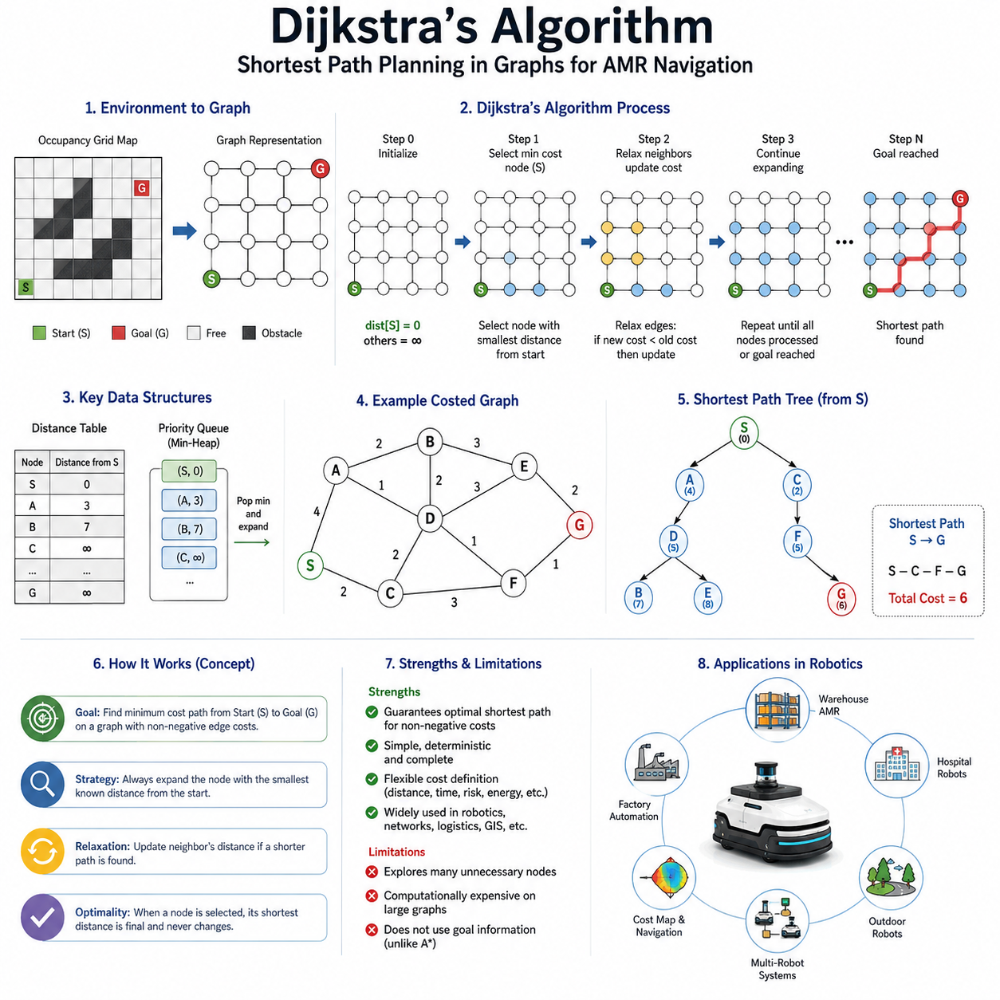
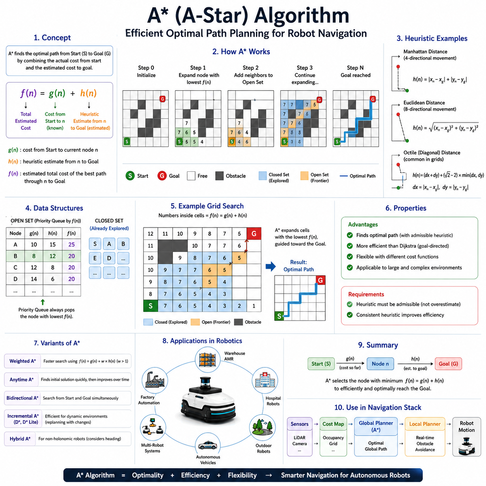
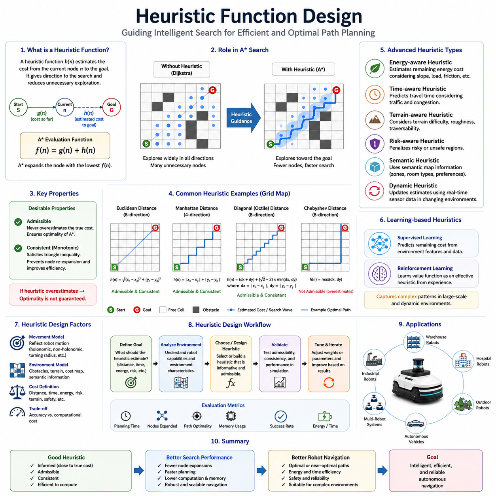
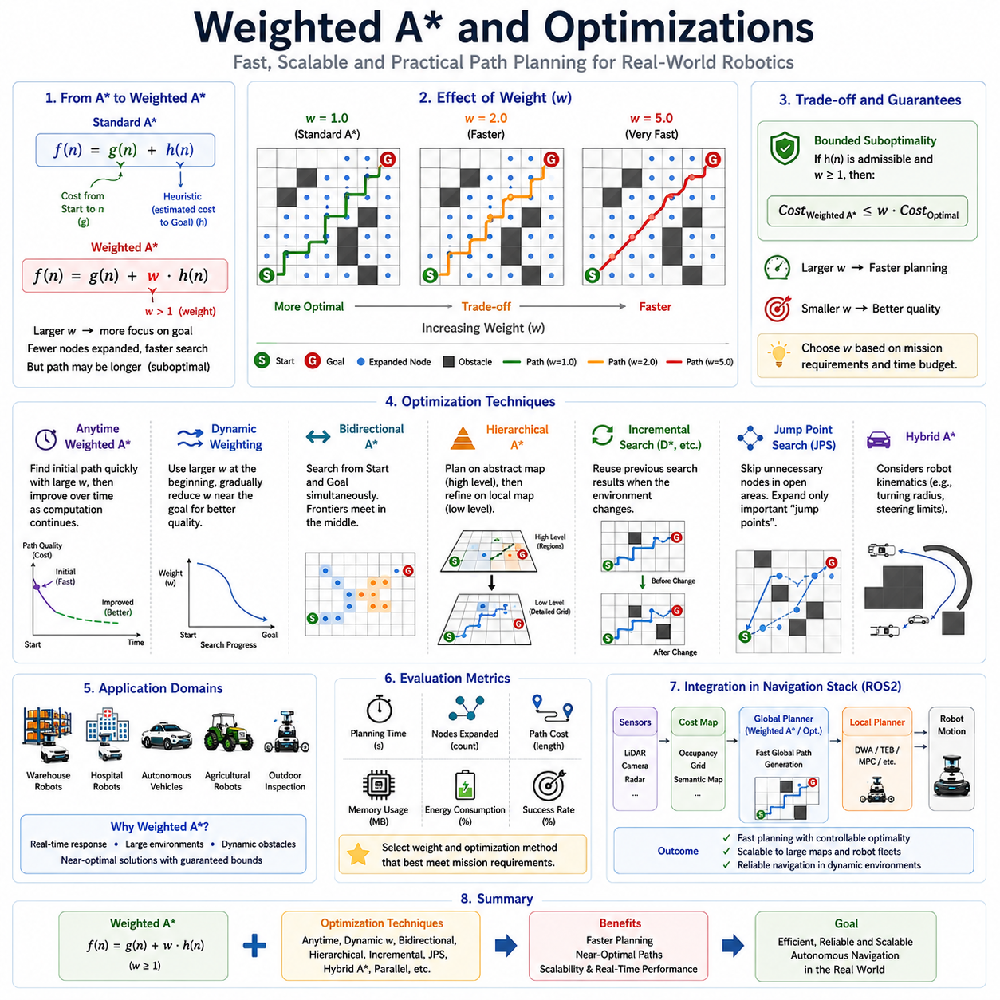
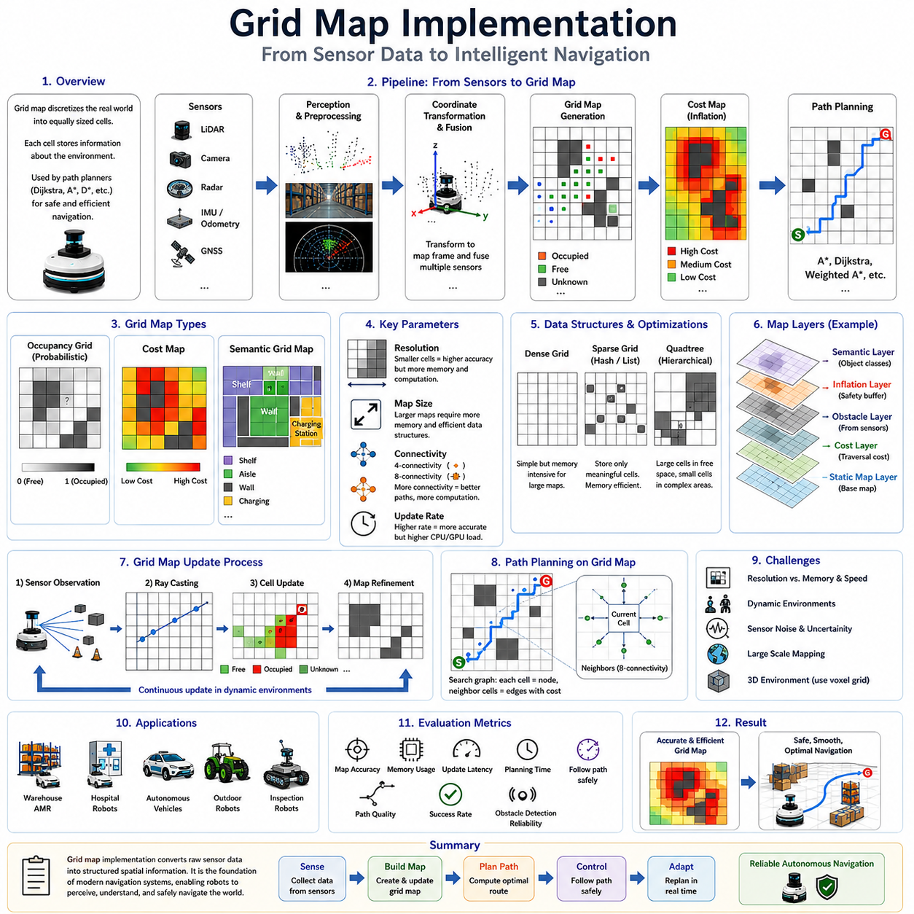
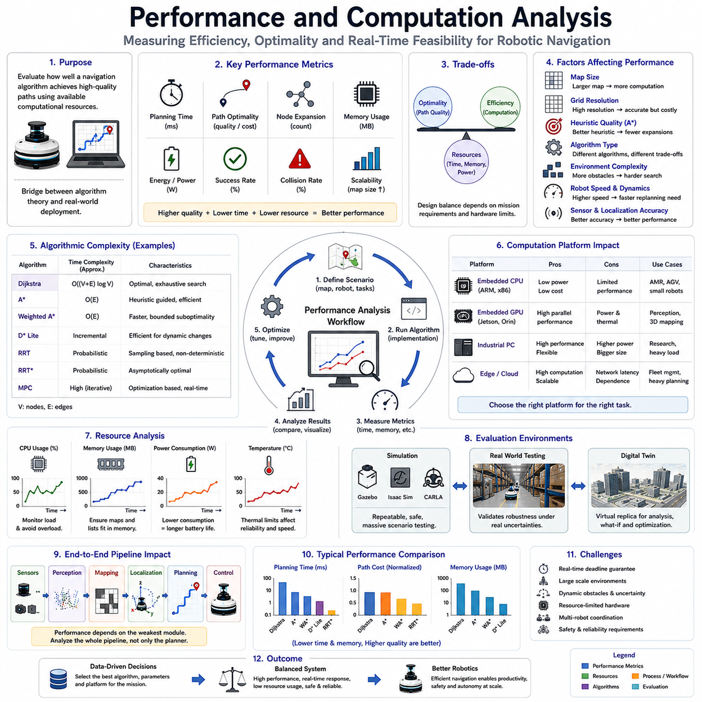
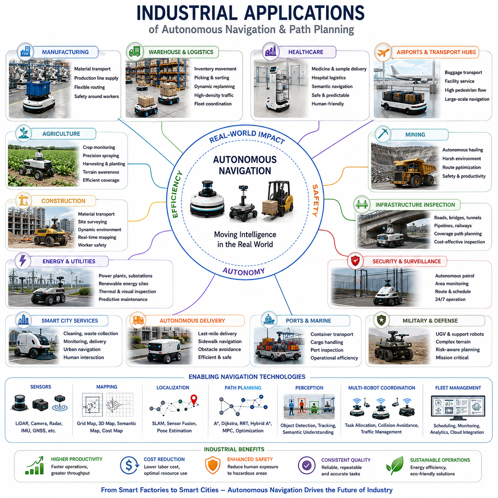
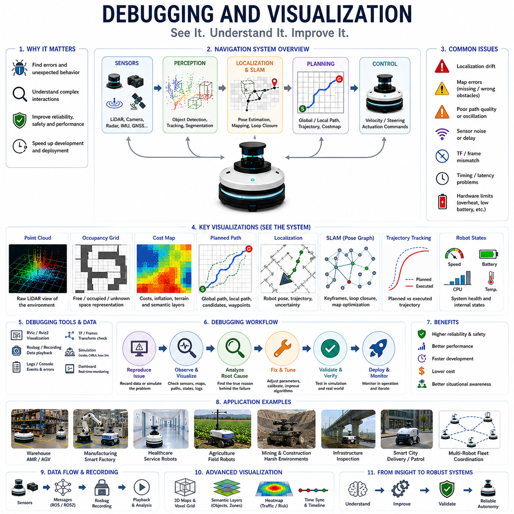

**Volume 05. Path Planning and Autonomous Navigation**


# Chapter 04. A\* and Dijkstra

##  

## 04.1 Dijkstra Algorithm

{width="7.268055555555556in" height="7.268055555555556in"}

Dijkstra\'s Algorithm is one of the most fundamental and influential path planning algorithms in the history of computer science, robotics, autonomous navigation, transportation systems, and network optimization. It serves as the foundation for many modern path planning techniques and remains an essential component in autonomous mobile robot navigation systems. Within the context of Autonomous Mobile Robots (AMRs), Dijkstra\'s Algorithm provides a systematic method for discovering the shortest path between a starting position and a destination while considering the structure of the environment represented as a graph. It is particularly valuable because it guarantees the optimal shortest path when all edge costs are non-negative, making it highly reliable for industrial and commercial navigation applications. The algorithm forms a critical bridge between map representation and actual path generation, enabling robots to transform environmental knowledge into executable navigation routes. Its position within the navigation stack makes it one of the most important global path planning algorithms studied in robotics.

The origins of Dijkstra\'s Algorithm date back to 1956 when Dutch computer scientist Edsger W. Dijkstra developed the method to solve shortest-path problems. Since its publication, the algorithm has become a cornerstone of graph theory and optimization. Despite the emergence of more advanced algorithms, Dijkstra\'s method remains widely used due to its mathematical simplicity, deterministic behavior, and guaranteed optimality. In robotics, it is often introduced as the first complete path planning algorithm before progressing to heuristic-based approaches such as A\*, sampling-based planners such as RRT, or optimization-based trajectory planners.

To understand Dijkstra\'s Algorithm, it is first necessary to understand graph-based representations of navigation environments. A graph consists of vertices, commonly referred to as nodes, and edges that connect those nodes. In a robotic navigation system, nodes may represent positions, intersections, waypoints, grid cells, or locations within a map. Edges represent traversable connections between nodes. Each edge is assigned a numerical cost representing the effort required to travel between the connected nodes. The cost may represent distance, travel time, energy consumption, terrain difficulty, risk level, or a combination of multiple navigation factors.

A robot operating in a warehouse, factory, hospital, airport, or outdoor environment typically converts its map into a graph structure before performing path planning. In grid-based maps, each cell becomes a node and neighboring cells become edges. In topological maps, important locations become nodes while corridors, roads, or paths become edges. Once the environment has been transformed into a graph, Dijkstra\'s Algorithm can systematically search for the minimum-cost route from the starting node to the goal node.

The core idea behind Dijkstra\'s Algorithm is surprisingly intuitive. The algorithm begins at the start node and progressively expands outward while maintaining the shortest known distance to every reachable node. At each step, the node with the lowest accumulated cost is selected for expansion. The algorithm then examines neighboring nodes and updates their shortest known distances if a better path is discovered. This process continues until all reachable nodes have been explored or until the destination node has been reached.

One of the key strengths of Dijkstra\'s Algorithm is its guarantee of optimality. When the algorithm selects a node for expansion, the shortest path to that node has already been determined. This property allows the algorithm to systematically construct the shortest path tree originating from the start position. As the search progresses, the robot gradually develops a complete understanding of the minimum travel cost to every accessible location in the environment.

The operation of the algorithm can be viewed as a wavefront propagation process. Starting from the source node, a virtual wave expands outward across the graph. Nodes closer to the source are explored first, while nodes farther away are explored later. The expansion resembles ripples spreading across the surface of water after a stone is dropped into a pond. Eventually, the wave reaches the goal node, at which point the shortest path has been identified.

An important concept in Dijkstra\'s Algorithm is the distance table. Each node maintains a value representing the shortest known distance from the starting node. Initially, all distances are set to infinity except for the start node, which is assigned a distance of zero. As the search progresses, these values are continuously updated whenever shorter paths are discovered. This updating process is known as relaxation. Relaxation is the fundamental operation that enables the algorithm to improve path estimates and converge toward the optimal solution.

Another critical component is the priority queue. The priority queue stores candidate nodes ordered by their accumulated distance from the start. At each iteration, the node with the smallest distance value is removed from the queue and expanded. This mechanism ensures that nodes are processed in order of increasing cost, which is essential for guaranteeing correctness and optimality.

In robotic navigation systems, Dijkstra\'s Algorithm is commonly applied to occupancy grid maps. An occupancy grid divides the environment into small cells that are classified as free, occupied, or unknown. Each free cell becomes a graph node, while adjacent cells are connected through edges. The edge cost is often proportional to the physical distance between cells. The resulting graph can contain thousands or even millions of nodes depending on map resolution. Dijkstra\'s Algorithm then searches this graph to identify the shortest route between the robot\'s current position and the desired destination.

The algorithm performs particularly well in environments where optimality is more important than computational speed. For example, industrial AMRs operating in factories often require highly reliable route generation. Since warehouse layouts are relatively stable and predictable, Dijkstra\'s Algorithm can compute globally optimal paths that maximize operational efficiency. Similarly, hospital delivery robots can use Dijkstra-based planning to ensure predictable and repeatable navigation behavior while transporting medications, laboratory samples, and medical supplies.

Outdoor autonomous robots can also benefit from Dijkstra\'s Algorithm. In agricultural robots, infrastructure inspection robots, mining vehicles, and security patrol robots, large-scale terrain maps can be represented as weighted graphs. Costs may incorporate terrain slope, surface roughness, energy consumption, or risk factors. Dijkstra\'s Algorithm then identifies routes that minimize travel effort while avoiding hazardous regions.

One of the most significant advantages of Dijkstra\'s Algorithm is its flexibility regarding cost definitions. Edge costs do not have to represent simple Euclidean distance. They may include multiple weighted factors. A navigation system may assign higher costs to narrow passages, crowded areas, slippery surfaces, steep slopes, or regions near obstacles. The planner naturally avoids expensive areas because they increase the total path cost. This capability allows engineers to incorporate safety, efficiency, and operational preferences directly into the planning process.

Despite its strengths, Dijkstra\'s Algorithm also has limitations. The most significant limitation is computational efficiency. Because the algorithm explores nodes solely based on accumulated cost and does not utilize information about the goal location, it often examines many unnecessary nodes. In large maps, this exhaustive exploration can become computationally expensive. The search region may expand in all directions, including areas far away from the desired destination. Consequently, planning time increases as map size grows.

This limitation motivated the development of heuristic-based algorithms such as A\*. A\* extends Dijkstra\'s approach by incorporating an estimate of the remaining distance to the goal. This heuristic guides the search toward the destination and significantly reduces computational effort. In fact, Dijkstra\'s Algorithm can be viewed as a special case of A\* where the heuristic value is always zero. Understanding Dijkstra\'s method therefore provides a strong conceptual foundation for understanding A\* and many other advanced path planning algorithms.

In modern ROS2 navigation systems, Dijkstra\'s Algorithm frequently appears within global planners. The planner generates a cost map that incorporates obstacle inflation, traversability information, and safety margins. Dijkstra-based search then computes the lowest-cost route through the map. The resulting path is subsequently passed to local planners such as Dynamic Window Approach (DWA) or Timed Elastic Band (TEB), which generate real-time motion commands while avoiding dynamic obstacles.

Another important application of Dijkstra\'s Algorithm is cost-to-go computation. Instead of planning from a start node to a single goal, the algorithm can compute the shortest distance from a goal node to every reachable location in the environment. The resulting cost field provides valuable information for navigation, obstacle avoidance, coverage planning, and multi-robot coordination. Many navigation frameworks exploit this capability to create navigation potential fields and global guidance maps.

Multi-robot systems also benefit from Dijkstra-based planning. Fleet management systems can use shortest-path calculations to estimate travel times, allocate tasks, optimize routes, and prevent congestion. In large industrial facilities containing dozens or hundreds of robots, efficient route planning becomes essential for maximizing productivity. Dijkstra\'s Algorithm provides a mathematically rigorous foundation for these higher-level optimization processes.

When implementing Dijkstra\'s Algorithm in practical robotic systems, developers must carefully consider memory usage, graph representation, and computational complexity. Sparse graph representations often improve efficiency. Binary heaps, Fibonacci heaps, and other priority queue structures can significantly reduce execution time. Parallel processing techniques may further accelerate planning performance on modern multicore processors and GPU-accelerated platforms.

Testing and validation play a crucial role in Dijkstra-based navigation development. Engineers typically evaluate path optimality, computation time, memory consumption, scalability, robustness, and reliability under various environmental conditions. Simulated environments provide controlled testing conditions, while field deployments validate real-world performance. Performance metrics commonly include path length, planning latency, obstacle clearance, navigation success rate, and energy consumption.

As autonomous robots continue to evolve, Dijkstra\'s Algorithm remains highly relevant. Although newer algorithms often provide faster performance, Dijkstra\'s method continues to serve as a benchmark for correctness and optimality. Many modern planners are extensions or variations of the original concept. Its mathematical rigor, deterministic behavior, and guaranteed shortest-path solution make it an indispensable tool in robotics, transportation, logistics, network routing, and intelligent autonomous systems.

In the broader context of autonomous navigation, Dijkstra\'s Algorithm represents far more than a historical path planning technique. It embodies a fundamental principle of intelligent decision-making: systematically evaluating available options to discover the most efficient route toward a goal. Whether navigating a warehouse AMR, a hospital service robot, an outdoor inspection platform, an autonomous vehicle, or a future embodied AI system, the concepts introduced by Dijkstra continue to influence the design of navigation architectures throughout the robotics industry. Its role as the foundational shortest-path algorithm ensures that it will remain an essential topic for engineers, researchers, and developers working in autonomous navigation for many years to come.

다익스트라 알고리즘(Dijkstra Algorithm)은 컴퓨터 과학, 로봇공학, 자율주행, 교통 시스템, 네트워크 최적화 분야에서 가장 기본적이면서도 영향력이 큰 경로 계획 알고리즘 중 하나이다. 이 알고리즘은 현대 경로 계획 기술의 기초를 제공하며, 오늘날에도 자율이동로봇(AMR)의 내비게이션 시스템에서 핵심적인 역할을 수행하고 있다. AMR의 관점에서 다익스트라 알고리즘은 그래프(Graph)로 표현된 환경 내에서 시작 위치와 목표 위치 사이의 최단 경로를 찾기 위한 체계적인 방법을 제공한다. 특히 모든 간선(Edge)의 비용이 음수가 아닌 경우 최적의 최단 경로를 반드시 보장한다는 점에서 산업용 로봇 및 상업용 로봇 시스템에서 매우 신뢰할 수 있는 알고리즘으로 평가된다. 이 알고리즘은 지도 표현(Map Representation)과 실제 경로 생성(Path Generation)을 연결하는 중요한 역할을 수행하며, 환경 정보를 실제 주행 가능한 경로로 변환하는 핵심 기술이다. 따라서 로봇 내비게이션 분야에서 가장 중요한 전역 경로 계획(Global Path Planning) 알고리즘 중 하나로 간주된다.

다익스트라 알고리즘은 1956년 네덜란드의 컴퓨터 과학자인 Edsger W. Dijkstra에 의해 개발되었다. 발표 이후 지금까지 최단 경로 문제를 해결하는 대표적인 알고리즘으로 자리 잡았으며, 그래프 이론과 최적화 분야의 핵심 기반 기술이 되었다. 이후 수많은 고급 알고리즘들이 등장했지만, 다익스트라 알고리즘은 수학적 단순성, 결정론적 동작 방식, 그리고 최적 해를 보장하는 특성 때문에 여전히 널리 사용되고 있다. 로봇 공학에서는 일반적으로 A\*, RRT, 최적화 기반 경로 계획 기법 등을 학습하기 전에 가장 먼저 배우는 기본 경로 계획 알고리즘으로 활용된다.

다익스트라 알고리즘을 이해하기 위해서는 먼저 그래프 기반 환경 표현에 대한 이해가 필요하다. 그래프는 노드(Node)와 이를 연결하는 간선(Edge)으로 구성된다. 로봇 내비게이션 시스템에서는 노드가 특정 위치, 교차점, 웨이포인트, 격자 셀(Grid Cell) 등을 의미할 수 있다. 간선은 두 노드 사이를 이동할 수 있는 연결 관계를 나타낸다. 각 간선에는 비용(Cost)이 부여되며, 이 비용은 이동 거리, 소요 시간, 에너지 소비량, 지형 난이도, 위험도 등 다양한 요소를 반영할 수 있다.

창고, 공장, 병원, 공항 또는 실외 환경에서 운용되는 로봇은 일반적으로 경로 계획을 수행하기 전에 환경 지도를 그래프 구조로 변환한다. 격자 기반 지도에서는 각 셀이 노드가 되고 인접한 셀들이 간선으로 연결된다. 위상 지도(Topological Map)에서는 주요 위치가 노드가 되고 복도나 도로가 간선이 된다. 이렇게 생성된 그래프를 기반으로 다익스트라 알고리즘은 시작 지점에서 목적지까지의 최소 비용 경로를 탐색한다.

다익스트라 알고리즘의 핵심 아이디어는 매우 직관적이다. 알고리즘은 시작 노드에서 출발하여 모든 노드에 대한 최단 거리를 점진적으로 계산해 나간다. 각 단계에서는 현재까지 발견된 경로 중 누적 비용이 가장 작은 노드를 선택한다. 이후 해당 노드와 연결된 이웃 노드를 탐색하면서 더 짧은 경로가 발견되면 거리를 갱신한다. 이러한 과정은 모든 도달 가능한 노드를 탐색하거나 목적지에 도달할 때까지 반복된다.

이 알고리즘의 가장 큰 장점 중 하나는 최적성을 보장한다는 점이다. 특정 노드가 탐색 대상으로 선택되는 순간, 해당 노드까지의 최단 경로는 이미 확정된 상태가 된다. 이러한 특성 덕분에 알고리즘은 시작 지점으로부터 모든 노드까지의 최단 경로 트리를 체계적으로 구축할 수 있다. 탐색이 진행될수록 로봇은 환경 내 각 위치까지 이동하는 데 필요한 최소 비용을 정확하게 파악하게 된다.

다익스트라 알고리즘의 동작은 물결이 퍼져 나가는 과정으로 비유할 수 있다. 시작 노드에서 발생한 가상의 파동이 그래프 전체로 점차 확산되는 형태이다. 시작점에 가까운 노드들이 먼저 탐색되고 먼 노드들은 나중에 탐색된다. 이는 마치 물에 돌을 던졌을 때 동심원 형태의 파동이 퍼져 나가는 모습과 유사하다. 결국 이 파동이 목표 노드에 도달하면 최단 경로가 완성된다.

알고리즘에서 중요한 개념 중 하나는 거리 테이블(Distance Table)이다. 각 노드는 시작점으로부터의 현재 최단 거리를 저장한다. 초기 상태에서는 시작 노드를 제외한 모든 노드의 거리가 무한대(Infinity)로 설정된다. 탐색이 진행되면서 더 짧은 경로가 발견될 경우 해당 값이 갱신된다. 이러한 갱신 과정을 완화(Relaxation)라고 하며, 다익스트라 알고리즘의 핵심 연산이다.

또 다른 중요한 요소는 우선순위 큐(Priority Queue)이다. 우선순위 큐는 탐색 후보 노드들을 누적 거리 기준으로 정렬하여 관리한다. 매 단계마다 가장 작은 비용을 가진 노드가 선택되어 확장된다. 이러한 구조 덕분에 알고리즘은 비용이 증가하는 순서대로 노드를 처리할 수 있으며, 최단 경로 보장이라는 중요한 특성을 유지할 수 있다.

로봇 내비게이션 시스템에서는 다익스트라 알고리즘이 점유 격자 지도(Occupancy Grid Map)에 자주 적용된다. 점유 격자 지도는 환경을 작은 셀 단위로 나누어 자유 공간, 장애물, 미확인 영역으로 구분한다. 자유 공간 셀은 노드가 되고 인접 셀들은 간선으로 연결된다. 간선 비용은 일반적으로 실제 이동 거리와 비례한다. 지도 해상도에 따라 수천 개에서 수백만 개의 노드가 생성될 수 있으며, 다익스트라 알고리즘은 이러한 그래프에서 최단 경로를 계산한다.

이 알고리즘은 특히 계산 속도보다 경로의 최적성이 중요한 환경에서 높은 가치를 가진다. 예를 들어 산업용 AMR은 매우 안정적이고 예측 가능한 경로를 요구한다. 창고와 공장의 구조는 상대적으로 고정되어 있기 때문에 다익스트라 알고리즘은 운영 효율을 극대화하는 전역 최적 경로를 생성할 수 있다. 병원 물류 로봇 역시 약품, 검체, 의료 물품을 운반할 때 예측 가능한 경로 계획이 중요하므로 다익스트라 기반 경로 계획이 효과적으로 활용된다.

실외 자율주행 로봇에서도 다익스트라 알고리즘은 유용하다. 농업 로봇, 지하시설 점검 로봇, 광산 차량, 보안 순찰 로봇 등은 대규모 지형 지도를 그래프로 변환하여 활용할 수 있다. 이 경우 비용에는 거리뿐 아니라 경사도, 노면 상태, 에너지 소비량, 위험도 등의 요소가 포함될 수 있다. 알고리즘은 이러한 정보를 종합하여 최소 비용 경로를 계산한다.

다익스트라 알고리즘의 또 다른 강점은 비용 정의의 유연성이다. 비용은 단순한 거리일 필요가 없다. 좁은 통로, 혼잡한 지역, 미끄러운 노면, 급경사 지역, 장애물 근처 영역 등에 높은 비용을 부여할 수 있다. 그러면 알고리즘은 자연스럽게 이러한 위험 지역을 회피하는 경로를 생성하게 된다. 이를 통해 안전성, 효율성, 운영 정책 등을 경로 계획 과정에 직접 반영할 수 있다.

하지만 다익스트라 알고리즘에도 한계는 존재한다. 가장 대표적인 문제는 계산 효율성이다. 알고리즘은 목표 지점에 대한 정보를 사용하지 않기 때문에 목적지와 관계없는 영역까지 광범위하게 탐색할 수 있다. 따라서 지도 규모가 커질수록 탐색해야 하는 노드 수가 급격히 증가한다. 결과적으로 계산 시간이 증가하고 메모리 사용량도 커질 수 있다.

이러한 한계를 해결하기 위해 등장한 것이 A\* 알고리즘이다. A는 다익스트라 알고리즘에 휴리스틱(Heuristic)을 추가하여 목표 방향으로 탐색을 유도한다. 이를 통해 불필요한 탐색을 줄이고 계산 속도를 크게 향상시킨다. 실제로 다익스트라 알고리즘은 휴리스틱 값이 항상 0인 특수한 형태의 A라고 볼 수 있다. 따라서 다익스트라 알고리즘을 이해하는 것은 A\*와 같은 고급 경로 계획 기법을 이해하는 데 매우 중요한 기반이 된다.

현대의 ROS2 내비게이션 시스템에서도 다익스트라 알고리즘은 전역 경로 계획기(Global Planner)의 핵심 요소로 사용된다. 비용 지도(Cost Map)에는 장애물, 안전 거리, 통행 가능 영역 등의 정보가 포함된다. 다익스트라 기반 탐색은 이 비용 지도를 이용하여 최적의 전역 경로를 계산한다. 이후 계산된 경로는 DWA(Dynamic Window Approach)나 TEB(Timed Elastic Band)와 같은 지역 경로 계획기(Local Planner)로 전달되어 실제 속도 명령으로 변환된다.

다익스트라 알고리즘은 Cost-to-Go 계산에도 널리 사용된다. 특정 목표 지점에서 시작하여 환경 내 모든 위치까지의 최소 비용을 계산할 수 있다. 이렇게 생성된 비용 필드는 전역 유도 지도(Global Guidance Map), 장애물 회피, 커버리지 계획, 다중 로봇 협업 등에 활용될 수 있다.

다중 로봇 시스템에서도 다익스트라 알고리즘은 중요한 역할을 수행한다. Fleet Management System(FMS)은 최단 경로 계산 결과를 이용하여 이동 시간 예측, 작업 할당, 경로 최적화, 교통 혼잡 완화 등을 수행할 수 있다. 수십 대에서 수백 대의 로봇이 동시에 운영되는 대규모 물류 환경에서는 이러한 기능이 매우 중요하다.

실제 시스템 구현 시에는 메모리 사용량, 그래프 표현 방식, 계산 복잡도 등을 신중하게 고려해야 한다. 희소 그래프(Sparse Graph)를 활용하면 효율성을 높일 수 있으며, Binary Heap, Fibonacci Heap 등의 자료구조를 사용하면 우선순위 큐 성능을 개선할 수 있다. 최근에는 멀티코어 CPU와 GPU를 이용한 병렬 처리 기법도 적용되고 있다.

다익스트라 기반 내비게이션 시스템의 개발에서는 테스트와 검증이 매우 중요하다. 일반적으로 경로 길이, 계산 시간, 메모리 사용량, 확장성, 안정성, 성공률 등을 평가한다. 시뮬레이션 환경에서는 다양한 시나리오를 반복적으로 검증할 수 있으며, 실제 현장 테스트를 통해 실운용 성능을 확인한다. 주요 성능 지표로는 경로 길이, 계획 시간, 장애물 이격 거리, 주행 성공률, 에너지 소비량 등이 사용된다.

자율주행 기술이 발전함에 따라 다익스트라 알고리즘의 중요성은 여전히 유지되고 있다. 비록 더 빠른 알고리즘들이 등장했지만, 다익스트라는 최적 경로의 기준(Benchmark)으로 널리 사용된다. 또한 현대의 많은 경로 계획 기법들이 다익스트라의 개념을 기반으로 발전해 왔다. 수학적 엄밀성, 결정론적 동작, 최단 경로 보장이라는 특성은 앞으로도 로봇공학, 물류, 교통, 네트워크 분야에서 지속적으로 활용될 것이다.

자율주행 시스템의 관점에서 다익스트라 알고리즘은 단순한 역사적 알고리즘이 아니다. 그것은 목표를 향해 나아가기 위해 가능한 선택지를 체계적으로 평가하고 가장 효율적인 경로를 찾아내는 지능적 의사결정의 기본 원리를 구현한 기술이다. 창고 AMR, 병원 서비스 로봇, 실외 순찰 로봇, GPR 기반 지하시설 점검 로봇, 자율주행 차량, 미래의 Embodied AI 로봇에 이르기까지 다익스트라 알고리즘의 개념은 다양한 내비게이션 시스템의 설계에 계속 활용되고 있다. 이러한 이유로 다익스트라 알고리즘은 자율주행과 경로 계획을 연구하는 모든 엔지니어와 연구자가 반드시 이해해야 할 핵심 기술로 남아 있다.

##  

## 04.2 A\* Algorithm

{width="7.268055555555556in" height="7.268055555555556in"}

A\* Algorithm, commonly pronounced as "A-Star," is one of the most widely used path planning algorithms in robotics, autonomous vehicles, video games, logistics systems, and intelligent navigation applications. It is considered one of the most important advancements in graph-based search and shortest-path planning because it combines the guaranteed optimality of Dijkstra's Algorithm with intelligent goal-directed search behavior. Within Autonomous Mobile Robot (AMR) navigation systems, A\* serves as a foundational global path planning algorithm capable of efficiently finding an optimal path between a start position and a destination while minimizing unnecessary exploration. As a result, A\* has become the de facto standard for many robotic navigation frameworks, including ROS and ROS2 navigation stacks, where reliable and computationally efficient path generation is required.

The primary objective of path planning is to determine a safe, feasible, and efficient route from a robot's current location to a target destination. In a simple environment, the shortest path may appear obvious. However, in realistic environments containing obstacles, narrow corridors, restricted zones, dynamic constraints, and varying terrain costs, identifying the optimal route becomes a complex optimization problem. A\* addresses this challenge by systematically searching through the environment while using additional knowledge about the destination to guide the search process. This goal-directed behavior dramatically improves efficiency compared to exhaustive search methods.

To understand A\*, it is useful to first understand its relationship with Dijkstra's Algorithm. Dijkstra's Algorithm expands nodes purely based on the accumulated cost from the start position. Although this guarantees optimality, it often causes the search to expand uniformly in all directions, including areas unrelated to the destination. Consequently, many unnecessary nodes are explored. A\* improves upon this behavior by introducing a heuristic function that estimates the remaining cost to the goal. Instead of considering only the cost already traveled, the algorithm also evaluates the estimated cost still required to reach the destination. This additional information allows the search to move more directly toward the target.

The central idea behind A\* is remarkably elegant. Every node in the graph is assigned an evaluation score that represents the estimated total cost of traveling from the start node to the goal node through that particular node. This evaluation score consists of two components. The first component is the accumulated cost from the start position to the current node. The second component is a heuristic estimate of the remaining distance from the current node to the goal. By combining these two values, A\* balances knowledge of the path already traveled with an estimate of future travel effort.

The accumulated cost is typically denoted as g(n). This value represents the exact cost of reaching node n from the starting position. The heuristic estimate is represented as h(n), which predicts the remaining cost required to reach the goal. The total evaluation function is expressed as f(n) = g(n) + h(n). The algorithm continuously selects the node with the lowest f-value for expansion. As a result, nodes that appear to lead efficiently toward the goal are prioritized, while nodes that are unlikely to contribute to an optimal solution receive lower priority.

The heuristic function is the defining feature of A\*. The quality of the heuristic directly influences the efficiency of the search. A good heuristic provides a close approximation of the actual remaining distance without overestimating it. If the heuristic is too weak, the algorithm behaves similarly to Dijkstra's Algorithm and explores many unnecessary nodes. If the heuristic is overly aggressive and overestimates the true cost, optimality may no longer be guaranteed. Therefore, heuristic design is one of the most important considerations in A\* implementation.

Several heuristic functions are commonly used in robotic navigation. For grid-based environments allowing only horizontal and vertical movement, Manhattan Distance is frequently applied. This heuristic measures the sum of horizontal and vertical distances between the current node and the goal. In environments where movement is allowed in any direction, Euclidean Distance often provides a more accurate estimate. Some applications utilize Diagonal Distance, Chebyshev Distance, or customized cost-aware heuristics that incorporate environmental characteristics such as terrain difficulty, risk levels, or energy consumption.

The operation of A\* begins by placing the starting node into an open set. The open set contains nodes that have been discovered but not yet fully explored. The algorithm repeatedly selects the node with the lowest evaluation score from this set. Once selected, the node is expanded and its neighboring nodes are examined. For each neighbor, the algorithm calculates the tentative path cost through the current node. If this path provides a lower cost than previously known routes, the neighbor's information is updated accordingly. The process continues until the goal node is selected for expansion, at which point the optimal path has been found.

An important data structure used in A\* is the priority queue. The priority queue maintains the open set and ensures that the node with the lowest evaluation score can be efficiently selected. Modern implementations often use binary heaps, Fibonacci heaps, or other optimized structures to improve computational performance. Alongside the open set, A\* also maintains a closed set that contains nodes that have already been explored. This prevents repeated processing of the same nodes and improves overall efficiency.

The search process can be visualized as a directed wave moving toward the goal. Unlike Dijkstra's Algorithm, which expands uniformly in all directions, A\* generates a more focused search region. The heuristic pulls the search toward the destination, reducing exploration of irrelevant areas. This behavior significantly decreases computational requirements, particularly in large-scale environments.

A\* is especially effective in occupancy grid maps commonly used by mobile robots. In such maps, the environment is divided into discrete cells representing free space, obstacles, and unknown regions. Each free cell corresponds to a graph node, while adjacent cells are connected through edges. The planner evaluates possible routes through these cells while considering both travel cost and estimated remaining distance. The result is a globally optimal path that efficiently guides the robot toward its destination.

In industrial AMR applications, A\* is frequently used for warehouse navigation. Modern fulfillment centers contain complex layouts with storage racks, workstations, loading zones, and dynamic traffic patterns. A\* enables robots to efficiently calculate routes that minimize travel distance while respecting safety constraints and operational policies. Because warehouse environments often require frequent replanning, the computational efficiency of A\* is particularly valuable.

Hospital service robots also benefit from A\*-based navigation. These robots transport medications, laboratory samples, meals, and medical supplies throughout healthcare facilities. Hospital environments contain numerous corridors, patient rooms, elevators, and restricted areas. A\* can efficiently compute safe routes while incorporating cost penalties for crowded regions or restricted access zones. This capability improves both operational efficiency and patient safety.

Outdoor autonomous robots represent another major application domain. Security patrol robots, agricultural robots, infrastructure inspection systems, delivery robots, and autonomous vehicles frequently utilize A\*-based planning. In these scenarios, edge costs may represent terrain roughness, slope angle, energy consumption, weather conditions, or operational risk. The planner naturally favors routes with lower overall cost, resulting in safer and more efficient navigation behavior.

One of the major advantages of A\* is its ability to incorporate sophisticated cost functions. The path planner does not simply minimize geometric distance. Instead, it can optimize a weighted combination of multiple factors. Areas near obstacles may receive higher costs to increase safety margins. Slippery surfaces may be assigned penalties to reduce risk. Steep slopes may be discouraged to conserve energy and maintain vehicle stability. Through careful cost-map design, engineers can shape robot behavior without modifying the underlying search algorithm.

The performance of A\* depends heavily on map size and heuristic quality. In small environments, computational requirements are typically modest. However, in large maps containing millions of nodes, planning complexity can become significant. Various optimization techniques have therefore been developed to improve scalability. These include hierarchical A\*, weighted A\*, anytime A\*, bidirectional A\*, incremental A\*, and hybrid planning approaches that combine graph search with trajectory optimization.

Weighted A\* introduces an adjustable weighting factor that increases the influence of the heuristic function. This often reduces computation time but may sacrifice strict optimality. Anytime A\* quickly generates an initial solution and progressively improves path quality as additional computation time becomes available. Incremental variants such as D\* and D\* Lite efficiently update paths when environmental conditions change. These extensions build upon the fundamental concepts introduced by the original A\* framework.

In modern ROS2 navigation systems, A\* frequently operates within the Global Planner component. Cost maps generated from LiDAR, cameras, radar, and occupancy grids provide environmental information. The planner computes a collision-free global path, which is subsequently followed by local planners such as Dynamic Window Approach (DWA), Timed Elastic Band (TEB), or Model Predictive Control (MPC). The separation between global and local planning enables robots to achieve both long-range route optimization and real-time obstacle avoidance.

A\* also plays an important role in multi-robot systems. Fleet management platforms use shortest-path calculations to estimate travel times, coordinate robot movement, allocate tasks, and optimize traffic flow. In large facilities containing hundreds of robots, efficient path planning contributes directly to operational productivity. A\*-based routing often serves as the foundation for higher-level scheduling and dispatching algorithms.

Theoretical analysis of A\* reveals several important properties. When the heuristic is admissible, meaning it never overestimates the true remaining cost, A\* is guaranteed to find an optimal solution. When the heuristic is also consistent, the algorithm avoids unnecessary node re-expansion and achieves improved efficiency. These mathematical guarantees make A\* highly attractive for safety-critical robotic applications where reliability and predictability are essential.

Testing and validation are critical components of A\* deployment. Engineers evaluate planning latency, path optimality, memory usage, obstacle clearance, navigation success rate, and scalability across diverse environments. Simulation platforms such as Gazebo and Isaac Sim allow extensive experimentation before real-world deployment. Field testing then validates performance under realistic operational conditions involving dynamic obstacles, sensor noise, communication delays, and environmental uncertainty.

Although many advanced path planning methods have emerged, A\* remains one of the most influential and practical algorithms in robotics. It offers an excellent balance between optimality, efficiency, simplicity, and adaptability. Its intuitive design makes it accessible to beginners, while its extensibility allows sophisticated customization for advanced applications. Many modern navigation algorithms are either direct extensions of A\* or incorporate similar heuristic-guided search principles.

As autonomous systems continue to evolve toward greater intelligence and autonomy, A\* remains a fundamental building block within navigation architectures. Whether guiding a warehouse robot through storage aisles, directing a hospital delivery robot across multiple floors, planning routes for outdoor inspection robots, coordinating autonomous vehicle traffic, or supporting future embodied AI systems, A\* continues to provide a reliable and efficient mechanism for intelligent path planning. Its combination of mathematical rigor, practical effectiveness, and broad applicability ensures that it will remain one of the most important algorithms in autonomous navigation for decades to come.

A\* 알고리즘(A-Star Algorithm)은 로봇공학, 자율주행차, 비디오 게임, 물류 시스템, 지능형 내비게이션 분야에서 가장 널리 사용되는 경로 계획 알고리즘 중 하나이다. 이 알고리즘은 다익스트라 알고리즘의 최적성 보장 특성과 목표 지향적 탐색 능력을 결합한 대표적인 그래프 기반 경로 탐색 기법으로 평가받는다. 자율이동로봇(AMR) 내비게이션 시스템에서는 시작 위치에서 목적지까지의 최적 경로를 효율적으로 탐색하면서도 불필요한 계산을 최소화할 수 있기 때문에 매우 중요한 전역 경로 계획(Global Path Planning) 알고리즘으로 사용된다. 현재 ROS 및 ROS2 Navigation Stack을 포함한 대부분의 로봇 내비게이션 프레임워크에서 표준적인 전역 경로 계획 기법으로 활용되고 있다.

경로 계획의 기본 목표는 로봇의 현재 위치에서 목표 지점까지 안전하고 효율적이며 실행 가능한 경로를 생성하는 것이다. 단순한 환경에서는 최단 경로를 찾는 것이 어렵지 않지만, 실제 환경에는 장애물, 좁은 통로, 접근 제한 구역, 다양한 지형 조건, 안전 규정 등이 존재한다. 이러한 요소들이 결합되면 최적 경로를 찾는 문제는 매우 복잡한 최적화 문제로 변한다. A\* 알고리즘은 이러한 문제를 해결하기 위해 환경을 체계적으로 탐색하면서도 목표 위치에 대한 정보를 활용하여 보다 효율적으로 탐색을 수행한다.

A\* 알고리즘을 이해하기 위해서는 먼저 다익스트라 알고리즘과의 관계를 이해하는 것이 중요하다. 다익스트라 알고리즘은 시작점으로부터의 누적 비용만을 고려하여 탐색을 수행한다. 따라서 최적 경로는 보장되지만 목적지와 관련 없는 영역까지 광범위하게 탐색하게 된다. 결과적으로 계산량이 증가하고 탐색 효율이 낮아질 수 있다. A\*는 여기에 휴리스틱(Heuristic) 함수를 추가하여 현재 위치에서 목표 지점까지의 예상 비용을 함께 고려한다. 이로 인해 탐색은 목적지 방향으로 유도되며 불필요한 영역 탐색이 크게 줄어든다.

A\* 알고리즘의 핵심 개념은 매우 간단하면서도 강력하다. 각 노드에 대해 전체 예상 비용을 계산하고, 그 값이 가장 작은 노드를 우선적으로 탐색한다. 이 전체 예상 비용은 두 개의 요소로 구성된다. 첫 번째는 시작 지점에서 현재 노드까지 실제로 이동하는 데 소요된 비용이며, 두 번째는 현재 노드에서 목표 지점까지 남아 있는 비용을 추정한 값이다. 알고리즘은 이 두 값을 합산하여 가장 유망한 경로를 선택한다.

시작 지점부터 현재 노드까지의 실제 비용은 일반적으로 g(n)으로 표현된다. 이는 정확하게 계산 가능한 값이며 이미 이동한 경로의 비용을 의미한다. 현재 노드에서 목표 지점까지의 예상 비용은 h(n)으로 표현된다. 이는 휴리스틱 함수에 의해 계산되는 추정값이다. 최종 평가 함수는 f(n)=g(n)+h(n)으로 정의된다. A\* 알고리즘은 항상 가장 작은 f값을 가지는 노드를 선택하여 탐색을 진행한다.

휴리스틱 함수는 A\* 알고리즘의 핵심 요소이다. 휴리스틱의 품질이 탐색 성능을 결정한다고 해도 과언이 아니다. 이상적인 휴리스틱은 실제 남은 비용에 매우 가까운 값을 제공하면서도 절대로 실제 비용보다 크게 추정하지 않아야 한다. 만약 휴리스틱이 너무 약하면 A\*는 다익스트라 알고리즘과 거의 동일하게 동작하게 된다. 반대로 휴리스틱이 실제 비용보다 과도하게 큰 값을 반환하면 최적 경로 보장이 깨질 수 있다.

로봇 내비게이션에서는 다양한 휴리스틱 함수가 사용된다. 격자 기반 환경에서 상하좌우 이동만 허용되는 경우에는 Manhattan Distance가 자주 사용된다. 이는 가로 거리와 세로 거리의 합으로 계산된다. 대각선 이동이 가능하거나 연속 공간에서 이동하는 경우에는 Euclidean Distance가 일반적으로 사용된다. 또한 Chebyshev Distance나 Diagonal Distance와 같은 방식도 활용될 수 있다. 산업용 환경에서는 단순 거리뿐 아니라 에너지 소비량, 위험도, 지형 난이도 등을 반영하는 맞춤형 휴리스틱도 적용된다.

A\* 알고리즘은 먼저 시작 노드를 Open Set에 추가하면서 시작된다. Open Set은 이미 발견되었지만 아직 완전히 탐색되지 않은 노드들의 집합이다. 알고리즘은 반복적으로 Open Set에서 가장 작은 f값을 가진 노드를 선택한다. 선택된 노드는 확장(Expansion)되며 인접 노드들이 검사된다. 각 이웃 노드에 대해 새로운 경로 비용을 계산하고, 기존보다 더 짧은 경로가 발견되면 정보를 갱신한다. 이 과정은 목표 노드가 선택될 때까지 반복된다.

A\* 구현에서는 우선순위 큐(Priority Queue)가 중요한 역할을 수행한다. 우선순위 큐는 Open Set을 관리하며 가장 작은 f값을 가진 노드를 빠르게 선택할 수 있도록 해준다. 일반적으로 Binary Heap이나 Fibonacci Heap 같은 자료구조가 사용된다. 또한 Closed Set이라는 구조도 사용되는데, 이는 이미 탐색이 완료된 노드를 저장하여 중복 계산을 방지한다.

A의 탐색 과정을 시각적으로 표현하면 목표 지점 방향으로 이동하는 지능적인 파동과 같다. 다익스트라 알고리즘이 사방으로 동일하게 퍼져나가는 탐색을 수행하는 반면, A는 휴리스틱의 도움을 받아 목표 방향으로 탐색을 집중시킨다. 이 때문에 훨씬 적은 노드를 방문하면서도 동일한 최적 경로를 찾을 수 있다.

A는 이동 로봇에서 사용되는 Occupancy Grid Map 환경에서 특히 효과적이다. 환경은 작은 셀들로 분할되며 각 셀은 자유 공간, 장애물 또는 미확인 영역으로 분류된다. 자유 공간 셀은 그래프의 노드가 되고 인접 셀은 간선으로 연결된다. A는 이러한 그래프를 탐색하여 장애물을 회피하면서 최적 경로를 생성한다.

산업용 AMR에서는 창고 내비게이션에 A가 광범위하게 사용된다. 현대 물류센터는 수많은 선반, 작업 구역, 적재 공간, 통행 경로로 구성되어 있다. A는 이러한 복잡한 환경에서 최적 경로를 계산하며 운영 효율을 극대화한다. 특히 로봇이 반복적으로 경로를 재계산해야 하는 상황에서 높은 계산 효율성을 제공한다.

병원 서비스 로봇 역시 A\* 기반 경로 계획을 활용한다. 약품 운반, 검체 이송, 식사 배달, 의료 물류 지원 등의 업무를 수행하는 로봇은 복잡한 병원 구조 내에서 안전한 경로를 찾아야 한다. A\*는 복도, 병실, 엘리베이터, 출입 제한 구역 등을 고려하여 효율적인 이동 경로를 생성한다.

실외 자율주행 로봇에서도 A는 중요한 역할을 한다. 보안 순찰 로봇, 농업 로봇, 시설 점검 로봇, 배달 로봇, 자율주행 차량 등은 경로 계획 과정에서 A를 활용할 수 있다. 이 경우 비용에는 단순 거리뿐 아니라 경사도, 노면 상태, 에너지 소비량, 기상 조건, 위험 요소 등이 포함될 수 있다.

A\*의 중요한 장점 중 하나는 다양한 비용 함수를 적용할 수 있다는 점이다. 경로 계획은 단순히 가장 짧은 거리를 찾는 것이 아니라 여러 조건을 동시에 고려할 수 있다. 장애물 근처에는 높은 비용을 부여하여 안전 거리를 확보할 수 있으며, 미끄러운 노면이나 위험 지역에는 추가 비용을 적용할 수 있다. 급경사 지역은 에너지 절약과 안정성 확보를 위해 높은 비용을 부여할 수도 있다. 이러한 방식으로 로봇의 행동 특성을 세밀하게 조정할 수 있다.

A의 성능은 지도 크기와 휴리스틱 품질에 크게 영향을 받는다. 작은 환경에서는 계산 부담이 크지 않지만, 수백만 개 이상의 노드를 포함하는 대규모 지도에서는 계산량이 상당히 증가할 수 있다. 이를 해결하기 위해 다양한 확장 알고리즘이 개발되었다. 대표적으로 Weighted A, Anytime A\*, Bidirectional A\*, Incremental A\*, Hybrid A\* 등이 있다.

Weighted A는 휴리스틱의 영향력을 강화하여 계산 속도를 높인다. 다만 최적성은 일부 희생될 수 있다. Anytime A는 빠르게 초기 경로를 생성한 후 시간이 허용되는 범위 내에서 지속적으로 경로 품질을 향상시킨다. D\* 및 D\* Lite와 같은 Incremental 알고리즘은 환경 변화에 따라 경로를 효율적으로 갱신할 수 있도록 설계되었다. 이러한 알고리즘들은 모두 A\*의 기본 개념을 확장한 형태이다.

ROS2 Navigation Stack에서는 A\*가 Global Planner 내부에서 동작하는 경우가 많다. LiDAR, 카메라, 레이더 및 점유 지도 기반으로 생성된 Cost Map을 이용하여 충돌 없는 전역 경로를 생성한다. 이후 이 경로는 DWA, TEB, MPC와 같은 Local Planner에 전달되어 실제 주행 명령으로 변환된다. 이러한 구조는 전역 최적화와 실시간 장애물 회피를 동시에 가능하게 한다.

다중 로봇 시스템에서도 A\*는 핵심 기술이다. Fleet Management System은 최단 경로 계산 결과를 이용하여 이동 시간 예측, 작업 할당, 교통 제어, 경로 예약 등을 수행한다. 수백 대의 로봇이 동시에 운영되는 대규모 물류 환경에서는 이러한 기능이 생산성 향상에 직접적인 영향을 미친다.

이론적으로 A\*는 매우 중요한 특성을 가진다. 휴리스틱이 실제 비용을 절대 초과하지 않는 Admissible Heuristic 조건을 만족하면 최적 경로가 보장된다. 또한 Consistent Heuristic 조건까지 만족하면 불필요한 노드 재탐색을 방지할 수 있어 효율성이 더욱 향상된다. 이러한 수학적 보장은 안전성과 신뢰성이 중요한 산업용 로봇 시스템에서 큰 장점이 된다.

A\* 알고리즘의 실제 적용에서는 다양한 검증 과정이 필요하다. 엔지니어들은 경로 길이, 계획 시간, 메모리 사용량, 장애물 이격 거리, 성공률, 확장성 등을 평가한다. Gazebo와 Isaac Sim 같은 시뮬레이터를 활용하여 다양한 시나리오를 검증할 수 있으며, 실제 현장 테스트를 통해 동적 장애물, 센서 노이즈, 통신 지연, 환경 변화에 대한 성능을 확인한다.

수많은 최신 경로 계획 알고리즘이 등장했음에도 불구하고 A는 여전히 가장 실용적이고 영향력 있는 알고리즘 중 하나로 남아 있다. 최적성, 효율성, 단순성, 확장성의 균형이 매우 뛰어나기 때문이다. 초보 엔지니어도 이해하기 쉬운 구조를 가지면서 동시에 복잡한 산업용 시스템에도 적용 가능한 유연성을 제공한다. 오늘날 많은 최신 경로 계획 기법들이 A의 개념을 기반으로 발전하고 있다.

자율주행 기술이 더욱 발전하고 지능형 로봇 시스템이 확대될수록 A\* 알고리즘의 중요성은 계속 유지될 것이다. 창고 AMR, 병원 서비스 로봇, 실외 점검 로봇, 자율주행 차량, 다중 로봇 시스템, 미래의 Embodied AI 기반 로봇에 이르기까지 A는 효율적이고 신뢰성 높은 경로 계획을 제공하는 핵심 기술로 활용되고 있다. 수학적 엄밀성, 실용성, 높은 성능을 동시에 제공하는 A 알고리즘은 앞으로도 자율주행 및 로봇 내비게이션 분야의 핵심 기반 기술로 자리할 것이다.

##  

## 04.3 Heuristic Function Design

{width="7.268055555555556in" height="7.268055555555556in"}

Heuristic Function Design is one of the most important topics in graph-based path planning and intelligent navigation systems. While algorithms such as Dijkstra's Algorithm explore the environment based solely on accumulated travel cost, heuristic-based algorithms such as A\* achieve significantly higher efficiency by incorporating an estimate of the remaining distance to the goal. The quality of this estimate directly influences search speed, computational complexity, memory consumption, and overall navigation performance. As a result, heuristic function design represents a critical engineering task in autonomous mobile robots, autonomous vehicles, logistics robots, warehouse automation systems, service robots, and outdoor autonomous navigation platforms. Within the context of global path planning, a well-designed heuristic function can reduce computation time by orders of magnitude while still preserving path optimality. Consequently, heuristic design has become a fundamental component of modern navigation architectures.

A heuristic function can be understood as a prediction mechanism that estimates how far a robot remains from its destination. Instead of blindly exploring all possible routes, the planner uses this estimate to guide the search process toward promising regions of the environment. The heuristic effectively provides directional intelligence to the search algorithm. Without a heuristic, a planner behaves like Dijkstra's Algorithm, expanding nodes uniformly in all directions. With a heuristic, the planner gains the ability to focus its computational resources toward the goal and avoid unnecessary exploration.

In A\* path planning, the heuristic function is represented as h(n), where n denotes the current node. The value h(n) estimates the cost of traveling from node n to the goal node. This estimate is combined with the accumulated path cost g(n) to form the evaluation function f(n). The search algorithm continuously selects nodes with the lowest evaluation scores for expansion. Consequently, the accuracy and characteristics of the heuristic function strongly influence the behavior of the planner.

The primary objective of heuristic function design is to provide an estimate that is both informative and computationally efficient. An informative heuristic closely approximates the true remaining distance to the goal. A computationally efficient heuristic can be evaluated rapidly during search. These two objectives often create trade-offs. Highly sophisticated heuristics may provide excellent estimates but require excessive computation. Extremely simple heuristics may be fast but provide little guidance. Effective heuristic design seeks an optimal balance between accuracy and efficiency.

One of the most important theoretical concepts in heuristic design is admissibility. An admissible heuristic never overestimates the actual cost required to reach the goal. In other words, the heuristic value must always be less than or equal to the true remaining path cost. This property guarantees that A\* will find an optimal solution. If a heuristic overestimates the true cost, the algorithm may incorrectly discard potentially optimal paths and produce suboptimal solutions. Therefore, admissibility is a critical requirement whenever path optimality must be guaranteed.

Closely related to admissibility is the concept of consistency, sometimes referred to as monotonicity. A consistent heuristic satisfies the triangle inequality. The estimated cost from one node to the goal should never exceed the cost of moving to a neighboring node plus that neighbor's estimated distance to the goal. Consistency ensures that once a node has been expanded, it does not need to be revisited. This property significantly improves search efficiency and simplifies implementation. Most practical navigation systems prefer consistent heuristics because they reduce computational overhead while maintaining optimality guarantees.

The simplest and most widely used heuristic in robotics is Euclidean Distance. This heuristic calculates the straight-line distance between the current position and the destination. In continuous environments where robots can move freely in any direction, Euclidean Distance provides a natural estimate of the remaining travel cost. Because it represents the shortest possible physical distance between two points, it never exceeds the true path length in environments containing obstacles. As a result, Euclidean Distance is both admissible and computationally inexpensive.

Grid-based navigation systems often employ Manhattan Distance as a heuristic. Manhattan Distance calculates the sum of horizontal and vertical separations between the current node and the goal. This heuristic is particularly appropriate when movement is restricted to four directions. In warehouse robots operating on orthogonal aisle structures, Manhattan Distance frequently provides a better estimate than Euclidean Distance because it more accurately reflects actual travel constraints.

When diagonal movement is permitted, Euclidean Distance and Manhattan Distance may become less accurate. In such cases, Diagonal Distance or Octile Distance often provides superior performance. These heuristics account for both orthogonal and diagonal motion capabilities, producing estimates that more closely match actual travel behavior. Consequently, search efficiency improves because the planner receives more accurate directional guidance.

The choice of heuristic should always reflect the movement characteristics of the robot and the structure of the environment. A heuristic that accurately models feasible robot motion generally produces better planning performance than one based solely on geometric distance. For example, differential-drive robots, Ackermann-steered vehicles, omnidirectional robots, and articulated towing robots all possess distinct motion constraints. Their corresponding heuristics should ideally reflect these differences.

In industrial navigation systems, travel cost is rarely determined by geometric distance alone. Modern robots often operate in environments containing variable terrain conditions, safety zones, traffic restrictions, human workers, equipment hazards, and energy management requirements. Under such circumstances, heuristic design becomes significantly more sophisticated. Instead of estimating only physical distance, the heuristic may incorporate expected energy consumption, predicted travel time, terrain difficulty, operational risk, or mission priorities.

Energy-aware navigation provides an important example. In battery-powered robots, minimizing distance does not necessarily minimize energy consumption. Steep slopes, rough terrain, frequent acceleration, and heavy payloads can substantially increase energy requirements. An energy-aware heuristic estimates the remaining energy needed to reach the destination rather than merely estimating travel distance. This approach can significantly extend operational endurance and improve battery utilization.

Time-aware heuristics are frequently used in logistics facilities and fleet management systems. In these environments, congestion and traffic patterns may influence travel duration more strongly than physical distance. A path that is geometrically shorter may require longer travel time due to congestion. Time-based heuristics attempt to predict these delays and guide robots toward faster routes. Such heuristics become particularly valuable in large-scale warehouses containing hundreds of simultaneously operating robots.

Outdoor autonomous navigation introduces additional challenges for heuristic design. Agricultural robots, mining vehicles, infrastructure inspection systems, and autonomous patrol platforms often operate across uneven terrain with varying traversability characteristics. A straight-line route may pass through mud, steep slopes, vegetation, ditches, or hazardous regions. Terrain-aware heuristics incorporate environmental information to estimate actual travel difficulty rather than relying solely on geometric distance.

Risk-aware navigation represents another advanced application. Certain areas within an environment may present elevated operational risks. Examples include regions near humans, machinery, hazardous materials, cliff edges, construction zones, or unstable surfaces. A risk-aware heuristic estimates both travel cost and exposure to potential hazards. This enables navigation systems to generate routes that balance efficiency and safety.

One of the most significant developments in modern robotics is the integration of semantic information into heuristic design. Semantic maps provide contextual knowledge about the environment, including object categories, room types, operational zones, and human activity patterns. A semantic heuristic can use this information to improve path planning decisions. For example, a hospital delivery robot may prefer service corridors over patient waiting areas, even if the latter provides a slightly shorter route. The heuristic effectively encodes high-level operational preferences into the navigation process.

Dynamic environments present additional complexity because heuristic values may change over time. In factories, warehouses, airports, hospitals, and public spaces, moving obstacles continuously alter the navigational landscape. Static heuristic estimates may quickly become outdated. Dynamic heuristic systems continuously update predictions using real-time sensor information, enabling planners to adapt to changing environmental conditions.

Machine learning has recently emerged as a powerful tool for heuristic generation. Traditional heuristics are manually designed using geometric and mathematical principles. Learning-based heuristics attempt to infer effective cost estimates from historical navigation data. Deep neural networks can learn complex relationships between environmental features and navigation outcomes. Such approaches have demonstrated promising performance in large-scale and highly dynamic environments where handcrafted heuristics may struggle.

Reinforcement learning provides another mechanism for heuristic optimization. Rather than explicitly defining heuristic equations, reinforcement learning systems learn value functions that estimate future navigation rewards. These learned value functions can serve as sophisticated heuristics that capture complex environmental interactions. As embodied AI and autonomous robotics continue to advance, learning-based heuristic design is expected to become increasingly important.

The computational efficiency of heuristic evaluation remains a critical consideration. A heuristic may provide highly accurate estimates, but if evaluating the heuristic requires excessive computation, overall planning performance may deteriorate. Practical navigation systems must therefore carefully balance heuristic sophistication against real-time processing requirements. In embedded robotic platforms operating under strict computational constraints, lightweight heuristics often remain preferable despite reduced accuracy.

Hybrid heuristic approaches combine multiple estimation methods to achieve improved performance. A planner may simultaneously consider geometric distance, energy consumption, terrain difficulty, safety margins, and traffic conditions. Weighted combinations of these factors produce composite heuristics tailored to specific operational requirements. Such approaches are increasingly common in industrial autonomous systems.

Heuristic design also plays an important role in hierarchical navigation architectures. Large-scale environments are frequently divided into multiple planning layers. High-level planners operate on abstract topological maps, while low-level planners operate on detailed occupancy grids. Different heuristic functions may be applied at each level. High-level heuristics prioritize strategic route selection, while low-level heuristics focus on precise obstacle avoidance and local optimization.

In ROS2 navigation systems, heuristic functions are fundamental components of global planning algorithms. Cost maps generated from LiDAR, cameras, radar, and occupancy grids provide environmental information that influences heuristic behavior. Proper heuristic design enables planners to generate efficient routes while maintaining safety, robustness, and computational efficiency. As robot fleets scale to hundreds or thousands of units, heuristic quality increasingly impacts overall system performance.

Testing and validation are essential aspects of heuristic development. Engineers evaluate heuristic performance using metrics such as planning time, node expansion count, memory consumption, path optimality, navigation success rate, energy efficiency, and computational load. Simulation platforms including Gazebo, Isaac Sim, and digital twin environments provide valuable tools for analyzing heuristic behavior before deployment in real-world systems.

As autonomous navigation technology continues to evolve, heuristic function design remains one of the most influential factors in path planning performance. The heuristic serves as the intelligence guiding the search process, determining where computational effort should be focused and which routes appear most promising. From simple Euclidean Distance calculations to sophisticated AI-driven prediction models, heuristic functions continue to shape the effectiveness of modern navigation systems.

In the broader context of robotics and autonomous systems, heuristic design represents the transition from blind search to intelligent search. Rather than merely exploring available options, the planner develops an informed expectation of future outcomes and uses this expectation to guide decision-making. This principle extends beyond path planning and appears throughout artificial intelligence, optimization, and autonomous reasoning. For autonomous mobile robots operating in increasingly complex environments, effective heuristic function design will remain a cornerstone of efficient, scalable, and intelligent navigation architectures for decades to come.

휴리스틱 함수 설계(Heuristic Function Design)는 그래프 기반 경로 계획과 지능형 내비게이션 시스템에서 가장 중요한 주제 중 하나이다. 다익스트라 알고리즘과 같은 전통적인 탐색 기법이 단순히 누적 이동 비용만을 기반으로 탐색을 수행하는 반면, A\*와 같은 휴리스틱 기반 알고리즘은 목표 지점까지 남아 있는 비용을 추정하여 탐색 효율을 크게 향상시킨다. 이러한 추정값의 품질은 탐색 속도, 계산 복잡도, 메모리 사용량, 경로 품질 및 전체 내비게이션 성능에 직접적인 영향을 미친다. 따라서 휴리스틱 함수 설계는 자율이동로봇(AMR), 자율주행차, 물류 로봇, 창고 자동화 시스템, 서비스 로봇 및 실외 자율주행 플랫폼에서 매우 중요한 엔지니어링 분야로 간주된다. 전역 경로 계획 관점에서 우수한 휴리스틱 함수는 최적 경로를 유지하면서도 계산 시간을 수십 배에서 수백 배까지 줄일 수 있으며, 현대 내비게이션 시스템의 핵심 요소로 자리 잡고 있다.

휴리스틱 함수는 현재 위치에서 목적지까지 얼마나 남아 있는지를 예측하는 추정 장치라고 이해할 수 있다. 경로 계획 알고리즘은 가능한 모든 경로를 무작정 탐색하는 대신 이 추정값을 활용하여 목적지 방향으로 탐색을 유도한다. 휴리스틱은 탐색 알고리즘에 방향성을 제공하는 역할을 한다. 휴리스틱이 없는 경우 탐색기는 다익스트라 알고리즘처럼 모든 방향으로 균등하게 확장된다. 반면 휴리스틱이 존재하면 탐색은 보다 효율적으로 목표 지점을 향해 집중된다.

A\* 알고리즘에서 휴리스틱 함수는 일반적으로 h(n)으로 표현된다. 여기서 n은 현재 노드를 의미한다. h(n)은 현재 노드에서 목표 노드까지 이동하는 데 필요한 비용을 추정한 값이다. 이 값은 시작점으로부터 현재 노드까지의 실제 비용인 g(n)과 결합되어 평가 함수 f(n)을 구성한다. 알고리즘은 가장 작은 f값을 가진 노드를 우선적으로 탐색하며, 결과적으로 휴리스틱 함수의 정확성과 특성이 탐색 행동을 결정하게 된다.

휴리스틱 함수 설계의 가장 중요한 목표는 정확성과 계산 효율성의 균형을 맞추는 것이다. 정확한 휴리스틱은 실제 남은 비용과 매우 유사한 값을 제공한다. 반면 계산 효율적인 휴리스틱은 매우 빠르게 계산될 수 있다. 그러나 이 두 가지 목표는 종종 상충된다. 복잡한 휴리스틱은 높은 정확도를 제공하지만 계산량이 많고, 단순한 휴리스틱은 계산은 빠르지만 탐색을 충분히 안내하지 못할 수 있다. 따라서 효과적인 휴리스틱 설계는 정확성과 계산 비용 사이에서 최적의 균형점을 찾는 과정이라 할 수 있다.

휴리스틱 설계에서 가장 중요한 이론적 개념 중 하나는 허용성(Admissibility)이다. 허용 가능한 휴리스틱은 절대로 실제 목표 비용을 초과해서는 안 된다. 즉, 휴리스틱 값은 항상 실제 남은 비용보다 작거나 같아야 한다. 이러한 특성이 보장되면 A\* 알고리즘은 최적 경로를 반드시 찾을 수 있다. 만약 휴리스틱이 실제 비용보다 큰 값을 반환한다면 최적 경로가 탐색 과정에서 배제될 수 있으며 결과적으로 최적성이 깨질 수 있다.

허용성과 밀접하게 관련된 개념으로 일관성(Consistency)이 있다. 일관성은 삼각 부등식(Triangle Inequality)을 만족하는 특성을 의미한다. 현재 노드의 휴리스틱 값은 인접 노드로 이동하는 비용과 해당 인접 노드의 휴리스틱 값을 합한 값보다 커서는 안 된다. 일관성이 보장되면 이미 탐색한 노드를 다시 방문할 필요가 없으므로 계산 효율이 향상된다. 실제 산업용 시스템에서는 대부분 일관성 있는 휴리스틱을 사용한다.

가장 단순하고 널리 사용되는 휴리스틱은 유클리드 거리(Euclidean Distance)이다. 이는 현재 위치와 목표 위치 사이의 직선 거리를 계산한다. 로봇이 자유롭게 모든 방향으로 이동할 수 있는 연속 공간 환경에서는 매우 자연스러운 추정값을 제공한다. 직선 거리는 항상 실제 이동 경로보다 짧거나 같기 때문에 허용성과 최적성 보장이 가능하다.

격자 기반 내비게이션에서는 맨해튼 거리(Manhattan Distance)가 자주 사용된다. 맨해튼 거리는 수평 거리와 수직 거리의 합으로 계산된다. 상하좌우 이동만 허용되는 환경에서는 실제 이동 거리와 매우 유사한 값을 제공하기 때문에 유클리드 거리보다 더 효과적일 수 있다. 특히 창고 AMR과 같이 직교 구조의 통로를 사용하는 환경에서 널리 활용된다.

대각선 이동이 가능한 환경에서는 대각선 거리(Diagonal Distance) 또는 Octile Distance가 사용된다. 이러한 휴리스틱은 수평, 수직, 대각선 이동을 모두 고려하여 실제 이동 특성에 더 가까운 추정값을 제공한다. 따라서 탐색 효율을 더욱 향상시킬 수 있다.

휴리스틱 선택은 반드시 로봇의 운동 특성과 환경 구조를 반영해야 한다. 차동구동 로봇, 아커만 조향 차량, 전방향 이동 로봇, 견인형 AMR은 각각 서로 다른 운동 제약을 가진다. 따라서 동일한 휴리스틱을 사용하는 것보다 로봇의 실제 이동 가능성을 반영한 휴리스틱이 더 좋은 성능을 제공한다.

현대 산업용 내비게이션에서는 이동 비용이 단순한 거리만으로 결정되지 않는다. 안전 구역, 작업자 밀집 지역, 교통량, 에너지 소비, 지형 조건 등 다양한 요소가 함께 고려된다. 따라서 휴리스틱도 단순 거리 추정을 넘어 복합적인 요소를 포함하게 된다.

에너지 기반 휴리스틱은 대표적인 사례이다. 배터리 기반 로봇의 경우 최단 거리가 반드시 최소 에너지 경로를 의미하지는 않는다. 경사면, 험로, 반복적인 가감속, 중량물 운반은 에너지 소비를 크게 증가시킨다. 따라서 남은 에너지 소비량을 추정하는 휴리스틱을 사용하면 배터리 효율을 높이고 운용 시간을 연장할 수 있다.

시간 기반 휴리스틱은 물류 창고와 FMS(Fleet Management System)에서 중요하게 활용된다. 물리적 거리가 짧더라도 혼잡 구간이나 교차로 대기 시간 때문에 실제 이동 시간이 길어질 수 있다. 시간 기반 휴리스틱은 이러한 요소를 예측하여 보다 빠른 경로를 선택하도록 유도한다.

실외 자율주행 환경에서는 휴리스틱 설계가 더욱 복잡해진다. 농업 로봇, 광산 차량, 순찰 로봇, GPR 기반 지하시설 점검 로봇은 다양한 지형 조건을 통과해야 한다. 직선 경로가 존재하더라도 진흙, 경사면, 수로, 잡목 지대 등이 존재할 수 있다. 따라서 지형 난이도를 반영하는 Terrain-Aware Heuristic이 필요하다.

위험도 기반 휴리스틱(Risk-Aware Heuristic)도 중요한 분야이다. 작업자 근처, 중장비 주변, 절벽 가장자리, 위험 물질 저장 구역 등은 높은 위험도를 가진다. 휴리스틱이 이러한 위험 정보를 포함하면 로봇은 단순히 가장 짧은 경로가 아니라 가장 안전한 경로를 선택할 수 있다.

최근에는 시맨틱 지도(Semantic Map)를 활용한 휴리스틱 설계가 활발히 연구되고 있다. 시맨틱 지도에는 공간의 의미 정보가 포함된다. 예를 들어 병원 로봇은 환자 대기실보다 서비스 통로를 선호할 수 있으며, 물류 로봇은 작업자가 많은 구역보다 전용 통로를 우선적으로 사용할 수 있다. 이러한 선호도를 휴리스틱에 반영함으로써 더욱 지능적인 경로 계획이 가능해진다.

동적 환경에서는 휴리스틱이 시간에 따라 변화할 수 있다. 공장, 병원, 공항, 쇼핑몰과 같이 사람들이 지속적으로 이동하는 환경에서는 정적인 휴리스틱만으로 충분하지 않다. 실시간 센서 데이터를 활용하여 휴리스틱 값을 지속적으로 갱신하는 동적 휴리스틱이 필요하다.

최근 인공지능 기술의 발전으로 머신러닝 기반 휴리스틱이 등장하고 있다. 전통적인 휴리스틱은 수학적 모델에 의해 설계되지만, 학습 기반 휴리스틱은 과거 주행 데이터를 분석하여 효과적인 비용 추정 방식을 자동으로 학습한다. 딥러닝 모델은 환경 특징과 실제 이동 비용 사이의 복잡한 관계를 학습할 수 있으며, 특히 대규모 환경에서 우수한 성능을 보여주고 있다.

강화학습(Reinforcement Learning) 역시 휴리스틱 설계에 활용되고 있다. 강화학습은 미래 보상(Value Function)을 학습하는데, 이 값은 사실상 매우 정교한 휴리스틱 역할을 수행할 수 있다. Embodied AI와 자율주행 기술이 발전함에 따라 이러한 학습 기반 휴리스틱의 중요성은 더욱 증가할 것으로 예상된다.

그러나 아무리 정교한 휴리스틱이라도 계산 비용이 지나치게 높다면 실시간 시스템에서는 사용할 수 없다. 따라서 실제 로봇 시스템에서는 휴리스틱의 정확성과 계산 속도 사이의 균형이 매우 중요하다. 특히 Jetson Orin NX와 같은 엣지 컴퓨팅 환경에서는 경량화된 휴리스틱이 선호되는 경우가 많다.

최근에는 여러 휴리스틱을 결합한 하이브리드 휴리스틱도 널리 사용된다. 거리, 에너지, 위험도, 지형 난이도, 교통량 등의 요소를 적절한 가중치로 결합하여 복합 휴리스틱을 구성할 수 있다. 이러한 방식은 특정 응용 분야에 최적화된 경로 계획을 가능하게 한다.

계층형 내비게이션(Hierarchical Navigation) 구조에서도 휴리스틱은 중요한 역할을 한다. 대규모 환경에서는 상위 계층이 위상 지도 기반으로 전략적 경로를 선택하고, 하위 계층이 세부 경로를 생성한다. 각 계층은 서로 다른 휴리스틱을 사용할 수 있으며, 상위 계층은 장거리 전략 최적화에 집중하고 하위 계층은 장애물 회피와 지역 최적화에 집중한다.

ROS2 Navigation Stack에서도 휴리스틱은 전역 경로 계획기의 핵심 요소이다. LiDAR, 카메라, 레이더, 점유 지도 기반으로 생성된 Cost Map 정보가 휴리스틱 설계에 영향을 미친다. 적절한 휴리스틱은 효율성, 안전성, 확장성을 동시에 향상시킨다. 특히 수백 대 이상의 로봇이 운영되는 대규모 Fleet 환경에서는 휴리스틱의 품질이 전체 시스템 성능에 직접적인 영향을 준다.

휴리스틱 개발 과정에서는 철저한 검증이 필요하다. 일반적으로 경로 계획 시간, 노드 확장 수, 메모리 사용량, 경로 최적성, 에너지 소비량, 성공률, 계산 부하 등을 평가한다. Gazebo, Isaac Sim, Digital Twin 환경은 다양한 휴리스틱을 시험하고 비교하는 데 매우 유용한 도구이다.

자율주행 기술이 발전할수록 휴리스틱 함수 설계의 중요성은 더욱 커지고 있다. 휴리스틱은 탐색 과정의 지능(Intelligence) 그 자체라고 볼 수 있다. 단순한 유클리드 거리 계산에서부터 AI 기반 예측 모델에 이르기까지 휴리스틱은 현대 내비게이션 시스템의 성능을 결정하는 핵심 요소이다.

보다 넓은 관점에서 보면 휴리스틱 설계는 단순한 탐색(Blind Search)에서 지능적 탐색(Intelligent Search)으로 발전하는 과정이라고 할 수 있다. 가능한 모든 경로를 동일하게 탐색하는 것이 아니라 미래 결과를 예측하고 가장 유망한 방향으로 계산 자원을 집중시키는 것이다. 이러한 개념은 경로 계획뿐만 아니라 인공지능, 최적화, 의사결정 시스템 전반에 적용된다. 미래의 자율주행 로봇과 Embodied AI 시스템에서도 휴리스틱 함수 설계는 효율적이고 확장 가능하며 지능적인 내비게이션을 실현하는 핵심 기술로 지속적으로 활용될 것이다.

##  

## 04.4 Weighted A\* and Optimizations

{width="7.268055555555556in" height="7.268055555555556in"}

Weighted A\* and A\* optimization techniques represent an important evolution of classical A\* path planning. While the standard A\* algorithm is widely recognized for its ability to generate optimal paths efficiently, practical autonomous navigation systems often operate under strict real-time constraints that require faster planning responses than standard A\* can provide. Autonomous Mobile Robots (AMRs), autonomous vehicles, warehouse robots, hospital service robots, agricultural machines, and outdoor inspection platforms frequently need to generate navigation paths within milliseconds while operating in complex and dynamic environments. In such situations, obtaining a perfectly optimal path may be less important than obtaining a very good path quickly. Weighted A\* addresses this challenge by introducing a controllable tradeoff between optimality and computational efficiency, while numerous optimization techniques further improve planning speed, scalability, and real-world applicability. As a result, Weighted A\* and related optimization strategies have become essential components of modern robotic navigation systems.

To understand Weighted A\*, it is useful to revisit the standard A\* algorithm. Classical A\* evaluates nodes using the function f(n)=g(n)+h(n), where g(n) represents the accumulated travel cost from the start node to the current node, and h(n) represents the heuristic estimate of the remaining cost from the current node to the goal. This balanced combination allows A\* to efficiently guide the search toward the destination while maintaining optimality, provided that the heuristic is admissible and consistent.

Although standard A\* is highly effective, it still explores a considerable number of nodes in large environments. In complex maps containing thousands or millions of navigable cells, the computational burden can become significant. This challenge becomes even more pronounced in real-time robotic applications where frequent replanning is required due to changing obstacles, dynamic traffic conditions, or evolving mission objectives. Weighted A\* was developed as a practical solution to this problem.

The central idea of Weighted A\* is remarkably simple. Instead of treating the heuristic estimate and the accumulated path cost equally, the algorithm increases the influence of the heuristic function. The evaluation function becomes:

f(n)=g(n)+w·h(n)

where w represents a weighting factor greater than one. By multiplying the heuristic value by a weight, the planner places greater emphasis on moving toward the goal. The search therefore becomes more aggressive and goal-directed, reducing the number of explored nodes and significantly decreasing planning time.

The weighting factor directly controls planner behavior. When the weight is equal to one, Weighted A\* becomes identical to standard A\*. As the weight increases, the search becomes increasingly focused on the destination. Small weights typically preserve near-optimal solutions while reducing computational effort. Larger weights can dramatically improve planning speed but may result in less optimal paths. Consequently, selecting an appropriate weighting factor is one of the most important design decisions in Weighted A\* implementation.

From an intuitive perspective, standard A\* carefully balances exploration and exploitation. Weighted A\* shifts this balance toward exploitation. Rather than extensively examining multiple alternatives, the planner follows the heuristic guidance more aggressively. This often produces excellent results in environments where the heuristic accurately reflects actual travel cost. In such cases, substantial computational savings can be achieved with minimal degradation in path quality.

One of the most attractive properties of Weighted A\* is bounded suboptimality. Unlike many approximate planning methods, Weighted A\* provides theoretical guarantees regarding solution quality. Under appropriate conditions, the resulting path cost will not exceed a predictable bound relative to the optimal solution. This characteristic makes Weighted A\* particularly attractive for industrial and safety-critical systems where performance guarantees remain important.

Warehouse automation systems provide an excellent example of Weighted A\* usage. Large fulfillment centers may contain hundreds of robots simultaneously transporting inventory. Navigation routes must be generated rapidly to support high-throughput operations. Waiting several seconds for an optimal route is often unacceptable. Weighted A\* enables robots to compute near-optimal paths within significantly shorter planning times, thereby improving overall system productivity.

Hospital service robots also benefit from Weighted A\* planning. Medication delivery robots, laboratory transport robots, and autonomous logistics systems frequently operate in dynamic environments where hallways become temporarily congested and obstacles appear unexpectedly. Rapid replanning is often more valuable than achieving perfect route optimality. Weighted A\* allows the robot to respond quickly to changing conditions while maintaining efficient navigation behavior.

Outdoor autonomous robots represent another important application domain. Agricultural robots, security patrol systems, mining vehicles, and infrastructure inspection platforms often operate across large geographic areas. Path planning in such environments may involve enormous search spaces. Weighted A\* helps maintain real-time responsiveness even when navigating across extensive terrain maps containing millions of cells or graph nodes.

The effectiveness of Weighted A\* depends heavily on heuristic quality. If the heuristic closely approximates actual travel cost, increasing its influence typically produces significant computational benefits. However, if the heuristic is inaccurate, excessive weighting may cause the planner to favor poor decisions. Consequently, heuristic design remains critically important even when optimization techniques are employed.

Several adaptive approaches have been developed to address this challenge. Dynamic weighting techniques adjust the heuristic weight during the search process. Near the beginning of the search, larger weights encourage aggressive goal-directed exploration. As the search approaches the destination, the weight may gradually decrease, allowing more careful optimization of the final route. Such adaptive strategies often achieve superior tradeoffs between planning speed and solution quality.

Anytime Weighted A\* represents one of the most influential extensions of the algorithm. Rather than searching exclusively for a single solution, Anytime A\* rapidly generates an initial path using an aggressive weight. The planner then continues searching and incrementally improves the solution over time. If additional computation time becomes available, path quality gradually converges toward optimality. This behavior is particularly valuable in autonomous systems where planning deadlines vary depending on operational conditions.

Anytime Repairing A\* further extends this concept by supporting efficient path refinement and replanning. Instead of restarting the search from scratch whenever environmental conditions change, the algorithm reuses previously computed information. This capability significantly reduces computational overhead in dynamic environments where frequent replanning is necessary.

One of the most widely studied optimization strategies is Bidirectional A\*. Traditional A\* searches from the start position toward the goal. Bidirectional A\* simultaneously performs one search from the start and another from the goal. When the two search frontiers meet, a complete path is constructed. Because each search covers a smaller region, computational effort is often dramatically reduced. Bidirectional search can be particularly effective in large environments with relatively uniform traversal costs.

Hierarchical planning represents another major optimization approach. Instead of performing all computations at the finest map resolution, the environment is divided into multiple abstraction levels. High-level planners operate on simplified representations of the environment, while low-level planners generate detailed local routes. Hierarchical A\* significantly reduces computational complexity by limiting fine-grained search to relevant regions.

Hierarchical Path-Finding A\* has become especially popular in large industrial facilities, logistics centers, and outdoor navigation systems. By decomposing the environment into sectors, regions, or zones, the planner can rapidly identify strategic routes before refining local path details. This multi-resolution approach provides substantial scalability improvements.

Memory optimization is another important area of A\* enhancement. Large-scale path planning often requires storing millions of nodes in memory. Techniques such as memory-bounded A\*, Simplified Memory-Bounded A\*, and Recursive Best-First Search reduce memory consumption while preserving much of the effectiveness of heuristic search. These approaches are particularly valuable for embedded robotic platforms with limited computational resources.

Incremental search algorithms represent a further optimization category. Dynamic environments frequently require repeated path planning. Recomputing an entire route after every environmental change is inefficient. Incremental algorithms such as D\*, D\* Lite, Lifelong Planning A\*, and Adaptive A\* reuse information from previous searches. This dramatically reduces planning latency and improves responsiveness.

Adaptive A\* is particularly noteworthy because it continuously improves its heuristic estimates based on prior search experience. Each completed search provides additional information about the environment. Future searches can then leverage this knowledge to become progressively more efficient. Such adaptive behavior is highly beneficial in environments where robots repeatedly navigate similar routes.

Jump Point Search is another powerful optimization technique for grid-based maps. Traditional A\* often expands numerous redundant nodes within open areas. Jump Point Search identifies symmetrical search patterns and skips unnecessary intermediate nodes. The resulting reduction in node expansions can produce substantial performance improvements while maintaining optimality.

Navigation mesh representations provide an alternative strategy for reducing computational complexity. Instead of representing the environment as a dense occupancy grid, free space is represented using larger polygonal regions. Search is then performed over the navigation mesh graph rather than individual cells. This significantly reduces graph size and improves planning efficiency in large environments.

Hybrid A\* represents one of the most important developments for autonomous vehicles and nonholonomic robots. Standard A\* assumes unrestricted movement between graph nodes. Real robots, however, possess kinematic constraints such as steering limits, turning radii, trailer articulation, and vehicle dynamics. Hybrid A\* integrates continuous vehicle motion models into the search process, generating physically feasible trajectories rather than purely geometric paths.

Hybrid A\* is particularly relevant for outdoor AMRs, autonomous vehicles, towing robots, autonomous forklifts, and agricultural machines. These platforms cannot instantaneously change direction like point-mass models. By incorporating vehicle kinematics directly into the search, Hybrid A\* produces trajectories that can be executed by real robotic systems without extensive post-processing.

Parallel computing has emerged as another important optimization direction. Modern robotic platforms increasingly employ multicore CPUs, GPUs, and heterogeneous computing architectures. Parallelized search algorithms distribute node expansion tasks across multiple processing units, substantially reducing planning latency. GPU-accelerated path planning is becoming increasingly common in large-scale autonomous systems.

Cloud robotics and fleet management systems introduce additional opportunities for optimization. Instead of performing all computations onboard the robot, portions of the planning workload can be distributed across cloud servers, edge computing infrastructure, or fleet coordination platforms. Such architectures enable large-scale optimization across entire robot fleets while maintaining real-time local autonomy.

In ROS2 Navigation Stack implementations, Weighted A\* and optimized variants frequently operate within global planning components. Cost maps generated from LiDAR, cameras, radar, occupancy grids, semantic maps, and digital twins provide environmental information. The planner uses optimized search techniques to rapidly generate high-quality global routes, which are then refined by local planners such as DWA, TEB, MPC, or trajectory optimization frameworks.

Evaluation of Weighted A\* and optimization methods typically focuses on several key metrics. Planning time measures computational responsiveness. Node expansion count reflects search efficiency. Memory usage indicates resource requirements. Path length evaluates route quality. Energy consumption measures operational efficiency. Navigation success rate quantifies robustness under real-world conditions. Engineers carefully analyze these metrics to determine appropriate algorithm configurations for specific applications.

Simulation environments such as Gazebo, Isaac Sim, CARLA, and digital twin platforms play a critical role in optimization research. These tools enable systematic comparison of different weighting factors, heuristic functions, map representations, and planning strategies under controlled conditions. Field validation then confirms performance under realistic operational constraints.

As autonomous navigation systems continue to grow in complexity, the importance of Weighted A\* and optimization techniques will only increase. Modern robots must operate in larger environments, respond to dynamic changes more rapidly, coordinate with larger fleets, and satisfy increasingly demanding performance requirements. Classical A\* provides an excellent foundation, but practical deployment often requires additional optimization to achieve real-time performance.

In the broader context of intelligent navigation, Weighted A\* and related optimization methods demonstrate a fundamental principle of engineering: perfect optimality is not always the most valuable objective. In many real-world systems, achieving a near-optimal solution quickly is more beneficial than obtaining a mathematically optimal solution slowly. By carefully balancing solution quality, computational efficiency, and operational constraints, Weighted A\* and its optimization techniques provide a practical framework for scalable, reliable, and intelligent autonomous navigation. These methods continue to serve as essential building blocks for modern robotics, autonomous vehicles, industrial automation systems, and the future generation of embodied AI navigation architectures.

Weighted A와 A 최적화 기법은 고전적인 A\* 경로 계획 알고리즘을 실용적인 환경에 적용하기 위해 발전된 중요한 기술이다. 표준 A\* 알고리즘은 최적 경로를 효율적으로 생성하는 능력으로 널리 알려져 있지만, 실제 자율주행 시스템은 종종 엄격한 실시간 제약 조건 아래에서 동작한다. 자율이동로봇(AMR), 자율주행차, 창고 로봇, 병원 서비스 로봇, 농업 로봇, 실외 점검 로봇 등은 복잡한 환경에서도 수 밀리초 내에 경로를 생성해야 하는 경우가 많다. 이러한 상황에서는 완벽하게 최적인 경로를 찾는 것보다 충분히 좋은 경로를 매우 빠르게 찾는 것이 더 중요할 수 있다. Weighted A는 이러한 요구를 만족시키기 위해 최적성과 계산 효율성 사이에 조절 가능한 균형을 제공하며, 다양한 최적화 기법은 탐색 속도와 확장성을 더욱 향상시킨다. 결과적으로 Weighted A와 관련 최적화 기술은 현대 로봇 내비게이션 시스템의 핵심 구성 요소가 되었다.

Weighted A를 이해하기 위해서는 먼저 표준 A 알고리즘을 다시 살펴볼 필요가 있다. 고전적인 A\*는 다음과 같은 평가 함수를 사용한다.

f(n)=g(n)+h(n)

여기서 g(n)은 시작 노드에서 현재 노드까지의 실제 누적 비용을 의미하며, h(n)은 현재 노드에서 목표 노드까지의 예상 비용을 의미한다. 이 두 값의 균형을 통해 A\*는 최적 경로를 보장하면서도 효율적인 탐색을 수행할 수 있다.

그러나 표준 A는 대규모 환경에서 여전히 많은 노드를 탐색해야 한다. 수십만 개 또는 수백만 개의 셀을 포함하는 지도에서는 계산량이 상당히 증가할 수 있다. 특히 동적 장애물, 교통 상황 변화, 임무 변경 등에 따라 경로를 반복적으로 재계산해야 하는 실시간 시스템에서는 이러한 계산 부담이 더욱 커진다. Weighted A는 이러한 문제를 해결하기 위해 개발되었다.

Weighted A\*의 핵심 아이디어는 매우 단순하다. 휴리스틱의 영향력을 의도적으로 강화하는 것이다. 평가 함수는 다음과 같이 변경된다.

f(n)=g(n)+w·h(n)

여기서 w는 일반적으로 1보다 큰 가중치이다. 휴리스틱 값에 가중치를 곱함으로써 탐색은 목표 방향으로 더욱 강하게 유도된다. 결과적으로 탐색 노드 수가 감소하고 계획 시간이 크게 줄어든다.

가중치의 크기는 탐색 특성을 직접 결정한다. 가중치가 1이면 표준 A와 동일하다. 가중치가 증가할수록 탐색은 더욱 공격적으로 목표 방향을 향하게 된다. 작은 가중치는 거의 최적에 가까운 경로를 유지하면서 계산량을 줄여준다. 반면 큰 가중치는 매우 빠른 탐색을 가능하게 하지만 경로 품질은 다소 저하될 수 있다. 따라서 적절한 가중치 선택은 Weighted A 설계에서 가장 중요한 요소 중 하나이다.

직관적으로 보면 표준 A는 탐색(Exploration)과 활용(Exploitation) 사이의 균형을 유지한다. Weighted A는 이 균형을 활용 중심으로 이동시킨다. 다양한 경로를 충분히 조사하기보다 휴리스틱이 제시하는 방향을 더욱 적극적으로 따라간다. 만약 휴리스틱이 실제 비용을 잘 반영한다면 경로 품질의 저하 없이 상당한 계산 절감 효과를 얻을 수 있다.

Weighted A의 중요한 장점 중 하나는 제한된 비최적성(Bounded Suboptimality)을 제공한다는 점이다. 많은 근사 알고리즘과 달리 Weighted A는 결과 경로가 최적 경로에 비해 얼마나 나빠질 수 있는지에 대한 이론적 보장을 제공한다. 이러한 특성은 산업용 시스템과 안전이 중요한 응용 분야에서 매우 매력적이다.

대형 물류 창고는 Weighted A가 효과적으로 사용되는 대표적인 사례이다. 수백 대의 AMR이 동시에 물품을 운반하는 환경에서는 경로를 매우 빠르게 계산해야 한다. 몇 초 동안 최적 경로를 계산하는 것은 운영 효율성을 떨어뜨릴 수 있다. Weighted A는 거의 최적에 가까운 경로를 매우 짧은 시간 안에 생성하여 전체 시스템 생산성을 향상시킨다.

병원 서비스 로봇 또한 Weighted A의 수혜를 받는다. 약품 배송, 검체 운반, 의료 물류 지원 로봇은 사람과 장애물이 지속적으로 움직이는 환경에서 동작한다. 이러한 환경에서는 완벽한 최적 경로보다 빠른 재계획 능력이 더욱 중요하다. Weighted A는 환경 변화에 신속하게 대응하면서도 효율적인 이동 경로를 제공한다.

실외 자율주행 로봇에서도 Weighted A는 중요한 역할을 한다. 농업 로봇, 순찰 로봇, 광산 차량, GPR 기반 지하시설 점검 로봇 등은 매우 넓은 영역을 탐색해야 한다. 이러한 환경에서는 탐색 공간 자체가 매우 크기 때문에 Weighted A를 통해 실시간성을 유지하는 것이 중요하다.

Weighted A\*의 성능은 휴리스틱 품질에 크게 의존한다. 휴리스틱이 실제 이동 비용을 정확하게 예측할수록 가중치 증가의 효과가 커진다. 반대로 휴리스틱이 부정확한 경우에는 과도한 가중치가 오히려 잘못된 방향으로 탐색을 유도할 수 있다. 따라서 휴리스틱 설계는 최적화 기법이 적용되더라도 여전히 핵심적인 중요성을 가진다.

이 문제를 해결하기 위해 동적 가중치(Dynamic Weighting) 기법이 개발되었다. 탐색 초기에는 큰 가중치를 사용하여 빠르게 목표 방향으로 이동하고, 목표에 가까워질수록 가중치를 감소시켜 경로 품질을 개선한다. 이러한 방식은 속도와 품질의 균형을 더욱 효과적으로 달성할 수 있다.

Anytime Weighted A\*는 가장 영향력 있는 확장 기법 중 하나이다. 이 알고리즘은 먼저 큰 가중치를 사용하여 빠르게 초기 경로를 생성한다. 이후 추가 시간이 허용되면 지속적으로 탐색을 수행하면서 경로를 개선한다. 따라서 초기에는 빠른 응답을 제공하고, 시간이 지날수록 최적 경로에 가까워지는 결과를 얻을 수 있다.

Anytime Repairing A\*는 환경 변화에 대한 재계획 능력을 강화한 버전이다. 환경이 변경될 때마다 처음부터 탐색을 다시 수행하는 대신 기존 계산 결과를 재활용한다. 이를 통해 동적 환경에서 계산 비용을 크게 줄일 수 있다.

Bidirectional A는 또 다른 대표적인 최적화 기법이다. 일반적인 A는 시작점에서 목표 방향으로 탐색을 진행하지만, Bidirectional A\*는 시작점과 목표점에서 동시에 탐색을 수행한다. 두 탐색이 중간에서 만나면 전체 경로가 완성된다. 각 탐색이 더 작은 영역만 조사하면 되기 때문에 계산량이 크게 감소할 수 있다.

계층형 경로 계획(Hierarchical Planning)도 중요한 최적화 방법이다. 전체 환경을 동일한 해상도로 탐색하는 대신 여러 수준의 추상화 계층을 사용한다. 상위 계층은 단순화된 환경 표현을 이용하여 전략적 경로를 선택하고, 하위 계층은 세부적인 경로를 생성한다. 이를 통해 탐색 공간을 크게 줄일 수 있다.

Hierarchical Path-Finding A\*는 물류센터, 공장, 실외 자율주행 시스템 등 대규모 환경에서 널리 사용된다. 환경을 여러 구역으로 나누고 상위 수준에서 경로를 결정한 후 지역 수준에서 세부 경로를 생성한다. 이 접근 방식은 매우 우수한 확장성을 제공한다.

메모리 최적화 또한 중요한 연구 분야이다. 대규모 환경에서는 수백만 개의 노드를 저장해야 할 수 있다. Memory-Bounded A\*, Simplified Memory-Bounded A\*, Recursive Best-First Search와 같은 기법은 메모리 사용량을 줄이면서도 우수한 탐색 성능을 유지한다. 이러한 기법은 임베디드 시스템에 특히 유용하다.

증분 탐색(Incremental Search) 알고리즘은 동적 환경에 매우 적합하다. 환경 변화가 발생할 때마다 전체 탐색을 다시 수행하는 것은 비효율적이다. D\*, D\* Lite, Lifelong Planning A\*, Adaptive A\*와 같은 알고리즘은 이전 탐색 결과를 재사용하여 새로운 경로를 빠르게 생성한다.

Adaptive A\*는 특히 흥미로운 특성을 가진다. 탐색을 수행할 때마다 환경에 대한 정보를 학습하고 이를 이후 탐색에 활용한다. 따라서 동일한 환경에서 반복적으로 주행할수록 탐색 효율이 향상된다.

Jump Point Search(JPS)는 격자 지도에서 매우 효과적인 최적화 기법이다. 일반적인 A\*는 넓은 빈 공간에서도 많은 중간 노드를 탐색한다. JPS는 대칭성을 이용하여 불필요한 중간 노드를 건너뛰고 중요한 노드만 확장한다. 결과적으로 탐색 속도가 크게 향상된다.

Navigation Mesh는 계산량 감소를 위한 또 다른 방법이다. 환경을 작은 격자가 아닌 큰 다각형 영역으로 표현한다. 탐색은 셀 단위가 아니라 다각형 단위로 수행되므로 그래프 크기가 크게 감소한다. 대규모 실내외 환경에서 특히 효과적이다.

Hybrid A는 자율주행차와 비홀로노믹(non-holonomic) 로봇을 위해 개발된 중요한 확장 기법이다. 일반적인 A는 로봇이 모든 방향으로 자유롭게 이동할 수 있다고 가정한다. 그러나 실제 차량은 조향각 제한, 회전 반경, 트레일러 연결 구조, 차량 동역학 등의 제약을 가진다. Hybrid A\*는 이러한 제약을 탐색 과정에 직접 반영하여 실제 주행 가능한 경로를 생성한다.

Hybrid A\*는 실외 AMR, 자율주행차, 견인형 AMR, 자율지게차, 농업 로봇 등에 매우 적합하다. 이러한 플랫폼은 순간적으로 방향을 변경할 수 없기 때문에 운동학 모델을 고려한 경로 생성이 필수적이다.

병렬 컴퓨팅도 중요한 최적화 방향이다. 현대 로봇은 멀티코어 CPU와 GPU를 활용할 수 있다. 탐색 작업을 여러 프로세서에 분산함으로써 경로 계획 시간을 크게 단축할 수 있다. 특히 GPU 기반 경로 계획은 대규모 지도에서 매우 효과적이다.

클라우드 로보틱스와 FMS 환경에서는 추가적인 최적화가 가능하다. 모든 계산을 로봇 내부에서 수행하는 대신 일부 작업을 클라우드 서버나 엣지 컴퓨팅 장치로 분산할 수 있다. 이를 통해 대규모 로봇 군집의 전역 최적화를 수행하면서도 로컬 수준의 실시간성을 유지할 수 있다.

ROS2 Navigation Stack에서도 Weighted A\*와 다양한 최적화 기법이 전역 경로 계획기의 핵심 구성 요소로 활용된다. LiDAR, 카메라, 레이더, 점유 지도, 시맨틱 지도, 디지털 트윈에서 생성된 정보를 활용하여 빠르고 효율적인 전역 경로를 생성한다. 이후 DWA, TEB, MPC 등의 로컬 플래너가 이를 기반으로 실제 주행 명령을 생성한다.

Weighted A\*와 최적화 기법의 성능 평가는 일반적으로 경로 계획 시간, 노드 확장 수, 메모리 사용량, 경로 길이, 에너지 소비량, 성공률 등의 지표를 사용한다. 엔지니어들은 이러한 지표를 분석하여 특정 응용 분야에 가장 적합한 알고리즘 구성을 선택한다.

Gazebo, Isaac Sim, CARLA, Digital Twin 플랫폼은 다양한 최적화 기법을 검증하는 데 중요한 역할을 한다. 시뮬레이션 환경에서는 다양한 가중치, 휴리스틱, 지도 구조, 최적화 기법을 체계적으로 비교할 수 있으며 이후 실제 환경에서 성능을 검증한다.

자율주행 시스템이 점점 더 복잡해짐에 따라 Weighted A와 최적화 기술의 중요성은 더욱 증가하고 있다. 현대 로봇은 더 넓은 환경에서 동작하고, 더 빠르게 환경 변화에 대응해야 하며, 더 많은 로봇과 협력해야 한다. 이러한 요구를 충족하기 위해서는 고전적인 A만으로는 충분하지 않으며 다양한 최적화 기술이 필수적이다.

보다 넓은 관점에서 보면 Weighted A와 관련 최적화 기법은 중요한 공학적 원리를 보여준다. 실제 시스템에서는 항상 절대적인 최적해가 최선의 선택은 아니다. 많은 경우 완벽한 최적 경로를 천천히 구하는 것보다 거의 최적에 가까운 경로를 매우 빠르게 구하는 것이 훨씬 가치가 있다. Weighted A는 경로 품질, 계산 효율성, 실시간성 사이의 균형을 제공하며, 현대 로봇공학, 자율주행차, 산업 자동화 시스템, 그리고 미래의 Embodied AI 내비게이션 아키텍처를 위한 핵심 기반 기술로 계속 활용될 것이다.

##  

## 04.5 Grid Map Implementation

{width="7.268055555555556in" height="7.268055555555556in"}

Grid Map Implementation is one of the most fundamental and widely adopted approaches in autonomous navigation, robot path planning, and mobile robotics. Nearly every modern Autonomous Mobile Robot (AMR), Automated Guided Vehicle (AGV), autonomous vehicle, service robot, warehouse robot, and outdoor inspection robot utilizes some form of grid-based environment representation as part of its navigation stack. The grid map serves as a bridge between raw sensor perception and high-level navigation decision-making, enabling robots to transform complex real-world environments into structured representations that can be efficiently processed by path planning algorithms. Within graph-based path planning frameworks such as Dijkstra, A\*, Weighted A\*, D\*, and many modern navigation planners, grid maps provide the foundational data structure upon which navigation intelligence is built. Consequently, understanding grid map implementation is essential for engineers, researchers, and developers working on autonomous robotic systems.

A grid map represents the environment as a collection of uniformly sized cells arranged in rows and columns. Each cell corresponds to a small physical area within the real world. Depending on the mapping methodology, a cell may represent free space, occupied space, unknown space, traversable terrain, restricted zones, or areas associated with specific costs. By discretizing the environment into regular cells, complex geometric structures become easier to analyze and process computationally.

The fundamental concept behind grid mapping is spatial discretization. Real-world environments are continuous and infinitely detailed. Directly representing every physical object, surface, and obstacle would require enormous computational resources. Grid maps simplify this challenge by dividing the environment into finite cells with predefined dimensions. A 100-meter by 100-meter environment may be represented using 10-centimeter cells, resulting in a map containing one million individual grid cells. Each cell stores information about the state of that region.

One of the earliest and most influential grid-based representations is the occupancy grid map. Occupancy grids were originally developed to support probabilistic robot perception and remain widely used today. In an occupancy grid, each cell contains a probability indicating whether the corresponding region is occupied by an obstacle. Rather than assigning a simple binary value, occupancy grids allow uncertainty to be represented explicitly. This capability is particularly valuable because sensor measurements are often noisy and incomplete.

When a robot first enters an unknown environment, all grid cells are typically initialized as unknown. As sensor data is collected, individual cells are updated based on observations. Regions repeatedly detected as obstacles gradually become occupied cells. Regions consistently observed as free become traversable cells. Areas not yet observed remain unknown. Over time, the robot builds an increasingly accurate representation of the surrounding environment.

Grid resolution is one of the most important design parameters in grid map implementation. Resolution determines the physical size represented by each cell. High-resolution maps use smaller cells and capture environmental details more accurately. Low-resolution maps use larger cells and require less memory and computation. The choice of resolution directly influences navigation accuracy, memory consumption, planning speed, and obstacle representation quality.

For example, a warehouse robot operating in narrow aisles may require a map resolution of five centimeters per cell to accurately represent shelving structures and navigation corridors. In contrast, an outdoor patrol robot operating across large open areas may use cell sizes of twenty centimeters, fifty centimeters, or even one meter to reduce computational requirements. Selecting an appropriate resolution requires balancing environmental complexity against available computational resources.

Memory management becomes increasingly important as map size grows. Large facilities, industrial campuses, agricultural fields, mining sites, and smart-city deployments can easily require maps covering hundreds of thousands or millions of square meters. Storing every grid cell at high resolution may exceed available memory. Consequently, various optimization techniques have been developed to address scalability challenges.

One common solution is hierarchical grid mapping. Instead of using a single resolution throughout the environment, multiple resolutions are employed simultaneously. High-resolution representations are used near the robot or in complex regions, while lower-resolution representations describe distant or less critical areas. This multi-scale approach significantly reduces memory consumption while preserving navigation accuracy where it matters most.

Another widely used technique is sparse grid representation. Many environments contain large open spaces with relatively little information. Rather than explicitly storing every cell, sparse representations store only cells containing meaningful data. This approach is particularly effective for outdoor environments where vast areas may be uniformly traversable.

Quadtrees provide another important optimization strategy. A quadtree recursively subdivides the environment into increasingly smaller regions only where additional detail is required. Large homogeneous regions are represented using large cells, while complex regions are represented using smaller subdivisions. Quadtree-based maps can dramatically reduce memory requirements while preserving spatial fidelity.

Grid map implementation begins with coordinate transformation. Sensor measurements are typically obtained in local coordinate frames relative to individual sensors. These measurements must be transformed into a common map coordinate system. Accurate transformation requires precise knowledge of sensor positions, orientations, robot pose estimates, and coordinate frame relationships. Errors in coordinate transformation can lead to distorted maps and navigation failures.

Sensor integration plays a critical role in grid map generation. Modern robots typically employ multiple sensor modalities including LiDAR, RGB cameras, depth cameras, radar systems, ultrasonic sensors, GNSS receivers, and inertial measurement units. Each sensor contributes unique environmental information. Grid map implementation must effectively fuse these heterogeneous data sources into a unified spatial representation.

LiDAR sensors are particularly well suited for occupancy grid generation. Laser beams provide precise distance measurements to surrounding objects. Each measurement updates corresponding grid cells along the laser path. Cells traversed by the beam are typically marked as free space, while cells containing detected obstacles are marked as occupied. Repeated observations improve confidence and map accuracy.

Vision-based grid mapping introduces additional capabilities. Camera systems can contribute semantic information, surface classifications, object categories, and visual features. Rather than representing only occupancy, modern grid maps increasingly incorporate semantic layers describing environmental meaning. Such information supports higher-level navigation reasoning and context-aware decision-making.

Radar-based mapping offers important advantages in adverse weather conditions. Rain, fog, dust, smoke, and darkness can significantly degrade optical sensors. Radar systems remain effective under such conditions and provide complementary information that enhances mapping robustness. Multi-sensor fusion therefore improves reliability and environmental coverage.

Cost maps represent an important extension of occupancy grids. Traditional occupancy grids classify cells as free or occupied. Cost maps assign numerical values representing traversal difficulty, safety considerations, or operational preferences. Cells near obstacles may receive elevated costs. Narrow passages may be assigned higher penalties. Regions containing heavy pedestrian traffic may be discouraged through increased traversal costs.

Cost map generation is fundamental to modern navigation systems. The planner evaluates potential paths not only based on geometric distance but also based on accumulated traversal cost. This enables safer, smoother, and more efficient robot behavior. Cost maps are particularly important in industrial facilities, hospitals, airports, and public environments where navigation decisions must balance efficiency with safety.

Obstacle inflation is a common technique used during cost map generation. Real robots possess physical dimensions and cannot be modeled as point particles. To ensure safe navigation, obstacles are artificially expanded within the map. Cells near obstacles receive progressively higher costs, creating safety buffers that discourage risky trajectories. Obstacle inflation helps account for localization uncertainty, control errors, and dynamic disturbances.

Grid connectivity determines how neighboring cells are connected during path planning. Four-connectivity allows movement only in horizontal and vertical directions. Eight-connectivity additionally permits diagonal movement. Some advanced implementations support sixteen-connectivity or continuous-angle motion approximations. Connectivity selection influences path quality, computational complexity, and motion realism.

Path planning algorithms convert grid maps into graph structures for navigation computation. Each traversable cell becomes a graph node. Neighboring cells become graph edges. Algorithms such as Dijkstra and A\* search this graph to identify optimal routes. The resulting path typically consists of a sequence of connected grid cells leading from the robot's starting position to the desired destination.

One limitation of grid maps is discretization error. Because continuous space is approximated using finite cells, path quality depends on map resolution. Low-resolution grids may produce stair-step trajectories and geometric inaccuracies. Various post-processing techniques such as path smoothing, spline interpolation, Bézier curves, and trajectory optimization are commonly applied to improve path quality.

Dynamic environments introduce additional complexity. Traditional grid maps assume static environments. Real-world settings contain moving people, vehicles, forklifts, robots, doors, and temporary obstacles. Dynamic grid mapping continuously updates occupancy information based on real-time sensor observations. Cells may transition between free and occupied states as environmental conditions change.

Temporal grid maps extend this concept by incorporating time as an additional dimension. Rather than representing only current occupancy, temporal maps estimate future occupancy based on observed motion patterns. Such predictions support proactive obstacle avoidance and improved navigation performance in crowded environments.

Three-dimensional grid mapping has become increasingly important for advanced robotics applications. While two-dimensional grids are sufficient for many indoor navigation tasks, outdoor robots often encounter elevation changes, ramps, slopes, stairs, ditches, vegetation, and complex terrain structures. Three-dimensional voxel grids extend occupancy mapping into volumetric space, enabling richer environmental representation.

Voxel maps divide space into cubic volumes rather than planar cells. Each voxel stores occupancy, semantic, or environmental information. Voxel-based mapping is widely used in autonomous vehicles, drone navigation, mining robots, agricultural robots, and infrastructure inspection systems. Although computationally more demanding than two-dimensional grids, voxel maps provide substantially greater environmental awareness.

Modern ROS2 navigation systems rely heavily on grid map implementations. Components such as occupancy grids, cost maps, layered cost maps, inflation layers, obstacle layers, voxel layers, and semantic mapping modules collectively form the foundation of navigation functionality. Sensor data continuously updates these representations, enabling planners to generate safe and efficient routes.

Industrial AMR deployments frequently integrate grid maps with fleet management systems. Shared maps enable coordinated navigation among multiple robots. Cloud-based map servers distribute environmental information across entire robot fleets. Centralized traffic management systems utilize grid-based representations to optimize fleet-wide routing and congestion avoidance.

Testing and validation are essential aspects of grid map implementation. Engineers evaluate map accuracy, occupancy classification quality, memory efficiency, update frequency, localization compatibility, sensor fusion performance, and navigation success rates. Simulation environments such as Gazebo, Isaac Sim, CARLA, and digital twin platforms provide valuable tools for verifying mapping performance before deployment.

Performance metrics commonly include map resolution, memory usage, update latency, occupancy accuracy, path planning efficiency, obstacle detection reliability, traversal success rate, and computational load. Careful analysis of these metrics helps identify design tradeoffs and optimization opportunities.

As autonomous navigation systems continue to evolve, grid maps remain one of the most practical and versatile environment representation methods available. Although alternative approaches such as topological maps, semantic maps, navigation meshes, learned representations, and world models continue to advance, grid maps provide a reliable foundation that integrates naturally with classical and modern path planning algorithms.

In the broader context of robotics and autonomous navigation, grid map implementation represents the transformation of raw sensor observations into actionable environmental intelligence. It converts complex physical spaces into structured digital representations that can be understood, analyzed, and utilized by navigation algorithms. From warehouse AMRs and hospital service robots to outdoor inspection platforms, autonomous vehicles, agricultural robots, and future embodied AI systems, grid maps continue to serve as one of the most important building blocks of intelligent autonomous navigation architectures.

그리드 맵 구현(Grid Map Implementation)은 자율주행, 로봇 경로 계획, 이동 로봇 분야에서 가장 기본적이면서도 널리 사용되는 환경 표현 방법 중 하나이다. 오늘날의 자율이동로봇(AMR), AGV, 자율주행차, 서비스 로봇, 물류 로봇, 실외 점검 로봇 대부분은 내비게이션 시스템의 핵심 요소로 그리드 기반 환경 표현을 사용한다. 그리드 맵은 센서로부터 수집된 원시 데이터를 고수준의 경로 계획과 연결하는 중간 계층 역할을 수행하며, 복잡한 실제 환경을 컴퓨터가 처리하기 쉬운 구조화된 형태로 변환해 준다. Dijkstra, A\*, Weighted A\*, D\*와 같은 그래프 기반 경로 계획 알고리즘은 모두 이러한 그리드 맵을 기반으로 동작한다. 따라서 그리드 맵 구현에 대한 이해는 자율주행 로봇 개발자와 연구자에게 필수적인 지식이다.

그리드 맵은 환경을 일정한 크기의 셀(Cell)들로 나누어 표현한다. 각 셀은 실제 공간의 특정 영역에 대응된다. 셀에는 자유 공간, 장애물 공간, 미탐색 공간, 주행 가능 영역, 제한 구역 또는 비용 정보 등이 저장될 수 있다. 복잡한 환경을 규칙적인 셀 구조로 분할함으로써 컴퓨터는 공간 정보를 보다 효율적으로 처리할 수 있게 된다.

그리드 맵의 핵심 개념은 공간 이산화(Spatial Discretization)이다. 실제 환경은 연속적인 공간이며 무한한 해상도를 가진다. 하지만 이를 그대로 저장하고 계산하는 것은 현실적으로 불가능하다. 따라서 환경을 일정한 크기의 셀로 나누어 표현한다. 예를 들어 100m × 100m 크기의 공간을 10cm 해상도로 표현한다면 총 100만 개의 셀이 생성된다. 각 셀은 해당 영역의 상태 정보를 저장하게 된다.

가장 널리 사용되는 그리드 기반 표현 방법은 점유 격자 지도(Occupancy Grid Map)이다. 점유 격자 지도에서는 각 셀이 장애물일 확률을 저장한다. 단순히 장애물이 있다 또는 없다는 이진 정보가 아니라 확률 정보를 사용함으로써 센서의 불확실성을 표현할 수 있다. 이는 실제 환경에서 센서 데이터가 노이즈를 포함하고 불완전하다는 점을 고려한 매우 중요한 개념이다.

로봇이 처음 미지의 환경에 진입하면 모든 셀은 일반적으로 Unknown 상태로 초기화된다. 이후 LiDAR, 카메라, 레이더 등의 센서가 환경을 관측하면서 셀의 상태가 갱신된다. 반복적으로 장애물이 관측되는 셀은 Occupied 상태가 되며, 지속적으로 비어 있는 것으로 관측되는 셀은 Free 상태가 된다. 관측되지 않은 영역은 Unknown 상태로 유지된다. 시간이 지남에 따라 로봇은 점점 더 정확한 환경 지도를 구축하게 된다.

그리드 맵 구현에서 가장 중요한 설계 변수 중 하나는 해상도(Resolution)이다. 해상도는 하나의 셀이 실제 공간에서 차지하는 크기를 의미한다. 높은 해상도는 더 작은 셀을 사용하므로 환경을 정밀하게 표현할 수 있다. 반면 메모리 사용량과 계산량이 크게 증가한다. 낮은 해상도는 계산량을 줄일 수 있지만 세밀한 환경 표현이 어렵다.

예를 들어 좁은 통로를 주행하는 창고 AMR은 5cm 정도의 해상도가 필요할 수 있다. 반면 농업용 로봇이나 순찰 로봇과 같이 넓은 공간을 이동하는 경우에는 20cm, 50cm 또는 1m 해상도를 사용할 수 있다. 적절한 해상도 선택은 환경 복잡성과 컴퓨팅 자원의 균형을 고려하여 결정된다.

맵의 규모가 커질수록 메모리 관리가 매우 중요해진다. 대형 공장, 스마트 시티, 농장, 광산, 물류 단지 등은 수백만 제곱미터 이상의 영역을 포함할 수 있다. 이러한 환경을 고해상도로 저장하면 막대한 메모리가 필요하다. 따라서 다양한 최적화 기법이 사용된다.

대표적인 방법이 계층형 그리드 맵(Hierarchical Grid Map)이다. 모든 영역을 동일한 해상도로 표현하는 대신 여러 해상도를 동시에 사용한다. 로봇 주변과 복잡한 지역은 높은 해상도로 표현하고, 먼 거리나 단순한 지역은 낮은 해상도로 표현한다. 이를 통해 메모리 사용량을 크게 줄일 수 있다.

희소 그리드(Sparse Grid) 표현도 널리 사용된다. 실외 환경에는 넓은 빈 공간이 많다. 모든 셀을 저장하는 대신 의미 있는 정보가 존재하는 셀만 저장함으로써 메모리를 절약할 수 있다. 특히 대규모 실외 환경에서 효과적이다.

쿼드트리(Quadtree)는 또 다른 중요한 최적화 방법이다. 환경을 재귀적으로 분할하여 복잡한 지역만 세밀하게 표현한다. 단순한 영역은 큰 셀로 유지하고, 장애물이 많은 영역은 작은 셀로 세분화한다. 이를 통해 공간 표현의 효율성을 크게 향상시킬 수 있다.

그리드 맵 구현은 좌표 변환(Coordinate Transformation)으로부터 시작된다. 센서 데이터는 일반적으로 센서 자체 기준 좌표계에서 측정된다. 이러한 데이터를 하나의 공통 지도 좌표계로 변환해야 한다. 이를 위해서는 센서 위치, 센서 방향, 로봇 자세 정보, 좌표계 관계 등이 정확하게 계산되어야 한다. 좌표 변환 오차는 지도 왜곡과 내비게이션 실패의 주요 원인이 될 수 있다.

현대의 로봇은 다양한 센서를 동시에 사용한다. LiDAR, RGB 카메라, Depth Camera, Radar, Ultrasonic Sensor, GNSS, IMU 등이 대표적이다. 각각의 센서는 서로 다른 정보를 제공하며, 그리드 맵 구현은 이러한 이종 센서 데이터를 효과적으로 융합해야 한다.

LiDAR는 점유 격자 생성에 가장 널리 사용되는 센서이다. 레이저 빔은 주변 물체까지의 거리를 매우 정확하게 측정할 수 있다. 레이저가 통과한 셀은 Free로 표시되며, 레이저가 물체에 반사된 위치는 Occupied로 표시된다. 반복적인 관측을 통해 지도 정확도가 향상된다.

카메라 기반 맵핑은 추가적인 의미 정보를 제공할 수 있다. 객체 종류, 표면 상태, 공간의 용도 등을 인식하여 시맨틱 정보를 지도에 포함시킬 수 있다. 최근의 그리드 맵은 단순한 장애물 표현을 넘어 의미 기반 환경 정보를 포함하는 방향으로 발전하고 있다.

레이더 기반 맵핑은 악천후 환경에서 중요한 역할을 수행한다. 비, 안개, 먼지, 연기, 야간 환경에서는 카메라와 LiDAR의 성능이 저하될 수 있다. 반면 레이더는 이러한 조건에서도 안정적으로 동작한다. 따라서 멀티센서 융합을 통해 지도 생성의 신뢰성을 높일 수 있다.

비용 지도(Cost Map)는 점유 격자의 확장 개념이다. 점유 격자가 장애물 여부를 표현한다면 비용 지도는 이동 난이도와 위험도를 표현한다. 장애물 근처 셀은 높은 비용을 가지며, 좁은 통로, 혼잡 지역, 위험 지역도 높은 비용을 부여받을 수 있다.

비용 지도는 현대 내비게이션 시스템의 핵심 요소이다. 경로 계획기는 단순히 가장 짧은 경로를 찾는 것이 아니라 총 비용이 가장 낮은 경로를 찾는다. 이를 통해 보다 안전하고 효율적인 경로를 생성할 수 있다.

장애물 팽창(Obstacle Inflation)은 비용 지도 생성 과정에서 매우 중요하다. 실제 로봇은 크기를 가진 물체이므로 점으로 가정할 수 없다. 따라서 장애물을 인위적으로 확대하여 안전 거리를 확보한다. 장애물에 가까운 셀일수록 높은 비용을 부여하여 위험한 경로 생성을 방지한다.

그리드 연결성(Grid Connectivity)은 경로 계획 성능에 큰 영향을 미친다. 4-Connectivity는 상하좌우 이동만 허용한다. 8-Connectivity는 대각선 이동까지 허용한다. 일부 시스템은 16-Connectivity 또는 연속 각도 기반 연결성을 사용한다. 연결성이 증가할수록 경로 품질은 향상되지만 계산량도 증가한다.

경로 계획 알고리즘은 그리드 맵을 그래프로 변환하여 사용한다. 각 셀은 하나의 노드가 되고 인접 셀은 간선으로 연결된다. Dijkstra와 A\*는 이 그래프를 탐색하여 최적 경로를 계산한다. 최종 결과는 시작 위치에서 목표 위치까지 연결된 셀들의 집합으로 표현된다.

그리드 맵의 단점 중 하나는 이산화 오차(Discretization Error)이다. 연속 공간을 셀 단위로 표현하기 때문에 경로가 계단 형태로 나타날 수 있다. 이를 해결하기 위해 경로 평활화(Path Smoothing), 스플라인 보간(Spline Interpolation), 베지어 곡선(Bézier Curve), 궤적 최적화(Trajectory Optimization) 등의 후처리 기법이 사용된다.

동적 환경에서는 추가적인 어려움이 존재한다. 전통적인 그리드 맵은 정적 환경을 가정한다. 그러나 실제 환경에는 사람, 차량, 지게차, 문, 이동형 장애물 등이 존재한다. 동적 그리드 맵은 실시간 센서 정보를 이용하여 지속적으로 셀 상태를 업데이트한다.

시간 기반 그리드 맵(Temporal Grid Map)은 한 단계 더 발전된 개념이다. 현재 상태뿐만 아니라 미래의 점유 상태까지 예측한다. 이를 통해 혼잡 환경에서 선제적인 장애물 회피가 가능해진다.

최근에는 3차원 그리드 맵의 중요성이 증가하고 있다. 실내 환경에서는 2차원 지도가 충분한 경우가 많지만, 실외 환경에서는 경사면, 계단, 도랑, 수풀, 지형 변화 등을 고려해야 한다. 따라서 3차원 볼륨 기반 표현이 필요하다.

복셀 맵(Voxel Map)은 공간을 큐브 형태의 작은 볼륨으로 나누어 표현한다. 각 복셀은 점유 정보, 시맨틱 정보, 환경 정보를 저장한다. 자율주행차, 드론, 광산 로봇, 농업 로봇, 시설 점검 로봇에서 널리 활용되고 있다.

ROS2 Navigation Stack은 그리드 맵을 중심으로 설계되어 있다. Occupancy Grid, Cost Map, Inflation Layer, Obstacle Layer, Voxel Layer, Semantic Layer 등이 결합되어 전체 내비게이션 기능을 제공한다. 센서 데이터는 지속적으로 이 계층들을 업데이트하며, 경로 계획기는 이를 기반으로 최적 경로를 생성한다.

산업용 AMR 환경에서는 그리드 맵이 Fleet Management System과 연동된다. 여러 로봇이 동일한 지도를 공유하며 협업 주행을 수행할 수 있다. 클라우드 기반 지도 서버는 전체 로봇 군집에 환경 정보를 제공하고 교통 관리 시스템은 그리드 기반 정보를 활용하여 혼잡을 최소화한다.

그리드 맵 구현에서는 철저한 검증이 필요하다. 일반적으로 지도 정확도, 점유 분류 정확도, 메모리 효율성, 업데이트 속도, 센서 융합 성능, 경로 계획 성공률 등을 평가한다. Gazebo, Isaac Sim, CARLA, Digital Twin 플랫폼은 이러한 성능을 검증하는 데 매우 유용하다.

주요 성능 지표로는 해상도, 메모리 사용량, 업데이트 지연 시간, 점유 정확도, 경로 계획 효율성, 장애물 검출 신뢰도, 주행 성공률, 계산 부하 등이 사용된다. 이러한 지표를 분석함으로써 시스템의 최적화를 수행할 수 있다.

자율주행 기술이 발전함에 따라 위상 지도, 시맨틱 지도, Navigation Mesh, World Model 등 다양한 환경 표현 방법이 등장하고 있지만, 그리드 맵은 여전히 가장 실용적이고 범용적인 환경 표현 방식으로 사용되고 있다. 대부분의 경로 계획 알고리즘과 자연스럽게 통합될 수 있으며 구현도 상대적으로 용이하기 때문이다.

보다 넓은 관점에서 보면 그리드 맵 구현은 센서 데이터로부터 환경 지능(Environmental Intelligence)을 생성하는 과정이라고 할 수 있다. 복잡한 실제 환경을 구조화된 디지털 공간으로 변환하여 경로 계획 알고리즘이 이해하고 활용할 수 있도록 만드는 것이다. 창고 AMR, 병원 서비스 로봇, GPR 기반 지하시설 점검 로봇, 농업 로봇, 자율주행차, 미래의 Embodied AI 로봇에 이르기까지 그리드 맵은 지능형 자율주행 시스템을 구성하는 가장 중요한 기반 기술 중 하나로 계속 활용될 것이다.

##  

##  

## 04.6 Performance and Computation Analysis

{width="7.268055555555556in" height="7.268055555555556in"}

Performance and Computation Analysis is a critical discipline within autonomous navigation, robotic path planning, and intelligent mobility systems. While path planning algorithms are often evaluated based on their ability to find safe and optimal routes, practical robotic systems must also satisfy strict computational constraints. A theoretically optimal algorithm may become unusable if it requires excessive processing time, memory resources, energy consumption, or computational infrastructure. Consequently, performance analysis serves as the bridge between algorithmic theory and real-world deployment. It enables engineers to understand how navigation algorithms behave under different operating conditions and helps determine whether a particular planning method is suitable for deployment on an actual robot platform. Within Autonomous Mobile Robots (AMRs), autonomous vehicles, service robots, warehouse automation systems, outdoor inspection robots, agricultural machines, and multi-robot fleets, performance and computation analysis play a central role in achieving reliable and scalable navigation capabilities.

At its core, performance analysis seeks to answer a simple question: how effectively does a navigation algorithm accomplish its task using the available computational resources? The answer involves evaluating multiple dimensions simultaneously. A navigation planner must generate high-quality paths, respond within real-time deadlines, operate within memory constraints, maintain robustness under uncertainty, and scale to increasingly complex environments. These requirements often compete with one another, creating tradeoffs that must be carefully managed.

One of the most fundamental performance metrics is planning time. Planning time measures the duration required for an algorithm to generate a path from a starting location to a destination. In robotics, planning latency directly influences responsiveness. A robot operating in a static warehouse environment may tolerate planning times of several hundred milliseconds. In contrast, a robot navigating among moving people or vehicles may require planning updates within tens of milliseconds. Failure to satisfy timing requirements can result in degraded navigation performance, inefficient operation, or safety risks.

Path optimality represents another essential evaluation criterion. Optimality refers to how closely the generated path approximates the best possible solution according to a specified cost function. Cost functions may include travel distance, travel time, energy consumption, risk exposure, terrain difficulty, or combinations of multiple factors. Some algorithms guarantee mathematically optimal solutions, while others sacrifice optimality to achieve improved computational efficiency. Performance analysis quantifies these tradeoffs and helps determine acceptable levels of approximation.

Node expansion count is frequently used to evaluate search efficiency. Graph-based planners such as Dijkstra, A\*, Weighted A\*, D\*, and many related algorithms operate by expanding nodes within a search space. Each node expansion requires computational effort. The total number of expanded nodes therefore serves as an indirect measure of algorithmic workload. Efficient algorithms typically explore fewer nodes while still generating high-quality solutions.

Computational complexity provides a theoretical framework for understanding algorithm behavior as problem size increases. Complexity analysis examines how computation time and memory requirements grow relative to the number of nodes, edges, or environmental features. Big-O notation is commonly used to characterize this behavior. For example, Dijkstra's Algorithm exhibits computational complexity proportional to the number of graph nodes and edges. A\* often performs more efficiently due to heuristic guidance, but its complexity remains highly dependent on map structure and heuristic quality.

Memory consumption represents another critical performance factor. Navigation algorithms frequently maintain data structures such as open lists, closed lists, occupancy grids, cost maps, search trees, graph representations, and localization states. Large environments may require millions of map cells or graph nodes. Excessive memory consumption can overwhelm embedded computing platforms and reduce overall system stability. Therefore, memory analysis is particularly important for robots operating with limited onboard computational resources.

Embedded robotic systems present unique computational challenges. Unlike cloud servers or high-performance workstations, mobile robots must operate within strict power, thermal, and hardware constraints. Navigation software often runs on embedded processors such as ARM-based systems, NVIDIA Jetson platforms, industrial PCs, or real-time controllers. Algorithms that perform well on desktop computers may become impractical when deployed on edge computing hardware. Consequently, performance analysis must always consider target deployment platforms.

Energy efficiency has become increasingly important in modern robotics. Every computational operation consumes electrical energy. Intensive navigation algorithms increase processor utilization, generate heat, and reduce battery endurance. For battery-powered AMRs, computation-related energy consumption can directly impact operational range and mission duration. Performance evaluation therefore increasingly includes measurements of processor load, GPU utilization, thermal behavior, and overall power consumption.

Map size strongly influences navigation performance. Small indoor environments may contain only a few thousand grid cells. Large warehouses, industrial facilities, airports, agricultural fields, mining sites, and smart-city deployments may contain millions of cells or graph nodes. As environmental scale increases, planning complexity often grows significantly. Scalability analysis evaluates how navigation performance changes as map size expands.

Grid resolution also affects computational requirements. High-resolution maps provide detailed environmental representations but increase memory consumption and search complexity. Low-resolution maps reduce computational burden but may degrade navigation accuracy. Engineers must carefully balance these competing factors. Resolution selection often represents one of the most important design decisions in navigation system development.

Heuristic quality plays a major role in computational performance for algorithms such as A\*. Effective heuristics guide the search process toward promising regions of the environment and reduce unnecessary exploration. Poor heuristics may cause excessive node expansions and significantly increase planning time. Performance analysis frequently includes comparisons among different heuristic functions to identify optimal configurations for specific applications.

Weighted A\* provides a clear example of performance-optimality tradeoffs. By increasing the influence of the heuristic function, Weighted A\* often reduces computation time dramatically. However, the resulting paths may be slightly less optimal than those produced by standard A\*. Performance analysis helps determine appropriate weighting factors by quantifying both computational savings and path quality degradation.

Sampling-based planners such as Rapidly-exploring Random Trees (RRT) introduce additional performance considerations. Unlike graph-search algorithms, sampling-based methods explore configuration spaces through stochastic sampling. Performance metrics include convergence speed, sampling efficiency, solution quality, and computational variability. Because sampling introduces randomness, performance analysis often requires statistical evaluation across multiple trials.

Trajectory optimization algorithms present yet another set of computational challenges. Methods such as Model Predictive Control (MPC), nonlinear optimization, spline optimization, and minimum-jerk trajectory generation involve solving mathematical optimization problems. Computational complexity depends on the number of optimization variables, constraints, prediction horizons, and solver characteristics. Real-time implementation often requires careful tuning and hardware acceleration.

Localization accuracy also influences navigation performance. Path planners rely on accurate robot pose estimates. Localization errors can cause navigation failures even when path planning algorithms perform correctly. Comprehensive performance analysis therefore examines interactions among localization, mapping, perception, and navigation subsystems. End-to-end system evaluation is often more meaningful than isolated algorithm benchmarking.

Sensor processing represents a significant portion of overall computational workload. Modern robots frequently integrate multiple LiDAR sensors, RGB cameras, depth cameras, thermal cameras, radar systems, GNSS receivers, and inertial measurement units. Sensor fusion pipelines generate substantial computational demand before navigation algorithms even begin execution. Performance analysis must therefore account for the complete navigation pipeline rather than focusing solely on path planning.

Multi-threaded software architectures are commonly employed to improve computational efficiency. Modern navigation systems often execute localization, perception, mapping, planning, control, and communication tasks concurrently. Proper thread scheduling and resource allocation can significantly improve performance. However, concurrency introduces additional complexity related to synchronization, latency, and resource contention.

GPU acceleration has become increasingly important in advanced navigation systems. Parallel processing architectures enable rapid execution of perception algorithms, sensor fusion pipelines, occupancy grid generation, semantic mapping, and certain path planning operations. Platforms such as NVIDIA Jetson Orin, Jetson Thor, RTX-based edge computers, and industrial GPU systems provide substantial computational advantages. Performance analysis frequently compares CPU-based and GPU-based implementations.

Cloud and edge computing architectures introduce new dimensions of performance evaluation. Some navigation tasks may execute locally on the robot, while others are offloaded to edge servers or cloud infrastructure. Distributed computation can improve scalability but introduces communication latency and network dependency. Engineers must carefully analyze tradeoffs between local autonomy and distributed processing.

Real-time performance analysis requires consideration of worst-case execution times rather than average performance alone. Safety-critical systems must guarantee that computational deadlines are always satisfied. Occasional latency spikes may create hazardous conditions even when average performance appears acceptable. Deterministic execution characteristics are therefore highly valued in industrial robotics applications.

Benchmarking methodologies provide standardized approaches for comparing navigation systems. Common benchmark environments include structured warehouses, office buildings, hospitals, outdoor campuses, industrial facilities, and simulated urban environments. Performance metrics typically include planning time, path length, energy consumption, memory usage, node expansion count, navigation success rate, collision frequency, and mission completion time.

Simulation platforms play a vital role in performance evaluation. Gazebo, Isaac Sim, CARLA, Webots, and digital twin environments enable controlled experimentation under repeatable conditions. Engineers can systematically vary environmental complexity, obstacle density, robot speed, sensor configurations, and computational resources to understand algorithm behavior across diverse scenarios.

Field testing remains essential despite advances in simulation technology. Real-world environments introduce sensor noise, communication delays, localization drift, weather effects, lighting variations, terrain irregularities, and unexpected human behaviors. Performance analysis must ultimately validate simulation results through extensive operational testing in realistic conditions.

Industrial AMR deployments often involve fleet-level performance considerations. Individual robot navigation performance is important, but overall system efficiency depends on coordination among multiple robots. Fleet performance metrics include traffic flow efficiency, congestion levels, task throughput, resource utilization, deadlock frequency, and system scalability. Navigation algorithms must be evaluated within the context of larger operational ecosystems.

Failure analysis provides valuable insights into performance limitations. Navigation failures may result from localization errors, mapping inaccuracies, sensor degradation, computational overload, communication interruptions, environmental changes, or algorithmic weaknesses. Systematic failure investigation helps identify bottlenecks and guide future optimization efforts.

Machine learning is increasingly applied to performance optimization. Predictive models can estimate computational workload, predict navigation bottlenecks, optimize planner parameters, and dynamically allocate resources. Learning-based approaches are beginning to complement traditional analytical performance evaluation techniques.

The emergence of digital twin technology has significantly enhanced performance analysis capabilities. Digital twins provide high-fidelity virtual representations of robotic systems and operating environments. Engineers can evaluate navigation performance under thousands of hypothetical scenarios before deployment, reducing development costs and accelerating optimization cycles.

For outdoor autonomous robots such as agricultural platforms, GPR-based infrastructure inspection robots, security patrol systems, and mining vehicles, performance analysis becomes even more challenging. Environmental variability, terrain complexity, weather conditions, and large-scale operating areas introduce significant computational demands. Robust performance evaluation is therefore essential for ensuring reliable field operation.

As robotic systems continue to evolve toward greater autonomy, performance and computation analysis will become increasingly important. Future navigation systems will integrate semantic reasoning, world models, multimodal perception, foundation models, reinforcement learning, and embodied AI capabilities. These advanced functions will dramatically increase computational requirements while simultaneously raising expectations for navigation performance.

In the broader context of autonomous navigation, performance and computation analysis represent the discipline that transforms theoretical algorithms into practical robotic solutions. An algorithm is not valuable merely because it can find a path; it is valuable because it can find an appropriate path within available computational resources and operational constraints. By systematically evaluating efficiency, scalability, robustness, resource utilization, and real-world effectiveness, performance analysis enables engineers to build navigation systems that are not only intelligent but also deployable, reliable, and economically viable. For modern AMRs, autonomous vehicles, industrial robots, and future embodied AI systems, performance and computation analysis will remain a foundational component of navigation system engineering for decades to come.

성능 및 계산 분석(Performance and Computation Analysis)은 자율주행, 로봇 경로 계획, 지능형 이동 시스템 분야에서 매우 중요한 영역이다. 경로 계획 알고리즘은 일반적으로 안전하고 최적의 경로를 찾는 능력으로 평가되지만, 실제 로봇 시스템은 동시에 엄격한 계산 자원 제약 조건도 만족해야 한다. 아무리 이론적으로 우수한 알고리즘이라 하더라도 계산 시간이 지나치게 길거나 메모리 사용량이 과도하거나 에너지 소비가 크다면 실제 환경에서는 활용하기 어렵다. 따라서 성능 분석은 알고리즘 이론과 실제 시스템 구현을 연결하는 중요한 역할을 수행한다. 이를 통해 엔지니어는 다양한 운영 환경에서 내비게이션 알고리즘이 어떻게 동작하는지 이해하고 실제 로봇에 적용 가능한지 판단할 수 있다. 자율이동로봇(AMR), 자율주행차, 서비스 로봇, 물류 로봇, 실외 점검 로봇, 농업 로봇, 다중 로봇 시스템에 이르기까지 성능 및 계산 분석은 안정적이고 확장 가능한 내비게이션 시스템 구축의 핵심 요소가 된다.

성능 분석의 가장 기본적인 목적은 주어진 계산 자원을 사용하여 내비게이션 알고리즘이 얼마나 효과적으로 임무를 수행하는지를 평가하는 것이다. 이를 위해 경로 품질, 계산 속도, 메모리 사용량, 확장성, 강건성, 에너지 소비량 등 다양한 요소를 동시에 고려해야 한다. 이러한 요소들은 서로 상충하는 경우가 많기 때문에 적절한 균형을 찾는 것이 중요하다.

가장 기본적인 성능 지표 중 하나는 경로 계획 시간(Planning Time)이다. 이는 시작 위치에서 목표 위치까지의 경로를 생성하는 데 걸리는 시간을 의미한다. 로봇 시스템에서는 이 시간이 곧 응답성을 결정한다. 정적인 창고 환경에서는 수백 밀리초의 경로 생성 시간도 허용될 수 있지만, 사람과 차량이 함께 움직이는 동적 환경에서는 수십 밀리초 이내에 경로를 갱신해야 할 수도 있다. 이러한 실시간 요구사항을 만족하지 못하면 주행 품질이 저하되거나 안전 문제가 발생할 수 있다.

경로 최적성(Path Optimality) 역시 매우 중요한 평가 항목이다. 최적성은 생성된 경로가 얼마나 이상적인 경로에 가까운지를 나타낸다. 여기서 비용 함수는 이동 거리, 이동 시간, 에너지 소비량, 위험도, 지형 난이도 등 다양한 요소를 포함할 수 있다. 일부 알고리즘은 수학적으로 최적 경로를 보장하지만 계산량이 크며, 일부 알고리즘은 계산 속도를 높이는 대신 약간의 최적성을 희생한다. 성능 분석은 이러한 트레이드오프를 정량적으로 평가하는 과정이다.

노드 확장 수(Node Expansion Count)는 탐색 효율성을 평가하는 대표적인 지표이다. Dijkstra, A\*, Weighted A\*, D\*와 같은 그래프 기반 탐색 알고리즘은 탐색 과정에서 수많은 노드를 방문한다. 노드 하나를 확장할 때마다 계산이 수행되므로 전체 확장 노드 수는 알고리즘의 계산 부담을 나타내는 중요한 척도가 된다. 효율적인 알고리즘일수록 적은 수의 노드를 탐색하면서도 우수한 경로를 생성한다.

계산 복잡도(Computational Complexity)는 알고리즘의 성능을 이론적으로 분석하는 중요한 방법이다. 일반적으로 Big-O 표기법을 사용하여 문제 규모가 증가할 때 계산 시간과 메모리 사용량이 어떻게 증가하는지를 분석한다. 예를 들어 Dijkstra 알고리즘은 그래프의 노드 수와 간선 수에 비례하여 계산량이 증가한다. A\*는 휴리스틱을 사용하여 탐색 범위를 줄이므로 일반적으로 더 효율적이지만, 성능은 지도 구조와 휴리스틱 품질에 크게 의존한다.

메모리 사용량(Memory Consumption)은 또 다른 중요한 성능 요소이다. 경로 계획 알고리즘은 Open List, Closed List, Occupancy Grid, Cost Map, Search Tree, Graph Structure 등의 데이터를 저장해야 한다. 대규모 환경에서는 수백만 개의 셀과 노드를 저장해야 할 수 있으므로 메모리 관리가 매우 중요하다. 메모리 사용량이 과도하면 임베디드 시스템에서 실행이 불가능해질 수 있다.

실제 로봇 시스템은 일반 서버와 달리 제한된 컴퓨팅 자원을 가진다. 대부분의 이동 로봇은 ARM 프로세서, 산업용 PC, NVIDIA Jetson 플랫폼, 실시간 제어기 등에서 동작한다. 데스크톱 PC에서는 문제없이 동작하는 알고리즘도 Jetson Orin NX와 같은 엣지 컴퓨팅 장치에서는 부담이 될 수 있다. 따라서 성능 분석은 반드시 실제 목표 하드웨어를 기준으로 수행되어야 한다.

에너지 효율성(Energy Efficiency)은 최근 더욱 중요해지고 있는 성능 요소이다. 모든 계산 작업은 전력을 소비하며, 프로세서 사용률이 높아질수록 배터리 소모도 증가한다. 특히 배터리 기반 AMR에서는 계산량 증가가 곧 운용 시간 감소로 이어질 수 있다. 따라서 CPU 사용률, GPU 사용률, 발열, 전력 소비량 등을 함께 분석해야 한다.

지도 크기(Map Size)는 내비게이션 성능에 큰 영향을 준다. 작은 실내 환경은 수천 개의 셀만 포함할 수 있지만, 대형 물류센터, 공장, 농장, 광산, 스마트 시티 환경은 수백만 개 이상의 셀을 포함할 수 있다. 지도 규모가 커질수록 탐색 공간도 증가하므로 성능 분석에서는 확장성(Scalability)이 중요한 평가 항목이 된다.

그리드 해상도(Grid Resolution) 역시 중요한 설계 요소이다. 높은 해상도는 환경을 세밀하게 표현할 수 있지만 메모리 사용량과 탐색 노드 수가 증가한다. 낮은 해상도는 계산량을 줄여주지만 경로 품질이 떨어질 수 있다. 따라서 적절한 해상도 선택은 성능 최적화의 핵심 요소 중 하나이다.

휴리스틱 품질은 A\* 계열 알고리즘의 성능에 직접적인 영향을 준다. 우수한 휴리스틱은 탐색을 목표 방향으로 효과적으로 유도하여 노드 확장 수를 줄인다. 반대로 부정확한 휴리스틱은 탐색 효율을 크게 저하시킬 수 있다. 따라서 다양한 휴리스틱 함수를 비교 분석하는 것은 성능 최적화 과정에서 매우 중요하다.

Weighted A\*는 성능과 최적성 사이의 균형을 보여주는 대표적인 사례이다. 휴리스틱 가중치를 증가시키면 탐색 속도는 향상되지만 경로는 다소 비최적이 될 수 있다. 성능 분석은 이러한 가중치 변화에 따른 계산 시간 감소와 경로 품질 저하를 정량적으로 평가한다.

RRT와 같은 샘플링 기반 경로 계획 알고리즘은 또 다른 성능 특성을 가진다. 이러한 알고리즘은 무작위 샘플링을 기반으로 동작하므로 실행마다 결과가 달라질 수 있다. 따라서 성능 분석 시에는 단일 실행이 아닌 다수의 반복 실험을 통해 평균 성능과 분산을 평가해야 한다.

MPC(Model Predictive Control), Trajectory Optimization, Minimum Jerk Optimization과 같은 궤적 최적화 기법은 수학적 최적화 문제를 반복적으로 해결해야 한다. 따라서 변수 수, 제약 조건 수, 예측 구간 길이 등에 따라 계산량이 크게 달라진다. 실시간 구현을 위해서는 하드웨어 가속과 알고리즘 최적화가 필수적이다.

위치 추정(Localization) 정확도 역시 내비게이션 성능에 영향을 준다. 경로 계획 알고리즘이 아무리 정확해도 위치 추정 오차가 크면 실제 주행은 실패할 수 있다. 따라서 성능 분석은 경로 계획뿐 아니라 위치 추정, 센서 처리, 맵핑, 제어 시스템을 포함한 전체 시스템 수준에서 수행되어야 한다.

현대 로봇은 여러 종류의 센서를 동시에 사용한다. LiDAR, RGB 카메라, Depth Camera, Thermal Camera, Radar, GNSS, IMU 등이 대표적이다. 이러한 센서 데이터는 모두 처리 과정을 거쳐야 하므로 실제 내비게이션 시스템의 계산 부하 중 상당 부분은 센서 처리에서 발생한다. 따라서 성능 분석은 경로 계획뿐 아니라 전체 센서 파이프라인을 포함해야 한다.

멀티스레드(Multi-threading) 구조는 계산 성능 향상을 위해 널리 사용된다. 위치 추정, 센서 처리, 경로 계획, 제어, 통신을 서로 다른 스레드에서 병렬로 실행함으로써 전체 시스템 성능을 향상시킬 수 있다. 하지만 스레드 간 동기화 문제와 자원 경쟁 문제가 발생할 수 있으므로 신중한 설계가 필요하다.

GPU 가속은 최근 내비게이션 시스템에서 매우 중요한 역할을 수행하고 있다. NVIDIA Jetson Orin NX, Jetson Thor, RTX 기반 엣지 컴퓨터 등은 병렬 계산 능력을 활용하여 센서 처리, 맵 생성, 시맨틱 분석, 경로 계획 성능을 크게 향상시킨다. 따라서 CPU 기반 구현과 GPU 기반 구현의 성능 비교도 중요한 분석 항목이다.

클라우드 및 엣지 컴퓨팅 아키텍처는 새로운 성능 분석 요소를 제공한다. 일부 작업은 로봇 내부에서 수행하고, 일부 작업은 클라우드 또는 엣지 서버에서 수행할 수 있다. 이를 통해 계산 부하를 분산할 수 있지만 네트워크 지연과 통신 안정성 문제가 추가된다.

실시간 시스템에서는 평균 성능보다 최악의 실행 시간(Worst Case Execution Time)이 더욱 중요하다. 안전이 중요한 산업용 로봇에서는 평균적으로 빠른 것보다 항상 일정한 시간 내에 응답하는 것이 중요하다. 따라서 성능 분석은 최대 지연 시간과 응답 일관성을 반드시 평가해야 한다.

성능 벤치마킹(Benchmarking)은 다양한 알고리즘을 비교하기 위한 표준화된 방법이다. 창고, 병원, 공장, 실외 캠퍼스, 스마트 시티 등 다양한 환경에서 계획 시간, 경로 길이, 에너지 소비량, 성공률, 충돌 빈도 등을 측정한다.

Gazebo, Isaac Sim, CARLA, Digital Twin과 같은 시뮬레이션 환경은 성능 분석에서 중요한 역할을 한다. 이러한 환경에서는 장애물 밀도, 지도 크기, 로봇 속도, 센서 구성 등을 체계적으로 변경하면서 성능을 평가할 수 있다.

그러나 시뮬레이션만으로는 충분하지 않다. 실제 환경에서는 센서 노이즈, 통신 지연, 위치 추정 오차, 기상 변화, 조명 변화, 인간의 예측 불가능한 행동 등이 존재한다. 따라서 최종 성능 평가는 반드시 실제 환경에서 수행되어야 한다.

산업용 AMR 환경에서는 개별 로봇의 성능뿐 아니라 전체 Fleet 수준의 성능도 중요하다. 여러 대의 로봇이 동시에 운영될 경우 교통 흐름, 작업 처리량, 혼잡도, 교착 상태 발생 빈도 등이 중요한 평가 요소가 된다.

실패 분석(Failure Analysis)은 성능 개선에 매우 중요한 정보를 제공한다. 위치 추정 오류, 맵 오류, 센서 고장, 계산 과부하, 통신 장애, 환경 변화 등은 모두 내비게이션 실패의 원인이 될 수 있다. 이러한 실패 원인을 체계적으로 분석함으로써 시스템을 지속적으로 개선할 수 있다.

최근에는 머신러닝을 활용한 성능 최적화 연구도 활발히 진행되고 있다. AI 모델은 계산 부하를 예측하고, 병목 현상을 사전에 감지하며, 경로 계획 파라미터를 자동으로 최적화할 수 있다.

디지털 트윈 기술 역시 성능 분석의 새로운 도구로 자리 잡고 있다. 실제 환경과 로봇을 가상 공간에 정밀하게 재현하여 수천 가지 시나리오를 시험할 수 있으며, 이를 통해 개발 비용을 줄이고 성능을 향상시킬 수 있다.

농업 로봇, GPR 기반 지하시설 점검 로봇, 실외 순찰 로봇, 광산 차량과 같은 대형 실외 자율주행 시스템에서는 성능 분석이 더욱 중요하다. 넓은 운용 영역, 다양한 지형, 기상 변화, 환경 불확실성이 존재하기 때문에 강건한 성능 검증이 필수적이다.

자율주행 기술이 발전할수록 성능 및 계산 분석의 중요성은 더욱 커질 것이다. 미래의 내비게이션 시스템은 시맨틱 추론, 월드 모델, 멀티모달 AI, Foundation Model, 강화학습, Embodied AI 등을 통합하게 될 것이다. 이는 계산 요구사항을 크게 증가시키는 동시에 더욱 높은 성능을 요구하게 된다.

보다 넓은 관점에서 보면 성능 및 계산 분석은 이론적인 알고리즘을 실제 산업용 로봇 시스템으로 전환하는 과정이라고 할 수 있다. 단순히 경로를 찾을 수 있다는 것만으로는 충분하지 않다. 제한된 계산 자원과 운영 조건 속에서도 안정적이고 효율적으로 경로를 생성할 수 있어야 한다. 효율성, 확장성, 강건성, 자원 활용도, 실제 환경 적응성을 체계적으로 평가함으로써 성능 분석은 지능적이면서도 실제로 배포 가능한 자율주행 시스템을 구축하게 해준다. 현대 AMR, 자율주행차, 산업용 로봇, 그리고 미래의 Embodied AI 로봇에 이르기까지 성능 및 계산 분석은 앞으로도 내비게이션 시스템 엔지니어링의 핵심 분야로 남게 될 것이다.

##  

## 04.7 Industrial Applications

{width="7.268055555555556in" height="7.268055555555556in"}

Industrial Applications of path planning and navigation technologies represent one of the most important areas of modern robotics and autonomous systems. While path planning algorithms such as Dijkstra, A\*, Weighted A\*, D\*, Hybrid A\*, and various optimization-based navigation methods are often studied from theoretical and computational perspectives, their true value emerges when deployed in real industrial environments. Today, autonomous navigation technologies are transforming manufacturing, logistics, healthcare, agriculture, mining, infrastructure inspection, transportation, security, defense, and smart city operations. The ability of autonomous systems to move safely, efficiently, and intelligently through complex environments has become a critical enabler of digital transformation and Industry 4.0 initiatives. As labor shortages, operational efficiency requirements, and safety concerns continue to increase globally, industrial navigation systems are becoming fundamental components of modern automated operations.

In manufacturing environments, autonomous navigation plays a central role in material handling and intralogistics. Modern factories contain extensive networks of production lines, storage areas, assembly stations, testing facilities, and shipping zones. Autonomous Mobile Robots and Automated Guided Vehicles transport raw materials, semi-finished products, tools, components, and finished goods throughout these facilities. Path planning systems ensure that robots select efficient routes while avoiding collisions with workers, machinery, forklifts, and other mobile assets. Navigation algorithms must continuously adapt to changing production conditions, temporary obstacles, and evolving workflow requirements. In highly automated factories, hundreds of autonomous vehicles may operate simultaneously, requiring sophisticated fleet-level navigation and traffic management strategies.

Warehouse automation represents one of the fastest-growing industrial applications of autonomous navigation. Large e-commerce fulfillment centers rely heavily on mobile robots to transport inventory between storage locations and picking stations. Navigation systems coordinate thousands of daily movements while maximizing throughput and minimizing congestion. Grid-based maps, cost maps, and graph-based route planning enable robots to identify efficient paths through densely packed storage environments. Dynamic replanning capabilities are essential because operational conditions change continuously as inventory is moved, shelves are relocated, and human workers interact with robotic systems. The efficiency of navigation algorithms directly impacts order fulfillment speed, operational costs, and overall warehouse productivity.

Distribution centers and logistics hubs require navigation systems capable of operating across large facilities with high traffic density. Autonomous transport robots move pallets, cartons, containers, and shipping materials between receiving docks, storage areas, sorting systems, and outbound loading zones. Route optimization not only affects individual robot performance but also influences overall facility efficiency. Multi-robot path planning, congestion avoidance, task allocation, and traffic coordination become increasingly important as fleet size grows. Advanced fleet management systems utilize path planning algorithms to balance workloads, optimize travel times, and minimize operational bottlenecks.

Healthcare environments present unique navigation challenges and opportunities. Hospitals, clinics, medical laboratories, and pharmaceutical facilities increasingly deploy autonomous service robots for logistics operations. These robots transport medications, laboratory samples, medical supplies, linens, meals, and equipment throughout healthcare facilities. Unlike industrial environments, hospitals contain highly dynamic human populations, sensitive patients, and strict safety requirements. Navigation systems must balance efficiency with predictability, comfort, and safety. Semantic navigation becomes particularly valuable because robots must understand contextual information such as restricted areas, emergency zones, patient rooms, and staff-only corridors. Reliable navigation contributes directly to healthcare efficiency while reducing the workload of medical personnel.

Airport and transportation hub operations have also become important application domains for autonomous navigation technologies. Airports involve complex logistics operations including baggage transport, facility maintenance, cleaning services, cargo handling, and passenger assistance. Autonomous robots can improve operational efficiency by automating repetitive transportation tasks. Navigation systems operating in these environments must handle large-scale facilities, high pedestrian density, dynamic obstacles, and continuously changing operational conditions. Robust localization and path planning are essential for maintaining reliable performance within such challenging environments.

Agricultural robotics represents a rapidly expanding field of industrial navigation. Modern agricultural robots perform tasks including crop monitoring, precision spraying, harvesting, planting, soil analysis, and autonomous transportation. Unlike structured indoor environments, agricultural fields present irregular terrain, changing environmental conditions, vegetation growth, weather influences, and varying soil characteristics. Navigation systems must account for terrain traversability, crop rows, field boundaries, obstacles, and operational efficiency. Advanced path planning algorithms enable robots to maximize field coverage while minimizing overlap, energy consumption, and crop damage. Autonomous agricultural navigation contributes to increased productivity, reduced labor dependency, and more sustainable farming practices.

Mining operations present some of the most demanding navigation challenges encountered in industrial robotics. Autonomous mining vehicles operate in harsh environments characterized by uneven terrain, dust, limited visibility, dynamic work zones, and significant safety hazards. Navigation systems must provide reliable operation despite difficult environmental conditions and limited infrastructure. Path planning algorithms optimize transportation routes for ore hauling, equipment movement, and site logistics. Autonomous navigation improves operational efficiency while reducing human exposure to hazardous conditions. As mining operations increasingly adopt automation technologies, navigation systems continue to play a critical role in enhancing productivity and safety.

Construction environments provide another emerging application area. Construction sites are inherently dynamic, with continuously changing layouts, moving equipment, temporary structures, and evolving work zones. Autonomous construction robots perform material transport, surveying, inspection, site monitoring, and equipment support functions. Navigation systems must adapt to frequent environmental changes while maintaining safe operation near human workers and heavy machinery. Dynamic mapping, real-time obstacle detection, and adaptive path planning are particularly important in these environments.

Infrastructure inspection has become one of the most significant industrial applications of autonomous navigation. Inspection robots are increasingly used to assess roads, bridges, tunnels, railways, pipelines, utility networks, power facilities, industrial plants, and public infrastructure. These systems reduce inspection costs, improve safety, and enable more frequent monitoring. Navigation algorithms guide robots through complex environments while ensuring complete inspection coverage. Coverage path planning is often as important as shortest-path planning because the objective is to inspect every relevant area rather than simply travel between two points.

Underground utility inspection represents a particularly important application for advanced navigation systems. As urban infrastructure ages, there is increasing demand for technologies capable of locating and assessing buried assets. Ground Penetrating Radar systems integrated with autonomous mobile platforms enable efficient inspection of underground utilities, pipelines, communication cables, and infrastructure networks. Navigation systems coordinate vehicle movement while maintaining sensor coverage requirements and positioning accuracy. Large-scale infrastructure inspection often involves extensive route planning, precise localization, and integration with geographic information systems.

Outdoor inspection robots operating in industrial facilities, energy installations, and utility networks require navigation systems capable of handling complex terrain and environmental conditions. These robots perform routine inspections of pipelines, substations, solar farms, wind farms, water treatment facilities, and industrial plants. Navigation algorithms optimize inspection routes while accounting for terrain characteristics, safety requirements, sensor constraints, and mission objectives. Autonomous inspection reduces operational costs while improving monitoring frequency and data quality.

Energy sector applications have expanded significantly in recent years. Autonomous robots inspect power generation facilities, electrical substations, transmission corridors, renewable energy installations, and utility infrastructure. Navigation systems enable robots to operate safely near high-voltage equipment and within large industrial sites. Thermal cameras, LiDAR sensors, visual inspection systems, and AI-based anomaly detection technologies are frequently integrated with navigation platforms to support predictive maintenance and asset management strategies.

Security and surveillance operations represent another major application area. Autonomous patrol robots are increasingly deployed in industrial parks, campuses, warehouses, transportation facilities, military bases, and critical infrastructure sites. Navigation systems coordinate patrol routes, area coverage strategies, and response behaviors. These robots often operate continuously over extended periods, requiring highly reliable localization and path planning capabilities. Route optimization contributes to improved coverage effectiveness while reducing energy consumption and operational costs.

Smart city initiatives increasingly incorporate autonomous navigation technologies into urban infrastructure management. Municipal service robots perform cleaning, waste collection, monitoring, delivery, maintenance, and inspection tasks. Navigation systems must interact safely with pedestrians, vehicles, bicycles, and public transportation systems. Urban environments present significant challenges due to scale, complexity, and environmental variability. Advanced navigation technologies are essential for enabling practical deployment within smart city ecosystems.

Autonomous delivery systems have emerged as a rapidly growing application domain. Delivery robots operate in sidewalks, campuses, residential communities, business districts, and industrial facilities. Navigation systems must safely interact with pedestrians while maintaining efficient route execution. Dynamic path planning, semantic understanding, and real-time obstacle avoidance are critical capabilities for successful operation. As last-mile delivery continues to evolve, navigation technology remains one of the key enabling factors.

Marine and port operations also benefit from autonomous navigation technologies. Ports involve large-scale logistics activities including container transportation, cargo handling, facility inspection, and security monitoring. Autonomous ground vehicles, mobile robots, and specialized inspection platforms utilize path planning algorithms to coordinate operations within complex industrial environments. Efficient navigation contributes directly to improved throughput and operational efficiency.

Military and defense applications often require navigation systems capable of operating in highly uncertain and challenging environments. Autonomous ground vehicles, logistics robots, reconnaissance platforms, and support systems must navigate complex terrain while maintaining operational effectiveness. Path planning algorithms frequently incorporate risk assessment, mission priorities, terrain analysis, and threat avoidance. Robust navigation remains a critical requirement for autonomous defense systems.

Multi-robot industrial systems represent an increasingly important area of application. Modern facilities rarely deploy individual autonomous robots in isolation. Instead, fleets of robots collaborate to accomplish shared objectives. Navigation systems must coordinate robot movement, allocate tasks, prevent congestion, avoid deadlocks, and optimize fleet-level performance. Multi-agent path planning has therefore become a major research and industrial development area.

Fleet Management Systems integrate navigation algorithms with scheduling, traffic management, mission planning, and operational analytics. These systems provide centralized coordination while allowing individual robots to maintain local autonomy. Effective fleet navigation significantly improves resource utilization, throughput, and operational scalability. Large industrial facilities may manage hundreds or even thousands of autonomous vehicles through integrated fleet management architectures.

The emergence of digital twins has further expanded industrial navigation capabilities. Digital twins provide virtual representations of robots, facilities, infrastructure, and operational environments. Navigation algorithms can be tested, optimized, and validated within simulated environments before deployment. This capability reduces development costs, accelerates deployment cycles, and improves operational reliability. Digital twin technology is becoming increasingly important for industrial robotics and autonomous systems engineering.

Artificial intelligence is transforming industrial navigation by enabling semantic understanding, predictive planning, adaptive behavior, and learning-based optimization. Modern navigation systems increasingly integrate machine learning, computer vision, reinforcement learning, and foundation models. These technologies allow robots to interpret complex environments, anticipate changes, and improve performance over time. The combination of classical path planning algorithms with advanced AI techniques represents one of the most important trends in industrial robotics.

The economic impact of autonomous navigation technologies is substantial. Improved productivity, reduced labor costs, enhanced safety, increased operational consistency, and better resource utilization contribute directly to return on investment. Organizations deploying autonomous navigation systems often achieve significant improvements in efficiency while reducing operational risks. As hardware costs continue to decrease and software capabilities continue to improve, adoption rates are expected to accelerate across multiple industries.

Looking toward the future, industrial navigation systems will become increasingly intelligent, connected, and autonomous. Integration with cloud computing, edge AI, digital twins, large-scale fleet management, semantic world models, and embodied AI architectures will expand the capabilities of autonomous systems. Robots will move beyond simple point-to-point navigation and develop deeper understanding of operational contexts, mission objectives, and environmental dynamics.

In the broader context of autonomous systems engineering, industrial applications demonstrate the practical significance of navigation technologies. Path planning algorithms, grid maps, localization systems, cost maps, semantic reasoning, and computational optimization techniques ultimately derive their value from their ability to solve real-world problems. From factories and warehouses to hospitals, farms, mines, inspection systems, infrastructure networks, and smart cities, industrial navigation technologies continue to transform how work is performed. As autonomous robotics becomes increasingly integrated into global industries, navigation systems will remain one of the most important foundations enabling safe, efficient, scalable, and intelligent automation.

경로 계획(Path Planning) 및 내비게이션 기술의 산업 응용(Industrial Applications)은 현대 로봇공학과 자율 시스템 분야에서 가장 중요한 영역 중 하나이다. Dijkstra, A\*, Weighted A\*, D\*, Hybrid A\* 및 다양한 최적화 기반 내비게이션 알고리즘은 이론적 연구 대상으로 많이 다루어지지만, 진정한 가치는 실제 산업 현장에 적용될 때 나타난다. 오늘날 자율주행 기술은 제조업, 물류, 의료, 농업, 광산, 사회기반시설 점검, 운송, 보안, 국방, 스마트시티 등 다양한 산업을 혁신하고 있다. 자율 시스템이 복잡한 환경 속에서 안전하고 효율적으로 이동할 수 있는 능력은 디지털 전환(Digital Transformation)과 Industry 4.0의 핵심 요소가 되었다. 전 세계적으로 인력 부족 문제, 생산성 향상 요구, 안전성 확보 요구가 증가함에 따라 산업용 내비게이션 시스템은 현대 자동화 환경의 필수 기술로 자리 잡고 있다.

제조 산업에서는 자율 내비게이션이 물류 및 자재 운반의 핵심 역할을 수행한다. 현대 공장은 생산 라인, 조립 구역, 검사 구역, 창고, 출하 구역 등으로 구성된 복잡한 구조를 가지고 있다. 자율이동로봇(AMR)과 AGV는 원자재, 반제품, 공구, 부품, 완제품을 자동으로 운반한다. 경로 계획 시스템은 작업자, 지게차, 기계 설비 및 다른 로봇과의 충돌을 방지하면서 최적 경로를 생성한다. 생산 환경은 지속적으로 변화하기 때문에 내비게이션 시스템은 동적으로 경로를 수정해야 한다. 대규모 스마트 팩토리에서는 수백 대의 로봇이 동시에 운행되며, 이를 위해 고도화된 Fleet Navigation 및 Traffic Management 기술이 활용된다.

물류 창고 자동화는 자율 내비게이션 기술이 가장 빠르게 성장하고 있는 분야 중 하나이다. 대형 전자상거래 물류센터에서는 수많은 로봇이 상품을 보관 위치와 피킹 스테이션 사이에서 운반한다. 내비게이션 시스템은 창고 전체의 이동 경로를 최적화하여 물류 처리량을 극대화한다. Grid Map, Cost Map, Graph 기반 경로 계획 기술은 밀집된 창고 환경에서도 효율적인 이동을 가능하게 한다. 창고 내 재고 위치와 작업 환경은 지속적으로 변하기 때문에 실시간 경로 재계산 기능이 매우 중요하다. 경로 계획 성능은 주문 처리 속도와 운영 비용에 직접적인 영향을 미친다.

물류 허브와 유통 센터에서는 대규모 자율 운송 시스템이 운영된다. 로봇은 팔레트, 컨테이너, 박스 및 각종 물류 자산을 운반한다. 이 환경에서는 단순히 개별 로봇의 이동 효율뿐만 아니라 전체 시스템의 효율성이 중요하다. 다중 로봇 경로 계획(Multi-Robot Path Planning), 교통 혼잡 회피, 작업 할당, 이동 시간 최적화 등이 핵심 기술로 활용된다. Fleet Management System은 이러한 기능을 통합적으로 관리하여 전체 운영 효율을 향상시킨다.

의료 분야는 자율 내비게이션 기술이 매우 큰 가치를 제공하는 영역이다. 병원, 의료센터, 제약 시설에서는 약품, 검체, 의료 장비, 린넨, 식사 등을 운반하는 서비스 로봇이 점점 증가하고 있다. 병원 환경은 공장과 달리 환자, 보호자, 의료진이 끊임없이 이동하는 동적 환경이다. 따라서 내비게이션 시스템은 효율성과 안전성을 동시에 만족해야 한다. 시맨틱 내비게이션(Semantic Navigation)은 환자 구역, 응급실, 의료진 전용 공간 등 공간의 의미를 이해하고 적절하게 이동하는 데 활용된다. 이러한 기술은 의료진의 업무 부담을 줄이고 병원 운영 효율성을 향상시킨다.

공항과 대형 교통 허브에서도 자율 내비게이션 기술이 활용되고 있다. 공항은 수하물 운반, 청소, 시설 관리, 보안 순찰, 화물 운송 등 다양한 물류 작업이 이루어지는 복잡한 환경이다. 자율 로봇은 이러한 반복 작업을 자동화하여 운영 효율을 높인다. 공항 환경은 넓은 공간, 높은 보행자 밀도, 다양한 장애물, 지속적인 환경 변화가 존재하기 때문에 강건한 위치 추정과 경로 계획 기술이 요구된다.

농업 로봇은 산업용 내비게이션의 대표적인 성장 분야이다. 현대 농업 로봇은 작물 모니터링, 정밀 방제, 수확, 파종, 토양 분석, 농산물 운반 등의 작업을 수행한다. 농업 환경은 실내 환경과 달리 비정형적이며 지형 변화가 크고 기상 조건에 영향을 받는다. 내비게이션 시스템은 작물 줄(Row), 경계선, 지형 상태, 이동 가능 영역을 고려하여 효율적인 경로를 생성해야 한다. 경로 계획 기술은 중복 작업을 줄이고 연료 및 에너지 소비를 최소화하며 생산성을 향상시킨다.

광산 산업은 가장 어려운 내비게이션 환경 중 하나이다. 자율 광산 차량은 험한 지형, 먼지, 낮은 가시성, 위험 지역 등에서 동작해야 한다. 내비게이션 시스템은 이러한 조건에서도 안정적으로 경로를 생성해야 한다. 광석 운반 차량, 중장비, 점검 로봇은 경로 계획 기술을 통해 생산성을 향상시키고 작업자의 위험 노출을 줄일 수 있다.

건설 현장 역시 자율 내비게이션 기술의 새로운 응용 분야로 주목받고 있다. 건설 현장은 레이아웃이 지속적으로 변하고 중장비와 작업자가 동시에 움직이는 매우 동적인 환경이다. 자율 건설 로봇은 자재 운반, 측량, 점검, 모니터링 업무를 수행한다. 이러한 환경에서는 실시간 지도 갱신, 장애물 인식, 동적 경로 계획이 매우 중요하다.

사회기반시설 점검(Infrastructure Inspection)은 산업용 내비게이션 기술이 크게 활용되는 분야 중 하나이다. 점검 로봇은 도로, 교량, 터널, 철도, 파이프라인, 전력 설비 및 각종 공공시설을 검사한다. 자율 내비게이션은 점검 비용을 절감하고 안전성을 높이며 더 자주 점검할 수 있도록 지원한다. 이 경우에는 단순 최단 경로보다 전체 영역을 빠짐없이 검사하는 Coverage Path Planning이 중요한 역할을 한다.

지하시설 점검은 특히 중요한 응용 분야이다. 도시 인프라가 노후화됨에 따라 지하 매설물의 위치와 상태를 정확하게 파악해야 할 필요성이 증가하고 있다. GPR(Ground Penetrating Radar)과 자율주행 플랫폼을 결합하면 지하 배관, 통신선, 전력선, 상하수도 시설을 효율적으로 탐지할 수 있다. 내비게이션 시스템은 센서가 필요한 영역을 빠짐없이 스캔할 수 있도록 이동 경로를 계획한다. 대규모 인프라 점검에서는 GIS와의 연동, 정밀 위치 추정, 장거리 경로 계획이 매우 중요하다.

실외 산업 시설 점검 로봇은 발전소, 송전 설비, 태양광 발전소, 풍력 발전소, 정유 공장, 수처리 시설 등에서 활용되고 있다. 이러한 로봇은 주기적으로 시설을 순찰하며 데이터를 수집한다. 내비게이션 시스템은 지형 조건, 센서 제약, 점검 우선순위 등을 고려하여 최적의 경로를 생성한다. 이를 통해 운영 비용을 절감하고 시설 관리 품질을 향상시킬 수 있다.

에너지 산업에서도 자율 내비게이션 기술은 중요한 역할을 수행한다. 전력 설비, 송전선, 변전소, 신재생 에너지 시설 등에 대한 점검 작업은 자율 로봇을 통해 수행될 수 있다. 열화상 카메라, LiDAR, RGB 카메라, AI 기반 이상 탐지 기술과 결합된 내비게이션 플랫폼은 예방 정비(Predictive Maintenance)의 핵심 수단이 되고 있다.

보안 및 감시 분야 또한 중요한 응용 영역이다. 자율 순찰 로봇은 산업 단지, 물류센터, 캠퍼스, 군사 시설, 공공 시설 등에서 활용된다. 내비게이션 시스템은 순찰 경로를 최적화하고 감시 범위를 확대한다. 이러한 로봇은 24시간 운영되는 경우가 많기 때문에 매우 높은 수준의 신뢰성과 안정성이 요구된다.

스마트시티 환경에서는 자율 내비게이션 기술이 도시 서비스 자동화에 활용되고 있다. 청소 로봇, 쓰레기 수거 로봇, 시설 점검 로봇, 배달 로봇 등이 대표적이다. 도시 환경은 보행자, 차량, 자전거, 대중교통 등이 복잡하게 얽혀 있기 때문에 매우 정교한 내비게이션 기술이 필요하다.

자율 배달 로봇은 최근 가장 빠르게 성장하는 분야 중 하나이다. 배달 로봇은 인도, 캠퍼스, 아파트 단지, 상업 지구 등에서 물품을 배송한다. 이들은 보행자와 안전하게 상호작용하면서도 효율적인 경로를 따라 이동해야 한다. 실시간 장애물 회피와 시맨틱 이해 능력은 성공적인 운영의 핵심 요소이다.

항만 및 해양 물류 분야에서도 자율 내비게이션 기술이 활용되고 있다. 항만은 컨테이너 운송, 화물 적재, 시설 점검, 보안 감시 등 복잡한 물류 작업이 이루어지는 환경이다. 자율 차량과 이동 로봇은 경로 계획 알고리즘을 활용하여 운영 효율을 향상시킨다.

국방 및 방위 산업에서는 더욱 강건한 내비게이션 기술이 요구된다. 자율 지상 차량, 군수 지원 로봇, 정찰 플랫폼은 복잡한 지형과 위험 요소를 고려하여 이동해야 한다. 이 경우 경로 계획은 단순 거리 최적화뿐 아니라 위험 회피, 임무 우선순위, 지형 분석 등을 포함하게 된다.

다중 로봇 시스템은 현대 산업 현장의 핵심 기술로 자리 잡고 있다. 실제 산업 환경에서는 개별 로봇보다 여러 대의 로봇이 협력하여 작업하는 경우가 훨씬 많다. 내비게이션 시스템은 작업 분배, 교통 제어, 혼잡 방지, 교착 상태 회피 등을 수행해야 한다. 이를 위해 Multi-Agent Path Planning 기술이 활발히 연구되고 있다.

Fleet Management System은 내비게이션과 스케줄링, 교통 관리, 작업 관리, 데이터 분석 기능을 통합한다. 중앙 관리 시스템은 전체 로봇 군집을 최적화하면서도 개별 로봇의 자율성을 유지한다. 대형 물류센터에서는 수백 대 이상의 로봇이 하나의 Fleet Management System 아래에서 운영될 수 있다.

디지털 트윈(Digital Twin)의 등장으로 산업용 내비게이션은 더욱 발전하고 있다. 디지털 트윈은 실제 로봇과 환경을 가상 공간에 정밀하게 재현한다. 이를 통해 실제 배치 전에 내비게이션 알고리즘을 테스트하고 최적화할 수 있다. 결과적으로 개발 비용은 감소하고 시스템 신뢰성은 향상된다.

인공지능 기술은 산업용 내비게이션을 새로운 단계로 발전시키고 있다. 머신러닝, 컴퓨터 비전, 강화학습, Foundation Model은 환경 이해 능력과 의사결정 능력을 향상시키고 있다. 고전적인 경로 계획 알고리즘과 AI 기술의 결합은 산업용 로봇의 활용 범위를 크게 확장시키고 있다.

경제적 관점에서 자율 내비게이션 기술은 매우 큰 가치를 창출한다. 생산성 향상, 인건비 절감, 안전성 향상, 품질 향상, 자원 활용 최적화 등을 통해 높은 투자 수익률(ROI)을 제공한다. 하드웨어 비용은 감소하고 소프트웨어 성능은 지속적으로 향상되고 있기 때문에 향후 도입 속도는 더욱 빨라질 것으로 예상된다.

미래의 산업용 내비게이션 시스템은 더욱 지능화되고 연결성이 강화될 것이다. 클라우드 컴퓨팅, 엣지 AI, 디지털 트윈, 대규모 Fleet Management, World Model, Embodied AI와 결합하여 단순한 이동 기능을 넘어 환경과 임무를 이해하는 수준으로 발전하게 될 것이다.

결국 산업 응용은 경로 계획과 내비게이션 기술이 왜 중요한지를 가장 잘 보여주는 사례이다. Grid Map, Localization, Cost Map, Semantic Navigation, Multi-Robot Coordination, AI 기반 의사결정 기술은 모두 실제 산업 문제를 해결하기 위해 존재한다. 제조 공장, 물류센터, 병원, 농장, 광산, 사회기반시설, 에너지 설비, 스마트시티에 이르기까지 자율 내비게이션 기술은 산업 전반을 변화시키고 있으며, 앞으로도 안전하고 효율적이며 확장 가능한 자동화를 실현하는 핵심 기술로 자리할 것이다.

##  

## 04.8 Debugging and Visualization

{width="7.268055555555556in" height="7.268055555555556in"}

Debugging and Visualization represent some of the most critical activities in the development, validation, deployment, and maintenance of autonomous navigation systems. While algorithms such as Dijkstra, A\*, Weighted A\*, D\*, Hybrid A\*, SLAM, localization systems, and motion planners may appear mathematically correct on paper, real-world robotic systems frequently exhibit unexpected behaviors when deployed in practical environments. Navigation failures often emerge from subtle interactions among perception systems, sensor fusion pipelines, localization modules, mapping processes, path planners, motion controllers, communication systems, and hardware constraints. Consequently, debugging and visualization serve as essential tools that allow engineers to observe, analyze, understand, and improve robot behavior. Without effective debugging and visualization methodologies, the development of reliable autonomous navigation systems would be extremely difficult and time-consuming.

At a fundamental level, debugging refers to the systematic process of identifying, analyzing, and correcting errors, failures, inefficiencies, or unexpected behaviors within a robotic system. Visualization refers to the graphical representation of data, states, decisions, and environmental information that helps engineers understand what the robot is sensing, thinking, and doing. Together, these two disciplines transform complex internal computations into interpretable information that can be analyzed by developers, researchers, operators, and system integrators.

Modern autonomous robots generate enormous amounts of data during operation. LiDAR sensors may produce millions of points per second. Cameras generate high-resolution image streams. Radar sensors continuously detect objects and motion. GNSS receivers provide positioning information. IMUs generate acceleration and rotational measurements. Localization systems estimate robot pose. Mapping systems update environmental models. Path planners compute routes. Motion controllers generate steering and velocity commands. Debugging and visualization provide mechanisms for understanding how these diverse data streams interact within the overall navigation architecture.

One of the most important objectives of debugging is determining why a robot behaves differently than expected. A navigation failure may appear simple from an external perspective. A robot may stop unexpectedly, deviate from its planned route, collide with an obstacle, become lost, or fail to reach its destination. However, the root cause often lies deep within the navigation stack. Sensor noise, localization drift, mapping inconsistencies, path planning errors, timing issues, communication delays, actuator limitations, or environmental disturbances may all contribute to the observed behavior. Effective debugging requires systematic investigation of these interconnected components.

Visualization provides critical insight into robot perception. One of the most commonly visualized data sources is the LiDAR point cloud. Point cloud visualization allows engineers to observe the robot\'s representation of its surrounding environment. Obstacles, walls, vehicles, equipment, pedestrians, terrain features, and environmental structures become visible as three-dimensional spatial data. By examining point clouds, engineers can verify sensor performance, identify blind spots, detect calibration errors, and evaluate environmental perception quality.

Occupancy grid visualization is another fundamental debugging tool. Grid maps convert raw sensor measurements into discrete environmental representations used by path planning algorithms. Visualizing occupancy grids allows engineers to verify obstacle detection accuracy, free-space estimation, unknown regions, and map consistency. Incorrect occupancy classifications often lead directly to navigation failures. Visualization enables rapid identification of mapping errors that may otherwise remain hidden.

Cost map visualization plays a particularly important role in navigation debugging. Modern navigation systems often use layered cost maps that incorporate obstacle information, safety margins, inflation zones, terrain costs, semantic information, and dynamic obstacles. Visualizing these cost layers helps engineers understand how the planner evaluates different regions of the environment. If a robot consistently selects inefficient routes, the cause may be revealed through cost map inspection.

Path visualization is among the most intuitive debugging techniques. Planned routes can be displayed directly within the environment representation. Engineers can compare planned paths against expected behavior and environmental constraints. Visualization may include global paths, local trajectories, candidate paths, rejected alternatives, and optimization results. Observing these elements provides valuable insight into planner decision-making processes.

Localization debugging is particularly important because accurate positioning serves as the foundation of autonomous navigation. Visualization tools commonly display estimated robot pose, trajectory history, sensor measurements, map alignment, and localization uncertainty. If localization errors occur, visualization often reveals discrepancies between sensor observations and map features. Such insights are essential for diagnosing localization failures and improving system robustness.

SLAM systems benefit extensively from visualization-based debugging. Simultaneous Localization and Mapping involves complex interactions among sensor processing, feature extraction, pose estimation, loop closure detection, and map optimization. Visualizing pose graphs, landmarks, feature correspondences, loop closure candidates, and map updates helps engineers understand system behavior and identify performance bottlenecks. Without visualization, diagnosing SLAM failures can become extremely challenging.

Trajectory visualization provides insight into robot motion behavior. Planned trajectories can be compared with actual executed trajectories. Deviations may indicate controller tuning issues, actuator limitations, localization inaccuracies, terrain influences, or dynamic disturbances. Trajectory analysis is especially important for autonomous vehicles, mobile robots, towing systems, and nonholonomic platforms where motion constraints significantly influence navigation performance.

Robot state visualization extends beyond spatial information. Modern debugging systems often display velocity profiles, acceleration values, steering angles, battery status, sensor health, processor utilization, network latency, and internal algorithm states. These visualizations provide a comprehensive view of system behavior and help engineers identify interactions among different subsystems.

Time synchronization represents a critical debugging challenge in autonomous systems. Sensors operate at different frequencies and may experience varying communication delays. Navigation algorithms depend heavily on accurate temporal alignment of sensor measurements. Visualization tools often include timestamp analysis, message timelines, synchronization diagnostics, and latency monitoring to identify timing-related issues.

Communication debugging becomes increasingly important as robotic systems grow more complex. Modern navigation architectures often involve distributed computing, ROS2 communication frameworks, edge computing devices, cloud services, fleet management systems, and multiple onboard processors. Visualization of message flows, communication rates, bandwidth utilization, packet delays, and node interactions helps engineers diagnose communication bottlenecks and system integration issues.

ROS and ROS2 ecosystems provide some of the most widely used debugging and visualization tools in robotics. RViz serves as a central visualization platform capable of displaying point clouds, occupancy grids, robot models, TF transformations, planned paths, cost maps, sensor measurements, markers, and navigation information. Engineers frequently rely on RViz throughout the entire robot development lifecycle.

The TF visualization system provides insight into coordinate frame relationships. Autonomous robots may maintain dozens of coordinate frames associated with sensors, robot components, maps, localization systems, and control modules. Incorrect frame transformations can produce severe navigation failures. TF visualization enables engineers to verify spatial relationships and identify transformation inconsistencies.

Rosbag recording plays a crucial role in debugging workflows. Real-world failures often occur intermittently and may be difficult to reproduce. Rosbag allows engineers to record sensor data, navigation messages, and system states during operation. These recordings can later be replayed repeatedly under controlled conditions. Offline debugging significantly accelerates problem analysis and algorithm development.

Log analysis represents another important debugging methodology. Navigation systems generate extensive logs describing internal events, warnings, errors, state transitions, and performance metrics. Structured logging enables engineers to trace system behavior over time and identify conditions associated with failures. Modern logging frameworks often integrate with visualization dashboards to simplify analysis.

Simulation environments have become indispensable debugging platforms. Gazebo, Isaac Sim, CARLA, Webots, and digital twin environments allow engineers to visualize robot behavior under controlled conditions. Simulation provides repeatability, safety, scalability, and rapid experimentation. Engineers can test navigation algorithms across diverse scenarios while observing internal system behavior through detailed visualization tools.

Digital twins extend visualization capabilities by creating high-fidelity virtual representations of physical environments and robotic systems. Navigation performance can be analyzed under thousands of simulated conditions before deployment. Engineers can visualize potential failures, evaluate alternative strategies, and optimize system configurations with minimal operational risk.

Three-dimensional visualization has become increasingly important as robotic systems evolve. Traditional two-dimensional maps are often insufficient for understanding complex environments involving elevation changes, terrain structures, infrastructure elements, and three-dimensional obstacles. Modern visualization tools support volumetric maps, voxel representations, digital terrain models, semantic layers, and immersive 3D environments.

Semantic visualization provides another powerful debugging capability. Modern navigation systems increasingly incorporate semantic understanding of the environment. Objects, regions, infrastructure elements, work zones, traffic areas, safety zones, and operational constraints can be displayed as semantic overlays. Visualization helps engineers verify classification accuracy and contextual reasoning performance.

Multi-robot systems introduce unique debugging challenges. Fleet-level visualization tools display robot locations, planned routes, task assignments, traffic conditions, congestion zones, communication status, and operational efficiency metrics. Such tools help operators understand collective robot behavior and identify coordination problems that may not be visible at the individual robot level.

Performance visualization supports computational analysis and optimization. Engineers often visualize processor utilization, memory consumption, GPU workload, message frequencies, planning times, localization rates, sensor update frequencies, and network performance. Real-time performance dashboards help identify computational bottlenecks and resource limitations.

Heat maps provide valuable insight into navigation behavior. Heat maps can represent robot traffic density, obstacle occurrence frequency, localization confidence, communication quality, energy consumption, or operational risk. By visualizing spatial patterns across large environments, engineers can identify problematic regions and optimization opportunities.

Failure visualization is particularly valuable during system validation. When navigation failures occur, visualization tools can reconstruct the sequence of events leading to the incident. Sensor measurements, localization estimates, planner outputs, controller actions, and environmental conditions can be replayed and analyzed in detail. Such investigations often reveal root causes that would otherwise remain difficult to identify.

Machine learning and AI systems introduce additional debugging complexity. Deep neural networks often behave as black-box models. Visualization techniques such as attention maps, feature activations, saliency maps, semantic embeddings, confidence distributions, and explainable AI methods help engineers understand model behavior and improve trustworthiness.

Human-machine interfaces also benefit from effective visualization. Operators, supervisors, maintenance personnel, and safety managers require intuitive displays of robot status and navigation behavior. Well-designed visualization systems improve situational awareness and facilitate operational decision-making.

Industrial applications place particularly high demands on debugging and visualization systems. Warehouses, factories, hospitals, airports, agricultural operations, mining sites, infrastructure inspection systems, and autonomous vehicle deployments often involve large-scale operations and strict reliability requirements. Visualization tools enable continuous monitoring and rapid diagnosis of operational issues.

Autonomous outdoor robots face additional challenges due to environmental variability. Weather conditions, terrain changes, vegetation growth, dynamic obstacles, GNSS degradation, and long-distance operations introduce complex failure modes. Visualization systems help engineers understand environmental influences and improve navigation robustness.

Cybersecurity and system integrity monitoring are becoming increasingly important aspects of visualization. Navigation systems may visualize communication anomalies, unauthorized access attempts, sensor spoofing indicators, network disruptions, and system health metrics. Such capabilities support safe and secure operation of autonomous platforms.

As robotics systems become increasingly sophisticated, debugging and visualization technologies continue to evolve. Future systems will incorporate augmented reality, virtual reality, digital twins, AI-assisted diagnostics, predictive failure analysis, automated root-cause identification, and intelligent visualization frameworks. These capabilities will further enhance the ability of engineers to understand and optimize complex autonomous systems.

From a broader perspective, debugging and visualization serve as the eyes and analytical intelligence of robotic development. Navigation algorithms may perform millions of calculations internally, but without visualization those computations remain invisible to human developers. Visualization transforms abstract mathematical processes into understandable representations, while debugging provides structured methodologies for improving system behavior. Together, they enable the development of reliable, safe, scalable, and intelligent navigation systems.

For autonomous mobile robots, autonomous vehicles, warehouse automation platforms, hospital service robots, agricultural machines, infrastructure inspection robots, industrial fleets, and future embodied AI systems, debugging and visualization will remain indispensable disciplines. They provide the transparency, understanding, and diagnostic capabilities necessary to transform complex navigation algorithms into dependable real-world autonomous systems capable of operating safely and efficiently within increasingly challenging environments.

디버깅(Debugging)과 시각화(Visualization)는 자율주행 내비게이션 시스템의 개발, 검증, 배포 및 유지보수 과정에서 가장 중요한 활동 중 하나이다. Dijkstra, A\*, Weighted A\*, D\*, Hybrid A\*, SLAM, 위치 추정(Localization), 경로 계획(Path Planning), 모션 제어(Motion Control)와 같은 알고리즘은 수학적으로 완벽해 보일 수 있지만 실제 환경에서는 예상하지 못한 다양한 문제가 발생한다. 내비게이션 실패는 센서 융합, 지도 생성, 위치 추정, 경로 계획, 제어 시스템, 통신 구조, 하드웨어 성능 등이 복합적으로 상호작용하면서 발생하는 경우가 많다. 따라서 디버깅과 시각화는 로봇이 무엇을 보고 있는지, 무엇을 판단하고 있는지, 그리고 실제로 무엇을 수행하고 있는지를 이해하기 위한 필수 도구가 된다. 효과적인 디버깅과 시각화가 없다면 안정적인 자율주행 시스템을 개발하는 것은 매우 어려운 작업이 된다.

디버깅은 시스템 내부에서 발생하는 오류, 비정상 동작, 성능 저하, 예외 상황 등을 체계적으로 찾아내고 수정하는 과정이다. 시각화는 센서 데이터, 위치 정보, 지도 정보, 경로 계획 결과, 제어 명령 등 다양한 내부 상태를 사람이 이해할 수 있는 형태로 표현하는 기술이다. 두 기술은 복잡한 로봇 내부의 계산 과정을 가시화하여 개발자와 운영자가 시스템을 이해하고 개선할 수 있도록 지원한다.

현대의 자율주행 로봇은 엄청난 양의 데이터를 생성한다. LiDAR는 초당 수백만 개의 포인트를 생성하고, 카메라는 고해상도 영상 데이터를 제공한다. 레이더는 물체의 위치와 속도를 측정하며, GNSS는 위치 정보를 제공한다. IMU는 가속도와 각속도를 생성한다. 위치 추정 시스템은 로봇의 자세를 계산하고, SLAM 시스템은 지도를 생성한다. 경로 계획기는 이동 경로를 계산하며, 제어기는 실제 구동 명령을 생성한다. 디버깅과 시각화는 이러한 복잡한 데이터 흐름을 이해하는 핵심 수단이다.

디버깅의 가장 중요한 목적은 로봇이 왜 예상과 다르게 행동하는지를 찾는 것이다. 로봇이 갑자기 멈추거나, 잘못된 방향으로 이동하거나, 장애물에 충돌하거나, 목적지에 도달하지 못하는 현상은 외부에서 보기에는 단순한 문제처럼 보일 수 있다. 그러나 실제 원인은 센서 노이즈, 위치 추정 오차, 지도 불일치, 경로 계획 오류, 통신 지연, 제어기 문제, 하드웨어 제약 등 다양한 요소가 복합적으로 작용한 결과일 수 있다. 따라서 체계적인 디버깅 절차가 필요하다.

시각화는 로봇의 환경 인식을 이해하는 데 매우 중요한 역할을 한다. 가장 대표적인 예가 LiDAR 포인트 클라우드 시각화이다. 포인트 클라우드는 로봇이 주변 환경을 어떻게 인식하고 있는지를 보여준다. 벽, 장애물, 차량, 작업자, 설비, 지형 등이 3차원 데이터로 표현되며, 개발자는 이를 통해 센서의 성능과 환경 인식 상태를 확인할 수 있다. 포인트 클라우드를 분석하면 센서 사각지대, 캘리브레이션 오류, 인식 성능 문제 등을 쉽게 발견할 수 있다.

Occupancy Grid Map 시각화 역시 매우 중요하다. Occupancy Grid는 경로 계획에 사용되는 핵심 지도 표현 방식이다. 시각화를 통해 자유 공간(Free Space), 장애물 영역(Occupied Space), 미탐색 영역(Unknown Area)을 확인할 수 있다. 잘못된 장애물 인식이나 지도 생성 오류는 내비게이션 실패의 주요 원인이므로 이를 시각적으로 확인하는 것이 중요하다.

Cost Map 시각화는 경로 계획 디버깅에서 핵심적인 역할을 한다. Cost Map은 장애물, 안전 거리, 위험 지역, 지형 난이도 등의 정보를 포함한다. 경로 계획기는 이러한 비용 정보를 기반으로 경로를 생성한다. 만약 로봇이 비효율적인 경로를 선택한다면 Cost Map 시각화를 통해 원인을 파악할 수 있다.

경로 시각화(Path Visualization)는 가장 직관적인 디버깅 방법 중 하나이다. 생성된 경로를 지도 위에 표시하면 개발자는 경로 계획기의 의사결정 과정을 이해할 수 있다. 전역 경로(Global Path), 지역 경로(Local Path), 후보 경로(Candidate Path), 최적화 결과 등을 동시에 시각화함으로써 경로 계획 알고리즘의 동작을 분석할 수 있다.

위치 추정(Localization) 디버깅은 자율주행 시스템에서 매우 중요한 영역이다. 위치 추정 오차는 모든 내비게이션 기능에 영향을 미친다. 일반적으로 로봇 위치, 이동 궤적, 센서 데이터, 지도 정합 상태, 위치 추정 신뢰도 등을 시각화한다. 위치 추정 오류가 발생하면 센서 데이터와 지도 정보의 불일치가 시각적으로 드러나게 된다.

SLAM 디버깅은 더욱 복잡하다. SLAM은 센서 처리, 특징 추출, 위치 추정, Loop Closure, 그래프 최적화 등이 복합적으로 동작하는 시스템이다. Pose Graph, Landmark, Feature Matching, Loop Closure 후보 등을 시각화하면 SLAM 성능을 분석할 수 있다. 시각화가 없다면 SLAM 오류의 원인을 찾는 것은 매우 어려운 작업이 된다.

Trajectory Visualization은 로봇의 실제 이동 성능을 분석하는 데 사용된다. 계획된 경로와 실제 이동 궤적을 비교함으로써 제어기 성능을 평가할 수 있다. 차이가 크다면 제어기 튜닝 문제, 센서 오차, 지형 영향, 동적 장애물 등의 원인을 조사할 수 있다.

로봇 상태 시각화는 공간 정보 외에도 다양한 내부 상태를 표현한다. 속도, 가속도, 조향각, 배터리 상태, CPU 사용률, GPU 사용률, 센서 상태, 네트워크 상태 등을 실시간으로 표시할 수 있다. 이를 통해 시스템 전체의 상태를 종합적으로 이해할 수 있다.

시간 동기화(Time Synchronization)는 자율주행 시스템에서 매우 중요한 문제이다. LiDAR, 카메라, 레이더, IMU는 서로 다른 주기로 데이터를 생성한다. 시간 동기화가 정확하지 않으면 센서 융합 결과가 왜곡될 수 있다. 따라서 타임스탬프 분석과 메시지 타이밍 시각화는 필수적인 디버깅 도구이다.

통신 디버깅 역시 중요한 영역이다. 현대 로봇 시스템은 ROS2, DDS, Edge Computing, Cloud Computing, Fleet Management System 등 다양한 컴포넌트로 구성된다. 메시지 흐름, 네트워크 대역폭, 지연 시간, 데이터 손실 등을 시각화함으로써 통신 문제를 분석할 수 있다.

ROS 및 ROS2 환경에서는 RViz가 가장 널리 사용되는 시각화 도구이다. RViz는 Point Cloud, Occupancy Grid, Robot Model, TF Transform, Planned Path, Cost Map, Sensor Data 등을 실시간으로 시각화할 수 있다. 대부분의 로봇 개발자는 개발 과정 전반에 걸쳐 RViz를 사용한다.

TF Visualization은 좌표계(Frame) 관계를 분석하는 데 사용된다. 로봇은 수십 개 이상의 좌표계를 사용한다. 센서 좌표계, 로봇 기준 좌표계, 지도 좌표계, GPS 좌표계 등이 대표적이다. 좌표계 변환 오류는 심각한 내비게이션 문제를 유발할 수 있으므로 TF 시각화가 매우 중요하다.

Rosbag 기록은 디버깅 과정에서 필수적인 도구이다. 실제 환경에서 발생한 문제는 재현하기 어려운 경우가 많다. Rosbag은 모든 센서 데이터와 시스템 상태를 기록하여 나중에 반복적으로 재생할 수 있도록 한다. 이를 통해 문제 분석과 알고리즘 개선을 효율적으로 수행할 수 있다.

로그 분석(Log Analysis) 역시 중요한 디버깅 기법이다. 시스템은 경고, 오류, 상태 전환, 성능 정보 등을 지속적으로 기록한다. 로그 분석을 통해 문제 발생 시점과 원인을 추적할 수 있다. 최근에는 로그 분석과 시각화 대시보드를 결합한 방식이 널리 사용되고 있다.

Gazebo, Isaac Sim, CARLA, Webots와 같은 시뮬레이션 환경은 강력한 디버깅 플랫폼이다. 시뮬레이션은 반복 가능성, 안전성, 비용 절감이라는 장점을 제공한다. 개발자는 다양한 환경 조건에서 알고리즘을 시험하고 내부 상태를 시각적으로 분석할 수 있다.

디지털 트윈(Digital Twin)은 시각화와 디버깅을 한 단계 발전시킨 기술이다. 실제 로봇과 환경을 가상 공간에 정밀하게 재현함으로써 수천 가지 시나리오를 시험할 수 있다. 이를 통해 실제 배치 전에 문제를 발견하고 개선할 수 있다.

3차원 시각화는 최근 점점 더 중요해지고 있다. 2차원 지도만으로는 경사면, 계단, 구조물, 복잡한 지형을 충분히 표현할 수 없다. 따라서 Voxel Map, Terrain Model, 3D Semantic Map 등을 활용한 3차원 시각화 기술이 널리 사용되고 있다.

Semantic Visualization은 환경의 의미 정보를 표현한다. 도로, 보행자 구역, 작업 구역, 위험 구역, 안전 구역 등을 색상과 레이블로 표시함으로써 로봇이 환경을 어떻게 이해하는지 확인할 수 있다.

다중 로봇 시스템에서는 Fleet Visualization이 중요하다. 로봇 위치, 이동 경로, 작업 상태, 교통 상황, 네트워크 상태 등을 동시에 표시함으로써 전체 시스템의 동작을 분석할 수 있다. 이는 교착 상태(Deadlock), 혼잡(Congestion), 비효율적인 작업 분배 등을 발견하는 데 유용하다.

성능 시각화는 시스템 최적화에 활용된다. CPU 사용률, GPU 부하, 메모리 사용량, 경로 계획 시간, 위치 추정 주기, 센서 처리 속도 등을 그래프로 표시하여 병목 현상을 분석할 수 있다.

Heat Map은 내비게이션 행동을 분석하는 강력한 도구이다. 특정 구역의 교통량, 장애물 발생 빈도, 위치 추정 정확도, 통신 품질, 에너지 소비량 등을 색상 분포로 표현할 수 있다. 이를 통해 문제 지역을 쉽게 식별할 수 있다.

실패 분석(Failure Visualization)은 시스템 검증 단계에서 매우 중요하다. 내비게이션 실패가 발생했을 때 센서 데이터, 위치 추정 결과, 경로 계획 결과, 제어 명령 등을 재생하여 원인을 분석할 수 있다. 이러한 분석은 시스템 개선의 핵심 과정이다.

딥러닝과 AI 기반 시스템은 새로운 디버깅 과제를 제시한다. 신경망은 내부 동작을 이해하기 어려운 블랙박스 특성을 가진다. 따라서 Attention Map, Feature Activation, Saliency Map, Confidence Distribution, Explainable AI 기법 등을 활용하여 모델의 의사결정 과정을 시각화한다.

사용자 인터페이스(HMI) 역시 시각화의 중요한 응용 분야이다. 운영자와 유지보수 담당자는 로봇 상태를 직관적으로 이해할 수 있어야 한다. 잘 설계된 시각화 시스템은 상황 인식 능력을 향상시키고 운영 효율성을 높인다.

산업 현장에서는 디버깅과 시각화의 중요성이 더욱 커진다. 물류센터, 공장, 병원, 공항, 농장, 광산, 지하시설 점검 로봇 운영 환경에서는 높은 신뢰성이 요구된다. 시각화 시스템은 운영 중 발생하는 문제를 신속하게 진단하고 해결할 수 있도록 지원한다.

실외 자율주행 로봇은 기상 변화, 지형 변화, 식생 성장, GNSS 오류, 장거리 운행 등으로 인해 더욱 복잡한 문제를 겪는다. 디버깅과 시각화는 이러한 환경적 영향을 이해하고 시스템의 강건성을 향상시키는 데 필수적이다.

최근에는 보안과 시스템 무결성 모니터링도 시각화의 중요한 영역으로 떠오르고 있다. 네트워크 공격, 센서 스푸핑, 비정상 통신, 시스템 이상 징후 등을 시각적으로 감시하여 안전한 운영을 지원한다.

미래의 디버깅 및 시각화 기술은 증강현실(AR), 가상현실(VR), AI 기반 진단, 자동 원인 분석, 디지털 트윈 기반 예측 분석 등과 결합하여 더욱 발전할 것이다. 이러한 기술은 복잡한 자율주행 시스템의 이해와 최적화를 더욱 쉽게 만들어 줄 것이다.

결국 디버깅과 시각화는 자율주행 시스템 개발자의 눈과 두뇌 역할을 수행한다. 로봇 내부에서는 수많은 계산이 수행되지만 시각화가 없다면 이를 이해할 수 없다. 시각화는 복잡한 수학적 계산을 사람이 이해할 수 있는 형태로 변환하며, 디버깅은 문제를 체계적으로 분석하고 개선하는 방법론을 제공한다. 두 기술은 안전하고 신뢰할 수 있으며 확장 가능한 자율주행 시스템을 개발하는 데 필수적인 요소이다.

자율이동로봇(AMR), 자율주행차, 물류 로봇, 병원 서비스 로봇, 농업 로봇, GPR 기반 지하시설 점검 로봇, 산업용 Fleet 시스템, 그리고 미래의 Embodied AI 로봇에 이르기까지 디버깅과 시각화는 앞으로도 핵심 기술로 활용될 것이다. 이는 복잡한 내비게이션 알고리즘을 실제 산업 현장에서 신뢰성 있게 운영 가능한 자율 시스템으로 발전시키는 가장 중요한 기반 기술 중 하나이다.
