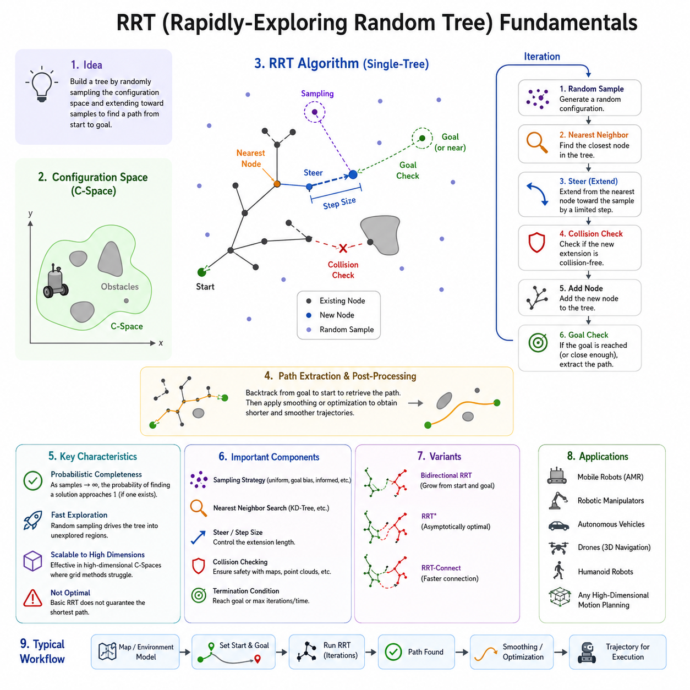
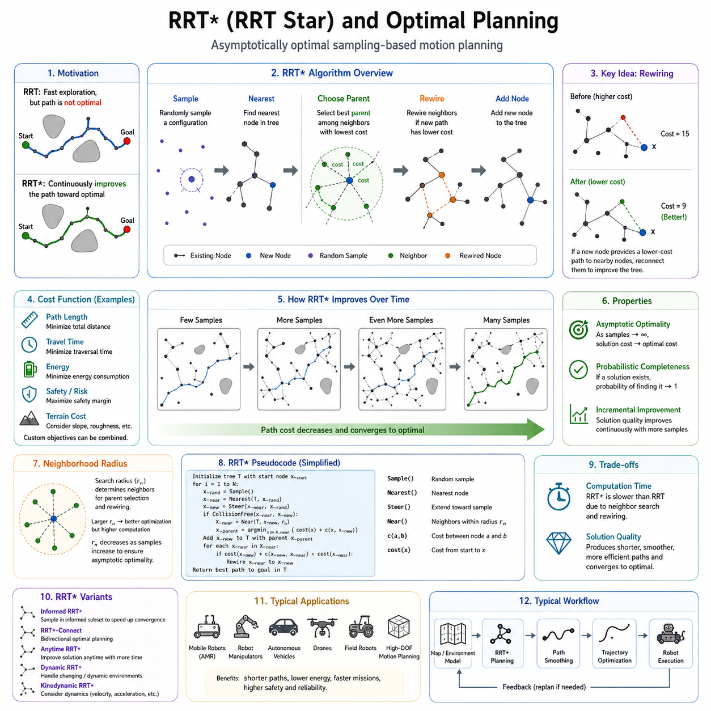
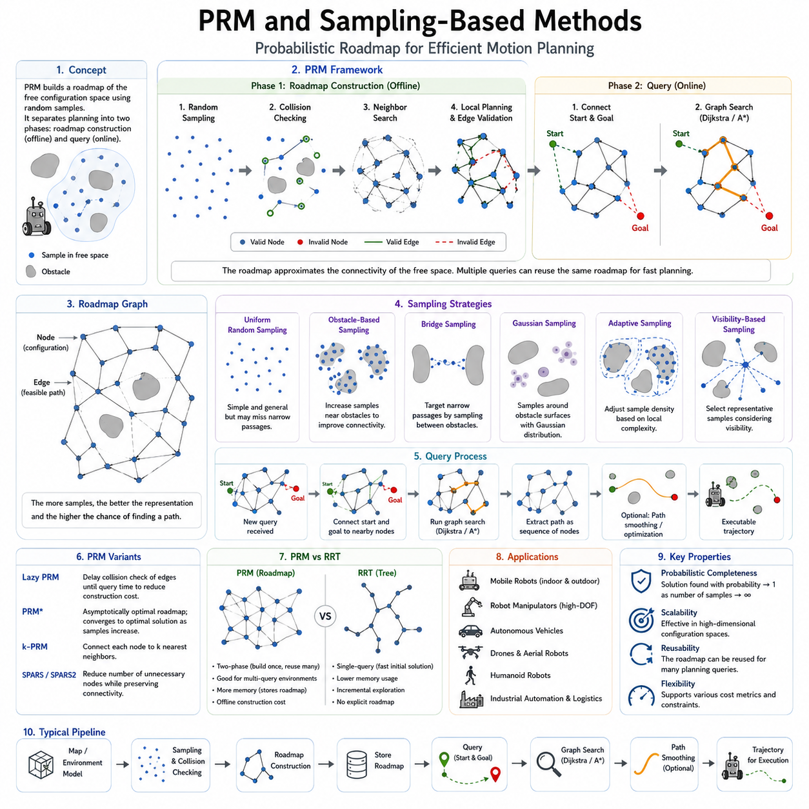
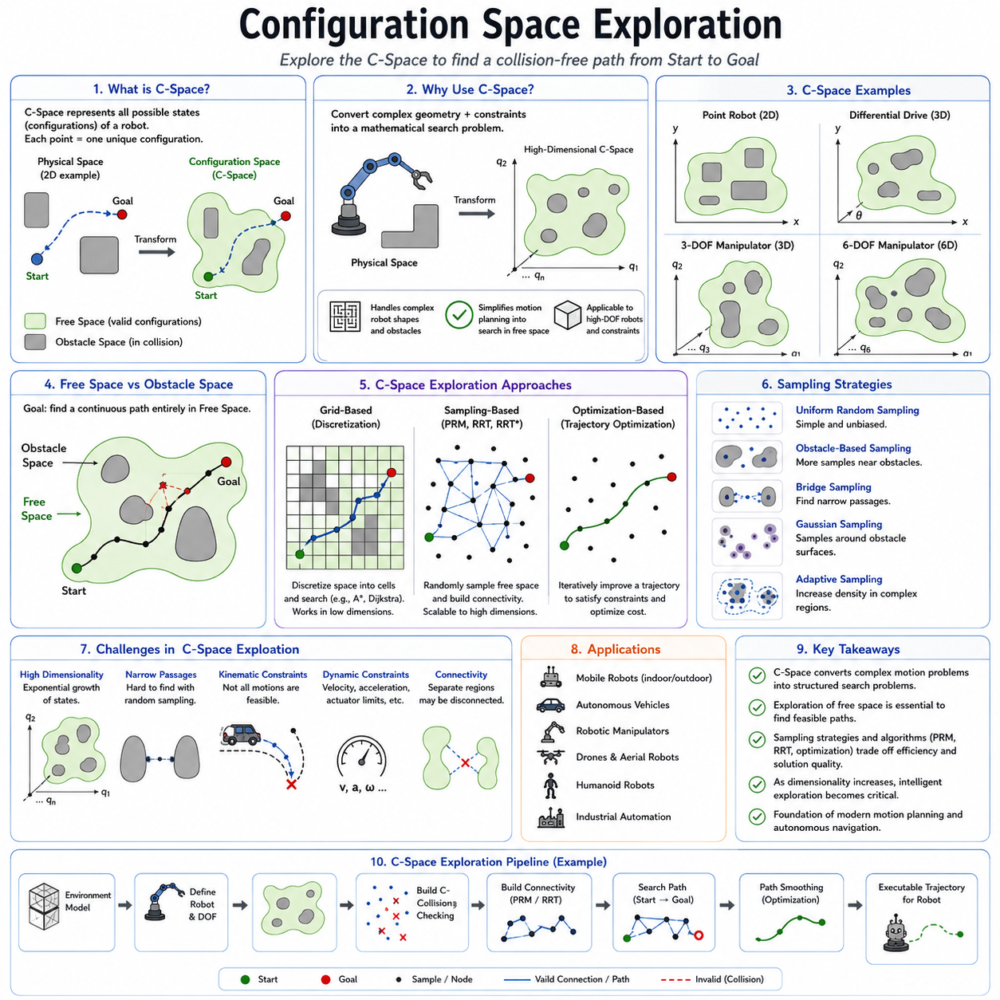
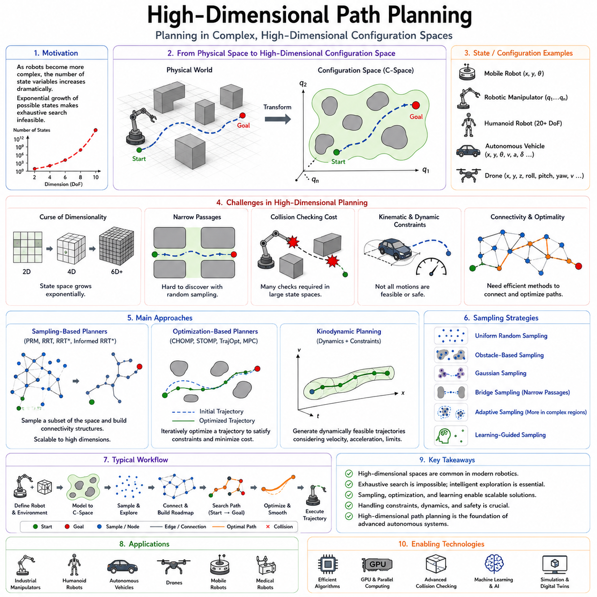
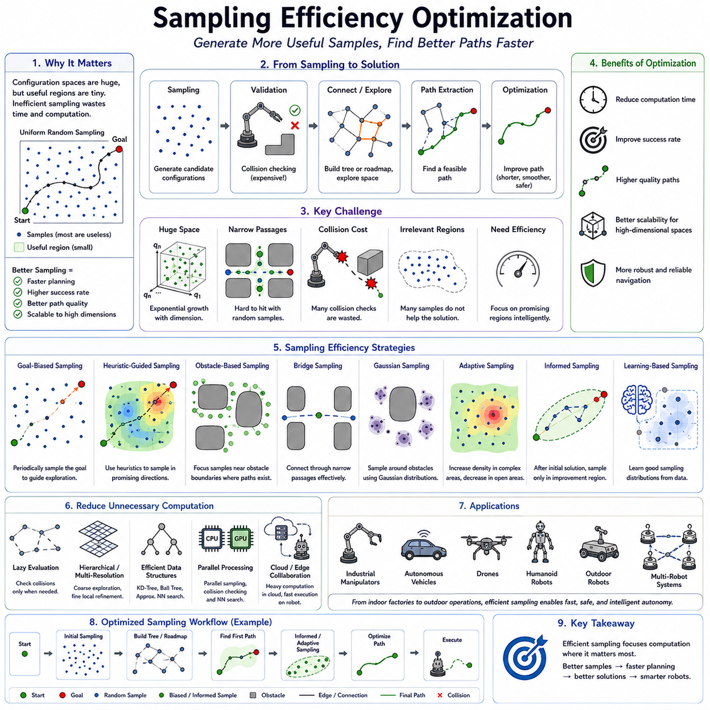
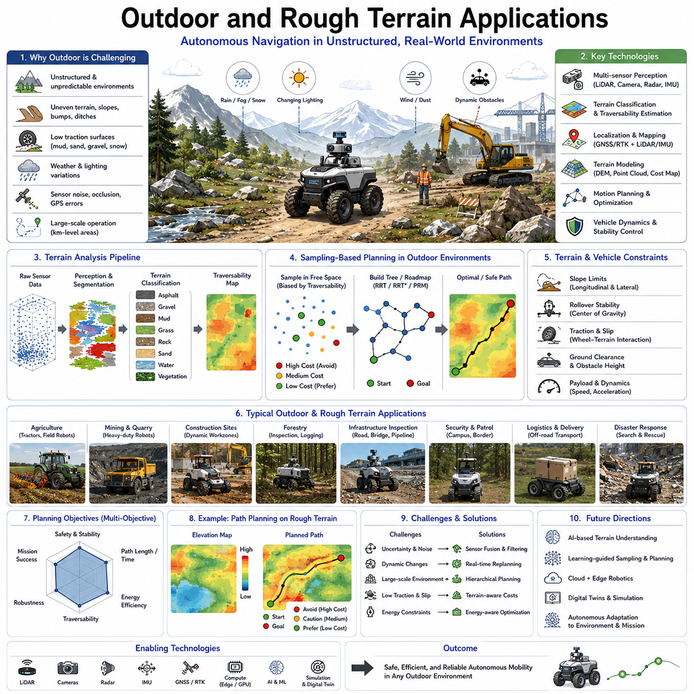
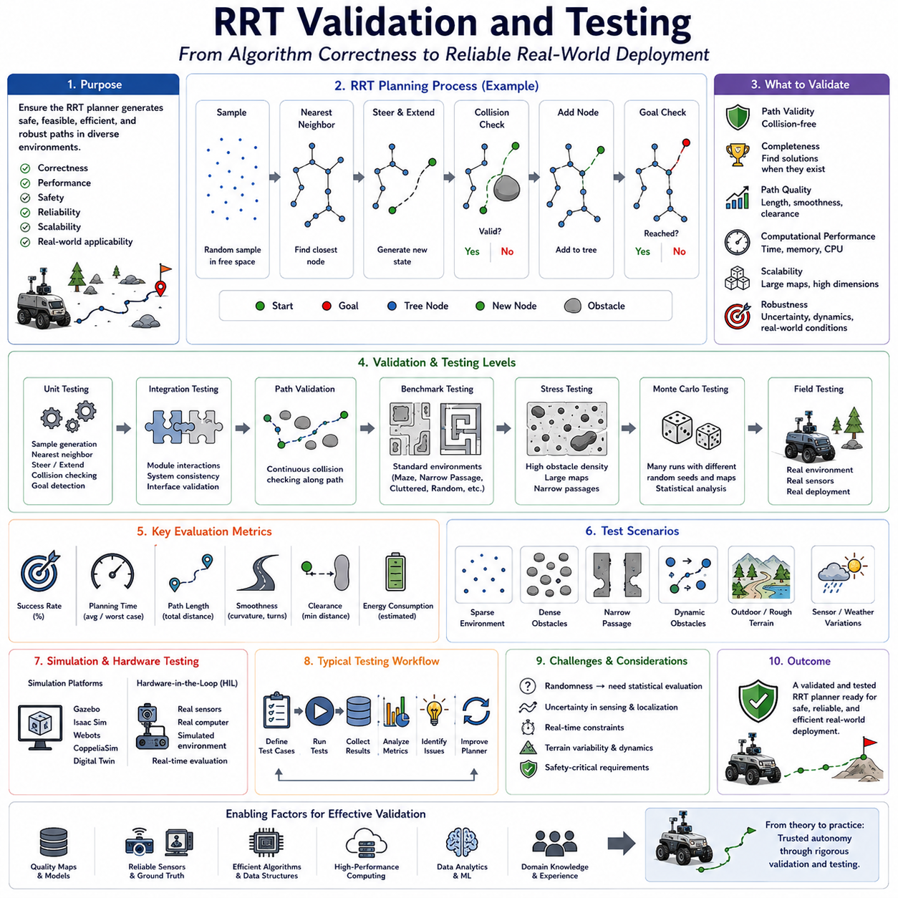

**Volume 05. Path Planning and Autonomous Navigation**

# Chapter 05. RRT and Sampling Methods

## 05.1 RRT Fundamentals

{width="7.268055555555556in" height="7.268055555555556in"}

Rapidly-Exploring Random Tree (RRT) is one of the most influential sampling-based path planning algorithms in robotics and autonomous navigation. It was originally developed to address the challenges of planning feasible paths in high-dimensional configuration spaces where traditional grid-based or graph-based algorithms become computationally expensive or impractical. RRT introduced a fundamentally different approach to path planning by replacing exhaustive search methods with probabilistic exploration of the configuration space. Instead of evaluating every possible location within an environment, the algorithm incrementally builds a tree structure through random sampling, enabling efficient exploration of large and complex spaces. Within autonomous mobile robots, autonomous vehicles, robotic manipulators, drones, and industrial automation systems, RRT has become a foundational planning method because of its ability to generate collision-free paths even in highly constrained environments. It serves as one of the most important representatives of sampling-based planning and forms the basis for numerous modern variants such as RRT\*, Informed RRT\*, RRT-Connect, and kinodynamic planning frameworks.

The primary objective of RRT is to discover a feasible path from a start configuration to a goal configuration while minimizing computational effort. Unlike deterministic search algorithms such as Dijkstra or A-Star, which systematically expand nodes according to predefined cost functions, RRT relies on stochastic exploration. This probabilistic behavior allows the planner to rapidly expand into unexplored regions of the environment. As a result, the algorithm can often find feasible solutions much faster in environments containing narrow passages, irregular obstacles, and high-dimensional state spaces. The key insight behind RRT is that random sampling naturally drives exploration toward areas of the configuration space that have not yet been visited, allowing the tree to cover the environment efficiently.

Understanding the concept of configuration space is essential when studying RRT. In robotic navigation, the configuration space represents all possible states that a robot can occupy. For a simple mobile robot moving on a two-dimensional plane, the configuration space may consist of x and y coordinates. For a car-like robot, orientation must also be considered, resulting in a three-dimensional state space. For robotic manipulators with multiple joints, the dimensionality can become significantly larger. A six-degree-of-freedom manipulator, for example, may require a six-dimensional configuration space representation. As dimensionality increases, traditional search methods suffer from the curse of dimensionality because the number of possible states grows exponentially. RRT addresses this challenge by avoiding complete discretization and instead sampling only a small subset of configurations.

The operation of RRT begins with a single node representing the robot\'s initial state. The algorithm repeatedly generates random samples within the configuration space. For each sample, the nearest existing node in the tree is identified according to a distance metric. A new node is then created by extending the tree from the nearest node toward the sampled point by a predefined step size. Before adding the new node to the tree, collision checking is performed to ensure that the path segment does not intersect any obstacles. If the segment is collision-free, the new node is added to the tree and connected to its parent. Through thousands of such iterations, the tree gradually expands and explores the environment.

One of the most important characteristics of RRT is its exploration bias. Because random samples are generated throughout the configuration space, regions that are far from existing nodes tend to attract future expansion. This property naturally encourages the tree to spread outward rather than clustering around previously explored regions. The result is a rapidly expanding structure capable of discovering paths through large environments. The algorithm\'s name originates from this behavior, as the tree rapidly explores unexplored portions of the configuration space.

The nearest-neighbor search is a critical component of the RRT algorithm. During each iteration, the planner must identify the existing node that is closest to the randomly generated sample. The efficiency of this operation significantly affects overall planning performance. In small environments, a linear search through all nodes may be sufficient. However, in large-scale applications containing thousands or millions of nodes, more advanced data structures such as KD-Trees, Ball Trees, or Approximate Nearest Neighbor algorithms are commonly employed. These structures reduce search complexity and allow real-time performance in practical robotic systems.

The extension step determines how the tree grows toward sampled configurations. Rather than directly connecting the nearest node to the sampled point, most implementations move only a limited distance in the sample\'s direction. This distance is known as the step size or expansion radius. Selecting an appropriate step size is crucial for planner performance. A small step size provides better obstacle avoidance and smoother exploration but increases computational requirements. A large step size accelerates exploration but may cause collisions or produce suboptimal paths. Many modern implementations adapt the step size dynamically according to environmental complexity.

Collision detection plays a fundamental role in ensuring path validity. Every candidate edge generated during tree expansion must be checked against the environment model. Depending on the application, collision checking may involve occupancy grids, polygonal maps, point clouds, voxel maps, signed distance fields, or geometric models. Efficient collision detection often becomes the dominant computational cost in RRT planning. For autonomous robots operating in real-world environments, accurate collision validation is essential for maintaining safety and preventing navigation failures.

The stopping condition of RRT varies depending on application requirements. The simplest approach terminates planning when a newly added node lies within a predefined distance of the goal. Another common strategy attempts a direct connection to the goal whenever a new node is added. If a collision-free connection exists, the planner declares success and extracts a path from the start node to the goal node. Some implementations continue exploring even after finding a solution to improve path quality or identify alternative routes.

A significant advantage of RRT is probabilistic completeness. Probabilistic completeness means that if a feasible solution exists, the probability of finding that solution approaches one as the number of samples approaches infinity. This property provides theoretical assurance that the planner will eventually discover a valid path if sufficient computation time is available. While this does not guarantee optimality, it offers strong practical reliability in complex environments.

Despite its strengths, basic RRT has several limitations. The paths generated by the algorithm are often jagged and inefficient because they follow the random structure of the tree. Numerous unnecessary turns may appear, resulting in trajectories that are difficult for robots to follow smoothly. Consequently, path smoothing and trajectory optimization are frequently applied after planning. Techniques such as shortcut smoothing, spline interpolation, Bézier curves, and trajectory optimization frameworks can significantly improve path quality.

Goal biasing is a common enhancement used to accelerate convergence. Instead of selecting random samples uniformly across the entire configuration space, the planner occasionally chooses the goal position directly as the sample. This increases the likelihood that the tree expands toward the desired destination. Proper tuning of goal bias probability is important. Excessive goal bias may reduce exploration efficiency, while insufficient bias may delay convergence.

Bidirectional RRT represents another important development in sampling-based planning. Instead of growing a single tree from the start position, two trees are constructed simultaneously. One tree expands from the start state while the other expands from the goal state. The planner attempts to connect the two trees during expansion. This approach often reduces planning time dramatically because each tree explores only part of the configuration space before a connection is established.

The performance of RRT depends heavily on environmental characteristics. In open environments containing few obstacles, solutions are typically found quickly. However, environments containing narrow corridors or constrained passages present greater challenges. Random sampling may rarely enter these regions, leading to slower convergence. Numerous research efforts have focused on improving sampling efficiency through obstacle-based sampling, bridge sampling, adaptive sampling, informed sampling, and machine-learning-guided sampling techniques.

In autonomous mobile robots, RRT is commonly used as a global planner. The algorithm generates a collision-free route through a static or semi-static map, while local planners handle dynamic obstacle avoidance and trajectory tracking. In outdoor autonomous robots, RRT can operate within large GNSS-based maps, HD maps, or LiDAR-generated environments. In rough-terrain applications, the planner may incorporate terrain traversability costs to avoid steep slopes, unstable surfaces, or hazardous regions. For large outdoor AMRs, agricultural robots, and GPR inspection platforms, RRT-based methods provide practical solutions for navigating unstructured environments where traditional grid-based approaches become computationally expensive.

The application of RRT extends beyond mobile robots. Robotic manipulators use RRT to plan collision-free arm motions in cluttered workspaces. Humanoid robots employ sampling-based planning for whole-body motion generation. Autonomous drones utilize RRT for three-dimensional navigation through complex airspaces. Self-driving vehicles integrate RRT-derived concepts within motion planning frameworks that account for vehicle dynamics and safety constraints. In each case, the ability to efficiently explore high-dimensional state spaces makes RRT an attractive solution.

Modern robotics frameworks frequently include RRT implementations. Motion planning libraries such as the Open Motion Planning Library provide optimized versions of RRT and related algorithms. These frameworks integrate collision checking, nearest-neighbor search structures, path optimization, and benchmarking tools. Within ROS 2 ecosystems, OMPL-based planners are often incorporated into navigation and manipulation stacks, enabling developers to deploy advanced planning algorithms with minimal implementation effort.

As robotics systems continue to evolve toward greater autonomy, larger operational environments, and higher-dimensional decision spaces, the importance of sampling-based planning remains significant. RRT established a new paradigm in robotic motion planning by demonstrating that intelligent random exploration can outperform exhaustive search in many practical scenarios. Although numerous variants and improvements have been developed over the years, the fundamental concepts introduced by RRT continue to influence modern planning systems. Understanding RRT fundamentals provides an essential foundation for studying advanced sampling-based planners, optimal planning algorithms, trajectory optimization techniques, and future autonomous navigation architectures. Through its balance of simplicity, scalability, and practical effectiveness, RRT remains one of the most influential algorithms in the history of robotic path planning and autonomous navigation.

## 05.2 RRT\* and Optimal Planning

{width="7.268055555555556in" height="7.268055555555556in"}

Rapidly-Exploring Random Tree Star (RRT\*) represents one of the most significant advancements in sampling-based motion planning. While the original RRT algorithm revolutionized robotic path planning through efficient exploration of high-dimensional configuration spaces, it does not guarantee that the generated path is optimal. The solution produced by a standard RRT is often feasible but may contain unnecessary detours, excessive curvature, inefficient motion segments, and suboptimal travel distances. To address these limitations, RRT\* was developed as an asymptotically optimal extension of RRT. The algorithm preserves the exploration efficiency and scalability of the original method while continuously improving the quality of the solution as more samples are generated. Over time, the generated path converges toward the optimal solution, making RRT\* one of the most widely studied and deployed optimal sampling-based planning algorithms in robotics and autonomous navigation.

The motivation behind RRT\* originates from a fundamental challenge in robotic motion planning. In practical applications, finding any collision-free path is often insufficient. Autonomous mobile robots, industrial manipulators, autonomous vehicles, drones, and field robots must operate efficiently within limited energy budgets, strict mission timelines, and dynamic environmental constraints. A path that is unnecessarily long increases travel time, battery consumption, actuator wear, and mission cost. Therefore, planners must not only identify feasible solutions but also seek solutions that optimize specific performance criteria such as path length, travel time, energy consumption, safety margin, terrain traversability, or overall mission efficiency.

The original RRT algorithm expands a tree by connecting newly sampled nodes to the nearest existing node. This process creates a valid tree structure that efficiently explores the configuration space. However, once a node is connected, its parent relationship remains fixed. As a result, poor local decisions made during early exploration remain embedded within the tree structure. Even if a significantly better connection becomes available later, the original RRT does not modify the tree. Consequently, the quality of the resulting path is strongly influenced by random sampling order and may remain far from optimal.

RRT\* introduces a fundamentally different philosophy. Instead of treating the tree as a static structure, it treats the tree as an evolving optimization framework. Every newly inserted node has the potential not only to extend the tree but also to improve existing portions of the tree. Through a process known as rewiring, the planner continuously reorganizes parent-child relationships whenever a lower-cost path is discovered. This ability to refine previously explored regions enables the planner to gradually converge toward the optimal solution.

The operation of RRT\* begins similarly to standard RRT. A random sample is generated within the configuration space. The nearest node in the existing tree is identified, and a new candidate node is created by extending toward the sample. Collision checking is performed to verify that the connection is valid. At this point, however, RRT\* introduces additional optimization steps that distinguish it from the original algorithm.

Rather than simply connecting the new node to the nearest neighbor, RRT\* first identifies all neighboring nodes located within a predefined search radius. These neighboring nodes are evaluated as potential parent candidates. The planner computes the total path cost associated with reaching the new node through each candidate parent. The connection resulting in the lowest overall cost is selected as the parent. This process is known as parent selection optimization.

The cost function used during parent selection depends on the planning objective. In its simplest form, cost is measured as cumulative path length from the root node to the candidate node. More advanced implementations incorporate travel time, energy consumption, risk level, terrain difficulty, dynamic constraints, vehicle stability, safety margins, or mission-specific performance metrics. This flexibility allows RRT\* to address a wide range of robotic planning problems.

After the optimal parent has been selected, the new node is inserted into the tree. The planner then performs the rewiring process. Each neighboring node is examined to determine whether its path cost can be reduced by connecting through the newly added node. If a lower-cost route is discovered and the corresponding connection is collision-free, the neighboring node changes its parent relationship. Through repeated rewiring operations, the tree gradually evolves into a more efficient structure.

The rewiring mechanism is the key innovation responsible for the asymptotic optimality of RRT\*. While individual rewiring operations may appear simple, their cumulative effect becomes profound as the number of samples increases. The tree continuously restructures itself to eliminate inefficient branches and improve overall path quality. Regions of the tree that initially contained poor connections are gradually replaced with more efficient alternatives.

A central theoretical property of RRT\* is asymptotic optimality. This property states that as the number of samples approaches infinity, the cost of the best solution found by the planner converges to the globally optimal solution. Unlike standard RRT, which merely guarantees eventual discovery of a feasible path, RRT\* guarantees continuous improvement toward optimality. This distinction has profound implications for autonomous systems operating in complex environments where efficiency and performance are critical.

The convergence behavior of RRT\* can be visualized by observing the evolution of generated paths over time. Early in the planning process, the solution may resemble a typical RRT path containing numerous irregular turns and unnecessary detours. As additional samples are generated and rewiring continues, these imperfections gradually disappear. The path becomes shorter, smoother, and more direct. Eventually, the solution approaches the theoretical optimum allowed by the environment and system constraints.

The neighborhood search radius plays an important role in RRT\* performance. A larger radius increases optimization opportunities because more neighboring nodes can participate in parent selection and rewiring. However, larger neighborhoods also increase computational complexity. A smaller radius reduces computational requirements but may limit optimization effectiveness. Theoretical analysis shows that the neighborhood radius should decrease gradually as the number of samples increases to maintain asymptotic optimality while controlling computational cost.

Nearest-neighbor search becomes even more important in RRT\* than in standard RRT. Since the planner must repeatedly identify neighboring nodes within a radius for both parent selection and rewiring, efficient data structures are essential. KD-Trees, Ball Trees, R-Trees, and Approximate Nearest Neighbor algorithms are commonly employed to accelerate neighborhood queries and maintain real-time performance.

Collision checking remains a dominant computational component of RRT\*. Every potential parent candidate and rewiring connection must be validated. Consequently, the number of collision checks is substantially greater than in standard RRT. While this increases computational overhead, the resulting improvement in path quality often justifies the additional cost, particularly in applications where optimality is important.

One of the primary tradeoffs between RRT and RRT\* involves planning speed versus solution quality. Standard RRT generally finds an initial feasible solution more quickly because it performs fewer computations during each iteration. RRT\* requires additional parent selection and rewiring operations, increasing computational expense. However, the paths produced by RRT\* are significantly superior and continue to improve over time. In applications where path quality directly affects operational efficiency, RRT\* is often preferred despite its higher computational requirements.

The advantages of RRT\* become particularly evident in large-scale outdoor navigation. Autonomous robots operating in industrial facilities, agricultural environments, mining sites, ports, airports, and smart city infrastructures frequently travel long distances. Small improvements in path efficiency can translate into substantial reductions in mission duration and energy consumption. RRT\* enables these systems to generate globally efficient routes while maintaining robustness in complex environments.

For outdoor autonomous mobile robots operating across rough terrain, optimization objectives often extend beyond simple distance minimization. Terrain traversability, slope limitations, wheel slip probability, stability margins, and surface quality may all influence path cost. RRT\* naturally accommodates such criteria by incorporating them into the cost function. This allows the planner to prefer safer and more reliable routes even if they are slightly longer geometrically.

Autonomous vehicles frequently employ planning frameworks inspired by RRT\*. Urban driving environments contain dynamic constraints, lane boundaries, traffic regulations, and safety requirements that necessitate optimization beyond collision avoidance. Variants of RRT\* can integrate vehicle kinematics and motion constraints, enabling generation of feasible and efficient driving trajectories.

Robotic manipulators also benefit significantly from optimal planning techniques. In high-degree-of-freedom robotic arms, multiple collision-free solutions may exist for a given task. RRT\* can identify motion plans that minimize joint movement, reduce energy consumption, avoid singularities, and improve task execution efficiency. This capability is particularly valuable in industrial automation and precision manufacturing environments.

Numerous variants of RRT\* have been developed to address specific limitations and improve performance. Informed RRT\* restricts sampling to regions that can potentially improve the current best solution, dramatically accelerating convergence. RRT\*-Connect combines bidirectional exploration with optimal planning principles. Anytime RRT\* continuously improves solutions during available computation time. Dynamic RRT\* adapts planning in changing environments. Kinodynamic RRT\* incorporates dynamic constraints such as acceleration, velocity, and actuator limitations.

Informed RRT\* represents one of the most influential extensions. Once an initial solution is found, the planner computes a heuristic region containing all possible paths capable of improving the current best solution. Sampling is restricted to this region, eliminating unnecessary exploration. This significantly accelerates convergence toward optimal paths and has become a standard enhancement in modern planning systems.

Path smoothing and trajectory optimization are still commonly applied after RRT\* planning. Although RRT\* improves path quality substantially compared to standard RRT, the resulting path may still contain discrete segments that require refinement. Spline interpolation, Bézier curves, B-Splines, minimum-jerk optimization, curvature minimization, and model predictive control techniques are often used to generate dynamically feasible trajectories suitable for real robot execution.

The integration of RRT\* with modern robotics software frameworks has contributed significantly to its widespread adoption. Motion planning libraries such as the Open Motion Planning Library provide highly optimized implementations of RRT\*, Informed RRT\*, and numerous related algorithms. These frameworks support collision checking, optimization objectives, benchmarking tools, and integration with ROS 2 navigation systems, allowing developers to deploy sophisticated planners without implementing algorithms from scratch.

The theoretical significance of RRT\* extends beyond robotics. The algorithm established a new class of asymptotically optimal sampling-based planners and inspired extensive research into optimal motion planning. Concepts introduced by RRT\* have influenced graph-based optimization, trajectory generation, autonomous driving, drone navigation, multi-robot coordination, and embodied AI systems. Many contemporary planning algorithms can trace their origins to the optimization principles introduced by RRT\*.

As autonomous systems continue to expand into increasingly complex operational domains, the demand for efficient, safe, and optimal motion planning continues to grow. Future autonomous robots must navigate larger environments, manage greater mission complexity, and operate under stricter safety and efficiency requirements. RRT\* provides a powerful foundation for addressing these challenges by combining probabilistic exploration with continuous optimization. Its ability to discover feasible solutions quickly while steadily improving them toward global optimality makes it one of the most important planning algorithms in modern robotics.

Understanding RRT\* is therefore essential for engineers, researchers, and robotics developers seeking to design advanced navigation systems. It bridges the gap between feasibility and optimality, demonstrating how intelligent optimization can transform a rapidly exploring search tree into a powerful framework for generating high-quality robotic motion plans. Within autonomous mobile robots, industrial automation systems, autonomous vehicles, drones, and future intelligent machines, RRT\* remains a cornerstone technology that continues to shape the evolution of robotic path planning and autonomous navigation.

## 05.3 PRM and Sampling-Based Methods

{width="7.268055555555556in" height="7.268055555555556in"}

Probabilistic Roadmap (PRM) is one of the most influential sampling-based motion planning algorithms in robotics and autonomous navigation. Along with Rapidly-Exploring Random Trees (RRT), PRM forms the foundation of modern sampling-based planning techniques and has played a critical role in solving path planning problems in high-dimensional configuration spaces. While traditional graph-based planners such as Dijkstra and A\* rely on discretized representations of the environment, PRM adopts a fundamentally different philosophy. Instead of exhaustively searching every possible state, it constructs a sparse representation of the free configuration space through random sampling. This approach allows planners to efficiently solve complex navigation problems that would otherwise be computationally prohibitive.

The development of PRM was motivated by the limitations of classical planning approaches when applied to robots with many degrees of freedom. As robotic systems become more complex, the size of the configuration space grows exponentially. A simple mobile robot operating in a two-dimensional environment may require only position coordinates for navigation. However, robotic manipulators, autonomous vehicles, humanoid robots, and articulated systems may require dozens of state variables to fully describe their configuration. The resulting search space becomes extremely large, making exhaustive exploration impractical. PRM addresses this challenge by sampling only a subset of the configuration space while maintaining a high probability of finding feasible solutions.

The core concept behind PRM is the separation of planning into two distinct phases. The first phase is known as the learning phase or roadmap construction phase. During this stage, the planner explores the environment and constructs a graph representing feasible motion possibilities. The second phase is the query phase, where start and goal configurations are connected to the roadmap and a path is searched through the resulting graph. This separation enables PRM to reuse previously generated roadmaps for multiple planning queries, making it particularly effective in environments where many navigation requests occur within the same map.

The roadmap itself consists of nodes and edges. Nodes represent collision-free configurations sampled from the free space. Edges represent feasible transitions between pairs of configurations. The roadmap serves as an approximation of the connectivity structure of the environment. As more samples are added, the roadmap becomes increasingly representative of the actual configuration space. The quality of the roadmap directly influences the planner's ability to discover valid and efficient paths.

Roadmap construction begins by randomly generating configurations throughout the free space. Each sampled configuration undergoes collision checking to determine whether it lies within an obstacle-free region. Valid configurations are added to the roadmap as nodes. Invalid samples located within obstacles are discarded. This process continues until a sufficient number of nodes have been collected to represent the environment adequately.

Once nodes are established, the planner attempts to connect nearby nodes through feasible motion paths. Neighboring nodes are identified using distance metrics such as Euclidean distance, configuration-space distance, or problem-specific similarity measures. The planner then performs local planning between candidate node pairs. If a collision-free connection exists, an edge is added to the roadmap. Through repeated connection attempts, a network of feasible motion pathways gradually emerges.

Collision checking is one of the most important components of PRM. Every sampled node and every candidate edge must be verified against the environment model. Depending on the application, collision checking may involve occupancy grids, point clouds, polygonal maps, voxel maps, signed distance fields, CAD geometry, or physics-based models. Because collision checking can consume significant computational resources, efficient collision detection algorithms are critical for practical implementations.

The query phase begins when a planning request is received. The start and goal configurations are inserted into the roadmap by connecting them to nearby nodes. Once these connections are established, the planner searches for a path through the roadmap graph. Standard graph search algorithms such as Dijkstra, A\*, or heuristic variants can then be applied to identify a feasible route from the start to the goal. The resulting path corresponds to a sequence of roadmap nodes connected by collision-free edges.

One of the primary advantages of PRM is its suitability for multi-query environments. Since roadmap construction is performed offline, the same roadmap can support numerous navigation requests. This characteristic makes PRM particularly valuable in warehouses, factories, hospitals, logistics centers, and industrial facilities where robots repeatedly operate within relatively stable environments. Once a roadmap has been generated, subsequent path planning queries can be answered rapidly.

PRM possesses an important theoretical property known as probabilistic completeness. Similar to RRT, probabilistic completeness means that if a valid solution exists, the probability of finding a solution approaches one as the number of samples increases indefinitely. Although this property does not guarantee optimality, it provides confidence that sufficient sampling density will eventually reveal feasible paths through the environment.

The quality of a PRM solution depends heavily on the sampling strategy. Uniform random sampling is the simplest approach and works effectively in many environments. However, certain regions of the configuration space may require more focused exploration. Narrow corridors, constrained passages, and cluttered obstacle regions are often underrepresented by uniform sampling. As a result, numerous advanced sampling techniques have been developed to improve roadmap quality.

Obstacle-based sampling concentrates samples near obstacle boundaries. Since critical navigation challenges often occur near obstacles, increasing sample density in these regions improves roadmap connectivity. Bridge sampling generates candidate samples within narrow passages by exploiting geometric relationships between obstacle boundaries. Gaussian sampling places pairs of samples near obstacle surfaces to identify difficult-to-access regions. Adaptive sampling dynamically adjusts sampling density according to environmental complexity.

Visibility-based PRM introduces an alternative roadmap construction philosophy. Instead of maximizing sample quantity, visibility-based methods focus on selecting representative configurations that capture essential connectivity relationships. This approach often produces more compact roadmaps while maintaining planning effectiveness. Reduced roadmap size decreases memory consumption and accelerates query processing.

Lazy PRM addresses one of the primary computational bottlenecks in roadmap construction. Traditional PRM performs collision checking for every candidate edge during roadmap generation. Lazy PRM postpones collision validation until a path query is executed. Only edges that participate in candidate solutions are evaluated. This significantly reduces computational overhead and enables efficient planning in large environments.

PRM\* extends the original PRM framework by introducing asymptotic optimality. Similar to the relationship between RRT and RRT\*, PRM\* guarantees convergence toward the optimal solution as the number of samples increases. The algorithm employs theoretically derived connection strategies and neighborhood selection rules that ensure optimal roadmap properties. As sampling density increases, solution quality improves and approaches the globally optimal path.

Sampling-based planning methods encompass a broader family of algorithms beyond PRM and RRT. These methods share a common philosophy of representing configuration spaces through discrete samples rather than exhaustive discretization. Their primary advantage lies in scalability. As configuration-space dimensionality increases, sampling-based methods often remain computationally feasible while traditional grid-based approaches become intractable.

The concept of configuration-space exploration is central to all sampling-based planners. Rather than directly searching the physical environment, planners operate within an abstract representation of possible robot states. Obstacles are transformed into forbidden regions within this space, while feasible robot motions correspond to continuous paths connecting valid configurations. Sampling-based algorithms efficiently explore these spaces without requiring complete enumeration.

Sampling efficiency becomes increasingly important in high-dimensional planning problems. Robotic manipulators with six or more joints, humanoid robots with dozens of degrees of freedom, and autonomous vehicles operating under dynamic constraints all present significant challenges. Intelligent sampling strategies help direct computational effort toward regions that contribute most to solution discovery. Research into sampling efficiency remains one of the most active areas of motion planning.

In mobile robotics, PRM is frequently applied to indoor navigation systems. Warehouses, hospitals, factories, airports, and logistics centers often feature relatively static layouts. Roadmaps generated during deployment can support thousands of subsequent navigation requests. The ability to separate roadmap construction from query execution makes PRM particularly attractive in such environments.

Autonomous mobile robots operating in large industrial facilities often combine PRM with localization systems such as SLAM, LiDAR mapping, and HD maps. The roadmap provides a global connectivity structure, while local planners handle obstacle avoidance and dynamic adaptation. This hierarchical planning architecture combines long-range efficiency with real-time responsiveness.

Robotic manipulators represent another major application domain for PRM. Industrial robot arms frequently perform repetitive motions within known workspaces. Precomputed roadmaps enable rapid planning of collision-free trajectories while accommodating complex geometric constraints. Multi-arm robotic systems can also utilize PRM-based approaches to coordinate motion and avoid interference.

Autonomous drones and aerial robots benefit from sampling-based planning methods in three-dimensional environments. The increased dimensionality associated with altitude, orientation, and dynamic constraints makes exhaustive search methods less practical. Sampling-based approaches provide scalable solutions for navigation through cluttered airspace, urban environments, forests, and indoor structures.

Modern autonomous vehicles increasingly integrate sampling-based planning concepts into motion planning pipelines. Although many production systems employ specialized planners tailored to road networks, the underlying principles of configuration-space exploration, collision-free sampling, and trajectory generation remain closely related to PRM and other sampling-based methods.

The integration of sampling-based planning with optimization techniques has significantly expanded their capabilities. Once a feasible path is discovered, optimization algorithms can refine trajectory quality by minimizing path length, energy consumption, travel time, curvature, or dynamic cost functions. This combination of exploration and optimization provides a powerful framework for real-world robotic navigation.

Machine learning and artificial intelligence are beginning to influence sampling-based planning as well. Learning-based samplers can predict promising regions of the configuration space, reducing exploration requirements. Neural networks may estimate obstacle distributions, guide roadmap generation, or accelerate local planning. These developments represent an important convergence between classical robotics and modern AI techniques.

Simulation environments have become essential tools for evaluating sampling-based planners. Platforms such as robot simulators, digital twins, and physics engines enable systematic testing across thousands of scenarios. Researchers can evaluate roadmap connectivity, planning time, path quality, robustness, and computational efficiency under controlled conditions before deployment in real-world systems.

Performance evaluation of PRM and related methods typically considers multiple metrics. Planning success rate measures the ability to find valid paths. Computation time reflects algorithm efficiency. Path length evaluates route quality. Memory consumption assesses scalability. Roadmap connectivity indicates structural effectiveness. Together, these metrics provide comprehensive insight into planner performance.

As robotics systems continue to evolve toward greater autonomy and complexity, sampling-based planning remains one of the most important motion planning paradigms. PRM introduced the revolutionary concept of constructing reusable roadmaps to represent navigable spaces. Its influence extends across industrial automation, autonomous vehicles, service robotics, warehouse logistics, aerial systems, and future intelligent machines.

Understanding PRM and sampling-based methods is therefore essential for robotics engineers, researchers, and autonomous system developers. These techniques provide a practical solution to the challenges of high-dimensional planning while maintaining scalability, flexibility, and robustness. The principles established by PRM continue to shape modern navigation architectures and serve as a foundation for future developments in autonomous motion planning.

## 05.4 Configuration Space Exploration

{width="7.268055555555556in" height="7.268055555555556in"}

Configuration Space Exploration is one of the most fundamental concepts in robotic motion planning, autonomous navigation, and sampling-based path planning. Nearly every modern planning algorithm, including Probabilistic Roadmaps (PRM), Rapidly-Exploring Random Trees (RRT), RRT\*, trajectory optimization frameworks, and many autonomous navigation systems, relies on the concept of exploring a configuration space rather than directly operating within the physical world. Understanding configuration space exploration is therefore essential for robotics engineers, autonomous vehicle developers, and researchers working in motion planning and intelligent navigation systems. The concept provides a mathematical framework that transforms complex physical motion planning problems into structured search and optimization problems that can be solved computationally.

A configuration space, often abbreviated as C-Space, represents all possible states that a robot can occupy. Each point in the configuration space corresponds to a unique configuration of the robot. Unlike a physical map that describes obstacles and free space in the environment, a configuration space describes the robot's possible positions, orientations, and internal states. The dimensionality of the configuration space depends on the complexity of the robot. A simple point robot moving in a two-dimensional environment may require only two coordinates, x and y. A differential-drive mobile robot requires x, y, and heading angle θ. A robotic manipulator with six joints may require six independent variables, one for each joint angle. Humanoid robots, autonomous vehicles, and articulated machinery may require dozens or even hundreds of state variables to fully describe their configurations.

The motivation for using configuration spaces arises from the complexity of robotic motion. In the physical world, robots have shapes, dimensions, kinematic constraints, dynamic behaviors, and interactions with obstacles. Directly reasoning about all these factors simultaneously can become extremely difficult. Configuration space transforms the problem into a mathematical representation where obstacles become forbidden regions and feasible robot states become free regions. Motion planning can then be formulated as finding a continuous path through free space while avoiding forbidden regions.

The transformation from physical space to configuration space fundamentally changes how motion planning is performed. Consider a mobile robot navigating around a wall. In physical space, planners must consider the robot\'s geometry relative to the obstacle. In configuration space, obstacle boundaries are expanded according to the robot's dimensions, effectively reducing the robot to a point. The resulting planning problem becomes significantly easier because the planner only needs to search for a path through free regions of the configuration space.

The dimensionality of configuration spaces has profound implications for planning complexity. Low-dimensional spaces can often be explored using classical graph search methods. However, as dimensionality increases, the number of possible configurations grows exponentially. This phenomenon is known as the curse of dimensionality. For example, a two-dimensional grid map may contain thousands of states, while a six-dimensional robotic arm configuration space may contain billions or trillions of possible states. Exhaustive search becomes computationally infeasible, motivating the development of sampling-based planning algorithms that explore only a subset of the configuration space.

Configuration space exploration refers to the process of systematically or probabilistically investigating the free regions of the configuration space to discover feasible paths between start and goal configurations. Different planning algorithms employ different exploration strategies. Grid-based planners discretize the space into cells and perform graph search. Sampling-based planners generate random configurations and construct connectivity structures. Optimization-based planners iteratively improve candidate trajectories. Despite these differences, all approaches fundamentally rely on exploring the configuration space.

One of the most important concepts in configuration space exploration is the distinction between free space and obstacle space. Free space consists of all valid robot configurations that satisfy collision constraints. Obstacle space consists of configurations that result in collisions with the environment. Motion planning algorithms seek continuous trajectories that remain entirely within free space. The boundary between free space and obstacle space often contains critical information because optimal paths frequently pass near obstacle boundaries.

Sampling-based methods such as PRM and RRT perform configuration space exploration by generating random samples within the free space. These samples act as representative states that approximate the underlying structure of the configuration space. Instead of explicitly representing every possible configuration, planners construct sparse connectivity structures based on sampled states. This dramatically reduces computational requirements while preserving the ability to discover feasible solutions.

The effectiveness of configuration space exploration depends heavily on sampling quality. Uniform random sampling distributes samples evenly across the configuration space and provides unbiased exploration. However, many planning challenges occur in specific regions such as narrow passages, constrained corridors, or obstacle-dense environments. Consequently, advanced sampling strategies have been developed to focus computational resources where they are most needed.

Obstacle-based exploration techniques intentionally increase sampling density near obstacle boundaries. Since many feasible paths pass through constrained regions, additional samples improve connectivity and increase the likelihood of discovering valid solutions. Adaptive exploration methods dynamically adjust sampling density according to environmental complexity. Regions with high obstacle density receive more exploration effort, while open regions require fewer samples.

Narrow passage problems represent one of the greatest challenges in configuration space exploration. A narrow passage corresponds to a small free-space region connecting larger open areas. Random sampling algorithms may struggle because the probability of generating samples within these regions is low. Various specialized techniques, including bridge sampling, Gaussian sampling, medial-axis sampling, and visibility-based exploration, have been developed to address this challenge.

Connectivity analysis plays a central role in configuration space exploration. The objective is not merely to generate samples but to understand how different regions of free space are connected. Two configurations may individually be valid yet remain unreachable from one another due to intervening obstacles. Effective exploration algorithms seek to identify connected components and establish pathways between them. This connectivity information ultimately determines whether a feasible path exists.

Roadmap-based planners explicitly represent connectivity structures through graphs. Nodes correspond to sampled configurations, while edges represent feasible transitions between configurations. Configuration space exploration in roadmap methods focuses on discovering sufficient connectivity to support future planning queries. The roadmap gradually becomes a sparse approximation of the free-space topology.

Tree-based planners adopt a different exploration strategy. Rather than constructing a reusable graph, algorithms such as RRT incrementally grow a tree structure outward from the initial configuration. The tree expands into unexplored regions of the configuration space and attempts to reach the goal. Tree-based exploration naturally emphasizes rapid coverage of previously unexplored areas and is particularly effective in high-dimensional spaces.

Exploration efficiency is a critical performance metric. Efficient exploration discovers relevant regions of the configuration space using minimal computational resources. Excessive exploration may waste computation on irrelevant areas, while insufficient exploration may fail to identify valid paths. Modern planning systems carefully balance exploration and exploitation. Exploration seeks new regions, while exploitation refines promising regions that appear likely to contain solutions.

Distance metrics significantly influence configuration space exploration. The planner must determine which configurations are similar and which are far apart. Euclidean distance is often used in low-dimensional spaces, but more sophisticated metrics may be required in complex systems. Robotic manipulators, car-like vehicles, and humanoid robots often require task-specific distance measures that account for kinematic constraints, joint limits, or dynamic feasibility.

Kinematic constraints further complicate exploration. Some robots cannot move arbitrarily between configurations. A differential-drive robot cannot instantly move sideways. A car-like vehicle cannot rotate in place. Aircraft and drones must obey aerodynamic constraints. These restrictions alter the structure of the configuration space and require specialized exploration techniques capable of generating feasible transitions.

Dynamic constraints introduce additional complexity. In many systems, motion feasibility depends not only on position but also on velocity, acceleration, steering angle, actuator limits, and momentum. These factors extend the configuration space into a state space that includes dynamic variables. Exploration algorithms must then consider both geometric and dynamic feasibility during planning.

High-dimensional robotic manipulators provide a compelling example of configuration space exploration challenges. A six-degree-of-freedom industrial robot arm may have millions of collision-free configurations. Exploring this space exhaustively is impossible. Sampling-based methods efficiently identify representative configurations and construct feasible motion pathways without enumerating all possibilities. This capability has made configuration-space planning indispensable in industrial robotics.

Autonomous vehicles also rely heavily on configuration space concepts. Although vehicles operate in physical road networks, planning algorithms internally represent states using position, orientation, velocity, steering angle, and other variables. Configuration space exploration enables the planner to identify feasible trajectories that satisfy both geometric and dynamic constraints while avoiding obstacles and adhering to traffic rules.

In outdoor autonomous mobile robots, configuration space exploration must account for terrain characteristics in addition to obstacle avoidance. Traversability, slope, surface roughness, wheel slip probability, stability margins, and environmental uncertainty may all influence motion feasibility. These factors effectively reshape the configuration space by altering the cost and accessibility of different regions.

Semantic information is increasingly incorporated into configuration space exploration. Traditional planners focus primarily on geometric feasibility. Modern autonomous systems often integrate semantic maps, object classifications, traffic rules, operational zones, and mission priorities. Configuration space exploration then becomes a multi-layered process involving both geometric connectivity and semantic reasoning.

Artificial intelligence and machine learning are introducing new capabilities into configuration space exploration. Learning-based planners can predict promising regions of the configuration space based on prior experience. Neural networks may guide sampling, estimate connectivity, predict collision likelihood, or accelerate search processes. These techniques reduce computational requirements while improving planning performance.

Simulation environments provide powerful tools for studying configuration space exploration. Robot simulators, digital twins, and virtual testing platforms allow researchers to visualize exploration behavior and evaluate algorithm performance. Metrics such as exploration coverage, connectivity quality, planning success rate, path quality, and computational efficiency can be measured systematically across thousands of scenarios.

Performance evaluation of configuration space exploration algorithms often focuses on several key indicators. Coverage measures the proportion of free space that has been explored. Connectivity evaluates how effectively different regions have been linked. Success rate reflects the ability to find valid solutions. Planning time measures computational efficiency. Path quality assesses the usefulness of generated trajectories. Together, these metrics provide a comprehensive understanding of exploration effectiveness.

The relationship between exploration and optimization continues to drive advances in motion planning research. Exploration identifies candidate solutions, while optimization improves solution quality. Modern planners increasingly combine these capabilities within unified frameworks. Sampling-based exploration generates feasible paths, and optimization modules subsequently refine those paths into smooth, efficient, and dynamically feasible trajectories.

As robotic systems continue to increase in complexity, configuration space exploration remains one of the most important foundations of autonomous navigation. Whether applied to mobile robots, robotic manipulators, autonomous vehicles, drones, humanoid robots, or future intelligent machines, the ability to efficiently explore high-dimensional spaces is essential for autonomous decision-making and motion generation.

Understanding configuration space exploration provides the conceptual bridge between geometry, robotics, planning algorithms, optimization, and artificial intelligence. It explains how complex physical motion problems can be transformed into mathematical search problems and solved efficiently through computational methods. The principles established through configuration space exploration continue to underpin nearly every major advancement in robotic motion planning and autonomous navigation, making it one of the most fundamental topics in modern robotics engineering.

## 05.5 High Dimensional Path Planning

{width="7.268055555555556in" height="7.268055555555556in"}

High-Dimensional Path Planning is one of the most important and challenging topics in modern robotics, autonomous navigation, motion planning, and intelligent autonomous systems. As robotic systems become increasingly sophisticated, the complexity of their configuration spaces grows dramatically. Traditional path planning algorithms that perform well in low-dimensional environments often become computationally infeasible when applied to robots with many degrees of freedom. High-dimensional path planning addresses this challenge by developing efficient methods for searching, exploring, and optimizing paths within extremely large configuration spaces. The field lies at the intersection of robotics, optimization, artificial intelligence, computational geometry, control theory, and autonomous systems engineering. It serves as a foundational technology for robotic manipulators, autonomous vehicles, drones, humanoid robots, industrial automation systems, medical robots, and future embodied AI platforms.

A path planning problem is considered high-dimensional when the robot state cannot be represented using only a small number of variables. For a simple mobile robot moving on a flat surface, the state may consist of only x and y coordinates. If orientation is included, the dimensionality increases to three. However, many real-world robotic systems require substantially larger state representations. A six-axis industrial manipulator requires six joint variables. A humanoid robot may require dozens of joint positions, body orientations, limb configurations, and balance parameters. Autonomous vehicles may include position, heading, steering angle, velocity, acceleration, and dynamic states. The resulting configuration spaces often contain millions, billions, or even infinitely many possible states.

The primary challenge of high-dimensional path planning arises from the curse of dimensionality. As dimensionality increases, the size of the search space grows exponentially. In a two-dimensional environment, discretizing each dimension into one hundred intervals produces ten thousand possible states. In a six-dimensional space, the same discretization produces one trillion possible states. Exhaustively evaluating all configurations becomes impossible even for powerful computing systems. Consequently, specialized planning algorithms are required to explore only a small fraction of the configuration space while still finding valid and efficient solutions.

The concept of configuration space is central to high-dimensional planning. Configuration space represents all possible states of a robot as points in a mathematical space. Obstacles within the physical environment are transformed into forbidden regions within this space. Path planning then becomes the task of finding a continuous path through the free regions of the configuration space. While this formulation simplifies the mathematical representation of motion planning, it introduces significant computational challenges as dimensionality increases.

High-dimensional planning problems appear across numerous robotic domains. Industrial robotic manipulators frequently operate within six- or seven-dimensional joint spaces. Collaborative robots must plan motions while avoiding humans and dynamic obstacles. Humanoid robots require whole-body motion planning involving dozens of interconnected joints. Autonomous drones operate within three-dimensional environments while simultaneously considering orientation, velocity, and dynamic constraints. Autonomous vehicles must account for kinematic and dynamic variables in addition to geometric positioning. Each of these applications requires sophisticated approaches capable of handling large state spaces efficiently.

Traditional grid-based search algorithms such as Dijkstra and A\* encounter severe scalability limitations in high-dimensional environments. These methods rely on discretizing the configuration space into individual cells or nodes. As dimensionality increases, memory requirements and computational costs grow exponentially. Even modest increases in dimensionality can render exhaustive search completely impractical. This limitation motivated the development of sampling-based planning methods specifically designed for high-dimensional spaces.

Sampling-based algorithms represent one of the most successful approaches to high-dimensional path planning. Instead of discretizing the entire configuration space, these algorithms generate representative samples and construct connectivity structures between them. Probabilistic Roadmaps (PRM) and Rapidly-Exploring Random Trees (RRT) are among the most influential examples. By focusing only on a subset of configurations, sampling-based planners avoid the combinatorial explosion associated with exhaustive search.

PRM addresses high-dimensional planning through roadmap construction. Random samples are generated within the free space, and collision-free connections are established between neighboring samples. The resulting roadmap approximates the connectivity structure of the configuration space. Once the roadmap has been constructed, path queries can be answered efficiently through graph search. PRM is particularly effective in static environments where multiple planning queries must be solved repeatedly.

RRT adopts a different strategy by incrementally growing a tree structure through the configuration space. The tree expands toward randomly generated samples, rapidly exploring unexplored regions. This approach naturally scales to high-dimensional spaces because exploration focuses only on reachable regions. Variants such as RRT\*, Informed RRT\*, and RRT-Connect further improve efficiency and solution quality.

Sampling efficiency becomes increasingly important as dimensionality grows. Uniform random sampling may work adequately in low-dimensional spaces but becomes less effective in higher dimensions. The volume of the configuration space increases dramatically, causing samples to become sparse. Advanced sampling strategies therefore play a critical role in improving planner performance. Adaptive sampling, obstacle-based sampling, Gaussian sampling, bridge sampling, informed sampling, and learning-guided sampling techniques have all been developed to improve exploration efficiency.

One of the most difficult challenges in high-dimensional planning involves narrow passages. Narrow passages are regions of free space that occupy only a small fraction of the overall configuration space while providing critical connectivity between larger regions. The probability of random samples falling within these passages decreases rapidly as dimensionality increases. Specialized sampling methods are often required to identify and exploit these critical regions.

Collision checking becomes another major computational bottleneck. Every candidate configuration and motion segment must be verified to ensure that no collisions occur. In high-dimensional robotic systems, collision checking may involve complex geometric models, articulated kinematic chains, self-collision analysis, environmental obstacle detection, and dynamic safety constraints. Efficient collision detection algorithms and hierarchical representations are essential for maintaining practical planning performance.

Distance metrics play a crucial role in high-dimensional path planning. Determining similarity between configurations becomes increasingly difficult as dimensionality grows. Simple Euclidean distance may fail to capture meaningful relationships between robot states. Task-specific metrics are often required to account for kinematic structure, dynamic feasibility, energy consumption, or operational objectives. The choice of metric directly influences nearest-neighbor search, sampling behavior, and overall planner effectiveness.

Kinematic constraints further complicate high-dimensional planning. Many robots cannot move arbitrarily between configurations. Car-like vehicles are subject to steering limitations. Differential-drive robots cannot move sideways. Robotic manipulators must respect joint limits. Humanoid robots must maintain balance. These constraints effectively reduce the feasible region of the configuration space and require planners to generate physically achievable trajectories.

Dynamic constraints introduce an additional layer of complexity. Real robotic systems possess inertia, acceleration limits, velocity bounds, actuator constraints, and force limitations. Consequently, planning often occurs within a state space rather than a purely geometric configuration space. State-space planning incorporates both position and dynamic variables, significantly increasing dimensionality while providing more realistic motion solutions.

Kinodynamic planning addresses the combined challenges of kinematics and dynamics. Instead of merely generating collision-free paths, kinodynamic planners generate dynamically feasible trajectories that satisfy physical system constraints. Algorithms such as Kinodynamic RRT and trajectory optimization methods have become increasingly important in autonomous vehicles, drones, and high-performance robotic systems.

Trajectory optimization represents an alternative approach to high-dimensional path planning. Rather than explicitly exploring the configuration space, optimization-based planners formulate path planning as a mathematical optimization problem. An initial trajectory is iteratively refined until it satisfies collision avoidance, smoothness, dynamic feasibility, and performance objectives. Methods such as CHOMP, STOMP, TrajOpt, and Model Predictive Control have demonstrated remarkable effectiveness in high-dimensional environments.

Machine learning and artificial intelligence are increasingly influencing high-dimensional planning. Learning-based methods can leverage prior experience to predict promising regions of the configuration space. Neural networks may estimate feasible motions, guide sampling, predict collisions, or generate candidate trajectories. Reinforcement learning, imitation learning, and foundation models for robotics are beginning to complement classical planning algorithms in complex environments.

Robotic manipulators provide one of the most representative examples of high-dimensional planning. A six-degree-of-freedom industrial robot arm may have millions of valid configurations capable of reaching a target pose. Planning algorithms must identify collision-free joint trajectories while minimizing motion time, energy consumption, and mechanical wear. High-dimensional planning enables these systems to operate efficiently within cluttered industrial workspaces.

Humanoid robots present even greater challenges. Walking, balancing, reaching, climbing, and manipulating objects require coordination across numerous joints simultaneously. Whole-body motion planning may involve twenty, thirty, or more dimensions. Advanced planning techniques are essential for enabling stable and efficient humanoid motion.

Autonomous vehicles also benefit from high-dimensional planning frameworks. Modern vehicle planners must consider lane geometry, vehicle dynamics, steering constraints, velocity profiles, traffic participants, safety margins, and road conditions. These factors collectively create a high-dimensional planning problem that cannot be solved using simple geometric approaches alone.

Outdoor autonomous mobile robots frequently operate in unstructured environments characterized by rough terrain, slopes, vegetation, weather effects, and uncertain sensor observations. Additional state variables related to terrain traversability, wheel slip, vehicle stability, and environmental uncertainty further increase planning complexity. High-dimensional planning methods provide the flexibility required to navigate these environments safely and efficiently.

Multi-robot systems introduce another layer of dimensionality. When multiple robots operate simultaneously, the joint configuration space grows dramatically. Coordinating ten robots requires considering the combined state of all platforms. Centralized planning approaches quickly become computationally expensive, motivating research into decentralized planning, distributed optimization, and cooperative exploration strategies.

Performance evaluation for high-dimensional planners involves several key metrics. Planning success rate measures the ability to find feasible solutions. Computation time reflects algorithm efficiency. Path quality evaluates optimality and smoothness. Memory usage indicates scalability. Robustness assesses performance under uncertainty and environmental variation. Together, these metrics provide a comprehensive understanding of planner capabilities.

Simulation environments play a critical role in high-dimensional planning research. Platforms such as robot simulators, digital twins, physics engines, and virtual testing environments enable systematic evaluation of algorithms across thousands of scenarios. Researchers can study scalability, computational efficiency, path quality, and robustness before deployment in real robotic systems.

Recent advances in computing hardware have significantly expanded the capabilities of high-dimensional planning systems. Multi-core processors, GPU acceleration, cloud robotics, distributed computing, and edge AI platforms enable planners to process larger configuration spaces and perform more sophisticated optimization. These technologies are increasingly integrated into modern autonomous systems.

The future of high-dimensional path planning is closely connected to embodied artificial intelligence. Future robots will need to reason about complex environments, manipulate objects, interact with humans, and coordinate multiple behaviors simultaneously. Planning systems will likely combine classical motion planning, optimization, machine learning, semantic reasoning, and world models into unified architectures capable of operating in highly dynamic real-world environments.

Understanding high-dimensional path planning is therefore essential for anyone developing advanced robotic systems. It provides the theoretical and practical foundation required to navigate the immense complexity of modern robotic configuration spaces. By combining efficient exploration, intelligent sampling, optimization techniques, and emerging AI capabilities, high-dimensional planning enables autonomous systems to perform sophisticated tasks that would otherwise be computationally impossible. As robotics continues to evolve toward greater autonomy, adaptability, and intelligence, high-dimensional path planning will remain one of the most important enabling technologies in the field of autonomous navigation and robotic motion generation.

## 05.6 Sampling Efficiency Optimization

{width="7.268055555555556in" height="7.268055555555556in"}

Sampling Efficiency Optimization is one of the most critical topics in modern sampling-based motion planning. While algorithms such as Rapidly-Exploring Random Trees (RRT), RRT\*, Probabilistic Roadmaps (PRM), and their numerous variants have demonstrated remarkable success in solving high-dimensional path planning problems, their performance depends heavily on how efficiently samples are generated and utilized. In many practical applications, the majority of computational resources are spent generating samples that contribute little or nothing to the final solution. Consequently, improving sampling efficiency has become a major research area within robotics, autonomous navigation, motion planning, and autonomous systems engineering. Sampling efficiency optimization seeks to maximize useful exploration while minimizing wasted computation, thereby improving planning speed, solution quality, scalability, and robustness.

The importance of sampling efficiency becomes apparent when considering the scale of modern robotic planning problems. A mobile robot navigating a simple indoor environment may require only a few hundred samples to identify a feasible path. However, autonomous vehicles operating in urban environments, industrial manipulators with multiple degrees of freedom, humanoid robots, drones, and outdoor autonomous robots often require thousands or even millions of samples. In such situations, inefficient sampling strategies can dramatically increase computational cost without providing meaningful improvements in path quality.

The fundamental challenge arises from the fact that configuration spaces are typically very large while feasible solutions occupy only a small portion of the overall space. Uniform random sampling treats every region equally, regardless of its relevance to the planning problem. As a result, many generated samples fall into areas that do not contribute to reaching the goal. These unnecessary samples consume computational resources during collision checking, nearest-neighbor searches, graph construction, and path optimization.

Sampling efficiency optimization attempts to focus exploration on regions that are most likely to contribute to successful path generation. Rather than treating the configuration space as a uniform search domain, optimized planners allocate computational effort selectively. Regions with higher probabilities of containing feasible or optimal solutions receive greater attention, while less relevant areas receive fewer resources.

One of the simplest approaches to improving sampling efficiency is goal-biased sampling. In standard RRT, samples are generated uniformly throughout the configuration space. Goal-biased sampling periodically selects the goal configuration itself as a sample. This increases the likelihood that tree expansion progresses toward the target rather than wandering through irrelevant regions. Proper tuning of the goal bias ratio is important. Excessive bias may reduce exploration diversity, while insufficient bias may slow convergence.

Heuristic-guided sampling extends this concept further by incorporating domain knowledge into the sampling process. Instead of selecting samples purely at random, planners use heuristic functions to estimate the usefulness of candidate regions. Samples located closer to the goal, aligned with expected trajectories, or positioned within promising corridors may receive higher selection probabilities. This strategy improves exploration efficiency while preserving the probabilistic properties of the planner.

Obstacle-based sampling represents another important optimization technique. Traditional uniform sampling often struggles near obstacle boundaries where critical path solutions frequently exist. Obstacle-based methods intentionally concentrate samples around obstacles. Since many shortest paths pass close to obstacle boundaries, increasing sample density in these regions improves roadmap connectivity and enhances the probability of discovering efficient solutions.

Bridge sampling was specifically developed to address narrow passage problems. Narrow passages occupy only a small fraction of the configuration space but often provide essential connectivity between larger free-space regions. Uniform random sampling may rarely place samples inside these passages. Bridge sampling generates pairs of samples within obstacle regions and evaluates their midpoint. If the midpoint lies within free space, it is likely to belong to a narrow passage. This approach significantly increases the planner's ability to discover difficult connections.

Gaussian sampling improves exploration near obstacle boundaries by generating pairs of samples according to Gaussian distributions. One sample may fall within an obstacle while the other remains in free space. The free-space sample is retained because it likely lies near a boundary region that is important for navigation. This method effectively concentrates computational effort in geometrically significant areas.

Adaptive sampling dynamically adjusts sampling behavior based on environmental complexity. Open regions generally require fewer samples because connectivity is easily established. Complex regions containing dense obstacles, narrow passages, or high uncertainty require greater sampling density. Adaptive methods allocate computational resources where they are most needed, improving overall efficiency.

Visibility-based sampling focuses on maximizing information gain rather than sample quantity. The planner attempts to identify configurations that reveal previously unexplored connectivity relationships within the configuration space. Samples that contribute little new information are rejected, while highly informative samples are retained. This approach often produces compact yet highly effective roadmaps.

Informed sampling represents one of the most influential developments in sampling efficiency optimization. In algorithms such as Informed RRT\*, an initial solution is first discovered using conventional exploration. Once a valid path exists, the planner restricts future sampling to regions capable of producing better solutions. For path-length minimization problems, this region can often be represented as a prolate hyperspheroid connecting the start and goal configurations. By excluding irrelevant areas, convergence toward optimal solutions accelerates dramatically.

Importance sampling originates from statistical estimation theory and has been adapted for motion planning applications. The central idea is to sample configurations according to their expected contribution to solution quality rather than uniformly. Regions with greater planning significance receive higher sampling probabilities. Importance sampling improves both exploration efficiency and optimization performance.

Learning-based sampling has emerged as a major research direction with the rise of artificial intelligence and machine learning. Neural networks can learn sampling distributions from prior planning experiences. Instead of relying entirely on handcrafted heuristics, planners use learned models to predict promising regions of the configuration space. These models may incorporate environmental geometry, task objectives, obstacle distributions, or historical planning data.

Supervised learning approaches train models using previously successful planning examples. The planner learns which regions tend to contain useful samples and biases future exploration accordingly. Reinforcement learning approaches optimize sampling policies through repeated interaction with simulated environments. These methods gradually learn how to allocate computational resources most effectively.

Foundation models and large-scale robotics AI systems are beginning to influence sampling optimization as well. Future planners may leverage semantic understanding, scene interpretation, language instructions, and world models to guide exploration. Rather than searching blindly, planners can reason about environmental structure and predict likely solution regions before sampling begins.

Collision checking remains one of the largest computational costs in sampling-based planning. Consequently, many efficiency optimization techniques focus on reducing unnecessary collision evaluations. Lazy evaluation methods postpone collision checking until absolutely necessary. Instead of validating every candidate edge immediately, planners perform validation only when a path candidate emerges. This significantly reduces computational workload.

Hierarchical sampling strategies organize exploration across multiple resolutions. Coarse exploration identifies promising regions at a high level, while fine-resolution sampling focuses on local details. This multiscale approach balances global exploration with local refinement and is particularly effective in large-scale environments.

Multi-resolution planning extends this idea further by employing multiple configuration-space representations simultaneously. Lower-dimensional approximations guide initial exploration, while higher-dimensional models refine solutions. This reduces computational requirements while preserving solution quality.

Nearest-neighbor search efficiency is closely related to sampling efficiency. Sampling-based planners frequently perform nearest-neighbor queries during roadmap construction, tree expansion, and optimization. Advanced data structures such as KD-Trees, Ball Trees, Cover Trees, and Approximate Nearest Neighbor algorithms significantly reduce computational overhead. Efficient search enables planners to process larger sample sets without sacrificing performance.

Parallel computing has become increasingly important for sampling optimization. Modern processors contain multiple CPU cores and powerful GPU architectures capable of evaluating thousands of samples simultaneously. Parallel sampling, collision checking, and nearest-neighbor search dramatically accelerate planning performance. Large-scale autonomous systems increasingly rely on parallel processing to achieve real-time operation.

Cloud robotics introduces additional opportunities for sampling optimization. Large computational resources can be leveraged to generate extensive roadmaps, perform global optimization, and learn sampling policies from vast datasets. Edge devices then utilize these optimized representations during real-time operation. This cloud-edge collaboration allows complex planning tasks to benefit from centralized computational infrastructure.

Outdoor autonomous navigation presents unique sampling challenges. Large environments may span hundreds of meters or even kilometers. Uniform sampling across such vast spaces becomes inefficient. Terrain-aware sampling strategies prioritize traversable regions while avoiding hazardous areas such as steep slopes, unstable surfaces, dense vegetation, water hazards, or restricted zones.

For outdoor autonomous mobile robots operating on rough terrain, sampling optimization often incorporates traversability analysis. Samples are weighted according to terrain quality, slope angle, wheel slip probability, energy consumption, and vehicle stability. This enables planners to focus exploration on routes that are not only feasible but also practical and safe.

Autonomous vehicles require additional forms of sampling optimization due to dynamic constraints. Vehicle motion is governed by steering limitations, acceleration constraints, lane structures, traffic regulations, and safety requirements. Sampling strategies must therefore consider both geometric feasibility and dynamic reachability. Motion primitives, trajectory libraries, and learned driving policies often complement traditional sampling methods.

Robotic manipulators face different optimization challenges. High-dimensional joint spaces contain vast numbers of possible configurations. Many configurations are irrelevant because they violate task constraints or create collisions. Task-space sampling, inverse kinematics guidance, and constraint-aware exploration significantly improve planning efficiency for manipulation tasks.

Humanoid robots present some of the most difficult sampling problems in robotics. Whole-body motion planning requires coordinating dozens of joints while maintaining balance and stability. Sampling efficiency optimization becomes essential because exhaustive exploration is impossible. Hierarchical planning, task decomposition, balance-aware sampling, and learning-guided exploration are commonly employed to manage complexity.

Performance evaluation of sampling efficiency optimization techniques typically considers several metrics. Sampling efficiency itself measures the ratio of useful samples to total generated samples. Planning time reflects computational performance. Success rate evaluates reliability. Path quality measures solution effectiveness. Memory consumption indicates scalability. Together, these metrics provide a comprehensive assessment of optimization effectiveness.

Simulation environments play a crucial role in developing and validating sampling optimization strategies. Digital twins, physics simulators, robotic simulation platforms, and virtual testing environments allow researchers to evaluate algorithms across thousands of scenarios. Controlled experimentation enables systematic analysis of exploration behavior, convergence speed, computational efficiency, and robustness.

Modern robotics frameworks increasingly integrate sampling optimization directly into planning libraries. Systems such as the Open Motion Planning Library include support for advanced sampling strategies, informed exploration, nearest-neighbor optimization, and benchmarking tools. These frameworks allow developers to apply sophisticated optimization techniques without implementing algorithms from scratch.

As autonomous systems continue to grow in complexity, sampling efficiency optimization will become even more important. Future robots will operate in larger environments, interact with humans, manipulate objects, and execute increasingly sophisticated tasks. Efficient exploration of high-dimensional configuration spaces will remain a fundamental requirement for autonomy.

The future of sampling efficiency optimization is likely to combine classical planning theory with artificial intelligence. Learning-based exploration, semantic reasoning, world models, foundation models for robotics, cloud-scale planning infrastructure, and adaptive optimization frameworks will work together to guide exploration more intelligently than ever before. Rather than relying solely on random sampling, future planners will leverage knowledge, experience, and predictive reasoning to focus computational effort precisely where it is most valuable.

Understanding sampling efficiency optimization is therefore essential for robotics engineers, autonomous system developers, and motion-planning researchers. It represents the bridge between theoretical planning algorithms and practical real-world deployment. By maximizing the usefulness of every generated sample, these techniques enable faster planning, higher-quality solutions, greater scalability, and more robust autonomous behavior across a wide range of robotic applications.

## 05.7 Outdoor and Rough Terrain Applications

{width="7.268055555555556in" height="7.268055555555556in"}

Outdoor and Rough Terrain Applications represent one of the most demanding and rapidly growing areas of autonomous navigation and robotic mobility. Unlike indoor environments where maps are structured, surfaces are relatively flat, and environmental conditions remain predictable, outdoor environments introduce significant uncertainty, dynamic changes, and complex terrain characteristics. Autonomous robots operating outdoors must navigate through uneven ground, slopes, mud, gravel, vegetation, rocks, water crossings, construction zones, weather variations, and changing lighting conditions. These challenges require advanced path planning systems capable of integrating perception, localization, terrain analysis, motion planning, stability control, and real-time decision making. Sampling-based planning methods such as Rapidly-Exploring Random Trees (RRT), RRT\*, Probabilistic Roadmaps (PRM), and their modern variants have become important tools for addressing these challenges because they can efficiently explore large, unstructured, and high-dimensional environments.

The transition from indoor to outdoor navigation fundamentally changes the assumptions underlying motion planning. Indoor environments typically contain well-defined corridors, walls, doors, and structured layouts. Outdoor environments, however, often lack clearly defined boundaries. The navigable space may extend across large open areas, agricultural fields, industrial facilities, forests, mining sites, ports, airports, military zones, construction sites, or smart-city infrastructures. The absence of predefined pathways requires robots to continuously evaluate traversability and generate safe paths through uncertain terrain.

One of the most important concepts in outdoor navigation is traversability analysis. Traversability refers to the ability of a robot to safely move across a particular surface. Not all terrain that appears open is necessarily drivable. Soft soil may cause wheel sinking. Loose gravel may reduce traction. Wet surfaces may increase slip probability. Steep slopes may create rollover risks. Vegetation may conceal obstacles. Consequently, path planning algorithms must consider not only geometric obstacle avoidance but also terrain quality and vehicle capability.

Terrain classification serves as the foundation for traversability estimation. Modern outdoor robots use LiDAR, stereo vision, RGB cameras, depth cameras, radar, thermal sensors, and multispectral imaging systems to analyze the environment. Machine learning and computer vision algorithms classify terrain into categories such as asphalt, concrete, grass, gravel, sand, mud, rock, snow, water, and vegetation. Each terrain type is associated with different mobility characteristics that influence path planning decisions.

Digital elevation models play an important role in rough-terrain navigation. Elevation maps represent the three-dimensional structure of the environment and provide information about slopes, ditches, ridges, embankments, and surface irregularities. Path planners utilize these maps to evaluate terrain difficulty and identify routes that satisfy vehicle stability constraints. Sampling-based planners frequently incorporate elevation data into cost functions, allowing the planner to prefer safer and more efficient routes.

Slope handling represents a critical challenge in outdoor autonomous navigation. Many robotic platforms have operational slope limits determined by vehicle geometry, center of gravity, wheelbase configuration, traction characteristics, and payload conditions. Exceeding these limits may result in loss of control, wheel slip, or vehicle rollover. Consequently, path planning systems must evaluate both longitudinal and lateral slope angles when generating trajectories.

For large outdoor autonomous mobile robots, particularly heavy-duty platforms used in industrial, agricultural, mining, and infrastructure inspection applications, stability analysis becomes an integral part of planning. The planner must consider not only the shortest path but also vehicle dynamics, load distribution, suspension behavior, and rollover margins. Safe paths may be longer than geometrically optimal paths but provide significantly greater operational reliability.

Wheel slip and traction management are closely related to rough-terrain planning. On hard pavement, wheel motion and vehicle motion are closely correlated. In rough terrain, however, significant slip may occur due to mud, loose soil, sand, snow, or wet surfaces. Slip can degrade localization accuracy, increase energy consumption, and reduce mobility performance. Advanced planners incorporate traction models and slip estimation algorithms to predict terrain-dependent mobility limitations.

Sampling-based planning methods are particularly well suited for rough-terrain environments because they do not require highly structured maps. Traditional grid-based approaches may become computationally expensive when representing large outdoor environments. RRT and PRM-based methods can efficiently explore expansive terrain while incorporating terrain costs, slope constraints, and traversability metrics into the planning process.

Terrain-aware sampling represents an important extension of conventional sampling-based planning. Rather than generating samples uniformly across the environment, the planner biases exploration toward regions with favorable terrain characteristics. Areas exhibiting excessive slope, poor traction, high uncertainty, or elevated risk receive lower sampling density, while traversable regions receive greater exploration effort.

RRT\* is especially valuable in outdoor environments because it combines exploration with optimization. The planner can incorporate terrain costs into its optimization objective, allowing the generated path to minimize not only distance but also energy consumption, risk exposure, terrain difficulty, or mission completion time. As the planner continues to explore and optimize, increasingly efficient routes emerge.

Environmental uncertainty is significantly greater outdoors than indoors. GPS errors, sensor noise, weather effects, moving obstacles, vegetation growth, construction activities, and seasonal changes can alter environmental conditions. Robust path planning systems must therefore operate under uncertainty and continuously adapt to changing conditions. Probabilistic planning frameworks and uncertainty-aware cost functions are commonly used to address these challenges.

Localization presents additional difficulties in outdoor navigation. GNSS systems provide global positioning information but may suffer from multipath effects, signal blockage, atmospheric disturbances, and urban canyon environments. Consequently, outdoor robots often employ multi-sensor fusion combining GNSS, RTK corrections, inertial measurement units, LiDAR localization, visual odometry, wheel odometry, and terrain matching techniques. Accurate localization is essential because path planning quality depends directly on state estimation accuracy.

Large-scale mapping is another defining characteristic of outdoor robotic applications. While indoor maps may cover hundreds of meters, outdoor operational areas often span kilometers. Agricultural robots may operate across entire farms. Mining robots may traverse large extraction sites. Infrastructure inspection robots may follow lengthy pipelines, roadways, railways, or utility corridors. Efficient path planning in these environments requires scalable mapping and navigation architectures.

Agricultural robotics represents one of the fastest-growing application domains for rough-terrain navigation. Autonomous tractors, crop monitoring robots, spraying systems, harvesting machines, and field inspection platforms operate in highly variable environments. Path planners must account for crop rows, field boundaries, terrain variations, soil conditions, irrigation structures, and seasonal changes. Sampling-based methods provide the flexibility needed to navigate these complex environments.

Mining and quarry operations present even more demanding conditions. Robots operating in mines encounter steep slopes, loose material, dust, poor visibility, uneven terrain, and dynamically changing work areas. Navigation systems must prioritize safety while maintaining operational efficiency. Terrain-aware path planning becomes essential for preventing accidents and ensuring reliable operation.

Construction-site robotics introduces unique planning challenges due to rapidly changing environments. Equipment, materials, excavations, temporary structures, and human workers continuously modify the workspace. Static maps quickly become outdated. Consequently, planners must support frequent replanning and dynamic adaptation. Sampling-based methods are advantageous because they can rapidly generate alternative routes when conditions change.

Forestry applications require robots to navigate among trees, roots, undergrowth, uneven terrain, and natural obstacles. GNSS availability may be limited beneath dense canopy cover. Path planners often rely on LiDAR-based perception and local terrain analysis to identify feasible routes. The ability to navigate through highly unstructured environments makes sampling-based planning particularly attractive in forestry operations.

Infrastructure inspection represents another important application area. Robots inspecting roads, bridges, railways, pipelines, power lines, utility corridors, and underground assets frequently operate in challenging outdoor environments. Inspection missions often require following predefined routes while simultaneously avoiding obstacles and adapting to environmental conditions. Efficient path planning directly influences mission productivity and data collection quality.

Outdoor autonomous security and patrol robots operate in campuses, industrial facilities, military installations, airports, ports, and smart-city environments. These systems must function under varying weather conditions, changing lighting environments, and diverse terrain types. Navigation planners must balance mission efficiency, safety, energy management, and operational reliability.

Weather conditions significantly influence outdoor navigation performance. Rain can alter terrain traction and sensor visibility. Snow may obscure landmarks and change terrain characteristics. Fog reduces sensor range. Strong sunlight creates visual perception challenges. Wind affects aerial and lightweight ground robots. Advanced navigation systems increasingly incorporate weather-aware planning strategies to improve robustness.

Seasonal variations further complicate path planning. Terrain conditions may change dramatically between seasons. Areas that are traversable during dry periods may become impassable during rainy seasons. Vegetation growth may alter visibility and accessibility. Snow accumulation may completely transform the operational environment. Long-term autonomous systems must adapt to these evolving conditions.

Energy-aware planning becomes especially important in outdoor operations. Large operational areas require efficient energy management to maximize mission duration. Path planners often incorporate energy consumption models that account for terrain slope, surface type, vehicle speed, payload weight, and environmental conditions. Optimizing energy expenditure can significantly improve operational effectiveness.

Heavy-payload autonomous robots introduce additional planning requirements. Industrial transport robots, agricultural machines, logistics vehicles, and infrastructure service platforms may carry hundreds or thousands of kilograms of payload. Vehicle dynamics, braking distance, traction limits, and stability margins become highly dependent on load conditions. Path planners must therefore adapt trajectories according to current payload characteristics.

For large outdoor AMRs used in industrial and agricultural environments, multi-objective optimization is increasingly common. Rather than minimizing a single criterion, planners simultaneously consider distance, time, energy consumption, safety, terrain quality, stability, communication coverage, and mission objectives. Sampling-based optimization frameworks provide a flexible mechanism for balancing these competing requirements.

Machine learning is increasingly being integrated into rough-terrain navigation systems. Deep learning models can estimate terrain traversability directly from sensor observations. Neural networks can predict slip risk, classify terrain types, estimate mobility costs, and guide sampling processes. Learning-based approaches complement classical planning methods by providing richer environmental understanding.

Digital twins and simulation environments have become essential tools for developing outdoor navigation systems. High-fidelity simulators enable testing across diverse terrain types, weather conditions, vehicle configurations, and operational scenarios. Simulation-based validation allows engineers to evaluate planning algorithms safely and efficiently before deployment in real environments.

Performance evaluation of outdoor path planning systems typically includes several metrics. Success rate measures the ability to complete missions. Traversability evaluates terrain handling capability. Path efficiency measures route quality. Energy consumption assesses operational effectiveness. Stability metrics evaluate rollover and safety margins. Robustness measures performance under uncertainty and environmental variation. Together, these metrics provide a comprehensive assessment of navigation capability.

Future developments in outdoor and rough-terrain navigation are expected to combine sampling-based planning, artificial intelligence, semantic reasoning, world models, digital twins, and cloud robotics into unified autonomous systems. Robots will increasingly understand terrain semantics, predict environmental changes, reason about mission objectives, and adapt their planning strategies accordingly. This evolution will enable autonomous systems to operate safely and efficiently across increasingly complex outdoor environments.

Understanding outdoor and rough-terrain applications is therefore essential for robotics engineers, autonomous vehicle developers, and navigation researchers. These environments represent some of the most demanding operational conditions encountered by autonomous systems. The integration of advanced perception, localization, terrain analysis, sampling-based planning, optimization, and artificial intelligence provides the foundation for reliable autonomous mobility in the real world. As autonomous robots continue expanding into agriculture, mining, construction, infrastructure inspection, logistics, defense, and smart-city operations, outdoor and rough-terrain navigation will remain one of the most important frontiers in autonomous robotics.

## 05.8 RRT Validation and Testing

{width="7.268055555555556in" height="7.268055555555556in"}

Rapidly-Exploring Random Tree (RRT) algorithms have become one of the most widely used path-planning techniques in robotics, autonomous navigation, and intelligent mobility systems. Their ability to efficiently explore large configuration spaces makes them particularly attractive for autonomous mobile robots, robotic manipulators, autonomous vehicles, drones, and outdoor robotic platforms operating in complex environments. However, developing an RRT planner is only the first step toward a reliable navigation system. The true measure of a planning algorithm lies in its performance under realistic operating conditions. Validation and testing therefore play a critical role in ensuring that an RRT-based planner can consistently generate safe, feasible, efficient, and robust paths in a wide variety of environments. RRT Validation and Testing encompasses the systematic evaluation of algorithmic correctness, planning performance, computational efficiency, safety, reliability, scalability, and real-world applicability. It serves as the bridge between theoretical algorithm development and practical autonomous deployment.

The primary objective of RRT validation is to verify that the planner behaves according to its intended design. At a fundamental level, the planner must generate collision-free paths connecting the start configuration to the goal configuration whenever such a path exists. The generated paths should satisfy environmental constraints, robot kinematic limitations, and operational requirements. Validation ensures that these core functions operate correctly before the planner is deployed in simulation environments, hardware testbeds, or real-world robotic systems.

Testing begins with algorithmic verification. Developers must confirm that individual components of the RRT implementation operate correctly. Random sampling modules should generate valid configurations within the defined search space. Nearest-neighbor search algorithms should consistently identify the closest nodes according to the selected distance metric. Tree expansion procedures should generate feasible extensions toward sampled states. Collision-checking functions must accurately identify valid and invalid configurations. Goal detection logic should reliably recognize successful path completion. Errors within any of these subsystems can significantly affect overall planning performance.

Unit testing is commonly employed during early development stages. Each software module is evaluated independently using carefully designed test cases. Random sampling functions may be tested to verify distribution characteristics. Collision-checking routines can be evaluated using known obstacle configurations. Tree insertion procedures can be examined to ensure structural consistency. Unit testing provides confidence that individual components function correctly before full-system integration begins.

Integration testing evaluates interactions among multiple planning modules. Although individual components may perform correctly in isolation, unexpected issues often arise when they operate together. For example, nearest-neighbor search performance may degrade when combined with dynamic memory allocation. Collision-checking latency may affect planner responsiveness. Integration testing helps identify these interactions and ensures consistent system behavior.

Path validity represents one of the most important validation criteria. Every generated path must remain entirely within free space and avoid all obstacles. Path validation procedures typically perform continuous collision checking along each path segment. In high-resolution validation environments, intermediate states are sampled densely to ensure that no collisions occur between discrete planning nodes. This process verifies that the planner produces truly executable trajectories rather than merely collision-free waypoint sequences.

Completeness testing evaluates the planner's ability to discover solutions when feasible paths exist. Since RRT is probabilistically complete, the probability of finding a valid solution should increase as sampling density and planning time increase. Testing typically involves a large collection of benchmark environments containing varying levels of complexity. Success rates are measured across multiple planning trials to quantify planner reliability.

Path quality evaluation assesses the usefulness of generated solutions. Standard RRT prioritizes exploration rather than optimality, which often results in paths containing unnecessary detours and excessive curvature. Validation metrics commonly include path length, path smoothness, number of turns, cumulative heading change, clearance from obstacles, and overall travel efficiency. These metrics help quantify the practical quality of generated trajectories.

Computational performance testing measures planner efficiency. Autonomous systems often operate under strict real-time constraints and cannot tolerate excessive planning delays. Validation therefore includes measurement of planning time, CPU utilization, memory consumption, collision-checking workload, nearest-neighbor search overhead, and total computational complexity. Performance metrics are typically evaluated across varying environment sizes and obstacle densities.

Scalability testing examines planner behavior as problem complexity increases. Small test environments may not reveal performance limitations that emerge in large-scale deployments. Scalability experiments evaluate performance across increasingly large configuration spaces, larger maps, higher obstacle densities, longer planning distances, and greater state-space dimensionality. Understanding scalability characteristics is essential for selecting planning architectures appropriate for real-world applications.

High-dimensional planning validation is particularly important for robotic manipulators, humanoid robots, and multi-joint systems. As dimensionality increases, sampling efficiency decreases and computational demands rise dramatically. Testing procedures evaluate the planner's ability to maintain acceptable performance in complex configuration spaces. Metrics such as convergence rate, sampling efficiency, and solution reliability become especially important in these environments.

Benchmark environments provide standardized testing scenarios that facilitate objective performance comparison. Many robotics research communities employ benchmark datasets containing obstacle fields, maze structures, narrow passages, cluttered environments, and high-dimensional planning challenges. Consistent evaluation across benchmark problems allows researchers to compare different planner implementations and identify performance improvements.

Narrow passage testing represents one of the most challenging validation scenarios. Narrow passages occupy only a small fraction of the configuration space yet frequently determine overall planning difficulty. Because random sampling may rarely generate states within these regions, narrow-passage environments provide valuable insight into exploration effectiveness and sampling efficiency. Successful navigation through these scenarios often indicates strong planner performance.

Obstacle density testing evaluates robustness across varying environmental complexity levels. Sparse environments generally allow rapid path discovery. Dense obstacle fields require more sophisticated exploration behavior and place greater demands on collision-checking systems. Validation across different obstacle densities helps characterize planner adaptability and robustness.

Dynamic environment testing examines planner performance when obstacles move or environmental conditions change over time. Although standard RRT was originally designed for static environments, many modern applications require operation in dynamic settings. Validation may include moving obstacles, changing map structures, temporary path blockages, and real-time replanning requirements. These tests assess responsiveness and adaptability under realistic operational conditions.

Outdoor autonomous navigation introduces additional validation requirements. Terrain variability, environmental uncertainty, sensor noise, weather effects, and large operational areas significantly increase planning complexity. Testing procedures often incorporate digital elevation maps, traversability analysis, slope constraints, traction limitations, and terrain-dependent cost functions. Validation must confirm that generated paths remain safe and practical under realistic outdoor conditions.

Localization uncertainty significantly influences planning performance in real robotic systems. Simulated environments often assume perfect state estimation, but actual robots experience positioning errors due to sensor noise, GNSS inaccuracies, wheel slip, and environmental disturbances. Robust validation includes uncertainty modeling to evaluate planner behavior under imperfect localization conditions.

Sensor robustness testing evaluates planner performance under degraded perception conditions. LiDAR occlusions, camera noise, radar interference, environmental dust, fog, rain, and lighting variations can affect obstacle detection and map generation. Validation frameworks frequently introduce sensor perturbations to assess planner resilience under realistic sensing conditions.

Monte Carlo testing represents one of the most widely used statistical validation methods. The planner is executed thousands of times using different random seeds, obstacle configurations, environmental conditions, and initial states. Statistical analysis of the resulting performance metrics provides insight into reliability, robustness, and failure probability. Monte Carlo evaluation is particularly valuable because RRT behavior depends on stochastic sampling processes.

Success rate is one of the most fundamental evaluation metrics. It measures the percentage of planning attempts that successfully generate valid paths within specified computational limits. High success rates indicate reliable exploration and robust planning behavior. However, success rate alone is insufficient because it does not capture solution quality or computational efficiency.

Planning time is another critical metric. Fast planning is essential for real-time autonomous systems. Validation typically reports average planning time, worst-case planning time, variance, and convergence characteristics. Understanding timing behavior helps determine whether the planner can satisfy operational requirements.

Path length provides a direct measure of solution efficiency. Shorter paths generally reduce travel time and energy consumption. However, path length must be evaluated alongside safety and stability considerations. In some applications, longer paths may provide greater obstacle clearance or reduced terrain difficulty.

Obstacle clearance measures the minimum distance between the planned path and nearby obstacles. Larger clearances generally improve safety and robustness. Validation frameworks frequently evaluate clearance distributions to ensure that planners maintain appropriate safety margins.

Smoothness metrics assess trajectory quality. Excessive turns, abrupt heading changes, and discontinuous motions can reduce vehicle stability and increase control effort. Smoothness evaluation is especially important for autonomous vehicles, drones, and high-speed robotic platforms.

Energy consumption has become an increasingly important validation metric, particularly for battery-powered robots. Energy-aware evaluation considers path length, terrain difficulty, vehicle dynamics, acceleration profiles, and environmental conditions. Efficient paths can significantly extend operational endurance and mission effectiveness.

Safety validation is often the highest-priority requirement in real-world autonomous systems. Path planners must avoid collisions, maintain stability, respect operational constraints, and preserve safety margins. Safety testing may include worst-case scenarios, adversarial environments, fault injection experiments, and extreme operating conditions. The objective is to identify potential failure modes before deployment.

Hardware-in-the-loop testing bridges the gap between simulation and real-world deployment. The planner operates using actual sensors, processors, communication systems, and control hardware while interacting with simulated environments. This approach reveals performance issues that may not appear in purely software-based simulations.

Simulation-based validation remains a cornerstone of RRT testing. Modern simulation platforms such as Gazebo, Isaac Sim, Webots, and digital twin environments enable large-scale experimentation under controlled conditions. Thousands of scenarios can be evaluated efficiently, providing comprehensive insight into planner performance before physical testing begins.

Field testing represents the final stage of validation. Real-world environments introduce complexity that is difficult to model accurately in simulation. Sensor imperfections, environmental variability, communication delays, terrain inconsistencies, and unexpected obstacles all influence performance. Field testing confirms that the planner can operate safely and effectively under actual deployment conditions.

For outdoor autonomous mobile robots, field testing often includes agricultural environments, industrial facilities, mining operations, infrastructure inspection routes, and rough-terrain scenarios. Testing procedures evaluate navigation performance, traversability handling, localization robustness, energy consumption, mission completion rates, and long-term operational reliability.

Modern RRT validation increasingly incorporates machine learning and data analytics. Large-scale testing generates extensive datasets describing planner behavior across diverse conditions. Statistical analysis, anomaly detection, and predictive modeling help identify weaknesses and guide future algorithm improvements. These techniques enable continuous performance refinement and support the development of more intelligent planning systems.

Digital twins are becoming particularly valuable for validation and testing. By maintaining synchronized virtual representations of real robotic systems and environments, digital twins allow continuous evaluation, predictive testing, and scenario analysis. Engineers can assess planner performance under hypothetical conditions without exposing physical systems to unnecessary risk.

As autonomous systems continue to evolve, validation requirements become increasingly stringent. Future robots will operate in more complex environments, interact closely with humans, coordinate with other autonomous systems, and perform increasingly sophisticated tasks. Comprehensive validation frameworks will therefore become even more important for ensuring safety, reliability, and operational effectiveness.

Understanding RRT Validation and Testing is essential for robotics engineers, autonomous vehicle developers, and motion-planning researchers. A planner that performs well in theory may fail under realistic conditions if not properly validated. Through systematic verification, benchmarking, simulation, hardware-in-the-loop testing, field evaluation, and statistical analysis, developers can ensure that RRT-based planning systems achieve the robustness and reliability required for real-world deployment. Validation transforms a motion-planning algorithm from an academic concept into a dependable component of practical autonomous systems, making it one of the most important stages in the development lifecycle of autonomous navigation technology.
