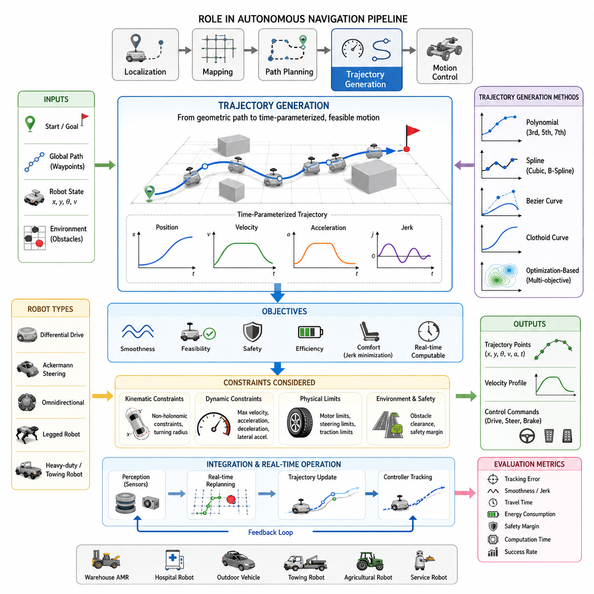
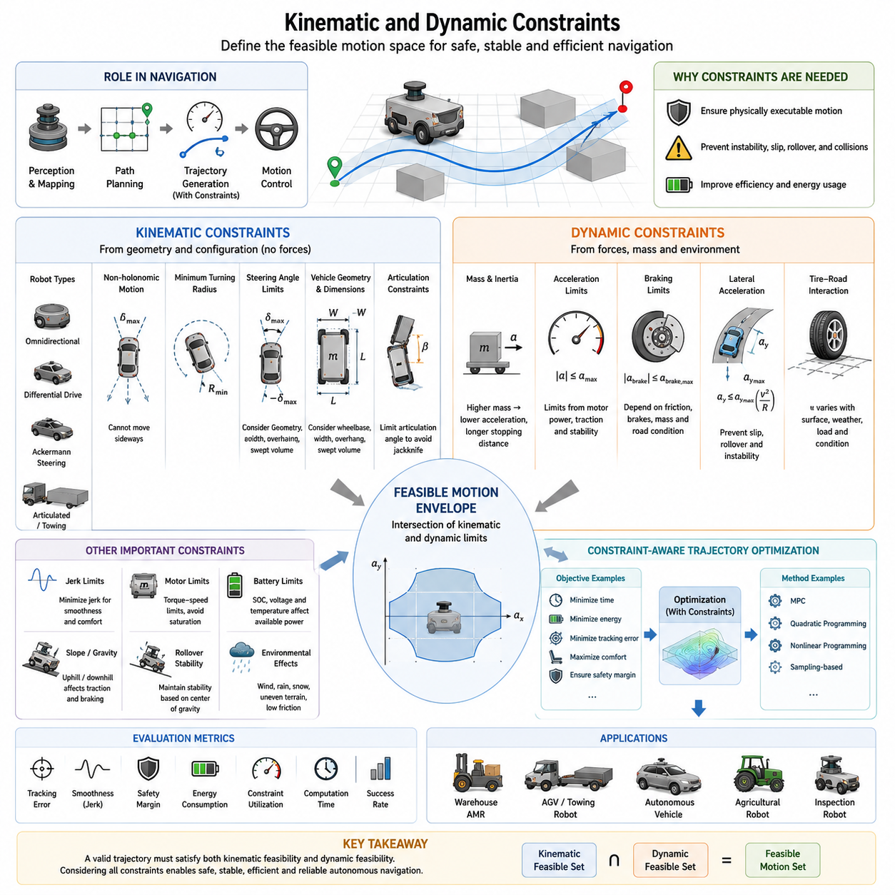
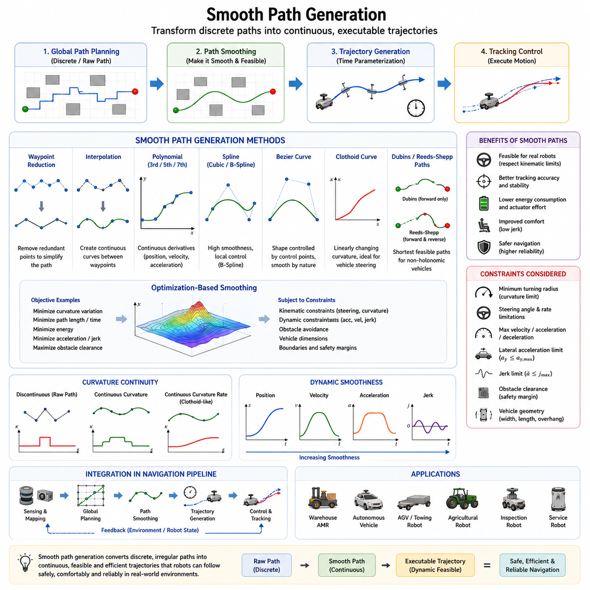
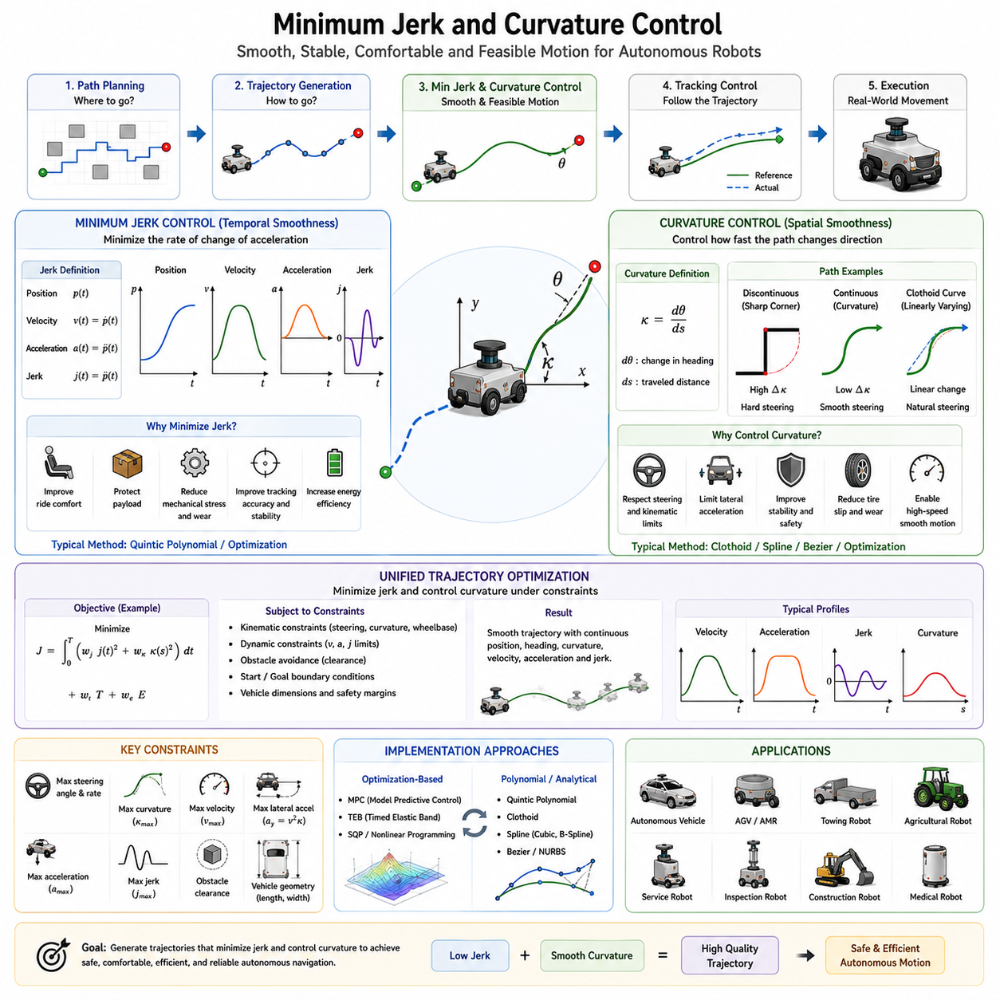
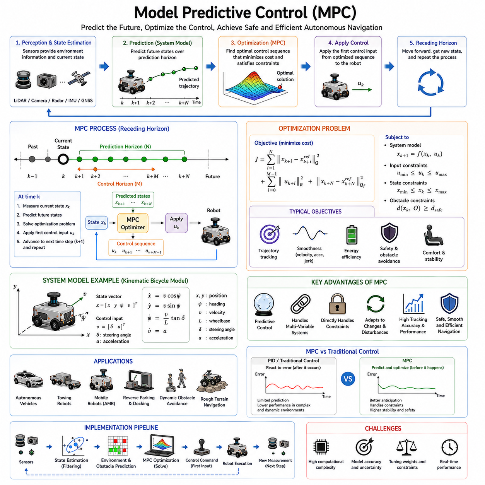
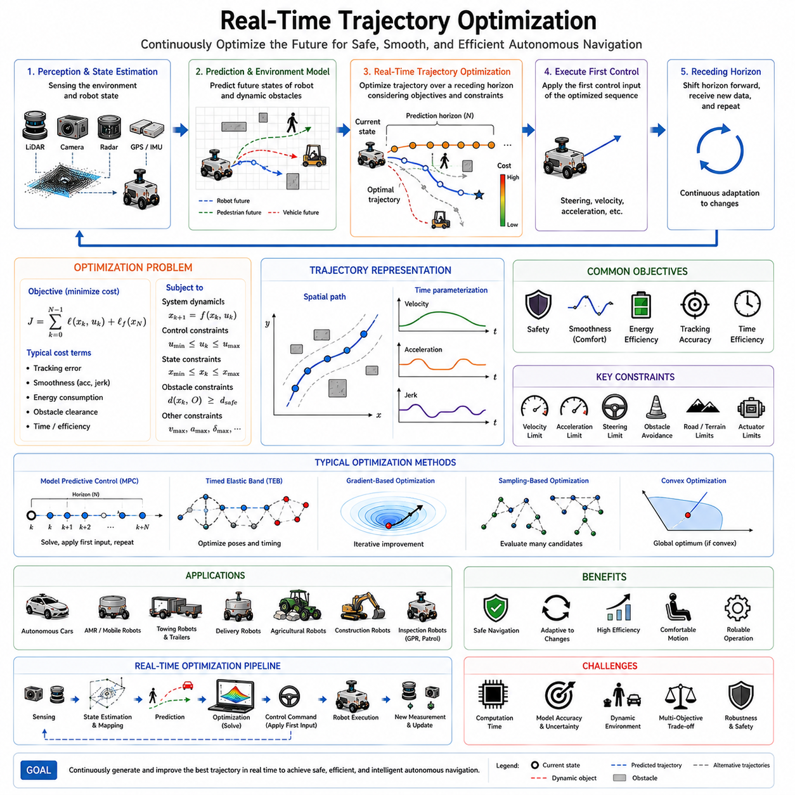
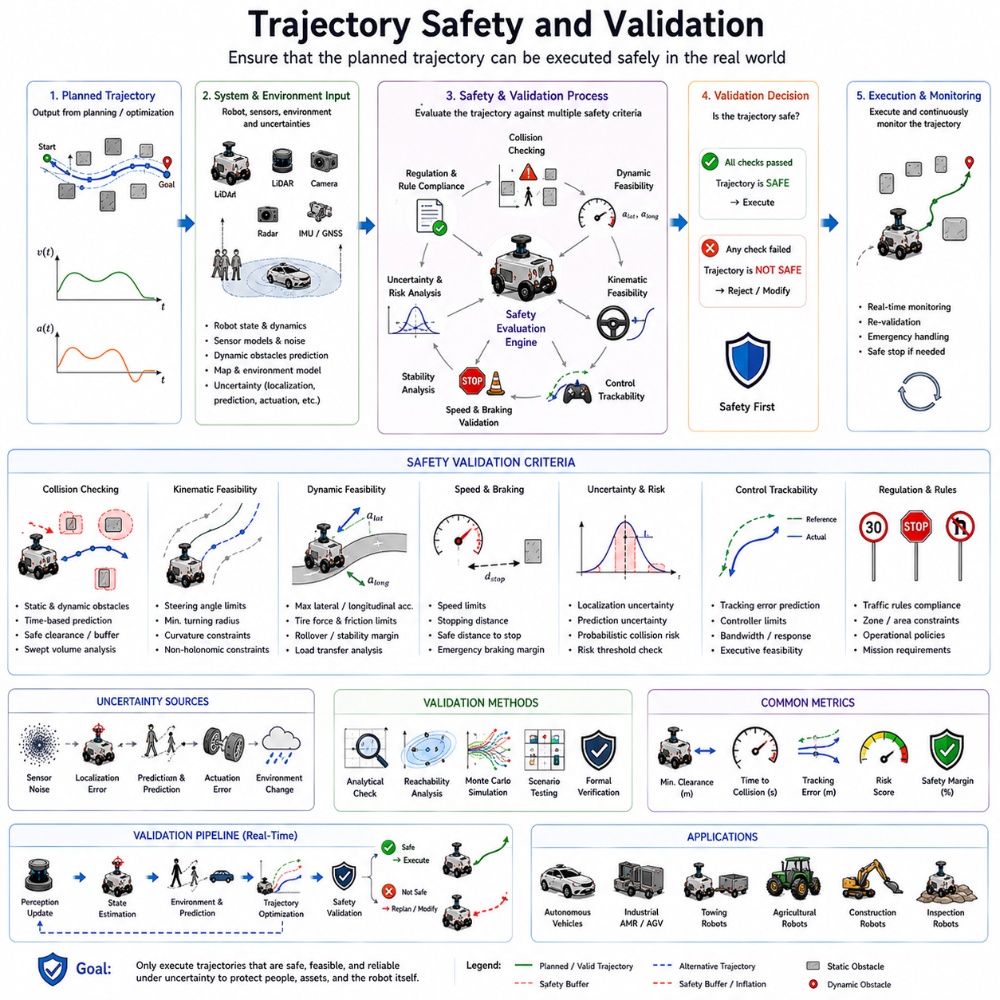
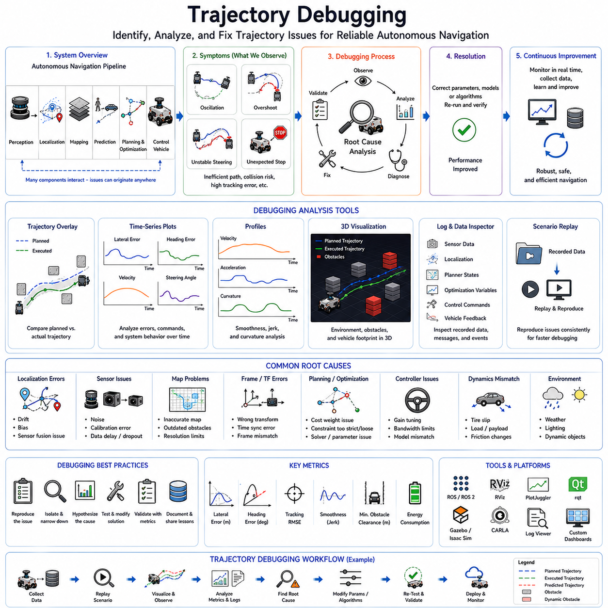

**Volume 05. Path Planning and Autonomous Navigation**

# Chapter 06. Trajectory Optimization

## 06.1 Trajectory Generation Basics

{width="7.268055555555556in" height="7.268055555555556in"}

Trajectory generation is one of the most fundamental topics in autonomous navigation and robotic motion planning. While path planning determines where a robot should travel, trajectory generation determines how the robot should move along that path over time. In practical autonomous mobile robot systems, the distinction between a path and a trajectory is extremely important. A path generally describes a geometric route connecting a start position and a goal position, whereas a trajectory includes temporal information such as velocity, acceleration, heading, and timing. A robot cannot safely execute a path unless it is transformed into a physically feasible trajectory that respects the robot's kinematic and dynamic capabilities. Therefore, trajectory generation serves as the critical bridge between high-level path planning and low-level motion control.

In modern autonomous navigation systems, trajectory generation is responsible for producing smooth, continuous, and executable motion commands. The generated trajectory must guide the robot from its current state to a desired destination while ensuring safety, efficiency, comfort, stability, and computational feasibility. Whether the robot is operating in a warehouse, hospital, factory, outdoor construction site, agricultural field, or urban environment, trajectory generation plays a central role in enabling reliable autonomous movement.

A trajectory can be mathematically represented as a time-parameterized sequence of states. These states typically include position, orientation, velocity, acceleration, and sometimes higher-order derivatives such as jerk. Instead of simply defining a sequence of waypoints, a trajectory describes how the robot transitions smoothly between those waypoints. This time-based representation allows controllers to calculate appropriate steering, throttle, braking, and motor commands required for accurate motion execution.

The need for trajectory generation arises because robotic systems possess physical limitations. Motors cannot instantaneously change velocity. Steering mechanisms cannot produce infinite turning rates. Tires cannot generate unlimited traction forces. Heavy payloads create inertia that restricts acceleration and deceleration. Without trajectory generation, robots would attempt unrealistic motions that could cause instability, excessive mechanical wear, passenger discomfort, or even collisions. Trajectory generation ensures that all planned motions remain physically realizable.

The overall navigation pipeline generally consists of localization, mapping, path planning, trajectory generation, and motion control. Localization estimates the robot\'s position. Mapping provides an environmental representation. Path planning determines a collision-free route. Trajectory generation transforms this route into a dynamically feasible motion profile. Finally, the motion controller tracks the generated trajectory and converts it into actuator commands. This layered architecture improves modularity, maintainability, and system robustness.

One of the primary objectives of trajectory generation is smoothness. Abrupt changes in velocity or steering angle can create oscillations, increase energy consumption, and reduce passenger comfort. Smooth trajectories minimize sudden motion transitions and allow the robot to maintain stable control. Smoothness becomes particularly important in hospital delivery robots, passenger transport robots, autonomous wheelchairs, and service robots operating around humans.

Another key objective is feasibility. A theoretically optimal path may not be executable if it violates the robot\'s kinematic constraints. For example, a car-like robot cannot move sideways and cannot instantly rotate in place. Similarly, a large outdoor autonomous vehicle towing heavy equipment may require significant turning radii and long stopping distances. Trajectory generation must incorporate these constraints to ensure realistic motion planning.

Safety is also a fundamental requirement. The generated trajectory must maintain sufficient clearance from static obstacles, dynamic obstacles, pedestrians, vehicles, and infrastructure. Safety margins are often incorporated into trajectory optimization processes. The trajectory should provide enough time and space for emergency braking, obstacle avoidance, and recovery actions when unexpected events occur.

Energy efficiency is another important consideration. Aggressive acceleration and frequent braking consume excessive energy and reduce battery life. Efficient trajectory generation seeks to minimize unnecessary velocity fluctuations while maintaining operational productivity. This becomes especially critical for battery-powered autonomous mobile robots operating continuously throughout the day.

Trajectory generation methods can be categorized into several major approaches. One common method involves waypoint interpolation. In this approach, the path planner generates a sequence of waypoints, and interpolation techniques are used to create a smooth trajectory connecting them. Linear interpolation represents the simplest approach but often produces discontinuous heading changes. More advanced methods employ polynomial curves, splines, or Bézier curves to achieve smoother transitions.

Polynomial trajectory generation is widely used because it allows smooth control of position, velocity, and acceleration. Third-order, fifth-order, and seventh-order polynomials are frequently employed depending on application requirements. Higher-order polynomials provide greater flexibility in satisfying boundary conditions and continuity constraints. They enable smooth motion profiles that reduce mechanical stress and improve tracking performance.

Spline-based trajectory generation represents another popular approach. Cubic splines and B-splines are commonly used to create continuous trajectories through multiple waypoints. Splines offer excellent smoothness properties while maintaining computational efficiency. They are particularly useful in environments where robots must navigate through complex corridors or cluttered spaces.

Bezier curves are also frequently used in trajectory design. These curves provide intuitive geometric control through a set of control points. Small adjustments to control points can significantly alter trajectory shapes, making Bézier curves attractive for interactive path design and industrial robot programming applications.

Clothoid curves play an important role in vehicle-like systems. A clothoid provides gradual curvature transitions between straight lines and circular arcs. Because steering systems cannot instantaneously change curvature, clothoids help reduce steering discontinuities and improve ride quality. Autonomous vehicles, agricultural robots, and outdoor AMRs often employ clothoid-based trajectory generation techniques.

Trajectory generation must consider both spatial and temporal dimensions. Spatial planning determines the geometric shape of the path, while temporal planning determines velocity profiles along that path. The velocity profile specifies how fast the robot should travel at each location. Temporal planning is particularly important because identical paths can produce vastly different dynamic behaviors depending on speed selection.

Velocity planning often incorporates constraints such as maximum speed, maximum acceleration, maximum deceleration, and maximum lateral acceleration. When approaching sharp turns, the velocity profile must be reduced to prevent wheel slip and maintain stability. Conversely, straight segments allow higher travel speeds and increased operational efficiency.

Acceleration profiles significantly affect system performance. Excessive acceleration may overload motors, cause wheel slip, or destabilize payloads. Excessive deceleration may create safety hazards or damage transported goods. Proper trajectory generation balances performance objectives with mechanical limitations.

Jerk, which represents the rate of change of acceleration, has become increasingly important in advanced robotic systems. Minimizing jerk produces smoother motion and improves passenger comfort. Service robots, hospital robots, and autonomous transportation systems often incorporate jerk minimization into trajectory generation frameworks to achieve more natural movement.

Different robot types require different trajectory generation strategies. Differential-drive robots can rotate in place and therefore possess unique maneuverability characteristics. Ackermann-steered vehicles must follow nonholonomic constraints and require curvature-continuous trajectories. Omnidirectional robots can move laterally and offer additional trajectory flexibility. Legged robots introduce entirely different motion planning challenges involving gait generation and balance maintenance.

Outdoor autonomous robots introduce additional complexity. Uneven terrain, varying traction conditions, slopes, weather effects, and dynamic obstacles must all be considered. Trajectory generation algorithms may incorporate terrain information obtained from LiDAR, stereo cameras, radar, or GNSS-based mapping systems. These environmental factors influence velocity planning, stability constraints, and safety margins.

Heavy-duty industrial robots present another challenging scenario. Large payloads increase inertia and significantly affect stopping distances. Towing robots, autonomous forklifts, and logistics vehicles often require specialized trajectory generation methods that account for load-dependent dynamics. Trajectories must remain stable even when transporting several tons of cargo.

Modern trajectory generation increasingly relies on optimization techniques. Rather than generating trajectories using predefined geometric rules, optimization-based methods formulate trajectory generation as a mathematical problem. Objective functions may include travel time, energy consumption, smoothness, safety, obstacle clearance, and tracking accuracy. Optimization algorithms search for trajectories that best satisfy these competing objectives.

Real-time operation is a crucial requirement for autonomous navigation systems. Trajectory generation must often occur within milliseconds. Dynamic environments require frequent replanning as obstacles move and environmental conditions change. Therefore, computational efficiency is just as important as trajectory quality. Efficient algorithms enable continuous trajectory updates without compromising navigation responsiveness.

Trajectory generation also interacts closely with perception systems. Sensors continuously provide information regarding obstacle locations, free-space boundaries, road geometry, terrain conditions, and traffic participants. Trajectory planners use this information to update motion plans in real time. As perception improves, trajectory generation becomes more adaptive and context-aware.

In ROS2-based autonomous navigation architectures, trajectory generation typically resides between global planning and control modules. The global planner provides a high-level route, while the trajectory generator refines the route into executable motion commands. Controllers such as Pure Pursuit, Stanley Controller, MPC, or PID-based tracking systems then follow the generated trajectory. This modular structure simplifies development, testing, and maintenance.

Simulation environments play an important role in trajectory generation development. Platforms such as Gazebo, Isaac Sim, and digital twin systems allow engineers to evaluate trajectory quality before deployment. Simulated testing enables validation under diverse scenarios including obstacle encounters, emergency braking events, sharp turns, high-speed operation, and sensor failures.

Performance evaluation typically includes trajectory tracking error, smoothness metrics, travel time, energy consumption, safety margin compliance, computational latency, and success rate. Engineers analyze these metrics to refine planning algorithms and improve navigation performance. Extensive validation ensures that generated trajectories remain robust across a wide range of operating conditions.

As autonomous robotics continues to evolve, trajectory generation is becoming increasingly intelligent. Machine learning, reinforcement learning, and foundation-model-based navigation systems are beginning to influence trajectory planning. Future systems may generate trajectories that adapt to human behavior, environmental context, mission objectives, and long-term operational experience. Nevertheless, the fundamental principles remain unchanged: a trajectory must be safe, smooth, feasible, efficient, and executable.

Trajectory generation therefore represents one of the most important foundations of autonomous navigation. It transforms abstract navigation goals into physically realizable motion, enabling robots to move reliably through complex environments. From indoor service robots to large outdoor autonomous vehicles, effective trajectory generation remains a key technology that directly influences navigation performance, safety, efficiency, and overall system capability. Its role within autonomous mobile robotics will continue to expand as robots become increasingly intelligent, autonomous, and integrated into real-world operations. This topic belongs to the "06_Trajectory_Optimization" section within the Path Planning and Autonomous Navigation volume of the AMR robotics engineering framework.

## 06.2 Kinematic and Dynamic Constraints

{width="7.268055555555556in" height="7.268055555555556in"}

Kinematic and dynamic constraints form the foundation of trajectory optimization and motion planning in autonomous mobile robots. While path planning algorithms may generate collision-free routes through an environment, the resulting paths are often purely geometric and may not be physically executable by a real robot. Trajectory generation therefore requires a comprehensive understanding of the robot's motion capabilities and limitations. Kinematic constraints describe how a robot can move based on its geometric structure and mechanical configuration, while dynamic constraints describe how forces, torques, inertia, and physical interactions affect motion. Together, these constraints define the feasible motion space within which safe, stable, and efficient autonomous navigation can occur.

In autonomous navigation systems, trajectory generation is not simply a matter of connecting points in space. Every motion command must satisfy the physical laws governing the robot. A path that appears valid on a map may require impossible steering angles, excessive acceleration, unrealistic braking forces, or unstable vehicle dynamics. Without considering kinematic and dynamic constraints, navigation systems would generate trajectories that cannot be executed by the robot, resulting in tracking errors, instability, excessive energy consumption, or safety hazards.

Kinematic constraints originate from the geometry and mechanical structure of the robot. They describe the relationship between position, orientation, velocity, and steering mechanisms without explicitly considering forces or mass. Kinematic models assume idealized motion and focus on how the robot can move based on its configuration. These models are computationally efficient and are commonly used during path planning and trajectory generation.

One of the most important concepts in robot kinematics is the distinction between holonomic and non-holonomic systems. A holonomic robot can move freely in all degrees of freedom within its operating space. Omnidirectional robots equipped with mecanum wheels or omni wheels are typical examples. These robots can move forward, backward, sideways, and rotate simultaneously, providing significant flexibility in trajectory generation.

In contrast, most autonomous vehicles and outdoor mobile robots are non-holonomic systems. These robots possess motion constraints that limit the directions in which they can move. A typical Ackermann steering vehicle cannot move directly sideways. Instead, it must follow curved trajectories that satisfy steering geometry constraints. As a result, trajectory generation for non-holonomic robots becomes significantly more complex because feasible motion paths must respect these inherent movement restrictions.

Differential-drive robots represent another common kinematic configuration. These robots utilize independently driven left and right wheels to control motion. By varying wheel velocities, the robot can move forward, backward, and rotate in place. Although differential-drive robots provide high maneuverability in confined environments, their motion still follows specific kinematic equations that constrain feasible trajectories.

Ackermann steering systems are widely used in autonomous vehicles, agricultural robots, logistics vehicles, and outdoor AMRs. In these systems, steering is achieved through front-wheel steering mechanisms. The kinematic constraints associated with Ackermann steering introduce minimum turning radius requirements and curvature limitations. Trajectories must therefore be generated with smooth curvature transitions to avoid excessive steering demands.

The concept of turning radius is central to kinematic planning. Every vehicle possesses a minimum turning radius determined by wheelbase dimensions and maximum steering angles. A trajectory requiring a tighter turn than the vehicle can physically achieve is infeasible regardless of obstacle clearance or path optimality. Therefore, trajectory generation algorithms must continuously verify curvature feasibility throughout the planning process.

Steering angle constraints also influence trajectory design. Mechanical steering systems can only achieve finite steering angles and steering rates. Sudden changes in trajectory curvature may require steering motions beyond actuator capabilities. Consequently, smooth curvature-continuous trajectories are preferred because they minimize steering effort and improve tracking performance.

Vehicle geometry introduces additional constraints related to vehicle dimensions. The path followed by the center of the vehicle differs from the path swept by the entire vehicle body. Large autonomous robots, forklifts, towing vehicles, and construction robots must account for body overhangs, articulation points, and swept volumes. Trajectory generation must ensure that the entire vehicle remains collision-free throughout the maneuver.

Kinematic constraints become even more important when trailers or articulated systems are involved. Towing robots frequently operate with trailers, carts, or heavy payload platforms. The trailer introduces additional degrees of freedom and creates complex motion relationships between the towing vehicle and the load. Reversing maneuvers become particularly challenging because articulation angles must remain within stable operating limits to prevent jackknifing.

While kinematics describe allowable motion geometry, dynamics describe how physical forces affect motion execution. Dynamic constraints account for mass, inertia, tire forces, motor capabilities, friction, gravity, and environmental interactions. These constraints determine whether a theoretically feasible trajectory can actually be executed safely and reliably.

Mass is one of the most significant dynamic parameters. A heavier robot requires greater force to accelerate and decelerate. The relationship between force and acceleration is governed by Newton's Second Law. As payload increases, acceleration capability decreases and stopping distance increases. Therefore, trajectory generation must adapt to varying vehicle mass conditions, particularly in industrial applications where payloads frequently change.

Inertia influences how rapidly a robot can change velocity or direction. Large outdoor robots, autonomous forklifts, and towing vehicles often possess substantial inertia due to their mass and payload capacity. High inertia limits acceleration, deceleration, and steering responsiveness. Trajectories that appear feasible under kinematic assumptions may become dynamically infeasible when inertia is considered.

Acceleration constraints play a critical role in trajectory planning. Every robot has maximum longitudinal acceleration limits determined by motor power, traction availability, and mechanical design. Exceeding these limits can lead to wheel slip, excessive energy consumption, motor overheating, or loss of control. Consequently, trajectory planners impose acceleration bounds to ensure stable motion.

Deceleration constraints are equally important. Emergency stopping capability directly influences safety. The maximum achievable braking force depends on tire friction, brake system performance, vehicle mass, and road conditions. Trajectory generators must ensure that sufficient stopping distance exists whenever hazards are detected. Conservative braking models are often employed to accommodate uncertainties in environmental conditions.

Lateral acceleration constraints become important during cornering maneuvers. When a vehicle follows a curved trajectory, centrifugal forces generate lateral acceleration. Excessive lateral acceleration may cause wheel slip, cargo instability, passenger discomfort, or vehicle rollover. Therefore, velocity profiles must be adjusted based on path curvature to maintain safe lateral acceleration levels.

Tire-ground interaction significantly affects dynamic feasibility. Traction forces arise from friction between tires and the surface. The maximum available traction depends on tire characteristics, surface material, weather conditions, and load distribution. Wet roads, loose gravel, mud, snow, and uneven terrain can substantially reduce traction. Dynamic trajectory generation must account for changing surface conditions to prevent loss of control.

Slope navigation introduces additional dynamic challenges. When operating on inclined surfaces, gravitational forces influence acceleration and braking behavior. Uphill motion requires additional traction and motor torque, while downhill motion increases stopping distances and braking demands. Trajectory planners for outdoor autonomous robots must explicitly consider terrain gradients and slope stability.

Rollover prevention represents a critical dynamic constraint for large outdoor robots and heavy-duty autonomous vehicles. The vehicle's center of gravity plays a major role in determining stability margins. Sharp turns, high speeds, uneven terrain, and elevated payloads can increase rollover risk. Advanced trajectory planners incorporate stability models to ensure that generated trajectories remain within safe operating envelopes.

Jerk constraints are increasingly incorporated into modern trajectory optimization frameworks. Jerk represents the rate of change of acceleration and directly influences motion smoothness. High jerk values produce abrupt movements that may destabilize sensors, damage cargo, increase mechanical wear, and reduce passenger comfort. Minimizing jerk results in smoother trajectories that are easier for controllers to track.

Motor limitations also impose important dynamic constraints. Electric motors possess finite torque-speed characteristics. Maximum torque is typically available at low speeds and decreases as rotational speed increases. Trajectory generation algorithms must respect motor operating envelopes to prevent saturation and maintain controllability.

Battery systems indirectly influence dynamic performance as well. State-of-charge, temperature, voltage sag, and power delivery capabilities affect acceleration and sustained performance. Some advanced autonomous systems dynamically adjust trajectory constraints based on available battery power to optimize operational efficiency and extend mission duration.

Environmental conditions further complicate dynamic constraint modeling. Wind disturbances, rain, snow, ice, loose soil, sand, and uneven terrain can significantly alter vehicle behavior. Outdoor autonomous robots operating in agricultural, mining, construction, or infrastructure inspection applications must continuously adapt their trajectory generation strategies to changing environmental conditions.

The interaction between kinematic and dynamic constraints creates a feasible motion envelope within which trajectory optimization must operate. A trajectory satisfying only kinematic constraints may violate dynamic limitations, while a dynamically feasible trajectory must also remain geometrically executable. Effective trajectory generation therefore requires simultaneous consideration of both constraint categories.

Modern trajectory optimization frameworks formulate this challenge as a constrained optimization problem. The objective may involve minimizing travel time, energy consumption, tracking error, or discomfort while satisfying all kinematic and dynamic constraints. Mathematical optimization techniques such as quadratic programming, nonlinear programming, and model predictive control are commonly employed to solve these problems.

Model Predictive Control (MPC) has become particularly popular because it naturally incorporates constraints into the optimization process. MPC predicts future vehicle behavior over a finite horizon and continuously updates control commands based on current state estimates. This approach enables real-time trajectory optimization while respecting complex vehicle dynamics.

Autonomous navigation systems often employ hierarchical planning architectures. Global planners generate high-level paths without detailed dynamic considerations. Local trajectory generators then refine these paths using detailed kinematic and dynamic models. Finally, low-level controllers execute the resulting trajectories while compensating for disturbances and model uncertainties.

Simulation plays a crucial role in validating kinematic and dynamic constraints. High-fidelity simulation environments such as Gazebo, Isaac Sim, CARLA, and digital twin platforms allow engineers to evaluate vehicle behavior under diverse operating conditions. Simulations help identify constraint violations, instability risks, and performance limitations before deployment in real-world environments.

Performance evaluation typically involves metrics such as tracking accuracy, stability margins, maximum constraint utilization, energy efficiency, passenger comfort, computational latency, and safety compliance. These metrics help engineers balance performance objectives against operational constraints.

For industrial AMRs, outdoor autonomous robots, GPR inspection platforms, towing vehicles, autonomous forklifts, and heavy-payload logistics systems, accurate modeling of kinematic and dynamic constraints is essential for reliable operation. As vehicle size, payload capacity, speed, and environmental complexity increase, the importance of constraint-aware trajectory generation grows correspondingly.

Future autonomous navigation systems will increasingly integrate artificial intelligence, physics-based simulation, digital twins, and adaptive learning to improve constraint modeling accuracy. Real-time estimation of vehicle dynamics, terrain properties, payload characteristics, and environmental conditions will enable more intelligent trajectory optimization. Nevertheless, the fundamental principle remains unchanged: every autonomous robot must operate within the physical limits imposed by its geometry, mechanics, actuators, and environment.

Kinematic and dynamic constraints therefore serve as the foundation upon which all safe and effective trajectory generation methods are built. They define the boundaries of feasible motion, guide optimization algorithms, ensure safety and stability, and ultimately determine whether a planned trajectory can be transformed into successful real-world autonomous movement. This topic forms a critical component of Trajectory Optimization and represents one of the most important building blocks in advanced autonomous navigation systems.

## 06.3 Smooth Path Generation

{width="7.268055555555556in" height="7.268055555555556in"}

Smooth path generation is a fundamental component of autonomous navigation and trajectory optimization. While a collision-free path can guide a robot from its starting location to a destination, the raw output produced by many path planning algorithms is often unsuitable for direct execution. Paths generated by grid-based planners, graph-search algorithms, or sampling-based methods frequently contain abrupt direction changes, discontinuities, sharp corners, and irregular transitions. Such characteristics may be mathematically acceptable but are often physically infeasible, inefficient, or unsafe for real robotic systems. Smooth path generation addresses these limitations by transforming discrete paths into continuous, executable trajectories that satisfy vehicle constraints while maintaining navigation objectives.

The primary purpose of smooth path generation is to create motion that can be realistically followed by a robot. Real-world robots cannot instantaneously change direction, steering angle, velocity, or acceleration. Every motion command must respect the physical capabilities of the vehicle. Therefore, smooth path generation serves as the critical bridge between geometric path planning and practical trajectory execution. It converts abstract navigation solutions into motion profiles that can be accurately tracked by control systems.

In autonomous mobile robots, smoothness directly affects navigation quality. Abrupt changes in path geometry often produce oscillatory control behavior, increased tracking errors, excessive actuator demands, and unstable vehicle responses. When a robot encounters sharp corners or discontinuous paths, it may need to decelerate significantly, perform aggressive steering maneuvers, or repeatedly correct its heading. These actions reduce efficiency and may compromise safety. Smooth path generation minimizes such undesirable behaviors by producing gradual transitions that are easier to execute.

The concept of smoothness can be understood from both geometric and dynamic perspectives. Geometric smoothness refers to continuity in position, orientation, and curvature along the path. Dynamic smoothness extends this concept to velocity, acceleration, and jerk profiles. A path that is geometrically smooth but dynamically aggressive may still cause uncomfortable or unstable motion. Therefore, advanced trajectory generation systems seek both geometric and dynamic smoothness simultaneously.

One of the most common sources of unsmooth paths is grid-based path planning. Algorithms such as A\* and Dijkstra typically operate on discrete map cells. The resulting path often consists of straight-line segments connected by abrupt turns. Although these paths successfully avoid obstacles, they rarely satisfy vehicle steering constraints. Smooth path generation removes unnecessary discontinuities and creates more natural transitions between segments.

Sampling-based methods such as Rapidly-exploring Random Trees (RRT) and Probabilistic Roadmaps (PRM) also benefit significantly from smoothing. These algorithms generate paths by connecting randomly sampled nodes, often producing irregular and jagged routes. Post-processing techniques are therefore commonly applied to reduce path complexity and improve trajectory quality before execution.

Smooth path generation is particularly important for non-holonomic vehicles. Ackermann-steered robots, autonomous vehicles, agricultural machines, towing robots, and outdoor autonomous platforms cannot instantaneously change heading or move sideways. Their motion must satisfy curvature constraints imposed by steering geometry. Smooth paths ensure that curvature changes remain within feasible limits and prevent steering commands from exceeding mechanical capabilities.

Curvature continuity is one of the most important concepts in smooth path generation. Curvature describes how rapidly a path changes direction. A discontinuous curvature profile implies an instantaneous steering change, which is physically impossible for most vehicles. By ensuring curvature continuity, smooth path generation produces trajectories that can be executed without abrupt steering inputs.

The simplest smoothing approach involves path pruning and waypoint reduction. Many path planners generate excessive intermediate points that contribute little to navigation accuracy. Removing redundant waypoints can simplify the path while preserving its overall shape. This process reduces computational complexity and creates a cleaner foundation for further smoothing operations.

Interpolation techniques represent another widely used approach. Instead of connecting waypoints using straight-line segments, interpolation generates continuous curves passing through or near the original points. Interpolation improves path continuity and reduces sharp directional changes. Various mathematical methods are available for this purpose, each offering different tradeoffs between smoothness, computational cost, and control flexibility.

Polynomial interpolation is one of the most common smoothing techniques. Polynomial curves can represent smooth trajectories using mathematical functions whose derivatives remain continuous. Cubic, quintic, and septic polynomials are frequently employed in autonomous navigation systems. Higher-order polynomials provide greater flexibility for satisfying position, velocity, acceleration, and curvature constraints simultaneously.

Cubic polynomial trajectories offer a balance between computational efficiency and smoothness. They provide continuous position and velocity profiles while maintaining relatively low computational requirements. Quintic polynomials extend these capabilities by ensuring acceleration continuity as well. As a result, quintic trajectories are widely used in autonomous vehicles and advanced robotic systems where smooth dynamic behavior is required.

Spline-based methods have become some of the most popular techniques for smooth path generation. Splines are piecewise polynomial functions connected in a manner that preserves continuity across segment boundaries. Cubic splines, B-splines, and NURBS are commonly applied in robotics because they provide excellent smoothness while remaining computationally efficient.

Cubic splines generate continuous position, velocity, and acceleration profiles across multiple waypoints. They are particularly useful for long navigation routes involving numerous path segments. The resulting trajectories are smooth, natural, and suitable for real-time execution.

B-splines offer additional flexibility through local control properties. Modifying one control point influences only a portion of the curve rather than the entire trajectory. This characteristic makes B-splines highly attractive for dynamic environments where local trajectory updates are frequently required.

NURBS, or Non-Uniform Rational B-Splines, provide even greater modeling flexibility. Originally developed for computer-aided design applications, NURBS enable precise representation of both freeform curves and analytic shapes. Their ability to represent complex geometries has led to their adoption in advanced autonomous navigation systems and industrial robotics.

Bezier curves represent another powerful smoothing approach. A Bezier curve is defined by a set of control points that determine its overall shape. By adjusting control points, designers can easily manipulate trajectory characteristics while maintaining smoothness. Bezier curves are frequently used in robot motion planning, computer graphics, and autonomous vehicle trajectory generation.

Clothoid curves play a particularly important role in vehicle navigation. Unlike ordinary curves, clothoids exhibit linearly varying curvature. This property allows smooth transitions between straight lines and circular arcs. Since vehicle steering systems naturally prefer gradual curvature changes, clothoids provide highly realistic trajectories for automotive and outdoor robotic applications.

Dubins paths and Reeds-Shepp paths are specialized smoothing approaches designed for non-holonomic vehicles. Dubins paths generate shortest feasible trajectories for forward-only vehicles with limited turning radii. Reeds-Shepp paths extend this concept by allowing both forward and reverse motion. These methods are especially useful in parking, docking, and constrained navigation scenarios.

Trajectory optimization techniques represent a more advanced form of smooth path generation. Instead of applying predefined curve-fitting methods, optimization-based approaches formulate smoothing as a mathematical optimization problem. Objective functions may seek to minimize curvature variation, path length, travel time, energy consumption, acceleration, jerk, or tracking error while satisfying obstacle avoidance and vehicle constraints.

One of the most important optimization objectives is jerk minimization. Jerk represents the rate of change of acceleration and directly affects ride quality, sensor stability, mechanical wear, and passenger comfort. High jerk values create sudden movements that can destabilize robotic systems. Therefore, modern smooth path generation algorithms frequently include jerk minimization terms within their objective functions.

Smooth path generation also contributes significantly to energy efficiency. Aggressive steering maneuvers, rapid accelerations, and frequent corrections consume additional power. By producing smoother trajectories, navigation systems reduce actuator workload and improve battery utilization. This benefit is particularly important for battery-powered autonomous mobile robots operating continuously in industrial environments.

Obstacle avoidance remains an essential consideration throughout the smoothing process. Excessive smoothing may inadvertently move a trajectory closer to obstacles or even introduce collisions. Consequently, path smoothing algorithms must preserve safety margins while improving path quality. Constraint-based optimization techniques often explicitly incorporate obstacle clearance requirements to maintain safe navigation.

Dynamic environments introduce additional challenges. Pedestrians, vehicles, forklifts, and other moving obstacles require continuous path adaptation. Smooth path generation in such environments must balance responsiveness with stability. Frequent trajectory updates are necessary, but these updates must remain smooth enough to avoid introducing oscillatory behavior or unstable control responses.

Real-time performance is another critical requirement. Autonomous navigation systems often operate at update rates ranging from tens to hundreds of milliseconds. Smooth path generation algorithms must therefore provide high-quality trajectories within strict computational budgets. Excessive computational complexity can delay navigation decisions and compromise safety.

In ROS2 navigation architectures, smooth path generation typically occurs between global path planning and local trajectory tracking. The global planner generates a coarse route, while smoothing algorithms refine that route into a continuous trajectory. Controllers such as Pure Pursuit, Stanley Controller, Dynamic Window Approach, Timed Elastic Band, and Model Predictive Control then use the smoothed trajectory as a reference for motion execution.

Model Predictive Control has become particularly effective for smooth path generation because it simultaneously considers future system behavior, vehicle constraints, and optimization objectives. MPC continuously updates trajectories based on changing environmental conditions while maintaining smoothness and feasibility.

Smooth path generation is especially important for outdoor autonomous robots operating on rough terrain. Large industrial robots, agricultural platforms, inspection robots, and autonomous vehicles often encounter uneven surfaces, slopes, loose soil, and variable traction conditions. Smooth trajectories help maintain vehicle stability and reduce dynamic loads imposed on the mechanical structure.

Heavy-payload autonomous robots present additional challenges. Large masses increase inertia and reduce maneuverability. Sharp trajectory changes can create dangerous load shifts or destabilize transported cargo. Smooth path generation minimizes these risks by ensuring gradual transitions throughout the motion sequence.

Trajectory tracking performance is closely related to path smoothness. Controllers can follow smooth trajectories more accurately than discontinuous paths. Reduced tracking error improves navigation precision, decreases control effort, and enhances overall system reliability. Consequently, smooth path generation directly influences the effectiveness of downstream control systems.

Simulation plays a vital role in evaluating smoothing algorithms. Digital twins, Gazebo, Isaac Sim, CARLA, and other simulation environments allow engineers to compare different smoothing techniques under realistic operating conditions. Metrics such as tracking error, curvature continuity, computational latency, energy consumption, passenger comfort, and obstacle clearance help quantify performance.

Future developments in smooth path generation are increasingly influenced by artificial intelligence and machine learning. Learning-based trajectory generators can adapt smoothing strategies based on prior experience, environmental context, vehicle behavior, and operational objectives. Foundation models, reinforcement learning, and world-model-based navigation systems may eventually generate highly optimized smooth trajectories in real time.

Despite ongoing technological advances, the fundamental objective remains unchanged. A smooth path must be safe, feasible, comfortable, efficient, and computationally practical. It must satisfy vehicle constraints while enabling reliable navigation in complex environments. Smooth path generation therefore represents one of the most important components of trajectory optimization, providing the essential connection between path planning and real-world autonomous motion execution.

Within the broader framework of autonomous navigation, smooth path generation serves as the mechanism that transforms discrete planning outputs into continuous, executable trajectories. By ensuring continuity in position, orientation, curvature, velocity, acceleration, and jerk, smooth path generation enables robots to move naturally, safely, and efficiently through the world. As autonomous systems become increasingly sophisticated, the importance of smooth path generation will continue to grow, making it a cornerstone technology for future intelligent robotic platforms.

## 06.4 Minimum Jerk and Curvature Control

{width="7.268055555555556in" height="7.268055555555556in"}

Minimum Jerk and Curvature Control represents one of the most important concepts in modern trajectory optimization and autonomous navigation. While path planning determines where a robot should move and trajectory generation determines how the robot should move over time, minimum jerk and curvature control focuses on ensuring that the resulting motion is smooth, stable, comfortable, mechanically efficient, and physically feasible. In practical autonomous systems, a trajectory that simply connects two locations is not sufficient. The trajectory must also be generated in a manner that minimizes abrupt changes in acceleration and steering behavior. This requirement becomes increasingly important as autonomous robots operate in human environments, transport valuable cargo, move at higher speeds, and navigate through complex dynamic scenarios.

The concept of smooth motion has existed for decades in robotics, aerospace engineering, industrial automation, and vehicle control. Human motion naturally tends to minimize jerk, which is one reason why human movements appear fluid and coordinated. Autonomous systems attempt to replicate this characteristic by generating trajectories that avoid sudden accelerations, abrupt steering changes, and unnecessary oscillations. Minimum jerk and curvature control provide the mathematical framework for achieving this objective.

Jerk is defined as the rate of change of acceleration with respect to time. Position represents the first level of motion description, velocity is the first derivative of position, acceleration is the second derivative, and jerk is the third derivative. Mathematically, jerk describes how quickly acceleration changes during motion. A system experiencing large jerk values undergoes sudden changes in force and motion characteristics. These rapid transitions can create discomfort, instability, excessive mechanical stress, and reduced tracking performance.

In autonomous mobile robots, jerk directly influences passenger comfort, cargo stability, sensor reliability, and vehicle durability. Consider a hospital delivery robot transporting medical equipment. If the robot suddenly accelerates or brakes, the cargo may shift, sensitive equipment may be damaged, and passengers or nearby humans may perceive the motion as unsafe. Similarly, an autonomous shuttle transporting people must avoid abrupt accelerations to maintain ride comfort. Minimum jerk trajectory generation addresses these concerns by producing smooth acceleration profiles throughout the motion.

The significance of jerk becomes even more apparent when considering force transmission. According to Newtonian mechanics, acceleration is directly related to force. Rapid changes in acceleration therefore correspond to rapid changes in force. These force fluctuations propagate through the vehicle structure, suspension system, sensors, payload, and mechanical components. Over time, excessive jerk can increase wear and reduce system lifespan. Consequently, minimizing jerk improves both operational performance and long-term reliability.

Minimum jerk trajectory generation originated in studies of human motor control and biological motion. Researchers observed that human arm movements often follow trajectories that minimize integrated jerk over the movement duration. This principle was later adopted in robotics because it naturally produces smooth and efficient motion. Today, minimum jerk optimization is widely applied in robotic manipulators, autonomous vehicles, mobile robots, drones, industrial automation systems, and service robotics.

A minimum jerk trajectory typically produces smooth position, velocity, and acceleration profiles. Instead of abrupt transitions, motion evolves gradually and continuously. The resulting velocity curve often exhibits a bell-shaped profile, while acceleration changes smoothly without sharp discontinuities. Such characteristics make the trajectory easier for controllers to track and reduce the likelihood of instability.

Polynomial trajectory generation plays a major role in minimum jerk control. Fifth-order polynomials, commonly known as quintic polynomials, are particularly popular because they allow simultaneous control of position, velocity, and acceleration at both the initial and final states. By satisfying these boundary conditions, quintic trajectories naturally produce smooth jerk characteristics. Higher-order polynomials may also be employed when additional smoothness requirements are imposed.

Minimum jerk optimization is often formulated as an objective function. The optimization process seeks to minimize the integral of squared jerk over the trajectory duration while satisfying motion constraints. This formulation creates trajectories that distribute acceleration changes evenly across the motion interval. The resulting paths appear natural and fluid rather than mechanical or abrupt.

While jerk control focuses primarily on temporal smoothness, curvature control focuses on spatial smoothness. Curvature describes how rapidly a path changes direction as a vehicle moves through space. In autonomous navigation, curvature is a critical parameter because it directly influences steering behavior, lateral acceleration, and vehicle stability.

A straight line has zero curvature because its direction remains constant. Circular paths exhibit constant curvature because the turning rate remains unchanged. More complex trajectories involve varying curvature profiles that continuously change as the vehicle moves. The objective of curvature control is to ensure that these changes occur smoothly and within physically feasible limits.

Curvature is particularly important for non-holonomic vehicles such as automobiles, agricultural robots, autonomous forklifts, towing robots, and outdoor autonomous platforms. These vehicles cannot instantaneously change their heading direction. Their steering systems impose limitations on achievable curvature and curvature rates. Consequently, trajectory generation algorithms must ensure that planned paths remain compatible with vehicle steering capabilities.

Abrupt curvature changes create significant control challenges. Consider a path consisting of straight segments connected by sharp corners. At each corner, the required steering angle changes instantaneously. Real vehicles cannot perform such maneuvers because steering actuators possess finite response times and mechanical limitations. Curvature discontinuities therefore result in tracking errors, oscillations, and unstable vehicle behavior.

Curvature continuity has become a central requirement in modern path generation. A curvature-continuous trajectory ensures that steering commands evolve smoothly throughout the motion. Such trajectories are easier to follow, improve stability, and reduce control effort. Curvature continuity is especially important at high speeds where even small steering discontinuities can generate large dynamic effects.

The relationship between curvature and lateral acceleration further emphasizes the importance of curvature control. Lateral acceleration is proportional to vehicle speed squared multiplied by path curvature. Therefore, sharp curvature changes can generate large lateral forces, increasing the risk of wheel slip, rollover, cargo instability, and passenger discomfort. Curvature control helps maintain lateral accelerations within acceptable limits.

Clothoid curves represent one of the most widely used solutions for curvature control. A clothoid is a special curve whose curvature changes linearly with distance. This property allows smooth transitions between straight lines and circular arcs. Road design engineers have used clothoids for decades because they provide comfortable and predictable steering behavior. Autonomous vehicles and mobile robots increasingly adopt clothoid-based trajectory generation for the same reasons.

Bezier curves and spline-based methods also support curvature control. Cubic splines, B-splines, and NURBS allow designers to generate smooth trajectories with continuous curvature profiles. These methods are particularly useful in environments containing numerous waypoints or complex obstacle configurations. By carefully selecting control points and optimization criteria, smooth curvature transitions can be achieved across the entire path.

The combination of minimum jerk and curvature control creates trajectories that are both temporally and spatially smooth. Temporal smoothness ensures gradual acceleration changes, while spatial smoothness ensures gradual steering changes. Together, these characteristics significantly improve overall navigation quality.

Modern autonomous navigation systems frequently optimize jerk and curvature simultaneously. Multi-objective optimization techniques allow trajectory planners to balance competing requirements such as travel time, energy consumption, safety margins, obstacle avoidance, tracking accuracy, passenger comfort, and computational efficiency. Jerk and curvature penalties are incorporated into objective functions to encourage smooth solutions.

Model Predictive Control (MPC) has become one of the most effective frameworks for implementing minimum jerk and curvature control. MPC predicts future system behavior over a finite horizon and repeatedly solves optimization problems in real time. By explicitly including jerk and curvature constraints, MPC can generate trajectories that remain smooth while adapting to dynamic environmental conditions.

Timed Elastic Band (TEB) optimization represents another widely used approach. TEB treats a trajectory as a sequence of connected states and optimizes both spatial and temporal characteristics. Constraints related to velocity, acceleration, obstacle clearance, curvature, and jerk can be incorporated directly into the optimization process. This makes TEB particularly effective for mobile robot navigation in dynamic environments.

Human-centered navigation further highlights the importance of minimum jerk and curvature control. Robots operating near humans must exhibit predictable and comfortable motion patterns. Abrupt turns or sudden accelerations may cause discomfort, surprise, or safety concerns. Smooth trajectories enhance trust and improve human-robot interaction. Service robots, hospital robots, delivery robots, and collaborative mobile platforms therefore place strong emphasis on motion smoothness.

Autonomous passenger transportation systems have especially stringent comfort requirements. Ride quality is directly influenced by acceleration, jerk, and lateral forces. Excessive jerk can cause motion sickness and discomfort even when the vehicle remains dynamically stable. Consequently, passenger-oriented autonomous vehicles frequently prioritize minimum jerk optimization over absolute travel time minimization.

Heavy-payload robots face additional challenges. Large masses amplify dynamic effects and increase stopping distances. Sudden acceleration or steering commands may destabilize cargo or exceed actuator capabilities. Minimum jerk and curvature control help distribute dynamic loads more evenly and improve overall system safety.

Outdoor autonomous robots operating on rough terrain also benefit significantly from smooth motion control. Uneven surfaces, slopes, loose soil, and varying traction conditions introduce disturbances that complicate navigation. Smooth trajectories reduce dynamic shocks and help maintain vehicle stability despite environmental uncertainties.

Energy efficiency is another important advantage of minimum jerk and curvature control. Smooth acceleration profiles reduce power peaks and decrease actuator stress. Likewise, smooth steering behavior minimizes unnecessary wheel slip and energy losses. These benefits are particularly important for battery-powered autonomous robots that must maximize operational endurance.

Trajectory tracking performance improves considerably when jerk and curvature are minimized. Controllers can follow smooth trajectories more accurately because reference signals evolve gradually. Reduced tracking error improves navigation precision and decreases corrective control effort. This leads to more stable and reliable operation under real-world conditions.

Simulation environments such as Gazebo, Isaac Sim, CARLA, and digital twin platforms are extensively used to evaluate jerk and curvature optimization strategies. Engineers analyze velocity profiles, acceleration profiles, curvature distributions, lateral accelerations, tracking errors, energy consumption, and passenger comfort metrics to assess performance. Simulation allows extensive validation before deployment in operational environments.

Future developments in autonomous navigation will likely integrate artificial intelligence, reinforcement learning, and foundation models into minimum jerk and curvature optimization. Learning-based systems may automatically discover optimal smoothness strategies based on environment type, vehicle characteristics, mission objectives, and operational history. World models may predict future environmental changes and proactively generate smoother trajectories.

Despite these technological advances, the underlying principle remains unchanged. Autonomous robots must move in a manner that respects both human expectations and physical limitations. Motion should be smooth, predictable, efficient, and safe. Minimum jerk control addresses temporal smoothness by regulating acceleration changes, while curvature control addresses spatial smoothness by regulating steering behavior. Together, they form a fundamental component of trajectory optimization and represent one of the most important mechanisms for achieving high-quality autonomous navigation.

Within the broader context of autonomous robotics, minimum jerk and curvature control transform raw geometric paths into elegant, physically realizable motion. By minimizing sudden acceleration changes and ensuring continuous steering behavior, these techniques improve safety, comfort, efficiency, stability, tracking accuracy, and mechanical reliability. As autonomous systems become more capable and increasingly integrated into everyday environments, minimum jerk and curvature control will continue to serve as foundational technologies enabling natural and intelligent robotic movement.

## 06.5 Model Predictive Control

{width="7.268055555555556in" height="7.268055555555556in"}

Model Predictive Control (MPC) is one of the most powerful and influential control methodologies in modern autonomous navigation, robotics, industrial automation, aerospace systems, and advanced vehicle control. Within the context of trajectory optimization, MPC serves as a bridge between path planning and real-time motion execution. While trajectory generation defines the desired future motion of a robot, MPC continuously predicts future system behavior and computes optimal control actions that enable the robot to follow the trajectory while satisfying physical constraints and adapting to environmental changes. As autonomous systems become increasingly complex and operate in highly dynamic environments, MPC has emerged as one of the most effective solutions for achieving accurate, stable, safe, and efficient navigation. This topic occupies a central position within the Trajectory Optimization framework of autonomous navigation systems.

Traditional feedback controllers such as PID controllers operate primarily on current error measurements. They compare the desired state with the current state and generate corrective actions accordingly. While PID controllers are simple, efficient, and widely used, they have limited predictive capability. They react to errors after they occur rather than proactively preventing them. In contrast, MPC explicitly predicts future system behavior over a finite time horizon and optimizes control actions before significant errors develop. This predictive capability allows MPC to achieve superior performance in complex navigation scenarios.

The fundamental principle behind MPC is relatively intuitive. Instead of making control decisions solely based on the current state, MPC uses a mathematical model of the robot to predict how the system will evolve in the future. Given the current state, the controller simulates multiple possible future trajectories and evaluates them according to a predefined objective function. The optimization process identifies the trajectory that best satisfies performance objectives while respecting system constraints. The first control action from the optimized sequence is then applied to the robot. After a short time interval, the process repeats using updated sensor information, creating a continuously adapting control framework.

This repetitive prediction and optimization process is often referred to as receding horizon control. The prediction horizon continuously moves forward as the robot progresses through the environment. At each control cycle, new sensor measurements update the system state, environmental information is refreshed, and a new optimization problem is solved. This rolling optimization strategy enables MPC to adapt to disturbances, uncertainties, and changing operating conditions in real time.

One of the defining strengths of MPC is its ability to incorporate constraints directly into the control problem. Autonomous robots must operate within numerous physical limitations. Maximum velocity, acceleration limits, steering angle restrictions, motor torque capabilities, tire traction boundaries, battery power constraints, obstacle avoidance requirements, and safety margins all influence feasible motion. Unlike many conventional controllers that address constraints indirectly, MPC explicitly includes these limitations within the optimization formulation. As a result, generated control commands are inherently feasible and safe.

The mathematical foundation of MPC begins with a system model. This model describes how the robot state evolves over time as control inputs are applied. Depending on application requirements, the model may be linear or nonlinear. Simple mobile robots often employ kinematic models, while high-performance autonomous vehicles frequently utilize dynamic models that capture inertia, tire forces, and vehicle dynamics. The accuracy of the model significantly influences MPC performance because future predictions depend directly on model fidelity.

State variables typically describe the robot's position, orientation, velocity, acceleration, steering angle, and other relevant quantities. Control inputs may include steering commands, throttle signals, braking forces, wheel velocities, or actuator references. The system model mathematically links these variables and predicts future state evolution under candidate control sequences.

The prediction horizon defines how far into the future the controller evaluates system behavior. A longer horizon provides greater foresight and allows more globally optimal decisions. However, longer horizons also increase computational complexity. Conversely, shorter horizons reduce computational burden but may produce less optimal behavior. Selecting an appropriate prediction horizon therefore requires balancing control performance against available computational resources.

The control horizon represents the portion of the prediction horizon over which control variables are optimized independently. Beyond the control horizon, future control actions may be constrained or assumed constant. This approach reduces optimization complexity while preserving much of the predictive capability.

The objective function serves as the heart of the MPC optimization problem. It defines what the controller seeks to achieve. In autonomous navigation applications, objective functions often include trajectory tracking accuracy, travel efficiency, smoothness, energy consumption, passenger comfort, safety margins, and obstacle avoidance performance. Each objective may be assigned a weighting factor that reflects its relative importance.

Trajectory tracking is one of the most common MPC objectives. The controller attempts to minimize the difference between the predicted robot trajectory and the desired reference trajectory. Position error, heading error, velocity error, and curvature error may all contribute to the optimization cost. By minimizing these quantities, MPC ensures accurate path following even under challenging operating conditions.

Smoothness objectives are frequently incorporated through penalties on acceleration, steering rate, jerk, and curvature variation. These terms encourage gradual control actions and reduce abrupt motion changes. Smooth trajectories improve passenger comfort, cargo stability, sensor reliability, and mechanical longevity. As discussed in previous sections on minimum jerk and curvature control, these considerations are particularly important for service robots, hospital robots, autonomous shuttles, and heavy-duty industrial vehicles.

Energy efficiency can also be integrated into the objective function. Battery-powered autonomous robots often operate under strict energy constraints. Excessive acceleration, aggressive steering, and unnecessary motion corrections consume additional power. By penalizing energy-intensive behaviors, MPC can extend operational endurance and improve overall system efficiency.

Safety objectives play a critical role in autonomous navigation. Obstacle avoidance constraints ensure that predicted trajectories maintain sufficient clearance from static and dynamic obstacles. Safety margins may be dynamically adjusted based on vehicle speed, environmental uncertainty, and operational context. MPC naturally accommodates such considerations because safety constraints are incorporated directly into the optimization problem.

One of the major advantages of MPC is its ability to handle multivariable systems. Autonomous robots typically involve multiple interacting variables that influence one another. Steering affects lateral position, velocity influences stopping distance, acceleration impacts stability, and obstacle avoidance may alter trajectory shape. Traditional controllers often struggle with such interactions. MPC considers all relevant variables simultaneously, enabling coordinated decision-making across the entire system.

Autonomous vehicles represent one of the most prominent applications of MPC. Modern self-driving cars frequently employ MPC for lateral and longitudinal control. Lateral control manages steering and lane tracking, while longitudinal control regulates speed and following distance. By predicting future vehicle behavior, MPC maintains accurate trajectory tracking even at high speeds and under rapidly changing road conditions.

Outdoor autonomous robots also benefit significantly from MPC. Agricultural robots, mining vehicles, construction platforms, GPR inspection robots, and autonomous patrol systems operate in unstructured environments characterized by terrain variability, uncertain traction conditions, and dynamic obstacles. MPC provides the adaptability and robustness required to navigate such challenging scenarios safely.

Heavy-duty towing robots introduce additional complexities that make MPC particularly attractive. Large payloads increase inertia, alter vehicle dynamics, and create load-dependent behavior. Conventional controllers may require extensive gain tuning across operating conditions. MPC can explicitly incorporate payload-dependent dynamics and adjust control strategies accordingly. This capability improves stability and performance during towing operations, trailer maneuvering, and reverse parking tasks.

MPC also plays an important role in reverse driving and autonomous parking. These maneuvers involve tight spatial constraints, non-holonomic vehicle behavior, and precise positioning requirements. The predictive nature of MPC enables the controller to anticipate future vehicle states and generate feasible steering sequences that achieve accurate positioning while avoiding collisions.

Dynamic obstacle avoidance represents another major application area. In environments containing pedestrians, vehicles, forklifts, and other moving agents, navigation decisions must account for future obstacle motion. MPC can incorporate obstacle predictions directly into the optimization process. Predicted collision risks are evaluated over the planning horizon, allowing the controller to proactively modify trajectories before dangerous situations arise.

The integration of MPC with perception systems further enhances navigation capability. LiDAR, cameras, radar, GNSS, IMUs, and depth sensors continuously provide environmental information. These sensor inputs update the system state and obstacle maps used by the MPC optimization process. As perception data evolves, the controller automatically adapts future predictions and control actions.

Despite its advantages, MPC presents several implementation challenges. Computational complexity remains one of the most significant concerns. Each control cycle requires solving an optimization problem in real time. As system complexity, prediction horizon length, and constraint count increase, computational demands grow substantially. Real-time implementation therefore requires efficient optimization algorithms and adequate processing resources.

Advances in computing hardware have significantly expanded MPC applicability. Modern autonomous robots frequently employ high-performance processors, GPUs, and edge computing platforms capable of solving optimization problems within milliseconds. Embedded systems such as NVIDIA Jetson platforms increasingly support real-time MPC deployment even in resource-constrained environments.

Linear MPC represents the simplest implementation approach. Linear models and quadratic objective functions enable efficient optimization using quadratic programming techniques. Many industrial applications successfully utilize linear MPC because it provides an effective balance between performance and computational efficiency.

Nonlinear MPC extends predictive control to systems exhibiting nonlinear behavior. Vehicle dynamics, tire models, robotic manipulators, and aerial vehicles often require nonlinear representations to achieve high accuracy. Although nonlinear MPC offers superior modeling fidelity, it also increases computational complexity. Ongoing research focuses on improving optimization efficiency for nonlinear formulations.

Robust MPC addresses uncertainty and disturbances. Real-world environments inevitably contain modeling errors, sensor noise, external disturbances, and unpredictable events. Robust MPC incorporates uncertainty models and seeks solutions that remain feasible under varying conditions. This approach enhances reliability and safety in practical deployments.

Adaptive MPC further extends predictive control by continuously updating model parameters during operation. As vehicle characteristics change due to payload variation, tire wear, environmental conditions, or mechanical degradation, adaptive MPC modifies internal models accordingly. This capability maintains control performance across diverse operating scenarios.

MPC is often integrated with higher-level planning systems. Global path planners generate coarse routes across large environments. Local planners refine these routes based on nearby obstacles and operational constraints. MPC then serves as the trajectory tracking and optimization layer, converting planned trajectories into executable control commands. This hierarchical architecture is widely adopted in autonomous navigation frameworks.

ROS2-based navigation systems increasingly incorporate MPC as an alternative to traditional controllers such as Pure Pursuit, Stanley Controller, and PID-based tracking methods. While these traditional approaches remain valuable, MPC provides superior performance in environments requiring precise trajectory tracking, constraint handling, and predictive adaptation.

Simulation environments such as Gazebo, Isaac Sim, CARLA, and digital twin platforms play an essential role in MPC development. Engineers evaluate controller performance across diverse scenarios, including obstacle avoidance, emergency braking, high-speed navigation, rough terrain operation, trailer towing, and sensor failures. Metrics such as tracking error, control smoothness, energy consumption, computation time, safety margin compliance, and mission success rate are commonly analyzed.

Future developments in MPC are closely linked to artificial intelligence and learning-based systems. Learning-enhanced MPC approaches use neural networks to improve system models, accelerate optimization, or predict environmental dynamics. Reinforcement learning can complement MPC by providing adaptive strategies for objective weighting and decision-making. World models and foundation models may eventually enable predictive controllers to reason about complex environments at unprecedented levels of sophistication.

Cloud robotics and distributed computing may also influence the future of MPC. High-level predictive optimization could be performed in cloud environments while low-latency control remains on edge devices. Such architectures may support increasingly complex autonomous systems operating across large-scale fleets and smart city infrastructures.

Ultimately, Model Predictive Control represents one of the most comprehensive and effective control frameworks available for autonomous navigation. By combining predictive modeling, optimization, constraint handling, and real-time adaptation, MPC enables robots to navigate safely, efficiently, and accurately in complex environments. Its ability to integrate trajectory tracking, obstacle avoidance, motion smoothness, energy efficiency, and system constraints within a unified optimization framework makes it a cornerstone technology of modern autonomous robotics. As autonomous systems continue to evolve toward higher levels of intelligence and autonomy, MPC will remain a foundational component of advanced trajectory optimization and real-time motion control.

## 06.6 Real-Time Trajectory Optimization

{width="7.268055555555556in" height="7.268055555555556in"}

Real-Time Trajectory Optimization is one of the most critical technologies in modern autonomous navigation systems. While trajectory generation produces a feasible motion plan and trajectory tracking ensures that the robot follows the desired path, real-time trajectory optimization continuously improves and adapts the trajectory during execution. The primary objective is to generate safe, smooth, efficient, and dynamically feasible trajectories while responding immediately to changes in the environment, vehicle state, mission objectives, and operational constraints. As autonomous robots increasingly operate in dynamic and uncertain environments, the ability to optimize trajectories in real time has become a fundamental requirement rather than an optional enhancement.

Traditional path planning systems often assume a static environment where obstacles remain fixed and the robot follows a predetermined route. In reality, autonomous robots frequently encounter moving pedestrians, vehicles, forklifts, construction equipment, unexpected obstacles, terrain changes, weather effects, and sensor uncertainties. Under such conditions, a trajectory that was optimal a few seconds ago may quickly become unsafe or inefficient. Real-time trajectory optimization addresses this challenge by continuously reevaluating future motion plans and generating improved trajectories based on the latest available information.

The concept of trajectory optimization originates from optimal control theory. The goal is to identify a sequence of states and control inputs that minimizes a predefined cost function while satisfying system dynamics and operational constraints. Unlike traditional trajectory generation, which may produce a trajectory once and execute it until completion, real-time optimization repeatedly updates the trajectory throughout the mission. This continuous adaptation allows the robot to maintain high performance even in highly dynamic environments.

A trajectory can be viewed as a time-parameterized sequence of positions, orientations, velocities, accelerations, and control actions. Real-time optimization modifies these parameters to improve navigation performance. The optimization process seeks to balance multiple objectives simultaneously, including safety, smoothness, energy efficiency, travel time, passenger comfort, obstacle avoidance, tracking accuracy, and system stability.

One of the primary motivations for real-time optimization is environmental uncertainty. Autonomous robots rarely possess perfect knowledge of their surroundings. Sensor measurements contain noise, environmental conditions change unexpectedly, and dynamic objects behave unpredictably. Real-time optimization continuously incorporates new sensor information into the planning process, allowing the robot to adapt its trajectory as conditions evolve.

Modern autonomous navigation systems typically operate within a perception-planning-control architecture. Perception systems gather information from LiDAR, cameras, radar, depth sensors, ultrasonic sensors, GNSS receivers, IMUs, and other sensing modalities. This information is used to estimate the robot\'s state and construct a representation of the surrounding environment. Real-time trajectory optimization uses this information as input and generates an improved trajectory that satisfies current operational requirements.

Trajectory optimization differs fundamentally from path planning. Path planning primarily focuses on finding a collision-free route from a starting location to a destination. Trajectory optimization goes further by determining how the robot should move along that route over time. The optimization process considers vehicle dynamics, motion constraints, timing requirements, and environmental interactions. Consequently, trajectory optimization often operates at a higher level of sophistication than simple path planning.

The optimization problem is typically formulated mathematically using an objective function and a set of constraints. The objective function defines what the system seeks to achieve. Common objectives include minimizing travel time, reducing energy consumption, maximizing obstacle clearance, minimizing tracking error, reducing acceleration and jerk, improving passenger comfort, and maintaining stable vehicle behavior. Each objective may be assigned a weighting factor to reflect its relative importance within the mission context.

Constraints define the allowable operating region for the optimization process. These constraints may include maximum velocity, acceleration limits, steering angle restrictions, tire traction boundaries, actuator capabilities, battery limitations, obstacle avoidance requirements, safety margins, and environmental restrictions. The optimizer must find a solution that satisfies all constraints while minimizing the objective function.

Vehicle dynamics play a crucial role in real-time optimization. A trajectory that appears geometrically feasible may be dynamically infeasible if it requires excessive acceleration, abrupt steering changes, or unrealistic tire forces. Therefore, optimization algorithms often incorporate dynamic vehicle models to ensure that generated trajectories remain physically executable.

The distinction between kinematic and dynamic optimization is particularly important. Kinematic optimization focuses on geometric motion constraints and typically assumes simplified vehicle behavior. Dynamic optimization incorporates forces, torques, inertia, tire interactions, and other physical effects. While dynamic optimization generally produces more accurate results, it also requires greater computational resources.

Computational efficiency is one of the defining challenges of real-time trajectory optimization. The optimization process must be completed within strict time limits, often ranging from a few milliseconds to a few hundred milliseconds. Delayed decisions may render optimized trajectories obsolete before they can be executed. Consequently, algorithm design must carefully balance solution quality against computational speed.

Optimization horizons significantly influence system performance. A prediction horizon defines how far into the future the optimizer evaluates candidate trajectories. Longer horizons provide greater foresight and potentially better global solutions. However, longer horizons also increase computational complexity. Short horizons reduce computational requirements but may lead to myopic decision-making. Selecting an appropriate horizon length therefore represents an important design consideration.

Model Predictive Control has become one of the most widely adopted frameworks for real-time trajectory optimization. MPC repeatedly predicts future vehicle behavior over a finite horizon, solves an optimization problem, and applies the first control action from the resulting solution. The process then repeats at the next control cycle. This receding horizon strategy enables continuous trajectory refinement while maintaining responsiveness to environmental changes.

Timed Elastic Band optimization represents another highly successful real-time trajectory optimization technique. TEB models a trajectory as a sequence of connected states linked by temporal relationships. Optimization adjusts both spatial and temporal components simultaneously, allowing the robot to balance trajectory smoothness, obstacle avoidance, velocity constraints, and timing requirements. TEB has become particularly popular within ROS-based navigation systems because of its ability to handle dynamic environments efficiently.

Gradient-based optimization methods are commonly employed when objective functions are differentiable. These algorithms iteratively improve candidate trajectories by following gradients toward lower-cost solutions. Gradient descent, sequential quadratic programming, and interior-point methods are frequently used in autonomous navigation applications.

Sampling-based optimization methods provide an alternative approach when objective functions are highly nonlinear or nonconvex. Techniques such as stochastic optimization, random shooting, and trajectory rollout evaluate multiple candidate trajectories and select the most favorable option. Although sampling-based methods may require greater computational effort, they can effectively handle complex optimization landscapes.

Convex optimization techniques are particularly attractive because they guarantee convergence to globally optimal solutions under appropriate conditions. Whenever trajectory optimization problems can be reformulated as convex programs, efficient solvers can produce high-quality solutions within real-time computational constraints.

Obstacle avoidance represents one of the most important applications of real-time optimization. Static obstacles can often be addressed through offline path planning, but dynamic obstacles require continuous trajectory adaptation. Pedestrians, vehicles, forklifts, drones, and other robots may change their motion unpredictably. Real-time optimization predicts future obstacle positions and adjusts trajectories proactively to avoid potential collisions.

Human-aware navigation introduces additional complexity. Robots operating near humans must not only avoid collisions but also maintain socially acceptable behavior. Sudden trajectory changes, aggressive maneuvers, or close approaches may cause discomfort or alarm. Real-time optimization can incorporate human comfort metrics and social navigation constraints into the objective function.

Energy optimization has become increasingly important as battery-powered autonomous robots become more widespread. Frequent acceleration, aggressive steering, and unnecessary path deviations increase energy consumption. Real-time trajectory optimization can reduce power usage by generating smoother motion profiles and minimizing unnecessary control effort.

Passenger comfort is another critical consideration in service robots and autonomous transportation systems. Acceleration, jerk, lateral forces, and vibration levels directly affect ride quality. Optimization algorithms frequently include comfort-related objectives to minimize abrupt motion and improve user experience.

Outdoor autonomous robots face particularly challenging optimization problems. Agricultural robots, mining vehicles, construction platforms, GPR inspection robots, and autonomous delivery systems operate on uneven terrain with varying traction conditions. Real-time optimization must account for slopes, surface roughness, wheel slip, terrain stability, and environmental uncertainties.

Heavy-duty industrial robots introduce additional considerations related to payload dynamics. Large payloads alter vehicle inertia, braking distances, stability characteristics, and energy consumption patterns. Real-time optimization can adapt trajectories based on estimated payload conditions to maintain safety and performance.

Multi-robot systems present another important application domain. When multiple autonomous robots share the same environment, trajectory optimization must consider interactions among all agents. Collision avoidance, traffic coordination, task prioritization, and shared resource management become integral components of the optimization problem.

The integration of machine learning with real-time trajectory optimization has become an active research area. Neural networks can accelerate optimization by providing high-quality initial solutions, predicting obstacle behavior, estimating environmental dynamics, or approximating computationally expensive models. Learning-enhanced optimization frameworks offer the potential to improve both performance and computational efficiency.

Reinforcement learning provides another promising direction. Rather than explicitly defining optimization objectives, reinforcement learning agents can learn trajectory optimization strategies through experience. Hybrid approaches combining reinforcement learning with model-based optimization increasingly appear in advanced autonomous navigation research.

Digital twins are becoming valuable tools for real-time optimization development and validation. A digital twin provides a high-fidelity virtual representation of the robot and its environment. Engineers can evaluate optimization algorithms under realistic operating conditions, identify potential failure modes, and validate performance before deployment in real-world environments.

Simulation platforms such as Gazebo, Isaac Sim, CARLA, Webots, and proprietary digital twin environments are extensively used to test real-time trajectory optimization systems. Performance metrics commonly include trajectory tracking error, computational latency, energy consumption, obstacle clearance, mission completion time, passenger comfort, stability margins, and success rates.

Robustness remains a major design objective. Real-world systems must continue operating despite sensor failures, communication delays, actuator degradation, environmental disturbances, and model inaccuracies. Robust optimization techniques explicitly account for uncertainty and seek solutions that remain safe under varying operating conditions.

Scalability is becoming increasingly important as autonomous systems grow in complexity. Future autonomous vehicles, robot fleets, warehouse automation systems, smart city infrastructures, and collaborative robotic ecosystems will require optimization algorithms capable of handling large-scale environments and numerous interacting agents simultaneously.

Cloud and edge computing architectures are expected to play an increasingly important role in future trajectory optimization systems. Computationally intensive optimization tasks may be distributed across cloud resources, while latency-sensitive control functions remain on edge processors. Such hybrid architectures can provide both scalability and responsiveness.

The future of real-time trajectory optimization is closely linked to advances in artificial intelligence, world models, foundation models, and embodied AI. Future systems may predict environmental evolution far more accurately, reason about long-term mission objectives, and generate highly sophisticated trajectories that balance safety, efficiency, comfort, and operational goals simultaneously.

Ultimately, real-time trajectory optimization represents the decision-making core of advanced autonomous navigation systems. It transforms perception data, environmental understanding, vehicle dynamics, mission objectives, and safety requirements into executable motion plans. By continuously adapting trajectories to changing conditions, real-time optimization enables robots to navigate safely, efficiently, and intelligently in complex real-world environments. As autonomous systems continue to evolve toward higher levels of autonomy and capability, real-time trajectory optimization will remain one of the most essential technologies underlying intelligent robotic mobility.

## 06.7 Trajectory Safety and Validation

{width="7.268055555555556in" height="7.268055555555556in"}

Trajectory Safety and Validation is a fundamental component of autonomous navigation systems and serves as the final safeguard between trajectory generation and real-world execution. While path planning identifies a route to a destination and trajectory optimization determines how the robot should move along that route, safety validation ensures that the generated trajectory can be executed without causing collisions, instability, system failures, or violations of operational requirements. In modern autonomous robots, the generation of an optimized trajectory alone is not sufficient. Every candidate trajectory must be rigorously evaluated against a comprehensive set of safety criteria before it is accepted for execution. As autonomous systems increasingly operate in dynamic, uncertain, and human-populated environments, trajectory safety and validation have become essential pillars of reliable autonomous operation.

The importance of trajectory safety arises from the fact that autonomous robots interact directly with the physical world. Unlike purely software-based systems, navigation errors can lead to property damage, equipment loss, operational disruption, injury, or even loss of life. Consequently, safety validation must verify not only that a trajectory reaches the intended destination but also that it remains safe under all anticipated operating conditions. This verification process extends beyond simple collision checking and encompasses vehicle dynamics, environmental uncertainty, sensor limitations, control performance, and fault tolerance considerations.

Trajectory validation begins with the concept of feasibility. A feasible trajectory is one that satisfies all physical, kinematic, dynamic, and operational constraints of the robot. Even if a trajectory appears mathematically optimal, it cannot be considered valid if it requires impossible steering angles, excessive acceleration, unrealistic braking performance, or actuator commands beyond system capabilities. Therefore, the first stage of validation typically focuses on verifying trajectory feasibility.

Kinematic validation ensures that the trajectory conforms to the robot\'s geometric motion constraints. Non-holonomic vehicles such as autonomous cars, agricultural robots, autonomous forklifts, towing robots, and outdoor autonomous platforms cannot move freely in all directions. Their trajectories must respect steering geometry, minimum turning radius requirements, and curvature limitations. Validation algorithms continuously evaluate curvature profiles, steering demands, and vehicle orientation changes to ensure that planned motions remain executable.

Dynamic validation extends this analysis by considering physical forces and vehicle behavior. A trajectory that is kinematically feasible may still be dynamically unsafe. Excessive lateral acceleration during cornering, high braking demands, unstable load transfer, tire force saturation, or rollover risk can render an otherwise valid trajectory unacceptable. Dynamic validation therefore incorporates vehicle dynamics models to assess stability and control margins throughout the trajectory.

Collision avoidance remains one of the most visible aspects of trajectory safety. Collision checking verifies that the robot maintains adequate clearance from static and dynamic obstacles throughout the planned motion. Unlike simple path validation, trajectory validation considers the full time evolution of the robot. Obstacles that are currently distant may intersect the robot\'s future trajectory, making temporal prediction an essential component of safety analysis.

Static obstacle validation evaluates interactions with fixed objects such as walls, equipment, infrastructure, shelving systems, barriers, and terrain features. The validation process ensures that the robot\'s footprint remains collision-free throughout the entire trajectory. For large robots, collision analysis often includes swept-volume calculations that account for vehicle dimensions, overhangs, articulated components, and payload geometry.

Dynamic obstacle validation introduces additional complexity. Pedestrians, vehicles, forklifts, drones, and other robots continuously change their positions over time. Validation systems must predict future obstacle behavior and assess potential collision risks throughout the trajectory horizon. Since obstacle motion is inherently uncertain, probabilistic prediction methods are often employed to estimate future occupancy regions.

Safety margins play a critical role in collision validation. Maintaining a minimum clearance distance from obstacles provides protection against sensor noise, localization errors, prediction uncertainty, and unexpected environmental changes. Safety margins may vary depending on vehicle speed, obstacle type, environmental conditions, and mission requirements. Higher speeds generally require larger safety buffers because stopping distances increase significantly.

The concept of reachable sets has become increasingly important in safety validation. A reachable set represents all possible future states that a robot may occupy given current conditions and system uncertainties. By comparing reachable sets against obstacle predictions, validation systems can determine whether safe operation remains possible under varying circumstances. Reachability analysis provides a mathematically rigorous foundation for safety assessment.

Trajectory safety also depends heavily on localization accuracy. Even a perfectly optimized trajectory becomes unsafe if the robot\'s estimated position differs significantly from its actual position. Validation systems therefore consider localization uncertainty when evaluating trajectory safety. Larger localization errors require larger safety margins and more conservative motion planning strategies.

Sensor limitations introduce additional safety concerns. Every sensing modality possesses finite range, resolution, update frequency, and field-of-view characteristics. Areas beyond sensor coverage may contain unknown hazards. Trajectory validation must account for these blind regions and avoid generating trajectories that rely on unverified assumptions about the environment.

Occlusions present a particularly challenging problem. Obstacles may temporarily block sensor visibility, preventing direct observation of potentially hazardous regions. For example, a pedestrian hidden behind a parked vehicle may suddenly emerge into the robot\'s path. Advanced validation systems explicitly model occluded regions and assign uncertainty-based safety penalties to trajectories passing near them.

Environmental uncertainty further complicates validation. Weather conditions, lighting changes, dust, fog, rain, snow, and terrain variability all influence sensor performance and vehicle behavior. Validation systems must account for these uncertainties to maintain reliable operation across diverse operating environments.

Control system limitations represent another important validation consideration. Even if a trajectory is theoretically feasible, it may not be trackable by the available control system. Tracking controllers possess finite bandwidth and response capabilities. Highly aggressive trajectories may generate excessive tracking errors that compromise safety. Consequently, validation often includes controller performance predictions to ensure that planned trajectories remain controllable.

Trajectory smoothness contributes significantly to safety. Abrupt changes in velocity, acceleration, steering angle, or curvature can destabilize the vehicle and reduce control accuracy. Smooth trajectories are generally easier to track and provide greater robustness against disturbances. Therefore, safety validation frequently incorporates smoothness metrics such as acceleration limits, jerk constraints, steering rate restrictions, and curvature continuity requirements.

Speed validation is another essential component. The maximum safe speed depends on numerous factors, including road geometry, terrain conditions, obstacle density, vehicle dynamics, sensor capabilities, and environmental uncertainty. Validation systems continuously evaluate whether planned velocities remain compatible with current operating conditions.

Stopping distance analysis is particularly important for safety-critical applications. The robot must always maintain sufficient distance to stop safely before reaching any obstacle or hazardous region. This principle is often referred to as guaranteed stopping safety. Validation algorithms calculate braking distances based on vehicle dynamics, surface conditions, payload mass, and environmental factors to ensure compliance with safety requirements.

Emergency maneuver validation evaluates the robot\'s ability to respond to unexpected events. Sudden obstacle appearances, system faults, communication failures, or sensor degradation may require immediate corrective actions. Safety validation assesses whether alternative trajectories or emergency stop procedures remain available throughout the planned motion.

Fault tolerance represents a major aspect of advanced autonomous systems. Real-world operation inevitably involves component failures, sensor malfunctions, communication disruptions, and software errors. Validation frameworks often incorporate fault models and verify that safe operation can continue despite specified failure scenarios. Redundancy, graceful degradation, and fail-safe behaviors are important design principles in this context.

Formal verification methods have gained increasing attention in autonomous navigation safety research. Formal methods use mathematical proofs to demonstrate that specific safety properties always hold under defined assumptions. Although computationally demanding, formal verification provides stronger safety guarantees than conventional testing approaches and is increasingly being applied to safety-critical autonomous systems.

Risk assessment provides a complementary perspective on safety validation. Rather than treating safety as a binary condition, risk-based methods quantify the probability and severity of potential failures. Trajectories are evaluated according to expected risk levels, enabling more nuanced decision-making in complex environments where absolute safety may be impossible to guarantee.

Human-centered environments require additional validation considerations. Robots operating near people must satisfy not only physical safety requirements but also behavioral expectations. Excessively aggressive trajectories may cause discomfort or alarm even if collision risk remains low. Social navigation principles therefore influence trajectory validation in service robotics, healthcare applications, and public-space deployments.

Industrial environments introduce unique safety challenges. Warehouses, factories, logistics centers, construction sites, and mining operations often contain heavy machinery, restricted zones, hazardous materials, and high-value equipment. Validation systems must enforce site-specific safety policies while maintaining operational efficiency.

Autonomous vehicles operating on public roads face some of the most demanding validation requirements. Traffic regulations, pedestrian interactions, unpredictable human behavior, and diverse environmental conditions create highly complex safety challenges. Extensive validation procedures are required before deployment in such environments.

Simulation plays a crucial role in trajectory safety validation. High-fidelity simulation environments enable engineers to evaluate system performance across a vast range of scenarios that would be impractical or unsafe to test in the real world. Simulation allows systematic exploration of edge cases, rare events, and failure conditions while reducing development costs and risks.

Digital twins further enhance validation capabilities. By maintaining a virtual representation of the robot and its environment, digital twins enable continuous safety evaluation under realistic operating conditions. Engineers can analyze system behavior, validate updates, and assess performance before deploying changes to physical platforms.

Scenario-based testing has become a standard practice in autonomous system validation. Test scenarios represent diverse operating conditions, including normal operation, edge cases, environmental disturbances, sensor failures, dynamic obstacle interactions, and emergency situations. Comprehensive scenario coverage improves confidence in system safety and robustness.

Performance metrics provide quantitative measures of safety. Common metrics include minimum obstacle clearance, collision rate, time-to-collision, stopping distance margin, trajectory tracking error, stability margin, risk score, controller saturation frequency, and safety constraint violation count. These metrics enable objective comparison of alternative trajectory generation and validation approaches.

Machine learning is increasingly influencing safety validation. Learning-based models can predict obstacle behavior, estimate uncertainty, identify anomalous situations, and improve risk assessment. However, machine learning also introduces challenges related to explainability, verification, and reliability. Consequently, many safety-critical systems employ hybrid architectures that combine learning-based methods with model-based validation frameworks.

Real-time validation is becoming increasingly important as autonomous systems operate in highly dynamic environments. Instead of validating trajectories only once before execution, modern systems continuously monitor safety conditions and reevaluate trajectories throughout operation. This continuous validation approach enables rapid response to environmental changes and emerging hazards.

Future developments in trajectory safety and validation will likely involve deeper integration of artificial intelligence, formal verification, digital twins, world models, and large-scale simulation. Advanced autonomous systems may eventually maintain continuous safety certification processes that dynamically assess risk and adapt behavior in real time.

Ultimately, trajectory safety and validation represent the final gatekeeper between planning and execution. No matter how sophisticated a planning algorithm may be, its output cannot be trusted until it has been verified against rigorous safety criteria. By evaluating feasibility, collision risk, dynamic stability, uncertainty, control performance, fault tolerance, and operational constraints, trajectory validation ensures that autonomous robots move safely and reliably through complex real-world environments. As autonomous navigation systems continue to evolve toward higher levels of intelligence and autonomy, trajectory safety and validation will remain one of the most essential foundations supporting trustworthy robotic mobility.

## 06.8 Trajectory Debugging

{width="7.268055555555556in" height="7.268055555555556in"}

Trajectory Debugging is a critical activity in the development, validation, deployment, and maintenance of autonomous navigation systems. While trajectory generation, optimization, and control algorithms may appear mathematically correct during design, real-world deployment often reveals unexpected behaviors that can significantly impact navigation performance, safety, efficiency, and reliability. Trajectory debugging provides the systematic methodology required to identify, analyze, diagnose, and correct these issues. It serves as the bridge between theoretical trajectory planning and practical autonomous operation. As autonomous robots become increasingly sophisticated and operate in more complex environments, effective trajectory debugging has become one of the most important engineering disciplines within robotics and autonomous systems.

In autonomous navigation, a trajectory represents the complete time-dependent motion plan of a robot. It includes position, orientation, velocity, acceleration, curvature, steering commands, and control inputs over time. A trajectory may be mathematically feasible and satisfy optimization objectives while still producing undesirable real-world behavior. Examples include oscillatory motion, unstable steering, excessive tracking error, inefficient paths, unexpected stopping, collision risks, excessive energy consumption, or poor passenger comfort. Debugging focuses on understanding why these behaviors occur and determining how to eliminate them.

One of the fundamental challenges of trajectory debugging is that navigation performance emerges from the interaction of many interconnected subsystems. Localization, perception, mapping, prediction, planning, optimization, control, communication, sensing, and hardware act together to produce vehicle motion. A trajectory problem observed during execution may originate from any of these subsystems. Consequently, debugging requires a holistic understanding of the entire navigation pipeline rather than focusing solely on the trajectory generator itself.

The trajectory debugging process typically begins with symptom identification. Engineers first observe that the robot is not behaving as expected. The robot may overshoot corners, oscillate around a path, exhibit unstable steering behavior, brake unexpectedly, generate inefficient trajectories, fail obstacle avoidance maneuvers, or produce trajectories that appear safe in simulation but fail in reality. Accurately identifying the observed symptom is an essential first step because it narrows the set of potential root causes.

Visualization plays a central role in trajectory debugging. Humans often identify navigation issues much more effectively through visual inspection than through raw numerical data alone. Modern robotics development environments therefore provide extensive visualization tools. Planned trajectories, executed trajectories, obstacle locations, vehicle footprints, velocity profiles, curvature profiles, localization estimates, sensor observations, and control commands are commonly visualized simultaneously. Such visualizations enable engineers to quickly identify discrepancies between expected and actual behavior.

Trajectory overlays represent one of the most useful debugging tools. By displaying the planned trajectory alongside the actual executed trajectory, engineers can immediately observe tracking errors and behavioral deviations. Consistent deviations may indicate controller tuning issues, while sporadic deviations may suggest sensor noise, environmental disturbances, or state estimation problems. Overlay visualization often provides the first clue regarding the underlying source of navigation errors.

Trajectory debugging frequently involves analyzing temporal data. Navigation performance evolves over time, and many issues cannot be understood from static snapshots alone. Time-series plots showing position error, heading error, velocity, acceleration, steering angle, control effort, curvature, jerk, and optimization cost values allow engineers to observe dynamic behavior throughout the mission. Temporal analysis often reveals patterns that are otherwise difficult to detect.

Localization errors represent one of the most common causes of trajectory execution problems. A robot cannot accurately follow a trajectory if its estimated position differs significantly from its true position. Small localization errors may gradually accumulate and cause trajectory drift, while larger errors can result in severe navigation failures. Debugging localization-related issues often involves comparing ground truth positions against estimated positions and analyzing sensor fusion performance.

Sensor data quality has a direct impact on trajectory generation and execution. LiDAR noise, camera calibration errors, GNSS inaccuracies, IMU drift, radar artifacts, and communication delays can all influence trajectory behavior. Debugging frequently requires detailed inspection of sensor outputs to determine whether inaccurate environmental perception is contributing to observed navigation issues.

Map-related errors are another common source of trajectory problems. Inaccurate maps, outdated obstacle information, coordinate frame inconsistencies, and map resolution limitations can cause planning algorithms to generate undesirable trajectories. Engineers often validate map correctness by comparing environmental representations against actual operating conditions. Even small coordinate frame misalignments can produce significant trajectory deviations.

Coordinate transformation errors are notoriously difficult to diagnose. Modern autonomous systems frequently utilize multiple coordinate frames, including map frames, odometry frames, vehicle frames, sensor frames, global reference frames, and local planning frames. An incorrect transformation between any of these frames may introduce subtle navigation errors that appear as trajectory instability, drift, or tracking failure. Careful verification of transformation chains is therefore an essential debugging activity.

Trajectory generation algorithms themselves may introduce errors. Path smoothing methods, interpolation techniques, spline generation procedures, optimization routines, and constraint formulations can all contribute to undesirable trajectory behavior. Engineers often inspect intermediate planning outputs to determine whether the issue originates during trajectory construction rather than execution.

Optimization-based trajectory generators introduce additional debugging challenges. Modern optimization frameworks often involve numerous objective functions, weighting factors, constraints, and solver parameters. An improperly configured optimization problem may produce trajectories that satisfy mathematical objectives while violating practical expectations. Understanding optimization behavior frequently requires detailed analysis of cost function contributions and constraint activations.

Constraint debugging is particularly important in trajectory optimization systems. Velocity limits, acceleration bounds, curvature restrictions, obstacle avoidance constraints, safety margins, and actuator limitations all influence optimization results. Excessively restrictive constraints may prevent feasible solutions from being found, while overly relaxed constraints may generate unsafe trajectories. Engineers must verify that constraint formulations accurately represent real-world requirements.

Controller performance represents another major focus of trajectory debugging. Even a perfectly generated trajectory may be poorly executed if the controller is improperly configured. PID controllers, Pure Pursuit algorithms, Stanley Controllers, Model Predictive Controllers, and other tracking methods each possess tunable parameters that influence performance. Controller debugging typically involves analyzing tracking errors, control commands, actuator responses, and system stability.

Oscillatory behavior is one of the most frequently encountered trajectory execution issues. Oscillations may occur in steering, velocity, lateral position, or heading angle. Such behavior often results from excessive controller gains, delayed feedback, sensor noise amplification, model inaccuracies, or unstable control loop interactions. Identifying the root cause requires careful analysis of closed-loop system dynamics.

Tracking error analysis is central to trajectory debugging. Tracking error measures the difference between the planned trajectory and the actual vehicle motion. Lateral error, longitudinal error, heading error, velocity error, and curvature error provide quantitative indicators of system performance. Persistent tracking errors often reveal underlying issues in planning, control, localization, or vehicle modeling.

Vehicle dynamics mismatches frequently contribute to trajectory execution failures. Simplified vehicle models used during planning may not accurately represent real-world behavior. Tire slip, suspension dynamics, load transfer, actuator nonlinearities, friction variations, and payload effects can introduce discrepancies between predicted and actual motion. Debugging such issues often requires comparing model predictions against measured vehicle responses.

Trajectory smoothness is another important debugging consideration. Excessive acceleration, high jerk values, abrupt steering changes, and discontinuous curvature profiles may reduce comfort, increase energy consumption, and degrade tracking performance. Engineers frequently analyze velocity, acceleration, jerk, and curvature plots to evaluate motion quality and identify opportunities for improvement.

Obstacle avoidance failures represent particularly critical debugging scenarios. When a robot exhibits unsafe behavior near obstacles, engineers must determine whether the issue originated from perception, prediction, planning, optimization, control, or system integration. Debugging often involves replaying recorded sensor data and reconstructing the decision-making process that led to the unsafe trajectory.

Dynamic obstacle interactions introduce additional complexity. Predicting pedestrian motion, vehicle behavior, forklift trajectories, and robot interactions is inherently uncertain. Incorrect prediction models may cause trajectory generators to produce unsafe or inefficient avoidance maneuvers. Debugging these situations often requires comparing predicted obstacle trajectories against actual observed behavior.

Real-time trajectory optimization systems present unique debugging challenges. Optimization algorithms continuously modify trajectories during execution, making it difficult to reproduce specific failures. Engineers frequently rely on data logging and replay systems that capture complete system states for later analysis. These tools allow identical scenarios to be reproduced repeatedly during debugging sessions.

Logging infrastructure is one of the most valuable assets in trajectory debugging. Comprehensive logs typically include sensor data, localization outputs, planner states, optimization variables, controller commands, actuator feedback, system diagnostics, and environmental observations. Without sufficient logging, many trajectory issues become extremely difficult to diagnose.

Data replay capabilities significantly accelerate debugging workflows. Recorded operational data can be replayed through planning and control algorithms under controlled conditions. Engineers can test software modifications against identical scenarios and evaluate whether observed issues have been resolved without requiring repeated field testing.

Simulation environments provide powerful debugging capabilities. Platforms such as Gazebo, Isaac Sim, CARLA, Webots, and digital twin systems allow engineers to reproduce navigation scenarios safely and efficiently. Simulation enables systematic testing under controlled conditions while providing access to internal system variables that may be difficult to observe in real-world deployments.

Digital twins extend debugging capabilities by maintaining a virtual representation of the physical robot and its environment. Engineers can evaluate trajectory behavior under diverse operating conditions, inject faults, modify parameters, and explore alternative solutions without disrupting operational systems. Digital twins are becoming increasingly important for large-scale autonomous deployments.

Scenario-based debugging has emerged as a standard engineering practice. Instead of analyzing isolated failures, engineers construct representative scenarios that capture common operational challenges. Examples include narrow corridor navigation, high-speed cornering, dynamic obstacle encounters, trailer maneuvering, rough terrain operation, GPS-denied environments, and emergency stop situations. Repeated evaluation across standardized scenarios improves both debugging efficiency and system reliability.

Performance metrics provide objective guidance during debugging activities. Common metrics include tracking error, trajectory smoothness, travel time, energy consumption, obstacle clearance, computational latency, safety margin utilization, optimization convergence rate, and mission success rate. Quantitative metrics allow engineers to measure improvements and compare alternative solutions systematically.

Machine learning systems introduce new debugging challenges. Neural networks used for perception, prediction, planning, or control may exhibit unexpected behavior that is difficult to interpret. Unlike traditional algorithms, learning-based systems often lack transparent decision-making processes. Consequently, explainability tools, feature visualization techniques, uncertainty estimation methods, and model introspection frameworks are becoming increasingly important components of trajectory debugging workflows.

Autonomous systems operating in safety-critical environments require particularly rigorous debugging procedures. Industrial robots, autonomous vehicles, healthcare robots, mining systems, and infrastructure inspection robots must meet strict reliability and safety requirements. Debugging in such domains extends beyond performance optimization and includes formal verification, safety certification, failure mode analysis, and risk assessment activities.

Real-world deployment often reveals issues that were not observed during simulation. Sensor imperfections, environmental variability, hardware tolerances, communication delays, weather effects, and unexpected human behavior can expose weaknesses in navigation algorithms. Consequently, field testing remains an essential component of trajectory debugging despite advances in simulation technology.

Continuous monitoring is increasingly integrated into deployed autonomous systems. Modern robots often perform online trajectory diagnostics during operation, detecting abnormal behavior before failures occur. Health monitoring systems evaluate tracking performance, controller stability, localization confidence, obstacle prediction reliability, and safety margins in real time. Such capabilities transform debugging from a purely offline activity into a continuous operational process.

Future developments in trajectory debugging will likely involve artificial intelligence-assisted diagnostics, automated root-cause analysis, digital twin integration, large-scale simulation, and autonomous software validation systems. Advanced debugging frameworks may automatically identify performance anomalies, explain underlying causes, recommend corrective actions, and validate proposed solutions.

Ultimately, trajectory debugging is the discipline that transforms theoretical navigation algorithms into reliable real-world systems. By systematically analyzing trajectory behavior, identifying root causes, validating corrective actions, and continuously improving system performance, trajectory debugging ensures that autonomous robots operate safely, efficiently, and predictably. As autonomous navigation systems continue to increase in complexity and capability, trajectory debugging will remain one of the most essential engineering practices supporting the development of trustworthy robotic mobility solutions.
