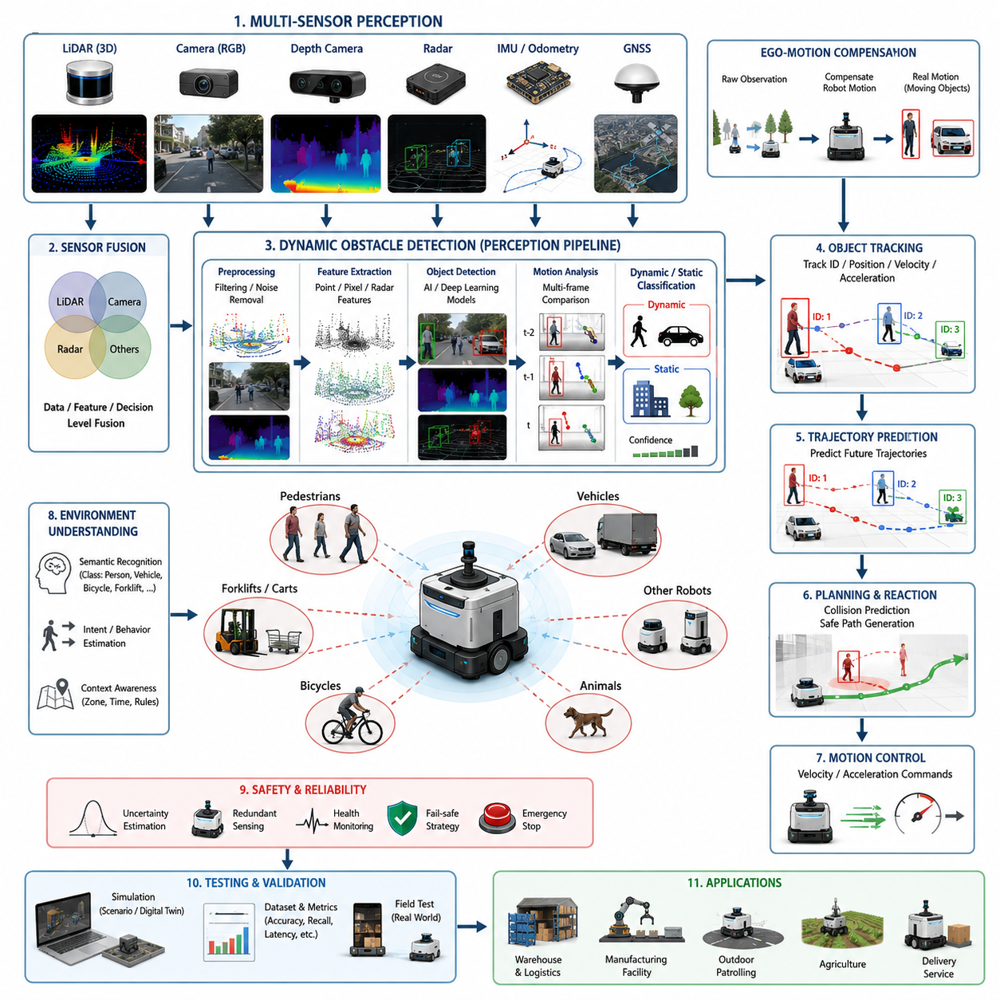
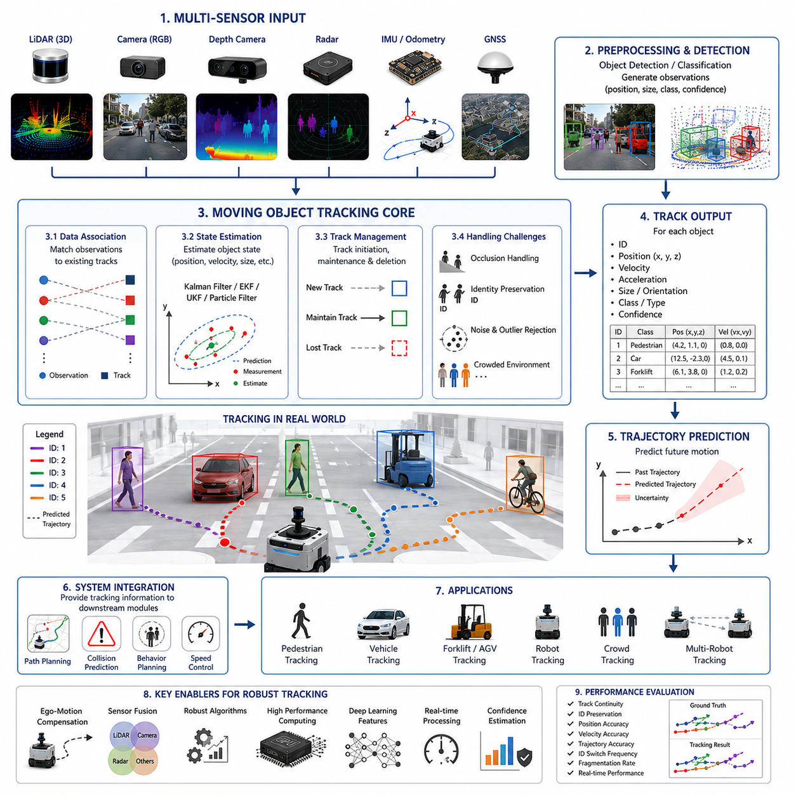
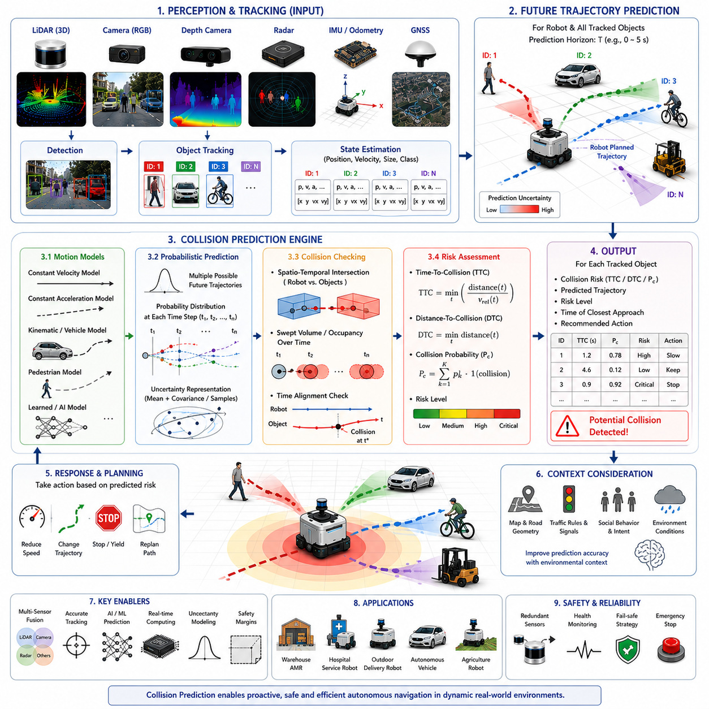
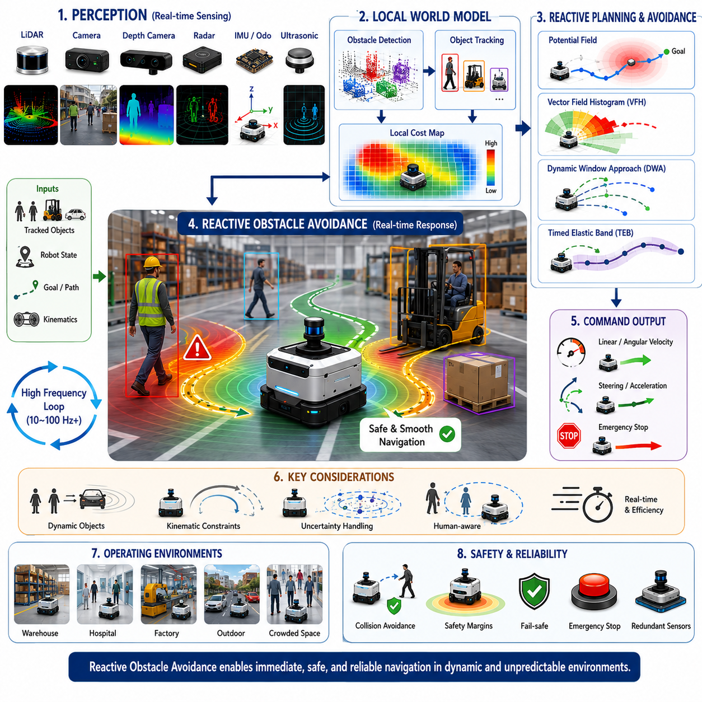
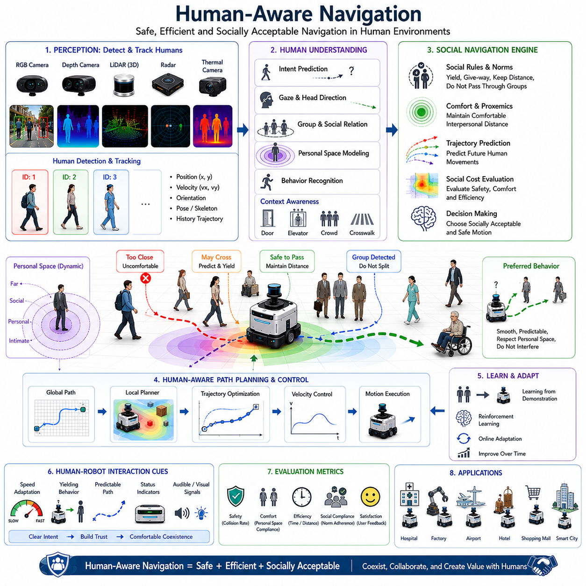
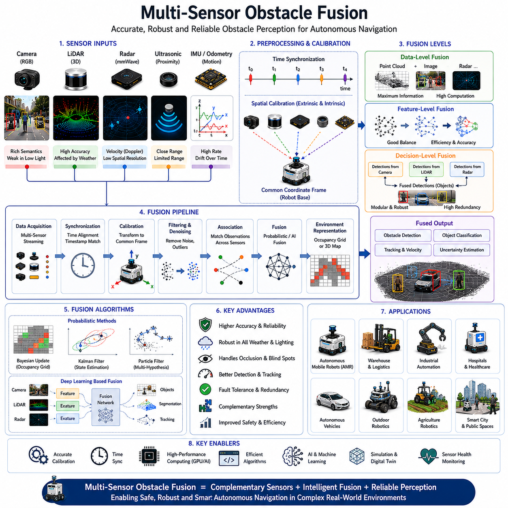
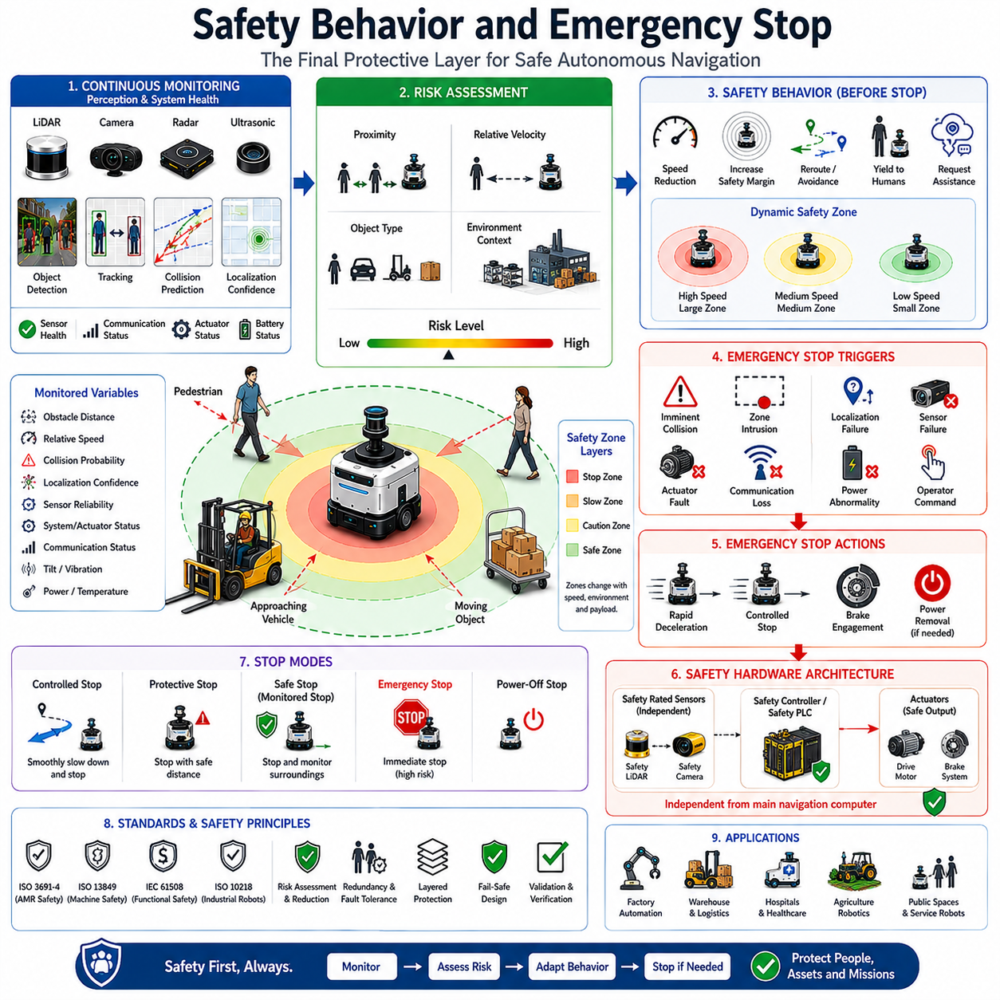
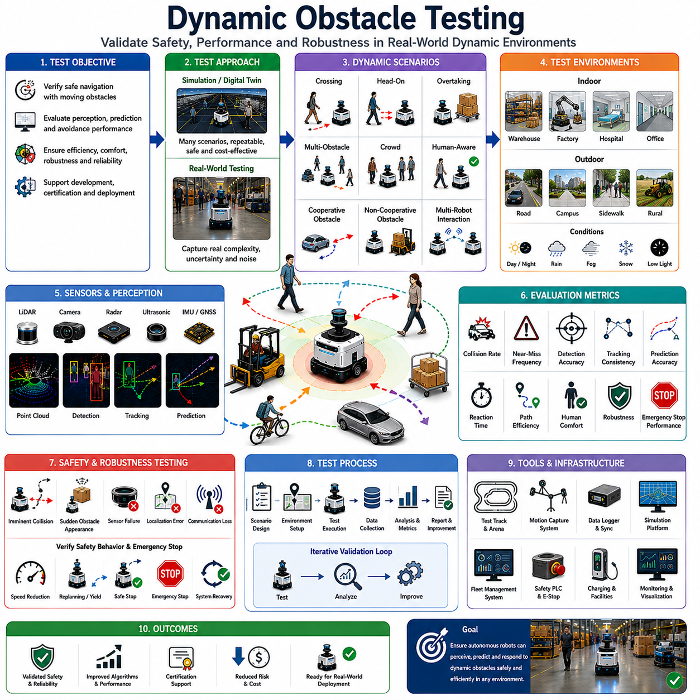

**Volume 05. Path Planning and Autonomous Navigation**

# Chapter 07. Dynamic Obstacle Avoidance

## 07.1 Dynamic Obstacle Detection

{width="7.268055555555556in" height="7.268055555555556in"}

Dynamic Obstacle Detection is one of the most important capabilities in autonomous navigation systems because real-world environments are rarely static. Unlike static obstacles such as walls, pillars, shelves, fences, or fixed infrastructure, dynamic obstacles continuously change their positions over time and often behave unpredictably. Humans walking through corridors, forklifts operating in warehouses, vehicles moving in logistics centers, bicycles crossing roads, autonomous robots sharing the same workspace, and even animals moving through outdoor environments all represent dynamic obstacles that must be detected, tracked, and interpreted in real time. The ability to accurately identify these moving objects forms the foundation of safe and reliable autonomous navigation. Within the broader Dynamic Obstacle Avoidance framework of autonomous mobile robots, Dynamic Obstacle Detection serves as the first stage of perception, providing essential information that later modules use for object tracking, collision prediction, behavior planning, and trajectory generation.

In autonomous robot systems, obstacle detection begins with environmental sensing. Sensors continuously collect information about the surrounding world and transform physical measurements into digital representations that can be processed by navigation software. Dynamic obstacle detection differs from static obstacle detection because the system must not only determine whether an object exists but also determine whether the object is moving. This requires temporal analysis, where sensor observations collected over multiple time frames are compared and analyzed to identify motion patterns. The navigation system must therefore understand both spatial and temporal information simultaneously.

LiDAR sensors are among the most widely used technologies for dynamic obstacle detection. A two-dimensional LiDAR scanner generates a horizontal slice of the environment, measuring distances to surrounding objects at high frequencies. By comparing consecutive scans, the robot can identify changes in object positions and estimate motion. Three-dimensional LiDAR systems provide richer environmental information by generating dense point clouds representing the surrounding space. These point clouds allow the detection system to identify not only the presence of moving objects but also their shapes, sizes, and trajectories. Modern outdoor autonomous robots often utilize multiple LiDAR units positioned around the platform to eliminate blind spots and provide full 360-degree environmental awareness. Such configurations are particularly valuable in industrial facilities, smart cities, agricultural environments, and inspection robot applications.

Camera-based systems provide another critical source of information. RGB cameras capture rich visual data that can be analyzed using computer vision algorithms and deep learning models. Dynamic obstacle detection using cameras often relies on motion estimation techniques such as optical flow, frame differencing, background subtraction, and object detection networks. Optical flow estimates the motion of pixels between consecutive images and allows the system to infer object movement. Deep learning models such as YOLO, Faster R-CNN, SSD, and transformer-based detection architectures can identify pedestrians, vehicles, bicycles, forklifts, and other relevant object categories. Once detected, these objects can be monitored over time to determine whether they are moving and how their positions evolve. Camera-based approaches are particularly effective in environments where semantic understanding is important, such as hospitals, public facilities, warehouses, and urban outdoor spaces.

Depth cameras add another dimension to obstacle detection by providing direct distance measurements. Unlike conventional RGB cameras, depth sensors can estimate the three-dimensional position of objects within the environment. This information improves obstacle localization accuracy and helps distinguish moving objects from background structures. Stereo cameras, structured-light sensors, and time-of-flight cameras are common depth sensing technologies used in robotic systems. The combination of RGB and depth information enables robust dynamic obstacle detection even in cluttered environments containing multiple overlapping objects.

Radar technology is increasingly being adopted for outdoor autonomous robots because of its ability to operate reliably under adverse environmental conditions. Rain, fog, dust, snow, and poor lighting conditions can significantly degrade camera and LiDAR performance. Radar systems are less sensitive to these environmental factors and can directly measure object velocity through Doppler effects. This capability provides valuable information about moving obstacles and supports early detection of approaching vehicles or other high-speed objects. Radar-based dynamic obstacle detection is particularly useful for outdoor patrol robots, agricultural robots, autonomous delivery systems, and road-based autonomous vehicles.

Sensor fusion represents a key strategy for improving detection reliability. Individual sensors possess unique strengths and weaknesses. Cameras provide rich semantic understanding but may struggle in darkness. LiDAR provides accurate geometry but may be affected by heavy rain. Radar offers robust velocity measurements but provides lower spatial resolution. By combining information from multiple sensors, autonomous systems achieve significantly higher detection accuracy and robustness. Sensor fusion architectures may operate at raw data levels, feature levels, or decision levels. Modern autonomous robots frequently employ multi-sensor fusion pipelines that integrate LiDAR, cameras, radar, IMU, GNSS, and odometry information into a unified perception framework. This approach is especially important for safety-critical navigation systems operating in dynamic environments.

One of the fundamental challenges in dynamic obstacle detection is distinguishing moving objects from stationary objects while the robot itself is moving. If a robot observes environmental changes while traveling through an environment, apparent motion may result from the robot\'s own movement rather than actual object motion. To address this issue, localization and odometry information are incorporated into the detection process. By estimating the robot\'s own motion between sensor measurements, the perception system can compensate for ego-motion and accurately determine which environmental elements are genuinely moving. This process is essential for reliable obstacle detection in autonomous mobile robots.

Background modeling techniques are commonly used to separate dynamic elements from static environments. The system maintains an estimate of the stationary environment and continuously compares new observations against this model. Objects that exhibit significant deviations from the expected static scene are classified as potential dynamic obstacles. In structured indoor environments such as factories or warehouses, background models can be highly effective because the environment changes relatively slowly. In outdoor environments, however, dynamic weather conditions, vegetation movement, shadows, and lighting changes introduce additional complexity.

Machine learning and deep learning have transformed dynamic obstacle detection capabilities. Traditional rule-based systems often relied on geometric thresholds and handcrafted features. Modern systems increasingly employ neural networks capable of learning complex patterns directly from large datasets. Convolutional neural networks process image data to detect and classify moving objects. Recurrent neural networks and temporal transformers analyze motion sequences over time. Point cloud neural networks process three-dimensional LiDAR data to identify dynamic objects directly within spatial representations. Multimodal architectures combine information from multiple sensors and generate unified representations that improve detection performance across diverse operating conditions.

Real-time processing requirements impose significant computational challenges. Dynamic obstacle detection must operate within strict timing constraints because delayed perception can lead to unsafe navigation decisions. In many industrial AMR systems, perception pipelines operate at frequencies ranging from 10 Hz to 50 Hz or higher. Outdoor autonomous vehicles may require even faster update rates. Achieving these performance levels requires efficient algorithms, optimized software architectures, GPU acceleration, and specialized AI hardware. Edge computing platforms such as NVIDIA Jetson devices are frequently employed to execute perception workloads directly on robotic platforms while maintaining low latency and high reliability.

Dynamic obstacle detection systems must also handle uncertainty. Sensor measurements are inherently noisy, and environmental conditions can introduce ambiguity. A detected object may be partially occluded, poorly illuminated, or observed only briefly. Probabilistic approaches such as Bayesian filtering, Kalman filtering, particle filtering, and occupancy grid methods are commonly used to estimate object existence and motion with associated confidence levels. These techniques enable robust operation even when observations are incomplete or uncertain.

Human detection represents one of the most critical applications of dynamic obstacle detection. Autonomous robots frequently operate in shared environments where humans and robots coexist. Detecting pedestrians accurately is essential for ensuring safety and regulatory compliance. Human-aware detection systems often incorporate specialized AI models trained specifically for pedestrian recognition. Additional contextual information such as body pose estimation, walking direction, group behavior, and intent prediction may also be analyzed. Understanding human movement patterns enables robots to anticipate future actions and navigate in socially acceptable ways.

Industrial environments introduce unique detection challenges. Warehouses contain forklifts, pallets, carts, workers, and other robots moving simultaneously. Manufacturing facilities may include automated guided vehicles, conveyors, cranes, and mobile equipment. Dynamic obstacle detection systems must reliably identify all relevant objects while minimizing false positives. Excessive false detections can reduce operational efficiency, whereas missed detections can create safety risks. Balancing sensitivity and reliability is therefore a key design objective.

Outdoor environments are even more challenging due to their variability. Dynamic obstacle detection must account for vehicles, bicycles, pedestrians, animals, vegetation movement, weather effects, and changing lighting conditions. Agricultural robots may encounter workers, tractors, livestock, and moving crops. Inspection robots may operate near roads, construction zones, or public spaces. Robust perception architectures must be capable of adapting to these diverse scenarios while maintaining consistent detection performance.

Dynamic obstacle detection is closely connected to object tracking systems. Once a moving object has been detected, tracking algorithms maintain its identity across multiple observations and estimate its motion state. Tracking provides velocity, acceleration, heading direction, and trajectory information that later modules use for collision prediction and navigation planning. Detection and tracking therefore function as complementary components within the broader perception architecture.

Safety considerations play a central role in system design. Dynamic obstacle detection serves as the first line of defense against collisions. Functional safety standards require perception systems to achieve specific performance levels under defined operating conditions. Safety-certified LiDAR systems, redundant sensing architectures, fault detection mechanisms, and health monitoring frameworks are frequently incorporated into industrial robot platforms. When uncertainty exceeds acceptable limits, the robot may reduce speed, increase safety margins, or initiate emergency stopping procedures.

Testing and validation are essential for evaluating detection performance. Engineers typically measure metrics such as detection accuracy, precision, recall, false positive rate, false negative rate, detection latency, localization error, and robustness across environmental conditions. Validation datasets must include diverse scenarios representing real-world operating conditions. Simulation environments provide a controlled method for generating large-scale testing data, while field trials verify performance under actual deployment conditions. Both approaches are necessary to establish confidence in system reliability.

As autonomous navigation systems continue to evolve, dynamic obstacle detection is becoming increasingly intelligent and predictive. Future systems will move beyond simple object detection toward comprehensive scene understanding. Perception modules will recognize object types, infer intentions, predict future behaviors, and understand social interactions occurring within the environment. Large-scale AI models, multimodal perception architectures, world models, and embodied intelligence frameworks are expected to further enhance detection capabilities. These advances will enable autonomous robots to navigate safely and efficiently in highly dynamic environments containing large numbers of moving objects and complex interactions. Dynamic obstacle detection will remain a foundational technology supporting the next generation of intelligent autonomous machines and advanced AMR platforms.

## 07.2 Moving Object Tracking

{width="7.268055555555556in" height="7.268055555555556in"}

Moving Object Tracking is a fundamental capability within autonomous navigation systems that enables robots to continuously monitor and understand the behavior of dynamic entities in their surroundings. While Dynamic Obstacle Detection focuses on identifying the existence of moving objects, Moving Object Tracking extends this capability by maintaining the identity of each object over time, estimating its motion state, predicting its future behavior, and providing essential information to higher-level navigation and decision-making modules. In real-world environments, autonomous mobile robots operate among pedestrians, vehicles, forklifts, bicycles, other robots, and various moving equipment. Merely detecting these objects is insufficient for safe navigation. The robot must understand where these objects are moving, how fast they are traveling, whether they are accelerating or decelerating, and how their future trajectories may interact with the robot's planned path. Moving Object Tracking provides the continuous situational awareness required to achieve this understanding.

In autonomous navigation architectures, object tracking typically follows the object detection stage. Detection algorithms identify potential moving objects in sensor data and generate observations containing object positions, dimensions, classifications, and confidence scores. Tracking algorithms then associate these observations across consecutive time frames, assigning a persistent identity to each object and estimating its state over time. This process transforms a sequence of independent detections into coherent object trajectories. Without tracking, the navigation system would perceive each observation as a completely new object, making it impossible to estimate motion patterns or predict future behavior.

The primary objective of Moving Object Tracking is maintaining object identity consistency. When a pedestrian appears in a camera frame, the system may assign a unique tracking identifier. As the pedestrian continues walking through the environment, subsequent observations must be associated with the same identifier despite changes in position, orientation, appearance, lighting conditions, or partial occlusions. Maintaining identity consistency allows the robot to accumulate motion history and generate accurate predictions regarding future movement.

Motion tracking begins with the acquisition of sensor measurements. Modern autonomous robots typically utilize multiple sensors including LiDAR, RGB cameras, depth cameras, radar systems, ultrasonic sensors, GNSS, IMU, and wheel odometry. Each sensor contributes unique information regarding object positions and movement. LiDAR provides precise geometric measurements, cameras provide semantic understanding, radar supplies velocity information, and odometry assists in compensating for robot motion. By combining these sensor observations, tracking systems generate robust estimates of object states even under challenging environmental conditions.

One of the fundamental challenges in Moving Object Tracking arises from the fact that the robot itself is usually moving. As the robot navigates through the environment, all observed objects appear to move relative to the robot's coordinate system. Therefore, tracking systems must first compensate for ego-motion. Localization algorithms estimate the robot's movement between consecutive observations, allowing the perception system to distinguish between environmental motion caused by robot movement and actual object motion. Accurate ego-motion compensation is essential for reliable tracking performance, particularly in outdoor autonomous navigation applications where robots travel over large distances.

State estimation forms the mathematical foundation of object tracking. A tracked object is typically represented by a state vector containing variables such as position, velocity, acceleration, orientation, angular velocity, and size. The tracking algorithm continuously updates this state estimate using new sensor observations. Because sensor measurements are inherently noisy and incomplete, probabilistic estimation techniques are employed to produce robust state estimates. These methods combine prior knowledge about object motion with incoming observations, generating an optimal estimate of the current state.

The Kalman Filter is one of the most widely used algorithms in object tracking. Originally developed for aerospace applications, it has become a standard technique in robotics and autonomous navigation. The Kalman Filter predicts the future state of an object based on its previous motion and then updates this prediction using new observations. The resulting estimate balances model predictions and sensor measurements according to their respective uncertainties. Kalman Filters are computationally efficient and perform well when object motion follows approximately linear dynamics and measurement noise follows Gaussian distributions.

In many real-world scenarios, object motion is nonlinear. Pedestrians may suddenly change direction, vehicles may execute turns, and robots may accelerate unpredictably. To handle such situations, Extended Kalman Filters and Unscented Kalman Filters are commonly employed. These methods extend the Kalman Filter framework to nonlinear systems and provide improved tracking accuracy in complex environments.

Particle Filters represent another powerful tracking approach. Rather than maintaining a single estimate of object state, Particle Filters maintain a collection of hypotheses representing different possible states. Each particle corresponds to a potential object state and carries an associated probability. As new observations arrive, particles are updated and resampled according to their consistency with sensor measurements. Particle Filters are particularly useful when object motion exhibits strong nonlinearities or when uncertainty distributions become highly non-Gaussian.

Data association is one of the most critical components of Moving Object Tracking. At every time step, the tracking system receives multiple observations from sensors and must determine which observations correspond to which tracked objects. This problem becomes increasingly difficult as the number of objects grows. In crowded environments such as hospitals, warehouses, airports, or urban areas, dozens of moving objects may appear simultaneously. The tracking system must correctly associate observations while avoiding identity switches, false associations, and track fragmentation.

Nearest Neighbor Association is one of the simplest data association techniques. Observations are matched to existing tracks based on spatial proximity. While computationally efficient, this method may fail when objects move close together. More advanced approaches include Joint Probabilistic Data Association, Multiple Hypothesis Tracking, and graph-based optimization techniques. These methods consider multiple possible associations simultaneously and select the most likely tracking solution based on probabilistic reasoning.

Object occlusion represents another major challenge. Moving objects frequently become partially or completely hidden behind other objects, walls, shelves, vehicles, or infrastructure. A pedestrian walking behind a forklift may temporarily disappear from camera view. Effective tracking systems must maintain object identities even during periods of missing observations. Motion models allow the tracker to predict object positions during occlusion intervals, enabling successful track recovery when the object reappears.

Deep learning has significantly transformed modern object tracking systems. Traditional tracking methods primarily relied on geometric information and handcrafted motion models. Contemporary systems increasingly employ neural networks capable of learning complex appearance features directly from data. Visual tracking models analyze object appearance and maintain identity based on visual similarity. Deep feature representations allow trackers to distinguish between multiple objects with similar motion patterns and improve robustness against appearance changes.

Multiple Object Tracking has become an important research area due to the increasing complexity of autonomous navigation environments. Unlike single-object tracking, multiple object tracking requires simultaneous estimation of numerous object trajectories. Industrial facilities may contain dozens of workers, forklifts, carts, and autonomous robots operating simultaneously. Urban environments may contain hundreds of pedestrians and vehicles. Multiple object tracking systems must scale efficiently while maintaining high accuracy and real-time performance.

Three-dimensional object tracking has become increasingly important with the widespread adoption of 3D LiDAR sensors. Unlike image-based tracking, 3D tracking operates directly within spatial coordinate systems and provides accurate position estimates in real-world units. Three-dimensional tracking enables autonomous robots to estimate object trajectories, distances, and collision risks with greater precision. Modern autonomous vehicles and outdoor mobile robots frequently rely on LiDAR-based tracking as a core component of their perception architectures.

Radar-based tracking provides unique advantages because radar sensors directly measure object velocity through Doppler effects. This capability allows trackers to estimate object motion even when position measurements are noisy or sparse. Radar tracking is particularly valuable in adverse weather conditions where camera and LiDAR performance may degrade. Many outdoor autonomous systems combine radar tracking with LiDAR and vision tracking to achieve robust all-weather perception.

Human tracking is among the most important applications of Moving Object Tracking. Autonomous robots operating in shared human environments must continuously monitor pedestrian behavior. Human movement is inherently complex and often unpredictable. Pedestrians may stop abruptly, change directions suddenly, interact with other individuals, or exhibit socially influenced movement patterns. Advanced human tracking systems incorporate behavioral models, social interaction analysis, and intent estimation to better predict future movements.

Human-aware tracking is especially important in hospitals, hotels, shopping centers, airports, and smart factories. In these environments, robots must not only avoid collisions but also behave in ways that are socially acceptable and comfortable for nearby humans. Tracking systems therefore provide information not only about object positions but also about group formations, walking directions, interpersonal distances, and potential crossing intentions.

Object classification and tracking are increasingly integrated within unified perception architectures. Rather than treating detection and tracking as separate processes, modern systems often employ tracking-by-detection approaches. Detection networks generate object candidates, while tracking algorithms maintain identities over time. End-to-end neural architectures are also emerging, combining detection, tracking, classification, and trajectory prediction into a single learning framework. These systems reduce processing complexity while improving overall perception performance.

Trajectory estimation is a natural extension of object tracking. As motion history accumulates, tracking systems generate increasingly accurate estimates of future object trajectories. Trajectory prediction enables navigation planners to anticipate potential conflicts before they occur. For example, if a pedestrian is expected to cross the robot's path within several seconds, the navigation system can proactively adjust speed or modify the planned route. This predictive capability is essential for smooth and efficient autonomous navigation.

Real-time processing remains a critical requirement for Moving Object Tracking. Autonomous robots must continuously update object states while maintaining low latency. Industrial AMRs often require tracking updates at frequencies ranging from 10 Hz to 50 Hz, while autonomous vehicles may operate at even higher rates. Achieving these performance levels requires efficient software architectures, GPU acceleration, optimized data structures, and high-performance computing platforms.

Tracking accuracy must be evaluated using rigorous performance metrics. Common evaluation criteria include track continuity, identity preservation, position accuracy, velocity estimation accuracy, trajectory prediction accuracy, identity switch frequency, track fragmentation rate, and computational efficiency. Benchmark datasets and simulation environments provide standardized methods for comparing tracking algorithms under diverse operating conditions.

Simulation has become an essential tool for tracker development. Digital twins and virtual environments allow engineers to generate large-scale datasets containing complex dynamic interactions. Simulation enables testing under rare, dangerous, or expensive scenarios that would be difficult to reproduce consistently in real-world environments. However, field testing remains indispensable because real-world conditions often introduce complexities not fully captured in simulation.

Safety is deeply connected to Moving Object Tracking. Reliable tracking provides the foundation for collision prediction, risk assessment, dynamic path planning, and emergency response. If tracking accuracy degrades, navigation safety may be compromised. Consequently, safety-critical systems often employ redundant tracking mechanisms, sensor diversity, fault detection frameworks, and confidence estimation methods. These measures ensure that navigation decisions remain reliable even when individual perception components experience failures.

Future Moving Object Tracking systems will become increasingly intelligent through the integration of foundation models, multimodal perception, world models, and embodied AI technologies. Rather than merely estimating positions and velocities, future trackers will understand object intent, predict long-term behavior, recognize social interactions, and reason about environmental context. Robots will not simply observe movement but will understand why objects move and what actions they are likely to perform next. This transition from motion estimation to behavioral understanding represents a major evolution in autonomous navigation capabilities.

As autonomous mobile robots become more common in factories, hospitals, logistics centers, smart cities, agricultural operations, inspection systems, and public spaces, Moving Object Tracking will remain a cornerstone technology supporting safe, efficient, and intelligent navigation. By continuously observing, interpreting, and predicting the behavior of surrounding entities, tracking systems provide the dynamic environmental awareness necessary for advanced autonomous operation and next-generation robotic intelligence.

## 07.3 Collision Prediction

{width="7.268055555555556in" height="7.268055555555556in"}

Collision Prediction is one of the most critical functions within autonomous navigation systems because it enables a robot to anticipate dangerous situations before they occur. While Dynamic Obstacle Detection identifies moving objects and Moving Object Tracking estimates their positions and motion states over time, Collision Prediction analyzes the future interactions between the robot and surrounding entities to determine whether a collision is likely to occur. This predictive capability transforms navigation from a reactive process into a proactive one, allowing autonomous systems to avoid hazards early, generate safer trajectories, and maintain efficient operation in dynamic environments. In industrial facilities, warehouses, hospitals, logistics centers, smart cities, agricultural fields, and outdoor autonomous robot deployments, collision prediction serves as a core safety mechanism that protects humans, equipment, infrastructure, and the robot itself.

At its foundation, collision prediction attempts to answer a simple but extremely important question: if all observed objects continue moving according to their current behaviors, will the robot collide with any of them in the future? Answering this question requires the navigation system to continuously estimate future positions for both the robot and surrounding objects. Unlike obstacle detection, which focuses on current environmental states, collision prediction focuses on future environmental states. The prediction horizon may range from fractions of a second in high-speed navigation systems to several seconds or even minutes in large-scale planning applications.

The collision prediction process begins with perception. Multiple sensors continuously observe the environment and provide information regarding nearby objects. LiDAR systems generate geometric measurements, cameras provide semantic understanding, radar systems contribute velocity estimates, depth cameras measure object distances, and localization systems provide accurate robot positioning. Dynamic obstacle detection algorithms identify moving entities, while object tracking systems estimate their motion states. Collision prediction utilizes these outputs as inputs for future state estimation. The quality of collision prediction therefore depends heavily on the accuracy of upstream perception systems.

A collision occurs when two objects occupy the same physical space at the same time. Consequently, collision prediction requires estimating both spatial and temporal relationships. The system must determine where objects will be located in the future and when they will arrive at those locations. Even if two trajectories intersect geometrically, a collision may not occur if the objects arrive at different times. Conversely, objects following parallel trajectories may still collide if one suddenly changes direction. Accurate collision prediction therefore requires both motion forecasting and temporal reasoning.

One of the simplest collision prediction approaches involves extrapolating current motion. If an object is moving at a constant velocity, its future position can be estimated using basic kinematic equations. This approach is computationally efficient and often serves as an initial approximation in real-time navigation systems. However, real-world objects rarely move with perfectly constant velocity. Humans stop unexpectedly, vehicles accelerate or brake, and robots alter their trajectories in response to environmental changes. Consequently, more sophisticated prediction models are typically required.

Motion models form the foundation of predictive estimation. Constant Velocity Models assume that objects continue moving at their current speeds and directions. Constant Acceleration Models incorporate acceleration estimates and provide improved predictions for objects undergoing speed changes. More advanced motion models may account for turning behavior, steering constraints, vehicle dynamics, pedestrian movement patterns, or robot-specific kinematic limitations. Selecting an appropriate motion model significantly influences prediction accuracy.

Probabilistic prediction methods are widely used because future motion is inherently uncertain. Instead of generating a single predicted trajectory, probabilistic models estimate multiple possible future trajectories and assign confidence values to each possibility. This approach reflects the reality that future behavior cannot be known with certainty. A pedestrian approaching an intersection may continue straight, turn left, turn right, or stop. Rather than selecting a single outcome, probabilistic prediction systems evaluate all plausible scenarios and estimate their likelihoods.

Kalman Filters are commonly employed within collision prediction frameworks. Tracking systems often use Kalman Filters to estimate current object states, and these estimates can be propagated forward to generate future trajectories. Extended Kalman Filters and Unscented Kalman Filters provide enhanced capabilities for nonlinear motion patterns. Particle Filters offer an alternative approach by maintaining multiple hypotheses regarding future object behavior. These probabilistic methods help navigation systems manage uncertainty and make robust decisions under imperfect information.

Trajectory prediction represents a major component of collision prediction. For every tracked object, the system generates one or more future trajectories describing expected movement over a prediction horizon. These trajectories may include position, velocity, acceleration, orientation, and uncertainty estimates at future time steps. Once trajectories have been generated, the navigation system compares them against the robot's planned path. Potential intersections indicate possible collision risks.

Time-To-Collision, commonly abbreviated as TTC, is one of the most widely used collision risk metrics. TTC estimates the amount of time remaining before a collision occurs if current motion patterns continue unchanged. Small TTC values indicate high collision risk and may trigger immediate avoidance actions. Large TTC values indicate relatively safe situations. TTC is particularly useful because it provides an intuitive measure of urgency that can be directly integrated into behavior planning and safety control systems.

Distance-To-Collision is another important metric. Rather than measuring time, it estimates the physical distance remaining before a collision event occurs. In some environments, distance-based metrics are more meaningful than time-based metrics, particularly when vehicle speeds vary significantly. Combining TTC and distance-based measures often provides a more comprehensive understanding of collision risk.

Collision prediction becomes significantly more challenging in environments containing multiple moving objects. Warehouses may contain workers, forklifts, carts, and multiple autonomous robots. Hospitals may contain patients, visitors, medical staff, and service robots. Urban environments may contain vehicles, cyclists, pedestrians, and delivery robots. Each object may interact with others, creating highly complex dynamic situations. Collision prediction systems must therefore evaluate numerous potential interactions simultaneously while maintaining real-time performance.

Human motion prediction represents one of the most difficult aspects of collision prediction. Human behavior is inherently variable and influenced by social interactions, environmental context, and individual decision-making. Pedestrians may abruptly change direction, stop unexpectedly, avoid obstacles, or interact with other individuals. Predicting such behaviors requires more than simple kinematic models. Modern systems increasingly employ machine learning and behavioral modeling techniques to improve prediction accuracy.

Human-aware collision prediction systems incorporate contextual information regarding pedestrian behavior. These systems may analyze walking direction, gaze orientation, body posture, group formation, crowd dynamics, and environmental context. A person looking toward a doorway may be more likely to enter that doorway. A pedestrian approaching a crosswalk may be likely to cross the road. By incorporating behavioral cues, prediction systems achieve more realistic forecasts of future movement.

Machine learning has dramatically advanced collision prediction capabilities. Traditional approaches relied heavily on handcrafted motion models and rule-based reasoning. Modern AI systems learn movement patterns directly from large datasets containing real-world trajectories. Recurrent Neural Networks, Long Short-Term Memory networks, Temporal Convolutional Networks, Graph Neural Networks, and Transformer architectures are increasingly used to predict future motion. These models capture complex behavioral patterns that are difficult to represent using conventional mathematical models.

Trajectory prediction using deep learning often considers environmental context. Road geometry, obstacles, traffic rules, social interactions, and scene semantics all influence future behavior. For example, a vehicle approaching a curved road is likely to follow the road geometry. A pedestrian approaching a wall is unlikely to continue through it. AI-based systems learn these contextual constraints automatically, resulting in more accurate predictions.

Multi-agent prediction has become an important research area because objects rarely move independently. Human crowds exhibit collective behavior. Vehicles respond to nearby traffic. Autonomous robots coordinate their actions with other robots. Multi-agent prediction models attempt to capture these interactions by jointly predicting the trajectories of multiple entities. Such approaches often provide significantly improved accuracy in crowded environments.

Collision prediction is closely integrated with local path planning. Once a potential collision is identified, the navigation system must determine how to respond. Possible responses include reducing speed, stopping, adjusting trajectory curvature, selecting alternative paths, yielding to pedestrians, or executing emergency maneuvers. The planner continuously evaluates predicted collision risks and modifies robot behavior accordingly. This feedback loop operates in real time throughout navigation.

Safety margins play a critical role in practical collision prediction systems. Because predictions are uncertain, navigation systems rarely allow trajectories to approach collision boundaries exactly. Instead, safety buffers are introduced around objects and predicted trajectories. These buffers account for sensor noise, tracking uncertainty, prediction errors, actuator delays, communication latency, and unexpected object behavior. Industrial safety regulations often specify minimum separation distances that must be maintained between robots and humans.

Industrial autonomous mobile robots frequently implement layered collision prediction architectures. Short-range prediction modules focus on immediate safety and operate at high frequencies. Medium-range modules support local planning and trajectory generation. Long-range modules contribute to strategic navigation and behavior planning. This hierarchical approach balances computational efficiency with predictive capability.

Outdoor collision prediction presents additional challenges due to environmental complexity. Vehicles travel at higher speeds, prediction horizons become longer, and environmental uncertainty increases. Weather conditions, uneven terrain, varying visibility, and larger operational areas complicate prediction accuracy. Outdoor autonomous robots therefore often rely on multi-sensor fusion and advanced AI models to maintain robust performance.

Simulation plays an essential role in collision prediction development. Digital twins and virtual environments enable engineers to generate diverse collision scenarios safely and efficiently. Rare events, near misses, complex crowd interactions, and dangerous situations can be reproduced repeatedly for testing purposes. Simulation accelerates algorithm development while reducing costs and safety risks associated with physical testing.

Performance evaluation requires comprehensive testing across numerous scenarios. Common metrics include collision prediction accuracy, false positive rate, false negative rate, prediction horizon accuracy, Time-To-Collision estimation error, trajectory prediction error, computational latency, and system robustness. Successful systems must balance accuracy with real-time processing requirements.

Functional safety standards place strict requirements on collision prediction systems. Autonomous robots operating near humans must demonstrate reliable hazard identification and risk mitigation capabilities. Safety-certified architectures often include redundant sensors, independent safety monitoring systems, emergency stop functions, fault detection mechanisms, and continuous health monitoring. Collision prediction outputs may be verified by separate safety controllers before critical actions are executed.

Recent developments in foundation models and embodied AI are expanding the scope of collision prediction. Future systems will not merely estimate future positions but will understand intentions, goals, social norms, and environmental semantics. Robots will predict not only where objects will move but also why they are moving. This deeper understanding will enable more natural, efficient, and socially acceptable navigation behaviors.

World models are expected to play a major role in future collision prediction architectures. By maintaining a continuously updated representation of the environment and its dynamic entities, world models can simulate potential future scenarios internally. These simulations allow robots to evaluate multiple action alternatives before execution, reducing collision risk while improving operational efficiency.

As autonomous robots become increasingly common in industrial, commercial, medical, agricultural, logistics, and public environments, Collision Prediction will remain one of the most important technologies supporting safe autonomous operation. By forecasting future interactions, quantifying risk, and enabling proactive decision-making, collision prediction transforms autonomous navigation from simple obstacle avoidance into intelligent, predictive, and safety-aware mobility. Within the broader Dynamic Obstacle Avoidance framework, Collision Prediction serves as the critical bridge between perception and action, ensuring that autonomous robots can coexist safely and effectively with the dynamic world around them.

## 07.4 Reactive Obstacle Avoidance

{width="7.268055555555556in" height="7.268055555555556in"}

Reactive Obstacle Avoidance is one of the most essential capabilities in autonomous navigation systems because it enables a robot to respond immediately to unexpected obstacles and rapidly changing environmental conditions. Unlike global path planning, which calculates routes using prior knowledge of the environment, reactive obstacle avoidance focuses on real-time decision making based on current sensor observations. It allows autonomous mobile robots to operate safely in dynamic and unpredictable environments where new obstacles may appear without warning. Warehouses, hospitals, factories, logistics centers, smart cities, agricultural fields, construction sites, and outdoor public spaces all contain situations where preplanned paths become invalid due to the appearance of people, vehicles, equipment, animals, or temporary obstacles. Reactive obstacle avoidance serves as the robot's immediate response mechanism, enabling safe navigation when environmental conditions change faster than long-term planning algorithms can adapt.

The concept of reactive obstacle avoidance originates from the observation that real-world environments are constantly changing. Even if a robot possesses an accurate map and an optimized route, unforeseen events can occur at any moment. A worker may step into a corridor, a forklift may cross an intersection, a pallet may be placed in the robot's path, or another robot may unexpectedly stop. In these situations, waiting for a complete global replanning cycle may be too slow. The robot must react instantly to prevent collisions and maintain safe operation. Reactive obstacle avoidance therefore operates at high frequencies and prioritizes immediate safety over long-term path optimality.

Reactive obstacle avoidance relies heavily on perception systems. Sensors continuously observe the surrounding environment and provide information regarding nearby obstacles. LiDAR systems generate precise distance measurements and spatial geometry. Cameras provide visual and semantic understanding of objects. Depth cameras contribute three-dimensional positioning information. Radar systems offer velocity measurements and robustness under adverse weather conditions. Ultrasonic sensors provide short-range obstacle detection capabilities, particularly useful during docking and close-range maneuvering. These sensor inputs are processed continuously to generate an up-to-date representation of the local environment.

A fundamental characteristic of reactive obstacle avoidance is its dependence on local information rather than global knowledge. Global planners often consider large-scale maps and long-term objectives. Reactive systems focus primarily on obstacles located within the immediate vicinity of the robot. This localized perspective enables rapid decision making because computational resources are concentrated on the most relevant portion of the environment. As a result, reactive algorithms can operate at update frequencies ranging from tens to hundreds of times per second.

The local cost map is one of the most important data structures supporting reactive obstacle avoidance. The cost map represents nearby obstacles, free space, safety zones, and navigation constraints within a local coordinate frame centered on the robot. Each cell within the map contains a cost value indicating the relative difficulty or risk associated with traversing that location. High-cost regions correspond to obstacles or dangerous areas, while low-cost regions indicate safe navigation corridors. Reactive planners continuously update this cost map using incoming sensor observations and use it as the basis for real-time motion generation.

One of the earliest approaches to reactive obstacle avoidance is the Artificial Potential Field method. In this framework, the robot is attracted toward its goal while simultaneously being repelled away from obstacles. The goal generates an attractive force, and obstacles generate repulsive forces. The robot computes the resulting force vector and moves accordingly. Potential field methods are computationally efficient and conceptually intuitive. However, they may suffer from local minima problems where the robot becomes trapped in configurations that prevent progress toward the goal.

Vector Field Histogram algorithms represent another influential approach. These methods construct histograms describing obstacle density around the robot and identify collision-free movement directions. By evaluating obstacle distributions and desired travel directions simultaneously, the robot can select safe steering commands that maintain progress toward its destination. Vector Field Histogram methods remain popular because they balance computational efficiency with practical obstacle avoidance performance.

The Dynamic Window Approach, commonly known as DWA, is one of the most widely deployed reactive obstacle avoidance algorithms in industrial robotics. DWA evaluates a set of candidate velocity commands and predicts the robot's future motion over a short time horizon. Each candidate trajectory is evaluated according to multiple criteria including obstacle clearance, progress toward the goal, heading alignment, and velocity efficiency. The command with the highest overall score is selected for execution. DWA naturally incorporates the robot's kinematic constraints and provides smooth, real-time obstacle avoidance behavior.

Timed Elastic Band planning represents a more advanced reactive planning technique. Unlike DWA, which evaluates discrete velocity samples, TEB optimizes an entire local trajectory simultaneously. The trajectory is represented as an elastic band that can deform in response to obstacles while respecting robot kinematics, dynamic constraints, and timing requirements. TEB planners often generate smoother and more efficient trajectories than purely reactive velocity-based methods, making them popular in modern autonomous mobile robot systems.

Reactive obstacle avoidance must account for the physical limitations of the robot. Every platform possesses unique kinematic and dynamic constraints. Differential-drive robots, Ackermann-steered vehicles, omnidirectional robots, tracked vehicles, towing robots, and articulated mobile systems all exhibit different motion characteristics. Reactive planners must generate commands that remain feasible for the specific robot platform. Ignoring vehicle constraints can result in trajectories that are theoretically collision-free but physically impossible to execute.

Dynamic obstacles introduce additional complexity because they move independently. Static obstacle avoidance only requires consideration of fixed environmental structures. Dynamic obstacle avoidance requires predicting future obstacle positions and evaluating collision risks over time. A trajectory that appears safe at the current moment may become dangerous if a pedestrian or vehicle enters the robot's path shortly afterward. Reactive systems therefore integrate object tracking and collision prediction modules to account for future obstacle movement.

Human-aware reactive obstacle avoidance has become increasingly important as robots operate more frequently in shared environments. Humans expect robot behavior to be predictable, comfortable, and socially acceptable. Merely avoiding collisions is insufficient. Robots should maintain appropriate interpersonal distances, avoid sudden aggressive maneuvers, respect social norms, and yield when appropriate. Human-aware avoidance systems incorporate social navigation principles into reactive decision making, improving both safety and user acceptance.

Social force models provide one approach for incorporating human considerations into obstacle avoidance. These models extend traditional potential field concepts by introducing social interaction forces that reflect human comfort preferences. The robot treats humans differently from inanimate obstacles, generating trajectories that maintain comfortable distances and avoid disrupting pedestrian movement patterns. Such approaches are particularly valuable in hospitals, shopping centers, airports, and public facilities.

Machine learning has significantly expanded the capabilities of reactive obstacle avoidance. Traditional methods rely on handcrafted cost functions and manually designed decision rules. Learning-based approaches can automatically discover navigation policies from data. Reinforcement learning has become particularly influential in this area. Through repeated interaction with simulated environments, reinforcement learning agents learn obstacle avoidance strategies that maximize safety, efficiency, and task completion performance.

Deep reinforcement learning enables robots to learn complex avoidance behaviors that would be difficult to encode manually. Neural networks process sensor observations and generate control commands directly. During training, the system receives rewards for reaching goals safely and penalties for collisions or inefficient behavior. Over time, the learned policy develops sophisticated navigation strategies capable of handling diverse dynamic environments.

Imitation learning provides another learning-based approach. Instead of discovering behaviors through trial and error, robots learn obstacle avoidance strategies by observing expert demonstrations. Human operators or optimized planning systems provide example trajectories, and machine learning models learn to reproduce these behaviors. Imitation learning often accelerates development and improves policy stability compared with purely reinforcement-based methods.

Reactive obstacle avoidance must operate under strict real-time constraints. Navigation decisions often need to be generated within milliseconds. Delayed reactions may result in collisions, especially at higher operating speeds. Consequently, computational efficiency is a critical design requirement. Modern implementations frequently utilize GPU acceleration, parallel processing architectures, optimized data structures, and high-performance edge computing platforms to meet real-time demands.

Uncertainty management is another essential consideration. Sensor measurements contain noise, object tracking estimates contain errors, and future object motions cannot be predicted perfectly. Reactive systems therefore incorporate uncertainty estimates into decision making. Probabilistic occupancy grids, confidence maps, Bayesian estimation methods, and risk-aware planning techniques allow robots to maintain safe behavior even when environmental information is incomplete or ambiguous.

Emergency response behavior represents the final layer of reactive obstacle avoidance. In situations where collision risk exceeds acceptable thresholds, normal navigation objectives become secondary to safety. Emergency responses may include rapid deceleration, controlled stopping, evasive steering maneuvers, activation of warning systems, or execution of safety-certified emergency stop procedures. Industrial safety regulations often require such mechanisms to operate independently from higher-level navigation software.

Multi-robot environments present unique challenges for reactive obstacle avoidance. When multiple autonomous robots share the same workspace, each robot becomes both an obstacle and an intelligent agent. Coordination mechanisms are required to prevent deadlocks, congestion, and inefficient avoidance behaviors. Local avoidance systems must therefore interact with fleet management systems, traffic control mechanisms, and robot-to-robot communication frameworks.

Outdoor environments further increase complexity. Uneven terrain, changing weather conditions, varying visibility, large operational spaces, and mixed traffic conditions create additional uncertainty. Reactive avoidance systems for outdoor robots often integrate LiDAR, radar, cameras, GNSS, IMU data, and terrain analysis modules to achieve reliable performance. Agricultural robots, inspection robots, delivery robots, and autonomous utility vehicles all rely heavily on robust reactive avoidance capabilities.

Simulation plays a crucial role in developing and validating reactive obstacle avoidance systems. Digital twins and virtual environments enable extensive testing across thousands of scenarios before field deployment. Engineers can evaluate system behavior under rare edge cases, high-density traffic conditions, adverse weather scenarios, and emergency situations without risking equipment damage or human safety. Simulation also supports reinforcement learning and large-scale performance benchmarking.

Performance evaluation typically considers multiple metrics. Collision rate measures safety performance. Goal completion rate evaluates navigation success. Path efficiency assesses travel distance and travel time. Computational latency measures responsiveness. Comfort metrics evaluate smoothness of motion and acceleration profiles. Human-aware systems may additionally assess social compliance and pedestrian comfort. Balancing these metrics is often challenging because improvements in one area may negatively affect another.

Functional safety requirements impose rigorous standards on reactive obstacle avoidance systems. Safety-certified robots often employ redundant sensors, independent safety controllers, fail-safe architectures, continuous health monitoring, and certified emergency stop systems. The reactive avoidance layer serves as a critical safety barrier, ensuring that navigation remains safe even when higher-level planning systems encounter unexpected conditions or failures.

The future of reactive obstacle avoidance is increasingly connected to embodied AI, foundation models, and world models. Rather than reacting solely to immediate sensor observations, future systems will maintain richer representations of environmental context and object behavior. Robots will understand intentions, predict interactions, reason about social norms, and evaluate multiple future scenarios simultaneously. Reactive behavior will become more intelligent, anticipatory, and context-aware.

World models may eventually allow robots to simulate potential avoidance actions internally before execution. By predicting the outcomes of multiple alternative maneuvers, the robot can select actions that minimize risk while maximizing operational efficiency. Such predictive reactive systems will blur the traditional distinction between reactive control and strategic planning.

As autonomous mobile robots continue expanding into factories, hospitals, logistics networks, smart cities, agriculture, infrastructure inspection, and public environments, Reactive Obstacle Avoidance will remain one of the most fundamental technologies enabling safe autonomous mobility. It serves as the immediate safety layer connecting perception, prediction, planning, and control. By responding rapidly to unexpected events and continuously adapting to environmental changes, reactive obstacle avoidance enables robots to navigate safely and effectively within the dynamic, unpredictable, and complex environments of the real world.

## 07.5 Human-Aware Navigation

{width="7.268055555555556in" height="7.268055555555556in"}

Human-Aware Navigation is an advanced autonomous navigation paradigm that enables robots to move safely, efficiently, and socially acceptably in environments shared with humans. Traditional navigation systems primarily focus on reaching destinations while avoiding collisions with static and dynamic obstacles. However, when robots operate in hospitals, factories, airports, shopping centers, hotels, offices, logistics facilities, public spaces, and smart cities, simply avoiding collisions is not sufficient. Humans expect robots to behave in ways that are predictable, comfortable, intuitive, and socially appropriate. Human-Aware Navigation addresses these requirements by incorporating human behavior understanding, social interaction modeling, personal space considerations, intention prediction, and human-centered decision making into the navigation process. Within the Dynamic Obstacle Avoidance section of autonomous navigation, Human-Aware Navigation represents the evolution from obstacle avoidance toward socially intelligent mobility systems.

The motivation for Human-Aware Navigation originates from the increasing deployment of autonomous mobile robots in environments where people and robots coexist. In industrial settings, workers and robots often share production areas. In hospitals, service robots transport medicine, meals, and supplies while interacting with patients and medical staff. In hotels and airports, robots provide delivery and guidance services. In smart cities, autonomous delivery robots navigate sidewalks among pedestrians. In these environments, robots must understand not only where humans are located but also how humans perceive robot behavior. A robot that moves too close to people, blocks walking paths, or behaves unpredictably may cause discomfort, anxiety, or even safety concerns despite avoiding physical collisions.

Humans naturally follow social norms while moving through shared spaces. People maintain personal space, yield to others when appropriate, avoid sudden direction changes that surprise nearby individuals, and adapt their movements according to social context. Human-Aware Navigation seeks to enable robots to exhibit similar behaviors. The objective is not merely safe navigation but socially compatible navigation that improves trust, acceptance, and collaboration between humans and autonomous systems.

The foundation of Human-Aware Navigation begins with perception. Robots must continuously detect, identify, and track nearby humans. Modern systems employ multiple sensing modalities including RGB cameras, depth cameras, LiDAR, radar, thermal cameras, and sensor fusion architectures. Human detection algorithms identify individuals within the environment, while tracking systems estimate their positions, velocities, orientations, and movement histories. These observations provide the information necessary for higher-level social reasoning and navigation planning.

Human detection differs from general obstacle detection because people exhibit highly dynamic and unpredictable behaviors. A box placed in a corridor remains stationary, whereas a person may stop, accelerate, turn, interact with others, or alter intentions unexpectedly. Consequently, human-aware systems require more sophisticated perception capabilities. Deep learning-based human detection models, pose estimation systems, body tracking algorithms, and behavior recognition frameworks are increasingly integrated into modern navigation architectures.

Human tracking represents a critical component of Human-Aware Navigation. Maintaining consistent identities over time allows the robot to analyze movement patterns and predict future behavior. By observing historical trajectories, the system can estimate walking direction, speed preferences, and potential future destinations. This predictive capability enables proactive navigation decisions that minimize disruption and improve safety.

One of the most important concepts in Human-Aware Navigation is personal space. Humans naturally maintain invisible zones around themselves that influence social interactions. Intrusions into these zones may create discomfort even when no physical danger exists. The concept of proxemics, originally developed in social psychology, describes the spatial relationships between individuals. Human-aware robots incorporate proxemic models into navigation planning to maintain socially acceptable distances from nearby people.

Personal space is not constant and varies according to context. In crowded public environments, people tolerate smaller interpersonal distances. In quiet hallways or healthcare facilities, larger distances may be preferred. Human-Aware Navigation systems therefore adapt their behavior according to environmental conditions, population density, cultural expectations, and task requirements. Dynamic personal space modeling allows robots to balance operational efficiency with human comfort.

Social force models provide one of the earliest frameworks for Human-Aware Navigation. These models extend traditional potential field approaches by incorporating social interactions. Humans generate social repulsive forces that encourage the robot to maintain comfortable distances. Goals generate attractive forces that guide navigation. By balancing these influences, robots can produce motion behaviors that appear natural and socially compliant.

Human-Aware Navigation also requires understanding human intentions. Position and velocity alone may not fully describe future behavior. A person standing near a doorway may intend to enter a room. A pedestrian approaching a crosswalk may intend to cross the street. A hospital worker pushing a cart may be following a predictable route. Intention prediction systems analyze contextual cues including body orientation, gaze direction, walking patterns, environmental context, and task information to estimate future actions.

Gaze estimation has emerged as an important tool for understanding human intent. Human attention often provides strong indicators of future movement. Individuals frequently look toward destinations before moving. By estimating head orientation and gaze direction, robots can anticipate human actions more accurately. This capability improves trajectory prediction and supports smoother navigation interactions.

Trajectory prediction plays a central role in Human-Aware Navigation. Rather than reacting solely to current positions, robots predict future human motion and plan accordingly. Modern trajectory prediction systems often utilize machine learning techniques trained on large datasets of human movement. These models learn complex behavioral patterns that cannot easily be represented using simple kinematic equations. Predicted trajectories allow robots to anticipate interactions before they occur.

Crowd navigation introduces additional complexity because human movement is influenced by interactions among multiple individuals. People avoid collisions, form groups, follow social conventions, and respond to environmental constraints. Human-Aware Navigation systems operating in crowded environments must consider collective behavior rather than analyzing individuals independently. Crowd modeling techniques enable robots to navigate efficiently while minimizing disruption to pedestrian flow.

Group behavior recognition is particularly important in social environments. Families, medical teams, coworkers, and tour groups often move together. Splitting groups or passing through group formations may create discomfort or confusion. Human-aware robots identify group structures and adjust navigation strategies accordingly. Respecting social group formations contributes significantly to perceived robot intelligence and social acceptance.

Human-Robot Interaction strongly influences navigation behavior. In many environments, navigation itself becomes a form of communication. The direction, speed, trajectory, and positioning of a robot convey information about its intentions. A robot slowing down may indicate yielding behavior. A robot maintaining a predictable trajectory may communicate confidence and stability. Human-Aware Navigation incorporates these communication effects into decision making.

Legibility and predictability are important principles in human-centered navigation. Legibility refers to how easily humans can infer robot intentions from observed behavior. Predictability refers to how accurately humans can anticipate future robot actions. Navigation strategies that maximize both properties improve trust and reduce confusion. People feel more comfortable around robots whose behaviors are understandable and consistent.

Human-aware path planning extends traditional path planning algorithms by incorporating social constraints. Conventional planners typically optimize metrics such as path length, travel time, energy consumption, and obstacle clearance. Human-aware planners additionally consider interpersonal distance, comfort metrics, social norms, and interaction quality. The resulting trajectories may be slightly longer but significantly improve user experience and social acceptance.

The Dynamic Window Approach and Timed Elastic Band planners are frequently extended with social navigation constraints. Additional cost functions penalize trajectories that violate personal space, obstruct pedestrian movement, or create uncomfortable interactions. These modified planners retain real-time performance while generating more socially appropriate behaviors.

Machine learning has significantly advanced Human-Aware Navigation capabilities. Traditional social navigation relied heavily on handcrafted rules and manually designed cost functions. Modern AI systems learn navigation policies directly from human demonstrations and large-scale interaction datasets. Reinforcement learning, imitation learning, inverse reinforcement learning, and behavior cloning approaches have demonstrated promising results in socially complex environments.

Deep reinforcement learning enables robots to discover navigation strategies through experience. During training, the robot receives rewards for safe, efficient, and socially acceptable behavior. Penalties are applied for collisions, discomfort generation, excessive interference, or inefficient movement. Over time, the learned policy develops sophisticated navigation behaviors that adapt dynamically to human interactions.

Imitation learning provides another effective approach. Human demonstrations are collected and used to train navigation policies that mimic expert behavior. Because humans naturally follow social conventions, imitation learning allows robots to acquire socially acceptable movement patterns without explicitly encoding every social rule. This approach often accelerates deployment and improves behavioral realism.

Multimodal AI systems are increasingly being integrated into Human-Aware Navigation architectures. Visual observations, LiDAR measurements, speech signals, gesture recognition, contextual information, and environmental semantics are combined to create richer representations of human behavior. Multimodal perception improves prediction accuracy and supports more natural interactions.

Semantic understanding further enhances navigation performance. Human-aware systems recognize locations such as entrances, exits, elevators, waiting areas, hospital corridors, reception desks, and pedestrian walkways. Understanding the semantic meaning of environments allows robots to anticipate likely human behaviors and adjust navigation strategies appropriately.

Human-Aware Navigation is particularly important in healthcare environments. Patients may move slowly, unpredictably, or require special consideration. Medical staff often operate under time pressure and require efficient mobility. Service robots must adapt to these diverse requirements while maintaining safety and minimizing interference. Similar challenges arise in elderly care facilities, rehabilitation centers, and assisted living communities.

Industrial environments present unique requirements. Workers may carry heavy objects, operate machinery, or perform complex tasks requiring concentration. Human-aware industrial robots must balance productivity with worker safety and comfort. Predicting worker movements and maintaining appropriate separation distances contributes to safer and more efficient operations.

Safety remains the highest priority in Human-Aware Navigation. Human comfort considerations never override collision avoidance requirements. Safety-certified architectures often include redundant sensing systems, safety LiDARs, emergency stop mechanisms, speed monitoring functions, dynamic safety zones, and independent safety controllers. These systems ensure compliance with industrial safety standards while supporting socially intelligent behavior.

Simulation plays a major role in developing Human-Aware Navigation systems. Digital twins and virtual environments enable testing across thousands of interaction scenarios involving individuals, crowds, groups, and complex social situations. Simulation allows engineers to evaluate navigation policies safely and efficiently before deployment in real-world environments.

Performance evaluation extends beyond traditional navigation metrics. In addition to collision rates, path efficiency, and travel time, Human-Aware Navigation systems are assessed using comfort metrics, social compliance measures, interaction quality scores, trust evaluations, acceptance studies, and user satisfaction assessments. These human-centered metrics provide a more comprehensive understanding of system effectiveness.

The future of Human-Aware Navigation is closely connected to embodied AI, foundation models, world models, and advanced human-robot interaction technologies. Future robots will not merely avoid people; they will understand social context, interpret intentions, recognize emotions, anticipate behaviors, and participate naturally in human environments. Navigation decisions will increasingly incorporate high-level reasoning regarding social norms, task priorities, and collaborative objectives.

World models may enable robots to simulate future human-robot interactions before executing actions. By evaluating multiple possible futures internally, robots can select navigation strategies that maximize safety, comfort, efficiency, and cooperation simultaneously. Foundation models may provide broader social reasoning capabilities, allowing robots to generalize across diverse environments and cultural contexts.

As autonomous robots become increasingly integrated into everyday life, Human-Aware Navigation will evolve from a specialized research topic into a fundamental requirement for practical deployment. Whether operating in hospitals, factories, logistics centers, airports, hotels, shopping centers, campuses, smart cities, or public spaces, future robots must coexist harmoniously with people. Human-Aware Navigation provides the framework that enables this coexistence by combining perception, prediction, social intelligence, safety, and human-centered decision making into a unified navigation architecture. Within the Dynamic Obstacle Avoidance domain, it represents the transition from simple collision avoidance toward truly intelligent and socially aware autonomous mobility systems.

## 07.6 Multi-Sensor Obstacle Fusion

{width="7.268055555555556in" height="7.268055555555556in"}

Multi-Sensor Obstacle Fusion is a critical technology in autonomous navigation systems that combines information from multiple sensors to create a more accurate, reliable, and comprehensive understanding of obstacles in the environment. Modern autonomous mobile robots operate in complex and dynamic environments where relying on a single sensor is rarely sufficient. Individual sensors possess unique strengths and weaknesses. Cameras provide rich semantic information but may struggle under poor lighting conditions. LiDAR sensors generate highly accurate geometric measurements but can be affected by rain, fog, or dust. Radar systems perform well in adverse weather and directly measure velocity but typically provide lower spatial resolution. Ultrasonic sensors are effective at close-range obstacle detection but have limited operating range. By integrating data from multiple sensing modalities, Multi-Sensor Obstacle Fusion enables robots to overcome individual sensor limitations and achieve robust obstacle perception under a wide range of operating conditions.

The motivation for Multi-Sensor Obstacle Fusion arises from the inherent uncertainty and incompleteness of sensor measurements. Every sensor observes only a partial representation of reality. Environmental conditions, sensor noise, occlusions, hardware limitations, and measurement errors can reduce perception quality. A camera may fail to detect an object hidden in shadows. LiDAR may produce sparse returns from dark or reflective surfaces. Radar may identify an object's motion but provide limited shape information. If navigation decisions rely on a single sensor, failures or inaccuracies can significantly impact safety and performance. Fusion systems reduce these risks by combining complementary observations into a unified environmental model.

Within autonomous navigation architectures, Multi-Sensor Obstacle Fusion typically operates between perception and decision-making layers. Raw sensor data are collected from various sensing devices, synchronized in time, transformed into a common coordinate system, and processed through fusion algorithms. The resulting fused representation is then used by object detection, object tracking, collision prediction, obstacle avoidance, path planning, and behavior planning modules. As a result, fusion serves as a foundational component that directly influences the quality of all downstream navigation functions.

Time synchronization is one of the first requirements for effective sensor fusion. Different sensors operate at different update rates and may produce measurements at different times. A LiDAR sensor may operate at 10 Hz, a camera at 30 Hz, an IMU at 200 Hz, and a radar at 20 Hz. Without proper synchronization, measurements may represent different environmental states, resulting in inconsistent fusion outputs. Modern robotic systems employ hardware synchronization, Precision Time Protocol, GPS time synchronization, timestamp alignment, and software buffering techniques to ensure temporal consistency across sensor streams.

Spatial calibration is equally important. Sensor measurements must be transformed into a common coordinate frame before fusion can occur. Cameras, LiDARs, radars, and other sensors are mounted at different positions and orientations on the robot platform. Extrinsic calibration determines the relative positions and orientations between sensors, while intrinsic calibration characterizes individual sensor properties. Accurate calibration ensures that observations of the same object from different sensors can be correctly associated and fused.

Sensor fusion can be categorized into several levels depending on where information is combined within the processing pipeline. Data-level fusion combines raw sensor measurements directly. Feature-level fusion combines intermediate representations extracted from sensor data. Decision-level fusion combines outputs from independently operating perception systems. Each approach offers different advantages and trade-offs regarding computational complexity, flexibility, accuracy, and robustness.

Data-level fusion provides the highest potential information content because raw measurements are combined before information is discarded during processing. For example, LiDAR point clouds may be directly combined with depth images or radar returns. However, data-level fusion requires precise synchronization and calibration and often demands significant computational resources.

Feature-level fusion is widely used in modern autonomous systems. Individual sensors first extract meaningful features such as edges, corners, object candidates, semantic labels, point cloud descriptors, or motion estimates. These features are then combined into a unified representation. Feature-level fusion often provides a practical balance between information richness and computational efficiency.

Decision-level fusion operates at a higher abstraction level. Independent perception modules generate object detections, classifications, or tracking results. Fusion algorithms then combine these outputs to generate final decisions. This approach offers modularity and flexibility because individual sensor pipelines can operate independently. Decision-level fusion is frequently employed in safety-critical systems where redundancy is important.

LiDAR and camera fusion represents one of the most common sensor fusion combinations in autonomous robotics. LiDAR provides accurate three-dimensional geometric measurements, while cameras contribute semantic understanding. A LiDAR sensor can accurately determine an object's position and shape, while a camera can identify whether the object is a pedestrian, vehicle, forklift, bicycle, pallet, or another robot. Combining these complementary capabilities significantly improves obstacle detection performance.

Three-dimensional point clouds generated by LiDAR systems can be projected onto camera images using calibration parameters. This projection enables direct association between geometric and visual information. Deep learning models often utilize these fused representations to perform object detection, semantic segmentation, and scene understanding. Such approaches have become standard practice in autonomous vehicles and advanced mobile robots.

Radar and camera fusion provides another valuable combination. Radar excels at measuring object velocity through Doppler effects and performs reliably under adverse weather conditions. Cameras provide visual context and object classification capabilities. Radar-camera fusion allows robots to maintain obstacle awareness even during rain, fog, snow, or nighttime conditions where camera performance alone may be insufficient.

LiDAR-radar fusion is particularly useful for outdoor autonomous robots. LiDAR contributes precise spatial geometry, while radar provides robust velocity estimates and weather resilience. Together, these sensors create highly reliable obstacle perception systems capable of operating in diverse environmental conditions. Many autonomous vehicles and outdoor robotic platforms employ LiDAR-radar fusion as a core perception strategy.

Multi-sensor fusion becomes increasingly important when detecting dynamic obstacles. Humans, vehicles, bicycles, forklifts, and other moving objects exhibit complex behaviors that require accurate position, velocity, and classification estimates. Individual sensors may struggle to provide all required information simultaneously. Fusion systems combine complementary measurements to generate comprehensive object representations that support tracking, behavior prediction, and collision avoidance.

Occupancy grid mapping is one of the most widely used fusion frameworks in mobile robotics. The environment is divided into discrete cells, and each cell contains a probability representing occupancy status. Sensor measurements continuously update these probabilities through probabilistic fusion algorithms. Occupancy grids provide a unified representation that naturally accommodates measurements from multiple sensors while explicitly modeling uncertainty.

Bayesian estimation forms the mathematical foundation of many fusion systems. Bayesian methods update environmental beliefs as new observations become available. Each sensor contributes evidence regarding object existence, position, and properties. Fusion algorithms combine these observations according to probabilistic principles, producing estimates that reflect both measurement uncertainty and prior knowledge.

Kalman Filters are frequently used in multi-sensor fusion systems for object tracking and state estimation. Measurements from LiDAR, radar, cameras, IMUs, and odometry sensors can be combined to estimate object positions, velocities, and trajectories. Extended Kalman Filters and Unscented Kalman Filters accommodate nonlinear dynamics and measurement models, making them suitable for complex robotic applications.

Particle Filters provide an alternative probabilistic fusion framework. Instead of maintaining a single state estimate, Particle Filters maintain multiple hypotheses representing possible environmental states. These hypotheses are continuously updated using sensor observations. Particle Filters are particularly useful when uncertainty distributions become highly nonlinear or multimodal.

Deep learning has significantly transformed Multi-Sensor Obstacle Fusion. Traditional fusion methods often relied on manually designed mathematical models. Modern AI architectures learn fusion strategies directly from data. Neural networks process information from cameras, LiDARs, radars, and other sensors simultaneously, automatically learning complementary relationships between sensing modalities.

Multimodal deep learning has become a major research area within autonomous navigation. Convolutional Neural Networks, Point Cloud Neural Networks, Transformers, Graph Neural Networks, and attention-based architectures are increasingly employed to fuse heterogeneous sensor data. These models can extract high-level semantic information while maintaining spatial and temporal consistency across modalities.

Transformer-based fusion architectures have demonstrated particularly strong performance. Attention mechanisms enable the system to selectively focus on the most relevant information from each sensor. For example, during nighttime operation, the model may place greater emphasis on LiDAR and radar measurements. During daylight conditions, visual information may receive greater attention. Such adaptive behavior improves perception robustness across varying environments.

Artificial intelligence also enables context-aware fusion. Different environments may require different fusion strategies. Indoor environments often rely heavily on cameras and LiDAR. Outdoor environments may place greater emphasis on radar and GNSS. Industrial facilities may prioritize safety LiDAR measurements, while agricultural robots may require specialized fusion strategies for vegetation and terrain perception. AI-driven fusion systems dynamically adjust sensor weighting according to operational context.

Fault tolerance is a major advantage of Multi-Sensor Obstacle Fusion. Sensor failures are inevitable in real-world deployments. Cameras may become obscured, LiDAR sensors may experience contamination, radar units may encounter interference, and communication links may fail. Fusion systems provide redundancy that allows continued operation despite individual sensor degradation. Fault detection and sensor health monitoring mechanisms further improve system reliability.

Safety-critical applications frequently employ redundant fusion architectures. Independent sensor pipelines generate separate obstacle estimates that are compared and validated. Safety controllers may require agreement between multiple sensing modalities before authorizing critical navigation actions. Such architectures support compliance with industrial safety standards and functional safety requirements.

Real-time processing presents significant computational challenges. Modern robots may process multiple high-resolution camera streams, dense LiDAR point clouds, radar measurements, IMU data, GNSS observations, and additional sensor inputs simultaneously. Efficient software architectures, GPU acceleration, edge computing platforms, parallel processing frameworks, and optimized algorithms are essential for maintaining real-time performance.

Edge AI hardware has become increasingly important for fusion applications. Platforms such as NVIDIA Jetson systems, high-performance edge computers, AI accelerators, and embedded GPUs enable advanced fusion algorithms to operate directly on robotic platforms. Local processing reduces communication latency and supports autonomous operation even when network connectivity is limited.

Multi-Sensor Obstacle Fusion plays a central role in human-aware navigation. Detecting, tracking, and predicting human behavior requires highly reliable perception. Fusion systems combine visual human recognition, LiDAR-based localization, radar-based motion estimation, and contextual information to create accurate human representations. These fused models support social navigation, safety monitoring, and human-robot interaction.

Industrial applications place particularly demanding requirements on fusion systems. Warehouses contain workers, forklifts, pallets, racks, and autonomous vehicles operating simultaneously. Hospitals contain patients, staff, visitors, and medical equipment. Outdoor inspection robots encounter vehicles, pedestrians, animals, vegetation, and infrastructure. Fusion architectures must provide reliable perception across all these scenarios while maintaining safety and operational efficiency.

Simulation has become an essential tool for developing and validating fusion systems. Digital twins and virtual environments allow engineers to generate synchronized multi-sensor datasets under controlled conditions. Rare events, adverse weather scenarios, sensor failures, and complex interactions can be reproduced repeatedly. Simulation accelerates development while reducing testing costs and safety risks.

Performance evaluation involves multiple metrics. Detection accuracy, localization accuracy, tracking consistency, false positive rates, false negative rates, latency, robustness, fault tolerance, and computational efficiency are commonly assessed. Benchmark datasets provide standardized comparisons between fusion algorithms, while field testing validates performance under real-world operating conditions.

Future Multi-Sensor Obstacle Fusion systems will increasingly integrate foundation models, world models, multimodal AI, and embodied intelligence technologies. Future robots will not simply combine sensor measurements but will develop deeper contextual understanding of environments and behaviors. Fusion systems will reason about object intentions, environmental semantics, task objectives, and long-term interactions. This transition from measurement fusion to knowledge fusion represents a major evolution in robotic perception.

World models are expected to become a central component of future fusion architectures. By maintaining a continuously updated representation of the environment and its dynamics, world models can integrate information across space, time, and sensor modalities. Such systems will enable robots to predict future environmental states, compensate for missing observations, and make more intelligent navigation decisions.

As autonomous robots continue expanding into factories, hospitals, logistics facilities, agricultural operations, smart cities, infrastructure inspection systems, and public environments, Multi-Sensor Obstacle Fusion will remain one of the most important enabling technologies. It provides the robust perception foundation required for obstacle detection, object tracking, collision prediction, reactive avoidance, human-aware navigation, behavior planning, and autonomous decision making. Within the Dynamic Obstacle Avoidance framework, Multi-Sensor Obstacle Fusion serves as the critical perception layer that transforms diverse sensor observations into a unified, reliable, and actionable understanding of the surrounding world.

## 07.7 Safety Behavior and Emergency Stop

{width="7.268055555555556in" height="7.268055555555556in"}

Safety Behavior and Emergency Stop represent the final protective layer of an autonomous navigation system and serve as the foundation for safe robot operation in dynamic and unpredictable environments. While obstacle detection, object tracking, collision prediction, and obstacle avoidance focus on preventing hazardous situations, safety behavior and emergency stop mechanisms are designed to protect humans, equipment, infrastructure, and the robot itself when preventive measures are insufficient or unexpected situations arise. In industrial facilities, hospitals, warehouses, logistics centers, agricultural fields, public spaces, and outdoor autonomous robot deployments, safety systems act as the ultimate safeguard that ensures autonomous operation remains acceptable under both normal and abnormal conditions. Within the Dynamic Obstacle Avoidance architecture, Safety Behavior and Emergency Stop form the final decision layer that directly influences motion execution and operational safety.

The primary objective of safety behavior is to minimize risk before an accident occurs. Autonomous robots continuously monitor their environment, internal system status, sensor health, communication integrity, localization confidence, actuator performance, and navigation quality. When potential hazards are identified, the robot may modify its behavior to reduce risk. Such modifications can include reducing speed, increasing safety margins, selecting alternative routes, limiting acceleration, avoiding congested areas, requesting operator intervention, or entering a safe operational mode. These actions occur before emergency stop conditions are reached and are intended to maintain productivity while preserving safety.

Emergency stop mechanisms serve a different purpose. Unlike safety behaviors that attempt to mitigate risk gradually, emergency stop systems are designed to immediately halt robot motion whenever a dangerous condition exceeds predefined safety thresholds. Emergency stop actions prioritize human safety and asset protection above all other operational objectives. Navigation efficiency, task completion, productivity, and mission goals become secondary concerns when emergency stop conditions are triggered. This principle forms the basis of safety-critical robotic system design and is reflected in industrial safety regulations worldwide.

Autonomous navigation systems operate in environments characterized by uncertainty. Sensors may generate noisy measurements, dynamic obstacles may behave unpredictably, communication links may fail, and environmental conditions may change rapidly. Because no perception system can guarantee perfect awareness under all conditions, safety architectures must assume that failures are possible. Safety behavior and emergency stop mechanisms provide the resilience required to maintain safe operation despite these uncertainties.

Safety behavior begins with hazard detection. The robot continuously evaluates potential risks using information from multiple subsystems. Obstacle detection systems identify nearby hazards. Object tracking systems estimate motion states. Collision prediction modules evaluate future interactions. Sensor health monitoring systems verify perception reliability. Localization systems assess positional confidence. Control systems monitor actuator performance. Together, these components generate a comprehensive safety assessment of the robot's operational state.

Risk assessment plays a central role in safety behavior generation. Not all hazards require the same response. A stationary obstacle located several meters away presents less risk than a rapidly approaching vehicle. A pedestrian walking parallel to the robot may require different handling than a child running toward the robot's path. Safety systems therefore evaluate risk levels based on factors such as obstacle proximity, relative velocity, collision probability, object classification, environmental context, and operational speed. These risk assessments guide behavioral adjustments.

Speed adaptation represents one of the most common safety behaviors. As environmental complexity increases, robots often reduce operating speed to provide additional reaction time. In crowded environments, speed may decrease significantly to improve safety margins. In open areas with low risk, higher speeds may be permitted. Dynamic speed adaptation enables robots to balance productivity and safety according to current operating conditions.

Dynamic safety zones are frequently employed in autonomous navigation systems. Rather than maintaining a fixed protective boundary, robots continuously adjust safety zones according to speed, environmental conditions, payload characteristics, stopping distance, and obstacle behavior. Higher speeds generally require larger safety zones because braking distances increase. Dynamic safety zones allow efficient operation while maintaining adequate protection under varying circumstances.

Human-aware safety behavior introduces additional considerations. Humans are not merely obstacles but vulnerable participants within the environment. Safety systems often assign higher protection priorities to humans than to other objects. Personal space, comfort zones, social norms, and human behavior uncertainty influence navigation decisions. A robot may slow down significantly near pedestrians, increase separation distances, or yield right-of-way even when no immediate collision risk exists.

Functional safety standards provide formal frameworks governing robotic safety systems. Standards such as ISO 3691-4 for autonomous mobile robots, ISO 13849 for machine safety, IEC 61508 for functional safety, and ISO 10218 for industrial robots define requirements for hazard analysis, risk reduction, system architecture, validation, and emergency response. Compliance with these standards is essential for commercial deployment in many industries.

Safety architectures often employ layered protection strategies. The first layer consists of perception systems that identify hazards. The second layer includes predictive algorithms that anticipate dangerous situations. The third layer contains behavioral adaptations that reduce risk. The fourth layer includes emergency stop mechanisms that halt motion when necessary. This multi-layered approach provides redundancy and improves overall safety performance.

Emergency stop systems are typically implemented independently from primary navigation software. Safety-critical functions should not depend on the same computational resources used for mission planning or perception. Independent safety controllers, certified safety processors, safety PLCs, and dedicated emergency circuits provide additional reliability. If the primary navigation system fails, emergency stop capabilities remain operational.

The physical emergency stop button remains one of the most recognizable safety devices in robotics. Located on the robot exterior, it allows nearby personnel to manually halt robot operation immediately. Industrial safety regulations often require clearly visible, easily accessible emergency stop devices. These buttons typically remove power from motion-generating actuators while preserving essential safety monitoring functions.

Modern autonomous robots also employ software-based emergency stop mechanisms. These systems continuously monitor sensor inputs and operational states. When dangerous conditions are detected, software-generated emergency stop commands initiate rapid deceleration or immediate braking. Software emergency stops often respond faster than human operators because they operate continuously and automatically.

Safety LiDAR systems are widely used for emergency stop triggering. Unlike conventional perception sensors, safety-certified LiDARs are specifically designed to meet stringent reliability requirements. These devices monitor predefined protective zones around the robot and generate safety signals whenever objects enter critical regions. Safety LiDARs frequently operate independently from navigation perception systems, providing an additional layer of protection.

Safety cameras represent another emerging technology. Advanced vision systems can detect humans, identify hazardous situations, and trigger safety responses. When combined with AI-based perception, safety cameras provide flexible protection capable of adapting to complex environments. However, safety certification requirements often impose strict validation standards for such systems.

Emergency stop triggering conditions vary according to application requirements. Common triggers include imminent collision risk, obstacle intrusion into protective zones, excessive localization uncertainty, sensor failure, actuator malfunction, communication loss, power system abnormalities, excessive tilt angles, unexpected acceleration, software faults, and operator commands. Multiple trigger sources contribute to overall system robustness.

Stopping behavior itself must be carefully designed. Immediate braking may not always represent the safest option. Sudden stops can destabilize payloads, create hazards for nearby humans, or damage transported materials. Consequently, safety systems often distinguish between controlled stops, protective stops, safe stops, emergency stops, and power-removal stops. Each category corresponds to different risk levels and operational requirements.

Safe stopping distance is a fundamental concept within emergency stop design. The robot must be capable of stopping before reaching a hazard after detection occurs. Stopping distance depends on robot speed, payload mass, braking performance, actuator response time, sensor latency, processing delays, and environmental conditions. Safety calculations incorporate these factors to determine minimum protective zone dimensions.

Redundancy significantly improves safety system reliability. Critical safety functions often utilize multiple independent sensors and decision pathways. For example, both a safety LiDAR and a safety camera may monitor the same protective area. If one sensor fails, the other can continue providing protection. Redundant architectures reduce the probability of dangerous undetected failures.

Sensor health monitoring is closely integrated with safety behavior generation. The robot continuously evaluates sensor functionality, calibration quality, communication status, data consistency, and measurement reliability. If critical sensors become unavailable or unreliable, safety systems may reduce operating speed, restrict functionality, or initiate controlled stopping procedures.

Localization uncertainty also affects safety behavior. Autonomous navigation depends heavily on accurate position estimation. If localization confidence decreases significantly, the robot may no longer know its position relative to hazards or infrastructure. In such situations, safety systems may transition to degraded operating modes or initiate safe stopping procedures until localization quality is restored.

Communication monitoring is particularly important in fleet-managed environments. Autonomous robots frequently exchange information with fleet management systems, traffic control infrastructure, cloud services, and other robots. Communication failures may reduce situational awareness or disrupt coordination mechanisms. Safety architectures therefore include fallback behaviors that allow continued safe operation during communication interruptions.

Industrial autonomous mobile robots frequently employ Safety Rated Monitored Stop functionality. Under this mode, motion is halted while safety systems remain active and capable of monitoring environmental conditions. Once hazards are removed and safe conditions are restored, operation can resume without requiring complete system restart. This capability improves productivity while maintaining safety compliance.

Human-robot collaboration introduces unique safety challenges. Collaborative environments require robots to operate near humans while maintaining efficient productivity. Speed and Separation Monitoring is commonly employed in such situations. The robot continuously adjusts speed according to human proximity. As humans approach, speed decreases progressively. If minimum separation distances are violated, emergency stopping may occur.

Machine learning and artificial intelligence are increasingly influencing safety behavior generation. Traditional safety systems relied primarily on fixed thresholds and deterministic rules. Modern AI systems can evaluate environmental context, predict hazards, estimate human intentions, and generate more adaptive safety responses. However, safety-critical AI deployment requires rigorous validation, explainability, and certification processes.

Digital twins and simulation environments play an essential role in safety system development. Thousands of hazardous scenarios can be evaluated virtually before field deployment. Rare events, sensor failures, communication interruptions, human interactions, and emergency conditions can be reproduced repeatedly for validation purposes. Simulation significantly improves safety verification efficiency while reducing development risk.

Performance evaluation of safety systems extends beyond conventional navigation metrics. Engineers assess hazard detection rates, emergency stop response times, stopping accuracy, false activation frequency, fault tolerance, system availability, recovery behavior, and compliance with safety standards. Comprehensive testing is necessary because safety failures may have severe consequences.

Future safety systems are expected to become increasingly intelligent through integration with foundation models, world models, multimodal perception systems, and embodied AI architectures. Rather than reacting solely to immediate hazards, future systems will anticipate risks earlier, understand complex environmental contexts, predict human intentions more accurately, and generate more sophisticated safety behaviors.

World models may enable robots to simulate future safety scenarios internally before executing actions. By evaluating multiple possible outcomes, robots can proactively avoid dangerous situations and minimize the need for emergency interventions. This predictive safety capability represents a major step beyond traditional reactive safety approaches.

As autonomous robots continue expanding into manufacturing, healthcare, logistics, agriculture, infrastructure inspection, public services, and smart city applications, Safety Behavior and Emergency Stop systems will remain among the most critical technologies supporting deployment. These systems provide the final protective barrier between autonomous machines and the physical world. By continuously assessing risk, adapting behavior, monitoring system health, and intervening immediately when necessary, Safety Behavior and Emergency Stop mechanisms ensure that autonomous navigation remains safe, reliable, and trustworthy in complex real-world environments. Within the broader Dynamic Obstacle Avoidance framework, they represent the ultimate safeguard that transforms intelligent navigation into safe autonomous operation.

## 07.8 Dynamic Obstacle Testing

{width="7.268055555555556in" height="7.268055555555556in"}

Dynamic Obstacle Testing is a critical phase in the development, validation, certification, and deployment of autonomous navigation systems. While obstacle detection, object tracking, collision prediction, reactive obstacle avoidance, human-aware navigation, multi-sensor fusion, and safety behavior algorithms can be designed and optimized in simulation or laboratory environments, their true effectiveness can only be verified through systematic testing under realistic dynamic conditions. Dynamic Obstacle Testing evaluates how well an autonomous robot perceives, understands, predicts, and responds to moving objects while maintaining safety, efficiency, robustness, and reliability. In modern autonomous mobile robots, autonomous vehicles, warehouse robots, industrial AMRs, delivery robots, agricultural robots, inspection robots, and service robots, Dynamic Obstacle Testing serves as the ultimate validation process that determines whether a navigation system is ready for real-world operation.

The primary objective of Dynamic Obstacle Testing is to verify that the robot can safely operate in environments where obstacles continuously change their positions, velocities, trajectories, and behaviors. Unlike static obstacle testing, which focuses on fixed environmental structures such as walls, shelves, poles, or machinery, dynamic testing introduces moving entities that interact with the robot over time. These entities may include pedestrians, workers, vehicles, forklifts, bicycles, carts, animals, other robots, or any object capable of changing its motion unexpectedly. Dynamic environments present significantly greater complexity because future states cannot be observed directly and must be predicted using perception and planning systems.

The importance of Dynamic Obstacle Testing increases as robots become more integrated into human environments. Modern autonomous systems are expected to operate safely alongside people in hospitals, factories, airports, shopping centers, campuses, logistics facilities, hotels, public spaces, and smart cities. In these environments, moving obstacles are not exceptional events but normal operating conditions. Therefore, testing methodologies must evaluate the robot's ability to continuously adapt to changing surroundings while maintaining acceptable safety margins and operational performance.

Testing begins with clearly defined performance requirements. Engineers must determine what constitutes acceptable behavior before evaluation can occur. Typical requirements include collision avoidance performance, obstacle detection accuracy, object tracking consistency, trajectory prediction quality, reaction time, emergency stop response, navigation efficiency, path smoothness, human comfort, and system robustness. These requirements serve as measurable criteria against which testing results can be evaluated.

Dynamic Obstacle Testing generally follows a progressive validation strategy. Development often begins in simulation environments where scenarios can be generated quickly, safely, and repeatedly. Digital twins provide virtual representations of operational environments and allow engineers to test thousands of dynamic interactions before deploying physical systems. Simulation significantly reduces development costs while enabling exposure to dangerous situations that would be difficult or unsafe to reproduce in reality.

Simulation-based testing offers numerous advantages. Dynamic obstacles can be generated with precise control over position, speed, trajectory, density, and behavior. Rare events such as sudden obstacle appearances, aggressive vehicle maneuvers, sensor failures, localization degradation, communication interruptions, and complex crowd interactions can be evaluated repeatedly. Engineers can systematically vary environmental parameters and measure system performance under controlled conditions.

However, simulation alone is insufficient because real-world environments contain complexities that are difficult to model accurately. Sensor noise, lighting variations, weather effects, human unpredictability, mechanical tolerances, communication delays, and environmental uncertainties introduce challenges that may not be fully represented in virtual environments. Consequently, physical testing remains essential for validating navigation systems under realistic operating conditions.

One of the most fundamental Dynamic Obstacle Testing scenarios involves a single moving obstacle crossing the robot's planned path. This scenario evaluates obstacle detection, tracking, collision prediction, and avoidance capabilities. The obstacle may move at various speeds and approach from different directions. Successful navigation requires the robot to recognize the obstacle, predict potential collisions, and modify its trajectory appropriately.

Head-on encounter testing represents another important scenario. In this case, the robot and dynamic obstacle move toward each other along intersecting or opposing paths. The navigation system must determine whether to stop, yield, replan, or execute an avoidance maneuver. Such tests evaluate decision-making logic, safety behavior generation, and reactive obstacle avoidance performance.

Overtaking scenarios are commonly used in warehouse and logistics environments. The robot encounters slower-moving obstacles traveling in the same direction. Safe overtaking requires accurate tracking, prediction, path planning, and collision avoidance. Testing verifies that overtaking maneuvers remain safe while maintaining operational efficiency.

Multi-obstacle testing significantly increases complexity. Multiple pedestrians, vehicles, forklifts, carts, and robots may move simultaneously within the environment. The navigation system must evaluate numerous potential interactions while maintaining real-time performance. Multi-object testing assesses scalability, computational efficiency, and decision quality under crowded conditions.

Human-centered testing plays a particularly important role in modern autonomous systems. Human behavior is inherently unpredictable and often differs substantially from vehicle behavior. Pedestrians may stop suddenly, change direction unexpectedly, interact with other people, or exhibit socially influenced movement patterns. Human-Aware Navigation algorithms must be validated under realistic pedestrian interactions to ensure safety and comfort.

Personal space evaluation is an important component of human-centered testing. The robot must maintain appropriate distances from nearby individuals while avoiding unnecessary interruptions to human movement. Testing measures whether navigation behaviors comply with social expectations and human comfort requirements. Human participants may provide subjective feedback regarding perceived safety, trust, comfort, and acceptance.

Crowd navigation testing evaluates robot performance within densely populated environments. Crowds exhibit collective behaviors that differ from isolated individuals. Pedestrian flows, group formations, bottlenecks, and social interactions influence navigation dynamics. Testing verifies whether the robot can move efficiently through crowds without disrupting pedestrian movement or creating unsafe situations.

Human intention prediction can also be evaluated during testing. The robot may encounter pedestrians approaching doorways, crosswalks, elevators, intersections, or workstations. The navigation system must predict future human actions and adjust behavior accordingly. Testing measures the accuracy and usefulness of intention-aware prediction systems.

Dynamic Obstacle Testing frequently includes cooperative and non-cooperative obstacle behaviors. Cooperative obstacles follow predictable movement patterns and generally avoid collisions. Non-cooperative obstacles may behave unpredictably, ignore robot presence, or intentionally violate expected navigation rules. Autonomous systems must demonstrate safe operation under both conditions.

Robot-to-robot interaction testing is increasingly important in fleet-managed environments. Multiple autonomous robots often operate simultaneously within shared facilities. Testing evaluates traffic management, collision avoidance, coordination strategies, deadlock prevention, communication protocols, and fleet-level optimization mechanisms. These scenarios become particularly relevant in large warehouses, manufacturing facilities, and hospital logistics systems.

Environmental complexity represents another major testing dimension. Indoor environments include corridors, intersections, elevators, doorways, narrow passages, waiting areas, and open spaces. Outdoor environments introduce roads, sidewalks, uneven terrain, vegetation, infrastructure, weather conditions, and mixed traffic. Dynamic Obstacle Testing should cover all operational environments expected during deployment.

Sensor validation forms a crucial part of testing activities. Dynamic obstacle perception depends heavily on sensor performance. LiDAR systems, cameras, radar units, ultrasonic sensors, GNSS receivers, IMUs, and sensor fusion architectures must all be evaluated under dynamic conditions. Testing may examine detection range, localization accuracy, tracking consistency, classification performance, and robustness to environmental changes.

Adverse condition testing evaluates performance under challenging environmental circumstances. Rain, fog, snow, dust, low-light conditions, glare, shadows, reflections, temperature extremes, and electromagnetic interference can all affect perception quality. Robust autonomous systems must maintain acceptable safety performance despite such conditions.

Sensor failure testing evaluates fault tolerance capabilities. Cameras may become obscured, LiDAR sensors may experience contamination, radar systems may fail, communication links may be interrupted, or localization systems may degrade. Dynamic Obstacle Testing verifies that fallback mechanisms, redundancy strategies, and safety systems respond appropriately during such failures.

Localization testing is particularly important because navigation decisions depend heavily on positional accuracy. Dynamic obstacle interactions become significantly more challenging when localization uncertainty increases. Testing measures how effectively the system maintains safe behavior during localization degradation, GPS outages, map inconsistencies, and environmental changes.

Safety Behavior and Emergency Stop validation represent critical testing objectives. Engineers intentionally create scenarios involving imminent collision risks, unexpected obstacle appearances, sensor failures, communication interruptions, and hazardous environmental conditions. Testing verifies that emergency stop systems activate correctly, response times remain within acceptable limits, and protective behaviors function as intended.

Performance metrics provide quantitative evaluation criteria. Collision rate represents the most fundamental safety metric. Near-miss frequency measures situations where safety margins become critically small. Detection accuracy evaluates perception performance. Tracking consistency measures object identity preservation. Prediction accuracy quantifies future trajectory estimation quality. Navigation efficiency assesses travel time and path length. Human-centered metrics evaluate comfort, social compliance, and trust.

Reaction time is particularly important in Dynamic Obstacle Testing. The navigation system must perceive changes, process information, generate decisions, and execute control commands quickly enough to maintain safety. Delayed responses may result in collisions even when perception and planning algorithms are otherwise accurate.

Computational performance is also evaluated. Dynamic environments often require processing large volumes of sensor data while tracking multiple moving objects and generating avoidance maneuvers in real time. Testing measures CPU utilization, GPU utilization, memory consumption, communication bandwidth, processing latency, and overall system scalability.

Statistical testing methodologies are frequently employed because dynamic interactions contain inherent randomness. Large numbers of trials are conducted across diverse scenarios to characterize performance distributions rather than individual outcomes. Statistical analysis helps identify rare failure modes and quantify reliability levels.

Digital twin technology has become increasingly important for Dynamic Obstacle Testing. High-fidelity digital replicas of operational environments enable continuous validation throughout the robot lifecycle. Real-world operational data can be replayed within simulation environments, allowing engineers to reproduce challenging situations and evaluate software updates before deployment.

Machine learning systems require specialized testing approaches. AI-based perception, prediction, and navigation algorithms must be evaluated across diverse datasets representing various obstacle types, environmental conditions, and behavioral patterns. Dataset diversity becomes critical because insufficient training coverage may lead to unexpected failures during deployment.

Safety certification often requires extensive Dynamic Obstacle Testing. Regulatory agencies, customers, and safety assessors may require documented evidence demonstrating acceptable performance across defined operational scenarios. Testing procedures must therefore be repeatable, traceable, measurable, and thoroughly documented.

Future Dynamic Obstacle Testing frameworks are expected to incorporate foundation models, world models, embodied AI, and advanced simulation technologies. Intelligent testing systems may automatically generate challenging scenarios, identify weaknesses, and optimize validation coverage. World models may enable robots to internally simulate future interactions and evaluate safety outcomes before actions are executed.

As autonomous robots become increasingly common in manufacturing, logistics, healthcare, agriculture, infrastructure inspection, transportation, and public service applications, Dynamic Obstacle Testing will continue to play a central role in ensuring safe and reliable operation. It provides the evidence that perception systems, tracking algorithms, prediction models, obstacle avoidance strategies, safety mechanisms, and navigation architectures function correctly under realistic operating conditions. Within the Dynamic Obstacle Avoidance framework, Dynamic Obstacle Testing serves as the comprehensive validation process that transforms theoretical navigation capabilities into trustworthy real-world autonomous performance.
