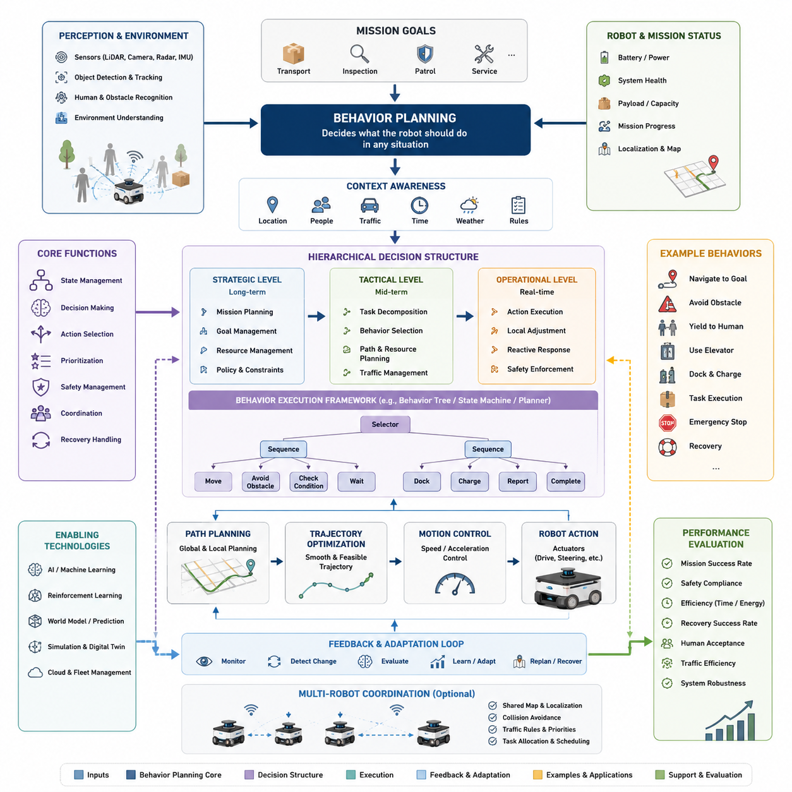
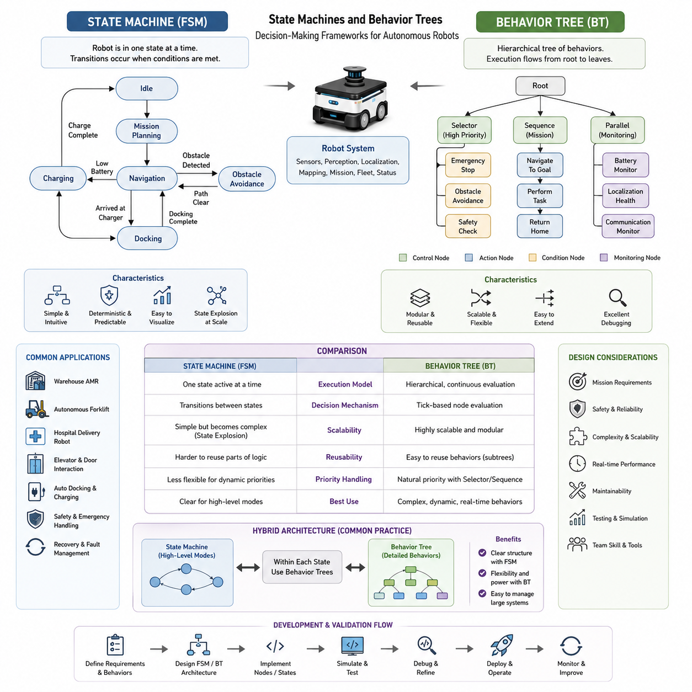
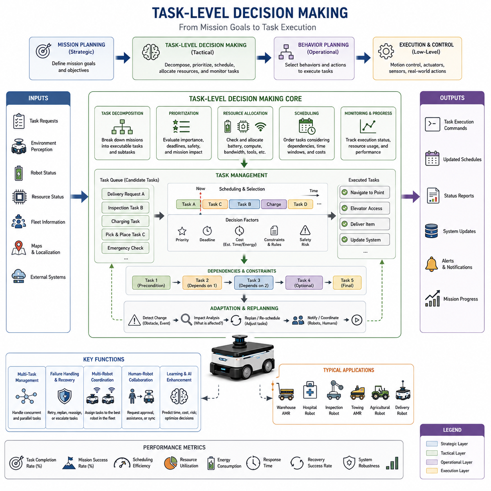
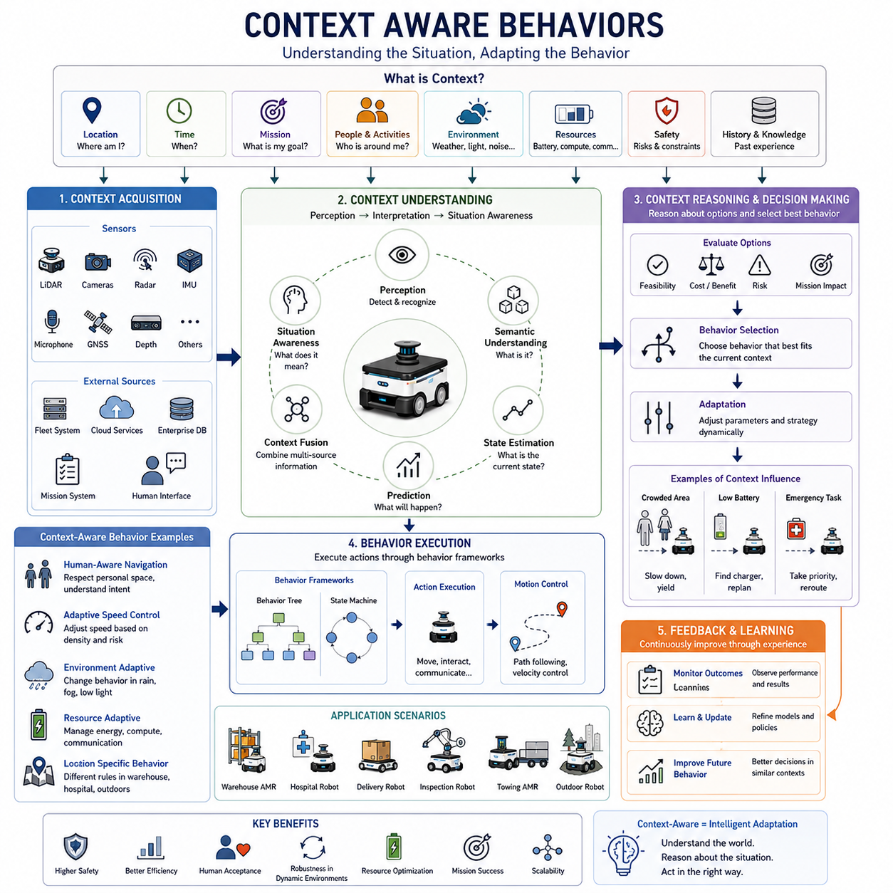
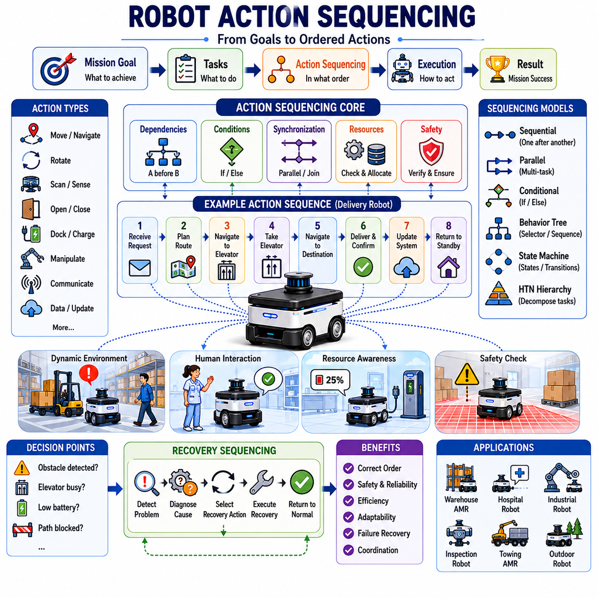
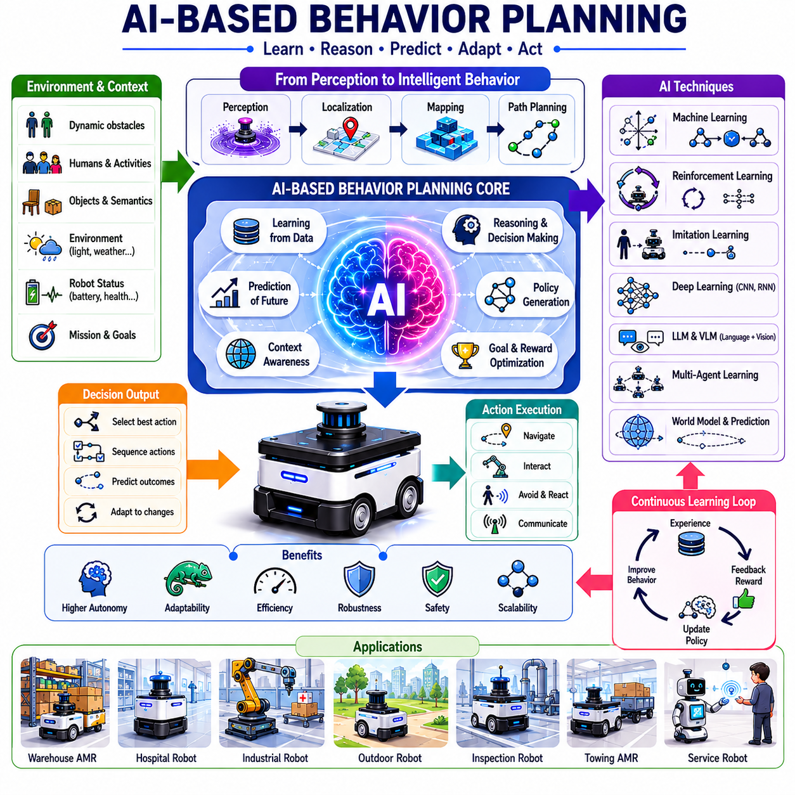
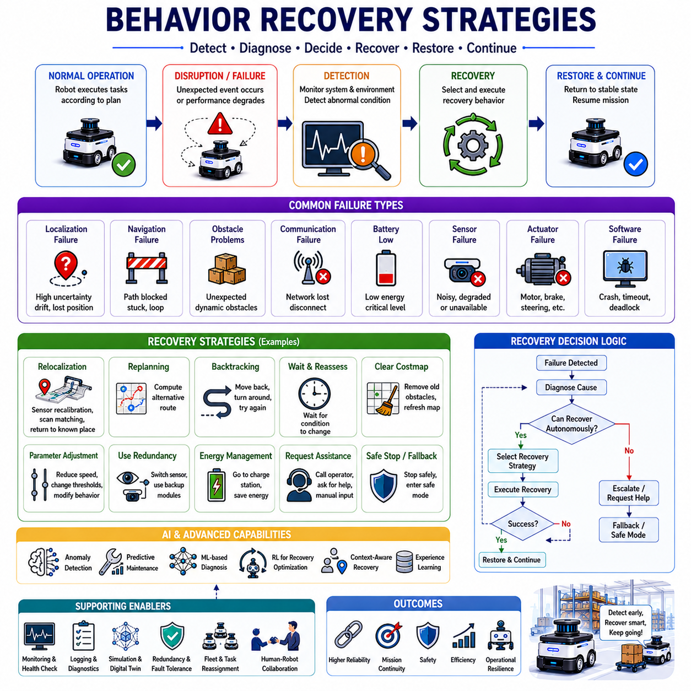
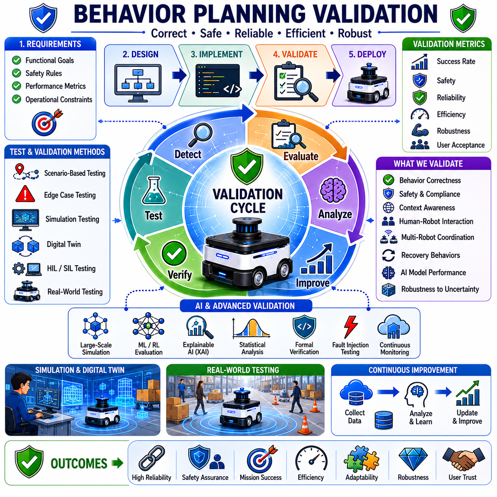

**Volume 05. Path Planning and Autonomous Navigation**

# Chapter 08. Behavior Planning

## 08.1 Behavior Planning Overview

{width="7.268055555555556in" height="7.268055555555556in"}

Behavior Planning is one of the most important layers within an autonomous navigation system because it serves as the bridge between high-level mission objectives and low-level motion execution. While localization determines where the robot is, mapping provides an understanding of the environment, perception identifies surrounding objects, and path planning calculates feasible routes, behavior planning decides what the robot should do at any given moment. It is responsible for selecting appropriate actions, determining operational priorities, managing interactions with dynamic environments, and ensuring that robot behavior remains safe, efficient, predictable, and aligned with mission goals. In modern Autonomous Mobile Robots (AMRs), behavior planning transforms navigation from simple movement into intelligent autonomous decision-making.

A robot operating in a real-world environment constantly encounters situations that cannot be solved by path planning alone. The robot may need to decide whether to wait for a pedestrian, reroute around a temporary obstacle, yield to another robot, enter an elevator, dock at a charging station, or recover from a navigation failure. These decisions require reasoning beyond geometric path generation. Behavior planning provides the decision-making framework that allows the robot to select appropriate actions according to environmental context, mission objectives, operational constraints, and safety requirements. Without behavior planning, a robot may possess excellent perception and navigation capabilities but still fail to operate effectively in complex environments.

The autonomous navigation stack is commonly divided into multiple hierarchical layers. At the highest level, mission planning determines long-term objectives such as transporting goods from one location to another or performing an inspection route. Below this layer, behavior planning translates mission objectives into actionable behaviors. Path planning then computes routes and trajectories required to execute those behaviors, while motion control generates motor commands that physically move the robot. This layered architecture allows each subsystem to focus on specific responsibilities while maintaining overall system coherence. Behavior planning occupies a critical middle position because it coordinates interactions between strategic goals and operational execution.

One of the primary objectives of behavior planning is to manage state transitions throughout robot operation. An AMR rarely performs a single continuous action. Instead, it transitions through numerous operational states such as idle, mission assignment, navigation, obstacle avoidance, waiting, docking, charging, emergency stop, recovery, and mission completion. Each state requires different decision logic and different interactions with lower-level navigation modules. Behavior planning governs these transitions and ensures that the robot responds appropriately to changes in environment, mission status, and system health.

In industrial environments, behavior planning often resembles the decision-making process of a skilled human operator. Consider a logistics robot operating in a warehouse. When assigned a delivery task, the robot first evaluates its battery level. If sufficient power is available, it proceeds toward the destination. If battery reserves fall below a predefined threshold, the robot may interrupt the task and seek a charging station. Along the route, it may encounter workers, forklifts, temporary obstacles, or congested corridors. The robot must decide whether to slow down, stop, wait, reroute, or request traffic priority. Each of these decisions is governed by behavior planning logic.

Behavior planning becomes even more important in dynamic environments where conditions continuously change. Unlike static maps, real-world environments contain moving humans, vehicles, doors, elevators, equipment, and unpredictable events. The robot must continuously evaluate environmental conditions and determine the most appropriate course of action. For example, if a corridor becomes blocked, the robot may temporarily wait before initiating a rerouting procedure. If a pedestrian enters the robot\'s safety zone, the robot may reduce speed, increase clearance distance, or stop completely depending on the assessed risk level. Such decisions require contextual reasoning beyond simple collision avoidance.

Context awareness is a key characteristic of advanced behavior planning systems. Context-aware behavior planning considers not only the robot\'s immediate surroundings but also broader operational circumstances. The same obstacle may require different responses depending on mission urgency, environmental conditions, robot type, payload characteristics, and safety requirements. A hospital delivery robot transporting medication may prioritize rapid delivery while maintaining strict safety constraints. A cleaning robot operating during off-hours may choose alternative routes to maximize coverage efficiency. An outdoor inspection robot may adjust its behavior according to weather conditions, terrain characteristics, or communication availability.

Modern behavior planning systems frequently employ hierarchical decision structures. Strategic decisions define mission objectives and overall operational priorities. Tactical decisions determine how specific goals should be achieved. Operational decisions manage real-time actions and interactions. This hierarchy allows complex autonomous systems to maintain long-term mission focus while simultaneously responding to immediate environmental changes. Such architectures improve scalability, maintainability, and reliability in large autonomous systems.

Behavior planning also plays a critical role in safety management. Autonomous robots must operate safely around humans, equipment, and infrastructure. Safety cannot rely solely on emergency stop mechanisms or obstacle detection systems. Proactive behavioral decisions are necessary to prevent dangerous situations before they occur. For example, a robot may proactively reduce speed when entering crowded areas, increase following distances near pedestrians, avoid high-risk zones, or suspend operations during adverse conditions. These preventive actions are coordinated through behavior planning.

Human-aware navigation represents an important application of behavior planning. Humans expect robot behavior to be understandable, predictable, and socially acceptable. A robot that moves efficiently but behaves unexpectedly may create discomfort or safety concerns. Behavior planning incorporates social navigation principles that enable robots to respect personal space, yield appropriately, avoid abrupt maneuvers, and communicate intentions through movement patterns. Such capabilities become increasingly important as robots operate in hospitals, offices, airports, shopping centers, and public spaces.

Behavior planning is also closely related to traffic management in multi-robot environments. Large-scale deployments often involve dozens or even hundreds of robots sharing common infrastructure. Without coordinated behavior planning, congestion, deadlocks, and inefficiencies can occur. Robots must negotiate shared resources such as intersections, narrow corridors, elevators, charging stations, and loading areas. Behavior planning provides mechanisms for prioritization, scheduling, resource reservation, and conflict resolution that enable efficient fleet-level operations.

In outdoor autonomous robots, behavior planning must address additional complexities. Environmental uncertainty is significantly greater than in structured indoor environments. Outdoor robots encounter changing weather, uneven terrain, varying visibility conditions, dynamic traffic participants, and incomplete environmental information. Behavior planning must continuously evaluate risk levels and adjust operational strategies accordingly. For example, an inspection robot operating during heavy rain may reduce speed, increase obstacle clearance margins, and prioritize safe return routes.

Recovery behavior represents another essential component of behavior planning. Autonomous systems inevitably encounter failures. Localization errors, blocked paths, sensor degradation, communication interruptions, and unexpected obstacles can prevent successful task execution. Recovery strategies allow robots to maintain operational robustness by detecting abnormal conditions and initiating corrective actions. Recovery behaviors may include local replanning, reversing maneuvers, sensor recalibration, map reinitialization, human assistance requests, or mission reassignment. Effective recovery planning significantly improves system reliability and reduces operational downtime.

The implementation of behavior planning can be achieved using various methodologies. Finite State Machines (FSMs) provide a simple and widely used framework for defining discrete operational states and transitions. Behavior Trees offer greater modularity, scalability, and flexibility, making them popular in modern robotics systems. Rule-based systems encode expert knowledge through conditional logic. Planning-based approaches use symbolic reasoning and task planning algorithms to generate action sequences dynamically. More recently, artificial intelligence techniques including reinforcement learning, imitation learning, large language models, and embodied AI frameworks have been explored for behavior generation in complex environments.

Behavior Trees have emerged as a particularly effective framework for autonomous robotics because they provide hierarchical organization, modular structure, and intuitive visualization. Complex robot behaviors can be decomposed into smaller reusable components that are easier to develop, test, maintain, and validate. Many industrial robotics platforms now utilize Behavior Trees as their primary decision-making architecture because of their scalability and robustness.

Artificial intelligence is increasingly influencing behavior planning architectures. Traditional rule-based systems perform well in predictable environments but struggle with novel situations. AI-driven behavior planning enables robots to learn from experience, adapt to environmental changes, and generalize across diverse scenarios. Reinforcement learning algorithms can optimize decision policies through interaction with simulation environments. Foundation models and embodied AI systems may eventually enable robots to reason about goals, environments, and actions in ways that resemble human decision-making.

Simulation plays an important role in behavior planning development. Testing every possible scenario in physical environments is impractical, expensive, and potentially unsafe. Digital twins, simulation platforms, and virtual testing environments enable engineers to evaluate behavior logic under thousands of diverse operating conditions. Rare corner cases, failure scenarios, and safety-critical situations can be reproduced systematically to validate behavior planning algorithms before deployment.

Performance evaluation of behavior planning systems requires metrics that extend beyond traditional navigation measurements. While path efficiency and travel time remain important, additional factors such as mission completion rate, recovery effectiveness, safety compliance, human acceptance, traffic efficiency, resource utilization, and operational robustness must also be considered. Comprehensive evaluation frameworks ensure that behavior planning contributes positively to overall system performance.

As autonomous robots become increasingly intelligent and capable, behavior planning is evolving from deterministic rule execution toward adaptive cognitive decision-making. Future systems are expected to incorporate semantic understanding, world models, multimodal perception, predictive reasoning, and human-aware intelligence. Rather than simply following predefined rules, future robots will interpret context, predict future events, reason about consequences, and select actions that optimize both operational objectives and social compatibility.

In the broader context of autonomous navigation, behavior planning serves as the decision-making brain that coordinates perception, localization, mapping, path planning, control, safety, and mission execution. It transforms navigation from a purely geometric problem into an intelligent autonomous capability. Whether operating in warehouses, hospitals, factories, logistics centers, smart cities, agricultural fields, construction sites, inspection environments, or outdoor autonomous robot deployments, behavior planning remains the central mechanism that enables robots to act purposefully, safely, and effectively in complex real-world environments. Its importance will continue to grow as AMRs evolve toward higher levels of autonomy, greater environmental understanding, and increasingly sophisticated forms of embodied intelligence.

## 08.2 State Machines and Behavior Trees

{width="7.268055555555556in" height="7.268055555555556in"}

State Machines and Behavior Trees are two of the most widely used decision-making frameworks in autonomous robotics. They provide the logical foundation that enables robots to select actions, react to environmental changes, manage complex missions, and execute autonomous behaviors in a structured and predictable manner. As autonomous mobile robots become increasingly sophisticated, the ability to organize decision-making processes efficiently becomes essential. Navigation systems, manipulation systems, industrial automation platforms, service robots, inspection robots, autonomous vehicles, and collaborative robotic systems all require mechanisms that can coordinate large numbers of actions while maintaining safety, reliability, and operational efficiency. State Machines and Behavior Trees represent two fundamental approaches to solving this challenge.

Autonomous robots continuously receive information from sensors, perception systems, localization modules, mapping systems, fleet management software, and mission planning frameworks. The robot must determine how to interpret this information and what action should be executed at each moment. The decision-making layer serves as the bridge between environmental understanding and physical action. Without a structured decision framework, autonomous behavior would quickly become chaotic, difficult to maintain, and nearly impossible to scale. State Machines and Behavior Trees provide methodologies for organizing this decision logic into manageable and understandable architectures.

A State Machine, often referred to as a Finite State Machine (FSM), is one of the oldest and most intuitive methods for implementing robot behavior. The core concept is simple. A robot exists in one specific state at any given time. Each state represents a particular operational mode, and transitions define how the robot moves from one state to another when predefined conditions are satisfied.

Consider a warehouse AMR performing a delivery task. The robot may begin in an Idle state while waiting for work assignments. Once a task is received, it transitions into a Mission Planning state. After route generation is completed, the robot enters a Navigation state and begins moving toward its destination. If an obstacle is detected, the robot may transition into an Obstacle Avoidance state. Upon arrival at a charging station, it enters a Docking state and later transitions into a Charging state. When charging is completed, the robot returns to an Idle state or resumes task execution. Each operational mode is represented by a state, and state transitions define the flow of robot behavior.

The strength of Finite State Machines lies in their simplicity and predictability. Engineers can easily visualize the behavior flow using state diagrams. Each state has clearly defined responsibilities, making system behavior easier to understand and debug. Because transitions occur only when specific conditions are met, the resulting system often behaves in a highly deterministic manner. This determinism is particularly valuable in industrial automation environments where safety, reliability, and certification requirements are important.

State Machines are commonly used in navigation systems, docking controllers, charging management systems, autonomous forklifts, mobile manipulators, industrial inspection robots, and many embedded control systems. They provide a straightforward framework for coordinating behaviors such as startup sequences, mission execution, emergency handling, recovery operations, and shutdown procedures.

Despite their advantages, Finite State Machines have limitations when system complexity increases. As additional behaviors are introduced, the number of states and transitions grows rapidly. A relatively simple robot may initially contain only ten states, but large autonomous systems can require hundreds of states and thousands of transitions. This phenomenon is often referred to as state explosion. As the number of transitions increases, maintaining and debugging the system becomes progressively more difficult.

For example, an autonomous hospital robot may need to handle navigation, elevator integration, automatic door interaction, human avoidance, fleet coordination, charging management, emergency responses, delivery verification, localization recovery, and communication failures. Representing all possible interactions between these behaviors using a traditional State Machine can result in a highly complex network of states that becomes difficult to understand and maintain.

To address these challenges, hierarchical State Machines were introduced. Hierarchical structures allow groups of related states to be organized into larger composite states. Instead of creating hundreds of individual states at a single level, developers can build multi-layer architectures that improve readability and maintainability. Hierarchical approaches significantly reduce complexity and make large autonomous systems more manageable.

Another evolution of State Machines is the use of concurrent state architectures. In many robotic systems, multiple behaviors may need to operate simultaneously. For example, navigation may continue while battery monitoring, communication management, and safety supervision are running in parallel. Concurrent State Machines allow multiple state regions to execute independently while still coordinating overall system behavior.

Although hierarchical and concurrent State Machines improve scalability, many robotics developers eventually encounter situations where traditional FSM architectures become cumbersome. This challenge led to the widespread adoption of Behavior Trees as an alternative framework for autonomous decision-making.

Behavior Trees originated in the game development industry but have become one of the most popular decision-making frameworks in modern robotics. Their success stems from their modularity, scalability, flexibility, and ease of maintenance. Unlike State Machines, which focus on state transitions, Behavior Trees focus on hierarchical behavior execution.

A Behavior Tree represents robot decision logic as a tree structure consisting of nodes connected in parent-child relationships. The root node serves as the entry point of execution. Control flow nodes determine how execution progresses through the tree. Action nodes perform specific tasks, while condition nodes evaluate environmental or system conditions.

Execution begins at the root and propagates downward through the tree. Each node returns one of several execution statuses such as Success, Failure, or Running. These statuses determine how execution continues through the hierarchy. Because decision-making is evaluated continuously, Behavior Trees naturally support dynamic adaptation to changing environments.

One of the most important advantages of Behavior Trees is modularity. Individual behaviors can be encapsulated into reusable components. For example, obstacle avoidance, docking, charging, localization recovery, elevator operation, and mission execution can each be implemented as independent subtrees. These subtrees can then be reused across multiple robot platforms and applications without modification.

Consider an autonomous delivery robot operating in a hospital. The top-level Behavior Tree may contain branches responsible for mission execution, safety management, battery monitoring, and recovery handling. Within the mission execution branch, additional subtrees manage navigation, elevator usage, delivery verification, and return operations. If battery levels become critically low, the battery monitoring subtree may interrupt the current mission and activate charging behaviors. Once charging is completed, mission execution can resume automatically. This modular architecture simplifies development while improving system robustness.

Behavior Trees also provide excellent support for prioritization. Certain behaviors naturally have higher priority than others. Safety-related actions, for example, should always override normal mission execution. Selector nodes within the tree allow high-priority behaviors to be evaluated before lower-priority alternatives. If a safety condition is detected, emergency procedures can immediately take control of the robot regardless of its current task.

This prioritization capability is particularly important in dynamic environments. A robot navigating through a crowded factory may encounter unexpected obstacles, moving forklifts, human workers, or temporary route blockages. Behavior Trees allow the system to continuously evaluate conditions and activate the most appropriate behavior without requiring explicit state transitions between every possible situation.

Another significant advantage of Behavior Trees is scalability. As autonomous systems grow in complexity, new behaviors can be added by introducing additional branches rather than redesigning the entire architecture. This incremental development approach reduces engineering effort and supports long-term maintainability.

Behavior Trees are especially popular within ROS2-based autonomous navigation systems. Modern navigation frameworks frequently use Behavior Trees to coordinate localization, path planning, obstacle avoidance, recovery actions, and mission execution. The ROS2 Navigation Stack, commonly known as Nav2, employs Behavior Trees extensively to manage navigation workflows. This adoption has contributed significantly to the widespread acceptance of Behavior Trees throughout the robotics industry.

Behavior Trees also facilitate debugging and visualization. Because execution follows a hierarchical structure, developers can easily monitor which nodes are active, which conditions are satisfied, and where failures occur. Visual debugging tools provide real-time insight into behavior execution, making it easier to identify and resolve operational issues.

While Behavior Trees offer many advantages, they are not a universal replacement for State Machines. In fact, many successful robotic systems combine both approaches. State Machines are often used for high-level operational modes, while Behavior Trees manage detailed task execution within each mode. This hybrid architecture leverages the strengths of both methodologies.

For example, an outdoor inspection robot may use a State Machine to manage major operational phases such as Startup, Mission Execution, Charging, Maintenance, and Shutdown. Within the Mission Execution state, a Behavior Tree may coordinate navigation, obstacle avoidance, waypoint inspection, data collection, communication management, and recovery behaviors. This combination provides both high-level clarity and low-level flexibility.

The emergence of artificial intelligence has further expanded the capabilities of Behavior Trees and State Machines. Machine learning models can provide environmental understanding, risk assessment, object recognition, and contextual awareness that influence decision-making logic. Reinforcement learning systems can optimize action selection policies based on experience. Large Language Models may eventually contribute to high-level mission planning and adaptive reasoning. However, even as AI technologies advance, structured decision frameworks remain essential for ensuring safety, predictability, and explainability.

AI-enhanced Behavior Trees are becoming increasingly common in advanced robotics applications. In such systems, traditional control nodes remain responsible for execution management, while AI modules provide recommendations, predictions, and context-aware decision support. This hybrid approach combines the reliability of deterministic logic with the adaptability of machine intelligence.

Safety remains one of the most important considerations in both State Machine and Behavior Tree design. Autonomous robots frequently operate in environments shared with humans. Decision architectures must therefore ensure predictable behavior, fault tolerance, graceful recovery, and compliance with safety regulations. Emergency stop procedures, obstacle avoidance mechanisms, fail-safe behaviors, and recovery strategies are typically integrated directly into decision-making structures.

Simulation and testing play critical roles in validating decision architectures. Engineers must verify that State Machines and Behavior Trees behave correctly across a wide range of scenarios. Digital twins, simulation environments, synthetic testing frameworks, and field validation procedures allow developers to evaluate behavior logic before deployment. Extensive testing helps identify unexpected interactions, unreachable states, race conditions, and failure modes.

Performance evaluation of decision-making systems involves multiple metrics. Engineers assess mission success rates, recovery effectiveness, safety compliance, execution efficiency, computational overhead, maintainability, scalability, and robustness under uncertainty. These metrics help determine whether a particular architecture is suitable for industrial deployment.

Future autonomous robots will require increasingly sophisticated decision-making capabilities. As robots become more intelligent, collaborative, and autonomous, decision architectures must support higher levels of reasoning, adaptability, and contextual understanding. Semantic reasoning, world models, predictive planning, embodied intelligence, and multi-agent coordination are expected to become integral components of next-generation autonomous systems.

Despite these advances, the fundamental principles underlying State Machines and Behavior Trees will remain highly relevant. State Machines provide clear operational structure and deterministic control. Behavior Trees offer modularity, flexibility, and scalability. Together, they form the foundation upon which modern robot behavior systems are built. Whether controlling a warehouse AMR, an outdoor inspection robot, a hospital delivery platform, an autonomous forklift, a towing robot, or a future embodied AI system, these frameworks continue to play a central role in transforming perception, planning, and intelligence into purposeful autonomous action.

## 08.3 Task-Level Decision Making

{width="7.268055555555556in" height="7.268055555555556in"}

Task-Level Decision Making is a critical component of autonomous robot intelligence that bridges the gap between high-level mission planning and low-level behavior execution. While mission planning determines what overall objective should be accomplished and behavior planning selects the immediate actions required to achieve that objective, task-level decision making focuses on organizing, prioritizing, scheduling, coordinating, and executing individual tasks that collectively contribute to mission success. In modern Autonomous Mobile Robots (AMRs), autonomous vehicles, service robots, industrial robots, and embodied AI systems, task-level decision making serves as the operational brain that transforms strategic goals into actionable workflows.

Autonomous robots rarely perform a single isolated action. Instead, they operate within complex environments where multiple tasks must be executed simultaneously or sequentially while responding to changing environmental conditions, resource constraints, operational priorities, and safety requirements. A warehouse robot may receive multiple delivery requests, a hospital robot may need to transport medicine while monitoring battery levels, an inspection robot may need to collect sensor data from numerous locations, and a towing AMR may need to coordinate coupling, transportation, parking, and decoupling procedures. Task-level decision making determines how these tasks are selected, ordered, managed, and completed.

The concept of a task can be broadly defined as a unit of work that contributes to a larger mission objective. Tasks may be simple, such as moving to a waypoint, opening a door, collecting sensor data, or docking at a charging station. They may also be highly complex, involving multiple subtasks, dependencies, conditional branches, and interactions with external systems. Effective task-level decision making requires the robot to understand task objectives, evaluate execution requirements, assess available resources, estimate completion costs, and continuously monitor progress throughout execution.

Within a typical autonomous system architecture, mission planning operates at the strategic level, task-level decision making operates at the tactical level, and behavior execution operates at the operational level. Mission planning may assign a goal such as delivering materials across a factory. Task-level decision making decomposes that mission into individual tasks including route generation, navigation, elevator interaction, delivery confirmation, return navigation, and charging operations. Behavior planning then selects specific actions required to execute each task, while motion controllers and actuators perform physical movements.

Task decomposition is one of the most important functions of task-level decision making. Complex missions are often too large to execute directly. Instead, they must be broken into smaller manageable components that can be planned, monitored, and controlled independently. This hierarchical decomposition improves scalability, maintainability, and reliability while simplifying decision-making processes.

Consider an autonomous hospital delivery robot assigned to transport medication from a pharmacy to a patient ward located on another floor. The mission itself appears simple, but successful completion requires numerous coordinated tasks. The robot must receive the delivery request, verify inventory availability, determine the destination location, generate a navigation route, request elevator access, travel to the appropriate floor, navigate through hospital corridors, confirm delivery completion, update hospital information systems, and return to its standby position. Each of these activities represents a task that must be executed in the correct sequence while adapting to changing conditions.

Task prioritization is another fundamental responsibility of task-level decision making. Autonomous robots frequently receive multiple task requests that compete for limited resources. Determining which task should be executed first requires consideration of mission importance, deadlines, safety requirements, operational constraints, customer expectations, and resource availability.

In industrial environments, some tasks may be classified as high priority due to production dependencies or safety implications. A robot delivering critical manufacturing components may receive higher priority than a routine inventory transport request. Similarly, emergency medical deliveries within hospitals may supersede normal logistics operations. Task-level decision making evaluates these priorities and dynamically adjusts execution schedules accordingly.

Priority management becomes particularly challenging when environmental conditions change unexpectedly. A robot executing a low-priority task may suddenly receive an urgent request that requires immediate attention. The decision-making system must determine whether the current task should be paused, canceled, postponed, or completed before transitioning to the higher-priority assignment. These decisions require sophisticated reasoning about operational tradeoffs and mission objectives.

Resource allocation represents another critical aspect of task-level decision making. Every task consumes resources including battery energy, computational capacity, communication bandwidth, sensor availability, storage capacity, and physical workspace. The robot must evaluate whether sufficient resources are available before accepting or executing a task.

Battery management provides a common example. A robot assigned a long-distance delivery task must estimate whether available energy reserves are sufficient to complete the mission safely. If battery levels are inadequate, charging activities may need to be scheduled before task execution begins. Similarly, computationally intensive inspection tasks involving AI-based image processing may require allocation of GPU resources before execution can proceed.

Task scheduling extends beyond simple prioritization and resource allocation. In many robotic systems, tasks have dependencies that dictate execution order. Certain tasks cannot begin until prerequisite tasks have been completed successfully. For example, a towing robot cannot transport a trailer until coupling procedures have been completed. An autonomous delivery robot cannot perform delivery confirmation until it reaches the destination. Task-level decision making manages these dependencies and ensures that execution sequences remain logically consistent.

Temporal constraints often play a major role in scheduling decisions. Many industrial operations involve deadlines, time windows, service level agreements, or synchronized workflows. Robots operating in manufacturing environments may need to coordinate with production schedules. Hospital delivery robots may need to deliver medication within specified time limits. Agricultural robots may need to perform operations during favorable weather conditions. Task-level decision making incorporates these temporal requirements into scheduling algorithms.

Multi-task management is becoming increasingly important as autonomous robots evolve toward higher levels of capability. Rather than performing one task at a time, advanced robots often manage multiple concurrent activities. For example, a robot may navigate toward a destination while simultaneously monitoring battery status, updating fleet management systems, performing environmental mapping, and communicating with cloud services. Effective task-level decision making coordinates these parallel activities while preventing conflicts and ensuring overall system stability.

Task monitoring and progress tracking are essential for maintaining operational reliability. Once a task begins, the robot must continuously evaluate execution status and verify that expected outcomes are being achieved. Monitoring systems track task progress, resource consumption, environmental conditions, performance metrics, and potential failure indicators. If deviations are detected, corrective actions can be initiated before failures occur.

Failure handling represents a major component of task-level decision making. Real-world environments are inherently uncertain, and task execution does not always proceed as planned. Obstacles may block routes, communication systems may fail, sensors may malfunction, resources may become unavailable, or external conditions may change unexpectedly. Task-level decision making must detect these situations and determine appropriate recovery actions.

Recovery strategies may include task retries, alternative execution methods, route replanning, resource reallocation, task reassignment, human intervention requests, or mission modification. The objective is to maximize mission success while minimizing operational disruption. Robust recovery capabilities significantly improve overall system reliability and availability.

Task-level decision making also plays a central role in fleet management systems involving multiple robots. In large-scale deployments, tasks must be distributed efficiently across available robots. Fleet management software evaluates robot locations, capabilities, workloads, battery levels, and operational status when assigning tasks. The goal is to maximize overall system efficiency while balancing resource utilization and minimizing task completion times.

Task assignment algorithms may use optimization techniques such as auction-based allocation, market-based coordination, heuristic scheduling, constraint satisfaction methods, or machine learning approaches. These techniques help ensure that tasks are assigned to the most appropriate robots based on current operational conditions.

Human-robot collaboration introduces additional complexity into task-level decision making. In collaborative environments, robots frequently interact with human operators, supervisors, technicians, healthcare workers, and customers. Tasks may require human approval, human assistance, or coordinated execution between humans and robots. Decision-making systems must account for human availability, preferences, safety considerations, and communication requirements.

For example, a hospital robot delivering medication may require nurse confirmation before completing a delivery task. An industrial inspection robot may request technician assistance if abnormal conditions are detected. A collaborative manufacturing robot may synchronize task execution with human workers on an assembly line. Task-level decision making coordinates these interactions while maintaining operational efficiency and safety.

Artificial intelligence is increasingly enhancing task-level decision making capabilities. Traditional rule-based systems perform well in structured environments but often struggle with uncertainty and dynamic conditions. AI-based approaches enable robots to learn from experience, predict task outcomes, estimate execution costs, optimize schedules, and adapt to changing circumstances.

Machine learning models can improve task selection by predicting completion times, resource requirements, failure probabilities, and operational risks. Reinforcement learning algorithms can optimize scheduling policies through experience. Predictive analytics can anticipate future workload demands and proactively adjust resource allocation strategies. Large Language Models and embodied AI systems may eventually support high-level task reasoning and natural language task specification.

Task planning frameworks often employ hierarchical representations that organize tasks into goals, subtasks, actions, and behaviors. Hierarchical Task Networks (HTNs) are widely used for this purpose. HTN planners decompose complex objectives into progressively smaller tasks until executable actions are produced. This hierarchical structure mirrors the organization of many real-world operations and supports scalable decision-making architectures.

Behavior Trees and State Machines frequently serve as execution frameworks for task-level decisions. Task planners generate objectives and execution sequences, while Behavior Trees coordinate action selection and monitoring. State Machines manage operational modes and task transitions. Together, these frameworks provide a structured approach to implementing complex autonomous behavior.

Simulation and digital twin technologies play important roles in developing and validating task-level decision-making systems. Engineers can evaluate scheduling algorithms, resource allocation strategies, failure recovery procedures, and multi-robot coordination methods within virtual environments before deployment. Simulation enables extensive testing under diverse operating conditions while reducing development cost and risk.

Performance evaluation of task-level decision making involves multiple metrics including task completion rate, mission success rate, scheduling efficiency, resource utilization, energy consumption, response time, recovery effectiveness, scalability, and operational robustness. These metrics provide quantitative measures of decision quality and system performance.

As autonomous robots become more intelligent and capable, task-level decision making is evolving beyond simple scheduling and workflow management. Future systems will integrate semantic understanding, predictive reasoning, world models, contextual awareness, and collaborative intelligence. Robots will not only execute assigned tasks but also reason about objectives, anticipate future requirements, negotiate priorities, coordinate with humans and other robots, and adapt mission plans dynamically.

The emergence of embodied AI further expands the scope of task-level decision making. Future autonomous systems may understand high-level goals expressed in natural language, decompose those goals into executable task structures, evaluate alternative strategies, and continuously optimize execution based on environmental feedback. Such capabilities will enable robots to operate effectively in increasingly complex and unstructured environments.

In the broader context of autonomous robotics, task-level decision making serves as the tactical intelligence layer that connects mission planning with behavior execution. It transforms abstract objectives into organized workflows, manages resources and priorities, coordinates execution activities, monitors progress, handles failures, and ensures that missions are completed efficiently and safely. Whether operating in warehouses, hospitals, factories, agricultural fields, smart cities, inspection environments, logistics networks, or future embodied AI systems, task-level decision making remains a foundational capability that enables robots to perform meaningful work autonomously and reliably.

## 08.4 Context-Aware Behaviors

{width="7.268055555555556in" height="7.268055555555556in"}

Context-Aware Behaviors represent one of the most important advancements in modern autonomous robotics. Traditional robotic systems often operate using predefined rules that respond to immediate sensor inputs without fully understanding the broader operational environment. While such approaches can perform effectively in structured and predictable environments, they frequently struggle when faced with dynamic situations, uncertain conditions, changing mission priorities, or complex interactions with humans and other autonomous systems. Context-aware behavior planning addresses these limitations by enabling robots to understand not only what is happening around them but also why it is happening, what it means for mission execution, and how their behavior should adapt accordingly. In modern Autonomous Mobile Robots (AMRs), autonomous vehicles, service robots, industrial robots, and embodied AI systems, context awareness serves as a foundation for intelligent decision-making and adaptive autonomy.

The concept of context can be broadly defined as any information that characterizes the current situation of an autonomous system. Context extends beyond immediate sensor observations and includes environmental conditions, mission objectives, operational constraints, resource availability, human activities, temporal information, location-specific knowledge, safety requirements, infrastructure status, organizational policies, and historical experiences. A context-aware robot continuously interprets these factors and adjusts its behavior to maximize safety, efficiency, reliability, and mission success.

In traditional navigation systems, behavior decisions are often driven primarily by geometric considerations. A robot detects obstacles, computes paths, and follows trajectories according to predefined rules. However, real-world environments require much richer decision-making capabilities. The same physical situation may demand different responses depending on operational context. For example, a person standing in a corridor may be treated as an obstacle in one situation, a customer requiring interaction in another, or a supervisor providing instructions in a third. Context-aware behaviors enable robots to interpret such situations appropriately rather than relying solely on geometric information.

The development of context-aware behavior systems begins with context acquisition. Autonomous robots continuously collect information from multiple sources including perception sensors, localization systems, environmental maps, fleet management platforms, cloud services, enterprise databases, mission planning systems, and human interaction interfaces. Cameras, LiDAR sensors, radar systems, depth sensors, GNSS receivers, IMUs, microphones, and networked information systems all contribute valuable contextual information. The challenge is not merely collecting data but transforming it into meaningful situational understanding.

Context interpretation is the process through which raw data becomes actionable knowledge. Sensor observations must be analyzed, correlated, and integrated into coherent representations of the environment and operational state. A robot operating in a hospital may recognize medical staff, patients, visitors, medical equipment, restricted areas, emergency pathways, elevators, and medication delivery stations. Beyond identifying these elements, the robot must understand their significance within the current operational context. A crowded hallway during visiting hours may require different navigation strategies than the same hallway during nighttime operations.

Location awareness represents one of the most fundamental forms of context. The meaning of a robot's behavior often depends heavily on where it is operating. A warehouse robot moving through a storage area may prioritize efficiency and speed. The same robot entering a human-populated loading zone may automatically reduce speed and increase safety margins. In hospitals, robots may behave differently in patient wards, operating rooms, pharmacies, public corridors, and emergency departments. Context-aware behavior systems utilize semantic maps and location-specific knowledge to adapt actions according to the characteristics of different environments.

Temporal awareness is another important aspect of context. Time influences operational requirements in many environments. Manufacturing facilities may operate under different production schedules throughout the day. Hospitals experience varying levels of activity during shifts, emergencies, and visiting hours. Outdoor autonomous robots encounter changing lighting conditions, weather patterns, and traffic densities depending on the time of day. Context-aware systems incorporate temporal information into decision-making processes, allowing behavior policies to evolve dynamically as circumstances change.

Mission context significantly influences autonomous behavior. A robot's current objective affects how it should respond to environmental events. Consider an autonomous delivery robot transporting routine supplies versus emergency medical equipment. Both robots may encounter identical obstacles, but the urgency of their missions may justify different behavioral responses. A high-priority mission may favor rerouting around congestion, while a lower-priority mission may choose to wait. Context-aware behaviors enable robots to balance operational efficiency against mission importance.

Human context has become increasingly important as robots operate alongside people in shared environments. Human behavior is often unpredictable, socially complex, and difficult to model using traditional robotics approaches. Context-aware systems incorporate information about human activities, intentions, roles, and social norms into decision-making processes. A robot may recognize the difference between a patient, a healthcare worker, a technician, and a visitor. It may adjust navigation behavior, communication strategies, and interaction protocols according to the specific characteristics of each individual.

Human-aware navigation provides an excellent example of context-aware behavior. Traditional obstacle avoidance systems treat humans as moving obstacles. Context-aware systems recognize that humans require special consideration. Personal space, walking direction, group behavior, social interactions, and environmental expectations all influence navigation decisions. A robot moving through a hospital corridor may yield to medical personnel transporting critical patients while selecting alternative routes to minimize disruption. Such behavior improves safety, acceptance, and overall user experience.

Environmental context extends beyond physical obstacles and includes broader situational awareness. Weather conditions, lighting variations, terrain characteristics, noise levels, air quality, visibility conditions, and infrastructure availability can all affect robot performance. Outdoor inspection robots may reduce speed during heavy rain, increase localization uncertainty estimates in fog, adjust sensor processing strategies in low-light conditions, or modify route planning when terrain becomes unstable. Context-aware behavior systems continuously evaluate these environmental factors and adapt operational strategies accordingly.

Resource awareness is another essential dimension of context. Autonomous robots operate with finite resources including battery energy, computational capacity, storage space, communication bandwidth, and mechanical wear limits. Context-aware behavior systems monitor resource availability and adjust actions proactively. A robot with low battery reserves may postpone non-essential tasks, seek charging opportunities, or return to a service station. Similarly, communication limitations may trigger autonomous fallback modes when cloud connectivity becomes unavailable.

Safety context plays a central role in behavior planning. Risk levels can vary significantly depending on environmental conditions and operational circumstances. A robot operating in an empty warehouse may safely travel at higher speeds, while the same robot moving through a crowded facility may require conservative behavior. Context-aware systems continuously assess risk and adjust operational parameters accordingly. Speed limits, obstacle clearance distances, acceleration profiles, and route selection strategies may all change dynamically based on safety assessments.

Context-aware behaviors are particularly valuable in dynamic obstacle management. Traditional obstacle avoidance systems react primarily to obstacle positions and velocities. Context-aware systems consider additional factors such as obstacle type, predicted behavior, environmental significance, and mission impact. A moving forklift, a walking pedestrian, a stationary pallet, and an emergency response vehicle may all require different responses despite occupying similar physical space. Understanding context allows robots to make more intelligent navigation decisions.

Fleet-level operations introduce additional contextual dimensions. In multi-robot environments, individual robots must consider the activities and intentions of other autonomous systems. Shared resources such as charging stations, elevators, intersections, loading docks, and narrow corridors require coordinated behavior. Context-aware fleet management systems exchange operational information among robots, enabling collaborative decision-making and reducing congestion, deadlocks, and inefficiencies.

Semantic understanding significantly enhances context awareness. Semantic maps provide information about the meaning and purpose of locations, objects, and activities within an environment. Rather than representing the world solely through geometric structures, semantic representations enable robots to reason about concepts such as offices, patient rooms, charging stations, inspection points, hazardous zones, emergency exits, and workstations. This semantic knowledge allows behavior decisions to align more closely with operational objectives and human expectations.

Artificial intelligence plays an increasingly important role in context-aware behavior systems. Machine learning models can identify patterns, infer hidden relationships, predict future events, and recognize complex situations that would be difficult to encode using traditional rule-based approaches. Deep learning techniques support scene understanding, activity recognition, anomaly detection, and intention prediction. Reinforcement learning enables robots to learn context-dependent policies through experience. Large Language Models and Vision-Language Models introduce new possibilities for contextual reasoning and semantic understanding.

Context prediction represents an emerging area of research. Rather than reacting solely to current conditions, advanced autonomous systems attempt to anticipate future situations. Predictive models estimate human movements, traffic flows, resource availability, environmental changes, and mission demands. By forecasting future context, robots can make proactive decisions that improve efficiency and safety. For example, a robot may reroute before congestion develops or schedule charging activities during anticipated low-demand periods.

World models provide another important foundation for context-aware behaviors. A world model is an internal representation that integrates perception, memory, environmental knowledge, and predictive reasoning. Such models enable robots to understand not only what is happening now but also how the environment is likely to evolve. Context-aware behavior systems increasingly rely on world models to support long-term planning, adaptive decision-making, and intelligent behavior generation.

Embodied AI further expands the capabilities of context-aware robotics. Traditional robotic systems often rely on predefined context categories and manually designed behavior rules. Embodied AI systems seek to learn contextual understanding through interaction with the physical world. By combining perception, reasoning, memory, learning, and action within unified architectures, embodied AI enables more flexible and adaptive context-aware behaviors. These systems may eventually understand complex operational scenarios in ways that resemble human situational awareness.

Implementing context-aware behavior systems requires effective context representation frameworks. Context information may be organized using knowledge graphs, semantic maps, ontologies, world models, probabilistic representations, relational databases, or hybrid architectures. The chosen representation must support efficient reasoning, real-time updates, scalability, and integration with decision-making systems.

Behavior Trees and State Machines frequently serve as execution frameworks for context-aware behaviors. Context information influences branch selection, action priorities, state transitions, and recovery procedures. Rather than executing fixed behavior sequences, these frameworks dynamically adapt execution paths according to changing circumstances. This combination of structured execution and contextual adaptation provides both reliability and flexibility.

Simulation and digital twin technologies play crucial roles in developing context-aware systems. Context-dependent behaviors must be evaluated across diverse operating conditions, many of which may be difficult or dangerous to reproduce in physical environments. Simulation platforms allow developers to test behavior adaptation strategies under varying environmental, operational, and social conditions while collecting performance data for optimization and validation.

Evaluating context-aware behavior systems requires metrics that extend beyond traditional navigation performance. Important measures include adaptation quality, situational awareness accuracy, mission success rates, human acceptance, safety performance, recovery effectiveness, resource efficiency, predictive accuracy, and operational robustness. These metrics help determine whether contextual understanding translates into improved real-world performance.

As autonomous robots continue to evolve, context awareness is expected to become a defining characteristic of intelligent autonomy. Future robots will operate not merely as reactive machines but as adaptive agents capable of understanding environments, interpreting human intentions, predicting future events, reasoning about operational consequences, and selecting behaviors that align with complex objectives. Context-aware behaviors will form the foundation of next-generation autonomous systems operating in factories, hospitals, logistics centers, smart cities, agricultural environments, transportation systems, and future embodied AI platforms.

In the broader framework of autonomous navigation and behavior planning, context-aware behaviors transform robotic decision-making from simple rule execution into intelligent situational adaptation. By understanding not only what exists in the environment but also what that information means within the current operational context, autonomous systems achieve higher levels of safety, efficiency, flexibility, and autonomy. As robotics advances toward increasingly intelligent and human-centered systems, context-aware behavior planning will remain one of the most important technologies enabling meaningful and effective autonomous operation.

## 08.5 Robot Action Sequencing

{width="7.268055555555556in" height="7.268055555555556in"}

Robot Action Sequencing is a fundamental component of autonomous robot intelligence that focuses on organizing individual actions into coherent, efficient, safe, and goal-oriented execution flows. While mission planning determines what overall objective should be achieved, behavior planning determines which behaviors should be activated, and task-level decision making identifies what tasks need to be completed, action sequencing defines the precise order in which individual actions are executed. It serves as the operational framework that transforms abstract goals and task definitions into executable robotic activities. In Autonomous Mobile Robots (AMRs), autonomous vehicles, service robots, industrial robots, inspection robots, warehouse automation systems, and future embodied AI platforms, action sequencing provides the structure necessary to coordinate complex operations and achieve reliable mission execution.

At its core, action sequencing addresses a simple but critical question: what should the robot do next? Although this question appears straightforward, answering it becomes increasingly difficult as system complexity grows. Real-world robotic operations involve hundreds or thousands of individual actions that must be executed in specific orders while considering dependencies, safety constraints, environmental conditions, resource limitations, and mission objectives. Effective action sequencing ensures that these actions occur in a logical and coordinated manner.

An action can be defined as the smallest executable unit of robot behavior. Examples include moving to a waypoint, rotating to a desired orientation, scanning an object, opening a door, docking with a charging station, capturing sensor data, initiating communication, activating a manipulator, coupling a trailer, or transmitting information to a cloud service. Individually, these actions may appear simple. However, when combined into large operational workflows, they form the foundation of autonomous robot behavior.

Consider a hospital delivery robot assigned to transport medication from a pharmacy to a patient ward located on another floor. The robot cannot simply move directly to the destination. Instead, a sequence of actions must be executed. The robot receives the delivery request, validates task information, generates a navigation route, travels to the elevator, requests elevator access, enters the elevator, exits at the appropriate floor, navigates through corridors, verifies the destination, performs delivery confirmation, updates hospital records, and returns to a standby location. The successful completion of the mission depends not only on performing these actions but also on executing them in the correct order.

Action sequencing serves several important objectives. It ensures operational consistency, prevents invalid action execution, maintains safety, improves efficiency, supports recovery mechanisms, and enables coordination among multiple subsystems. Without proper sequencing, robots may attempt actions prematurely, violate operational constraints, or enter unsafe conditions. Sequencing logic provides the structure that keeps robot behavior organized and predictable.

One of the most important concepts in action sequencing is dependency management. Many actions depend upon the successful completion of previous actions. These dependencies define the relationships between different operational steps. For example, a robot cannot unload cargo before reaching its destination. A towing robot cannot begin transport before completing trailer coupling procedures. An inspection robot cannot analyze sensor data before collecting measurements. Action sequencing systems manage these dependencies and ensure that execution proceeds only when prerequisite conditions have been satisfied.

Dependencies can be categorized into several forms. Temporal dependencies require actions to occur in a specific chronological order. Resource dependencies require access to particular hardware or software resources before execution can proceed. Information dependencies require certain data to be available before actions can begin. Safety dependencies require verification of safety conditions before potentially hazardous operations are allowed. Effective sequencing frameworks continuously monitor these dependencies throughout execution.

Sequential execution represents the most straightforward form of action sequencing. In sequential workflows, actions are executed one after another according to a predefined order. This approach is common in structured industrial environments where operational procedures remain relatively stable. Manufacturing robots, automated inspection systems, warehouse delivery robots, and autonomous docking systems often utilize sequential action flows because they provide predictability and simplicity.

However, modern autonomous robots frequently require more sophisticated execution models. Many robotic systems perform multiple activities simultaneously. A mobile robot may navigate toward a destination while monitoring battery levels, collecting environmental data, updating fleet management systems, and maintaining communication links. Parallel action execution enables greater efficiency and responsiveness but introduces additional complexity. Sequencing systems must coordinate concurrent activities while avoiding conflicts and resource contention.

Parallel action sequencing requires careful synchronization mechanisms. Certain actions may execute independently, while others require coordination points where multiple execution paths converge. Synchronization ensures that dependent activities remain properly aligned. For example, an autonomous inspection robot may collect data from multiple sensors simultaneously but must wait until all measurements are available before initiating data fusion and analysis processes.

Conditional branching introduces adaptability into action sequencing. Real-world environments are inherently uncertain, and execution paths cannot always be predetermined. Robots must frequently choose between alternative actions based on environmental observations, mission status, resource availability, or safety considerations. Conditional logic enables sequencing systems to evaluate conditions and dynamically select appropriate execution paths.

For example, a delivery robot approaching an elevator may encounter several possible scenarios. If the elevator is available, the robot proceeds with entry and floor selection. If the elevator is occupied, the robot waits. If the elevator becomes unavailable due to maintenance, the robot may select an alternative route. Each scenario results in a different action sequence despite originating from the same task objective. Conditional branching enables robots to adapt execution flows to changing circumstances.

Decision points play a central role in adaptive action sequencing. At these points, the robot evaluates current conditions and determines how execution should proceed. Decision-making may involve obstacle assessments, battery evaluations, mission priority analysis, communication status verification, environmental risk estimation, or human interaction requirements. Sophisticated sequencing systems integrate decision logic directly into execution frameworks, allowing robots to respond intelligently to unexpected situations.

Behavior Trees have become one of the most popular frameworks for implementing action sequencing in modern robotics. Behavior Trees represent execution logic using hierarchical structures composed of control nodes, condition nodes, and action nodes. Their modular architecture allows complex action sequences to be constructed from reusable behavioral components. Selector nodes support conditional branching, sequence nodes enforce execution order, and parallel nodes enable concurrent activities. This flexibility makes Behavior Trees particularly suitable for autonomous systems operating in dynamic environments.

Finite State Machines provide another common implementation method. In FSM-based architectures, action sequences are represented as transitions between operational states. Each state corresponds to a particular phase of execution, while transition conditions determine progression through the workflow. FSMs offer clarity and predictability, making them attractive for industrial systems with well-defined operational procedures. However, they may become difficult to manage as system complexity increases.

Hierarchical Task Networks (HTNs) provide a higher-level approach to action sequencing. HTNs decompose complex objectives into progressively smaller tasks until executable actions are generated. This hierarchical decomposition mirrors the structure of many real-world operations and supports scalable planning and execution. HTN-based systems are particularly useful for service robots, logistics platforms, and embodied AI applications requiring flexible task decomposition.

Action sequencing also plays a crucial role in safety management. Many robotic operations involve potentially hazardous actions that must be carefully controlled. Sequencing systems enforce safety protocols by ensuring that protective measures are completed before dangerous actions are executed. For example, an industrial robot may verify workspace clearance, activate warning signals, confirm human absence, and validate safety sensors before initiating high-speed motion. Safety-critical sequences help prevent accidents and support regulatory compliance.

Recovery sequencing is another essential aspect of autonomous operation. Unexpected failures are inevitable in real-world environments. Navigation failures, communication disruptions, sensor malfunctions, localization errors, and mechanical faults can interrupt normal execution flows. Recovery sequencing defines structured procedures for detecting problems, diagnosing causes, and restoring operational functionality.

Recovery actions may include stopping motion, collecting diagnostic information, recalibrating sensors, reinitializing software modules, requesting operator assistance, rerouting navigation paths, or transitioning into safe operating modes. Well-designed recovery sequences significantly improve system reliability and reduce operational downtime. Rather than simply reacting to failures, advanced sequencing systems proactively prepare contingency plans that can be activated when abnormal conditions are detected.

Human-robot interaction introduces additional sequencing challenges. Many tasks require coordination between autonomous systems and human operators. Delivery confirmation, maintenance procedures, collaborative assembly operations, healthcare workflows, and service interactions often involve both human and robotic participants. Action sequencing frameworks must account for human responses, approval processes, communication delays, and collaborative workflows.

For example, a hospital delivery robot may arrive at a patient ward and wait for nurse confirmation before releasing medication. If confirmation is delayed, the robot may notify staff, retry communication attempts, or escalate the situation according to predefined procedures. Such interaction sequences ensure safe and effective collaboration between humans and autonomous systems.

Multi-robot systems further increase the complexity of action sequencing. In fleet environments, robots must coordinate actions to avoid conflicts and optimize resource utilization. Shared infrastructure such as elevators, charging stations, loading docks, and narrow corridors requires synchronized behavior among multiple robots. Sequencing frameworks support reservation systems, traffic management protocols, task coordination mechanisms, and collaborative workflows that enable efficient fleet operations.

Artificial intelligence is increasingly enhancing action sequencing capabilities. Traditional sequencing systems rely heavily on manually defined rules and workflows. While effective in predictable environments, these approaches may struggle with uncertainty and complexity. AI-based methods enable robots to learn execution strategies from experience, predict action outcomes, estimate execution costs, and optimize sequencing decisions dynamically.

Machine learning models can improve action selection by predicting success probabilities, completion times, resource requirements, and operational risks. Reinforcement learning algorithms can discover optimal action policies through interaction with simulation environments. Predictive models can anticipate future conditions and proactively adjust execution strategies. Large Language Models may eventually contribute to high-level sequence generation by translating natural language objectives into executable action plans.

Embodied AI introduces a new perspective on action sequencing. Traditional systems often rely on predefined workflows designed by engineers. Embodied AI systems seek to generate action sequences dynamically based on environmental understanding, contextual reasoning, and learned experience. Rather than following fixed procedures, future robots may construct novel action sequences to solve previously unseen problems. Such capabilities could significantly expand robot adaptability and autonomy.

Simulation plays an essential role in developing and validating action sequencing systems. Testing complex workflows directly in physical environments can be costly, time-consuming, and potentially unsafe. Simulation platforms allow engineers to evaluate execution logic under diverse scenarios while identifying sequencing errors, dependency violations, race conditions, deadlocks, and failure modes. Digital twins further support validation by reproducing realistic operating conditions within virtual environments.

Performance evaluation of action sequencing systems involves multiple criteria. Engineers assess mission completion rates, execution efficiency, resource utilization, safety compliance, recovery effectiveness, scalability, adaptability, computational overhead, and maintainability. These metrics provide quantitative measures of how effectively sequencing frameworks support autonomous operations.

As autonomous robots continue to evolve, action sequencing is becoming increasingly sophisticated. Future systems will integrate semantic understanding, context awareness, predictive reasoning, world models, collaborative intelligence, and adaptive planning. Robots will not merely execute predefined workflows but will dynamically construct, modify, and optimize action sequences according to changing circumstances and mission objectives.

The emergence of foundation models and embodied AI may fundamentally transform action sequencing architectures. Future autonomous systems may receive high-level goals expressed in natural language, interpret mission intent, generate execution plans, evaluate alternatives, coordinate multiple subsystems, and continuously refine action sequences based on real-time feedback. Such capabilities represent a major step toward generalized autonomous intelligence.

In the broader context of autonomous robotics, Robot Action Sequencing serves as the execution framework that connects planning, decision-making, behavior generation, and physical action. It transforms goals into operational procedures, coordinates complex workflows, manages dependencies, enforces safety constraints, supports recovery mechanisms, and enables adaptive autonomy. Whether operating in warehouses, factories, hospitals, logistics networks, inspection environments, outdoor autonomous platforms, towing AMRs, or future embodied AI systems, action sequencing remains one of the fundamental technologies that enable robots to perform meaningful tasks reliably, efficiently, and safely in the real world.

## 08.6 AI-Based Behavior Planning

{width="7.268055555555556in" height="7.268055555555556in"}

AI-Based Behavior Planning represents the next evolutionary stage of autonomous robot intelligence, transforming traditional rule-based decision-making systems into adaptive, learning-driven, and context-aware autonomous agents. In conventional robotic systems, behavior planning is typically implemented using predefined rules, finite state machines, behavior trees, or manually engineered decision logic. While these approaches have proven highly effective in structured and predictable environments, they often struggle when confronted with uncertainty, dynamic conditions, incomplete information, or situations that were not explicitly anticipated during development. Artificial Intelligence introduces the capability for robots to learn from experience, reason about complex situations, predict future outcomes, adapt to environmental changes, and generate intelligent behavior policies that extend beyond predefined programming. As autonomous robots become increasingly capable and are deployed in more complex environments, AI-Based Behavior Planning is emerging as one of the most important technologies enabling higher levels of autonomy.

Behavior planning can be viewed as the cognitive layer that determines what a robot should do at any given moment. Perception systems identify and interpret environmental information. Localization systems estimate the robot's position. Mapping systems represent the environment. Path planning systems generate feasible routes. Behavior planning then determines how the robot should act based on all available information. Traditional behavior planners typically rely on explicitly designed rules that specify responses to particular conditions. For example, if an obstacle is detected, stop and wait. If battery levels fall below a threshold, initiate charging procedures. If a delivery task is received, begin navigation. Although effective, these rules are inherently limited by the knowledge and assumptions of their designers.

Artificial Intelligence changes this paradigm by enabling behavior policies to emerge from learning processes rather than being entirely hand-crafted. Instead of explicitly defining every possible response, AI systems learn decision strategies from data, simulations, demonstrations, and operational experience. This capability allows autonomous robots to handle situations that may never have been encountered during development. Rather than simply following predefined instructions, the robot can evaluate alternatives, predict consequences, and select actions that maximize mission objectives while satisfying safety constraints.

The motivation for AI-Based Behavior Planning arises from the complexity of real-world environments. Modern autonomous robots operate in factories, warehouses, hospitals, airports, agricultural fields, construction sites, urban environments, logistics centers, and public spaces. These environments are highly dynamic and contain countless sources of uncertainty. Human behavior, environmental changes, traffic conditions, weather variations, equipment failures, communication disruptions, and operational priorities continuously evolve over time. Designing explicit rules for every possible scenario becomes impractical. AI provides mechanisms for generalization, adaptation, and continuous improvement that are difficult to achieve using conventional approaches.

One of the most important foundations of AI-Based Behavior Planning is machine learning. Machine learning enables robots to identify patterns within data and develop predictive models that support decision-making. Instead of relying solely on manually designed rules, robots can learn behavioral policies from observations and experience. Supervised learning approaches train models using labeled examples, allowing robots to learn relationships between environmental situations and appropriate actions. Unsupervised learning methods identify hidden structures and patterns within operational data. Semi-supervised approaches combine both techniques to improve learning efficiency.

Reinforcement Learning has become one of the most influential technologies in AI-Based Behavior Planning. In reinforcement learning, a robot learns through interaction with its environment. The robot selects actions, observes outcomes, and receives rewards or penalties based on performance. Over time, the learning algorithm discovers policies that maximize cumulative rewards. This framework closely resembles the challenges faced by autonomous robots, where actions must be selected sequentially under uncertainty while balancing competing objectives.

A navigation robot trained through reinforcement learning may gradually learn how to minimize travel time, reduce energy consumption, avoid collisions, and improve mission success rates. Unlike traditional rule-based systems, the learned policy can adapt to complex environmental conditions and discover strategies that human designers may not have anticipated. Reinforcement learning has demonstrated impressive results in navigation, manipulation, multi-agent coordination, task planning, and autonomous decision-making applications.

Deep Reinforcement Learning extends this concept by integrating deep neural networks into the learning process. Neural networks allow robots to process high-dimensional sensor data such as images, LiDAR scans, radar measurements, point clouds, and multimodal sensor streams. Deep Reinforcement Learning enables end-to-end behavior learning where perception and decision-making are integrated within a unified framework. This approach has become particularly important for autonomous driving, mobile robotics, drone navigation, and embodied AI research.

Imitation Learning represents another important branch of AI-Based Behavior Planning. Rather than learning exclusively through trial and error, robots can learn by observing expert demonstrations. Human operators perform tasks while the system records observations, actions, and environmental conditions. Machine learning models then learn policies that replicate expert behavior. This approach is especially useful when exploration through reinforcement learning may be unsafe, inefficient, or impractical.

Autonomous delivery robots, warehouse vehicles, hospital service robots, and collaborative industrial robots can all benefit from imitation learning. Human operators often possess valuable domain expertise that is difficult to encode manually. By learning from demonstrations, robots can acquire sophisticated behaviors more efficiently than through pure reinforcement learning. Modern imitation learning systems frequently combine demonstration data with reinforcement learning to improve both initial performance and long-term adaptation.

Context awareness is significantly enhanced through AI-based approaches. Traditional behavior planners often rely on explicit context definitions and manually engineered decision rules. AI systems can learn contextual relationships directly from operational data. By analyzing historical experiences, robots can recognize patterns that influence behavior decisions. For example, an AI-based system may learn that certain warehouse zones experience congestion during specific times of day, that particular weather conditions increase navigation risk, or that human traffic patterns vary according to operational schedules.

Predictive behavior planning represents another major advantage of AI-based systems. Traditional behavior planners often react to current conditions. AI models can predict future events and proactively adjust behavior. Predictive models may estimate human trajectories, traffic congestion, resource availability, battery consumption, communication quality, weather evolution, and mission demands. By anticipating future conditions, robots can make more informed decisions and avoid potential problems before they occur.

For example, an outdoor inspection robot may predict incoming rainfall and modify its route to complete critical inspections before weather conditions deteriorate. A warehouse robot may anticipate congestion near loading stations and select alternative paths. A hospital delivery robot may predict elevator usage patterns and optimize scheduling accordingly. These predictive capabilities significantly improve operational efficiency and robustness.

Multi-agent behavior planning has become an important research area within AI-based robotics. Modern deployments often involve large fleets of autonomous robots operating within shared environments. Coordinating these robots requires sophisticated decision-making mechanisms capable of managing resource allocation, traffic flow, task assignment, conflict resolution, and collaborative behaviors. AI techniques enable decentralized coordination strategies where robots learn to cooperate through experience.

Multi-agent reinforcement learning allows groups of robots to learn collaborative policies that maximize collective performance rather than individual rewards. Such approaches can improve warehouse throughput, reduce traffic congestion, optimize charging station utilization, and increase overall operational efficiency. As robotic fleets continue to expand, AI-driven coordination will become increasingly important.

Large Language Models are beginning to influence behavior planning architectures. LLMs provide powerful reasoning capabilities that extend beyond traditional machine learning approaches. They can interpret natural language instructions, reason about complex objectives, generate plans, explain decisions, and interact naturally with human operators. In robotics, LLMs are increasingly being explored as high-level decision-making modules that complement traditional planning frameworks.

A user might instruct a robot, "Inspect the northern section of the facility, prioritize any damaged equipment, and report findings before noon." An LLM-based planning system can interpret this instruction, decompose it into executable objectives, prioritize tasks, allocate resources, and coordinate lower-level planning systems. This capability significantly reduces the need for specialized programming interfaces and enables more intuitive human-robot interaction.

Vision-Language Models further expand AI-based behavior planning by integrating visual understanding with language reasoning. These systems allow robots to interpret visual scenes, understand semantic relationships, answer questions about their environment, and generate context-aware decisions. For example, a robot may recognize a blocked emergency exit, understand its significance, and modify behavior accordingly without requiring explicit programming for that specific situation.

World Models are emerging as a foundational concept in advanced AI-based behavior planning. A world model is an internal representation that captures environmental dynamics, object relationships, physical constraints, temporal evolution, and causal interactions. Rather than merely reacting to observations, robots equipped with world models can simulate future scenarios, evaluate alternative actions, and predict long-term consequences. This capability supports more intelligent and strategic decision-making.

Embodied AI represents perhaps the most ambitious vision for AI-Based Behavior Planning. Traditional robotics often separates perception, planning, control, memory, and learning into independent modules. Embodied AI seeks to integrate these capabilities into unified systems that learn through physical interaction with the world. Such systems continuously improve behavior policies through experience, adapt to novel environments, and develop increasingly sophisticated representations of their surroundings.

Embodied AI systems are expected to play major roles in future service robots, industrial automation platforms, autonomous vehicles, humanoid robots, and intelligent inspection systems. These systems may eventually exhibit forms of situational understanding and adaptive decision-making that approach human-level capabilities in certain domains.

Despite its enormous potential, AI-Based Behavior Planning introduces significant challenges. Safety remains one of the most critical concerns. Unlike rule-based systems, learned policies may exhibit unexpected behaviors in unfamiliar situations. Ensuring safety, reliability, predictability, and regulatory compliance requires rigorous validation procedures. Safe reinforcement learning, constrained optimization, explainable AI, formal verification, and hybrid architectures are active research areas addressing these challenges.

Explainability is particularly important in industrial and safety-critical applications. Operators, regulators, and engineers must understand why a robot selected a particular action. Explainable AI techniques seek to provide transparency into decision-making processes, enabling human oversight and improving trust in autonomous systems.

Hybrid architectures are becoming increasingly popular because they combine the strengths of AI and traditional robotics. In many systems, AI generates recommendations, predictions, or behavior priorities while deterministic frameworks such as Behavior Trees and State Machines maintain execution control. This approach preserves safety and predictability while benefiting from AI-driven adaptability and intelligence.

Simulation plays an essential role in developing AI-Based Behavior Planning systems. Training directly in physical environments can be expensive, slow, and potentially dangerous. Simulation platforms such as digital twins, Gazebo, Isaac Sim, and advanced physics engines allow robots to accumulate millions of learning experiences in virtual environments. Domain randomization techniques further improve the transfer of learned behaviors from simulation to reality.

Performance evaluation of AI-based behavior planners requires comprehensive metrics that extend beyond traditional navigation measures. Mission success rates, adaptation quality, learning efficiency, safety performance, resource utilization, recovery effectiveness, prediction accuracy, scalability, human acceptance, and long-term autonomy all contribute to overall system evaluation.

As robotics technology continues to evolve, AI-Based Behavior Planning is expected to become the central intelligence layer of autonomous systems. Future robots will not simply execute predefined procedures but will reason about goals, understand context, predict future outcomes, learn continuously from experience, coordinate with humans and other robots, and adapt dynamically to changing environments. These capabilities will enable autonomous systems to operate effectively in increasingly complex and unstructured settings.

In the broader framework of autonomous robotics, AI-Based Behavior Planning represents the convergence of machine learning, reinforcement learning, reasoning systems, world models, embodied intelligence, and autonomous decision-making. It transforms robots from programmable machines into adaptive agents capable of intelligent behavior generation. Whether deployed in warehouses, hospitals, factories, agricultural fields, smart cities, outdoor inspection platforms, logistics networks, autonomous vehicles, or future humanoid robots, AI-Based Behavior Planning will serve as one of the defining technologies driving the next generation of autonomous systems and embodied artificial intelligence.

## 08.7 Behavior Recovery Strategies

{width="7.268055555555556in" height="7.268055555555556in"}

Behavior Recovery Strategies are a fundamental component of autonomous robot intelligence and operational reliability. No matter how advanced a robot's perception, localization, planning, navigation, and control systems become, failures are inevitable in real-world environments. Sensors may produce inaccurate measurements, communication networks may become unavailable, localization systems may lose accuracy, paths may become blocked, batteries may reach critical levels, software components may crash, and unexpected environmental events may disrupt normal operations. The true measure of an autonomous system is not whether failures occur, but how effectively the system detects, manages, and recovers from those failures. Behavior Recovery Strategies provide the mechanisms that enable robots to maintain mission continuity, preserve safety, restore operational functionality, and maximize mission success despite uncertainty and unexpected disruptions.

In autonomous robotics, recovery behavior refers to the collection of actions, policies, decision-making processes, and execution mechanisms that are activated when normal operation is interrupted. Recovery behaviors are designed to identify abnormal conditions, diagnose probable causes, select appropriate corrective actions, and return the robot to a stable operating state. Recovery is therefore not simply an emergency response mechanism but an essential component of intelligent autonomy.

Autonomous robots operate in highly dynamic environments where uncertainty is unavoidable. Warehouses experience changing inventory layouts and human traffic. Hospitals contain unpredictable human movement and constantly changing operational priorities. Outdoor robots encounter weather variations, terrain changes, lighting fluctuations, and infrastructure limitations. Industrial environments contain moving machinery, temporary obstacles, and complex operational workflows. Because of these uncertainties, robots must be prepared to recover from conditions that were not explicitly anticipated during system design.

One of the most important concepts in recovery planning is failure detection. Before recovery can occur, the robot must recognize that a problem exists. Failure detection relies on continuous monitoring of system status, environmental conditions, sensor outputs, mission progress, and performance metrics. The robot must distinguish between normal operational variability and genuine failure conditions.

Failure detection mechanisms often analyze localization uncertainty, obstacle avoidance performance, navigation progress, communication status, battery health, actuator responses, sensor consistency, computational performance, and mission execution timelines. Significant deviations from expected behavior may indicate the presence of a fault that requires intervention. Modern robots frequently employ diagnostic systems that continuously compare observed system behavior against predicted operational models.

Localization failures represent one of the most common challenges encountered by autonomous robots. Accurate localization is essential for navigation, task execution, obstacle avoidance, and mission planning. Localization systems may fail due to sensor degradation, environmental ambiguity, poor feature visibility, GPS signal loss, LiDAR interference, map inconsistencies, or dynamic environmental changes.

When localization uncertainty exceeds acceptable thresholds, recovery mechanisms must be activated. The robot may reduce speed, stop movement, initiate sensor recalibration procedures, revisit known landmarks, perform loop closure operations, request external positioning assistance, or return to previously validated locations. Recovery strategies aim to restore localization confidence before mission execution continues.

Navigation failures constitute another major category of operational disruption. A robot may become trapped by obstacles, encounter blocked pathways, experience repeated path-planning failures, or enter situations where safe movement is no longer possible. Traditional navigation systems may repeatedly attempt the same unsuccessful action, creating inefficient behavior loops. Recovery strategies introduce alternative approaches designed to escape such situations.

For example, a robot that repeatedly fails to navigate through a narrow corridor may attempt reverse motion, select an alternative route, temporarily pause operation, request traffic clearance, or modify navigation parameters. These recovery actions increase robustness and reduce the likelihood of mission abandonment.

Obstacle-related recovery behaviors are particularly important in dynamic environments. Unexpected obstacles frequently appear after navigation plans have already been generated. Temporary equipment, misplaced inventory, parked vehicles, construction activities, and human gatherings can create conditions that invalidate previously planned routes.

Recovery systems continuously evaluate whether obstacles are temporary or persistent. Temporary obstacles may justify waiting strategies. Persistent obstacles may require route replanning. Critical obstacles affecting mission completion may trigger task reassignment, operator notification, or mission modification. The selected recovery strategy depends on contextual information, mission priorities, and operational constraints.

Communication failures represent another significant challenge. Modern autonomous robots frequently rely on wireless communication for fleet coordination, cloud connectivity, remote supervision, infrastructure interaction, and data exchange. Communication disruptions may occur due to network congestion, infrastructure outages, electromagnetic interference, or geographic coverage limitations.

Recovery strategies for communication failures often involve graceful degradation. Rather than immediately terminating operation, robots may switch to autonomous fallback modes that rely on locally available resources. Critical functions continue operating while nonessential cloud-dependent services are temporarily suspended. Once connectivity is restored, synchronization procedures update external systems with accumulated operational information.

Battery-related recovery behaviors are essential for maintaining operational continuity and preventing mission failures. Energy limitations affect all mobile robotic systems. Unexpected mission demands, environmental conditions, battery degradation, or charging infrastructure issues may create situations where energy reserves become critically low.

Behavior recovery systems continuously monitor battery status and estimate future energy requirements. If energy levels fall below predefined safety thresholds, the robot may postpone nonessential tasks, seek nearby charging stations, reduce computational workload, limit travel distances, or enter energy-conservation modes. These proactive recovery strategies prevent complete energy depletion and improve overall system reliability.

Sensor failures present unique recovery challenges because sensors provide the information required for decision-making. Cameras may become obstructed, LiDAR systems may experience interference, GNSS receivers may lose satellite visibility, depth sensors may malfunction, and environmental conditions may degrade sensor performance.

Modern robots increasingly employ sensor redundancy to support recovery. Multiple sensing modalities provide overlapping information that allows operation to continue even when individual sensors fail. Recovery strategies may involve switching to alternative sensor configurations, increasing uncertainty estimates, reducing operational speed, or restricting activities to safer operating conditions until normal sensing capabilities are restored.

Actuator failures represent another important category of operational disruptions. Motors, steering systems, brakes, manipulators, and mechanical subsystems may experience performance degradation or complete failure. Because actuator faults directly affect physical movement and safety, rapid detection and recovery are critical.

Recovery procedures may isolate faulty components, activate redundant systems, reduce operational capabilities, modify task assignments, or transition the robot into safe operating states. In some cases, recovery may involve controlled shutdown procedures designed to minimize risk while preserving valuable system data for diagnostics and maintenance.

Software failures can be equally disruptive. Autonomous robots consist of numerous interconnected software modules responsible for perception, localization, planning, communication, control, diagnostics, and mission management. Software crashes, memory leaks, synchronization issues, configuration errors, and unexpected exceptions may interrupt operation.

Behavior recovery frameworks often incorporate watchdog mechanisms that monitor software health and automatically restart failed components. More advanced architectures support module-level recovery where individual subsystems can be restarted without requiring complete system reboot. Such capabilities significantly improve system availability and reduce downtime.

Mission-level recovery focuses on preserving overall mission objectives despite operational disruptions. Not all failures require mission termination. Many disruptions can be accommodated through adaptive planning and task modification. Recovery systems evaluate whether mission goals remain achievable and identify alternative execution strategies when necessary.

For example, an inspection robot encountering inaccessible inspection points may modify inspection routes while still collecting critical data. A delivery robot facing elevator outages may reroute deliveries to accessible locations. A warehouse robot experiencing congestion may reorder task sequences to maintain productivity. Mission-level recovery emphasizes flexibility and objective preservation.

Behavior Trees have become one of the most widely used frameworks for implementing recovery strategies in modern robotic systems. Recovery nodes can be embedded directly within execution structures, enabling automatic transitions from primary behaviors to recovery behaviors when failures are detected. This architecture supports modular recovery design while maintaining transparency and predictability.

The ROS2 Navigation Stack (Nav2) provides a practical example of recovery behavior implementation. Recovery actions such as clearing costmaps, spinning in place, backing up, waiting, and replanning routes are integrated directly into navigation behavior trees. When navigation failures occur, the system automatically attempts recovery actions before declaring mission failure. This layered approach significantly improves navigation robustness.

Finite State Machines are also commonly used to implement recovery workflows. Specialized recovery states handle abnormal situations and coordinate transitions back to normal operation. Hierarchical state machine architectures allow recovery logic to be organized according to failure categories, simplifying implementation and maintenance.

Artificial Intelligence is increasingly enhancing recovery strategies. Traditional recovery systems rely on manually defined rules and predefined corrective actions. AI-based approaches enable robots to learn recovery policies from operational experience. Machine learning models can predict failures before they occur, estimate recovery success probabilities, recommend corrective actions, and optimize recovery decision-making.

Predictive maintenance represents an important application of AI-driven recovery. By analyzing sensor data, operational history, vibration patterns, temperature measurements, and performance indicators, machine learning models can identify early signs of degradation. Recovery actions can then be initiated proactively before failures occur, reducing downtime and maintenance costs.

Reinforcement learning is also being explored for recovery optimization. Robots can learn recovery strategies through simulated experience, discovering actions that maximize recovery success while minimizing operational disruption. Such approaches are particularly valuable in complex environments where manually designing recovery policies may be difficult.

Context awareness significantly improves recovery effectiveness. The optimal recovery strategy often depends on environmental conditions, mission priorities, resource availability, human activities, and operational objectives. A recovery action appropriate for a warehouse may be inappropriate in a hospital. Context-aware recovery systems evaluate situational factors before selecting corrective actions.

Human-robot collaboration plays an important role in many recovery scenarios. Certain failures require human intervention, guidance, or authorization. Recovery systems must determine when autonomous recovery remains feasible and when assistance should be requested. Effective escalation procedures ensure that human operators receive relevant information while minimizing unnecessary interruptions.

Fleet management systems introduce additional recovery opportunities. In multi-robot environments, tasks can often be reassigned when individual robots experience failures. A malfunctioning delivery robot may transfer pending tasks to nearby robots. Shared resources and collaborative coordination mechanisms improve system-level resilience and reduce the impact of individual failures.

Simulation and digital twin technologies are essential for validating recovery strategies. Real-world failures can be difficult, expensive, or unsafe to reproduce repeatedly. Simulation environments enable developers to evaluate recovery performance across thousands of failure scenarios, identify weaknesses, and optimize recovery policies before deployment.

Performance evaluation of recovery systems requires specialized metrics. Recovery success rate, recovery time, mission continuation rate, safety performance, resource consumption, operational availability, mean time to recovery, fault tolerance, and resilience are commonly used indicators. These metrics provide quantitative measures of how effectively recovery mechanisms support autonomous operation.

As autonomous systems continue to evolve, recovery strategies are becoming increasingly sophisticated. Future robots will combine predictive analytics, world models, contextual reasoning, adaptive planning, machine learning, and collaborative intelligence to create highly resilient autonomous systems. Rather than simply responding to failures after they occur, future recovery frameworks will anticipate potential disruptions and proactively modify behavior to avoid them altogether.

The emergence of embodied AI further expands the scope of behavior recovery. Embodied systems may eventually develop generalized recovery capabilities that extend beyond predefined failure categories. By leveraging accumulated experience, world understanding, and reasoning capabilities, future robots may discover novel recovery solutions in situations never previously encountered.

In the broader context of autonomous robotics, Behavior Recovery Strategies serve as the foundation of operational resilience. They transform robots from systems that merely execute plans into systems capable of adapting, recovering, and continuing operation despite uncertainty and disruption. Whether deployed in warehouses, factories, hospitals, logistics networks, outdoor inspection environments, agricultural operations, autonomous vehicles, towing AMRs, or future humanoid platforms, effective recovery behaviors are essential for achieving reliable, safe, and scalable autonomy in the real world.

## 08.8 Behavior Planning Validation

{width="7.268055555555556in" height="7.268055555555556in"}

Behavior Planning Validation is the systematic process of verifying and evaluating whether an autonomous robot's behavior planning system operates correctly, safely, reliably, and efficiently under a wide range of operational conditions. As autonomous robots become increasingly intelligent and are deployed in safety-critical environments such as warehouses, factories, hospitals, logistics centers, public spaces, agricultural fields, construction sites, and transportation systems, ensuring the correctness of behavioral decision-making becomes one of the most important engineering challenges. Unlike lower-level control systems that can often be validated through mathematical analysis and deterministic testing, behavior planning involves high-level decision-making, context interpretation, dynamic adaptation, and interaction with uncertain environments. Consequently, validation requires comprehensive methodologies that evaluate not only whether the robot functions as intended but also whether it behaves appropriately when confronted with unexpected situations, changing conditions, and complex operational constraints.

Behavior planning occupies a unique position within the autonomy stack. Perception systems determine what exists in the environment. Localization systems estimate where the robot is located. Mapping systems provide environmental representations. Path planners generate routes and trajectories. Behavior planners determine what the robot should do. Because behavior planning influences every operational decision, errors at this level can propagate throughout the entire system. A robot may successfully detect an obstacle and compute alternative routes but still make poor decisions if behavior planning incorrectly prioritizes actions or misinterprets situational context. Validation therefore focuses on ensuring that behavioral decisions align with mission objectives, safety requirements, operational constraints, and user expectations.

The primary objective of behavior planning validation is to establish confidence that the robot consistently selects appropriate actions under all foreseeable operating conditions. This confidence must extend beyond nominal scenarios and include degraded conditions, failure situations, unexpected environmental changes, communication disruptions, sensor uncertainties, human interactions, and rare corner cases. A behavior planning system that performs well only under ideal conditions cannot be considered suitable for real-world deployment.

One of the foundational concepts in validation is requirement verification. Every behavior planning system begins with a set of functional and non-functional requirements. Functional requirements define what the robot must do, while non-functional requirements specify performance expectations such as safety, reliability, efficiency, and robustness. Validation begins by ensuring that all specified requirements are traceable to implemented behaviors and test procedures.

For example, an autonomous hospital delivery robot may have requirements stating that it must yield to medical personnel, avoid restricted areas, prioritize emergency deliveries, recover from elevator failures, maintain safe operating speeds, and return to charging stations before battery depletion. Validation procedures verify that each of these requirements is implemented correctly and functions as intended.

Scenario-based testing is one of the most widely used approaches for behavior planning validation. In this methodology, engineers construct realistic operational scenarios that represent expected mission conditions. These scenarios may include routine deliveries, obstacle encounters, traffic congestion, charging operations, human interactions, elevator usage, route blockages, and task reassignment events. The robot is then evaluated to determine whether its behavior aligns with expected outcomes.

Scenario testing becomes increasingly valuable as environmental complexity increases. Simple validation involving obstacle avoidance alone is insufficient for modern autonomous systems. Real-world deployments involve interactions among multiple agents, changing mission priorities, resource constraints, and uncertain environmental conditions. Scenario-based validation enables engineers to evaluate how behavior planning performs across diverse operational contexts.

Edge-case validation is particularly important because many autonomous system failures occur under rare or unusual conditions. These situations may not occur frequently during normal operation but can have significant consequences when they do occur. Examples include simultaneous sensor failures, conflicting mission priorities, communication outages during critical tasks, unexpected human behavior, localization degradation near mission completion, or multiple obstacles blocking all available routes.

Behavior planning validation seeks to identify such corner cases and evaluate how the system responds. Engineers intentionally create challenging situations that stress decision-making logic and reveal potential weaknesses. Effective validation requires systematic exploration of these rare scenarios rather than relying solely on nominal testing.

Simulation has become one of the most important tools for behavior planning validation. Physical testing alone is often insufficient because certain scenarios are difficult, expensive, time-consuming, or unsafe to reproduce repeatedly. Modern simulation environments allow engineers to evaluate thousands or even millions of behavioral scenarios before deployment.

Simulation platforms provide virtual representations of robots, environments, sensors, infrastructure systems, and human actors. Engineers can modify environmental conditions, introduce failures, create congestion, vary mission priorities, and evaluate behavioral responses under controlled conditions. Because simulations can be executed rapidly and repeatedly, they enable extensive coverage of operational situations that would be impractical to test physically.

Digital twins further enhance validation capabilities. A digital twin is a high-fidelity virtual representation of a physical robot and its operating environment. Unlike traditional simulations, digital twins continuously synchronize with real-world operational data. This synchronization enables more accurate validation and allows engineers to evaluate behavior planning under realistic conditions derived from actual deployments.

Behavior Tree validation represents a specialized area within behavior planning verification. Behavior Trees are widely used for implementing autonomous decision-making because they provide modularity, scalability, and transparency. Validation focuses on ensuring that tree structures execute correctly, conditions evaluate appropriately, action priorities are respected, recovery behaviors function properly, and execution paths remain consistent under varying circumstances.

Engineers often employ tree visualization tools, execution tracing systems, and automated test frameworks to analyze Behavior Tree performance. Validation verifies that nodes activate correctly, transitions occur as expected, recovery mechanisms engage appropriately, and execution remains deterministic when required.

Finite State Machine validation follows similar principles. FSM-based behavior planners must ensure correct state transitions, proper handling of transition conditions, avoidance of deadlocks, prevention of unreachable states, and correct recovery from abnormal situations. State coverage analysis is frequently used to verify that all states and transitions have been exercised during testing.

Safety validation is one of the most critical aspects of behavior planning assessment. Autonomous robots frequently operate in environments shared with humans. Unsafe behavior can result in injury, equipment damage, operational disruption, or regulatory violations. Safety validation evaluates whether behavior planning consistently prioritizes safety under all circumstances.

Safety-related tests examine emergency stop responses, obstacle avoidance decisions, speed management policies, human-aware navigation behaviors, fault recovery procedures, restricted area enforcement, and risk assessment mechanisms. Validation also verifies that safety behaviors override operational objectives whenever necessary.

Human-robot interaction validation has become increasingly important as robots enter public and collaborative environments. Humans expect robots to behave predictably, understandably, and socially appropriately. Validation therefore extends beyond technical correctness and includes assessment of user acceptance and social compatibility.

For example, a robot may technically navigate successfully through a crowded hospital corridor while still exhibiting behavior perceived as uncomfortable or disruptive by nearby people. Validation processes evaluate personal space maintenance, yielding behavior, communication strategies, movement smoothness, and compliance with social expectations. These factors influence trust, acceptance, and overall deployment success.

Context-aware behavior validation introduces additional complexity. Context-aware systems modify behavior according to environmental conditions, mission priorities, human activities, resource availability, and operational constraints. Validation must therefore evaluate not only individual behaviors but also the correctness of context interpretation.

Engineers assess whether robots correctly recognize contextual situations and select appropriate responses. A hospital robot may need to behave differently during emergency operations than during routine deliveries. A warehouse robot may modify navigation strategies according to congestion levels. Validation verifies that context-dependent behavior adaptation functions correctly across diverse operational conditions.

AI-based behavior planning introduces unique validation challenges. Traditional rule-based systems allow engineers to predict behavior directly from implementation logic. Machine learning models, reinforcement learning policies, and neural network-based decision systems may exhibit behavior that is difficult to explain or predict fully.

Validation of AI-based behavior planners requires additional methodologies. Large-scale simulation, statistical performance analysis, robustness testing, adversarial scenario evaluation, explainability assessment, and uncertainty estimation become essential components of the validation process. Engineers must ensure that learned policies remain safe, reliable, and interpretable despite their complexity.

Reinforcement learning validation focuses on evaluating learned policies across diverse environments and operational conditions. Policies that perform well in training environments may behave differently when exposed to new situations. Validation therefore emphasizes generalization performance, robustness to uncertainty, and resistance to unexpected environmental changes.

Explainable AI techniques are becoming increasingly important in behavior planning validation. Operators, engineers, customers, and regulators often require insight into why a robot selected a particular action. Explainability tools help reveal decision factors, policy reasoning, confidence levels, and behavioral influences. These capabilities improve trust and facilitate debugging when unexpected behavior occurs.

Multi-robot validation represents another important area of behavior planning assessment. Fleet deployments introduce interactions among multiple autonomous agents sharing common resources and operating spaces. Validation evaluates coordination mechanisms, traffic management strategies, charging station allocation, task assignment policies, congestion mitigation techniques, and collaborative behaviors.

Simulation environments are particularly valuable for multi-robot validation because they allow large-scale experiments involving dozens or hundreds of robots. Engineers can evaluate emergent behaviors, identify bottlenecks, analyze resource utilization, and assess scalability under varying workload conditions.

Recovery behavior validation is essential because failures are inevitable in real-world deployments. Behavior planners must respond appropriately to localization failures, communication disruptions, navigation deadlocks, battery shortages, sensor malfunctions, and unexpected environmental events. Validation examines failure detection mechanisms, recovery strategy selection, recovery success rates, and mission continuation capabilities.

Fault injection testing is commonly used to evaluate recovery behaviors. Engineers intentionally introduce failures into simulation or physical systems and observe how behavior planning responds. Fault injection may involve disabling sensors, interrupting communications, corrupting localization estimates, introducing environmental obstacles, or simulating hardware degradation. These tests reveal weaknesses that might otherwise remain undiscovered.

Performance validation focuses on measuring operational effectiveness. Behavior planning must not only function correctly but also perform efficiently. Metrics commonly evaluated include mission completion rate, task success rate, average completion time, energy consumption, path efficiency, decision latency, recovery effectiveness, resource utilization, and operational availability.

Statistical validation is increasingly important as autonomous systems become more complex. Individual test cases provide valuable information but may not fully represent operational diversity. Large-scale statistical testing evaluates behavior planning across thousands or millions of scenarios, enabling quantitative assessment of reliability, safety, and robustness.

Formal verification methods are gaining attention for safety-critical applications. Formal verification uses mathematical techniques to prove that certain properties always hold. Examples include guarantees that robots never enter restricted areas, always maintain minimum safety distances, or eventually reach safe states after failures. Although challenging to apply to highly complex systems, formal methods provide strong confidence in critical behaviors.

Continuous validation has emerged as a best practice for modern robotic systems. Behavior planning is no longer validated only during development. Operational data collected from deployed robots continuously informs validation processes. Engineers analyze logs, monitor performance metrics, identify unexpected behaviors, and refine validation models based on real-world experience. This feedback loop enables ongoing improvement throughout the robot lifecycle.

Cloud robotics and fleet management systems further enhance continuous validation capabilities. Data from large robot fleets can be aggregated and analyzed to identify rare failure modes, emerging operational patterns, and opportunities for behavioral optimization. Machine learning models can leverage this information to improve future validation processes.

As autonomous robots advance toward higher levels of intelligence, validation methodologies must evolve accordingly. Future systems will incorporate world models, embodied AI, semantic reasoning, large language models, predictive planning, and collaborative decision-making. These capabilities will require new validation frameworks capable of assessing reasoning quality, contextual understanding, predictive accuracy, and adaptive behavior generation.

The future of behavior planning validation will likely combine simulation, digital twins, AI-assisted testing, formal verification, statistical analysis, real-world operational monitoring, and automated scenario generation. Together, these techniques will provide comprehensive evaluation of increasingly sophisticated autonomous systems.

In the broader context of autonomous robotics, Behavior Planning Validation serves as the bridge between behavior design and real-world deployment. It ensures that decision-making systems operate safely, reliably, efficiently, and predictably under diverse operating conditions. By systematically evaluating behavioral correctness, robustness, adaptability, recovery capabilities, and human compatibility, validation transforms autonomous behavior planning from a theoretical capability into a trustworthy operational technology. As robots continue expanding into factories, hospitals, logistics networks, smart cities, agricultural operations, inspection environments, autonomous vehicles, and future humanoid platforms, comprehensive behavior planning validation will remain an essential foundation for safe and successful autonomy.
