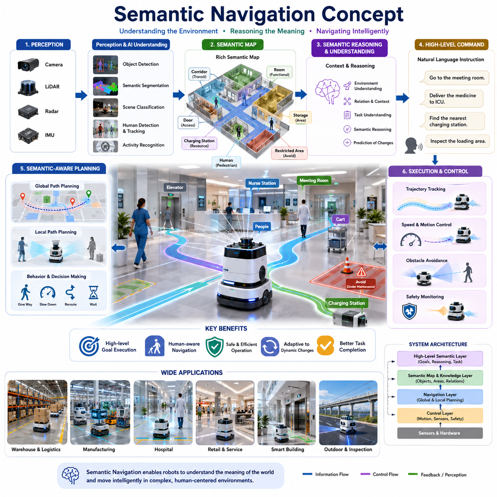
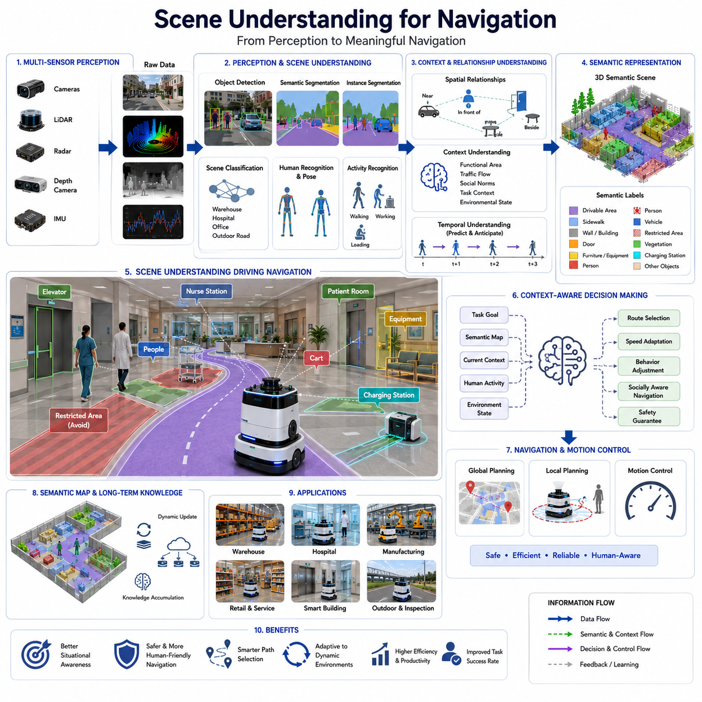
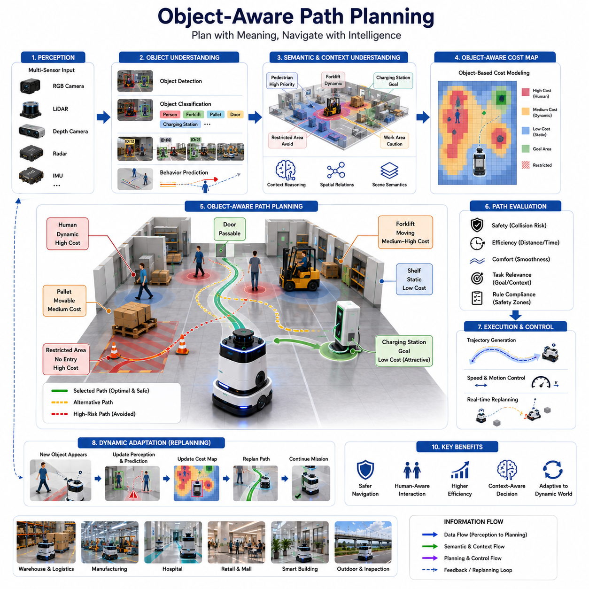
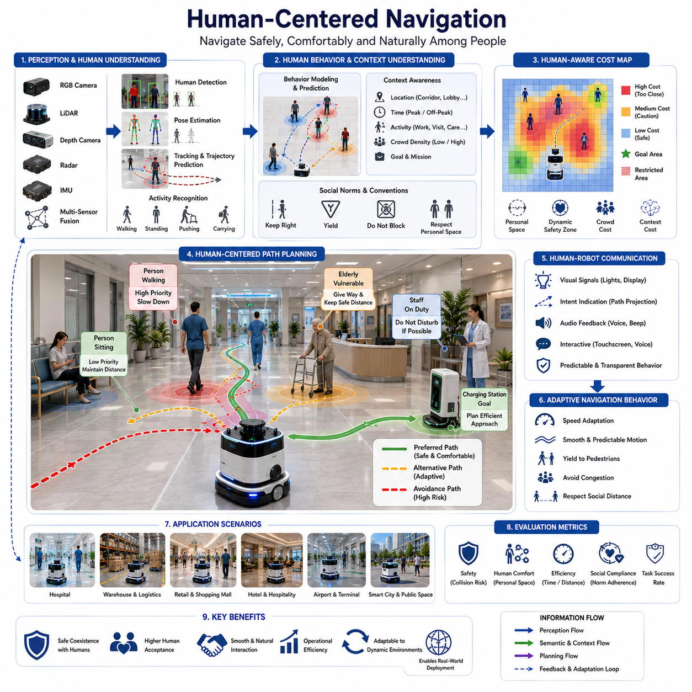
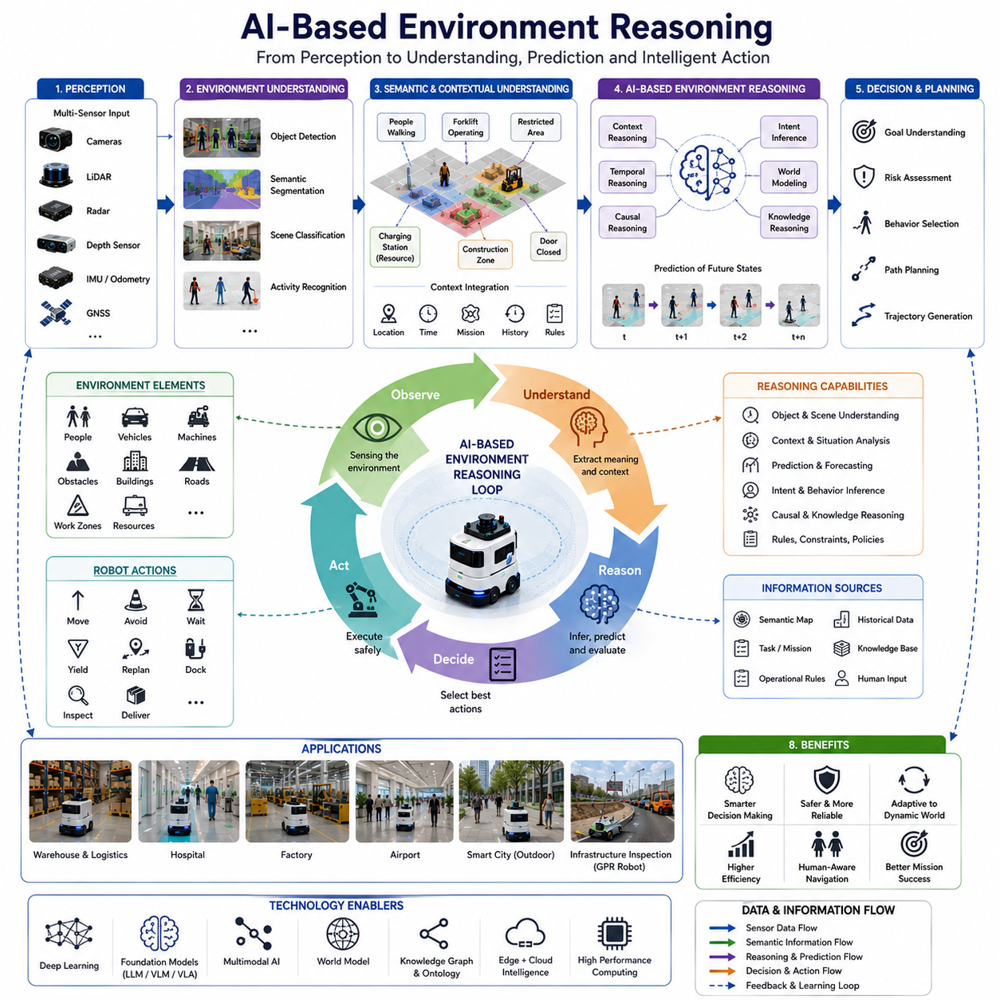
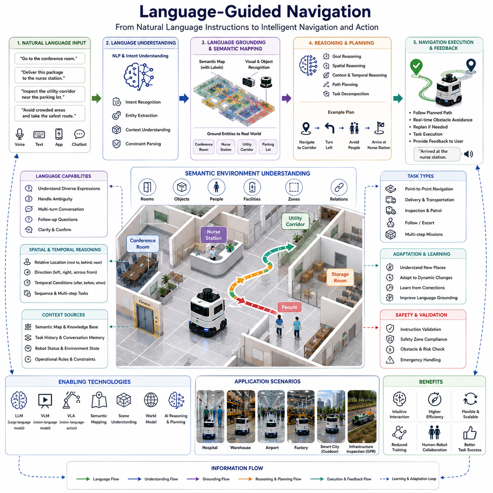
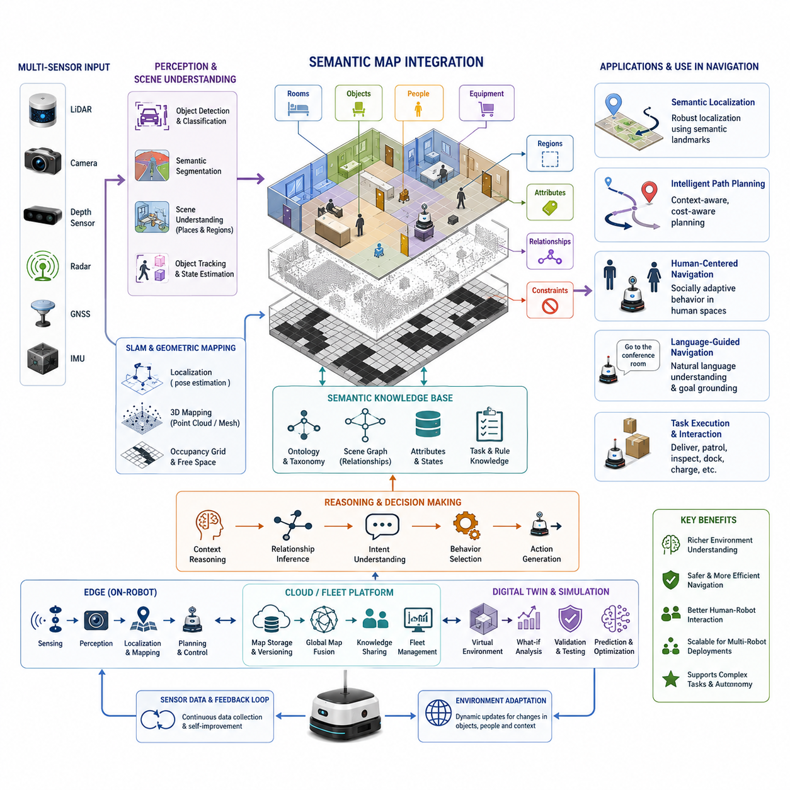
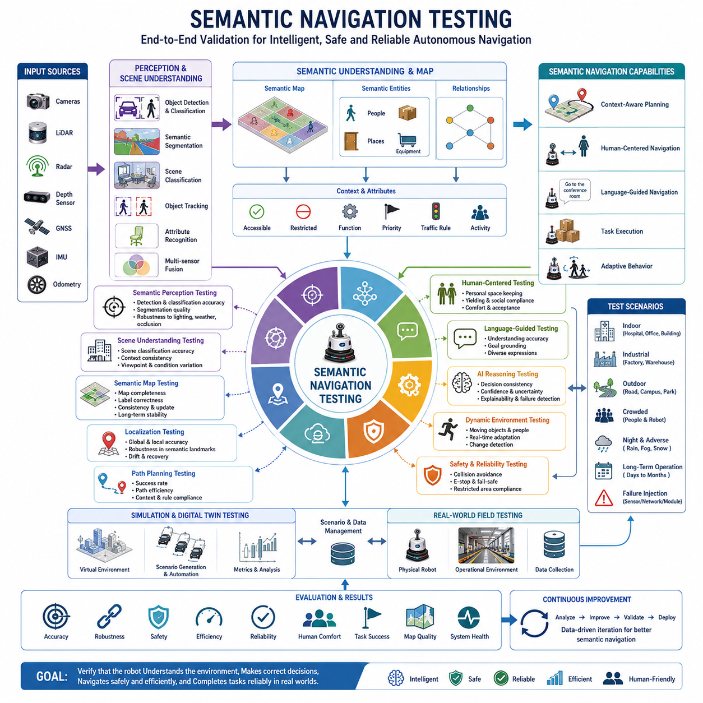

**Volume 05. Path Planning and Autonomous Navigation**

# Chapter 09. Semantic Navigation

## 09.1 Semantic Navigation Concepts

{width="7.268055555555556in" height="7.268055555555556in"}

시맨틱 내비게이션(Semantic Navigation)은 자율주행 로봇 내비게이션 기술의 중요한 진화 단계로, 기존의 기하학적(Geometric) 또는 좌표 기반(Metric) 경로 계획을 넘어 환경의 의미와 맥락을 이해하는 내비게이션을 의미한다. 전통적인 내비게이션 시스템은 지도, 좌표, 장애물 위치, 그리고 로봇의 운동학적 제약 조건을 활용하여 출발지에서 목적지까지 이동하는 데 집중한다. 이러한 방식은 구조화된 환경에서는 효과적이지만, 객체가 무엇인지, 공간이 어떤 용도로 사용되는지, 그리고 사람이 해당 공간을 어떻게 활용하는지에 대한 이해가 부족하다. 시맨틱 내비게이션은 이러한 한계를 극복하기 위해 환경의 의미를 이해하고 이를 내비게이션 과정에 반영함으로써 인간과 유사한 수준의 공간 이해 능력을 로봇에 제공한다.

인간은 이동할 때 좌표나 격자 지도를 떠올리지 않는다. 대신 회의실, 복도, 창고, 접수처, 엘리베이터, 충전소, 작업 공간과 같은 의미적 개념을 활용한다. 사람은 "회의실로 가라", "물품을 하역장으로 운반하라", "접수처 근처에서 대기하라"와 같은 명령을 쉽게 이해한다. 시맨틱 내비게이션은 로봇도 이러한 수준의 명령을 이해하고 수행할 수 있도록 하는 것을 목표로 한다. 이를 통해 로봇은 단순히 좌표를 따라 이동하는 것이 아니라 공간의 목적과 기능을 이해하면서 행동하게 된다.

시맨틱 내비게이션은 인지, 위치추정, 지도 작성, 인공지능, 의사결정 기술이 결합된 형태로 구현된다. 로봇은 카메라, LiDAR, 깊이 카메라, 레이더, IMU 등의 센서를 사용하여 주변 환경을 인식한다. 수집된 데이터는 객체 인식, 환경 분류, 랜드마크 식별, 인간 행동 분석 등의 과정을 거쳐 의미 정보를 추출하게 된다. 이러한 정보는 단순한 지도를 넘어 환경의 의미를 포함하는 시맨틱 맵(Semantic Map)으로 변환되며, 이후 내비게이션 의사결정의 핵심 기반이 된다.

시맨틱 맵은 기존 점유격자지도(Occupancy Grid Map)와 근본적으로 다르다. 일반적인 지도는 자유 공간, 점유 공간, 미지 공간 정도만 표현하지만, 시맨틱 맵은 각 공간과 객체에 의미를 부여한다. 예를 들어 복도는 이동 통로, 창고 선반은 보관 구역, 병실은 환자 치료 공간으로 정의될 수 있다. 또한 지게차, 작업자, 카트, 충전 스테이션, 자동문과 같은 객체들도 각각의 역할과 특성을 갖는 의미 정보로 표현된다. 이를 통해 로봇은 자신이 어떤 환경에서 동작하고 있는지를 보다 깊이 이해할 수 있다.

시맨틱 내비게이션의 핵심 요소 중 하나는 장면 이해(Scene Understanding)이다. 장면 이해는 단순히 물체를 인식하는 것을 넘어 공간과 객체 간의 관계를 파악하는 능력을 의미한다. 예를 들어 병원 환경에서 로봇은 병상이 병실 안에 위치한다는 사실을 이해하고, 간호사가 특정 복도를 자주 이동하며, 엘리베이터가 층간 이동을 위한 핵심 시설이라는 사실을 학습할 수 있다. 이러한 맥락적 지식은 보다 지능적이고 효율적인 이동 전략을 가능하게 한다.

시맨틱 내비게이션의 가장 큰 장점 중 하나는 고수준 목표(High-Level Goal)를 직접 수행할 수 있다는 점이다. 기존 시스템은 정확한 목적지 좌표를 요구하지만, 시맨틱 내비게이션 시스템은 추상적이고 인간 친화적인 명령을 이해할 수 있다. 사용자가 "중환자실로 약품을 전달하라" 또는 "물류 적재 구역을 점검하라"와 같은 명령을 내리면, 로봇은 해당 위치의 의미를 이해하고 적절한 경로를 생성한다. 이러한 능력은 인간-로봇 상호작용을 크게 향상시키고 로봇 운용의 복잡성을 감소시킨다.

시맨틱 정보는 경로 계획 성능 또한 향상시킨다. 기존 경로 계획은 거리, 이동 시간, 에너지 소비, 장애물 회피와 같은 요소를 최적화한다. 반면 시맨틱 내비게이션은 공간의 기능과 운영 목적까지 고려한다. 예를 들어 물류 로봇은 보행자 중심 복도보다 물류 이동 전용 통로를 선호할 수 있으며, 병원에서는 환자 휴게 공간을 우회하여 소음을 최소화할 수 있다. 공장에서는 작업자 밀집 구역을 피해 이동함으로써 안전성과 생산성을 동시에 높일 수 있다.

인간 중심 내비게이션(Human-Aware Navigation) 역시 시맨틱 내비게이션의 중요한 부분이다. 병원, 공항, 쇼핑몰, 물류센터, 공장과 같은 환경에서는 로봇과 사람이 같은 공간을 공유한다. 로봇은 사람의 행동 패턴과 사회적 규범을 이해해야 한다. 시맨틱 내비게이션은 보행자가 많은 구역을 인식하고, 작업 공간과 대기 공간을 구분하며, 상황에 따라 속도를 줄이거나 우선권을 양보하는 행동을 가능하게 한다. 이러한 기능은 인간과 로봇의 자연스러운 공존을 지원한다.

인공지능 기술은 시맨틱 내비게이션의 핵심 구성 요소이다. 딥러닝 기반 객체 검출, 시맨틱 분할, 장면 분류, 행동 인식 기술은 복잡한 센서 데이터를 이해 가능한 의미 정보로 변환한다. CNN, Transformer, Vision Foundation Model, Multimodal AI와 같은 최신 기술은 환경의 구조와 객체 간 관계를 이해하는 데 활용된다. 이러한 AI 기술은 기존 규칙 기반 접근 방식보다 훨씬 높은 수준의 환경 이해 능력을 제공한다.

최근에는 Foundation Model과 Vision-Language Model(VLM), Vision-Language-Action(VLA) 기술이 시맨틱 내비게이션의 발전을 가속화하고 있다. 이러한 모델은 시각 정보와 자연어를 통합적으로 이해할 수 있다. 예를 들어 로봇은 "회의실 옆 방으로 이동하라" 또는 "정비 구역 근처의 충전소를 찾아라"와 같은 자연어 명령을 이해하고 실행할 수 있다. 이는 인간과 로봇 간 상호작용을 더욱 직관적으로 만들어준다.

동적 환경에서 시맨틱 내비게이션의 장점은 더욱 두드러진다. 기존 내비게이션 시스템은 이동 장애물이나 환경 변화에 취약할 수 있다. 반면 시맨틱 내비게이션은 환경 변화의 의미를 이해하고 적절히 대응할 수 있다. 예를 들어 특정 복도가 공사로 인해 차단되면 로봇은 대체 경로를 선택하고, 특정 구역이 일시적으로 사용 금지 상태임을 인식하여 다른 경로를 계획할 수 있다.

시맨틱 추론(Semantic Reasoning)은 이러한 시스템의 또 다른 핵심 기능이다. 이는 단순한 거리 계산이 아니라 환경의 의미와 관계를 기반으로 의사결정을 수행하는 능력을 의미한다. 예를 들어 배송 위치에 접근할 수 없는 경우 로봇은 인근 서비스 데스크를 대체 인계 장소로 선택할 수 있다. 충전소가 사용 중일 경우 대기 구역에서 기다렸다가 충전을 수행할 수도 있다. 이러한 추론 능력은 자율성을 크게 향상시킨다.

실제 시스템에서는 시맨틱 내비게이션이 계층형 내비게이션 구조(Hierarchical Navigation Architecture) 내에서 동작한다. 최하위 계층은 모터 제어와 궤적 추종을 수행하며, 중간 계층은 장애물 회피와 로컬 경로 계획을 담당한다. 시맨틱 내비게이션은 상위 계층에서 환경의 의미를 고려한 전략적 의사결정을 수행하며, 이를 하위 경로 계획기에 전달한다. 이러한 구조는 실시간 제어 성능을 유지하면서도 높은 수준의 지능을 제공한다.

산업용 AMR 환경에서는 시맨틱 내비게이션이 매우 큰 가치를 제공한다. 창고 로봇은 적재 구역, 출하 구역, 작업 공간을 구분할 수 있으며, 제조 공장에서는 생산 라인과 물류 통로를 이해할 수 있다. 병원 로봇은 병실, 간호사 스테이션, 수술실, 응급실 등을 구분할 수 있다. 이러한 의미 기반 이해는 운영 효율성과 신뢰성을 크게 향상시킨다.

옥외 자율주행 로봇에서도 시맨틱 내비게이션은 중요한 역할을 수행한다. 도시 환경에서는 보도, 차도, 횡단보도, 주차장, 건물 입구를 구분할 수 있다. 농업 로봇은 작물 구역, 관개 시설, 농기계 작업 영역을 이해할 수 있다. 지하 시설물 탐사용 GPR 로봇의 경우 도로 구간, 교량, 터널, 맨홀, 유지보수 구역 등의 의미 정보를 활용하여 더욱 효율적인 검사 작업을 수행할 수 있다.

시맨틱 내비게이션의 성공적인 구현을 위해서는 시맨틱 맵의 지속적인 생성과 관리가 필요하다. 환경은 시간이 지나면서 변화하기 때문에 지도 또한 지속적으로 갱신되어야 한다. 장기 운영 환경에서는 새로운 객체와 공간 정보가 추가될 수 있으며, 기존 정보의 의미가 변경될 수도 있다. 따라서 클라우드 기반 지도 관리 시스템과 다중 로봇 지식 공유 시스템이 중요해지고 있다.

시맨틱 내비게이션의 성능 평가는 단순한 경로 길이나 이동 시간만으로는 충분하지 않다. 객체 인식 정확도, 시맨틱 분류 정확도, 장면 이해 능력, 추론 성능, 인간과의 상호작용 품질, 고수준 명령 수행 성공률 등 다양한 요소가 함께 평가되어야 한다. 미래의 평가 체계는 지능 수준과 환경 이해 능력까지 포함하는 방향으로 발전할 것으로 예상된다.

향후 시맨틱 내비게이션은 Embodied AI, World Model, Cognitive Robotics와 밀접하게 결합될 것이다. 미래의 로봇은 단순히 환경에 무엇이 있는지를 아는 수준을 넘어 왜 존재하는지, 어떻게 사용되는지, 현재 작업과 어떤 관계가 있는지를 이해하게 될 것이다. 이러한 통합적 세계 모델은 기하학적 정보와 의미 정보, 인간 의도, 운영 목표를 하나의 지식 체계로 결합하여 인간에 가까운 수준의 상황 인식 능력을 제공할 것이다.

결국 시맨틱 내비게이션은 자율주행 로봇이 단순한 좌표 기반 이동 시스템에서 벗어나 환경의 의미를 이해하고 상황에 맞게 행동하는 지능형 시스템으로 발전하는 핵심 기술이다. 이는 경로 계획과 인공지능, 인간-로봇 상호작용을 연결하는 중요한 다리 역할을 수행하며, 미래의 산업용 AMR, 병원 로봇, 물류 로봇, 스마트시티 로봇, 옥외 자율주행 로봇의 핵심 기반 기술로 자리 잡게 될 것이다.

## 09.2 Scene Understanding for Navigation

{width="7.268055555555556in" height="7.268055555555556in"}

내비게이션을 위한 장면 이해(Scene Understanding for Navigation)는 현대 자율주행 이동로봇(AMR)과 지능형 로봇 시스템에서 가장 중요한 핵심 기술 중 하나이다. 기존의 내비게이션 시스템이 위치추정(Localization), 지도 생성(Mapping), 장애물 탐지(Obstacle Detection), 경로 계획(Path Planning)에 초점을 맞추었다면, 장면 이해는 로봇이 주변 환경의 의미와 구조, 그리고 맥락(Context)을 이해할 수 있도록 해준다. 즉, 로봇이 세상을 단순한 점(Point), 픽셀(Pixel), 또는 기하학적 장애물의 집합으로 보는 것이 아니라, 객체를 인식하고 공간의 기능을 이해하며 객체 간의 관계를 해석하고 상황에 맞는 판단을 수행하도록 만드는 기술이다. 이러한 능력은 저수준 센서 인식과 고수준 자율 행동 사이를 연결하는 핵심 역할을 수행하며, 복잡한 실제 환경에서 보다 지능적인 자율주행을 가능하게 한다.

전통적인 내비게이션 시스템은 주로 점유격자지도(Occupancy Grid Map), 포인트 클라우드(Point Cloud), 또는 기하학적 지도 정보를 사용한다. 이러한 정보는 충돌 회피와 경로 계획에는 효과적이지만, 환경이 무엇으로 구성되어 있는지, 특정 객체가 어떤 의미를 가지는지, 또는 해당 공간이 어떤 목적으로 사용되는지에 대한 정보를 제공하지 못한다. 예를 들어 병원 침대와 벽은 모두 장애물로 인식될 수 있지만, 실제 의미와 역할은 전혀 다르다. 장면 이해는 이러한 한계를 극복하여 환경 요소에 의미를 부여하고 인간과 유사한 방식으로 환경을 해석할 수 있도록 한다.

인간은 일상생활에서 자연스럽게 장면 이해를 수행한다. 건물에 들어서면 복도, 사무실, 계단, 엘리베이터, 회의실, 대기실, 비상구 등을 즉시 구분할 수 있으며, 각 공간의 기능을 이해한다. 목적지를 찾을 때도 좌표를 계산하지 않고 환경의 의미와 맥락을 활용한다. 로봇 장면 이해의 목표는 이러한 인간 수준의 환경 인지 능력을 로봇에 제공하는 것이다.

장면 이해는 환경 인식(Environment Perception)에서 시작된다. 현대 로봇은 RGB 카메라, 깊이 카메라, 스테레오 비전, LiDAR, 레이더, 초음파 센서, 열화상 카메라, IMU 등 다양한 센서를 활용하여 환경 데이터를 수집한다. 각 센서는 환경의 다른 특성을 제공하며, 기하학적 구조, 시각적 특징, 움직임, 온도, 공간 관계 등에 대한 정보를 제공한다. 이러한 센서 데이터는 장면 이해 알고리즘의 기초 자료가 된다.

특히 시각 정보는 장면 이해에서 매우 중요한 역할을 수행한다. 카메라는 풍부한 의미 정보를 제공하며, 이를 통해 객체 인식, 환경 분류, 관계 분석, 행동 인식 등을 수행할 수 있다. 최근 컴퓨터 비전 기술의 발전으로 인해 로봇은 객체 검출(Object Detection), 시맨틱 분할(Semantic Segmentation), 인스턴스 분할(Instance Segmentation), 장면 분류(Scene Classification), 인간 인식(Human Recognition), 행동 분석(Activity Analysis)을 높은 정확도로 수행할 수 있게 되었다. 딥러닝 모델은 이미지 데이터를 의미 있는 환경 정보로 변환하여 구조화된 지식으로 만들어준다.

객체 인식(Object Recognition)은 장면 이해의 가장 기본적인 요소이다. 객체 인식을 통해 로봇은 환경 내에 무엇이 존재하는지 파악할 수 있다. 내비게이션 시스템은 문, 엘리베이터, 의자, 책상, 병상, 지게차, 팔레트, 카트, 기계 설비, 충전 스테이션, 작업자 등을 인식할 수 있다. 이러한 객체 정보는 내비게이션 의사결정에 직접적인 영향을 준다. 예를 들어 충전 스테이션을 인식하면 배터리 충전을 위한 이동이 가능하며, 팔레트를 인식하면 장애물 회피 전략을 수행할 수 있다.

장면 이해는 단순히 개별 객체를 인식하는 것을 넘어 객체 간의 관계를 분석하는 단계로 발전한다. 환경 내 관계 정보는 객체 자체보다 더 중요한 의미를 제공할 수 있다. 예를 들어 의자가 책상 옆에 위치해 있다는 사실, 병상이 병실 내부에 존재한다는 사실, 지게차가 물류 적재 구역에서 운행되고 있다는 사실은 공간의 기능과 목적을 이해하는 데 중요한 단서를 제공한다. 이러한 관계 이해는 로봇의 상황 인식 능력을 크게 향상시킨다.

장면 분류(Scene Classification)는 환경 전체를 하나의 의미적 공간으로 이해하는 기술이다. 로봇은 특정 지역이 창고인지, 병원 복도인지, 공장 생산라인인지, 사무실인지, 주차장인지, 농업 지역인지, 도로인지 구분할 수 있다. 서로 다른 환경은 서로 다른 내비게이션 전략을 요구한다. 병원의 복도에서는 사람 중심의 안전한 이동이 중요하지만, 산업용 창고에서는 물류 효율성이 더욱 중요할 수 있다.

시맨틱 분할은 환경 이해를 더욱 정교하게 만든다. 이미지나 포인트 클라우드의 모든 픽셀 또는 포인트에 의미를 부여함으로써 도로, 보도, 벽, 바닥, 기계 설비, 차량, 사람, 작업 구역 등을 구분할 수 있다. 이러한 세밀한 의미 정보는 이동 가능 영역과 제한 구역을 구분하고 최적의 경로를 생성하는 데 활용된다.

3차원 장면 이해는 공간적 추론 능력을 제공한다. LiDAR, 깊이 카메라, 스테레오 비전 및 다중 센서 융합 기술을 활용하여 로봇은 주변 환경의 3D 모델을 생성할 수 있다. 이를 통해 객체의 위치, 크기, 형태, 방향, 공간적 관계를 이해할 수 있으며, 복잡한 산업시설이나 창고, 건설 현장, 병원, 옥외 환경에서 더욱 정밀한 내비게이션이 가능해진다.

인간 이해(Human Understanding)는 장면 이해의 중요한 하위 분야이다. 로봇은 사람과 공간을 공유하기 때문에 인간을 인식하고 행동을 이해할 수 있어야 한다. 인간 검출, 추적, 자세 추정, 제스처 인식, 행동 예측 기술은 로봇이 사람 주변에서 안전하게 이동할 수 있도록 지원한다. 로봇은 사람이 서 있는지, 걷고 있는지, 장비를 운반하고 있는지, 기계를 조작하고 있는지 등을 이해할 수 있으며, 이를 기반으로 사회적으로 자연스러운 행동을 수행할 수 있다.

행동 인식(Activity Recognition)은 환경에서 현재 어떤 일이 발생하고 있는지를 이해하는 기술이다. 단순히 객체와 사람을 인식하는 것이 아니라 실제 작업과 활동을 파악한다. 예를 들어 창고에서는 물품 적재 작업을, 병원에서는 환자 이송 작업을, 공장에서는 생산 활동을 인식할 수 있다. 이러한 정보는 향후 환경 변화를 예측하고 선제적인 내비게이션 전략을 수립하는 데 도움을 준다.

시간적 이해(Temporal Understanding) 역시 매우 중요하다. 환경은 지속적으로 변화한다. 사람은 이동하고, 문은 열리고 닫히며, 장비는 위치를 변경한다. 효과적인 장면 이해는 현재 상태뿐 아니라 시간에 따른 변화를 이해해야 한다. 시간적 추론은 미래 상황을 예측하고 보다 안정적인 내비게이션을 가능하게 한다.

컨텍스트 인식(Context Awareness)은 장면 이해가 환경 지식과 임무 목표를 통합할 때 나타난다. 컨텍스트를 이해하는 로봇은 현재 수행 중인 작업과 환경 상태를 동시에 고려하여 행동할 수 있다. 예를 들어 병원의 배송 로봇은 방문객이 많은 시간대에 특정 복도를 회피할 수 있으며, 창고 로봇은 물류 작업이 집중되는 지역을 우회할 수 있다. 이러한 능력은 단순한 장애물 회피를 넘어 지능적인 의사결정을 가능하게 한다.

장면 이해는 시맨틱 위치추정(Semantic Localization)에도 활용된다. 기존 위치추정이 좌표를 계산하는 데 초점을 맞춘다면, 시맨틱 위치추정은 로봇이 현재 회의실에 있는지, 충전소 근처에 있는지, 엘리베이터 앞에 있는지, 저장 공간 내부에 있는지를 이해하게 한다. 이러한 정보는 인간 친화적인 작업 수행을 가능하게 한다.

장면 이해와 시맨틱 맵이 결합되면 내비게이션 성능은 크게 향상된다. 시맨틱 맵에는 객체 정보, 공간의 기능, 운영 규칙, 접근 제한 구역 등이 포함된다. 로봇은 장면 이해를 통해 지속적으로 시맨틱 맵을 업데이트하며 환경 변화에 대응할 수 있다. 이러한 동적 지식은 경로 계획과 의사결정의 중요한 기반이 된다.

인공지능은 고급 장면 이해 기술의 핵심 엔진이다. 딥러닝 네트워크, Transformer 모델, Graph Neural Network, Multimodal Foundation Model은 복잡한 환경을 이해하는 능력을 크게 향상시켰다. Vision Transformer는 장거리 문맥 정보를 분석할 수 있으며, 멀티모달 모델은 시각 정보와 언어 정보를 결합하여 더욱 풍부한 환경 이해를 가능하게 한다.

최근 Vision-Language Model(VLM)과 Vision-Language-Action(VLA) 기술은 장면 이해의 범위를 더욱 확대하고 있다. 이러한 모델은 시각 정보와 자연어를 연결하여 인간 중심의 명령을 이해할 수 있게 해준다. 로봇은 "접수처 옆 회의실로 이동하라" 또는 "정비 구역 근처 장비를 점검하라"와 같은 명령을 이해하고 수행할 수 있다.

월드 모델(World Model)은 장면 이해의 미래 방향 중 하나이다. 월드 모델은 현재 환경 상태뿐 아니라 객체 간 관계, 환경 변화, 미래 예측 정보를 통합적으로 저장하는 내부 표현 체계이다. 이를 통해 로봇은 미래 상황을 예측하고 더욱 지능적인 내비게이션 결정을 내릴 수 있다. 향후 자율주행 시스템의 핵심 기술로 자리잡을 것으로 예상된다.

산업 현장에서 장면 이해는 매우 다양한 형태로 활용된다. 제조 공장에서는 생산 라인, 기계 설비, 저장 구역, 안전 구역, 작업자 위치를 이해할 수 있다. 창고에서는 선반, 적재장, 물류 구역, 이동 통로를 인식할 수 있다. 병원에서는 병실, 간호사 스테이션, 수술실, 약국, 응급실을 구분할 수 있다. 옥외 점검 로봇은 도로, 교량, 전력 설비, 통신 시설, 유지보수 구역 등을 인식할 수 있다.

옥외 자율주행 로봇에서는 장면 이해가 더욱 중요하다. 옥외 환경은 다양한 지형, 동적 장애물, 날씨 변화, 조명 변화, 복잡한 인프라 구조를 포함한다. 로봇은 도로와 보도를 구분하고, 식생과 장애물을 구분하며, 공사 구역과 정상 통행 구역을 식별해야 한다. 강력한 장면 이해 능력은 이러한 복잡한 환경에서도 안전하고 안정적인 주행을 가능하게 한다.

장면 이해 시스템의 성능 평가는 객체 검출 정확도, 시맨틱 분할 정확도, 장면 분류 성능, 인간 인식 정확도, 문맥 추론 능력, 행동 인식 성능 등 다양한 요소를 포함한다. 또한 실제 내비게이션 성능 향상, 안전성, 자율성, 작업 성공률에 미치는 영향도 중요한 평가 항목이다.

로봇 기술이 Embodied AI 방향으로 발전함에 따라 장면 이해의 중요성은 더욱 커지고 있다. 미래의 로봇은 단순히 객체를 보는 수준을 넘어 환경의 목적, 관계, 인간의 의도, 작업의 의미를 이해하게 될 것이다. 인지, 추론, 월드 모델, 의사결정이 통합된 장면 이해 기술은 로봇이 인간 중심 환경에서 자연스럽게 동작할 수 있는 기반이 된다.

결국 장면 이해는 시맨틱 내비게이션의 인지적 기반이라 할 수 있다. 이는 로봇이 단순한 기하학적 내비게이션을 넘어 환경의 의미를 이해하고 상황에 적응하며 목적에 맞는 행동을 수행할 수 있도록 만든다. 공장, 병원, 물류센터, 스마트시티, 농업 환경, GPR 기반 지하시설물 점검 로봇 등 다양한 분야에서 장면 이해는 차세대 지능형 자율주행 로봇의 핵심 기술로 자리잡게 될 것이다.

## 09.3 Object-Aware Path Planning

{width="7.268055555555556in" height="7.268055555555556in"}

객체 인식 기반 경로 계획(Object-Aware Path Planning)은 자율주행 로봇이 단순히 장애물과 자유 공간만을 고려하여 경로를 생성하는 것이 아니라, 환경에 존재하는 객체의 종류와 의미를 이해하고 이를 경로 계획 과정에 반영하는 고급 내비게이션 기술이다. 기존의 경로 계획 알고리즘은 환경을 점유 공간과 비점유 공간으로 구분하여 최적의 이동 경로를 계산한다. 이러한 방식은 기본적인 이동에는 효과적이지만, 객체의 종류와 역할, 행동 특성, 그리고 운영상의 중요성을 고려하지 못한다. 객체 인식 기반 경로 계획은 이러한 한계를 극복하고 객체 수준의 지능을 내비게이션에 통합함으로써 보다 안전하고 효율적이며 상황에 적응하는 경로 생성을 가능하게 한다.

기존 내비게이션 시스템에서는 벽, 사람, 지게차, 병원 침대, 충전 스테이션, 팔레트 등이 모두 동일한 장애물로 표현되는 경우가 많다. 기하학적 관점에서는 모두 공간을 점유하는 객체이므로 회피 대상이 된다. 그러나 실제 환경에서는 각 객체가 가지는 의미와 위험도, 이동 특성, 운영적 중요성이 크게 다르다. 사람은 예측하기 어려운 움직임을 보이며, 지게차는 산업 현장의 특정 동선을 따라 이동한다. 충전 스테이션은 장애물이 아니라 목적지가 될 수 있으며, 팔레트는 일시적으로 이동 가능한 물체일 수 있다. 객체 인식 기반 경로 계획은 이러한 차이를 이해하고 내비게이션 과정에 반영한다.

이 기술의 핵심 목표는 환경에 존재하는 객체가 무엇인지 파악하고, 해당 객체가 경로 계획에 어떤 영향을 미쳐야 하는지를 판단하는 것이다. 즉, 단순히 공간을 기준으로 경로를 생성하는 것이 아니라 객체의 의미를 고려하여 경로를 생성하는 것이다. 이를 통해 로봇은 더욱 지능적이고 안전하며 목적 중심적인 이동을 수행할 수 있다.

객체 인식 기반 경로 계획은 환경 인식 단계에서 시작된다. 현대 자율주행 로봇은 RGB 카메라, 깊이 카메라, 스테레오 비전, LiDAR, 레이더, 초음파 센서, 열화상 카메라, IMU 등의 다양한 센서를 사용하여 환경 정보를 수집한다. 수집된 데이터는 객체 검출(Object Detection), 객체 분류(Object Classification), 객체 추적(Object Tracking), 행동 분석 등의 과정을 거쳐 의미 있는 객체 정보로 변환된다. 이러한 정보가 이후 내비게이션 의사결정의 기반이 된다.

객체 검출은 객체 기반 내비게이션의 첫 번째 단계이다. 딥러닝 기반 객체 검출 모델은 센서 데이터에서 사람, 차량, 지게차, 팔레트, 선반, 문, 엘리베이터, 충전 스테이션, 작업자, 병상, 휠체어, 의료 장비 등 다양한 객체를 식별한다. 각 객체는 고유한 의미를 가지며, 경로 계획 과정에서 서로 다른 방식으로 처리된다.

객체 분류는 단순한 식별을 넘어 객체의 특성과 역할을 이해하는 과정이다. 정적인 벽은 영구적인 장애물이지만 사람은 이동하는 객체이다. 충전 스테이션은 목적지이며, 안전 펜스는 접근 제한 구역을 의미할 수 있다. 비상구는 긴급 상황에서 중요한 경로 자원이 될 수 있다. 이러한 객체별 특성을 이해함으로써 로봇은 상황에 맞는 경로 전략을 선택할 수 있다.

객체 추적(Object Tracking)은 시간 정보를 포함하는 중요한 기술이다. 동적 객체는 지속적으로 위치를 변경하기 때문에 현재 위치뿐 아니라 미래 위치를 예측해야 한다. 추적 알고리즘은 객체의 속도, 가속도, 이동 방향을 계산하고 미래 궤적을 예측한다. 이를 통해 로봇은 단순히 장애물을 피하는 수준을 넘어 미래 상황을 고려한 선제적 경로 계획을 수행할 수 있다. 이러한 예측 능력은 부드럽고 안정적인 주행을 가능하게 한다.

객체 기반 비용 지도(Object-Based Cost Map)는 객체 인식 기반 경로 계획의 핵심 개념 중 하나이다. 기존 비용 지도는 장애물과의 거리만을 고려하여 비용을 계산하지만, 객체 기반 비용 지도에서는 객체의 종류와 위험도, 운영적 중요성까지 고려한다. 예를 들어 사람 주변은 높은 비용 영역으로 설정될 수 있으며, 이동 중인 지게차 주변은 동적으로 안전 영역이 확대될 수 있다. 민감한 장비 주변은 접근 제한 구역으로 설정될 수 있다. 이러한 객체 기반 비용 모델은 실제 환경에 더욱 적합한 경로 생성을 가능하게 한다.

사람 중심 내비게이션(Human-Aware Navigation)은 객체 인식 기반 경로 계획의 대표적인 응용 분야이다. 로봇과 사람이 함께 작업하는 환경에서는 사람을 단순한 장애물이 아니라 특별한 고려 대상 객체로 인식해야 한다. 로봇은 사람 주변에서 속도를 줄이고, 충분한 안전거리를 유지하며, 필요할 경우 우선권을 양보할 수 있어야 한다. 또한 사람이 많은 지역을 우회하거나 작업을 방해하지 않는 경로를 선택할 수도 있다. 이러한 기능은 안전성과 사용자 수용성을 크게 향상시킨다.

산업 환경에서는 객체 인식 기반 경로 계획의 가치가 더욱 크다. 공장, 창고, 물류센터, 항만 등에는 다양한 종류의 객체가 존재한다. 지게차는 물류 이동 경로를 따라 움직이며, 팔레트는 저장 구역을 구성하고, 컨베이어는 특정 작업 흐름을 형성한다. 생산 설비는 안전 구역을 정의하며, 작업자는 특정 작업 공간을 차지한다. 로봇이 이러한 객체들의 의미를 이해하면 산업 프로세스에 최적화된 경로를 생성할 수 있으며, 교통 혼잡 감소와 생산성 향상에 기여할 수 있다.

병원 환경 역시 객체 인식 기반 내비게이션의 대표적인 활용 사례이다. 병원에는 병상, 휠체어, 의료 카트, 환자, 간호사, 의사, 응급 장비 등 다양한 객체가 존재한다. 약품 배송 로봇은 환자 치료 구역을 방해하지 않는 경로를 선택해야 하며, 응급 상황이 발생한 지역을 우회해야 할 수도 있다. 객체 인식 기반 경로 계획은 의료 환경의 특수성을 이해하고 적절한 이동 전략을 제공한다.

객체 인식 기반 경로 계획은 시맨틱 맵(Semantic Map)과 밀접하게 연결된다. 시맨틱 맵에는 객체의 종류, 위치, 기능, 관계 정보가 저장된다. 로봇은 주행 과정에서 지속적으로 객체 정보를 업데이트하며, 이를 통해 환경 변화에 대응한다. 이러한 시맨틱 지도는 장기적인 환경 지식 저장소 역할을 수행하며, 다양한 임무 수행에 활용된다.

3차원 객체 이해는 내비게이션 성능을 더욱 향상시킨다. LiDAR 포인트 클라우드, 깊이 카메라, 스테레오 비전, 센서 융합 기술을 활용하면 객체의 크기, 형태, 방향, 공간 구조를 정확하게 파악할 수 있다. 이를 통해 통과 가능 공간, 충돌 위험도, 안전 여유 공간 등을 보다 정밀하게 계산할 수 있다. 특히 복잡한 산업 현장이나 협소한 통로 환경에서 매우 중요한 기능이다.

문맥 기반 추론(Contextual Reasoning)은 객체 인식 기반 내비게이션의 고급 기능이다. 로봇은 개별 객체만 보는 것이 아니라 객체 간의 관계와 상황을 이해한다. 예를 들어 하역장 근처의 팔레트는 물류 작업 중인 자산일 가능성이 높으며, 병실 앞의 휠체어는 환자 이동 작업과 관련이 있을 수 있다. 교차로로 접근하는 지게차는 교통 위험 증가를 의미할 수 있다. 이러한 맥락 이해는 더욱 지능적인 의사결정을 가능하게 한다.

객체 행동 예측(Object Behavior Prediction)도 중요한 요소이다. 많은 동적 객체는 일정한 행동 패턴을 가진다. 보행자는 보행로를 따라 이동하고, 지게차는 지정된 산업 경로를 이용하며, 차량은 교통 규칙을 따른다. 로봇이 이러한 패턴을 학습하면 미래 상황을 예측하고 보다 안전한 경로를 생성할 수 있다. 이는 급격한 회피 동작을 줄이고 주행 효율성을 높인다.

인공지능은 객체 인식 기반 경로 계획의 핵심 기술이다. CNN, Transformer, Graph Neural Network, Multimodal AI와 같은 최신 AI 기술은 객체 인식, 추적, 분류, 행동 예측, 추론을 수행한다. 이러한 기술을 통해 로봇은 복잡한 센서 데이터를 실제 의사결정에 활용할 수 있는 지식으로 변환한다.

최근 등장한 Foundation Model, Vision-Language Model(VLM), Vision-Language-Action(VLA) 기술은 객체 기반 내비게이션의 가능성을 더욱 확장하고 있다. 로봇은 "정비 구역을 피해서 이동하라", "간호사 스테이션 근처로 약품을 운반하라", "대형 장비를 우회하라"와 같은 자연어 명령을 이해하고 실행할 수 있다. 이는 객체 이해와 임무 수준 추론을 통합하는 새로운 접근 방식이다.

동적 환경에서는 객체 인식 기반 경로 계획의 중요성이 더욱 커진다. 건설 현장, 병원, 물류센터, 공항, 쇼핑몰, 스마트시티와 같은 환경은 지속적으로 변화한다. 기존 내비게이션 시스템은 이러한 변화에 효과적으로 대응하기 어렵지만, 객체 기반 시스템은 실시간으로 환경을 이해하고 경로를 재계획할 수 있다.

옥외 자율주행 로봇 역시 객체 인식 기반 내비게이션의 큰 혜택을 받는다. 도시 환경에서는 보행자, 자전거, 차량, 교통 표지판, 공사 장비, 가로 시설물을 인식해야 한다. 농업 로봇은 작물, 농기계, 작업자, 관개 시설을 이해해야 하며, 인프라 점검 로봇은 전력 설비, 통신 시설, 유지보수 차량, 도로 안전 시설을 인식해야 한다. 이러한 이해 능력은 안전하고 효율적인 주행을 지원한다.

특히 GPR 기반 지하시설물 탐사 로봇과 같은 인프라 점검 플랫폼에서는 객체 인식 기반 경로 계획이 매우 유용하다. 점검 대상 주변에는 도로, 교량, 작업 차량, 공사 장비, 보행자, 유지보수 인력 등이 존재한다. 로봇은 이러한 객체를 이해하고 안전을 확보하면서 검사 효율을 극대화할 수 있다. 또한 객체 정보를 활용하여 검사 우선순위를 결정하거나 임무 계획을 동적으로 변경할 수도 있다.

다중 로봇 시스템에서도 객체 인식 기반 내비게이션은 중요한 역할을 한다. 여러 대의 로봇이 함께 운용되는 환경에서는 다른 로봇 또한 하나의 객체로 간주된다. 로봇들은 객체 정보와 경로 계획 정보를 공유하여 충돌 방지, 교통 관리, 작업 협조를 수행할 수 있다. 이는 플릿(Fleet) 수준의 운영 효율성을 크게 향상시킨다.

객체 인식 기반 경로 계획과 행동 계획(Behavior Planning)이 결합되면 더욱 고도화된 내비게이션이 가능해진다. 로봇은 사람 근처에서는 조심스럽게 이동하고, 물류 통로에서는 효율성을 우선시하며, 충전 스테이션 근처에서는 정밀 도킹 모드로 전환하고, 검사 구역에서는 탐사 중심 행동을 수행할 수 있다. 객체 정보는 이러한 행동 전환을 위한 핵심 입력이 된다.

시뮬레이션과 디지털 트윈 환경은 객체 인식 기반 내비게이션 개발에 중요한 역할을 한다. 다양한 객체, 복잡한 상호작용, 극한 상황을 가상 환경에서 테스트할 수 있으며, 실제 배포 이전에 성능을 충분히 검증할 수 있다. 이는 개발 비용을 절감하고 신뢰성을 향상시킨다.

객체 인식 기반 경로 계획의 성능 평가는 단순한 경로 길이와 이동 시간만으로는 충분하지 않다. 객체 인식 정확도, 추적 성능, 의미 이해 능력, 인간과의 상호작용 품질, 안전 규정 준수 여부, 임무 성공률 등을 함께 평가해야 한다. 이러한 종합적인 평가가 실제 운영 환경에서의 성능을 정확히 반영한다.

미래의 객체 인식 기반 경로 계획은 Embodied AI, World Model, Multimodal Reasoning, Foundation Model과 결합하여 더욱 발전할 것으로 예상된다. 미래의 로봇은 객체를 단순히 인식하는 수준을 넘어 그 목적과 기능, 관계, 미래 행동까지 이해하게 될 것이다. 내비게이션은 인지, 예측, 계획, 의사결정이 통합된 지능형 시스템으로 발전하게 된다.

자율주행 로봇이 공장, 병원, 물류센터, 스마트시티, 농업 현장, GPR 기반 지하시설물 점검 현장 등 다양한 분야에 확대 적용됨에 따라 객체 인식 기반 경로 계획은 차세대 자율주행 기술의 핵심 요소가 될 것이다. 객체 이해와 내비게이션 지능을 결합함으로써 로봇은 단순한 장애물 회피를 넘어 환경과 상호작용하며 목적 중심적으로 행동할 수 있게 된다. 시맨틱 내비게이션 체계에서 객체 인식 기반 경로 계획은 환경 이해를 실제 행동으로 연결하는 핵심 메커니즘이며, 미래 지능형 로봇 시스템의 중요한 기반 기술로 자리 잡게 될 것이다.

## 09.4 Human-Centered Navigation

{width="7.268055555555556in" height="7.268055555555556in"}

인간 중심 내비게이션(Human-Centered Navigation)은 자율주행 로봇이 사람과 함께 사용하는 환경에서 안전하고 효율적이며 자연스럽게 이동할 수 있도록 하는 내비게이션 패러다임이다. 기존의 내비게이션 시스템이 주로 장애물 회피와 경로 최적화에 집중했다면, 인간 중심 내비게이션은 인간의 행동, 사회적 규범, 환경적 맥락, 그리고 사용자 기대를 경로 계획과 의사결정 과정에 반영한다. 목표는 단순히 충돌을 방지하는 것이 아니라 로봇의 움직임이 사람에게 편안하고 예측 가능하며 사회적으로 수용 가능한 방식으로 이루어지도록 하는 것이다. 병원, 창고, 공항, 쇼핑몰, 사무실, 호텔, 공장, 스마트시티 등 다양한 공간에서 자율주행 로봇의 활용이 증가함에 따라 인간 중심 내비게이션은 성공적인 로봇 운영을 위한 핵심 기술로 자리 잡고 있다.

전통적인 로봇 내비게이션 시스템은 벽, 상자, 기계, 사람 등 모든 장애물을 거의 동일하게 취급한다. 이러한 방식은 구조화된 산업 환경에서는 충분할 수 있지만, 사람이 생활하고 활동하는 공간에서는 한계가 존재한다. 사람은 단순한 장애물이 아니다. 사람은 예측하기 어려운 행동을 하고, 방향을 바꾸며, 몸짓과 행동으로 의도를 표현하고, 주변 존재들이 일정한 사회적 규칙을 따르기를 기대한다. 인간 중심 내비게이션은 이러한 특성을 이해하고 적절하게 대응할 수 있는 로봇을 만드는 것을 목표로 한다.

인간 중심 내비게이션의 출발점은 인간 인식(Human Perception)이다. 로봇은 먼저 환경 속에서 사람을 정확하게 탐지하고 식별할 수 있어야 한다. 현대의 인식 시스템은 RGB 카메라, 깊이 카메라, LiDAR, 레이더, 열화상 카메라, 그리고 다양한 센서 융합 기술을 활용하여 사람을 검출한다. 컴퓨터 비전과 딥러닝 기술은 사람과 다른 객체를 구분하고, 위치를 추정하며, 이동을 추적하고, 행동을 분석할 수 있게 한다. 이러한 인간 인식 능력은 이후 모든 내비게이션 의사결정의 기반이 된다.

사람을 단순히 검출하는 것만으로는 충분하지 않다. 효과적인 인간 중심 내비게이션을 위해서는 사람이 어떻게 움직이는지 이해해야 한다. 인간 추적(Human Tracking) 시스템은 사람의 위치, 속도, 이동 방향, 이동 궤적을 지속적으로 계산한다. 이러한 정보를 통해 로봇은 사람이 앞으로 어디로 이동할 가능성이 높은지를 예측할 수 있다. 미래 행동을 예측할 수 있는 능력은 로봇이 상황에 반응하는 수준을 넘어 선제적으로 행동할 수 있도록 해준다.

인간 행동 모델링(Human Behavior Modeling)은 인간 중심 내비게이션의 핵심 요소이다. 사람은 무작위로 움직이지 않는다. 사람의 이동은 목적, 환경 구조, 사회적 상호작용, 문화적 규범 등에 의해 영향을 받는다. 병원 복도를 걷는 사람과 쇼핑몰에서 이동하는 사람, 공장에서 작업하는 사람은 서로 다른 행동 패턴을 보인다. 인간 중심 내비게이션은 이러한 행동 패턴을 모델링하고 경로 계획 과정에 반영함으로써 보다 자연스러운 상호작용을 가능하게 한다.

인간 중심 내비게이션에서 가장 중요한 개념 중 하나는 개인 공간(Personal Space)이다. 사람은 사회적 상호작용 과정에서 자신을 둘러싼 보이지 않는 편안함의 영역을 유지한다. 이 공간의 크기와 형태는 문화, 상황, 활동, 개인 성향에 따라 달라질 수 있다. 로봇이 불필요하게 이 영역 안으로 들어오면 사람은 불편함이나 불안감을 느낄 수 있다. 따라서 인간 중심 내비게이션은 개인 공간 모델을 비용 지도와 경로 계획에 반영하여 적절한 거리를 유지하도록 설계된다.

사회적 내비게이션(Social Navigation)은 개인 공간을 넘어서는 개념이다. 인간 사회에는 이동과 상호작용에 대한 암묵적인 규칙이 존재한다. 사람들은 복도의 특정 방향으로 이동하고, 특정 상황에서는 양보하며, 출입구를 막지 않고, 군중의 흐름에 맞추어 행동한다. 인간 중심 내비게이션은 이러한 사회적 규칙을 학습하고 따르는 것을 목표로 한다. 로봇은 보행 흐름에 맞추어 이동하고, 좁은 통로에서는 사람을 먼저 통과시키며, 지역 사회의 문화적 기대에 부합하는 방식으로 행동할 수 있어야 한다.

문맥 인식(Context Awareness)은 적절한 행동을 결정하는 데 중요한 역할을 한다. 인간 중심 내비게이션은 사람의 위치뿐만 아니라 그 사람이 무엇을 하고 있는지 이해해야 한다. 병원에서 약품을 운반하는 간호사와 로비를 걷는 방문객은 서로 다른 의미를 가진다. 공장에서 기계를 조작하는 작업자와 사무실에 앉아 있는 직원 역시 다르게 고려되어야 한다. 이러한 문맥 이해는 상황에 맞는 내비게이션 전략을 가능하게 한다.

인간 활동 인식(Human Activity Recognition)은 이러한 문맥 이해를 더욱 향상시킨다. 로봇은 자세, 움직임, 제스처, 상호작용을 분석하여 현재 수행 중인 활동을 추론할 수 있다. 가만히 서 있는 사람은 대기 중일 수 있고, 장비를 운반하는 사람은 작업을 수행 중일 수 있다. 여러 사람이 모여 대화하고 있는 상황은 혼자 걷는 사람과는 다른 내비게이션 전략을 요구한다. 활동을 이해하는 능력은 인간 작업 흐름을 방해하지 않는 지능적인 경로 계획을 가능하게 한다.

군중 인식 내비게이션(Crowd-Aware Navigation)은 인간 중심 내비게이션의 확장 개념이다. 실제 환경에는 단일 보행자가 아니라 다수의 사람이 함께 존재하는 경우가 많다. 병원, 공항, 쇼핑몰, 기차역, 공공시설 등은 다양한 군중 밀도를 가진다. 군중 인식 시스템은 사람들의 흐름, 밀집도, 이동 패턴을 분석하고 집단 행동을 예측한다. 이를 통해 로봇은 혼잡 구역을 피하거나 군중 흐름에 맞추어 자연스럽게 이동할 수 있다.

인간 중심 내비게이션에서 가장 중요한 우선순위는 안전성이다. 사회적 수용성과 효율성이 중요하지만 인간의 안전은 절대적으로 보장되어야 한다. 이를 위해 동적 안전 구역(Dynamic Safety Zone), 속도 조절, 비상 정지 시스템, 충돌 예측 알고리즘, 다중 안전 장치 등이 적용된다. 일반적으로 로봇이 빠르게 이동할수록 안전 구역은 확대되며, 저속 주행 시에는 더욱 정밀한 이동이 가능하도록 조정된다.

속도 적응(Speed Adaptation) 역시 중요한 기능이다. 사람은 로봇이 혼잡하거나 민감한 환경에서 더욱 신중하게 움직이기를 기대한다. 예를 들어 빈 창고에서는 빠르게 이동할 수 있지만, 병원 병동이나 사람이 많은 공간에서는 속도를 줄여야 한다. 이러한 속도 조절은 안전성과 심리적 편안함을 동시에 향상시킨다.

병원은 인간 중심 내비게이션이 특히 중요한 환경이다. 병원에는 환자, 노인, 의료진, 방문객 등 다양한 사람들이 존재하며, 일부는 신체적으로 취약한 상태일 수 있다. 병원 로봇은 조용하고 안전하게 이동해야 하며, 환자의 휴식을 방해하거나 응급 의료 활동을 방해해서는 안 된다. 인간 중심 내비게이션은 민감한 구역을 인식하고 상황에 맞게 행동을 조정함으로써 의료 환경에 자연스럽게 통합될 수 있도록 한다.

소매점과 서비스 환경에서는 또 다른 형태의 인간 상호작용이 요구된다. 고객은 예측하기 어려운 방식으로 이동하고 갑자기 멈추거나 방향을 바꾸기도 한다. 매장, 쇼핑몰, 호텔, 서비스 시설에서 운영되는 로봇은 매우 유연한 행동을 보여야 한다. 인간 중심 내비게이션은 고객에게 적절하게 접근하고, 대화를 방해하지 않으며, 상호작용 시 적절한 거리를 유지하도록 지원한다.

산업 환경에서도 인간 중심 내비게이션은 중요한 역할을 한다. 현대 공장은 인간과 로봇이 협업하는 방향으로 발전하고 있다. 자율주행 물류 로봇은 작업자와 공간을 공유하면서 자재를 운반하고 부품을 공급하며 점검 작업을 수행한다. 인간 중심 내비게이션은 작업자의 활동을 이해하고 작업 흐름을 방해하지 않으면서 생산성을 향상시키는 데 기여한다.

사람과 로봇 간의 의사소통도 점점 중요해지고 있다. 인간 중심 로봇은 디스플레이, 조명, 음성, 프로젝션 경로, 자연어 인터페이스 등을 통해 자신의 의도를 표현할 수 있다. 예를 들어 회전하기 전에 방향을 표시하거나, 사람에게 양보할 때 대기 신호를 제공하거나, 혼잡 지역 접근 시 음성으로 안내할 수 있다. 이러한 의사소통은 예측 가능성을 높이고 상호작용의 불확실성을 줄여준다.

인공지능은 인간 중심 내비게이션의 발전을 이끄는 핵심 기술이다. 딥러닝 모델은 인간 검출, 자세 추정, 행동 예측, 활동 인식, 사회적 상호작용 분석을 수행한다. Transformer 기반 모델과 멀티모달 AI는 시각 정보, 공간 정보, 시간 정보, 문맥 정보를 통합하여 보다 정교한 인간 행동 모델을 구축한다.

최근 Foundation Model, Vision-Language Model(VLM), Vision-Language-Action(VLA) 기술은 인간 중심 내비게이션의 가능성을 더욱 확대하고 있다. 로봇은 "나를 따라와", "여기서 기다려", "환자 구역은 피해서 이동해", "간호사 스테이션으로 물품을 전달해"와 같은 자연어 명령을 이해하고 수행할 수 있다. 언어 이해와 내비게이션 지능의 결합은 로봇을 더욱 직관적인 시스템으로 만들어 준다.

인간 중심 내비게이션은 시맨틱 내비게이션 및 장면 이해 기술과도 밀접하게 연결된다. 환경을 이해한다는 것은 단순히 물리적 구조를 인식하는 것이 아니라 사람의 활동과 공간의 의미를 이해하는 것을 포함한다. 시맨틱 맵에는 작업 공간, 대기 공간, 제한 구역, 보행 통로, 회의실, 서비스 구역 등의 정보가 포함되며, 로봇은 이러한 정보를 활용하여 인간 친화적인 경로를 선택한다.

옥외 환경에서는 인간 중심 내비게이션의 중요성이 더욱 커진다. 보도, 횡단보도, 공원, 캠퍼스, 교통 허브, 스마트시티 환경에는 수많은 보행자가 존재한다. 로봇은 교통 규칙과 보행자 우선 원칙을 이해해야 하며, 사회적 규범에 맞게 행동해야 한다. 이를 통해 공공 공간에서 사람과 안전하게 공존할 수 있다.

GPR 기반 지하시설물 점검 로봇과 같은 인프라 점검 로봇에서도 인간 중심 내비게이션은 매우 중요하다. 이러한 로봇은 도로, 공사 현장, 유지보수 작업 구역, 작업자 주변에서 운용되는 경우가 많다. 인간 중심 내비게이션은 작업자와 보행자를 인식하고, 점검 작업을 수행하면서도 주변 활동에 미치는 영향을 최소화할 수 있도록 한다.

다중 로봇 시스템에서는 복잡성이 더욱 증가한다. 여러 대의 로봇이 사람과 함께 동일한 환경을 공유할 경우, 로봇들은 서로 협력하면서도 인간의 편안함을 유지해야 한다. 플릿 관리 시스템은 로봇 간 교통을 최적화하고 혼잡을 줄이며, 인간 중심의 운영을 유지하도록 지원한다.

시뮬레이션과 디지털 트윈은 인간 중심 내비게이션 개발에 중요한 도구이다. 실제 인간 행동은 매우 다양하고 복잡하기 때문에 수천 개 이상의 시나리오를 가상 환경에서 검증할 필요가 있다. 다양한 군중 밀도, 이동 패턴, 환경 구조, 상호작용 조건을 테스트함으로써 안전성과 신뢰성을 향상시킬 수 있다.

인간 중심 내비게이션의 성능 평가는 단순한 이동 거리나 시간만으로는 충분하지 않다. 인간의 편안함, 사회적 규범 준수 정도, 상호작용 품질, 안전성, 사용자 만족도, 군중 환경에서의 성능 등이 함께 평가되어야 한다. 결국 내비게이션 품질은 로봇과 공간을 공유하는 사람들이 어떻게 느끼는가에 의해 결정된다.

미래의 인간 중심 내비게이션은 Embodied AI, World Model, 멀티모달 추론, 인지 로봇 기술과 결합하여 더욱 발전할 것으로 예상된다. 미래의 로봇은 단순히 사람을 인식하고 회피하는 수준을 넘어 인간의 의도, 감정 상태, 사회적 관계, 협업 목표까지 이해하게 될 것이다. 내비게이션 시스템은 단순한 경로 계획기를 넘어 인간 사회의 구성원처럼 행동하는 지능형 사회적 에이전트로 발전할 것이다.

자율주행 로봇이 병원, 물류센터, 공장, 공항, 호텔, 대학, 스마트시티, 공공 인프라 등 다양한 환경에 보급됨에 따라 인간 중심 내비게이션은 선택이 아닌 필수 기술이 될 것이다. 미래 로봇의 성공은 목적지에 얼마나 빠르게 도달하는가보다 사람과 얼마나 자연스럽고 조화롭게 공존할 수 있는가에 달려 있다. 인간 중심 내비게이션은 로봇이 사람 중심 환경 속에서 안전하고, 존중하며, 예측 가능하고, 지능적으로 행동할 수 있도록 하는 핵심 프레임워크이며, 차세대 자율주행 시스템의 가장 중요한 구성 요소 중 하나가 될 것이다.

## 09.5 AI-Based Environment Reasoning

{width="7.268055555555556in" height="7.268055555555556in"}

AI 기반 환경 추론(AI-Based Environment Reasoning)은 자율주행 로봇이 인공지능을 활용하여 주변 환경을 이해하고, 해석하고, 예측하며, 추론할 수 있도록 하는 고급 지능 기술이다. 기존의 내비게이션 시스템은 주로 위치추정, 지도 생성, 장애물 회피, 경로 계획과 같은 기하학적 문제 해결에 집중해 왔다. 이러한 시스템은 로봇을 한 위치에서 다른 위치로 이동시키는 데는 효과적이지만, 왜 특정 환경 변화가 발생하는지, 해당 변화가 어떤 의미를 가지는지, 그리고 미래에 어떤 상황이 전개될지를 이해하는 능력은 부족하다. AI 기반 환경 추론은 이러한 한계를 극복하고 센서로부터 획득한 정보를 의미 있는 지식과 문맥(Context), 그리고 지능적인 의사결정으로 변환한다. 이는 현대 AMR 시스템의 시맨틱 내비게이션(Semantic Navigation)을 구성하는 핵심 기술 중 하나이며, 인식(Perception)과 인지(Cognition)를 연결하는 역할을 수행한다. 이를 통해 로봇은 단순한 반응형 내비게이션을 넘어 스스로 사고하고 판단하는 수준의 자율성을 확보할 수 있다.

환경 추론의 출발점은 환경 인식(Environment Perception)이다. 로봇은 카메라, LiDAR, 레이더, 깊이 센서, 열화상 카메라, 초음파 센서, GNSS, IMU 등 다양한 센서를 통해 지속적으로 데이터를 수집한다. 이러한 센서들은 객체, 장애물, 지형, 인간 활동, 건물 구조, 이동체, 작업 상황 등 다양한 정보를 제공한다. 그러나 원시 센서 데이터만으로는 환경을 이해할 수 없다. AI 기반 환경 추론 시스템은 이러한 데이터를 구조화된 지식으로 변환하여 내비게이션과 의사결정에 활용한다.

환경 추론의 첫 번째 단계는 환경 이해(Environment Understanding)이다. 로봇은 주변에 무엇이 존재하는지를 인식하고 의미 있는 범주로 분류해야 한다. 딥러닝 기반 객체 검출, 시맨틱 분할, 장면 분류, 행동 인식, 문맥 분석 기술은 사람, 차량, 기계 장비, 작업 공간, 건물, 도로, 복도, 엘리베이터, 충전 스테이션, 안전 구역 등 다양한 요소를 식별할 수 있도록 한다. 이러한 과정은 단순한 센서 데이터를 시맨틱 정보로 변환하여 상위 추론 계층에서 활용할 수 있게 만든다.

시맨틱 이해(Semantic Understanding)는 객체를 인식하는 것에서 한 단계 더 나아간 개념이다. 로봇은 객체가 무엇인지뿐 아니라 그 객체가 현재 상황에서 어떤 의미를 가지는지도 이해해야 한다. 예를 들어 창고 안에서 움직이는 지게차는 물류 작업이 진행 중임을 의미할 수 있으며, 여러 명의 작업자가 기계 주변에 모여 있다면 유지보수 작업이 진행 중일 가능성이 있다. 닫힌 문은 특정 구역으로의 접근 제한을 의미할 수 있으며, 충전 스테이션은 장애물이 아니라 중요한 운영 자원일 수 있다. AI 기반 환경 추론은 이러한 의미를 해석하여 내비게이션에 반영한다.

문맥 추론(Contextual Reasoning)은 AI 기반 환경 이해에서 가장 강력한 기능 중 하나이다. 문맥은 객체, 활동, 환경 조건, 운영 목표, 과거 정보 간의 관계를 의미한다. 동일한 객체라도 상황에 따라 다른 의미를 가질 수 있다. 복도에 서 있는 사람이 단순히 기다리는 것일 수도 있지만, 교통을 통제하는 작업자일 수도 있다. 도로 옆에 정차한 차량은 특별한 위험이 아닐 수 있지만, 교차로로 접근하는 차량은 내비게이션 위험 요소가 될 수 있다. AI 시스템은 이러한 문맥 정보를 분석하여 상황에 적합한 행동을 결정한다.

환경 추론은 다양한 정보원의 통합을 요구한다. 현대 AI 시스템은 시각 정보, 공간 정보, 시간 정보, 시맨틱 지도, 운영 규칙, 임무 목표 등을 하나의 통합된 환경 모델로 결합한다. 멀티모달 추론(Multimodal Reasoning)은 다양한 형태의 데이터를 동시에 처리할 수 있도록 하며, 카메라 영상, LiDAR 포인트 클라우드, 시맨틱 라벨, 작업 지시, 과거 환경 정보 등을 결합하여 종합적인 상황 이해를 제공한다.

시간적 추론(Temporal Reasoning)은 환경 이해의 핵심 요소이다. 환경은 정적인 것이 아니라 지속적으로 변화한다. 사람은 이동하고, 차량은 움직이며, 날씨는 변하고, 작업 상황은 계속 변화한다. 따라서 AI 시스템은 현재 상태만 보는 것이 아니라 시간에 따른 변화를 이해해야 한다. 시간적 추론은 과거 관측 데이터를 분석하여 패턴을 발견하고 미래 상황을 예측할 수 있도록 한다.

예측(Prediction)은 AI 기반 환경 추론의 중요한 기능이다. 예측 모델은 사람, 차량, 장비, 환경 상태가 미래에 어떻게 변화할 것인지를 추정한다. 보행자는 복도를 따라 계속 이동할 수 있고, 지게차는 산업용 이동 경로를 따라 움직일 가능성이 높다. 차량은 교차로로 접근할 수 있으며, 날씨 변화는 시야 확보에 영향을 줄 수 있다. 이러한 미래 예측은 보다 안전하고 효율적인 경로 계획을 가능하게 한다.

인간 행동 추론(Human Behavior Reasoning)은 AI 기반 환경 추론의 대표적인 응용 분야이다. 인간은 복잡하고 예측하기 어려운 행동을 보인다. AI 모델은 이동 패턴, 사회적 상호작용, 제스처, 자세, 주변 상황을 분석하여 인간의 의도를 추론할 수 있다. 엘리베이터 방향으로 이동하는 사람은 탑승 의도가 있을 가능성이 높고, 장비를 운반하는 작업자는 유지보수 작업 중일 수 있다. 복도에 여러 사람이 모여 있다면 일시적인 혼잡이 발생할 가능성이 있다. 이러한 인간 의도 이해는 보다 자연스럽고 안전한 인간 중심 내비게이션을 가능하게 한다.

장면 이해(Scene Understanding)는 환경 추론의 또 다른 기반 기술이다. 장면 이해는 환경 전체의 구조와 목적을 파악하는 것을 의미한다. 병원에서 로봇은 병실, 간호사 스테이션, 대기 공간, 수술실, 응급 통로를 이해해야 한다. 창고에서는 저장 구역, 하역장, 물류 이동 경로, 재고 보관 장소를 이해해야 한다. 장면 이해는 추론이 이루어지는 배경 지식을 제공한다.

월드 모델(World Model)은 고급 환경 추론의 미래 기술로 주목받고 있다. 월드 모델은 단순한 현재 환경 표현이 아니라 객체 간 관계, 환경 변화, 인과 관계, 미래 가능성까지 포함하는 내부 세계 모델이다. 로봇은 즉각적인 센서 데이터에만 의존하지 않고 지속적으로 업데이트되는 내부 환경 모델을 활용하여 장기적인 계획과 추론을 수행할 수 있다.

인과 추론(Causal Reasoning)은 환경 지능을 한 단계 더 발전시킨다. 기존 AI가 상관관계(Correlation)를 찾는 데 집중했다면, 인과 추론은 원인과 결과를 이해한다. 예를 들어 하역장 주변의 혼잡이 물품 적재 작업 때문이라는 사실을 이해할 수 있으며, 복도가 막힌 원인이 유지보수 작업이라는 것을 추론할 수 있다. 이러한 인과 관계 이해는 보다 정확한 예측과 효과적인 의사결정을 가능하게 한다.

지식 기반 추론(Knowledge-Based Reasoning)은 AI 학습 모델과 구조화된 지식을 결합하는 방식이다. 시맨틱 지도, 온톨로지(Ontology), 규칙 기반 시스템, 운영 절차, 산업별 지식베이스 등이 활용된다. 병원 로봇은 응급 통로를 항상 확보해야 한다는 규칙을 이해할 수 있으며, 공장 로봇은 중장비 주변의 안전 구역 규정을 준수할 수 있다. 이러한 지식은 운영 정책을 내비게이션에 반영하는 데 활용된다.

대규모 언어 모델(LLM)은 환경 추론에 새로운 가능성을 제공하고 있다. LLM은 자연어 지시, 운영 제약 조건, 환경 설명, 문맥 정보를 해석하여 고수준 의사결정을 지원한다. 예를 들어 "혼잡한 지역을 피하면서 가장 가까운 간호사 스테이션으로 물품을 전달하라" 또는 "정비 작업이 끝난 후 유지보수 구역을 점검하라"와 같은 복합 명령을 이해할 수 있다. 이는 로봇의 유연성과 자율성을 크게 향상시킨다.

Vision-Language Model(VLM)과 Vision-Language-Action(VLA) 시스템은 이러한 추론 능력을 더욱 확장한다. 이 모델들은 시각 이해, 언어 이해, 행동 계획을 하나의 구조로 통합한다. 로봇은 환경을 관찰하고, 인간의 지시를 이해하며, 문맥을 해석한 후 적절한 행동을 생성할 수 있다. 이는 Embodied AI를 향한 중요한 발전 단계이다.

AI 기반 환경 추론은 동적이고 비정형적인 환경에서 특히 중요하다. 건설 현장, 병원, 물류센터, 공항, 농업 현장, 산업 시설, 스마트시티 환경은 지속적으로 변화한다. 규칙 기반 시스템은 이러한 변화에 적응하기 어렵지만, AI 기반 추론 시스템은 새로운 데이터를 학습하고 환경 모델을 갱신하며 행동을 조정할 수 있다.

옥외 자율주행에서는 더욱 복잡한 추론이 요구된다. 날씨, 조명, 교통 상황, 지형, 인간 활동 등 수많은 요소가 영향을 미친다. 옥외 로봇은 도로 상태, 보행자 흐름, 공사 구역, 기반 시설, 식생, 기상 조건 등을 종합적으로 이해해야 한다. AI 기반 환경 추론은 이러한 불확실성을 극복하고 안정적인 주행을 가능하게 한다.

특히 GPR 기반 지하시설물 탐사 로봇에서는 환경 추론이 매우 큰 가치를 가진다. 검사 환경에는 도로, 차량, 공사 장비, 유지보수 작업자, 유틸리티 설비, 보행자, 임시 작업 구역 등이 존재한다. AI 기반 추론은 이러한 환경을 이해하고 점검 우선순위를 결정하며, 검사 경로를 동적으로 조정하고, 주변 작업과 안전하게 협력할 수 있도록 지원한다.

다중 로봇 시스템(Multi-Robot System)에서는 공유 환경 추론이 중요한 역할을 수행한다. 여러 로봇이 수집한 정보를 통합하면 개별 로봇보다 훨씬 풍부한 환경 모델을 생성할 수 있다. 플릿 수준의 추론 시스템은 교통 관리, 작업 할당, 혼잡 해소, 운영 최적화를 지원하며 전체 시스템 효율성을 향상시킨다.

행동 계획(Behavior Planning)은 환경 추론의 결과를 직접 활용한다. 고수준 행동 결정은 환경 상태, 인간 활동, 운영 우선순위, 미래 예측 정보에 기반하여 이루어진다. 환경 추론은 행동 선택, 경로 계획, 안전 관리, 작업 수행에 필요한 핵심 정보를 제공한다. 추론 기능이 없다면 행동 계획은 단순한 반응형 시스템에 머물 수밖에 없다.

시뮬레이션과 디지털 트윈은 AI 기반 환경 추론 개발에 매우 중요한 도구이다. 디지털 트윈은 실제와 유사한 가상 환경을 제공하며, 다양한 시나리오와 극한 상황을 테스트할 수 있게 한다. 이를 통해 실제 현장 배포 이전에 추론 알고리즘을 충분히 검증하고 개선할 수 있다.

AI 기반 환경 추론의 성능 평가는 단순한 이동 성능만으로는 충분하지 않다. 시맨틱 이해 정확도, 문맥 추론 품질, 예측 신뢰도, 의사결정 일관성, 적응성, 임무 성공률, 안전성 등이 종합적으로 평가되어야 한다. 미래의 벤치마크는 로봇이 얼마나 잘 움직이는가뿐 아니라 얼마나 잘 이해하고 판단하는가를 평가하게 될 것이다.

향후 AI 기반 환경 추론은 Embodied AI, Cognitive Robotics, Foundation Model, World Model, AGI 기술과 결합하여 더욱 발전할 것으로 예상된다. 미래의 로봇은 단순히 환경에 무엇이 있는지를 아는 수준을 넘어 왜 그런 일이 발생하는지, 다른 에이전트가 어떤 목표를 가지고 있는지, 앞으로 어떤 일이 일어날지를 이해하게 될 것이다. 인식, 기억, 추론, 계획, 학습, 행동이 하나의 통합된 인지 구조로 발전하게 된다.

자율주행 로봇이 공장, 병원, 물류센터, 스마트시티, 교통 시스템, 농업 현장, GPR 기반 인프라 점검 플랫폼에 더욱 깊이 통합됨에 따라 AI 기반 환경 추론은 지능형 자율성의 핵심 기술이 될 것이다. 이는 내비게이션을 단순한 기하학적 문제에서 인지적 문제로 확장시키며, 로봇이 환경의 의미를 이해하고 미래를 예측하며 지능적으로 행동할 수 있도록 만든다. 시맨틱 내비게이션 체계에서 AI 기반 환경 추론은 인식을 지식으로, 지식을 행동으로 변환하는 핵심 인지 엔진이며, 차세대 지능형 로봇 시스템을 실현하는 가장 중요한 기술 중 하나가 될 것이다.

## 09.6 Language-Guided Navigation

{width="7.268055555555556in" height="7.268055555555556in"}

언어 기반 내비게이션(Language-Guided Navigation)은 인간이 제공하는 자연어 명령을 이용하여 로봇이 환경을 탐색하고 이동할 수 있도록 하는 차세대 자율주행 기술이다. 기존의 내비게이션 시스템은 일반적으로 좌표, 목적지 ID, 웨이포인트(Waypoint), 또는 사전에 정의된 임무 계획을 기반으로 동작한다. 이러한 방식은 통제된 환경에서는 효과적이지만, 인간과 로봇 사이의 상호작용에는 한계가 존재한다. 인간은 좌표보다는 언어를 사용하여 목적지를 설명한다. 사람들은 "회의실로 가라", "간호사 스테이션으로 물품을 전달하라", "주차장 근처의 설비를 점검하라"와 같은 방식으로 지시한다. 언어 기반 내비게이션은 이러한 인간의 자연스러운 의사소통 방식을 로봇이 이해하고 실행할 수 있도록 하는 기술이다. 이는 인간-로봇 상호작용(HRI)의 중요한 진화 단계이며, 시맨틱 내비게이션(Semantic Navigation)의 핵심 구성 요소로 간주된다.

언어 기반 내비게이션의 기본 목표는 자연어 명령을 실제 내비게이션 행동으로 변환하는 것이다. 기존 내비게이션이 주로 기하학적 공간 표현을 기반으로 동작했다면, 언어 기반 내비게이션은 언어 이해, 환경 인식, 시맨틱 맵, 장면 이해, 추론, 경로 계획을 통합하여 인간의 의도를 실제 공간과 연결한다. 로봇은 사용자가 무엇을 원하는지 이해해야 할 뿐 아니라, 그 의도가 현재 환경과 어떻게 연결되는지도 이해해야 한다. 이를 위해 자연어 처리(NLP), 컴퓨터 비전, 시맨틱 맵핑, 월드 모델, 인공지능 추론 기술이 함께 활용된다.

자연어는 인간과 로봇을 연결하는 가장 직관적인 인터페이스이다. 인간의 언어는 매우 유연하며 상황에 따라 다양한 표현이 가능하다. 사용자는 "301호로 이동하라"와 같이 명확한 명령을 내릴 수도 있고, "가장 가까운 회의실로 가라"와 같이 상대적인 명령을 내릴 수도 있다. 또한 "엘리베이터 옆 사무실로 가라", "하역장 뒤쪽 구역을 점검하라"와 같이 객체를 기준으로 위치를 설명하기도 한다. 언어 기반 내비게이션 시스템은 이러한 다양한 표현을 이해하고 정확하게 해석해야 한다.

과정의 첫 단계는 자연어 이해(Natural Language Understanding)이다. 로봇은 음성 인식 시스템, 텍스트 인터페이스, 모바일 애플리케이션, 또는 대화형 에이전트를 통해 명령을 수신한다. 이후 자연어 처리 모델은 사용자의 문장에서 목적지, 작업 목표, 제약 조건, 우선순위, 행동 요구사항 등을 추출한다. 이를 통해 언어는 구조화된 명령 정보로 변환되며 내비게이션 시스템이 이해할 수 있는 형태로 표현된다.

의도 인식(Intent Recognition)은 언어 기반 내비게이션의 핵심 기능이다. 로봇은 사용자가 실제로 무엇을 원하는지 파악해야 한다. "정비 구역으로 가라"는 단순한 이동 명령일 수 있지만, "기술자를 따라가라"는 동적 목표 추적을 의미한다. "이 층의 모든 충전 스테이션을 점검하라"는 복수의 목적지를 포함하는 복합 임무가 된다. 의도 인식은 적절한 내비게이션 전략과 행동 계획을 선택하는 데 중요한 역할을 한다.

개체 인식(Entity Recognition) 역시 매우 중요하다. 인간의 명령에는 특정 장소, 사람, 장비, 구역, 객체 등이 포함되는 경우가 많다. 로봇은 회의실, 간호사 스테이션, 창고 통로, 병실, 엘리베이터, 정비실, 검사 구역 등의 명칭을 실제 환경 내의 위치와 연결해야 한다. 이를 통해 언어 속 개념이 실제 공간의 객체와 연결된다.

언어를 실제 환경과 연결하는 과정은 언어 그라운딩(Language Grounding)이라고 한다. 이는 언어 기반 내비게이션에서 가장 어려운 문제 중 하나이다. 예를 들어 "저장 구역 근처의 빨간 기계로 가라"라는 명령을 이해하려면 로봇은 빨간 기계가 무엇인지 인식하고, 해당 위치를 환경 내에서 찾아야 한다. 이를 위해 객체 인식, 장면 이해, 시맨틱 맵, 환경 추론 기술이 함께 사용된다.

시맨틱 맵은 언어 그라운딩을 위한 핵심 기반이다. 기존 지도는 공간 구조와 장애물 정보만 포함하지만, 시맨틱 맵은 공간 이름, 객체 유형, 방 이름, 기능 영역, 공간 간 관계 등의 정보를 포함한다. 따라서 "간호사 스테이션", "검사 구역", "충전소", "창고"와 같은 단어를 실제 위치와 연결할 수 있다.

장면 이해(Scene Understanding)는 언어 기반 내비게이션의 정확성을 더욱 향상시킨다. 로봇은 병원에서 병실, 간호사 스테이션, 대기실, 응급실을 구분할 수 있어야 하며, 창고에서는 적재 구역, 선반, 물류 통로, 작업 공간을 이해할 수 있어야 한다. 이러한 환경 이해는 언어 명령을 정확하게 해석하는 데 필수적이다.

문맥(Context)은 언어 해석 과정에서 매우 중요한 요소이다. 인간의 언어는 종종 암묵적인 배경 지식을 포함한다. 예를 들어 "평소 물품을 배송하던 장소로 가라"라는 명령은 과거 작업 이력을 기반으로 해석해야 한다. "아까 이야기한 구역을 점검하라"는 명령 역시 이전 대화 내용을 기억해야 한다. 문맥 인식 시스템은 과거 대화, 임무 기록, 환경 상태를 활용하여 이러한 모호성을 해결한다.

공간 추론(Spatial Reasoning)은 언어 기반 내비게이션의 필수 기능이다. 인간은 위치를 설명할 때 절대 좌표보다는 상대적 관계를 사용한다. "옆에", "뒤에", "앞에", "근처에", "사이에", "안쪽에", "밖에"와 같은 표현이 자주 사용된다. 로봇은 이러한 공간 개념을 이해하고 실제 위치를 계산할 수 있어야 한다.

시간 추론(Temporal Reasoning)도 중요한 역할을 한다. 일부 명령은 특정 시점이나 조건이 충족된 후에 실행되어야 한다. 예를 들어 "복도가 비면 이동하라" 또는 "정비 작업이 끝난 후 점검을 시작하라"와 같은 명령은 시간적 관계를 이해해야 한다. 로봇은 환경을 모니터링하고 적절한 시점에 행동을 수행해야 한다.

대규모 언어 모델(LLM)은 언어 기반 내비게이션의 발전을 크게 가속화하였다. 과거의 자연어 처리 시스템은 규칙 기반 접근법에 의존했지만, 현대 LLM은 다양한 표현 방식과 복잡한 문장 구조를 이해할 수 있다. 또한 암묵적인 의미와 문맥까지 해석할 수 있어 훨씬 높은 수준의 자연어 이해를 제공한다.

Vision-Language Model(VLM)은 언어 이해와 시각 정보를 결합한다. 이를 통해 로봇은 "파란색 표지판이 있는 방으로 가라" 또는 "이 사진에 보이는 장비를 점검하라"와 같은 명령을 수행할 수 있다. 언어와 시각 정보를 동시에 활용함으로써 보다 유연한 내비게이션이 가능해진다.

Vision-Language-Action(VLA) 모델은 언어 기반 내비게이션을 한 단계 더 발전시킨다. 이러한 구조에서는 인식, 언어 이해, 추론, 행동 생성이 하나의 통합된 아키텍처에서 수행된다. 로봇은 명령을 이해하고, 환경을 분석하며, 가능한 행동을 평가한 후, 최적의 내비게이션 행동을 생성할 수 있다. 이는 Embodied AI의 핵심 방향 중 하나이다.

AI 기반 환경 추론은 언어 기반 내비게이션과 긴밀하게 연결되어 있다. 인간의 명령은 종종 불완전하거나 모호하다. 예를 들어 "가장 안전한 경로로 이동하라" 또는 "사람이 많은 구역을 피해 가라"는 명령은 상황에 따라 의미가 달라질 수 있다. AI 추론 시스템은 현재 환경 상태와 운영 목표를 분석하여 적절한 해석을 수행한다.

인간 중심 내비게이션(Human-Centered Navigation)은 언어 기반 내비게이션의 중요한 응용 분야이다. 자연어는 사용자의 선호도와 제약 조건을 표현할 수 있는 가장 유연한 수단이다. 병원에서는 "환자 병동을 피해서 이동하라"는 명령이 있을 수 있고, 물류센터에서는 "가장 효율적인 경로를 사용하라"는 요구가 있을 수 있다. 언어는 인간의 의도를 직접 전달하는 도구가 된다.

다단계 임무(Multi-Step Task) 수행도 언어 기반 내비게이션의 중요한 특징이다. 실제 명령은 단순한 이동이 아닌 복합 작업인 경우가 많다. 예를 들어 "창고로 가서 장비를 가져온 후 정비실로 전달하라"는 명령은 여러 개의 내비게이션 목표와 작업 전환을 포함한다. 로봇은 이러한 복합 명령을 여러 단계의 행동으로 분해하여 수행해야 한다.

언어 기반 내비게이션은 변화가 많은 환경에서 특히 유용하다. 병원, 공항, 호텔, 물류센터, 공장, 캠퍼스, 스마트시티 환경에서는 새로운 작업이 지속적으로 발생한다. 기존 방식에서는 시스템 재설정이 필요할 수 있지만, 언어 기반 인터페이스에서는 운영자가 단순히 새로운 지시를 전달하는 것만으로도 로봇을 제어할 수 있다.

옥외 자율주행 로봇 역시 언어 기반 내비게이션의 혜택을 받는다. 점검 로봇, 순찰 로봇, 농업 로봇, 인프라 관리 로봇은 넓은 환경에서 운영되므로 좌표 기반 명령보다 "도로 옆 유틸리티 통로를 점검하라" 또는 "서쪽 농장의 관개 시설을 확인하라"와 같은 언어 기반 명령이 훨씬 효율적이다.

특히 GPR 기반 지하시설물 점검 로봇에서는 언어 기반 내비게이션이 큰 장점을 제공한다. 운영자는 좌표 대신 "교량 근처 유틸리티 라인을 점검하라", "정비 구역 옆 도로 구간을 스캔하라", "어제 이상 신호가 발생했던 위치를 다시 점검하라"와 같은 표현을 사용할 수 있다. 이는 현장 작업 효율성을 크게 향상시킨다.

다중 로봇 시스템에서도 언어 기반 제어가 활용될 수 있다. 플릿 관리자는 "가장 가까운 로봇을 하역장으로 보내라" 또는 "모든 유틸리티 통로를 점검하도록 로봇들을 배치하라"와 같은 명령을 내릴 수 있다. 시스템은 이를 자동으로 작업 할당과 경로 계획으로 변환한다.

안전성은 언어 기반 내비게이션에서도 가장 중요한 요소이다. 사용자의 명령이 안전 규정을 위반하거나 위험한 행동을 유도할 경우 로봇은 이를 거부하거나 수정해야 한다. 따라서 언어 이해 시스템은 항상 안전 검증 계층과 결합되어야 한다.

시뮬레이션과 디지털 트윈 환경은 언어 기반 내비게이션 개발에 매우 유용하다. 다양한 언어 표현, 환경 조건, 인간-로봇 상호작용 시나리오를 가상 환경에서 테스트할 수 있으며, 이를 통해 실제 배포 이전에 시스템의 신뢰성을 확보할 수 있다.

언어 기반 내비게이션의 성능 평가는 단순한 이동 성능만으로는 충분하지 않다. 명령 이해 정확도, 언어 그라운딩 성공률, 작업 완료율, 문맥 이해 능력, 사용자 만족도, 상호작용 효율성 등이 함께 평가되어야 한다. 이러한 지표는 로봇이 인간의 의도를 얼마나 정확하게 행동으로 변환하는지를 측정한다.

미래의 언어 기반 내비게이션은 Foundation Model, Embodied AI, World Model, 멀티모달 추론, 인지 로봇 기술에 의해 더욱 발전할 것이다. 미래의 로봇은 단순히 명령을 수행하는 수준을 넘어 사용자와 대화하며, 모호한 지시를 확인하고, 목표를 협의하며, 자신의 행동 이유를 설명할 수 있게 될 것이다. 이는 인간 수준의 협업 능력을 가진 지능형 로봇으로 가는 중요한 단계가 될 것이다.

자율주행 로봇이 산업 시설, 병원, 물류 네트워크, 교통 시스템, 스마트시티, 농업 환경, GPR 기반 인프라 점검 플랫폼에 점점 더 깊이 통합됨에 따라 언어 기반 내비게이션은 인간과 로봇을 연결하는 핵심 인터페이스가 될 것이다. 이는 내비게이션을 좌표 중심의 공학 문제에서 인간 의사소통 중심의 인지 문제로 확장시킨다. 자연어와 환경 이해, 추론, 자율 행동을 연결함으로써 언어 기반 내비게이션은 로봇을 더욱 직관적이고, 접근 가능하며, 유연하고, 인간 친화적인 시스템으로 발전시키는 핵심 기술이 될 것이다. 시맨틱 내비게이션 체계에서 언어 기반 내비게이션은 인간의 의도와 로봇의 자율성을 연결하는 가장 중요한 소통 채널이며, 미래 지능형 로봇 기술의 핵심 축으로 자리 잡게 될 것이다.

## 09.7 Semantic Map Integration

{width="7.268055555555556in" height="7.268055555555556in"}

시맨틱 맵 통합(Semantic Map Integration)은 기하학적 지도(Geometric Map), 위치 추정(Localization), 인지(Perception), 환경 지식(Environmental Knowledge), 그리고 상황 이해(Contextual Understanding)를 하나의 통합된 프레임워크로 결합하여, 자율이동로봇(AMR)이 인간과 유사한 방식으로 환경을 이해하고 이동할 수 있도록 만드는 과정이다. 시맨틱 내비게이션(Semantic Navigation) 분야에서 시맨틱 맵 통합은 저수준 공간 표현과 고수준 의사결정 시스템을 연결하는 핵심 기술이다.

기존의 내비게이션 시스템은 주로 점유 격자 지도(Occupancy Grid Map), 포인트 클라우드(Point Cloud), 토폴로지 그래프(Topological Graph), 위치 추정 결과에 의존한다. 반면 시맨틱 맵은 이러한 공간 정보에 객체의 의미, 장소의 역할, 인간 활동, 접근 제한, 운영 규칙, 그리고 환경적 맥락을 추가적으로 포함한다. 이를 통해 로봇은 단순히 장애물을 피하는 기계를 넘어, 주변 환경을 이해하고 목적에 맞게 행동하는 지능형 시스템으로 발전할 수 있다.

시맨틱 맵 통합의 기본 출발점은 기하학적 지도 생성이다. 로봇은 LiDAR, 카메라, 깊이 센서, 레이더, GNSS, IMU 등의 센서를 활용하여 환경의 구조를 모델링한다. 이러한 지도는 벽, 복도, 문, 장애물, 주행 가능 공간 등의 물리적 정보를 제공한다. 그러나 기하학적 정보만으로는 특정 공간이 병실인지 창고인지 구분할 수 없으며, 감지된 물체가 사람인지 지게차인지 병원 침대인지 팔레트인지도 판단할 수 없다.

시맨틱 맵 통합은 이러한 한계를 해결하기 위해 공간 정보에 의미적 라벨(Semantic Label)을 부여한다. 객체 인식 시스템은 딥러닝 모델을 활용하여 다양한 사물을 탐지하고 분류한다. 병원 로봇은 병실, 간호사 스테이션, 약품 보관실, 휠체어, 엘리베이터 등을 인식할 수 있으며, 물류 로봇은 랙(Rack), 팔레트, 지게차, 적재 구역, 충전 스테이션 등을 인식할 수 있다. 이러한 객체들은 단순한 장애물이 아니라 환경을 설명하는 의미적 랜드마크로 지도에 저장된다.

시맨틱 맵 통합은 객체 단위의 이해를 넘어 장면 이해(Scene Understanding)까지 확장된다. 예를 들어 복도는 여러 개의 방을 연결하며, 엘리베이터는 층 간 이동 수단이고, 도킹 스테이션은 충전 기능을 수행한다. 로봇은 이러한 관계를 이해함으로써 단순한 위치 정보가 아닌 구조화된 환경 지식을 획득하게 된다.

이러한 관계를 표현하기 위해 종종 Scene Graph가 사용된다. Scene Graph에서는 객체와 장소가 노드(Node)로 표현되고, 이들 간의 관계가 엣지(Edge)로 연결된다. 이를 통해 로봇은 공간 내 객체들의 상호 관계를 추론하고 보다 지능적인 의사결정을 수행할 수 있다.

시맨틱 맵 통합에서 중요한 요소 중 하나는 시간에 따른 정보 융합이다. 실제 환경은 지속적으로 변화한다. 물체는 이동하고, 새로운 장애물이 등장하며, 사람들의 활동 패턴도 달라진다. 따라서 시맨틱 맵은 환경 변화에 적응하면서도 장기적으로 일관성을 유지해야 한다.

이를 위해 장기 시맨틱 매핑(Long-Term Semantic Mapping)은 객체 상태를 지속적으로 업데이트하고, 오래된 정보를 제거하며, 안정적인 환경 지식을 유지한다. 이러한 기능은 수개월 또는 수년 동안 운영되는 산업용 AMR에서 매우 중요하다.

위치 추정(Localization) 역시 시맨틱 맵 통합을 통해 크게 향상된다. 전통적인 위치 추정은 벽, 모서리, 포인트 클라우드 특징 등을 활용하지만, 시맨틱 위치 추정은 접수대, 엘리베이터, 창고 랙과 같은 의미적 랜드마크도 함께 활용한다. 이러한 객체는 환경 변화에 상대적으로 강인하기 때문에 위치 추정의 안정성을 향상시킨다.

경로 계획(Path Planning) 역시 시맨틱 정보가 통합되면 훨씬 지능적으로 동작할 수 있다. 기존 경로 계획은 거리, 시간, 에너지 소비를 최소화하는 데 초점을 맞춘다. 그러나 시맨틱 기반 경로 계획은 환경의 의미를 고려한다.

예를 들어 병원 배송 로봇은 대기실과 같이 사람이 많은 공간을 피할 수 있으며, 보안 순찰 로봇은 중요 보안 구역을 우선적으로 순찰할 수 있다. 창고 로봇은 지게차 이동이 빈번한 구역을 회피하여 보다 안전하고 효율적인 경로를 선택할 수 있다.

인간 중심 내비게이션(Human-Centered Navigation) 역시 시맨틱 맵 통합의 중요한 응용 분야이다. 인간은 환경을 좌표가 아니라 사무실, 회의실, 복도, 출입구, 휴게실 등의 의미로 이해한다. 로봇이 인간과 자연스럽게 협력하기 위해서는 동일한 수준의 공간 이해가 필요하다.

시맨틱 맵을 활용하면 로봇은 사람이 많은 공간에서 속도를 줄이고, 좁은 통로에서 양보하며, 특정 작업 구역에서 인간의 활동을 방해하지 않는 행동을 수행할 수 있다. 이러한 사회적 내비게이션(Social Navigation)은 로봇의 수용성과 안전성을 향상시킨다.

언어 기반 내비게이션(Language-Guided Navigation)은 시맨틱 맵 통합이 제공하는 또 다른 중요한 기능이다. 인간은 일반적으로 좌표를 지정하지 않고 "회의실로 가라", "약국으로 물품을 전달하라", "엘리베이터 앞에서 기다려라"와 같은 명령을 사용한다.

이러한 명령을 이해하기 위해서는 자연어 처리 시스템과 시맨틱 맵이 긴밀하게 연결되어야 한다. 자연어 처리 시스템이 명령에서 의미적 객체를 추출하면, 시맨틱 맵은 이를 실제 위치와 연결하여 내비게이션 목표로 변환한다.

시맨틱 맵 통합 시스템은 일반적으로 여러 계층으로 구성된다. 인지 시스템은 객체를 탐지하고 분류하며, SLAM 시스템은 기하학적 지도를 생성한다. 시맨틱 추출 모듈은 객체와 장소에 의미를 부여하고, 지식 관리 시스템은 이를 데이터베이스나 그래프 형태로 저장한다. 추론 엔진은 객체 간 관계를 분석하고, 내비게이션 시스템은 이러한 정보를 활용하여 경로를 계획하고 행동을 결정한다.

다중 센서 융합(Multi-Sensor Fusion)은 시맨틱 맵 통합의 핵심 기술이다. 카메라는 풍부한 의미 정보를 제공하지만 조명 변화에 취약하다. LiDAR는 정확한 기하학적 정보를 제공하지만 의미적 정보가 부족하다. 레이더는 악천후 환경에서 강인성을 제공하지만 해상도가 낮다.

따라서 여러 센서를 융합하여 각각의 장점을 활용하면 더욱 정확하고 신뢰성 높은 시맨틱 맵을 구축할 수 있다.

산업 환경에서는 시맨틱 맵 통합이 더욱 중요하다. 공장, 창고, 항만, 공항, 병원과 같은 환경에서는 단순히 공간을 인식하는 것만으로는 충분하지 않다. 로봇은 작업 흐름, 안전 구역, 위험 구역, 장비 위치, 교통 패턴, 운영 규칙 등을 이해해야 한다.

예를 들어 산업용 AMR은 보행자 통로, 지게차 전용 구역, 위험물 취급 구역, 유지보수 구역, 생산 라인 등을 구분해야 하며, 이러한 정보는 내비게이션 전략에 직접 반영된다.

야외 환경에서는 시맨틱 맵 통합이 더욱 복잡해진다. 도로, 보도, 횡단보도, 주차장, 공사 구역, 차량, 보행자, 식생 등 다양한 요소를 인식하고 이해해야 한다. 또한 날씨와 계절 변화에 대응할 수 있어야 하며, 교통 규칙도 고려해야 한다.

시맨틱 맵 통합은 디지털 트윈(Digital Twin)과도 밀접하게 연결된다. 디지털 트윈은 실제 환경의 가상 복제본을 유지하며, 시맨틱 맵은 그 안에서 환경의 의미와 운영 정보를 제공한다. 이를 통해 원격 모니터링, 시뮬레이션, 예측 분석, 운영 최적화가 가능해진다.

클라우드-엣지 아키텍처 역시 시맨틱 맵 통합을 강화한다. 엣지 컴퓨팅은 실시간 인지와 내비게이션을 담당하고, 클라우드는 장기 지도 저장, 글로벌 지식 공유, 대규모 추론을 수행한다. 하나의 로봇이 수집한 시맨틱 정보는 전체 플릿(Fleet)에 공유될 수 있으며, 이를 통해 집단 지능 수준의 환경 이해가 가능해진다.

최근에는 인공지능 기술이 시맨틱 맵 통합에 더욱 깊이 적용되고 있다. 딥러닝은 객체 인식과 장면 이해를 수행하며, 비전-언어 모델(VLM)은 이미지와 언어를 연결한다. 대규모 언어 모델(LLM)은 환경에 대한 고수준 추론을 지원하며, 파운데이션 모델은 범용 환경 이해 능력을 제공한다.

이러한 기술들은 시맨틱 맵을 단순한 데이터 저장소에서 지능형 추론 플랫폼으로 발전시키고 있다.

시맨틱 맵 통합 시스템의 검증은 매우 중요하다. 평가 항목에는 객체 분류 정확도, 위치 추정 정확도, 맵 일관성, 경로 계획 성능, 작업 성공률, 인간 상호작용 품질 등이 포함된다. 검증은 시뮬레이션, 디지털 트윈, 실험실 환경, 실제 현장 테스트를 통해 수행된다.

미래의 시맨틱 맵 통합 기술은 더욱 풍부한 환경 이해, 지속 학습(Lifelong Learning), 로봇 간 지식 공유, 그리고 파운데이션 모델 기반 추론으로 발전할 것이다. 미래의 로봇은 경험을 통해 스스로 환경 지식을 학습하고, 이를 전 세계의 로봇들과 공유할 수 있게 될 것이다.

궁극적으로 시맨틱 맵 통합은 자율주행 및 자율이동로봇 기술 발전의 핵심 단계이다. 이는 로봇이 단순히 공간의 형태를 이해하는 수준을 넘어, 공간의 의미와 목적, 그리고 운영 맥락까지 이해할 수 있도록 만든다. 이러한 능력은 병원, 공장, 창고, 스마트시티, 물류센터, 사회기반시설, 야외 서비스 로봇, 그리고 미래의 체화 인공지능(Embodied AI) 시스템에 이르기까지 다양한 분야에서 지능형 자율 이동의 기반이 될 것이다. 시맨틱 지식을 지도와 통합하는 기술은 단순한 지도 고도화가 아니라, 인간 수준의 환경 이해를 향한 중요한 진화 단계라고 할 수 있다.

## 09.8 Semantic Navigation Testing

{width="7.268055555555556in" height="7.268055555555556in"}

시맨틱 내비게이션 테스트(Semantic Navigation Testing)는 자율이동로봇(AMR)의 시맨틱 내비게이션 시스템이 얼마나 정확하고 안전하며 강인하고 신뢰성 있게 동작하는지를 체계적으로 검증하는 과정이다. 내비게이션 기술이 단순한 경로 계획과 장애물 회피를 넘어 환경의 의미를 이해하고 상황에 따라 의사결정을 수행하는 수준으로 발전함에 따라, 테스트 역시 단순한 이동 성능 평가를 넘어 로봇의 인지 능력과 추론 능력까지 검증해야 한다.

시맨틱 내비게이션 테스트는 장면 이해(Scene Understanding), 객체 기반 내비게이션(Object-Aware Navigation), 인간 중심 내비게이션(Human-Centered Navigation), AI 기반 환경 추론(AI-Based Environment Reasoning), 언어 기반 내비게이션(Language-Guided Navigation), 그리고 시맨틱 맵 통합(Semantic Map Integration)과 같은 기술들이 실제 환경에서 통합적으로 동작하는지를 확인하는 최종 검증 단계이다. 이는 연구 단계의 기술을 실제 산업 현장에서 사용할 수 있는 제품 수준의 기술로 전환하기 위한 핵심 과정이다.

기존 내비게이션 테스트는 위치 추정 정확도, 장애물 회피 성능, 경로 효율성, 주행 안정성 등에 초점을 맞추었다. 그러나 시맨틱 내비게이션에서는 로봇이 어디로 이동하는지뿐만 아니라 왜 그 방향으로 이동하는지, 주변 환경을 어떻게 이해하는지, 인간 활동과 공간의 의미를 어떻게 해석하는지까지 평가해야 한다. 따라서 테스트의 범위는 물리적 이동 성능에서 인지적 판단 성능까지 확장된다.

시맨틱 내비게이션 테스트의 첫 번째 단계는 시맨틱 인지(Semantic Perception) 검증이다. 로봇은 주변 환경의 객체를 정확하게 인식하고 분류할 수 있어야 한다. 카메라, LiDAR, 레이더, 깊이 센서 등에서 수집된 데이터는 객체 탐지(Object Detection), 시맨틱 분할(Semantic Segmentation), 장면 분류(Scene Classification), 객체 추적(Object Tracking) 알고리즘을 통해 처리된다.

테스트에서는 사람이 사람으로 인식되는지, 지게차가 지게차로 분류되는지, 문과 엘리베이터, 충전 스테이션, 작업 구역 등이 정확하게 인식되는지를 검증한다. 특히 객체 분류 오류는 내비게이션 의사결정에 직접적인 영향을 미치므로 높은 정확도가 요구된다. 예를 들어 사람을 단순 장애물로 잘못 인식하면 부적절한 회피 행동이 발생할 수 있으며, 제한 구역을 일반 통로로 인식하면 심각한 안전 문제가 발생할 수 있다.

장면 이해 테스트는 단순 객체 인식보다 한 단계 높은 수준의 검증이다. 로봇은 개별 객체뿐 아니라 공간 전체의 의미를 이해해야 한다. 병원 환경에서는 환자 병실, 대기실, 응급실, 수술실, 의료진 전용 구역을 구분해야 하며, 물류 창고에서는 적재 구역, 랙 통로, 지게차 전용 구역, 보행자 통로를 구분해야 한다.

테스트 과정에서는 시점 변화, 조명 변화, 사람의 밀집도 변화, 부분 가림(Occlusion) 등이 발생하더라도 로봇이 올바른 공간 의미를 유지할 수 있는지를 검증한다.

시맨틱 맵 검증은 전체 시스템 테스트의 핵심이다. 시맨틱 맵은 로봇의 지식 기반(Knowledge Base) 역할을 수행하며, 여기서 발생하는 오류는 곧바로 잘못된 의사결정으로 이어질 수 있다.

테스트에서는 시맨틱 라벨이 정확한 위치에 연결되어 있는지, 객체 간 관계가 올바르게 표현되어 있는지, 동적 환경 변화가 정상적으로 반영되는지를 검증한다. 또한 장기간 운영 과정에서 맵의 일관성과 신뢰성이 유지되는지도 확인해야 한다.

인간 중심 내비게이션 테스트는 로봇이 인간과 공유하는 공간에서 얼마나 자연스럽고 안전하게 이동하는지를 평가한다. 현대의 병원 로봇, 서비스 로봇, 배송 로봇, 산업용 AMR은 대부분 사람과 동일한 공간에서 동작한다.

따라서 로봇은 단순히 충돌을 피하는 것을 넘어 인간이 편안함을 느낄 수 있는 방식으로 이동해야 한다. 테스트에서는 사람과의 거리 유지, 양보 행동, 복도 공유, 군중 통과, 속도 조절, 사회적 규칙 준수 여부 등을 평가한다. 이러한 평가에는 정량적 데이터뿐 아니라 사용자 만족도와 같은 정성적 평가도 포함된다.

언어 기반 내비게이션 테스트는 로봇이 자연어 명령을 얼마나 정확하게 이해하고 수행하는지를 검증한다. 실제 사용자는 좌표나 맵 ID를 입력하지 않는다. 대신 "회의실로 가라", "엘리베이터 앞에서 기다려라", "약국으로 배송하라"와 같은 명령을 사용한다.

테스트에서는 자연어 처리 시스템이 목적지와 작업 의도를 올바르게 해석하는지, 그리고 시맨틱 맵을 활용하여 적절한 내비게이션 목표로 변환하는지를 평가한다. 또한 예상된 명령뿐 아니라 다양한 표현 방식과 비정형 언어에 대해서도 검증이 이루어진다.

AI 기반 환경 추론 테스트는 최근 중요성이 급격히 증가하고 있다. 시맨틱 내비게이션 시스템은 점점 더 딥러닝 모델, 비전-언어 모델(VLM), 파운데이션 모델(Foundation Model), 대규모 언어 모델(LLM)을 활용하여 의사결정을 수행하고 있다.

이러한 시스템은 결정론적 알고리즘과 달리 확률적 특성을 가지므로, 테스트에서는 의사결정 일관성, 신뢰도 추정, 불확실성 처리 능력, 설명 가능성(Explainability), 오류 감지 능력 등을 평가한다.

상황 인식(Context-Aware) 내비게이션 테스트는 로봇이 환경 상황에 따라 행동을 적절하게 변경할 수 있는지를 검증한다. 예를 들어 동일한 경로라도 사람이 많은 시간대에는 우회 경로를 선택하고, 긴급 배송 작업 시에는 더 빠른 경로를 선택할 수 있어야 한다.

테스트에서는 다양한 운영 상황을 인위적으로 생성하여 로봇의 적응 능력을 평가한다.

다중 센서 시맨틱 융합(Multi-Sensor Semantic Fusion) 테스트는 카메라, LiDAR, 레이더, GNSS, IMU, 깊이 센서 등 여러 센서의 데이터가 얼마나 정확하게 통합되는지를 검증한다.

평가 항목에는 시간 동기화 정확도, 센서 보정 안정성, 데이터 일관성, 센서 고장 시 강인성, 중복성 활용 능력 등이 포함된다. 일부 테스트에서는 의도적으로 특정 센서를 비활성화하여 장애 상황 대응 능력을 평가하기도 한다.

동적 환경 테스트는 실제 운영 환경을 모사하기 위한 필수 단계이다. 사람, 차량, 지게차, 서비스 로봇, 이동 장비, 임시 장애물 등은 지속적으로 위치를 변경한다.

로봇은 이러한 변화에 실시간으로 대응하면서도 시맨틱 정보를 지속적으로 갱신해야 한다. 테스트에서는 이동하는 보행자, 작업 차량, 공사 구역, 임시 차단 구역 등을 활용하여 적응 능력을 검증한다.

산업 환경 테스트는 공장, 병원, 창고, 공항, 항만, 스마트시티와 같은 실제 운영 환경에서 수행된다. 각각의 환경은 서로 다른 운영 규칙과 요구사항을 가진다.

예를 들어 병원 로봇은 응급 상황 발생 시 특정 통로를 우선적으로 사용해야 할 수 있으며, 물류 로봇은 창고 내 교통량 변화에 따라 경로를 조정해야 할 수 있다. 시맨틱 내비게이션 시스템은 이러한 산업 특화 요구사항을 만족해야 한다.

야외 환경 테스트는 더욱 복잡한 검증을 요구한다. 도로, 인도, 횡단보도, 교차로, 주차장, 공사 구역, 차량, 보행자, 식생 등 다양한 요소를 인식해야 한다.

또한 낮과 밤, 비, 안개, 눈, 먼지, 강한 햇빛, 그림자, 계절 변화와 같은 환경 조건에서도 안정적으로 동작해야 한다.

시뮬레이션 기반 테스트는 시맨틱 내비게이션 검증 효율을 크게 향상시킨다. 디지털 트윈과 시뮬레이터를 활용하면 수천 개의 시나리오를 자동 생성하여 검증할 수 있다.

시뮬레이션은 희귀 상황(Rare Events)이나 위험한 상황도 안전하게 재현할 수 있으며, 실제 장비 손상 위험 없이 대규모 검증을 수행할 수 있다.

그러나 실제 현장 테스트는 여전히 필수적이다. 현실 환경에는 예측하기 어려운 인간 행동, 센서 노이즈, 통신 문제, 환경 변화 등이 존재한다. 따라서 실제 환경에서의 검증을 통해 시뮬레이션 결과가 실제 운영 환경에서도 유효한지를 확인해야 한다.

장기 자율운영 테스트(Long-Term Autonomy Testing)는 수일, 수주, 수개월 동안 로봇을 운영하면서 성능 유지 여부를 검증한다. 산업용 로봇은 연간 수천 시간 이상 운영될 수 있기 때문에 장기적인 안정성이 매우 중요하다.

시맨틱 맵의 일관성, AI 모델 성능 유지, 센서 안정성, 데이터 축적에 따른 영향 등을 지속적으로 평가해야 한다.

안전성 검증은 시맨틱 내비게이션 테스트에서 가장 중요한 영역이다. 충돌 회피, 비상 정지(E-Stop), 제한 구역 준수, 인간 보호 기능, 오류 복구 기능 등을 철저히 검증해야 한다.

특히 시맨틱 정보가 잘못 해석되더라도 로봇이 위험한 행동을 수행하지 않도록 다중 안전 계층이 정상적으로 동작하는지를 확인해야 한다.

성능 벤치마킹은 다양한 시스템을 객관적으로 비교하기 위한 기준을 제공한다. 주요 평가 지표에는 시맨틱 분류 정확도, 장면 이해 정확도, 위치 추정 강인성, 내비게이션 성공률, 경로 효율성, 작업 완료 시간, 인간 편의성 지표, 언어 이해 정확도, 시맨틱 맵 일관성 등이 포함된다.

클라우드 기반 시맨틱 내비게이션 시스템은 추가적으로 통신 안정성, 맵 동기화, 플릿 지식 공유, 클라우드-엣지 협업 성능 등을 검증해야 한다. 네트워크 장애 상황에서도 로봇이 안전하게 동작할 수 있어야 한다.

미래의 시맨틱 내비게이션 테스트는 파운데이션 모델, 체화 인공지능(Embodied AI), 월드 모델(World Model), 멀티모달 추론 시스템, 자율 학습 시스템을 포함하는 방향으로 발전할 것이다. 테스트 역시 고정된 동작 검증에서 벗어나 적응형 지능과 지속 학습 능력을 평가하는 방향으로 진화할 것으로 예상된다.

궁극적으로 시맨틱 내비게이션 테스트는 지능형 자율이동 시스템의 품질 보증 체계이다. 이를 통해 로봇은 단순히 목적지까지 이동하는 수준을 넘어, 환경의 의미를 이해하고 상황에 적절하게 대응하며, 인간과 안전하게 협력할 수 있는 진정한 지능형 자율 시스템으로 발전할 수 있다. 미래의 공장, 병원, 물류센터, 스마트시티, 사회기반시설에서 운영될 자율 로봇의 성공적인 상용화를 위해 시맨틱 내비게이션 테스트는 필수적인 핵심 기술로 자리 잡게 될 것이다.
