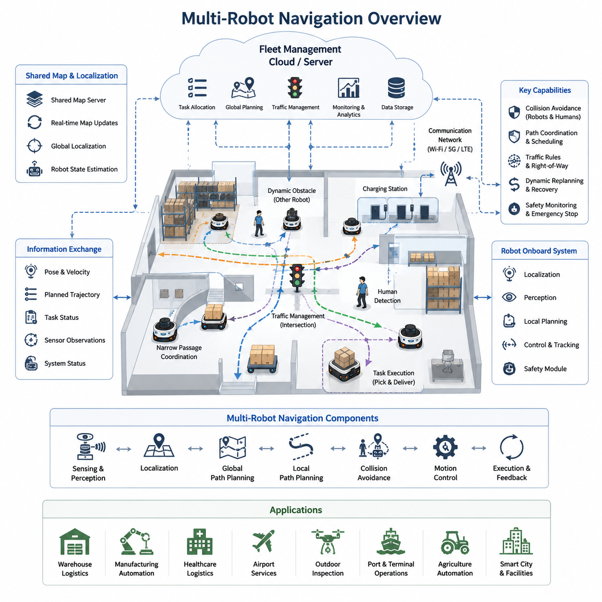
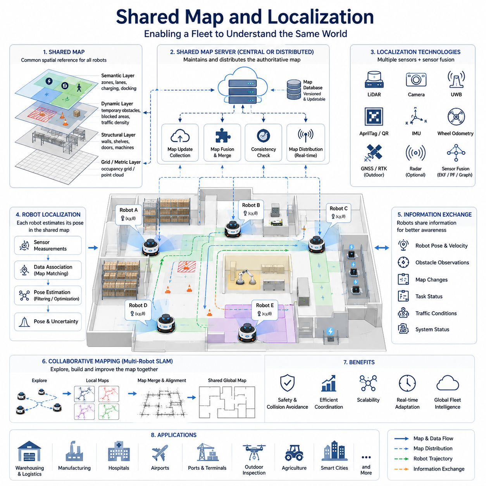
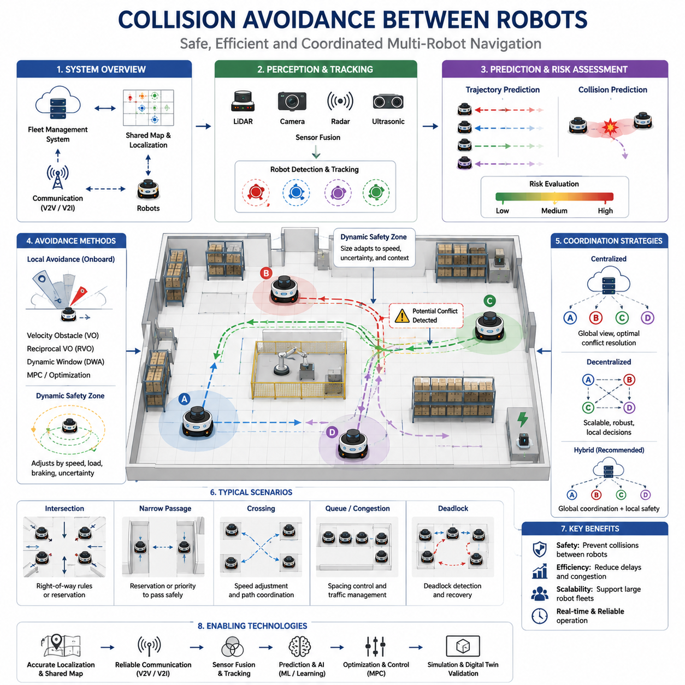
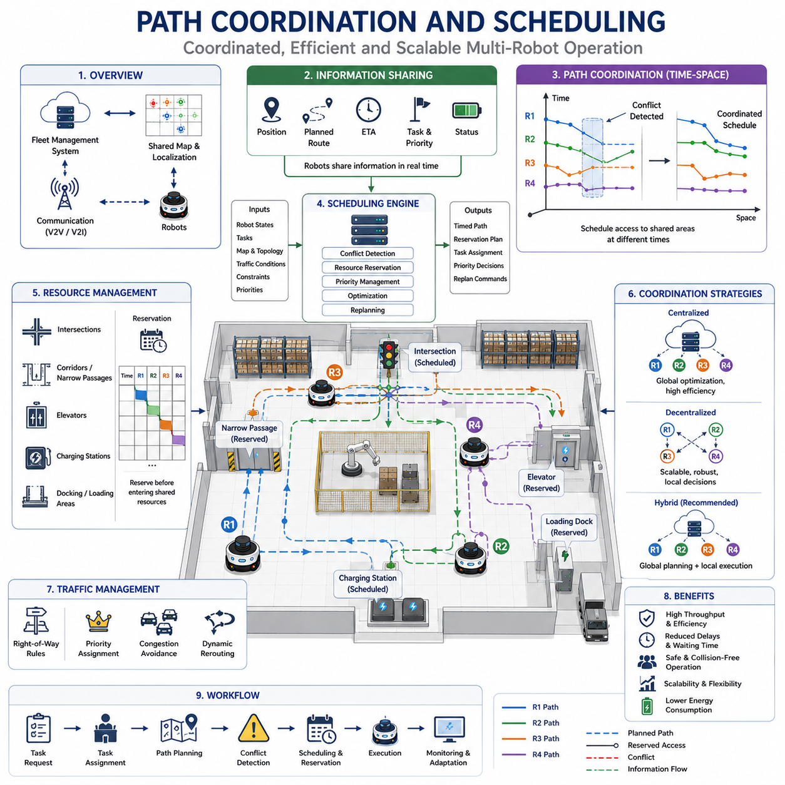
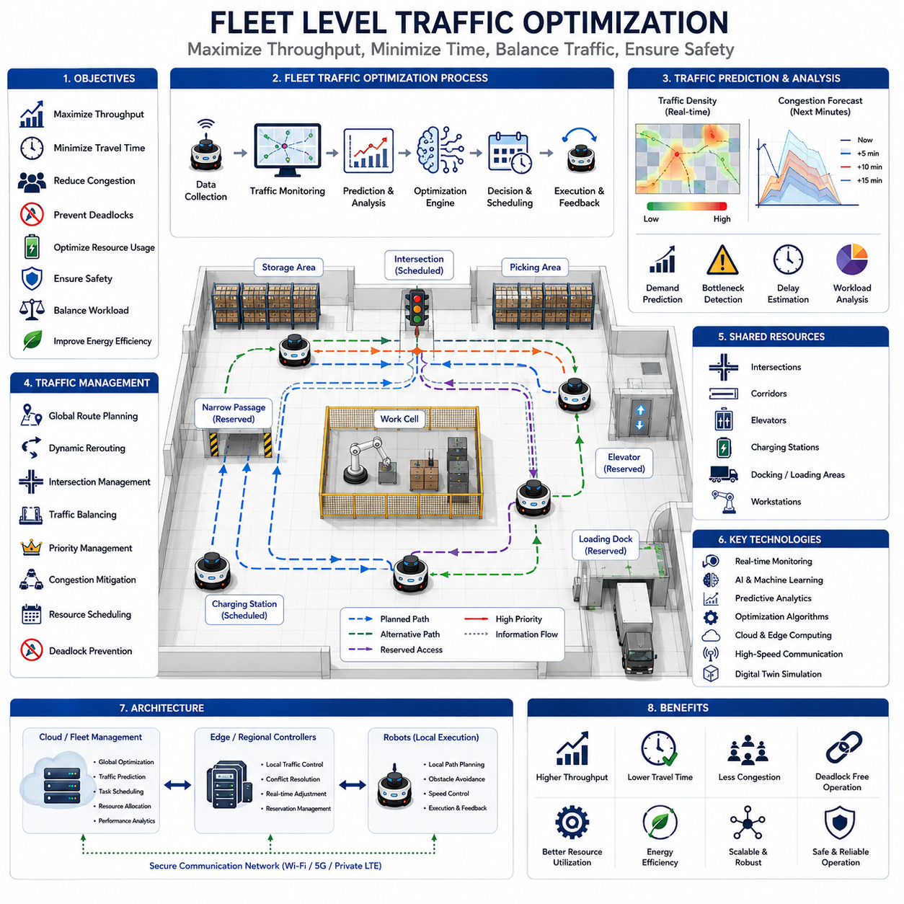
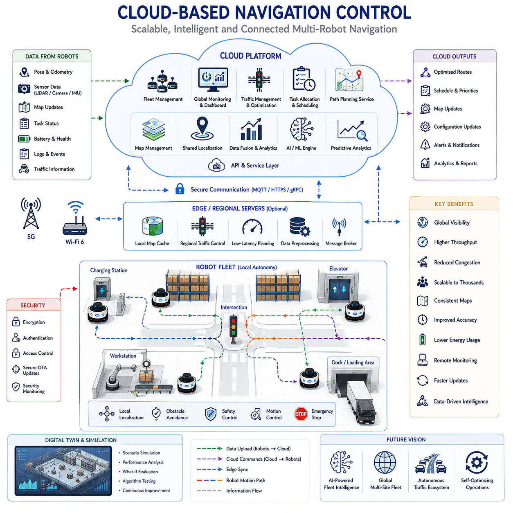
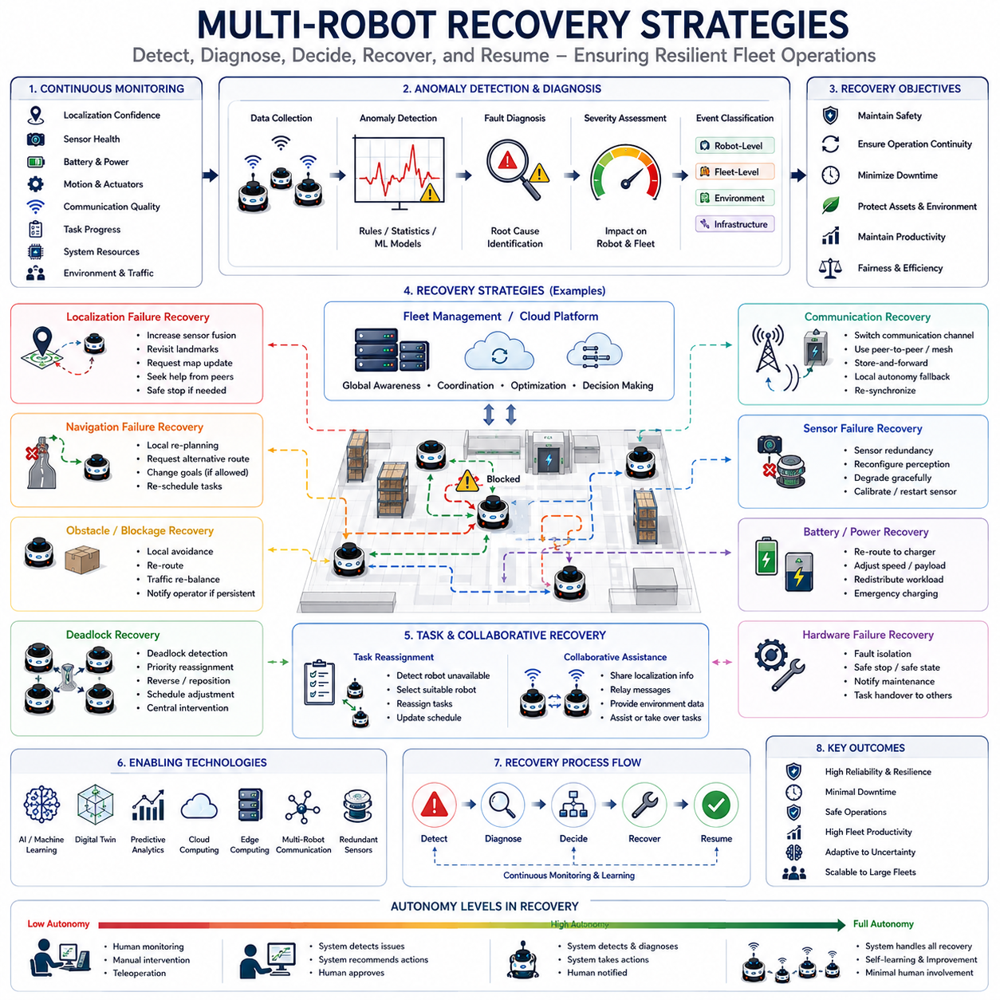
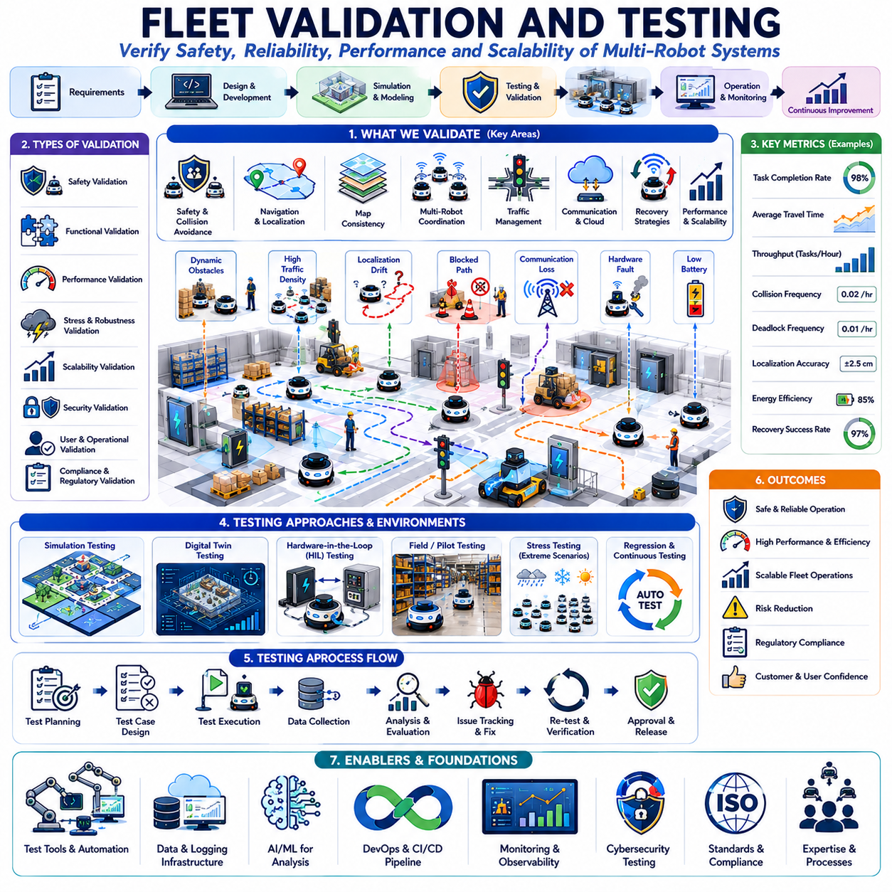

**Volume 05. Path Planning and Autonomous Navigation**


# Chapter 10. Multi-Robot Navigation

##  

## 10.1 Multi-Robot Navigation Overview

{width="7.268055555555556in" height="7.268055555555556in"}

Multi-robot navigation represents one of the most important advancements in modern autonomous mobile robot systems. While traditional navigation algorithms focus on enabling a single robot to move safely and efficiently through an environment, multi-robot navigation extends these concepts to support coordinated operation among many robots sharing the same physical space. As industries increasingly deploy fleets of autonomous mobile robots in warehouses, factories, hospitals, airports, logistics centers, ports, smart cities, and outdoor industrial facilities, the ability for multiple robots to navigate cooperatively has become a fundamental requirement for scalable automation systems. The topic serves as the foundation for shared localization, collaborative planning, traffic management, fleet optimization, and large-scale autonomous operations.

The primary objective of multi-robot navigation is to allow multiple autonomous robots to perform tasks simultaneously while minimizing conflicts, maximizing efficiency, and maintaining safe operations. Unlike single-robot systems where navigation decisions affect only one platform, multi-robot systems must continuously consider the actions, intentions, and future trajectories of other robots operating within the environment. Every robot becomes both a navigation participant and a dynamic obstacle that influences the behavior of the entire fleet. This creates a highly interconnected navigation problem that requires advanced coordination mechanisms and intelligent decision-making strategies.

Modern autonomous robot deployments often involve dozens, hundreds, or even thousands of robots operating simultaneously. Large warehouse automation systems may employ hundreds of mobile robots transporting inventory between storage locations and picking stations. Hospital logistics robots may deliver medication, meals, linens, laboratory samples, and medical supplies throughout multiple floors of a healthcare facility. Manufacturing plants may utilize fleets of material-handling robots moving components between production cells. Outdoor autonomous platforms may coordinate inspection, surveillance, mapping, maintenance, and transportation activities across large industrial facilities. In all these scenarios, multi-robot navigation provides the operational framework necessary to ensure that robots work together efficiently rather than competing for the same resources.

One of the key advantages of multi-robot systems is scalability. Instead of relying on a single robot to perform all tasks, organizations can increase productivity simply by adding more robots to the fleet. However, scalability introduces significant navigation challenges. As the number of robots increases, the likelihood of congestion, path conflicts, deadlocks, communication bottlenecks, and inefficient resource utilization also increases. Multi-robot navigation architectures must therefore be designed to maintain system performance as fleet size grows. Effective scalability requires efficient communication protocols, distributed decision-making mechanisms, optimized traffic management systems, and robust fleet coordination algorithms.

A multi-robot navigation system typically consists of several major components. These include robot localization systems, map management systems, path planning modules, collision avoidance systems, communication networks, traffic management controllers, task allocation engines, and fleet management software. Together, these components create a comprehensive ecosystem that allows robots to share information and coordinate their actions. Each robot maintains its own local perception and navigation capabilities while simultaneously participating in a larger fleet-level coordination framework.

Localization plays a critical role in multi-robot navigation. Every robot must know its position accurately while also understanding the locations of other robots operating within the environment. Shared localization systems often rely on common maps, synchronized coordinate frames, and centralized or distributed localization services. Indoor systems may utilize LiDAR-based SLAM, visual SLAM, QR code markers, UWB infrastructure, or hybrid localization techniques. Outdoor systems may combine GNSS RTK, inertial navigation, LiDAR localization, visual localization, and HD maps. Accurate localization ensures that robots can predict potential interactions and coordinate movement safely.

Shared maps are another essential component of multi-robot navigation. Instead of each robot maintaining an independent representation of the environment, fleet systems often utilize centralized map servers or distributed map-sharing architectures. These shared maps allow robots to operate within a common understanding of the environment. Dynamic updates such as newly detected obstacles, blocked corridors, temporary construction zones, or environmental changes can be distributed throughout the fleet, enabling all robots to react appropriately. Shared mapping improves consistency, reduces navigation errors, and enhances fleet-level situational awareness.

Communication infrastructure forms the backbone of coordinated navigation. Robots continuously exchange information related to position, velocity, planned trajectories, task assignments, environmental observations, system status, and operational constraints. Communication may occur through Wi-Fi, private LTE networks, 5G infrastructure, industrial wireless systems, mesh networks, or cloud-based communication services. Reliable communication is essential for maintaining fleet coordination and preventing navigation conflicts. However, communication failures must also be anticipated, requiring robust fallback strategies and autonomous local decision-making capabilities.

Path planning in multi-robot systems differs significantly from traditional single-robot planning. Instead of generating a path solely based on static obstacles and environmental constraints, planners must also account for the future movements of other robots. Time becomes an important dimension of the planning problem. Two robots may safely occupy the same physical location if they arrive at different times, while collisions may occur if they arrive simultaneously. Consequently, many multi-robot planning systems utilize space-time planning approaches that incorporate both spatial and temporal constraints.

Collision avoidance between robots represents one of the most visible aspects of multi-robot navigation. Robots must detect potential conflicts before they occur and adjust their behavior accordingly. Collision avoidance mechanisms may include local obstacle avoidance algorithms, trajectory prediction models, velocity coordination methods, reservation systems, and traffic control policies. Modern systems often combine reactive collision avoidance with predictive planning to achieve both safety and efficiency. Robots continuously evaluate the trajectories of neighboring robots and adjust their motion plans to prevent conflicts while maintaining progress toward their assigned goals.

Traffic management becomes increasingly important as fleet size grows. Similar to urban transportation systems, robot fleets require mechanisms to regulate movement through shared infrastructure such as corridors, intersections, doorways, elevators, loading stations, and charging areas. Traffic management systems may implement right-of-way rules, virtual traffic lights, reservation-based navigation, one-way traffic corridors, congestion control strategies, and dynamic rerouting mechanisms. Effective traffic management reduces delays, improves throughput, and minimizes energy consumption across the fleet.

Task allocation and navigation are closely interconnected in multi-robot systems. Assigning tasks without considering navigation constraints may lead to inefficient fleet behavior. Modern fleet management systems therefore integrate task planning with navigation optimization. Robots are assigned tasks based not only on availability but also on location, predicted travel time, battery status, traffic conditions, workload distribution, and operational priorities. This integrated approach maximizes fleet productivity while minimizing unnecessary movement and congestion.

Centralized and decentralized architectures represent two fundamental approaches to multi-robot navigation. In centralized systems, a fleet management server maintains a global view of all robots and coordinates navigation decisions. Centralized architectures provide strong optimization capabilities and simplified coordination but may introduce scalability limitations and single points of failure. In decentralized systems, robots make decisions locally while sharing information with neighboring robots. Decentralized approaches improve robustness and scalability but may face challenges in achieving globally optimal behavior. Many industrial systems employ hybrid architectures that combine centralized fleet-level planning with decentralized local navigation.

Cloud robotics has emerged as a significant enabler of large-scale multi-robot navigation. Cloud platforms provide computational resources for fleet optimization, global planning, traffic management, data analytics, and machine learning. Robots can offload computationally intensive tasks to cloud infrastructure while maintaining local autonomy for safety-critical operations. Cloud-based navigation architectures enable real-time coordination across geographically distributed fleets and facilitate continuous system improvement through centralized data collection and analysis.

Multi-robot navigation systems must also address operational uncertainties. Dynamic obstacles, human workers, environmental changes, sensor failures, communication disruptions, localization errors, and unexpected robot behaviors can all affect navigation performance. Robust systems incorporate fault detection mechanisms, recovery procedures, redundancy strategies, and adaptive planning algorithms. When navigation failures occur, robots must be capable of safely recovering while minimizing disruption to overall fleet operations.

Safety remains the highest priority in multi-robot environments. Industrial deployments often operate in close proximity to people, equipment, and valuable assets. Safety systems must ensure collision-free operation under both normal and abnormal conditions. Safety mechanisms may include protective zones, speed restrictions, emergency stop protocols, predictive collision detection, human-aware navigation behaviors, and compliance with international safety standards. Fleet-level safety monitoring provides additional protection by detecting system-wide risks and coordinating appropriate responses.

Simulation and digital twin technologies play a crucial role in the development of multi-robot navigation systems. Before deploying robots in real environments, engineers can evaluate fleet behaviors in virtual simulations. Large-scale simulations enable testing of traffic management algorithms, collision avoidance strategies, communication architectures, task allocation policies, and recovery mechanisms. Digital twins further allow real-world fleet operations to be monitored, analyzed, and optimized using virtual representations of physical systems.

Industrial applications demonstrate the practical value of multi-robot navigation. Warehouse automation systems coordinate large fleets to transport inventory efficiently. Hospital logistics systems enable autonomous delivery throughout healthcare facilities. Manufacturing robots support just-in-time material movement across production lines. Airport robots assist with baggage handling and service operations. Outdoor inspection robots coordinate infrastructure monitoring activities across large industrial sites. Agricultural robots collaborate to perform planting, spraying, monitoring, and harvesting operations. Each application introduces unique navigation challenges that drive ongoing innovation in fleet coordination technologies.

Recent advances in artificial intelligence are transforming multi-robot navigation. Machine learning models can predict traffic patterns, optimize task assignments, improve path planning, and enhance collision avoidance. Multi-agent reinforcement learning enables robots to learn cooperative behaviors through experience. Foundation models, world models, and embodied AI systems are beginning to influence how robot fleets perceive, reason about, and interact with complex environments. These technologies promise to make future fleets more adaptive, efficient, and autonomous.

The future of multi-robot navigation will likely involve increasingly intelligent and interconnected robotic ecosystems. Large fleets operating across factories, hospitals, logistics hubs, ports, smart cities, and outdoor industrial environments will share maps, exchange knowledge, coordinate decisions, and adapt collectively to changing conditions. Advances in cloud robotics, edge computing, artificial intelligence, digital twins, 5G communications, and autonomous fleet management will continue to expand the capabilities of multi-robot systems. As robotic deployments grow in scale and complexity, multi-robot navigation will remain one of the foundational technologies enabling safe, efficient, and scalable autonomous operations across virtually every sector of industry.

멀티 로봇 내비게이션(Multi-Robot Navigation)은 현대 자율이동로봇(AMR) 시스템에서 가장 중요한 기술 발전 중 하나이다. 전통적인 내비게이션 알고리즘이 단일 로봇이 환경 내에서 안전하고 효율적으로 이동하는 것에 초점을 맞추었다면, 멀티 로봇 내비게이션은 동일한 공간을 공유하는 여러 대의 로봇이 협력적으로 운용될 수 있도록 확장된 개념이다. 오늘날 창고, 공장, 병원, 공항, 물류센터, 항만, 스마트시티, 대규모 산업 현장 등에서 수십 대에서 수천 대에 이르는 로봇이 동시에 운용되면서, 로봇 간 협력 내비게이션은 대규모 자동화 시스템의 핵심 요소가 되었다. 이러한 기술은 공유 위치추정, 협업 경로계획, 교통 관리, 플릿 최적화 및 대규모 자율 운영의 기반을 형성한다.

멀티 로봇 내비게이션의 주요 목표는 여러 대의 자율 로봇이 동시에 작업을 수행하면서도 충돌을 최소화하고, 운영 효율성을 극대화하며, 안전성을 유지하는 것이다. 단일 로봇 시스템에서는 한 로봇의 이동 결정이 해당 로봇에만 영향을 미치지만, 멀티 로봇 시스템에서는 각 로봇이 다른 로봇들의 위치, 행동, 의도 및 미래 경로를 지속적으로 고려해야 한다. 모든 로봇은 단순한 작업 수행 주체일 뿐만 아니라 다른 로봇에게 영향을 주는 동적 장애물이 된다. 따라서 멀티 로봇 내비게이션은 상호 연결된 복잡한 문제로 발전하며, 이를 해결하기 위해서는 고도화된 협력 메커니즘과 지능형 의사결정 전략이 필요하다.

현대 산업 현장에서는 수십 대, 수백 대, 심지어 수천 대의 로봇이 동시에 운영되는 사례가 증가하고 있다. 대규모 물류창고에서는 재고 운반과 피킹 작업을 수행하기 위해 수백 대의 AMR이 동시에 이동한다. 병원에서는 의약품, 식사, 세탁물, 검사 샘플, 의료 소모품을 운반하는 물류 로봇이 여러 층을 오가며 운행한다. 제조 공장에서는 부품을 생산 라인 사이로 이동시키는 자재 운반 로봇이 운영된다. 야외 산업 현장에서는 점검, 순찰, 매핑, 유지보수, 운송 작업을 수행하는 자율 로봇들이 함께 협력한다. 이러한 모든 환경에서 멀티 로봇 내비게이션은 로봇들이 서로 경쟁하지 않고 효율적으로 협력하도록 만드는 운영 프레임워크 역할을 수행한다.

멀티 로봇 시스템의 가장 큰 장점 중 하나는 확장성이다. 단일 로봇에 의존하는 대신 필요에 따라 로봇 수를 증가시켜 생산성을 높일 수 있다. 그러나 로봇 수가 증가할수록 혼잡, 경로 충돌, 교착 상태, 통신 병목 현상, 자원 낭비와 같은 문제가 발생할 가능성도 커진다. 따라서 멀티 로봇 내비게이션 아키텍처는 플릿 규모가 증가해도 성능을 유지할 수 있도록 설계되어야 한다. 이를 위해 효율적인 통신 프로토콜, 분산 의사결정 메커니즘, 최적화된 교통 관리 시스템, 강건한 플릿 협조 알고리즘이 필요하다.

일반적인 멀티 로봇 내비게이션 시스템은 위치추정 시스템, 지도 관리 시스템, 경로계획 모듈, 충돌 회피 시스템, 통신 네트워크, 교통 관리 컨트롤러, 작업 할당 엔진, 플릿 관리 소프트웨어로 구성된다. 이러한 구성 요소들은 로봇들이 정보를 공유하고 행동을 조정할 수 있도록 지원한다. 각 로봇은 자체적인 인지 및 내비게이션 기능을 유지하면서 동시에 플릿 차원의 협력 프레임워크에 참여한다.

위치추정(Localization)은 멀티 로봇 내비게이션의 핵심 요소이다. 각 로봇은 자신의 위치를 정확하게 파악해야 할 뿐 아니라 다른 로봇들의 위치도 이해해야 한다. 공유 위치추정 시스템은 공통 지도, 동기화된 좌표계, 중앙 집중형 또는 분산형 위치 서비스에 기반한다. 실내 환경에서는 LiDAR SLAM, Visual SLAM, QR 마커, UWB 및 다양한 하이브리드 방식이 활용된다. 실외 환경에서는 GNSS RTK, 관성항법, LiDAR 기반 위치추정, 비전 기반 위치추정, HD Map 등이 함께 사용된다. 정확한 위치추정은 로봇 간 상호작용을 예측하고 안전한 협력을 가능하게 한다.

공유 지도(Shared Map) 역시 매우 중요한 구성 요소이다. 각 로봇이 개별 지도를 유지하는 대신 중앙 지도 서버 또는 분산 지도 공유 아키텍처를 통해 동일한 환경 정보를 사용한다. 이러한 공유 지도에는 새로운 장애물, 통행 금지 구역, 공사 구간, 환경 변화 등이 실시간으로 반영될 수 있으며, 모든 로봇은 이를 즉시 활용할 수 있다. 결과적으로 지도 일관성이 향상되고 내비게이션 오류가 감소하며 플릿 전체의 상황 인식 능력이 향상된다.

통신 인프라는 멀티 로봇 협력의 핵심 기반이다. 로봇들은 위치, 속도, 계획 경로, 작업 상태, 환경 정보, 시스템 상태 등을 지속적으로 교환한다. 이러한 통신은 Wi-Fi, 전용 LTE, 5G, 산업용 무선 네트워크, 메시 네트워크, 클라우드 기반 통신 등을 통해 이루어진다. 안정적인 통신은 플릿 협조를 유지하는 데 필수적이지만, 통신 장애 상황에서도 로봇이 안전하게 동작할 수 있도록 자율적인 로컬 의사결정 기능이 반드시 포함되어야 한다.

멀티 로봇 경로계획은 단일 로봇 경로계획과 근본적으로 다르다. 단순히 정적 장애물만 고려하는 것이 아니라 다른 로봇들의 미래 움직임까지 예측해야 한다. 따라서 시간(Time)이 경로계획의 중요한 요소가 된다. 두 로봇이 동일한 위치를 통과하더라도 통과 시간이 다르면 문제가 없지만, 같은 시점에 도착하면 충돌이 발생할 수 있다. 이러한 이유로 많은 멀티 로봇 시스템은 공간과 시간을 동시에 고려하는 시공간(Space-Time) 기반 경로계획 기법을 사용한다.

로봇 간 충돌 회피는 멀티 로봇 내비게이션에서 가장 중요한 기능 중 하나이다. 로봇은 잠재적인 충돌을 사전에 예측하고 행동을 조정해야 한다. 이를 위해 로컬 장애물 회피 알고리즘, 경로 예측 모델, 속도 조정 기법, 예약 기반 이동 시스템, 교통 제어 정책 등이 활용된다. 최신 시스템은 반응형 충돌 회피와 예측 기반 계획을 결합하여 안전성과 효율성을 동시에 확보한다.

플릿 규모가 증가할수록 교통 관리(Traffic Management)의 중요성도 증가한다. 이는 도시 교통 시스템과 유사한 개념으로 이해할 수 있다. 복도, 교차로, 출입문, 엘리베이터, 충전 스테이션과 같은 공유 자원을 효율적으로 사용하기 위해 우선순위 규칙, 가상 신호등, 예약 기반 통행, 일방통행 구간, 혼잡 제어 및 동적 우회 경로 전략이 활용된다. 적절한 교통 관리는 대기 시간을 줄이고 전체 처리량을 향상시키며 에너지 소비를 감소시킨다.

작업 할당(Task Allocation)과 내비게이션은 매우 밀접하게 연결되어 있다. 단순히 사용 가능한 로봇에 작업을 배정하는 것은 비효율적일 수 있다. 최신 플릿 관리 시스템은 위치, 이동 시간, 배터리 상태, 교통 상황, 작업 부하 및 우선순위를 종합적으로 고려하여 작업을 배정한다. 이를 통해 전체 플릿 생산성을 극대화할 수 있다.

멀티 로봇 내비게이션 아키텍처는 크게 중앙집중형(Centralized)과 분산형(Decentralized)으로 구분된다. 중앙집중형 시스템에서는 플릿 관리 서버가 모든 로봇의 상태를 관리하며 최적의 내비게이션 결정을 내린다. 이러한 방식은 전체 최적화에 유리하지만 확장성과 단일 장애점(Single Point of Failure)의 문제가 있다. 반면 분산형 시스템에서는 각 로봇이 독립적으로 의사결정을 수행하면서 주변 로봇과 정보를 교환한다. 이 방식은 확장성과 강건성이 높지만 전역 최적화를 달성하기 어렵다. 실제 산업 현장에서는 두 방식을 결합한 하이브리드 구조가 가장 많이 사용된다.

클라우드 로보틱스는 대규모 멀티 로봇 내비게이션의 중요한 기술로 자리 잡고 있다. 클라우드는 플릿 최적화, 전역 경로계획, 교통 관리, 데이터 분석, AI 학습과 같은 계산 집약적 작업을 수행한다. 반면 로봇은 안전과 실시간성이 요구되는 기능을 로컬에서 처리한다. 이러한 클라우드-엣지 협업 구조는 대규모 플릿 운영을 가능하게 한다.

멀티 로봇 시스템은 다양한 불확실성에도 대응해야 한다. 동적 장애물, 작업자 이동, 환경 변화, 센서 오류, 통신 장애, 위치추정 오차, 예기치 않은 로봇 동작 등이 발생할 수 있다. 따라서 시스템은 오류 감지, 장애 복구, 중복 설계, 적응형 재계획 기능을 포함해야 한다. 문제가 발생하더라도 플릿 전체 운영에 미치는 영향을 최소화하면서 안전하게 복구할 수 있어야 한다.

안전성은 멀티 로봇 환경에서 가장 중요한 요소이다. 산업 현장의 로봇은 사람, 장비, 고가의 자산과 매우 가까운 거리에서 동작한다. 따라서 충돌 방지, 속도 제한, 보호 구역 설정, 비상 정지, 인간 인식 내비게이션, 국제 안전 규격 준수 등이 필수적이다. 또한 플릿 차원의 안전 모니터링 시스템을 통해 전체 시스템 위험을 지속적으로 감시해야 한다.

시뮬레이션과 디지털 트윈은 멀티 로봇 내비게이션 개발 과정에서 중요한 역할을 수행한다. 실제 배포 이전에 수백 대 규모의 가상 플릿을 시뮬레이션하여 교통 관리 알고리즘, 충돌 회피 전략, 통신 구조, 작업 할당 정책을 검증할 수 있다. 디지털 트윈은 실제 운영 환경을 가상 환경에 반영하여 지속적인 성능 분석과 최적화를 가능하게 한다.

산업 현장에서는 멀티 로봇 내비게이션이 이미 다양한 분야에서 활용되고 있다. 물류창고에서는 재고 운반을 자동화하고, 병원에서는 의료 물류를 지원하며, 제조 공장에서는 생산 자재 이동을 수행한다. 공항에서는 수하물 운송과 서비스 로봇이 활용되고 있으며, 야외 산업 현장에서는 점검 및 순찰 로봇들이 협력적으로 운영된다. 농업 분야에서는 파종, 방제, 수확 작업을 수행하는 로봇들이 협업하는 사례도 증가하고 있다.

최근 인공지능 기술의 발전은 멀티 로봇 내비게이션에도 큰 영향을 주고 있다. 머신러닝은 교통 패턴 예측, 작업 할당 최적화, 경로계획 향상, 충돌 회피 개선에 활용되고 있다. 다중 에이전트 강화학습(Multi-Agent Reinforcement Learning)은 로봇들이 협력 행동을 스스로 학습할 수 있도록 지원한다. 또한 Foundation Model, World Model, Embodied AI와 같은 최신 AI 기술은 로봇 플릿이 환경을 이해하고 추론하며 협력하는 방식을 변화시키고 있다.

미래의 멀티 로봇 내비게이션은 더욱 지능적이고 상호 연결된 로봇 생태계로 발전할 것이다. 공장, 병원, 물류센터, 항만, 스마트시티, 대규모 산업 현장에서 운영되는 로봇들은 지도와 지식을 공유하고 협력적으로 의사결정을 수행하게 될 것이다. 클라우드 로보틱스, 엣지 컴퓨팅, AI, 디지털 트윈, 5G 통신, 자율 플릿 관리 기술의 발전은 멀티 로봇 시스템의 능력을 지속적으로 확장할 것이다. 로봇 배치 규모와 복잡성이 증가함에 따라 멀티 로봇 내비게이션은 안전하고 효율적이며 확장 가능한 자율 운영을 가능하게 하는 핵심 기술로 자리매김할 것이다.

##  

## 10.2 Shared Map and Localization

{width="7.268055555555556in" height="7.268055555555556in"}

Shared Map and Localization is one of the most critical technologies in multi-robot navigation systems because it provides a common spatial understanding that allows multiple autonomous robots to operate as a coordinated fleet rather than as independent machines. In a single-robot navigation system, localization focuses on estimating the position and orientation of one robot within a known or unknown environment. In contrast, multi-robot systems require every robot to understand not only its own location but also the positions of all other robots operating in the shared workspace. This collective understanding forms the foundation for collision avoidance, path coordination, traffic management, fleet optimization, collaborative task execution, and large-scale autonomous operations. Within modern industrial environments, the ability to maintain a consistent shared map and a common localization framework directly influences operational efficiency, safety, scalability, and overall system reliability.

The concept of a shared map begins with the creation of a unified representation of the environment. Instead of maintaining separate maps for individual robots, a fleet of robots utilizes a common map database that can be accessed, updated, and distributed throughout the system. This shared representation serves as the spatial reference used by all navigation components. Every robot interprets its surroundings according to the same coordinate system, map structure, and environmental model. As a result, fleet-wide navigation decisions become significantly more consistent and predictable. Robots can exchange information about obstacles, routes, restricted zones, charging stations, loading docks, work cells, intersections, and traffic conditions without ambiguity because all information is referenced within the same spatial framework.

In industrial AMR deployments, shared maps often contain multiple layers of information. The foundational layer typically consists of geometric information such as walls, corridors, doors, workstations, racks, storage locations, machinery, and structural features. Above this geometric layer, semantic information may be incorporated to provide contextual understanding. Areas may be labeled as production zones, warehouse aisles, hospital wards, loading bays, inspection sectors, maintenance regions, or pedestrian walkways. Dynamic information layers can further include temporary obstacles, construction zones, blocked passages, traffic density information, and operational constraints. By integrating these various layers into a shared map architecture, robots gain a richer understanding of the environment and can make more intelligent navigation decisions.

Localization refers to the process through which a robot estimates its current position and orientation within the shared map. In multi-robot systems, localization accuracy becomes even more important because errors propagate beyond individual robots and affect fleet-level coordination. If one robot experiences significant localization drift, its planned trajectory may conflict with the trajectories of neighboring robots. Therefore, robust localization mechanisms are essential for maintaining operational safety and efficiency.

A shared localization framework allows all robots to operate within a common coordinate reference system. This common reference frame enables robots to exchange positional information directly without requiring coordinate transformations or additional alignment procedures. Whether the system uses a global coordinate frame, facility-level reference frame, building map frame, or geospatial coordinate system, consistency across the fleet is essential. Every robot must interpret positional data identically to ensure proper coordination.

Several localization technologies are commonly employed within shared localization architectures. In indoor environments, LiDAR-based localization is widely used because of its robustness and high accuracy. Robots compare live LiDAR scans against the shared map and estimate their pose by matching observed features with known environmental structures. Visual localization techniques use cameras and visual landmarks to estimate robot positions relative to the map. QR codes, AprilTags, fiducial markers, and artificial landmarks may also be deployed to improve localization reliability in challenging environments. Ultra-Wideband systems provide infrastructure-assisted localization through anchor-based ranging measurements. Wheel odometry and inertial measurement units contribute additional motion information that supports continuous pose estimation between external observations.

Outdoor shared localization systems introduce additional complexity due to larger operational areas and changing environmental conditions. GNSS and RTK technologies provide global positioning information, while LiDAR localization and visual localization offer local refinement. High-definition maps often serve as reference models for precise localization. Sensor fusion techniques combine GNSS, IMU, wheel odometry, LiDAR, cameras, radar, and other sensing modalities to achieve robust localization under varying weather, lighting, and terrain conditions.

Multi-robot systems frequently employ simultaneous localization and mapping technologies to support shared map generation. During deployment in previously unknown environments, multiple robots may collaborate to construct a common map while simultaneously localizing themselves within that map. This process is known as collaborative SLAM or multi-robot SLAM. Each robot contributes observations collected from its local environment. These observations are integrated into a shared map that grows and improves as additional information becomes available. Collaborative mapping accelerates map generation, improves coverage, increases redundancy, and reduces overall deployment time.

Map merging represents a fundamental challenge in collaborative mapping systems. When multiple robots independently explore different regions of an environment, their local maps must eventually be aligned and combined into a unified representation. This process requires identifying common features, establishing coordinate correspondences, and estimating transformation relationships between map segments. Successful map merging allows information collected by one robot to become immediately useful to all other robots within the fleet.

Modern shared map architectures often utilize centralized map servers. A map server maintains the authoritative version of the environment and distributes updates to all connected robots. Robots periodically upload observations, localization estimates, environmental changes, and mapping updates to the server. The server integrates this information and redistributes updated map data throughout the fleet. Centralized architectures simplify synchronization and consistency management while providing a global view of the environment.

Distributed mapping architectures represent an alternative approach. Instead of relying on a single map server, robots exchange mapping information directly with one another. Distributed architectures improve robustness by eliminating single points of failure and may reduce communication bottlenecks in large-scale deployments. However, maintaining consistency across distributed maps introduces additional complexity and requires sophisticated synchronization mechanisms.

Real-time map updating is particularly important in dynamic environments. Warehouses, factories, hospitals, and outdoor facilities continuously change as equipment moves, inventory shifts, temporary barriers are installed, and operational conditions evolve. Shared maps must therefore support dynamic updates that reflect the current state of the environment. Robots that detect new obstacles or environmental changes can publish updates to the fleet, allowing all robots to adapt their navigation plans accordingly.

The integration of localization and mapping creates a feedback loop that improves both capabilities. Accurate localization enables robots to contribute high-quality observations to the shared map. Improved maps subsequently enhance localization performance by providing more reliable reference information. This mutually reinforcing relationship is one of the key reasons why shared map and localization architectures are so effective in multi-robot systems.

Time synchronization plays a crucial role in shared localization frameworks. Robots continuously generate observations from sensors operating at different frequencies. Accurate timestamps are required to align sensor data, coordinate robot positions, merge observations, and maintain consistency across the fleet. Network Time Protocol, Precision Time Protocol, GPS time synchronization, and hardware synchronization methods are commonly employed to ensure temporal consistency.

Communication infrastructure strongly influences shared localization performance. Position updates, map modifications, sensor observations, and fleet coordination messages must be exchanged reliably and efficiently. Industrial deployments typically utilize Wi-Fi, private LTE networks, 5G communication systems, mesh networks, or dedicated industrial communication infrastructures. Network latency, bandwidth limitations, packet loss, and communication interruptions must all be considered when designing shared localization architectures.

Cloud robotics is increasingly being integrated into shared mapping systems. Cloud platforms provide centralized storage, large-scale computation, long-term map maintenance, and fleet-wide optimization capabilities. Robots can offload computationally intensive mapping tasks to cloud servers while maintaining local localization functionality for safety-critical operations. Cloud-based map services enable large fleets to share information across multiple facilities, geographical regions, and operational environments.

Localization uncertainty management is an essential aspect of fleet navigation. Every localization estimate contains some degree of uncertainty due to sensor noise, environmental ambiguity, and modeling errors. Shared localization systems often represent uncertainty explicitly using covariance matrices, probability distributions, particle representations, or confidence scores. Fleet coordination algorithms can then incorporate localization uncertainty into decision-making processes, reducing the likelihood of navigation conflicts caused by inaccurate position estimates.

Shared maps also support higher-level fleet intelligence. Traffic management systems use map information to coordinate movement through intersections, corridors, and narrow passages. Task allocation systems use spatial information to assign work efficiently. Predictive analytics systems use localization histories to identify bottlenecks, congestion patterns, and operational inefficiencies. Digital twin platforms use shared maps as the foundation for virtual representations of real-world facilities.

Safety applications benefit significantly from shared localization frameworks. Robots can monitor the positions of neighboring robots, human workers, vehicles, and critical assets within the shared coordinate system. Potential collision risks can be identified early, allowing proactive avoidance actions. Emergency response mechanisms can leverage fleet-wide localization information to coordinate safe stopping procedures, evacuation behaviors, or system-wide operational adjustments.

Scalability is a major design consideration for shared map architectures. Small deployments may involve only a few robots operating within limited facilities. Large-scale deployments may involve hundreds or thousands of robots distributed across extensive operational environments. Shared localization systems must scale efficiently while maintaining accuracy, consistency, responsiveness, and reliability. Hierarchical map structures, regional map partitioning, cloud-edge architectures, and distributed processing frameworks are commonly employed to support scalability.

Simulation and digital twin technologies play a valuable role in the development and validation of shared map and localization systems. Engineers can evaluate mapping algorithms, localization performance, communication architectures, synchronization strategies, and fleet coordination mechanisms within virtual environments before deploying them in real facilities. Simulation accelerates development while reducing risk and deployment costs.

Future shared map and localization systems will likely become increasingly intelligent through the integration of artificial intelligence, semantic understanding, foundation models, and world models. Robots will not only share geometric maps but also semantic knowledge, operational experience, environmental predictions, and learned behaviors. Dynamic world models may continuously evolve as robots observe and interpret their surroundings. Cloud-native mapping platforms may support global fleets operating across multiple facilities while maintaining a unified understanding of spatial and operational information.

As multi-robot systems continue to expand across logistics, manufacturing, healthcare, transportation, agriculture, infrastructure inspection, smart cities, and defense applications, shared map and localization technologies will remain among the most fundamental building blocks of autonomous fleet operations. They provide the common language through which robots perceive their environment, understand their positions, coordinate their actions, and operate collectively as a unified intelligent system. Through advances in sensing, communication, cloud computing, artificial intelligence, and collaborative robotics, shared map and localization architectures will continue to evolve, enabling increasingly sophisticated, scalable, and autonomous robotic ecosystems.

공유 지도 및 위치추정(Shared Map and Localization)은 멀티 로봇 내비게이션 시스템에서 가장 중요한 기술 중 하나이다. 이 기술은 여러 대의 자율 로봇이 각각 독립적으로 동작하는 것이 아니라 하나의 협력적인 플릿(Fleet)으로 운영될 수 있도록 공통의 공간 인식 능력을 제공한다. 단일 로봇 시스템에서 위치추정은 하나의 로봇이 환경 내에서 자신의 위치와 자세를 추정하는 데 초점이 맞추어져 있다. 반면 멀티 로봇 시스템에서는 각 로봇이 자신의 위치뿐만 아니라 동일한 작업 공간에서 운용되는 다른 모든 로봇의 위치까지 이해해야 한다. 이러한 집단적 공간 인식은 충돌 회피, 경로 조정, 교통 관리, 플릿 최적화, 협업 작업 수행 및 대규모 자율 운영의 기반이 된다. 현대 산업 현장에서 공유 지도와 공통 위치추정 체계는 운영 효율성, 안전성, 확장성 및 시스템 신뢰성을 결정하는 핵심 요소로 작용한다.

공유 지도의 개념은 환경에 대한 통합된 표현을 구축하는 것에서 시작된다. 각 로봇이 별도의 지도를 유지하는 대신, 플릿 전체가 접근하고 업데이트하며 공유할 수 있는 공통 지도 데이터베이스를 사용한다. 이 공유 지도는 모든 내비게이션 구성 요소의 기준 공간 정보가 된다. 모든 로봇은 동일한 좌표계와 지도 구조를 기반으로 환경을 이해하기 때문에 플릿 전체의 의사결정이 일관되고 예측 가능해진다. 장애물, 경로, 제한 구역, 충전소, 적재 지점, 작업 셀, 교차로 및 교통 상황과 같은 정보는 동일한 공간 기준으로 표현되므로 로봇 간 정보 교환에 혼란이 발생하지 않는다.

산업용 AMR 환경에서 공유 지도는 일반적으로 여러 계층의 정보를 포함한다. 가장 기본적인 계층은 벽, 복도, 출입문, 작업 공간, 랙, 저장 위치, 기계 설비 및 구조물과 같은 기하학적 정보이다. 그 위에는 의미 정보(Semantic Information)가 추가될 수 있다. 예를 들어 특정 구역이 생산 구역인지, 창고 통로인지, 병동인지, 적재 구역인지, 보행자 통행 구역인지 등을 표시할 수 있다. 또한 동적 정보 계층에는 임시 장애물, 공사 구역, 폐쇄된 통로, 교통 밀도, 운영 제한 조건 등이 포함될 수 있다. 이러한 다층 구조의 공유 지도는 로봇이 환경을 더욱 풍부하게 이해하고 지능적인 내비게이션 결정을 내릴 수 있도록 지원한다.

위치추정(Localization)은 로봇이 공유 지도 내에서 자신의 현재 위치와 방향을 추정하는 과정이다. 멀티 로봇 시스템에서는 위치추정 오차가 개별 로봇에만 영향을 미치는 것이 아니라 플릿 전체의 협력 동작에 영향을 준다. 만약 한 로봇이 심각한 위치 오차를 가진다면 다른 로봇들과의 경로 충돌이 발생할 가능성이 높아진다. 따라서 안정적이고 정확한 위치추정은 멀티 로봇 시스템의 안전성과 효율성을 유지하는 핵심 기술이다.

공유 위치추정 프레임워크는 모든 로봇이 동일한 좌표계를 사용하도록 한다. 이러한 공통 좌표계는 로봇 간 위치 정보를 직접 교환할 수 있게 해주며 추가적인 좌표 변환 과정을 최소화한다. 글로벌 좌표계, 시설 좌표계, 건물 좌표계 또는 지리정보 기반 좌표계를 사용하더라도 모든 로봇이 동일한 기준을 사용해야 정확한 협력이 가능하다.

공유 위치추정 시스템에는 다양한 위치추정 기술이 활용된다. 실내 환경에서는 LiDAR 기반 위치추정이 높은 정확성과 강인성 때문에 널리 사용된다. 로봇은 실시간으로 획득한 LiDAR 스캔을 공유 지도와 비교하여 자신의 위치를 계산한다. 비전 기반 위치추정은 카메라와 시각적 특징점을 이용하여 위치를 추정한다. QR 코드, AprilTag, 마커 기반 시스템은 위치추정 신뢰성을 높이기 위한 보조 수단으로 활용된다. UWB(Ultra-Wideband)는 고정 앵커를 활용하여 정확한 거리 측정을 제공한다. 또한 휠 오도메트리와 IMU는 외부 센서 업데이트 사이의 연속적인 위치 추정을 지원한다.

실외 환경에서는 보다 복잡한 위치추정 문제가 발생한다. GNSS 및 RTK 기술이 전역 위치 정보를 제공하며, LiDAR 및 비전 기반 위치추정이 이를 보완한다. HD Map은 정밀 위치추정을 위한 기준 데이터로 사용된다. 실제 시스템에서는 GNSS, IMU, 오도메트리, LiDAR, 카메라, 레이더 등을 융합하여 날씨와 조명 변화에도 안정적인 위치추정을 수행한다.

멀티 로봇 시스템에서는 SLAM 기술을 활용하여 공유 지도를 생성하는 경우가 많다. 미지의 환경에서는 여러 대의 로봇이 동시에 탐색하면서 지도를 생성하고 동시에 자신의 위치를 추정한다. 이를 협업 SLAM(Collaborative SLAM) 또는 멀티 로봇 SLAM이라고 한다. 각 로봇은 자신이 수집한 관측 정보를 공유 지도에 추가하며, 다른 로봇이 수집한 정보도 활용할 수 있다. 이러한 협업 방식은 지도 생성 속도를 높이고 탐색 범위를 확대하며 시스템의 중복성과 신뢰성을 향상시킨다.

지도 병합(Map Merging)은 협업 SLAM에서 매우 중요한 기술이다. 여러 로봇이 서로 다른 지역을 탐색하여 생성한 부분 지도를 하나의 통합 지도로 결합해야 하기 때문이다. 이를 위해 공통 특징점을 찾고 좌표계를 정렬하며 지도 간 변환 관계를 계산한다. 지도 병합이 성공적으로 이루어지면 한 로봇이 수집한 정보가 즉시 플릿 전체에 활용될 수 있다.

현대의 공유 지도 시스템은 중앙 지도 서버(Map Server)를 사용하는 경우가 많다. 지도 서버는 환경 정보의 공식 버전을 유지하며, 모든 로봇에게 최신 정보를 제공한다. 각 로봇은 새로운 관측 정보, 위치 정보, 환경 변화 정보를 서버에 업로드하고, 서버는 이를 통합하여 최신 지도를 생성한 후 플릿 전체에 배포한다. 중앙집중형 구조는 지도 일관성을 유지하기 쉽고 전체 환경을 통합적으로 관리할 수 있다는 장점이 있다.

반면 분산형 지도 시스템은 특정 중앙 서버에 의존하지 않고 로봇들이 직접 정보를 교환한다. 이러한 구조는 단일 장애점 문제를 제거하고 대규모 시스템에서 확장성을 향상시킨다. 그러나 지도 동기화와 데이터 일관성을 유지하기 위해 보다 복잡한 관리 메커니즘이 필요하다.

실시간 지도 업데이트는 동적 환경에서 특히 중요하다. 창고, 공장, 병원 및 야외 산업 현장은 지속적으로 변화한다. 장비가 이동하고 재고가 변경되며 임시 장애물이 설치될 수 있다. 공유 지도 시스템은 이러한 변화를 실시간으로 반영해야 한다. 새로운 장애물을 발견한 로봇은 이를 즉시 플릿 전체에 공유하여 다른 로봇이 경로를 재계획할 수 있도록 한다.

위치추정과 지도 생성은 서로를 강화하는 관계를 가진다. 정확한 위치추정은 고품질 지도 생성을 가능하게 하며, 더욱 정교한 지도는 위치추정 정확도를 향상시킨다. 이러한 선순환 구조는 멀티 로봇 시스템의 성능을 지속적으로 향상시키는 중요한 원동력이다.

시간 동기화(Time Synchronization) 역시 공유 위치추정 시스템에서 매우 중요하다. 각 로봇은 다양한 주기로 동작하는 센서 데이터를 생성한다. 이러한 데이터를 정확하게 통합하려면 시간 정보가 일치해야 한다. 이를 위해 NTP, PTP, GPS 시간 동기화 및 하드웨어 기반 동기화 기술이 사용된다.

통신 인프라는 공유 위치추정 시스템의 성능을 크게 좌우한다. 위치 정보, 지도 업데이트, 센서 데이터 및 플릿 관리 메시지는 안정적으로 전송되어야 한다. 산업 환경에서는 Wi-Fi, Private LTE, 5G, 메시 네트워크 및 전용 산업용 네트워크가 활용된다. 설계 시에는 지연 시간, 대역폭 제한, 패킷 손실 및 통신 장애를 고려해야 한다.

최근에는 클라우드 로보틱스가 공유 지도 시스템과 결합되고 있다. 클라우드는 대규모 저장 공간과 강력한 계산 능력을 제공하며 장기 지도 관리와 플릿 최적화를 지원한다. 로봇은 실시간 위치추정은 자체적으로 수행하면서 복잡한 지도 생성과 최적화 작업은 클라우드에 위임할 수 있다. 이러한 구조는 여러 시설과 지역에 분산된 대규모 플릿 운영을 가능하게 한다.

위치추정 불확실성 관리도 중요한 요소이다. 모든 위치추정 결과에는 센서 노이즈와 환경 변화로 인한 오차가 존재한다. 따라서 시스템은 공분산 행렬, 확률 분포, 파티클 필터 또는 신뢰도 점수를 이용하여 위치추정의 불확실성을 표현한다. 플릿 제어 알고리즘은 이러한 정보를 활용하여 보다 안전하고 신뢰성 높은 의사결정을 수행한다.

공유 지도는 단순한 내비게이션 기능을 넘어 플릿 지능(Fleet Intelligence)의 기반이 된다. 교통 관리 시스템은 공유 지도를 이용하여 교차로와 복도 통행을 조정한다. 작업 할당 시스템은 위치 정보를 기반으로 가장 적합한 로봇을 선택한다. 운영 분석 시스템은 이동 이력을 분석하여 병목 현상과 비효율 구간을 발견한다. 디지털 트윈 시스템은 공유 지도를 기반으로 실제 시설의 가상 복제 환경을 구축한다.

안전 시스템 역시 공유 위치추정의 혜택을 크게 받는다. 로봇은 다른 로봇, 작업자, 차량 및 중요 자산의 위치를 실시간으로 파악할 수 있다. 잠재적인 충돌 위험을 조기에 발견하여 사전에 회피할 수 있으며, 비상 상황에서는 플릿 전체가 협력하여 안전 정지 또는 긴급 대응 절차를 수행할 수 있다.

확장성은 공유 지도 시스템 설계에서 중요한 고려 요소이다. 소규모 시스템은 몇 대의 로봇만 포함할 수 있지만, 대규모 물류센터나 스마트시티에서는 수천 대의 로봇이 동시에 운영될 수 있다. 따라서 공유 지도 시스템은 규모가 증가하더라도 정확성, 응답성, 신뢰성을 유지해야 한다. 이를 위해 계층형 지도 구조, 지역 분할 지도, 클라우드-엣지 아키텍처 및 분산 처리 기술이 활용된다.

시뮬레이션과 디지털 트윈은 공유 지도와 위치추정 시스템 개발에 매우 유용하다. 개발자는 실제 배포 이전에 가상 환경에서 지도 생성 알고리즘, 위치추정 성능, 통신 구조, 동기화 전략 및 플릿 협력 기능을 검증할 수 있다. 이는 개발 기간을 단축하고 배포 위험을 줄이는 데 기여한다.

미래의 공유 지도 및 위치추정 시스템은 인공지능, 의미 기반 이해, Foundation Model, World Model 기술과 결합되어 더욱 지능적으로 발전할 것이다. 로봇들은 단순히 기하학적 지도만 공유하는 것이 아니라 환경에 대한 의미 정보, 운영 경험, 미래 예측 정보, 학습된 행동 패턴까지 공유하게 될 것이다. 동적인 월드 모델은 로봇이 환경을 지속적으로 관찰하면서 실시간으로 진화할 수 있으며, 클라우드 기반 글로벌 지도 플랫폼은 여러 시설에 분산된 대규모 플릿을 하나의 통합된 지식 체계로 연결하게 될 것이다.

물류, 제조, 의료, 운송, 농업, 인프라 점검, 스마트시티, 국방 등 다양한 산업 분야에서 멀티 로봇 시스템이 확대됨에 따라 공유 지도와 위치추정 기술은 앞으로도 자율 플릿 운영의 가장 핵심적인 기반 기술로 자리잡을 것이다. 이 기술은 로봇들이 동일한 공간을 이해하고, 자신의 위치를 파악하며, 서로 협력하고, 하나의 지능형 시스템처럼 행동할 수 있도록 만드는 공통 언어 역할을 수행한다. AI, 센서 기술, 통신 기술, 클라우드 컴퓨팅 및 협업 로보틱스의 발전과 함께 공유 지도 및 위치추정 기술은 더욱 정교하고 확장 가능하며 지능적인 로봇 생태계를 구현하는 핵심 기술로 발전할 것이다.

##  

## 10.3 Collision Avoidance Between Robots

{width="7.268055555555556in" height="7.268055555555556in"}

Collision avoidance between robots is one of the most fundamental capabilities required for safe and efficient operation in multi-robot navigation systems. As autonomous mobile robots become increasingly common in warehouses, manufacturing plants, hospitals, airports, logistics centers, smart cities, ports, agricultural environments, and outdoor industrial facilities, the ability for multiple robots to share the same workspace without colliding becomes essential. Unlike single-robot navigation, where obstacles primarily consist of static structures and occasional moving objects, multi-robot systems introduce a unique challenge because every robot simultaneously acts as both an autonomous decision maker and a dynamic obstacle. Each robot continuously moves, changes direction, modifies speed, executes tasks, and adapts to environmental conditions. Consequently, collision avoidance between robots requires sophisticated perception, prediction, communication, planning, and control mechanisms that operate in real time while maintaining fleet-wide efficiency and safety.

The primary objective of robot-to-robot collision avoidance is to prevent physical contact between autonomous platforms while minimizing disruptions to operational productivity. A well-designed collision avoidance system must not only prevent accidents but also ensure that robots continue to accomplish their assigned tasks efficiently. Excessively conservative avoidance behaviors may reduce collisions but can significantly decrease throughput, create congestion, and increase travel times. Conversely, aggressive navigation strategies may improve efficiency while increasing operational risks. Therefore, successful collision avoidance requires a careful balance between safety and performance.

In a multi-robot environment, every robot continuously observes its surroundings and maintains awareness of neighboring robots. This awareness may be achieved through onboard sensors, communication networks, shared localization systems, fleet management platforms, or combinations of these technologies. Each robot must estimate not only the current positions of nearby robots but also predict their future movements. Collision avoidance therefore becomes a predictive problem rather than a purely reactive one. Robots must anticipate potential conflicts before they occur and take corrective actions early enough to avoid dangerous situations.

One of the most important concepts in multi-robot collision avoidance is shared situational awareness. When robots operate within a common map and localization framework, each robot can access accurate information regarding the positions, velocities, trajectories, and intentions of other robots. Shared situational awareness significantly improves collision avoidance performance because robots no longer rely solely on local sensing. Instead, they can utilize fleet-wide information to predict interactions and coordinate movements proactively. This capability becomes particularly valuable in environments containing blind corners, narrow corridors, intersections, elevators, loading stations, and other locations where direct line-of-sight sensing may be limited.

Collision avoidance begins with accurate robot detection and tracking. Robots must continuously identify neighboring robots operating within their vicinity. Detection may be performed using LiDAR sensors, cameras, depth sensors, radar systems, ultrasonic sensors, or combinations of multiple sensing modalities. Sensor fusion techniques combine observations from various sensors to improve detection reliability and reduce false positives or missed detections. Robust robot tracking systems maintain estimates of neighboring robot positions, velocities, accelerations, orientations, and motion histories. These estimates provide the foundation for future trajectory prediction and collision risk assessment.

Trajectory prediction represents a critical component of robot-to-robot collision avoidance. Once neighboring robots are detected and tracked, their future movements must be estimated. Simple prediction models may assume constant velocity or constant acceleration behavior. More advanced approaches incorporate planned trajectories, navigation goals, traffic rules, behavioral models, machine learning algorithms, and fleet coordination information. By predicting future robot positions several seconds in advance, collision avoidance systems can identify potential conflicts early and generate smooth corrective actions.

Collision prediction algorithms evaluate the likelihood that two or more robots will occupy the same space at the same time. Many systems use concepts such as Time to Collision, Closest Point of Approach, Predicted Occupancy Regions, or Dynamic Safety Zones. These metrics quantify collision risk and allow robots to prioritize avoidance actions appropriately. Collision prediction often extends beyond pairwise interactions and considers multiple robots simultaneously operating within complex environments.

Dynamic safety zones are commonly used to protect robots from collisions. A safety zone represents a protected region surrounding each robot that other robots are not permitted to enter. The size and shape of safety zones may vary depending on robot speed, payload, braking capability, environmental conditions, localization uncertainty, and operational context. High-speed robots generally require larger safety zones than slow-moving robots. Similarly, robots carrying heavy loads may require additional stopping distance and therefore larger protective regions. Dynamic safety zones continuously adapt to changing operating conditions to maintain appropriate levels of protection.

Local collision avoidance algorithms operate directly on individual robots and provide immediate responses to nearby threats. These algorithms continuously analyze sensor data and modify robot motion commands to prevent collisions. Common approaches include velocity obstacle methods, reciprocal velocity obstacle algorithms, dynamic window approaches, model predictive control, artificial potential fields, and optimization-based navigation techniques. Local avoidance systems typically operate at high frequencies to ensure rapid responses to dynamic situations.

Velocity obstacle methods have become widely used in multi-robot systems because they explicitly consider the future motion of neighboring robots. The velocity obstacle framework identifies regions of velocity space that would result in future collisions. Robots then select safe velocity commands that avoid these dangerous regions while maintaining progress toward navigation goals. Reciprocal velocity obstacle algorithms further improve coordination by assuming that all robots actively participate in avoidance behaviors. This cooperative assumption often produces smoother and more efficient interactions between robots.

Model Predictive Control has emerged as a powerful approach for multi-robot collision avoidance. MPC continuously predicts future robot trajectories over a finite planning horizon while optimizing motion commands subject to safety constraints. Collision avoidance constraints are incorporated directly into the optimization problem, ensuring that generated trajectories remain safe. MPC can simultaneously consider multiple robots, dynamic obstacles, vehicle dynamics, operational objectives, and environmental constraints. This capability makes MPC particularly attractive for complex industrial environments.

Centralized collision avoidance architectures rely on fleet management systems to coordinate robot movements. A centralized controller maintains a global view of all robot positions, trajectories, and operational objectives. Potential conflicts are detected at the fleet level, and corrective actions are assigned to individual robots. Centralized systems can achieve globally optimized solutions and reduce unnecessary avoidance maneuvers. However, they may introduce communication dependencies, computational bottlenecks, and single points of failure.

Decentralized collision avoidance systems distribute decision making among individual robots. Each robot independently evaluates collision risks and generates avoidance actions based on locally available information. Decentralized approaches improve scalability, robustness, and fault tolerance. They are particularly suitable for large fleets operating across extensive environments. However, decentralized systems may occasionally produce suboptimal behaviors if robots lack sufficient information regarding fleet-wide conditions.

Hybrid architectures combine centralized and decentralized strategies to achieve the advantages of both approaches. Fleet management systems perform high-level coordination and conflict prediction while individual robots maintain local avoidance capabilities for immediate safety responses. Such architectures are commonly employed in industrial AMR deployments because they provide both scalability and operational robustness.

Robot communication significantly enhances collision avoidance performance. Robots may exchange information regarding current positions, velocities, intended trajectories, navigation priorities, operational status, and planned maneuvers. Communication allows robots to coordinate movements explicitly rather than relying solely on sensor observations. For example, one robot may inform another that it intends to cross an intersection, enter a narrow passage, access a charging station, or perform a docking operation. This shared information enables more predictable and efficient avoidance behaviors.

Intersections represent one of the most challenging scenarios in multi-robot environments. Multiple robots may approach an intersection simultaneously from different directions while pursuing independent navigation objectives. Without proper coordination, collisions or deadlocks may occur. Many systems implement virtual traffic management mechanisms including right-of-way rules, reservation systems, traffic signals, scheduling algorithms, and priority assignments. These mechanisms regulate robot access to shared infrastructure and reduce the likelihood of conflicts.

Narrow corridors and constrained passages present additional challenges. In such environments, two robots moving in opposite directions may encounter situations where passing is impossible. Collision avoidance systems must determine which robot should proceed, which robot should yield, and whether rerouting is necessary. Reservation-based navigation methods are often employed to manage access to constrained spaces. Robots reserve occupancy rights before entering narrow regions, ensuring that conflicts are avoided before they occur.

Deadlock prevention is closely related to collision avoidance. Deadlocks occur when multiple robots block one another\'s progress, creating situations where none can continue moving. Although no physical collision occurs, operational productivity may be severely impacted. Effective collision avoidance systems therefore incorporate deadlock detection and resolution mechanisms. Strategies may include priority assignment, path replanning, temporary retreat maneuvers, traffic management policies, and centralized coordination.

Human-aware collision avoidance extends robot-to-robot safety concepts to environments containing human workers. In warehouses, factories, hospitals, and public facilities, robots frequently share space with people. Human motion is often less predictable than robot motion, requiring more conservative safety strategies. Robots must simultaneously avoid collisions with both other robots and nearby humans while maintaining efficient operations.

Localization accuracy plays a crucial role in collision avoidance performance. Position estimation errors can cause robots to misjudge distances, velocities, and future trajectories. Consequently, localization uncertainty must be incorporated into collision prediction models. Many systems enlarge safety zones or reduce operating speeds when localization confidence decreases. By accounting for uncertainty explicitly, robots maintain safe behavior even under imperfect sensing conditions.

Environmental factors also influence collision avoidance effectiveness. Lighting changes, weather conditions, sensor occlusions, reflective surfaces, communication disruptions, and dynamic obstacles can all affect robot perception and coordination. Robust collision avoidance systems employ redundant sensing modalities, fault-tolerant algorithms, adaptive safety mechanisms, and recovery procedures to maintain safe operations under challenging conditions.

Simulation plays a vital role in the development and validation of collision avoidance systems. Large-scale simulation environments enable engineers to evaluate avoidance algorithms under thousands of operational scenarios before deployment. Simulations can model high-density robot traffic, communication failures, localization errors, sensor noise, unexpected behaviors, and emergency situations. Digital twin platforms further support continuous monitoring and optimization of deployed fleets.

Machine learning and artificial intelligence are increasingly being integrated into collision avoidance systems. Learning-based approaches can improve trajectory prediction, traffic optimization, behavioral modeling, and conflict resolution. Multi-agent reinforcement learning allows robots to learn cooperative avoidance strategies through repeated interactions. Artificial intelligence may also help identify emerging traffic patterns, predict congestion, and optimize fleet-wide movement strategies.

Future collision avoidance systems will likely evolve toward highly collaborative navigation ecosystems in which robots continuously exchange information, predict one another\'s intentions, and coordinate actions proactively. Advanced world models, semantic understanding, cloud robotics, edge AI, 5G communication networks, and large-scale fleet intelligence platforms will enable increasingly sophisticated coordination capabilities. Instead of merely avoiding collisions, future robot fleets will optimize collective movement, minimize congestion, maximize operational throughput, and adapt dynamically to changing environmental conditions.

As autonomous mobile robots continue to expand across logistics, manufacturing, healthcare, transportation, agriculture, infrastructure inspection, defense, and smart city applications, collision avoidance between robots will remain one of the most important enabling technologies. It serves not only as a safety mechanism but also as a foundation for efficient fleet coordination, scalable deployment, intelligent traffic management, and reliable autonomous operations. Through continued advances in sensing, communication, localization, artificial intelligence, and multi-agent coordination, robot-to-robot collision avoidance will continue to play a central role in the evolution of large-scale autonomous robotic ecosystems.

로봇 간 충돌 회피(Collision Avoidance between Robots)는 멀티 로봇 내비게이션 시스템에서 안전하고 효율적인 운영을 가능하게 하는 가장 기본적이고 중요한 기술 중 하나이다. 자율이동로봇(AMR)이 창고, 제조 공장, 병원, 공항, 물류센터, 스마트시티, 항만, 농업 및 야외 산업 현장에 대규모로 도입되면서 여러 대의 로봇이 동일한 작업 공간을 공유하는 상황이 일반화되고 있다. 단일 로봇 내비게이션에서는 주로 정적인 구조물이나 이동 장애물이 회피 대상이지만, 멀티 로봇 환경에서는 각 로봇이 동시에 자율 의사결정 주체이자 동적 장애물이 된다. 모든 로봇은 지속적으로 이동하고, 방향을 바꾸고, 속도를 조정하며, 작업을 수행하고, 환경 변화에 대응한다. 따라서 로봇 간 충돌 회피는 실시간으로 동작하는 인지, 예측, 통신, 경로계획 및 제어 기술이 통합된 복합적인 문제이다.

로봇 간 충돌 회피의 궁극적인 목표는 물리적 충돌을 방지하면서도 작업 생산성을 유지하는 것이다. 단순히 충돌만 막는 것이 아니라 전체 플릿의 효율성을 저하시키지 않는 것이 중요하다. 지나치게 보수적인 회피 전략은 안전성을 높일 수 있지만 이동 시간이 증가하고 교통 혼잡이 발생하며 전체 처리량이 감소할 수 있다. 반대로 지나치게 공격적인 이동 전략은 효율성을 높일 수 있지만 안전 위험을 증가시킨다. 따라서 충돌 회피 시스템은 항상 안전성과 생산성 사이의 균형을 유지해야 한다.

멀티 로봇 환경에서 각 로봇은 주변 로봇들의 상태를 지속적으로 관찰하고 추적해야 한다. 이러한 정보는 온보드 센서, 통신 네트워크, 공유 위치추정 시스템, 플릿 관리 서버 등을 통해 획득할 수 있다. 단순히 현재 위치만 파악하는 것이 아니라 미래의 이동 경로까지 예측해야 한다. 따라서 충돌 회피는 반응형 문제라기보다 예측 기반 문제에 가깝다. 로봇은 충돌이 발생하기 전에 잠재적인 위험을 미리 예측하고 사전에 대응해야 한다.

멀티 로봇 충돌 회피에서 중요한 개념 중 하나는 공유 상황 인식(Shared Situational Awareness)이다. 모든 로봇이 동일한 지도와 위치추정 체계를 사용하는 경우 각 로봇은 다른 로봇의 위치, 속도, 이동 경로 및 의도에 대한 정보를 공유할 수 있다. 이는 충돌 회피 성능을 크게 향상시킨다. 로봇은 자신의 센서에만 의존하지 않고 플릿 전체의 정보를 활용하여 더 정확하게 위험을 예측할 수 있다. 특히 사각지대, 좁은 복도, 교차로, 엘리베이터, 적재 구역과 같이 시야 확보가 어려운 환경에서 매우 중요한 역할을 한다.

충돌 회피는 우선 정확한 로봇 탐지와 추적에서 시작된다. 각 로봇은 주변에서 움직이는 다른 로봇을 지속적으로 인식해야 한다. 이를 위해 LiDAR, RGB 카메라, Depth Camera, Radar, Ultrasonic Sensor 등이 사용된다. 실제 산업 현장에서는 여러 센서를 융합하여 탐지 정확도를 높이고 오탐지와 미탐지를 줄인다. 추적 시스템은 주변 로봇의 위치, 속도, 가속도, 방향 및 이동 이력을 지속적으로 유지한다. 이러한 정보는 미래 궤적 예측의 기반이 된다.

궤적 예측(Trajectory Prediction)은 충돌 회피 시스템의 핵심 구성 요소이다. 탐지된 로봇의 미래 움직임을 예측함으로써 잠재적인 충돌 가능성을 사전에 파악할 수 있다. 가장 단순한 방법은 현재 속도를 유지한다고 가정하는 것이지만, 실제 시스템에서는 계획 경로, 목적지, 교통 규칙, 행동 모델, 머신러닝 알고리즘 및 플릿 관리 정보를 활용하여 더욱 정확한 예측을 수행한다. 수 초 후의 위치를 미리 예측함으로써 충돌 위험을 조기에 발견할 수 있다.

충돌 예측 알고리즘은 두 대 이상의 로봇이 동일한 공간을 동일한 시간에 점유할 가능성을 계산한다. 이를 위해 TTC(Time to Collision), CPA(Closest Point of Approach), 점유 영역 예측(Predicted Occupancy Region), 동적 안전 영역(Dynamic Safety Zone) 등의 개념이 사용된다. 이러한 지표들은 충돌 위험도를 정량적으로 평가하고 적절한 회피 행동을 결정하는 데 활용된다. 실제 환경에서는 단순한 1:1 충돌뿐 아니라 여러 로봇이 동시에 상호작용하는 복잡한 상황도 고려해야 한다.

동적 안전 영역(Dynamic Safety Zone)은 충돌 회피에서 가장 널리 사용되는 방법 중 하나이다. 각 로봇 주변에 보호 영역을 설정하고 다른 로봇이 해당 영역에 진입하지 못하도록 한다. 안전 영역의 크기와 형태는 로봇의 속도, 적재 중량, 제동 성능, 환경 조건, 위치추정 오차 등에 따라 달라진다. 고속 이동 로봇은 더 큰 안전 영역이 필요하며, 무거운 화물을 운반하는 로봇도 더 긴 제동 거리가 요구되므로 보호 영역이 확대된다. 이러한 안전 영역은 운영 상황에 따라 실시간으로 변화한다.

로컬 충돌 회피(Local Collision Avoidance)는 개별 로봇 내부에서 수행되는 즉각적인 안전 기능이다. 로봇은 센서 데이터를 분석하여 충돌 위험이 발생할 경우 즉시 속도를 줄이거나 경로를 변경한다. 대표적인 방법으로 Velocity Obstacle, Reciprocal Velocity Obstacle, Dynamic Window Approach(DWA), Model Predictive Control(MPC), Artificial Potential Field 및 최적화 기반 내비게이션 기법이 있다. 이러한 알고리즘은 높은 주기로 실행되어 빠른 대응을 가능하게 한다.

Velocity Obstacle 기법은 미래 충돌이 발생할 수 있는 속도 영역을 계산하고 이를 회피하는 안전한 속도를 선택하는 방식이다. Reciprocal Velocity Obstacle(RVO)은 모든 로봇이 서로 협력하여 충돌을 회피한다고 가정한다. 이러한 협력적 접근 방식은 보다 부드럽고 효율적인 회피 동작을 생성할 수 있다.

Model Predictive Control(MPC)은 최근 가장 강력한 충돌 회피 기법 중 하나로 평가받고 있다. MPC는 일정 시간 구간 동안 미래의 로봇 궤적을 예측하고, 안전 제약 조건을 만족하면서 최적의 제어 명령을 계산한다. MPC는 여러 대의 로봇, 동적 장애물, 차량 동역학, 작업 목표 및 환경 조건을 동시에 고려할 수 있기 때문에 복잡한 산업 환경에 매우 적합하다.

중앙집중형(Centralized) 충돌 회피 시스템은 플릿 관리 서버가 전체 로봇의 상태를 통합적으로 관리하는 구조이다. 서버는 모든 로봇의 위치와 경로를 파악하고 잠재적인 충돌을 사전에 탐지한 후 각 로봇에 적절한 회피 명령을 전달한다. 이러한 방식은 전체 최적화가 가능하다는 장점이 있지만 통신 의존성이 높고 단일 장애점 문제가 존재한다.

반면 분산형(Decentralized) 충돌 회피 시스템에서는 각 로봇이 독립적으로 위험을 판단하고 회피 행동을 수행한다. 이 방식은 확장성과 강건성이 우수하며 대규모 플릿 운영에 적합하다. 하지만 전체 시스템 관점에서 최적이 아닌 행동이 발생할 수 있다.

실제 산업 환경에서는 중앙집중형과 분산형을 결합한 하이브리드 구조가 가장 많이 사용된다. 플릿 서버는 장기적인 교통 조정과 충돌 예측을 수행하고, 각 로봇은 즉각적인 안전 대응을 담당한다. 이를 통해 확장성과 안전성을 동시에 확보할 수 있다.

로봇 간 통신은 충돌 회피 성능을 크게 향상시킨다. 로봇들은 자신의 위치, 속도, 예정 경로, 우선순위 및 의도를 공유할 수 있다. 예를 들어 특정 로봇이 교차로를 통과하려 하거나 충전 스테이션에 접근하려는 정보를 미리 전달할 수 있다. 이러한 정보는 다른 로봇이 더 정확한 회피 행동을 계획할 수 있도록 돕는다.

교차로는 멀티 로봇 환경에서 가장 어려운 영역 중 하나이다. 여러 방향에서 접근하는 로봇들이 동시에 진입할 경우 충돌이나 교착 상태가 발생할 수 있다. 이를 방지하기 위해 가상 신호등, 우선순위 규칙, 예약 기반 통행 시스템, 스케줄링 알고리즘 등이 활용된다.

좁은 복도나 협소 공간도 충돌 회피가 어려운 대표적인 환경이다. 서로 반대 방향으로 이동하는 두 로봇이 만났을 때 누가 먼저 지나갈 것인지 결정해야 한다. 이를 위해 예약 기반 내비게이션이 활용되며, 로봇은 진입 전에 해당 공간 사용 권한을 확보한다.

교착 상태(Deadlock) 방지도 충돌 회피와 밀접하게 연관되어 있다. 교착 상태는 물리적 충돌은 없지만 여러 로봇이 서로의 이동을 막아 아무도 움직이지 못하는 상황을 의미한다. 이를 해결하기 위해 우선순위 지정, 경로 재계획, 후진 이동, 중앙 제어 기반 조정 등이 사용된다.

산업 환경에서는 사람과 로봇이 함께 작업하는 경우가 많기 때문에 인간 인식 충돌 회피(Human-Aware Collision Avoidance)도 중요하다. 사람의 움직임은 로봇보다 훨씬 예측하기 어렵기 때문에 더욱 보수적인 안전 전략이 필요하다. 로봇은 다른 로봇뿐 아니라 사람과의 충돌도 동시에 방지해야 한다.

위치추정 정확도는 충돌 회피 성능에 직접적인 영향을 준다. 위치 오차가 발생하면 거리 계산과 충돌 예측 결과도 부정확해질 수 있다. 따라서 많은 시스템은 위치추정 신뢰도가 낮아질 경우 안전 영역을 확대하거나 속도를 제한하여 위험을 줄인다.

조명 변화, 날씨, 센서 가림, 반사 표면, 통신 장애와 같은 환경 요인도 충돌 회피에 영향을 미친다. 따라서 실제 시스템은 센서 중복 설계, 오류 허용 알고리즘, 적응형 안전 정책 및 장애 복구 절차를 포함하여 다양한 환경 조건에서도 안전성을 유지하도록 설계된다.

시뮬레이션과 디지털 트윈은 충돌 회피 알고리즘 개발에 매우 중요한 역할을 한다. 수천 가지의 시나리오를 가상 환경에서 테스트하여 고밀도 교통 상황, 통신 장애, 센서 오류, 위치추정 오차 및 비상 상황에 대한 성능을 검증할 수 있다.

최근에는 인공지능과 머신러닝 기술이 충돌 회피 시스템에 적극적으로 적용되고 있다. AI는 궤적 예측, 교통 최적화, 행동 모델링 및 충돌 해결 전략을 향상시킬 수 있다. 다중 에이전트 강화학습(Multi-Agent Reinforcement Learning)은 로봇들이 협력적인 충돌 회피 전략을 스스로 학습할 수 있도록 지원한다.

미래의 충돌 회피 시스템은 단순히 충돌을 방지하는 수준을 넘어 협력적 내비게이션 생태계로 발전할 것이다. 로봇들은 서로의 의도를 예측하고 정보를 공유하며 집단적으로 이동을 최적화하게 될 것이다. 월드 모델(World Model), 클라우드 로보틱스, 엣지 AI, 5G 통신 및 플릿 지능 기술은 더욱 정교한 협력 기능을 가능하게 할 것이다.

자율이동로봇이 물류, 제조, 의료, 농업, 인프라 점검, 국방 및 스마트시티 분야로 확대됨에 따라 로봇 간 충돌 회피 기술은 앞으로도 가장 중요한 핵심 기술 중 하나로 남게 될 것이다. 이 기술은 단순한 안전 기능이 아니라 플릿 협력, 교통 관리, 대규모 배포 및 지능형 자율 운영을 가능하게 하는 기반 기술이다. 센서, 통신, 위치추정, 인공지능 및 다중 에이전트 협력 기술이 발전함에 따라 로봇 간 충돌 회피 기술 역시 더욱 지능적이고 효율적인 방향으로 진화하게 될 것이다.

##  

## 10.4 Path Coordination and Scheduling

{width="7.268055555555556in" height="7.268055555555556in"}

Path Coordination and Scheduling is one of the most important technologies in multi-robot navigation systems because it enables multiple autonomous robots to move efficiently through shared environments without creating conflicts, congestion, deadlocks, or unsafe operating conditions. While collision avoidance focuses primarily on preventing physical contact between robots, path coordination and scheduling address a broader operational challenge. The goal is not only to avoid collisions but also to optimize the movement of an entire robot fleet so that tasks are completed efficiently, resources are utilized effectively, and overall system productivity is maximized. In large-scale autonomous robot deployments such as warehouses, manufacturing plants, hospitals, airports, ports, logistics centers, and smart city environments, path coordination and scheduling serve as the operational backbone that transforms a collection of independent robots into a coordinated intelligent transportation system.

In a single-robot navigation environment, path planning is relatively straightforward. A robot determines its current position, identifies a destination, generates a collision-free path, and follows that path to completion. In a multi-robot environment, however, every robot influences the movement possibilities of every other robot. A path that appears optimal for one robot may create delays, congestion, or conflicts for neighboring robots. Consequently, path planning must be extended into a fleet-level optimization problem where individual robot objectives are balanced against global operational goals.

The concept of path coordination refers to the process of ensuring that multiple robots can execute their planned trajectories without interfering with one another. Coordination requires robots to share information regarding their current positions, intended routes, expected arrival times, operational priorities, and task assignments. By understanding the future intentions of neighboring robots, each robot can adjust its movement proactively rather than reacting only when conflicts become imminent. Effective coordination reduces unnecessary stopping, minimizes route conflicts, and improves traffic flow throughout the operational environment.

Scheduling introduces the temporal dimension into path coordination. In many cases, conflicts occur not because two robots require the same physical location, but because they require access to that location at the same time. Scheduling algorithms determine when each robot should occupy specific regions of the environment. By controlling access times rather than merely controlling spatial positions, scheduling enables significantly higher fleet densities while maintaining safe operation.

Time-space coordination forms the foundation of most modern scheduling systems. Traditional path planning considers only spatial information, but multi-robot coordination requires simultaneous consideration of both space and time. Every robot trajectory becomes a time-dependent sequence of occupied positions. Scheduling algorithms analyze these trajectories to identify potential conflicts and generate timing adjustments that prevent overlap. Through this approach, multiple robots can safely utilize the same corridor, intersection, charging station, elevator, or loading area at different times without interference.

One of the primary objectives of path coordination is maximizing fleet throughput. Throughput refers to the number of completed tasks or transported items within a given period. Poor coordination often leads to excessive waiting times, inefficient detours, congestion, and resource contention. Even when collisions are avoided, overall productivity may suffer significantly if robots spend excessive time waiting for access to shared resources. Advanced coordination algorithms seek to maximize throughput while minimizing delays and maintaining operational safety.

Path coordination systems often operate at multiple levels. Strategic coordination occurs at the fleet level and involves long-term planning decisions such as route allocation, task scheduling, traffic balancing, and congestion avoidance. Tactical coordination occurs during mission execution and addresses emerging conflicts, traffic fluctuations, dynamic obstacles, and changing operational priorities. Operational coordination occurs directly on the robots themselves and includes local trajectory adjustments, speed control, yielding behavior, and conflict resolution actions. The interaction between these coordination layers enables robust and scalable fleet operation.

Shared maps and shared localization systems play a central role in path coordination. Since all robots operate within a common coordinate framework, path schedules can be generated consistently across the fleet. Shared maps provide information regarding corridors, intersections, workstations, charging stations, restricted zones, safety areas, and operational constraints. Localization systems ensure that robots accurately follow assigned schedules and maintain awareness of their relative positions within the fleet.

Traffic management is closely integrated with path coordination and scheduling. In many respects, large robot fleets resemble urban transportation systems. Corridors function like roads, intersections function like traffic junctions, charging stations resemble service facilities, and robots behave as autonomous vehicles. Traffic management systems regulate movement through shared infrastructure, assign right-of-way priorities, control access to constrained spaces, and dynamically reroute robots when congestion develops.

Intersection management is one of the most important applications of path scheduling. Intersections represent locations where multiple robot trajectories converge, creating potential conflicts. Simple collision avoidance strategies may cause robots to stop frequently, reducing efficiency. Scheduling systems instead assign crossing times and movement priorities before robots arrive at the intersection. By coordinating intersection access in advance, robots can often maintain continuous motion while avoiding conflicts.

Narrow passages present another significant challenge. When two robots approach a constrained corridor from opposite directions, a conflict arises because both cannot pass simultaneously. Scheduling algorithms determine which robot receives priority, whether one robot should wait, or whether alternative routes should be assigned. Reservation-based scheduling approaches are commonly used in such environments. Robots reserve access rights to constrained regions before entering them, ensuring conflict-free movement.

Reservation systems represent one of the most widely used coordination techniques in industrial robot fleets. Under this approach, important resources such as intersections, corridors, elevators, docking stations, loading zones, and charging facilities are treated as reservable assets. Robots request access before arrival, and scheduling systems allocate resources according to predefined policies. Reservations provide predictability, reduce conflicts, and simplify coordination across large fleets.

Priority management is another important aspect of scheduling. Not all tasks possess equal importance. Emergency deliveries in hospitals may require higher priority than routine supply transport. Production-critical materials in manufacturing environments may take precedence over less urgent tasks. Scheduling systems incorporate priority information when resolving conflicts, allocating resources, and assigning movement permissions. Priority-based scheduling ensures that critical operations receive appropriate attention without compromising overall system stability.

Task scheduling and path scheduling are deeply interconnected. Assigning tasks without considering navigation implications can produce inefficient fleet behavior. Modern fleet management systems therefore integrate task allocation with route planning and movement scheduling. When assigning a task, the system evaluates robot locations, predicted travel times, traffic conditions, battery status, operational priorities, and resource availability. This integrated approach improves both task efficiency and navigation performance.

Deadlock prevention represents a major motivation for path coordination systems. Deadlocks occur when multiple robots block one another\'s movement, creating situations where none can proceed. Deadlocks frequently emerge in dense traffic environments containing narrow corridors, intersections, and constrained resources. Scheduling algorithms actively identify potential deadlock situations before they occur and modify robot schedules to eliminate these risks. Prevention strategies include priority assignment, path reservation, route diversification, temporal separation, and centralized conflict resolution.

Congestion management is equally important. As fleet density increases, localized traffic jams may emerge even when collisions are avoided. Congestion reduces throughput, increases energy consumption, extends task completion times, and decreases overall operational efficiency. Scheduling systems continuously monitor traffic conditions and dynamically adjust routes, priorities, and access permissions to balance workload distribution across the facility.

Real-time replanning capabilities are essential because industrial environments are inherently dynamic. Equipment may move unexpectedly, temporary obstacles may appear, communication delays may occur, and operational priorities may change rapidly. Static schedules quickly become obsolete under such conditions. Modern coordination systems continuously update plans based on current conditions and generate revised schedules whenever significant deviations occur.

Centralized scheduling architectures maintain a global view of the fleet and perform optimization across all robots simultaneously. A central fleet management server collects position updates, task information, environmental observations, and operational constraints from every robot. Using this information, the scheduler generates coordinated movement plans that optimize fleet-level objectives. Centralized scheduling often produces highly efficient solutions but requires reliable communication and substantial computational resources.

Decentralized scheduling distributes decision-making authority among individual robots. Each robot negotiates movement permissions, resolves conflicts locally, and adjusts its schedule based on information received from neighboring robots. Decentralized approaches improve scalability and robustness because fleet operation does not depend on a single controller. However, achieving globally optimal behavior becomes more challenging when decisions are distributed.

Hybrid scheduling architectures combine centralized optimization with decentralized execution. Fleet-level schedulers provide strategic coordination and long-term planning, while robots perform local adjustments in response to immediate environmental conditions. This architecture is commonly adopted in industrial deployments because it balances optimization quality, scalability, robustness, and operational flexibility.

Communication infrastructure plays a critical role in path coordination. Scheduling decisions depend on timely exchange of information regarding robot positions, task status, predicted trajectories, resource reservations, and operational priorities. Wireless communication systems such as Wi-Fi, private LTE, 5G, industrial wireless networks, and mesh communication architectures support these information exchanges. Communication reliability directly influences scheduling effectiveness and fleet performance.

Cloud robotics increasingly contributes to large-scale path coordination. Cloud platforms provide computational resources capable of solving complex optimization problems involving hundreds or thousands of robots simultaneously. Fleet-wide scheduling, traffic prediction, congestion analysis, and long-term route optimization can be performed in cloud environments while robots execute local control functions at the edge. This cloud-edge architecture enables scalable fleet management across geographically distributed facilities.

Artificial intelligence is beginning to transform path coordination and scheduling. Machine learning models can predict traffic patterns, estimate congestion levels, forecast task demand, and optimize resource allocation. Reinforcement learning algorithms can discover efficient scheduling policies through experience. Multi-agent learning approaches enable fleets to develop cooperative behaviors that improve overall performance. AI-based scheduling systems continuously adapt to changing operational conditions and may outperform manually designed scheduling rules.

Digital twin technologies provide valuable support for scheduling development and validation. Virtual representations of facilities allow engineers to simulate fleet operations, evaluate scheduling algorithms, identify bottlenecks, and test optimization strategies before deployment. Digital twins also support continuous operational improvement by analyzing historical traffic patterns and identifying opportunities for efficiency gains.

Large-scale industrial deployments demonstrate the practical importance of path coordination and scheduling. In warehouse automation systems, hundreds of robots may simultaneously transport inventory between storage locations and picking stations. Hospital fleets coordinate deliveries of medication, laboratory samples, meals, and medical supplies throughout complex facilities. Manufacturing robots move materials between production cells according to tightly synchronized schedules. Airport robots manage baggage transportation, cleaning operations, and passenger services. Outdoor autonomous fleets coordinate inspection, maintenance, security, and logistics operations across extensive industrial sites.

Future path coordination systems will evolve beyond simple conflict avoidance toward predictive, adaptive, and intelligent fleet orchestration. Advanced world models, cloud-native fleet management platforms, large-scale optimization engines, semantic understanding systems, and AI-driven decision-making frameworks will enable robots to coordinate their movements with unprecedented efficiency. Instead of merely avoiding conflicts, future fleets will proactively optimize traffic flow, anticipate operational demands, minimize energy consumption, balance workload distribution, and maximize overall system productivity.

As autonomous robot deployments continue to expand across logistics, manufacturing, healthcare, transportation, infrastructure inspection, agriculture, defense, and smart city applications, path coordination and scheduling will remain among the most important enabling technologies. They provide the mechanisms through which large numbers of robots can share limited resources, cooperate effectively, avoid operational conflicts, and function as a unified intelligent system. Through advances in optimization, communication, artificial intelligence, cloud robotics, and multi-agent coordination, path scheduling will continue to play a central role in the evolution of scalable autonomous robotic ecosystems.

경로 조정 및 스케줄링(Path Coordination and Scheduling)은 멀티 로봇 내비게이션 시스템에서 가장 중요한 기술 중 하나이다. 이 기술은 여러 대의 자율 로봇이 동일한 환경을 공유하면서도 충돌, 혼잡, 교착 상태 및 비효율적인 운영을 방지하고 효율적으로 이동할 수 있도록 지원한다. 충돌 회피가 물리적인 충돌 방지에 중점을 둔다면, 경로 조정과 스케줄링은 플릿 전체의 이동을 최적화하여 작업 효율을 극대화하는 데 목적이 있다. 창고, 제조 공장, 병원, 공항, 항만, 물류센터 및 스마트시티와 같은 대규모 자율 로봇 운영 환경에서는 경로 조정과 스케줄링이 개별 로봇을 하나의 지능형 운송 시스템으로 통합하는 핵심 기술이 된다.

단일 로봇 환경에서는 경로계획이 비교적 단순하다. 로봇은 자신의 현재 위치를 파악하고 목적지를 설정한 뒤 충돌 없는 경로를 생성하여 이동하면 된다. 그러나 멀티 로봇 환경에서는 상황이 크게 달라진다. 한 로봇의 이동은 다른 모든 로봇의 이동 가능성에 영향을 미친다. 특정 로봇에게 최적의 경로가 다른 로봇에게는 지연이나 혼잡을 유발할 수 있다. 따라서 경로계획은 개별 로봇의 최적화 문제를 넘어 플릿 전체의 최적화 문제로 확장된다.

경로 조정(Path Coordination)은 여러 대의 로봇이 서로 간섭하지 않고 계획된 경로를 실행할 수 있도록 하는 과정이다. 이를 위해 로봇들은 현재 위치, 예정 경로, 도착 예상 시간, 우선순위, 작업 상태 등의 정보를 공유한다. 이러한 정보 공유를 통해 로봇은 충돌이 발생하기 직전에 반응하는 것이 아니라 사전에 이동 전략을 조정할 수 있다. 효과적인 경로 조정은 불필요한 정지를 줄이고 경로 충돌을 최소화하며 전체적인 교통 흐름을 향상시킨다.

스케줄링(Scheduling)은 경로 조정에 시간 개념을 추가한다. 많은 경우 충돌은 동일한 공간을 사용하기 때문이 아니라 동일한 시점에 사용하려 하기 때문에 발생한다. 스케줄링 알고리즘은 각 로봇이 특정 공간을 언제 사용할 것인지를 결정한다. 공간뿐 아니라 시간까지 함께 고려함으로써 동일한 복도, 교차로, 충전 스테이션, 엘리베이터 또는 적재 공간을 여러 로봇이 안전하게 공유할 수 있다.

현대의 멀티 로봇 스케줄링은 시공간(Time-Space) 조정을 기반으로 한다. 단순한 경로계획은 공간 정보만 고려하지만, 멀티 로봇 환경에서는 시간 정보도 함께 고려해야 한다. 각 로봇의 경로는 특정 시점에 특정 위치를 점유하는 연속적인 시공간 궤적으로 표현된다. 스케줄링 알고리즘은 이러한 궤적들을 분석하여 충돌 가능성을 탐지하고 시간 조정을 통해 충돌을 제거한다. 이를 통해 동일한 공간을 여러 로봇이 서로 다른 시점에 안전하게 사용할 수 있다.

경로 조정의 주요 목표 중 하나는 플릿 처리량(Fleet Throughput)을 극대화하는 것이다. 처리량은 일정 시간 동안 완료된 작업 수 또는 운반된 물품의 양을 의미한다. 조정이 제대로 이루어지지 않으면 로봇들이 과도하게 대기하거나 불필요한 우회 경로를 선택하게 된다. 충돌은 발생하지 않더라도 전체 생산성은 크게 감소할 수 있다. 따라서 현대의 경로 조정 알고리즘은 안전성을 유지하면서도 대기 시간을 최소화하고 처리량을 극대화하는 방향으로 설계된다.

경로 조정은 일반적으로 여러 계층에서 수행된다. 전략적 조정은 플릿 수준에서 수행되며 작업 할당, 경로 배정, 교통 분산 및 장기 계획을 담당한다. 전술적 조정은 운영 중 발생하는 교통 변화, 동적 장애물 및 우선순위 변경에 대응한다. 운영적 조정은 개별 로봇 수준에서 이루어지며 속도 조절, 양보 행동, 국부 경로 수정 등을 포함한다. 이러한 다층 구조는 대규모 플릿 운영의 안정성과 확장성을 보장한다.

공유 지도와 공유 위치추정 시스템은 경로 조정의 핵심 기반이다. 모든 로봇이 동일한 좌표계와 환경 정보를 사용하기 때문에 일관된 스케줄 생성이 가능하다. 공유 지도에는 복도, 교차로, 작업 구역, 충전소, 제한 구역 및 안전 구역과 같은 정보가 포함되며, 이는 경로 조정과 자원 할당의 기준이 된다.

교통 관리(Traffic Management)는 경로 조정과 매우 밀접하게 연관되어 있다. 대규모 로봇 플릿은 도시 교통 시스템과 유사한 특성을 가진다. 복도는 도로의 역할을 하고, 교차로는 신호 교차점의 역할을 하며, 충전소는 서비스 시설과 유사한 기능을 수행한다. 교통 관리 시스템은 우선순위 규칙을 적용하고 제한 구역 접근을 제어하며 혼잡을 방지하기 위해 경로를 동적으로 조정한다.

교차로 관리(Intersection Management)는 스케줄링의 대표적인 적용 사례이다. 여러 방향에서 접근하는 로봇들이 동시에 교차로에 진입하려고 하면 충돌 위험이 증가한다. 단순한 충돌 회피 방식은 로봇들이 반복적으로 정지하게 만들어 효율성을 떨어뜨린다. 반면 스케줄링 시스템은 사전에 통과 시간을 할당하여 로봇들이 정지 없이 연속적으로 이동할 수 있도록 한다.

좁은 복도나 협소 공간 역시 중요한 관리 대상이다. 반대 방향으로 이동하는 두 로봇이 좁은 통로에서 만나면 어느 한쪽이 양보해야 한다. 스케줄링 시스템은 우선순위를 결정하거나 우회 경로를 제공하여 이러한 문제를 해결한다. 특히 예약 기반 접근 방식은 좁은 공간에 진입하기 전에 사용 권한을 확보하도록 함으로써 충돌 가능성을 원천적으로 제거한다.

예약 시스템(Reservation System)은 산업용 로봇 플릿에서 널리 사용되는 기술이다. 교차로, 복도, 엘리베이터, 충전소, 적재 공간과 같은 자원을 예약 가능한 자원으로 정의하고 로봇이 사용 전에 접근 권한을 요청하도록 한다. 중앙 스케줄러는 우선순위와 현재 상태를 고려하여 사용 권한을 할당한다. 이를 통해 예측 가능하고 안정적인 운영이 가능해진다.

우선순위 관리(Priority Management)도 중요한 요소이다. 모든 작업이 동일한 중요도를 가지는 것은 아니다. 병원에서는 응급 약품 배송이 일반 물품 운반보다 높은 우선순위를 가져야 하며, 생산 공장에서는 생산 라인을 유지하기 위한 핵심 부품 운송이 우선되어야 한다. 스케줄링 시스템은 이러한 우선순위를 고려하여 경로와 자원 할당을 수행한다.

작업 스케줄링(Task Scheduling)과 경로 스케줄링(Path Scheduling)은 서로 긴밀하게 연결되어 있다. 작업을 배정할 때 이동 거리, 예상 이동 시간, 교통 상황, 배터리 상태 및 자원 가용성을 함께 고려해야 한다. 현대의 플릿 관리 시스템은 작업 배정과 경로 계획을 통합적으로 수행하여 전체 운영 효율을 높인다.

교착 상태(Deadlock) 방지는 경로 조정 시스템의 중요한 목적 중 하나이다. 교착 상태는 여러 로봇이 서로의 이동을 막아 아무도 움직일 수 없는 상황을 의미한다. 이러한 문제는 좁은 통로, 교차로 및 혼잡한 환경에서 자주 발생한다. 스케줄링 시스템은 잠재적인 교착 상태를 사전에 예측하고 경로 변경, 우선순위 부여 또는 시간 조정을 통해 이를 예방한다.

혼잡 관리(Congestion Management) 또한 매우 중요하다. 로봇 수가 증가하면 특정 구간에 교통이 집중되어 병목 현상이 발생할 수 있다. 혼잡은 작업 완료 시간을 증가시키고 에너지 소비를 늘리며 전체 생산성을 저하시킨다. 따라서 스케줄링 시스템은 실시간으로 교통 상태를 분석하고 경로를 재조정하여 부하를 균등하게 분산시킨다.

실시간 재계획(Real-Time Replanning)은 산업 현장의 동적인 특성 때문에 필수적이다. 설비 이동, 임시 장애물 발생, 통신 장애 및 우선순위 변경은 기존 계획을 무효화할 수 있다. 따라서 현대의 경로 조정 시스템은 현재 상황을 지속적으로 모니터링하고 필요할 경우 즉시 새로운 스케줄을 생성한다.

중앙집중형(Centralized) 스케줄링은 플릿 관리 서버가 모든 로봇의 상태를 수집하여 전체 최적화를 수행하는 방식이다. 이 방식은 높은 효율성을 제공하지만 통신 의존성이 높고 계산 부하가 증가한다.

분산형(Decentralized) 스케줄링은 개별 로봇이 주변 로봇과 협상하면서 스스로 경로를 조정하는 방식이다. 확장성과 강건성은 우수하지만 전체 시스템 관점에서 최적의 결과를 보장하기는 어렵다.

실제 산업 환경에서는 중앙집중형과 분산형을 결합한 하이브리드 방식이 가장 널리 사용된다. 중앙 서버는 장기 계획과 전략적 조정을 담당하고, 개별 로봇은 국부적인 상황 변화에 대응한다. 이러한 구조는 최적화 성능과 확장성을 동시에 확보할 수 있다.

통신 인프라는 경로 조정의 핵심 요소이다. 로봇들은 위치 정보, 경로 정보, 예약 상태, 작업 상태 및 우선순위 정보를 지속적으로 교환해야 한다. 이를 위해 Wi-Fi, Private LTE, 5G, 산업용 무선 네트워크 및 메시 네트워크가 활용된다. 통신 품질은 스케줄링 성능에 직접적인 영향을 미친다.

클라우드 로보틱스는 대규모 플릿 스케줄링에 새로운 가능성을 제공하고 있다. 클라우드는 수백 또는 수천 대의 로봇을 대상으로 하는 복잡한 최적화 문제를 처리할 수 있는 강력한 계산 자원을 제공한다. 로봇은 현장에서 실시간 제어를 수행하고, 클라우드는 장기적인 최적화와 교통 예측을 담당하는 구조가 점차 확대되고 있다.

인공지능 역시 경로 조정 기술을 크게 발전시키고 있다. 머신러닝은 교통 패턴을 예측하고 혼잡을 분석하며 자원 배분을 최적화할 수 있다. 강화학습은 스케줄링 정책을 자동으로 학습할 수 있으며, 다중 에이전트 학습은 플릿 전체가 협력적으로 행동하도록 지원한다.

디지털 트윈은 경로 조정 알고리즘 개발과 검증에 매우 유용하다. 가상 환경에서 다양한 시나리오를 시험함으로써 병목 현상을 발견하고 최적의 운영 전략을 도출할 수 있다. 또한 실제 운영 데이터를 활용하여 지속적인 개선도 가능하다.

대규모 산업 현장은 경로 조정과 스케줄링 기술의 중요성을 잘 보여준다. 창고에서는 수백 대의 로봇이 동시에 재고를 운반하며, 병원에서는 약품과 의료 물품을 배송하는 로봇들이 협력한다. 제조 공장에서는 생산 자재가 정해진 시간에 정확한 위치에 도착해야 하며, 공항과 항만에서는 수많은 이동 장비들이 동기화되어야 한다.

미래의 경로 조정 시스템은 단순한 충돌 방지를 넘어 예측적이고 적응적인 플릿 오케스트레이션(Fleet Orchestration)으로 발전할 것이다. 월드 모델(World Model), 클라우드 네이티브 플릿 관리, AI 기반 최적화, 의미 기반 환경 이해 기술이 결합되면서 로봇들은 미래 수요를 예측하고 교통 흐름을 최적화하며 에너지 소비를 최소화할 수 있게 될 것이다.

물류, 제조, 의료, 농업, 인프라 점검, 국방 및 스마트시티 분야에서 자율 로봇의 활용이 확대됨에 따라 경로 조정 및 스케줄링은 가장 중요한 핵심 기술 중 하나로 남게 될 것이다. 이 기술은 수많은 로봇이 제한된 공간과 자원을 효율적으로 공유하면서도 안전하게 협력할 수 있도록 만드는 핵심 메커니즘이다. 최적화 기술, 통신 기술, 인공지능, 클라우드 로보틱스 및 다중 에이전트 협력 기술의 발전과 함께 경로 조정 및 스케줄링은 미래 대규모 자율 로봇 생태계의 중심 기술로 더욱 발전하게 될 것이다.

##  

## 10.5 Fleet Level Traffic Optimization

{width="7.268055555555556in" height="7.268055555555556in"}

Fleet Level Traffic Optimization is one of the most advanced and strategically important functions within modern multi-robot navigation systems. While individual robots are capable of planning routes, avoiding obstacles, and executing assigned tasks autonomously, large-scale robotic operations require a higher level of intelligence that manages the movement of the entire fleet as a unified system. Fleet-level traffic optimization focuses on maximizing overall operational efficiency rather than optimizing the behavior of individual robots. The objective is to ensure that hundreds or even thousands of robots can move simultaneously through shared environments while minimizing congestion, reducing travel time, preventing deadlocks, maximizing throughput, balancing workloads, and maintaining safe operations. In modern warehouses, manufacturing facilities, hospitals, airports, logistics hubs, ports, smart cities, and outdoor industrial sites, fleet-level traffic optimization has become a fundamental requirement for scalable autonomous operations. This topic forms a core component of Multi-Robot Navigation within the broader Path Planning and Autonomous Navigation framework.

The need for fleet-level optimization emerges because local navigation decisions that appear optimal for individual robots are often suboptimal when evaluated from a system-wide perspective. A robot may select the shortest route to its destination, but if many robots simultaneously choose the same route, severe congestion can occur. This congestion may reduce productivity for the entire fleet. Fleet-level optimization therefore evaluates navigation decisions from a global perspective, considering the interactions among all robots operating within the environment. Instead of asking what is best for a single robot, the system asks what is best for the fleet as a whole.

A fleet can be viewed as a dynamic transportation network similar to a city-wide traffic system. Corridors function as roads, intersections act as traffic junctions, charging stations resemble service facilities, elevators behave as vertical transportation resources, and robots operate as autonomous vehicles. Fleet-level traffic optimization applies principles from transportation engineering, operations research, artificial intelligence, and distributed systems to coordinate robot movement efficiently. The objective is not simply collision avoidance but rather the continuous optimization of traffic flow throughout the operational environment.

One of the primary goals of fleet-level optimization is throughput maximization. Throughput refers to the amount of productive work completed within a given period. In warehouse environments, throughput may represent the number of items transported per hour. In manufacturing facilities, throughput may correspond to the movement of materials between production stations. In hospitals, throughput may represent the number of deliveries completed successfully. Increasing throughput directly improves operational efficiency and business value. Fleet-level optimization continuously seeks routing strategies, scheduling policies, and resource allocation methods that maximize productivity.

Travel time minimization is another critical objective. Every minute spent traveling reduces overall operational efficiency. Long travel times increase energy consumption, reduce robot availability, and limit system productivity. Traffic optimization algorithms continuously evaluate route alternatives, congestion levels, and predicted delays to minimize travel duration. Unlike conventional path planning algorithms that focus solely on shortest-distance routes, fleet optimization often selects slightly longer routes if they reduce congestion and improve overall traffic flow.

Congestion management is one of the most challenging aspects of fleet traffic optimization. As fleet density increases, robots naturally concentrate in high-demand regions such as intersections, loading docks, charging stations, elevators, production cells, and storage areas. These bottlenecks can significantly degrade system performance. Advanced traffic optimization systems monitor congestion levels in real time and dynamically redistribute traffic throughout the facility. Alternative routes may be assigned, priorities adjusted, or schedules modified to balance traffic loads and prevent excessive accumulation of robots in specific regions.

Traffic prediction plays a vital role in modern optimization systems. Instead of reacting only after congestion occurs, predictive systems anticipate future traffic conditions based on historical patterns, current robot activities, task assignments, and environmental conditions. By forecasting congestion before it develops, optimization systems can proactively reroute robots, adjust schedules, and allocate resources more effectively. Predictive traffic management transforms fleet operations from reactive control into proactive optimization.

Global route planning serves as a fundamental component of fleet-level traffic management. While local planners generate immediate motion commands, global traffic optimization systems evaluate the entire transportation network and determine strategic routing policies. Routes are selected not only based on distance but also according to expected congestion, traffic density, resource availability, task priority, energy consumption, and fleet workload distribution. Global route planning continuously adapts to changing operational conditions and seeks to maintain optimal traffic flow throughout the environment.

Traffic balancing is another important optimization objective. Certain corridors, intersections, and operational zones may experience significantly higher traffic volumes than others. Uneven traffic distribution often creates bottlenecks that reduce overall efficiency. Fleet optimization systems monitor traffic density across the facility and encourage more balanced utilization of available infrastructure. By distributing robots across multiple routes and operational regions, the system improves capacity utilization and reduces localized congestion.

Intersection management is a critical aspect of fleet traffic optimization. Intersections represent locations where multiple robot trajectories converge, creating high potential for conflicts and delays. Traditional collision avoidance methods often result in frequent stopping and inefficient movement. Fleet-level optimization introduces coordinated scheduling, reservation systems, virtual traffic signals, and priority assignment mechanisms that allow robots to traverse intersections smoothly while maintaining safety. Efficient intersection management significantly improves overall traffic flow and reduces cumulative delays.

Resource optimization extends beyond navigation corridors to include shared operational resources. Charging stations, elevators, docking areas, loading zones, maintenance facilities, and workstations often become critical constraints in large-scale robot deployments. Fleet-level optimization systems coordinate access to these resources through scheduling and reservation mechanisms. By preventing excessive waiting times and balancing resource utilization, the system improves operational efficiency and reduces idle robot time.

Task-aware traffic optimization integrates navigation decisions with operational objectives. Navigation cannot be optimized independently from task execution because robot movement exists solely to support mission completion. Modern fleet management systems therefore evaluate task priorities, deadlines, service requirements, operational constraints, and customer expectations when making traffic optimization decisions. A robot transporting urgent medical supplies may receive preferential routing compared to robots performing lower-priority activities. Task-aware optimization ensures that traffic management supports broader operational goals.

Energy efficiency has become increasingly important in fleet optimization. Robot travel consumes battery power, and inefficient traffic patterns can significantly increase energy usage. Traffic optimization systems seek to minimize unnecessary movement, reduce waiting times, avoid excessive acceleration and deceleration, and coordinate charging schedules effectively. Energy-aware traffic management improves operational sustainability, extends battery life, and reduces infrastructure requirements.

Deadlock prevention and recovery represent essential responsibilities of fleet-level optimization systems. Deadlocks occur when groups of robots block one another\'s progress, creating situations where movement becomes impossible. Although no physical collisions occur, productivity can decline dramatically. Traffic optimization systems continuously analyze robot interactions, identify emerging deadlock risks, and implement preventive actions. These actions may include route modifications, priority reassignment, temporary holding strategies, or centralized coordination interventions.

Scalability is one of the defining characteristics of fleet-level optimization architectures. Small deployments involving only a few robots may function effectively with relatively simple coordination mechanisms. However, modern industrial facilities increasingly deploy hundreds or thousands of autonomous robots simultaneously. Optimization systems must therefore scale efficiently without experiencing exponential growth in computational complexity. Hierarchical traffic management architectures, distributed optimization frameworks, cloud-based computation, and regional traffic control systems are commonly employed to support large-scale deployments.

Centralized traffic optimization architectures maintain a global view of all robots operating within the environment. A fleet management server continuously receives position updates, task information, environmental observations, and operational metrics from every robot. Using this information, optimization algorithms generate coordinated traffic strategies that improve fleet-wide performance. Centralized systems often achieve highly efficient solutions but may require substantial computational resources and robust communication infrastructure.

Distributed traffic optimization architectures distribute decision-making responsibilities across individual robots or regional controllers. Rather than relying on a single central authority, robots collaborate to optimize traffic flow locally. Distributed systems improve fault tolerance, scalability, and robustness while reducing communication requirements. However, achieving globally optimal solutions may become more challenging because decision makers possess only partial information regarding system-wide conditions.

Hybrid optimization architectures combine the strengths of centralized and distributed approaches. Strategic traffic planning occurs at the fleet level, while tactical adjustments are performed locally by individual robots. This hybrid structure provides scalability, responsiveness, fault tolerance, and optimization quality simultaneously. Many commercial fleet management systems employ hybrid architectures because they perform well across diverse operational scenarios.

Communication infrastructure directly influences fleet traffic optimization performance. Real-time traffic management requires continuous exchange of information regarding robot locations, velocities, planned routes, task assignments, congestion levels, resource reservations, and operational priorities. High-bandwidth communication networks such as Wi-Fi 6, private LTE, 5G, industrial wireless systems, and edge-cloud communication platforms provide the connectivity required for large-scale optimization.

Cloud robotics increasingly supports fleet-level optimization. Cloud platforms provide virtually unlimited computational resources that can process large amounts of fleet data, solve complex optimization problems, and support advanced predictive analytics. Cloud-based optimization engines continuously evaluate system performance, analyze traffic patterns, generate optimization recommendations, and distribute updated policies to robots operating in the field. Edge computing complements cloud resources by providing low-latency decision-making capabilities near operational environments.

Artificial intelligence is transforming fleet-level traffic optimization. Machine learning algorithms analyze historical operational data to identify recurring traffic patterns, predict congestion, estimate task demand, and optimize routing strategies. Reinforcement learning systems can learn effective traffic management policies through experience. Multi-agent learning approaches allow robots to develop cooperative behaviors that improve collective performance. AI-driven optimization systems continuously adapt to changing environments and often outperform manually designed rule-based approaches.

Digital twin technology provides a powerful platform for traffic optimization development and deployment. Digital twins create virtual representations of physical facilities and robot fleets. Engineers can simulate thousands of traffic scenarios, evaluate optimization algorithms, identify bottlenecks, and validate scheduling strategies before deployment. During operation, digital twins support continuous monitoring, performance analysis, and operational improvement by comparing predicted behaviors with actual fleet performance.

Industrial deployments provide numerous examples of fleet-level traffic optimization in practice. Large warehouse automation systems coordinate hundreds of robots transporting inventory simultaneously. Manufacturing facilities synchronize material flow across multiple production lines. Hospital logistics fleets manage deliveries of medication, meals, laboratory samples, and medical equipment. Airport robotic systems coordinate baggage transport, cleaning operations, and passenger services. Outdoor industrial robots perform inspection, maintenance, surveillance, and transportation tasks across expansive facilities. In each case, traffic optimization directly influences productivity, reliability, and economic performance.

Future fleet-level traffic optimization systems will likely evolve toward fully autonomous traffic ecosystems driven by artificial intelligence, cloud-native platforms, semantic understanding, world models, and predictive operational intelligence. Rather than simply responding to current traffic conditions, future systems will anticipate demand, predict environmental changes, optimize resource allocation proactively, and coordinate fleet behavior at unprecedented scales. Real-time global world models, multi-agent AI systems, and advanced fleet orchestration platforms will enable robot fleets to function as highly adaptive and intelligent transportation networks.

As autonomous mobile robots continue to expand across logistics, manufacturing, healthcare, agriculture, transportation, infrastructure inspection, defense, and smart city applications, fleet-level traffic optimization will remain one of the most important enabling technologies. It serves as the mechanism through which large robot fleets achieve high efficiency, maintain safe operations, maximize resource utilization, and scale successfully. Within the broader AMR ecosystem, fleet-level traffic optimization represents the convergence of navigation, traffic engineering, operations research, artificial intelligence, cloud robotics, and systems engineering into a unified framework for intelligent autonomous mobility.

플릿 수준 교통 최적화(Fleet Level Traffic Optimization)는 현대 멀티 로봇 내비게이션 시스템에서 가장 고도화되고 전략적으로 중요한 기능 중 하나이다. 개별 로봇은 스스로 경로를 계획하고 장애물을 회피하며 주어진 작업을 수행할 수 있지만, 수십 대에서 수천 대에 이르는 로봇이 동시에 운영되는 환경에서는 전체 플릿을 하나의 통합된 시스템으로 관리하는 상위 수준의 지능이 필요하다. 플릿 수준 교통 최적화는 개별 로봇의 행동을 최적화하는 것이 아니라 플릿 전체의 운영 효율성을 극대화하는 것을 목표로 한다. 이를 통해 다수의 로봇이 동일한 환경에서 이동하더라도 혼잡을 최소화하고, 이동 시간을 단축하며, 교착 상태를 방지하고, 처리량을 극대화하며, 자원 활용도를 높이고, 안전한 운영을 유지할 수 있다.

창고, 제조 공장, 병원, 공항, 항만, 물류센터, 스마트시티 및 대규모 산업 현장에서는 플릿 수준 교통 최적화가 대규모 자율 운영을 가능하게 하는 핵심 기술로 자리잡고 있다. 이는 멀티 로봇 내비게이션의 핵심 구성 요소이며, 자율 주행 및 경로계획 기술의 상위 계층에서 전체 플릿의 이동을 조율하는 역할을 수행한다.

플릿 수준 최적화가 필요한 이유는 개별 로봇에게 최적인 경로가 전체 시스템 관점에서는 비효율적일 수 있기 때문이다. 예를 들어 여러 대의 로봇이 모두 최단 경로를 선택하면 특정 통로와 교차로에 과도한 교통량이 집중될 수 있다. 그 결과 전체 플릿의 생산성이 감소하게 된다. 따라서 플릿 수준 최적화는 단순히 개별 로봇의 이동 효율을 높이는 것이 아니라 전체 시스템의 성능을 최대화하는 방향으로 의사결정을 수행한다.

플릿은 도시 교통 시스템과 유사한 동적 운송 네트워크로 볼 수 있다. 복도는 도로 역할을 하고, 교차로는 신호 교차점 역할을 하며, 충전소는 서비스 시설의 역할을 한다. 각 로봇은 자율주행 차량과 유사하게 움직이며, 플릿 최적화 시스템은 교통공학, 운영연구, 인공지능 및 분산 시스템 기술을 활용하여 전체 이동 흐름을 관리한다. 목표는 단순한 충돌 방지가 아니라 전체 환경의 교통 흐름을 지속적으로 최적화하는 것이다.

플릿 수준 최적화의 가장 중요한 목표 중 하나는 처리량(Throughput) 극대화이다. 처리량은 일정 시간 동안 완료된 작업의 양을 의미한다. 창고에서는 시간당 운반된 물품 수량이 될 수 있고, 제조 공장에서는 생산 라인 간 이동된 자재 수량이 될 수 있으며, 병원에서는 완료된 배송 건수가 될 수 있다. 처리량이 증가할수록 운영 효율성과 경제적 가치도 향상된다. 따라서 최적화 시스템은 항상 생산성을 최대화할 수 있는 경로, 스케줄링 정책 및 자원 배분 방안을 탐색한다.

이동 시간 최소화 역시 중요한 목표이다. 로봇이 이동에 소비하는 시간이 길어질수록 작업 효율은 감소한다. 긴 이동 시간은 배터리 소모를 증가시키고, 로봇의 가용 시간을 줄이며, 전체 생산성을 낮춘다. 따라서 교통 최적화 시스템은 경로 대안, 혼잡도 및 예상 지연 시간을 분석하여 이동 시간을 최소화하려고 한다. 이 과정에서 단순히 가장 짧은 거리의 경로를 선택하는 것이 아니라, 약간 더 긴 경로라도 혼잡을 줄이고 전체 플릿의 효율성을 향상시킬 수 있다면 해당 경로를 선택한다.

혼잡 관리(Congestion Management)는 플릿 수준 교통 최적화의 가장 어려운 과제 중 하나이다. 로봇들은 자연스럽게 교차로, 적재 구역, 충전소, 엘리베이터, 생산 설비 및 저장 구역과 같은 핵심 위치에 집중되는 경향이 있다. 이러한 병목 현상은 시스템 성능을 크게 저하시킨다. 고급 교통 최적화 시스템은 혼잡도를 실시간으로 모니터링하고, 교통량을 분산시키기 위해 대체 경로를 제공하거나 우선순위를 조정하며 스케줄을 변경한다.

교통 예측(Traffic Prediction)은 현대 플릿 최적화 시스템의 핵심 기능이다. 단순히 혼잡이 발생한 후에 대응하는 것이 아니라 과거 데이터, 현재 로봇 상태, 작업 계획 및 환경 조건을 분석하여 미래의 교통 상황을 예측한다. 이를 통해 혼잡이 발생하기 전에 경로를 재조정하고 자원을 효율적으로 배치할 수 있다. 이러한 예측 기반 접근 방식은 반응형 제어를 능동적 최적화로 발전시킨다.

전역 경로계획(Global Route Planning)은 플릿 수준 교통 관리의 기본 요소이다. 로컬 플래너가 즉각적인 이동 제어를 담당하는 반면, 전역 최적화 시스템은 전체 교통 네트워크를 분석하여 전략적인 경로 정책을 결정한다. 경로는 단순 거리뿐 아니라 혼잡도, 교통 밀도, 자원 가용성, 작업 우선순위, 에너지 소비 및 작업 부하 분포까지 고려하여 결정된다.

교통 균형화(Traffic Balancing)도 중요한 목표이다. 특정 복도나 교차로에 교통량이 집중되면 병목 현상이 발생한다. 플릿 최적화 시스템은 시설 전체의 교통 밀도를 분석하고 로봇을 여러 경로로 분산시켜 인프라 활용도를 높인다. 이를 통해 특정 구역의 과부하를 방지하고 전체 시스템의 처리 능력을 향상시킨다.

교차로 관리(Intersection Management)는 플릿 수준 교통 최적화의 핵심 응용 분야이다. 교차로는 여러 로봇의 이동 경로가 만나는 지점으로 충돌과 지연이 발생하기 쉽다. 단순한 충돌 회피 방식은 빈번한 정지를 유발하지만, 플릿 최적화 시스템은 예약 시스템, 가상 신호등, 우선순위 제어 및 시간 기반 스케줄링을 통해 로봇들이 연속적으로 이동할 수 있도록 지원한다.

플릿 수준 최적화는 이동 경로뿐 아니라 공유 자원 관리까지 포함한다. 충전소, 엘리베이터, 도킹 스테이션, 적재 구역, 작업 셀 및 유지보수 시설은 모두 제한된 자원이다. 최적화 시스템은 예약과 스케줄링을 통해 이러한 자원의 사용을 조정하고 대기 시간을 최소화한다. 이를 통해 로봇의 유휴 시간을 줄이고 전체 운영 효율을 높일 수 있다.

작업 인식 교통 최적화(Task-Aware Traffic Optimization)는 교통 관리와 작업 수행을 통합한다. 내비게이션은 작업 완료를 지원하기 위한 수단이므로 작업의 중요도를 고려하지 않은 교통 관리는 의미가 없다. 예를 들어 병원에서 응급 의약품을 운반하는 로봇은 일반 물품 배송 로봇보다 높은 우선순위를 가져야 한다. 따라서 플릿 최적화 시스템은 작업 우선순위와 서비스 요구사항을 함께 고려하여 경로와 교통 흐름을 결정한다.

에너지 효율성도 점점 더 중요한 요소가 되고 있다. 로봇의 이동은 배터리를 소모하며 비효율적인 교통 흐름은 에너지 소비를 크게 증가시킨다. 최적화 시스템은 불필요한 이동을 줄이고, 대기 시간을 감소시키며, 충전 스케줄을 효율적으로 조정하여 에너지 사용량을 최소화한다.

교착 상태(Deadlock) 예방 및 복구는 플릿 수준 교통 최적화의 핵심 책임 중 하나이다. 교착 상태는 여러 로봇이 서로의 이동을 막아 아무도 움직일 수 없는 상황을 의미한다. 물리적 충돌은 발생하지 않지만 생산성은 급격히 감소한다. 최적화 시스템은 로봇 간 상호작용을 지속적으로 분석하여 교착 상태 위험을 조기에 발견하고 경로 변경, 우선순위 조정 및 중앙 제어를 통해 이를 예방한다.

확장성(Scalability)은 플릿 수준 최적화 시스템의 중요한 특징이다. 몇 대의 로봇만 운영되는 환경에서는 단순한 조정 메커니즘으로 충분할 수 있지만, 수백 대 또는 수천 대의 로봇이 운영되는 환경에서는 계산 복잡도가 급격히 증가한다. 이를 해결하기 위해 계층형 교통 관리 구조, 분산 최적화 프레임워크, 클라우드 기반 계산 및 지역 단위 교통 제어 방식이 활용된다.

중앙집중형 최적화 아키텍처는 플릿 관리 서버가 모든 로봇의 상태를 수집하고 전역 최적화를 수행하는 방식이다. 이러한 방식은 높은 최적화 성능을 제공하지만 강력한 통신 인프라와 계산 자원이 필요하다.

분산형 최적화 아키텍처는 개별 로봇 또는 지역 컨트롤러가 자체적으로 의사결정을 수행하는 방식이다. 이는 높은 확장성과 장애 허용성을 제공하지만 전역 최적화를 달성하기는 상대적으로 어렵다.

실제 산업 환경에서는 중앙집중형과 분산형을 결합한 하이브리드 아키텍처가 가장 널리 사용된다. 중앙 서버는 전략적 계획을 담당하고, 개별 로봇은 지역 상황에 맞추어 즉각적으로 대응한다. 이러한 구조는 최적화 성능과 확장성, 안정성을 동시에 확보할 수 있다.

통신 인프라는 플릿 수준 최적화 성능을 결정하는 중요한 요소이다. 로봇들은 위치, 속도, 경로, 작업 상태, 예약 정보 및 우선순위 정보를 지속적으로 교환해야 한다. 이를 위해 Wi-Fi 6, Private LTE, 5G, 산업용 무선 네트워크 및 엣지-클라우드 통신 구조가 활용된다.

최근에는 클라우드 로보틱스가 플릿 최적화의 핵심 기술로 부상하고 있다. 클라우드는 대규모 데이터를 분석하고 복잡한 최적화 문제를 해결할 수 있는 강력한 계산 자원을 제공한다. 클라우드 기반 최적화 엔진은 교통 패턴을 분석하고 성능을 평가하며 새로운 최적화 정책을 생성하여 현장의 로봇들에게 배포한다.

인공지능은 플릿 수준 교통 최적화를 혁신적으로 변화시키고 있다. 머신러닝은 교통 패턴을 학습하고 혼잡을 예측하며 작업 수요를 추정할 수 있다. 강화학습은 효과적인 교통 관리 정책을 스스로 학습할 수 있으며, 다중 에이전트 학습은 로봇들이 협력적인 행동을 개발하도록 지원한다. AI 기반 시스템은 변화하는 환경에 적응하며 기존 규칙 기반 시스템보다 우수한 성능을 제공할 수 있다.

디지털 트윈은 플릿 수준 교통 최적화를 위한 강력한 도구이다. 실제 시설과 로봇 플릿의 가상 복제 모델을 구축하여 다양한 교통 시나리오를 시뮬레이션할 수 있다. 이를 통해 병목 현상을 발견하고 최적화 알고리즘을 검증하며 운영 전략을 개선할 수 있다.

대규모 산업 현장에서는 플릿 수준 교통 최적화의 중요성이 더욱 명확하게 드러난다. 물류창고에서는 수백 대의 로봇이 재고를 운반하고, 제조 공장에서는 생산 자재가 이동하며, 병원에서는 의약품과 검사 샘플이 배송된다. 공항과 항만에서는 수하물과 화물이 이동하며, 야외 산업 현장에서는 점검 및 유지보수 로봇들이 협력적으로 운영된다. 이러한 모든 환경에서 교통 최적화는 생산성과 경제성을 결정하는 핵심 요소이다.

미래의 플릿 수준 교통 최적화 시스템은 단순한 교통 관리 기능을 넘어 완전한 자율 교통 생태계로 발전할 것이다. 인공지능, 월드 모델(World Model), 클라우드 네이티브 플랫폼, 의미 기반 환경 이해 및 예측 분석 기술이 결합되어 미래 수요를 예측하고 자원을 선제적으로 배분하며 수천 대 이상의 로봇을 효율적으로 운영하게 될 것이다.

자율이동로봇이 물류, 제조, 의료, 농업, 인프라 점검, 국방 및 스마트시티 분야로 확대됨에 따라 플릿 수준 교통 최적화는 가장 중요한 핵심 기술 중 하나로 남게 될 것이다. 이 기술은 대규모 로봇 플릿이 높은 효율성과 안전성을 유지하면서 성공적으로 운영될 수 있도록 지원하는 핵심 메커니즘이며, 내비게이션, 교통공학, 운영연구, 인공지능, 클라우드 로보틱스 및 시스템 공학이 융합된 차세대 자율 이동 기술의 중심 분야로 지속적으로 발전하게 될 것이다.

##  

## 10.6 Cloud-Based Navigation Control

{width="7.268055555555556in" height="7.268055555555556in"}

Cloud-Based Navigation Control represents one of the most significant evolutions in autonomous mobile robot systems and large-scale robotic fleet management. Traditional robot navigation architectures were primarily designed around onboard computation, where each robot independently performed localization, mapping, path planning, obstacle avoidance, and decision-making using its local processing resources. While such architectures remain effective for small deployments, they become increasingly difficult to scale as fleet sizes grow and operational complexity increases. Cloud-Based Navigation Control addresses these challenges by introducing centralized and distributed cloud infrastructure that supports navigation, coordination, optimization, monitoring, and intelligence functions across entire robot fleets. This approach transforms navigation from an isolated robot-level capability into a cloud-connected ecosystem capable of managing hundreds or thousands of autonomous robots simultaneously.

The fundamental principle of cloud-based navigation is the separation of computational responsibilities between robots and cloud infrastructure. Safety-critical and latency-sensitive functions remain on the robot, while computationally intensive, data-intensive, and fleet-wide optimization tasks are executed in cloud environments. This division enables robots to maintain safe autonomous operation even when communication disruptions occur while benefiting from the computational power and global awareness available through cloud services.

Modern robot fleets generate enormous volumes of operational data. Localization information, sensor observations, map updates, task status reports, navigation logs, obstacle detections, traffic conditions, battery status information, and fleet performance metrics are continuously produced by every robot. Processing this information locally on individual robots can quickly become inefficient and difficult to manage. Cloud-based systems aggregate data from all robots into centralized platforms where information can be analyzed, correlated, and transformed into actionable intelligence. This shared knowledge enables significantly more effective navigation and coordination than isolated robot-level processing.

One of the most important functions of cloud-based navigation control is centralized fleet visibility. In conventional robot systems, each robot possesses only local awareness of its environment and immediate surroundings. Cloud platforms, however, maintain a global view of the entire fleet. They continuously monitor robot locations, routes, tasks, traffic conditions, charging states, operational priorities, and environmental changes. This comprehensive visibility allows fleet managers and optimization algorithms to make informed decisions that improve overall system performance.

Cloud-based map management represents another major advantage. In large robot deployments, maintaining consistent maps across hundreds of robots can become a significant challenge. Cloud map servers provide a centralized repository for environmental information, ensuring that every robot operates using the most current map version. When a robot discovers a new obstacle, environmental change, or map correction, the update can be uploaded to the cloud and distributed automatically to the entire fleet. This continuous synchronization ensures consistent navigation behavior across all robots.

Shared localization services further enhance navigation accuracy. Cloud platforms can integrate localization data from multiple robots simultaneously, improving overall map quality and positioning reliability. In collaborative localization architectures, robots contribute observations to a common localization framework. Cloud services fuse these observations, identify inconsistencies, correct map drift, and provide refined localization information back to the fleet. This approach is particularly valuable in large facilities where maintaining long-term localization accuracy is challenging.

Multi-robot coordination is one of the primary motivations for cloud-based navigation control. As fleet sizes increase, robot interactions become increasingly complex. Robots compete for access to corridors, intersections, elevators, charging stations, loading docks, and operational resources. Cloud coordination platforms continuously evaluate fleet-wide conditions and generate coordinated navigation strategies that minimize conflicts and maximize efficiency. Instead of each robot making decisions independently, cloud systems orchestrate robot movement from a global perspective.

Fleet traffic management is closely integrated with cloud navigation systems. Cloud platforms continuously monitor traffic density, congestion levels, bottlenecks, route utilization, and resource availability. Using this information, optimization algorithms dynamically adjust routing decisions, modify schedules, assign priorities, and balance traffic loads throughout the facility. Traffic optimization improves throughput, reduces delays, minimizes energy consumption, and enhances overall fleet productivity.

Cloud-based path planning extends traditional navigation capabilities beyond local route generation. Rather than relying solely on onboard path planners, robots can request optimized routes from cloud services that possess awareness of fleet-wide conditions. Cloud planners consider traffic congestion, operational priorities, future reservations, resource availability, and predicted environmental changes when generating navigation plans. This broader perspective often produces more efficient routes than local planning alone.

Task allocation and navigation optimization are frequently integrated within cloud platforms. Modern fleet management systems do not treat navigation as an isolated problem. Instead, task assignment, route planning, scheduling, resource allocation, and traffic management are solved simultaneously. Cloud systems evaluate robot locations, travel times, battery levels, workload distribution, operational priorities, and facility conditions before assigning tasks. This integrated optimization significantly improves overall operational efficiency.

Scalability represents one of the strongest advantages of cloud-based architectures. As organizations expand from tens to hundreds or thousands of robots, local coordination approaches become increasingly difficult to manage. Cloud platforms provide virtually unlimited computational resources through distributed computing infrastructure. Additional processing capacity can be allocated dynamically as fleet size grows, allowing navigation systems to scale without requiring fundamental architectural changes.

Artificial intelligence plays an increasingly important role within cloud-based navigation systems. Large datasets collected from robot fleets can be analyzed using machine learning algorithms to identify traffic patterns, predict congestion, optimize routing policies, improve scheduling decisions, and enhance navigation performance. AI models trained in the cloud can continuously learn from operational data and distribute improvements throughout the fleet. This creates a feedback loop in which navigation performance improves over time through collective experience.

Predictive analytics is a particularly powerful capability enabled by cloud computing. Traditional navigation systems react to current conditions, while cloud-based systems can anticipate future conditions. By analyzing historical data, current traffic patterns, task demand forecasts, and environmental trends, cloud platforms can predict congestion, identify emerging bottlenecks, forecast resource utilization, and proactively adjust fleet operations. Predictive navigation significantly improves operational efficiency and reduces unexpected disruptions.

Digital twin technology is often closely integrated with cloud navigation architectures. A digital twin serves as a virtual representation of the physical fleet and operational environment. Cloud platforms continuously update digital twin models using real-time data collected from robots. Engineers and operators can use these models to simulate navigation scenarios, evaluate optimization strategies, test software updates, and analyze operational performance. Digital twins provide valuable insights that support continuous system improvement.

Cloud-based monitoring and supervision capabilities provide operators with comprehensive visibility into fleet operations. Dashboards display robot positions, active tasks, traffic conditions, battery levels, system health metrics, communication status, and operational performance indicators. Alerts and notifications can be generated automatically when anomalies, failures, safety concerns, or performance degradation are detected. Centralized monitoring significantly improves operational management and reduces maintenance costs.

Remote operation and teleoperation services also benefit from cloud integration. In situations where autonomous navigation encounters unexpected conditions, remote operators can access robot systems through cloud platforms. Operators may review sensor data, intervene in navigation decisions, assist with recovery procedures, or remotely control robots when necessary. Cloud infrastructure enables efficient management of geographically distributed robot deployments from centralized control centers.

Cloud robotics facilitates continuous software deployment and lifecycle management. Navigation software, localization algorithms, traffic management policies, AI models, and configuration parameters can be updated centrally and distributed automatically across entire fleets. Over-the-air updates eliminate the need for manual software installation on individual robots and ensure consistent system behavior throughout the fleet.

Cybersecurity becomes increasingly important in cloud-connected navigation systems. Communication between robots, cloud services, edge servers, and operational platforms must be protected against unauthorized access, data tampering, and cyber threats. Secure communication protocols, encryption mechanisms, authentication systems, access control policies, and continuous security monitoring are essential components of cloud navigation architectures. Robust cybersecurity measures are particularly important in industrial, healthcare, logistics, and critical infrastructure environments.

Cloud-edge collaboration represents a key architectural principle in modern navigation systems. While cloud platforms provide global intelligence and optimization, edge computing resources provide low-latency processing near operational environments. Edge servers may perform regional traffic management, local map synchronization, intermediate data processing, and fast decision-making functions. This layered architecture combines the scalability of cloud computing with the responsiveness of local control systems.

Communication reliability remains a critical consideration. Navigation systems must continue operating safely even when connectivity is interrupted. Consequently, robots typically maintain local autonomy for essential navigation functions including localization, obstacle avoidance, emergency stopping, and basic path following. Cloud services enhance performance but do not replace fundamental safety functions. Hybrid autonomy ensures operational continuity under varying network conditions.

The emergence of 5G communication networks significantly strengthens cloud-based navigation capabilities. High bandwidth, low latency, improved reliability, and massive device connectivity support real-time data exchange between robots and cloud services. 5G enables more responsive cloud control architectures and facilitates large-scale deployment of connected autonomous systems across industrial and urban environments.

Industrial applications demonstrate the practical value of cloud-based navigation control. Warehouses utilize cloud platforms to coordinate inventory transport across large robot fleets. Manufacturing facilities employ cloud systems to optimize material flow between production cells. Hospitals use cloud navigation platforms to manage deliveries of medication, meals, laboratory samples, and medical equipment. Airports coordinate baggage handling robots, cleaning systems, and passenger service robots through centralized cloud infrastructure. Outdoor industrial facilities leverage cloud-based control for inspection, maintenance, surveillance, and logistics operations across large geographical areas.

Future cloud-based navigation systems will likely evolve toward globally connected robotic ecosystems. Cloud-native fleet management platforms, real-time world models, large-scale AI reasoning systems, semantic environment understanding, and autonomous decision-making frameworks will enable unprecedented levels of coordination and intelligence. Robot fleets operating across multiple facilities, cities, or countries may eventually share knowledge, maps, operational experiences, and optimization strategies through interconnected cloud infrastructures.

As autonomous robots become increasingly integrated into logistics, manufacturing, healthcare, transportation, agriculture, infrastructure inspection, defense, and smart city applications, cloud-based navigation control will continue to serve as a foundational technology for scalable robotic operations. By combining cloud computing, artificial intelligence, edge processing, communication networks, digital twins, and fleet management systems, cloud-based navigation transforms individual autonomous robots into highly coordinated, intelligent, and adaptive robotic ecosystems capable of operating efficiently at unprecedented scale.

클라우드 기반 내비게이션 제어(Cloud-Based Navigation Control)는 자율이동로봇(AMR)과 대규모 로봇 플릿 관리 분야에서 가장 중요한 기술 발전 중 하나이다. 기존의 로봇 내비게이션 시스템은 각 로봇이 자체적으로 위치추정, 지도 생성, 경로계획, 장애물 회피 및 의사결정을 수행하는 온보드(On-Board) 컴퓨팅 중심 구조로 설계되었다. 이러한 방식은 소규모 로봇 운영 환경에서는 충분히 효과적이지만, 수백 대 또는 수천 대의 로봇이 동시에 운영되는 대규모 환경에서는 확장성과 관리 측면에서 한계를 가진다. 클라우드 기반 내비게이션 제어는 중앙집중형 또는 분산형 클라우드 인프라를 활용하여 내비게이션, 플릿 조정, 최적화, 모니터링 및 지능형 의사결정 기능을 지원함으로써 이러한 문제를 해결한다. 이를 통해 내비게이션은 개별 로봇의 기능을 넘어 전체 플릿을 관리하는 클라우드 연결 생태계로 발전하게 된다.

클라우드 기반 내비게이션의 핵심 원리는 로봇과 클라우드 간에 계산 역할을 분리하는 것이다. 안전과 직결되는 실시간 기능은 로봇 내부에서 수행하고, 계산량이 많거나 플릿 전체를 고려해야 하는 기능은 클라우드에서 처리한다. 이러한 구조는 통신 장애가 발생하더라도 로봇이 안전하게 운영될 수 있도록 하면서 동시에 클라우드가 제공하는 강력한 연산 능력과 전역적 시야를 활용할 수 있게 한다.

현대의 로봇 플릿은 방대한 양의 데이터를 생성한다. 위치추정 결과, 센서 데이터, 지도 업데이트, 작업 상태, 장애물 정보, 교통 상황, 배터리 상태, 운영 로그 및 성능 지표 등이 지속적으로 생성된다. 이러한 데이터를 각 로봇이 독립적으로 처리하는 것은 비효율적일 수 있다. 클라우드 플랫폼은 모든 로봇의 데이터를 수집하고 통합하여 분석함으로써 전체 플릿을 위한 지능적인 의사결정을 지원한다. 이를 통해 개별 로봇이 얻을 수 없는 수준의 통찰력과 최적화를 제공할 수 있다.

클라우드 기반 내비게이션의 가장 중요한 기능 중 하나는 중앙집중형 플릿 가시성(Fleet Visibility)이다. 기존 시스템에서는 각 로봇이 자신의 주변 환경만 인식할 수 있었지만, 클라우드 플랫폼은 전체 플릿의 위치, 경로, 작업 상태, 배터리 상태, 교통 상황 및 환경 변화를 실시간으로 파악할 수 있다. 이러한 전역적 시야는 플릿 수준의 최적화와 효율적인 운영을 가능하게 한다.

클라우드 기반 지도 관리(Map Management)는 또 다른 중요한 장점이다. 수백 대의 로봇이 동일한 환경에서 운영될 경우 모든 로봇이 동일한 최신 지도를 사용하는 것이 중요하다. 클라우드 지도 서버는 환경 정보를 중앙에서 관리하며, 새로운 장애물이나 환경 변화가 발견되면 이를 즉시 전체 플릿에 배포한다. 이를 통해 모든 로봇이 동일한 환경 정보를 기반으로 내비게이션을 수행할 수 있다.

공유 위치추정(Shared Localization) 서비스 역시 클라우드 기반 시스템의 핵심 기능이다. 여러 로봇이 수집한 위치 및 환경 정보를 클라우드에서 통합함으로써 위치추정 정확도를 향상시킬 수 있다. 로봇들이 수집한 관측 데이터를 융합하여 지도 드리프트(Map Drift)를 수정하고 위치 오차를 줄이며 보다 안정적인 위치 정보를 플릿 전체에 제공할 수 있다.

멀티 로봇 협력(Multi-Robot Coordination)은 클라우드 기반 내비게이션이 등장하게 된 주요 이유 중 하나이다. 로봇 수가 증가할수록 복도, 교차로, 엘리베이터, 충전소 및 적재 구역과 같은 공유 자원을 둘러싼 경쟁이 증가한다. 클라우드 플랫폼은 플릿 전체 상태를 지속적으로 분석하고 최적의 이동 전략을 생성함으로써 로봇 간 충돌과 자원 경쟁을 최소화한다.

플릿 교통 관리(Fleet Traffic Management)는 클라우드 내비게이션 시스템과 긴밀하게 통합된다. 클라우드는 교통 밀도, 혼잡도, 병목 현상, 경로 사용량 및 자원 상태를 지속적으로 모니터링한다. 이를 바탕으로 경로를 재조정하고 우선순위를 변경하며 스케줄을 최적화하여 전체 교통 흐름을 개선한다. 결과적으로 처리량 증가, 이동 시간 감소, 에너지 절약 및 생산성 향상을 달성할 수 있다.

클라우드 기반 경로계획(Path Planning)은 기존의 로컬 경로 생성 방식을 확장한다. 로봇은 단순히 자신의 위치와 목적지만 고려하는 것이 아니라 플릿 전체의 교통 상황, 예약 정보, 우선순위 및 미래 혼잡도를 고려한 최적의 경로를 클라우드로부터 받을 수 있다. 따라서 로컬 경로계획보다 더욱 효율적인 결과를 얻을 수 있다.

작업 할당(Task Allocation)과 내비게이션 최적화 역시 클라우드 플랫폼에서 통합적으로 수행된다. 현대 플릿 관리 시스템은 작업 배정과 내비게이션을 별개의 문제로 다루지 않는다. 로봇 위치, 예상 이동 시간, 배터리 상태, 작업 부하, 운영 우선순위 및 시설 상태를 종합적으로 고려하여 작업을 할당한다. 이를 통해 전체 운영 효율성을 크게 향상시킬 수 있다.

확장성(Scalability)은 클라우드 기반 구조의 가장 큰 장점 중 하나이다. 수십 대 규모에서 수천 대 규모로 로봇 수가 증가하더라도 클라우드는 필요에 따라 계산 자원을 확장할 수 있다. 따라서 플릿 규모가 커져도 시스템 구조를 근본적으로 변경할 필요가 없다.

인공지능(AI)은 클라우드 기반 내비게이션에서 점점 더 중요한 역할을 수행하고 있다. 머신러닝 알고리즘은 플릿 운영 데이터를 분석하여 교통 패턴을 학습하고 혼잡을 예측하며 경로 정책을 최적화할 수 있다. 클라우드에서 학습된 AI 모델은 플릿 전체에 배포되어 지속적으로 성능을 향상시킨다. 이를 통해 로봇들은 개별 경험이 아닌 집단 경험을 바탕으로 발전할 수 있다.

예측 분석(Predictive Analytics)은 클라우드 컴퓨팅이 제공하는 강력한 기능 중 하나이다. 기존 내비게이션 시스템이 현재 상황에 반응하는 수준이었다면, 클라우드 기반 시스템은 과거 데이터와 현재 상태를 분석하여 미래 상황을 예측할 수 있다. 혼잡 발생 가능성, 자원 사용량, 작업 수요 및 운영 위험을 사전에 예측하여 선제적으로 대응할 수 있다.

디지털 트윈(Digital Twin)은 클라우드 내비게이션 시스템과 밀접하게 연결된다. 디지털 트윈은 실제 시설과 로봇 플릿의 가상 복제 모델이다. 클라우드는 실시간 데이터를 이용해 디지털 트윈을 지속적으로 업데이트하며, 이를 통해 시뮬레이션, 성능 분석, 최적화 검증 및 소프트웨어 테스트를 수행할 수 있다.

클라우드 기반 모니터링은 운영자에게 플릿 전체에 대한 실시간 가시성을 제공한다. 대시보드를 통해 로봇 위치, 작업 상태, 교통 상황, 배터리 상태, 통신 상태 및 성능 지표를 확인할 수 있다. 또한 이상 상황이 발생하면 자동 경고를 생성하여 신속한 대응을 지원한다.

원격 운영(Remote Operation)과 텔레오퍼레이션(Teleoperation)도 클라우드 환경에서 효율적으로 수행할 수 있다. 자율 내비게이션이 예상치 못한 상황에 직면했을 때 운영자는 클라우드를 통해 원격으로 로봇을 지원하거나 직접 제어할 수 있다. 이러한 기능은 여러 지역에 분산된 플릿을 중앙에서 관리하는 데 매우 유용하다.

클라우드 로보틱스는 OTA(Over-The-Air) 업데이트를 가능하게 한다. 내비게이션 알고리즘, AI 모델, 지도 데이터 및 설정 파일을 중앙에서 관리하고 전체 플릿에 자동 배포할 수 있다. 이를 통해 유지보수 비용을 절감하고 시스템 일관성을 유지할 수 있다.

사이버 보안(Cybersecurity)은 클라우드 기반 내비게이션에서 매우 중요한 요소이다. 로봇과 클라우드 간의 통신은 무단 접근, 데이터 변조 및 사이버 공격으로부터 보호되어야 한다. 이를 위해 암호화, 인증, 접근 제어 및 보안 모니터링 기술이 필수적으로 적용된다. 특히 의료, 물류, 제조 및 중요 인프라 분야에서는 높은 수준의 보안이 요구된다.

클라우드-엣지 협업(Cloud-Edge Collaboration)은 현대 내비게이션 시스템의 핵심 아키텍처이다. 클라우드는 전역 최적화와 지능형 분석을 담당하고, 엣지 서버는 지역 단위의 빠른 의사결정을 수행한다. 이러한 계층 구조는 클라우드의 확장성과 엣지의 실시간성을 동시에 확보할 수 있게 한다.

통신 신뢰성 역시 매우 중요하다. 네트워크 연결이 끊어지더라도 로봇은 안전하게 동작해야 한다. 따라서 위치추정, 장애물 회피, 비상 정지 및 기본 경로 추종과 같은 필수 기능은 항상 로컬에서 수행된다. 클라우드는 성능 향상을 지원하지만 안전 기능을 대체하지는 않는다.

5G 통신 기술은 클라우드 기반 내비게이션의 발전을 크게 가속화하고 있다. 높은 대역폭, 낮은 지연 시간, 높은 신뢰성 및 대규모 연결성을 제공함으로써 실시간 데이터 교환과 대규모 로봇 운영을 가능하게 한다. 이를 통해 클라우드 기반 제어 구조는 더욱 빠르고 효율적으로 발전하고 있다.

실제 산업 현장에서는 클라우드 기반 내비게이션의 가치가 이미 입증되고 있다. 창고에서는 수백 대의 로봇이 재고를 운반하기 위해 클라우드 기반 플릿 관리를 활용한다. 제조 공장에서는 생산 자재 흐름을 최적화하기 위해 클라우드 시스템을 사용한다. 병원에서는 의약품, 식사, 검사 샘플 및 의료 장비 배송을 관리한다. 공항에서는 수하물 운반 로봇과 서비스 로봇을 중앙에서 제어하며, 야외 산업 현장에서는 점검, 유지보수 및 순찰 로봇을 효율적으로 운영한다.

미래의 클라우드 기반 내비게이션 시스템은 전 세계적으로 연결된 로봇 생태계로 발전할 가능성이 높다. 클라우드 네이티브 플릿 관리 플랫폼, 실시간 월드 모델(World Model), 대규모 AI 추론 시스템, 의미 기반 환경 이해 및 자율 의사결정 프레임워크가 결합되면서 여러 시설, 도시, 국가에 분산된 로봇들이 지도와 경험을 공유하고 협력할 수 있게 될 것이다.

물류, 제조, 의료, 운송, 농업, 인프라 점검, 국방 및 스마트시티 분야에서 자율 로봇의 활용이 확대됨에 따라 클라우드 기반 내비게이션 제어는 대규모 로봇 운영을 위한 핵심 기반 기술로 자리잡을 것이다. 클라우드 컴퓨팅, 인공지능, 엣지 컴퓨팅, 통신 네트워크, 디지털 트윈 및 플릿 관리 기술이 결합된 클라우드 기반 내비게이션은 개별 로봇을 넘어 하나의 지능적이고 적응적인 로봇 생태계를 구축하는 중심 기술로 지속적으로 발전하게 될 것이다.

##  

## 10.7 Multi-Robot Recovery Strategies

{width="7.268055555555556in" height="7.268055555555556in"}

Multi-Robot Recovery Strategies represent a critical component of modern autonomous fleet operations. While navigation, localization, mapping, path planning, and task execution receive significant attention during system development, real-world deployments inevitably encounter unexpected situations that cannot be fully prevented. Robots may become blocked by obstacles, lose localization accuracy, experience communication interruptions, encounter hardware malfunctions, suffer sensor degradation, enter deadlock situations, face environmental changes, or experience software anomalies. In large-scale robotic fleets, the probability of such events increases proportionally with fleet size and operational complexity. Consequently, recovery mechanisms are not merely optional features but essential capabilities that ensure continuous operation, maintain safety, preserve productivity, and support long-term autonomy. Multi-Robot Recovery Strategies provide the framework through which robot fleets detect failures, diagnose causes, coordinate corrective actions, and restore normal operations with minimal human intervention.

Traditional robotics often focused on fault avoidance, attempting to eliminate failures entirely through careful engineering. However, modern autonomous systems recognize that failures are unavoidable in complex real-world environments. Instead of assuming perfect operation, recovery-oriented architectures are designed to anticipate failures and respond intelligently when they occur. This shift from fault avoidance to fault resilience has become a defining characteristic of large-scale autonomous systems. Recovery strategies enable fleets to maintain operational continuity even when individual robots, subsystems, or environmental conditions deviate from expected behavior.

Recovery in multi-robot systems differs significantly from recovery in single-robot systems. When a single robot encounters a problem, recovery primarily affects that individual robot. In contrast, failures within a multi-robot fleet often have cascading consequences. A blocked robot may create traffic congestion. A localization failure may affect shared maps. A communication outage may disrupt coordination. A charging station malfunction may influence fleet scheduling. Therefore, recovery mechanisms must consider both local robot-level impacts and broader fleet-level implications.

One of the most important aspects of recovery is anomaly detection. Before recovery actions can be initiated, the system must recognize that an abnormal condition exists. Modern robot fleets continuously monitor a wide range of operational indicators including localization confidence, sensor health, battery status, motor performance, communication quality, navigation accuracy, obstacle detection consistency, task execution progress, and system resource utilization. Machine learning models, statistical monitoring techniques, rule-based diagnostics, and predictive analytics may all contribute to anomaly detection frameworks. Early detection significantly improves recovery effectiveness because corrective actions can be initiated before problems escalate.

Localization failure is among the most common recovery scenarios in autonomous navigation systems. Localization algorithms may become unreliable due to sensor degradation, environmental changes, feature-poor environments, dynamic obstacles, lighting variations, weather conditions, or accumulated estimation errors. When localization confidence falls below acceptable thresholds, recovery procedures are activated. Robots may slow down, increase sensor fusion weighting, perform active localization maneuvers, revisit known landmarks, request map updates, or seek assistance from neighboring robots. In severe cases, robots may transition into safe standby modes until localization reliability is restored.

Map inconsistency recovery is closely related to localization recovery. Shared maps evolve continuously as robots operate within dynamic environments. Construction activities, moved equipment, temporary obstacles, environmental modifications, and mapping errors can create discrepancies between stored maps and actual conditions. Recovery mechanisms identify inconsistencies and update maps accordingly. Collaborative mapping frameworks allow multiple robots to contribute observations that correct map inaccuracies and restore environmental consistency throughout the fleet.

Navigation failure recovery addresses situations where robots cannot reach their intended destinations. Obstacles may block planned routes, traffic conditions may change unexpectedly, or environmental conditions may invalidate previously generated plans. Navigation recovery systems continuously monitor progress toward goals and detect deviations from expected behavior. When navigation failures occur, robots may perform local replanning, request alternative routes from fleet management systems, negotiate access to constrained resources, or modify operational objectives. Dynamic recovery prevents minor navigation disruptions from becoming major operational problems.

Obstacle-related recovery scenarios are particularly common in industrial environments. Unexpected obstacles such as misplaced inventory, parked vehicles, construction materials, equipment failures, or human activities may obstruct robot movement. Recovery systems first attempt local avoidance strategies. If local avoidance fails, alternative routing options are evaluated. Fleet-level coordination may reroute neighboring robots to prevent congestion. In cases where obstacles persist, maintenance personnel may be notified automatically. Effective obstacle recovery minimizes disruption while maintaining safety.

Deadlock recovery represents one of the most important challenges in multi-robot systems. Deadlocks occur when groups of robots block one another\'s movement, creating situations where progress becomes impossible despite the absence of physical collisions. Deadlocks often emerge at intersections, narrow corridors, shared resources, loading areas, or congested traffic regions. Recovery systems continuously analyze robot interactions to identify emerging deadlock patterns. Once detected, priority reassignment, route modifications, temporary retreats, scheduling adjustments, or centralized coordination interventions may be employed to restore movement. Advanced deadlock recovery algorithms seek to minimize productivity losses while preserving fairness among participating robots.

Communication recovery is essential in cloud-connected and fleet-managed environments. Communication disruptions may arise from wireless interference, network congestion, infrastructure failures, hardware malfunctions, cybersecurity incidents, or environmental conditions. Recovery architectures typically employ multiple communication layers and fallback mechanisms. Robots may switch between Wi-Fi, private LTE, 5G, mesh networks, or peer-to-peer communication channels depending on availability. Local autonomy ensures that essential safety functions continue operating even when connectivity is temporarily lost. Once communication is restored, synchronization procedures update fleet information and restore coordinated operation.

Sensor failure recovery is another critical aspect of autonomous system resilience. Modern robots rely on numerous sensors including LiDAR, cameras, radar, ultrasonic sensors, GNSS receivers, IMUs, encoders, and environmental monitoring devices. Sensor failures may occur due to contamination, physical damage, calibration drift, environmental interference, or hardware degradation. Recovery strategies often utilize sensor redundancy and sensor fusion techniques. When one sensor becomes unavailable, remaining sensors compensate by providing alternative sources of information. Adaptive perception systems dynamically reconfigure sensing pipelines to maintain operational capability under degraded conditions.

Battery-related recovery plays an important role in long-duration autonomous operations. Battery degradation, unexpected energy consumption, charging station failures, or inaccurate energy predictions may threaten mission completion. Fleet management systems continuously monitor battery health, energy consumption rates, charging schedules, and operational priorities. Recovery actions may include dynamic task reassignment, emergency charging procedures, route modifications, reduced-speed operation, or coordinated fleet-level workload redistribution. Energy-aware recovery strategies prevent individual battery issues from disrupting broader operational objectives.

Hardware failure recovery addresses mechanical and electrical faults affecting robot operation. Motor failures, steering malfunctions, actuator degradation, power system anomalies, thermal overload conditions, and onboard computer issues may compromise robot performance. Diagnostic systems continuously evaluate hardware health and identify potential failures before catastrophic breakdowns occur. Predictive maintenance algorithms leverage operational data to estimate component remaining useful life and schedule preventive interventions. When hardware failures occur unexpectedly, affected robots may enter safe states while neighboring robots assume responsibility for unfinished tasks.

Task recovery ensures mission continuity despite robot-level disruptions. When a robot becomes unavailable due to failure, its assigned tasks must be reassigned efficiently. Fleet management systems maintain awareness of task progress, robot availability, operational priorities, and resource constraints. Recovery algorithms identify suitable replacement robots and redistribute workloads dynamically. This capability allows fleets to continue operating effectively even when individual robots experience failures.

Collaborative recovery represents one of the most distinctive features of multi-robot systems. Unlike isolated robots, fleet members can assist one another during recovery processes. Neighboring robots may provide localization references, share environmental observations, relay communication messages, transport critical payloads, inspect failed robots, or assume unfinished responsibilities. Collaborative recovery transforms the fleet into a resilient distributed system where collective resources compensate for individual failures.

Cloud-based recovery architectures further enhance resilience. Cloud platforms aggregate diagnostic information from across the fleet, enabling centralized analysis and coordinated response strategies. Machine learning models operating in cloud environments can identify emerging failure patterns, predict future disruptions, and recommend corrective actions. Cloud-based recovery systems benefit from fleet-wide visibility and historical operational knowledge that may not be available to individual robots.

Digital twins play an increasingly important role in recovery management. Virtual representations of robot fleets allow engineers and operators to analyze failure scenarios, evaluate recovery strategies, and simulate corrective actions before implementation. During real-world incidents, digital twins provide valuable situational awareness and support informed decision-making. Recovery plans can be tested virtually and optimized before deployment to physical systems.

Artificial intelligence is transforming recovery capabilities across autonomous fleets. Traditional recovery systems relied heavily on predefined rules and manually engineered procedures. AI-based recovery frameworks can learn from historical failures, adapt to new conditions, identify previously unseen anomalies, and generate context-aware recovery strategies. Reinforcement learning approaches enable robots to discover effective recovery behaviors through experience. Predictive AI systems may anticipate failures before they occur and initiate preventive actions proactively.

Safety remains the highest priority throughout all recovery operations. Recovery mechanisms must never compromise human safety, robot safety, or environmental protection. When uncertainty exists regarding system status, conservative safety policies take precedence over productivity objectives. Emergency stop procedures, safe shutdown mechanisms, protective zones, and fail-safe behaviors ensure that recovery activities do not introduce additional risks. Recovery systems are therefore designed with multiple layers of redundancy and verification.

Scalability presents unique challenges for recovery management. Small robot deployments may handle failures manually, but large fleets containing hundreds or thousands of robots require automated recovery frameworks. Recovery architectures must operate efficiently at scale without overwhelming communication networks, computational resources, or human operators. Hierarchical management structures, distributed diagnostics, regional recovery coordinators, and cloud-based orchestration platforms are often employed to support scalable recovery operations.

Industrial applications illustrate the practical importance of multi-robot recovery strategies. Warehouse automation systems must recover from blocked aisles, damaged inventory, communication interruptions, and charging station failures. Manufacturing robots must adapt to equipment malfunctions, production schedule changes, and material shortages. Hospital logistics fleets must maintain reliable delivery services despite elevator outages, corridor obstructions, and changing operational priorities. Outdoor industrial robots must recover from weather conditions, GNSS disruptions, terrain challenges, and infrastructure modifications. In every case, recovery capabilities directly influence operational reliability and business performance.

Future recovery systems will likely evolve toward self-healing robotic ecosystems. Advanced AI models, world models, predictive analytics, cloud robotics, digital twins, and autonomous fleet intelligence will enable increasingly sophisticated recovery capabilities. Rather than merely responding to failures after they occur, future systems will continuously monitor operational conditions, predict emerging risks, implement preventive actions, and optimize fleet resilience proactively. Recovery will become an integral component of autonomous decision-making rather than a separate emergency process.

As autonomous robots continue to expand across logistics, manufacturing, healthcare, transportation, agriculture, infrastructure inspection, defense, and smart city applications, Multi-Robot Recovery Strategies will remain one of the most important enabling technologies for reliable autonomous operation. They provide the mechanisms through which robot fleets maintain productivity, preserve safety, adapt to uncertainty, and achieve long-term operational resilience. Through advances in sensing, communication, artificial intelligence, cloud computing, and collaborative robotics, recovery systems will continue to evolve into highly intelligent frameworks capable of supporting the next generation of large-scale autonomous robotic ecosystems.

멀티 로봇 복구 전략(Multi-Robot Recovery Strategies)은 현대 자율 로봇 플릿 운영에서 매우 중요한 핵심 기술이다. 위치추정, 지도 생성, 경로계획, 내비게이션 및 작업 수행과 같은 기능은 로봇 시스템 개발 과정에서 많은 관심을 받지만, 실제 운영 환경에서는 예상하지 못한 다양한 문제가 반드시 발생한다. 로봇은 장애물에 의해 이동이 막힐 수 있고, 위치추정이 불안정해질 수 있으며, 통신이 끊어질 수도 있다. 또한 하드웨어 고장, 센서 성능 저하, 교착 상태, 환경 변화, 소프트웨어 오류와 같은 다양한 문제가 발생할 수 있다. 대규모 플릿에서는 로봇 수가 증가할수록 이러한 문제의 발생 가능성도 함께 증가한다. 따라서 복구 메커니즘은 선택적인 기능이 아니라 운영 연속성을 유지하고 안전성을 확보하며 생산성을 보장하기 위한 필수 기술이다. 멀티 로봇 복구 전략은 장애를 감지하고 원인을 분석하며 적절한 대응을 수행하여 정상 상태로 복귀시키는 전체적인 체계를 의미한다.

전통적인 로봇 공학에서는 장애 자체를 제거하는 데 초점을 맞추었다. 하지만 현대 자율 시스템은 실제 환경에서 모든 장애를 제거하는 것이 불가능하다는 사실을 인정한다. 따라서 장애를 예방하는 것뿐 아니라 장애가 발생했을 때 신속하게 복구하는 능력이 중요해졌다. 이러한 개념은 결함 회피(Fault Avoidance)에서 결함 복원력(Fault Resilience) 중심의 설계로 변화하고 있으며, 대규모 자율 시스템의 핵심 철학이 되고 있다.

멀티 로봇 환경에서의 복구는 단일 로봇 복구와 본질적으로 다르다. 단일 로봇에서 발생한 문제는 해당 로봇에만 영향을 주지만, 멀티 로봇 환경에서는 한 대의 로봇 문제도 전체 플릿에 영향을 미칠 수 있다. 한 로봇이 통로를 막으면 교통 혼잡이 발생할 수 있으며, 위치추정 오류는 공유 지도에 영향을 줄 수 있다. 통신 장애는 플릿 협업을 방해하고, 충전소 고장은 전체 작업 스케줄에 영향을 미칠 수 있다. 따라서 복구 전략은 개별 로봇뿐 아니라 전체 플릿 관점에서 설계되어야 한다.

복구 전략의 첫 단계는 이상 상황 감지(Anomaly Detection)이다. 문제를 해결하기 위해서는 먼저 문제가 발생했다는 사실을 인식해야 한다. 현대의 로봇 플릿은 위치추정 신뢰도, 센서 상태, 배터리 상태, 모터 성능, 통신 품질, 경로 추종 정확도, 작업 진행 상황 및 시스템 자원 사용량을 지속적으로 모니터링한다. 머신러닝 모델, 통계 분석 기법, 규칙 기반 진단 시스템 및 예측 분석 기술은 이상 상황을 조기에 탐지하는 데 활용된다. 조기 감지는 문제의 확산을 방지하고 복구 성공률을 높이는 중요한 요소이다.

위치추정 실패(Localization Failure)는 자율 로봇에서 가장 자주 발생하는 복구 시나리오 중 하나이다. 센서 성능 저하, 환경 변화, 특징점 부족, 동적 장애물, 조명 변화, 기상 조건 또는 누적 오차로 인해 위치추정 신뢰도가 감소할 수 있다. 이러한 상황이 발생하면 로봇은 속도를 줄이고, 추가적인 센서 데이터를 활용하며, 알려진 랜드마크를 재탐색하거나, 다른 로봇의 도움을 받아 위치를 재확인한다. 심각한 경우에는 안전 대기 모드(Safe Standby Mode)로 전환하여 위치 정확도를 회복한 후 다시 작업을 수행한다.

지도 불일치(Map Inconsistency) 복구 역시 중요한 요소이다. 공유 지도는 지속적으로 변화하는 환경 정보를 반영해야 한다. 공사, 장비 이동, 임시 장애물 설치, 환경 변경 및 지도 오류로 인해 실제 환경과 지도 사이에 차이가 발생할 수 있다. 복구 시스템은 이러한 불일치를 탐지하고 지도를 업데이트한다. 협업 매핑 시스템에서는 여러 로봇이 수집한 정보를 통합하여 지도 오류를 수정하고 전체 플릿의 환경 인식을 일관되게 유지한다.

내비게이션 실패(Navigation Failure) 복구는 로봇이 목적지에 도달하지 못하는 상황을 처리한다. 예상치 못한 장애물, 교통 상황 변화 또는 경로계획 오류가 발생할 수 있다. 복구 시스템은 로봇의 진행 상황을 지속적으로 모니터링하고 정상적인 이동 패턴에서 벗어났는지 확인한다. 문제가 발견되면 로컬 재경로계획(Local Replanning), 대체 경로 요청, 자원 예약 재조정 또는 작업 목표 변경과 같은 대응을 수행한다.

장애물 관련 복구는 산업 현장에서 매우 빈번하게 발생한다. 잘못 적재된 물품, 주차된 차량, 공사 자재, 장비 고장 또는 작업자의 활동으로 인해 이동 경로가 차단될 수 있다. 복구 시스템은 우선 로컬 장애물 회피를 시도하고, 실패할 경우 대체 경로를 생성한다. 필요 시 플릿 수준에서 다른 로봇들의 경로도 재조정하여 교통 혼잡을 방지한다. 장애물이 장기간 유지될 경우에는 유지보수 담당자에게 자동으로 알림을 전송할 수 있다.

교착 상태(Deadlock) 복구는 멀티 로봇 시스템에서 가장 중요한 복구 기술 중 하나이다. 교착 상태는 여러 대의 로봇이 서로의 이동을 방해하여 아무도 움직일 수 없는 상황을 의미한다. 이는 좁은 통로, 교차로, 적재 공간 또는 혼잡한 교통 구간에서 자주 발생한다. 복구 시스템은 로봇 간 상호작용을 분석하여 교착 상태를 탐지하고, 우선순위 변경, 경로 수정, 후진 이동, 스케줄 재조정 또는 중앙 제어 개입을 통해 문제를 해결한다.

통신 복구(Communication Recovery)는 클라우드 기반 플릿 운영에서 필수적인 기능이다. 무선 간섭, 네트워크 혼잡, 인프라 장애, 하드웨어 고장 또는 외부 환경 요인으로 인해 통신이 중단될 수 있다. 복구 시스템은 Wi-Fi, Private LTE, 5G, 메시 네트워크 또는 P2P 통신과 같은 다양한 통신 수단을 활용하여 연결을 유지하려고 시도한다. 통신이 완전히 끊어진 경우에도 로봇은 로컬 자율 기능을 유지하며 안전하게 동작할 수 있어야 한다. 연결이 복구되면 플릿 정보가 동기화되고 정상 운영이 재개된다.

센서 고장 복구(Sensor Failure Recovery)는 자율 시스템의 강건성을 유지하는 중요한 기술이다. LiDAR, 카메라, 레이더, 초음파 센서, GNSS, IMU 및 엔코더와 같은 센서는 오염, 물리적 손상, 캘리브레이션 오류 또는 환경 간섭으로 인해 성능이 저하될 수 있다. 복구 전략은 센서 중복성과 센서 융합 기술을 활용한다. 특정 센서가 고장 나더라도 다른 센서가 기능을 보완하여 시스템이 계속 운영될 수 있도록 한다.

배터리 관련 복구(Battery Recovery)는 장시간 운영되는 로봇 플릿에서 매우 중요하다. 배터리 노화, 예기치 않은 전력 소비, 충전소 고장 또는 잘못된 에너지 예측은 작업 수행을 위협할 수 있다. 플릿 관리 시스템은 배터리 상태를 지속적으로 모니터링하고 필요 시 작업을 재배정하거나 긴급 충전을 수행하며, 이동 경로를 수정하거나 작업 부하를 다른 로봇에 분산시킨다.

하드웨어 고장 복구(Hardware Failure Recovery)는 모터, 조향 장치, 액추에이터, 전원 장치, 냉각 시스템 및 온보드 컴퓨터와 같은 구성 요소의 장애를 다룬다. 진단 시스템은 지속적으로 하드웨어 상태를 모니터링하고 고장을 조기에 탐지한다. 예측 유지보수(Predictive Maintenance)는 운영 데이터를 분석하여 부품의 잔여 수명을 예측하고 사전에 유지보수를 수행할 수 있도록 지원한다.

작업 복구(Task Recovery)는 로봇 고장이 발생하더라도 임무가 중단되지 않도록 보장한다. 특정 로봇이 작업을 수행할 수 없게 되면 플릿 관리 시스템은 다른 로봇에게 해당 작업을 재할당한다. 이를 위해 현재 작업 상태, 로봇 가용성, 우선순위 및 자원 상태를 종합적으로 고려한다. 이러한 기능은 일부 로봇의 장애가 전체 운영 중단으로 이어지지 않도록 한다.

협력적 복구(Collaborative Recovery)는 멀티 로봇 시스템만이 가지는 독특한 장점이다. 주변 로봇들은 위치추정 정보를 공유하거나 환경 정보를 제공할 수 있으며, 통신 중계를 수행하거나 고장 난 로봇의 작업을 대신 수행할 수도 있다. 이러한 협력적 복구는 플릿 전체의 복원력을 크게 향상시킨다.

클라우드 기반 복구(Cloud-Based Recovery)는 플릿 전반의 진단 정보를 중앙에서 수집하고 분석할 수 있도록 지원한다. 클라우드는 장애 패턴을 분석하고 미래의 문제를 예측하며 최적의 복구 전략을 제안할 수 있다. 개별 로봇이 가지지 못한 전역적 시야와 과거 운영 데이터를 활용할 수 있다는 점이 큰 장점이다.

디지털 트윈(Digital Twin)은 복구 전략 수립에 매우 유용하다. 가상 환경에서 다양한 장애 시나리오를 시뮬레이션하고 복구 전략을 검증할 수 있다. 실제 장애가 발생했을 때도 디지털 트윈은 상황 분석과 의사결정을 지원하는 강력한 도구가 된다.

인공지능은 복구 기술을 크게 발전시키고 있다. 과거에는 사전에 정의된 규칙에 의존했지만, AI 기반 시스템은 과거 장애 사례를 학습하고 새로운 유형의 문제를 인식하며 상황에 맞는 복구 전략을 생성할 수 있다. 강화학습 기반 시스템은 경험을 통해 더욱 효과적인 복구 행동을 학습할 수 있으며, 예측 AI는 장애 발생 이전에 위험을 감지하고 예방 조치를 수행할 수도 있다.

안전성은 모든 복구 과정에서 최우선 요소이다. 어떠한 복구 작업도 사람이나 환경에 위험을 초래해서는 안 된다. 따라서 불확실성이 존재할 경우 생산성보다 안전성이 우선된다. 비상 정지, 안전 정지 모드, 보호 구역 및 Fail-Safe 메커니즘은 복구 과정에서도 항상 유지되어야 한다.

확장성 역시 중요한 고려 요소이다. 소규모 플릿에서는 사람이 직접 복구 작업을 수행할 수 있지만, 수백 대 또는 수천 대의 로봇이 운영되는 환경에서는 자동화된 복구 체계가 필수적이다. 이를 위해 계층형 관리 구조, 분산 진단 시스템, 지역 복구 관리자 및 클라우드 기반 오케스트레이션 플랫폼이 활용된다.

실제 산업 환경에서는 멀티 로봇 복구 전략의 중요성이 매우 크다. 물류창고에서는 막힌 통로, 손상된 재고, 통신 장애 및 충전소 고장을 처리해야 한다. 제조 공장에서는 장비 고장, 생산 일정 변경 및 자재 부족 상황에 대응해야 한다. 병원에서는 엘리베이터 장애, 복도 차단 및 응급 작업 우선순위 변화에 적응해야 한다. 야외 산업 환경에서는 기상 변화, GNSS 장애, 지형 변화 및 인프라 수정에 대응해야 한다. 이러한 모든 상황에서 복구 능력은 시스템 신뢰성과 경제성을 결정하는 핵심 요소가 된다.

미래의 복구 시스템은 자가 치유(Self-Healing) 로봇 생태계로 발전할 가능성이 높다. AI, 월드 모델(World Model), 예측 분석, 클라우드 로보틱스, 디지털 트윈 및 플릿 지능 기술이 결합되면서 시스템은 장애 발생 후 대응하는 수준을 넘어 장애를 사전에 예측하고 예방하는 방향으로 발전할 것이다.

물류, 제조, 의료, 운송, 농업, 인프라 점검, 국방 및 스마트시티 분야에서 자율 로봇의 활용이 확대됨에 따라 멀티 로봇 복구 전략은 장기적이고 안정적인 자율 운영을 가능하게 하는 핵심 기술로 남게 될 것이다. 이 기술은 생산성을 유지하고 안전성을 확보하며 불확실한 환경에 적응할 수 있도록 하는 기반 기술이며, 센서 기술, 통신 기술, 인공지능, 클라우드 컴퓨팅 및 협업 로보틱스의 발전과 함께 더욱 지능적이고 자율적인 방향으로 발전하게 될 것이다.

##  

## 10.8 Fleet Validation and Testing

{width="7.268055555555556in" height="7.268055555555556in"}

Fleet Validation and Testing is a critical discipline within multi-robot navigation systems because it determines whether an autonomous robot fleet can operate safely, reliably, efficiently, and consistently under real-world conditions. While individual navigation algorithms, localization modules, path planning systems, fleet management software, and communication infrastructures may perform well during development, successful deployment requires comprehensive validation of the entire robotic ecosystem. Fleet validation goes beyond testing individual robots and focuses on evaluating the behavior of the complete system, including robot interactions, traffic management, resource allocation, recovery mechanisms, cloud integration, communication networks, and operational workflows. As autonomous mobile robots continue to expand into logistics, manufacturing, healthcare, transportation, agriculture, infrastructure inspection, defense, and smart city applications, rigorous fleet validation has become an essential requirement for large-scale deployment.

The primary objective of fleet validation is to verify that all components of the system function together as intended. Autonomous fleets are complex cyber-physical systems composed of hardware, software, communication infrastructure, cloud services, artificial intelligence models, sensing technologies, and operational procedures. Failures rarely originate from a single component. Instead, they often emerge from interactions among multiple subsystems. Fleet validation therefore examines not only individual component performance but also the collective behavior of the entire operational ecosystem.

One of the most important aspects of fleet validation is system-level verification. Individual robots may successfully complete navigation tasks when tested independently, yet unexpected behaviors can emerge when multiple robots operate simultaneously. Traffic congestion, deadlocks, communication bottlenecks, resource contention, scheduling conflicts, and coordination failures may appear only under fleet-scale conditions. System-level validation evaluates these interactions and ensures that the fleet performs reliably under realistic operational loads.

Safety validation forms the foundation of all testing activities. Autonomous robots frequently operate near people, equipment, vehicles, inventory, and critical infrastructure. Consequently, every fleet deployment must demonstrate that safety requirements are consistently satisfied. Safety validation includes obstacle avoidance testing, emergency stop verification, collision prevention assessment, human-robot interaction analysis, safe speed enforcement, recovery mechanism validation, fail-safe operation verification, and fault tolerance evaluation. The objective is to ensure that no foreseeable operating condition can result in unacceptable safety risks.

Navigation validation is one of the core elements of fleet testing. Localization accuracy, map consistency, path planning performance, obstacle avoidance behavior, route-following precision, and destination achievement rates must all be evaluated. Navigation testing measures how effectively robots can travel through operational environments while maintaining accuracy, efficiency, and safety. Testing scenarios often include both nominal conditions and challenging situations involving dynamic obstacles, environmental changes, sensor degradation, and communication disruptions.

Localization validation ensures that robots can accurately determine their positions within operational environments. Position estimation errors directly affect navigation quality, collision avoidance performance, traffic management effectiveness, and task execution reliability. Validation procedures evaluate localization accuracy under varying environmental conditions, including changes in lighting, weather, infrastructure modifications, dynamic obstacles, sensor noise, and map updates. Long-duration testing is particularly important because localization drift may accumulate gradually over extended operational periods.

Map validation focuses on ensuring that robots operate using accurate and consistent environmental representations. Shared maps serve as the foundation for navigation, coordination, traffic management, and operational planning. Validation activities assess map completeness, geometric accuracy, semantic correctness, update consistency, and synchronization across the fleet. Testing may include deliberate environmental changes to evaluate how effectively robots detect modifications and update shared maps.

Multi-robot coordination testing evaluates how robots interact with one another while sharing common environments. This includes validation of collision avoidance systems, path coordination mechanisms, scheduling algorithms, resource allocation strategies, and traffic optimization frameworks. Coordination testing often involves high-density operational scenarios designed to stress the system and reveal weaknesses in cooperative behavior. Performance metrics may include throughput, delay, congestion frequency, deadlock occurrence, and resource utilization efficiency.

Traffic management validation is essential for large-scale fleet deployments. Traffic optimization systems must demonstrate the ability to maintain smooth flow under varying workload conditions. Testing evaluates congestion prediction algorithms, route optimization strategies, intersection management mechanisms, reservation systems, priority assignment policies, and dynamic scheduling frameworks. High-density traffic scenarios are particularly valuable because they expose limitations that may not appear during low-load operation.

Communication validation examines the reliability and performance of information exchange throughout the fleet. Modern autonomous systems depend heavily on communication networks for coordination, monitoring, cloud integration, software updates, and operational management. Testing evaluates network latency, bandwidth utilization, packet loss tolerance, synchronization accuracy, failover mechanisms, and recovery procedures. Communication testing must include adverse conditions such as interference, network congestion, partial outages, and infrastructure failures.

Cloud integration testing has become increasingly important as cloud-based navigation architectures gain adoption. Validation activities evaluate cloud connectivity, data synchronization, fleet management services, digital twin integration, centralized optimization systems, remote monitoring capabilities, and software deployment mechanisms. Testing must verify that robots continue operating safely when cloud services become unavailable and that synchronization procedures function correctly when connectivity is restored.

Artificial intelligence validation presents unique challenges because AI behavior may be probabilistic and data dependent. Machine learning models used for perception, prediction, planning, traffic optimization, anomaly detection, and recovery management must be evaluated under diverse conditions. Validation datasets should represent realistic operational scenarios, environmental variability, sensor noise, and rare events. Explainability, robustness, fairness, and generalization performance are increasingly important evaluation criteria for AI-enabled fleets.

Recovery strategy validation is critical because failures are inevitable in real-world deployments. Testing evaluates the fleet\'s ability to detect anomalies, diagnose faults, execute recovery procedures, and restore normal operation. Recovery validation includes localization failures, sensor malfunctions, communication disruptions, hardware faults, battery issues, navigation failures, deadlock situations, cloud outages, and environmental changes. Effective recovery testing ensures that individual failures do not escalate into broader operational disruptions.

Scalability testing evaluates how system performance changes as fleet size increases. A fleet consisting of ten robots may behave very differently from one consisting of one hundred or one thousand robots. Validation procedures progressively increase fleet density, workload intensity, communication traffic, and operational complexity to identify scalability limitations. Metrics such as throughput, response time, computation load, network utilization, and resource efficiency are carefully monitored throughout scalability assessments.

Stress testing deliberately pushes the fleet beyond normal operating conditions. Extreme traffic density, communication overload, resource shortages, environmental disruptions, sensor failures, and computational bottlenecks are introduced to evaluate system resilience. Stress testing reveals hidden weaknesses and provides valuable insights regarding operational limits. Understanding these limits helps organizations establish safe deployment boundaries and contingency plans.

Performance benchmarking provides quantitative measurements that support objective evaluation. Key performance indicators typically include task completion rate, average travel time, throughput, localization accuracy, collision frequency, deadlock frequency, communication reliability, energy consumption, recovery success rate, resource utilization, and system availability. Benchmarking allows engineers to compare different algorithms, configurations, hardware platforms, and operational strategies.

Simulation-based validation plays a central role in fleet testing. Modern simulation environments enable thousands of operational scenarios to be evaluated rapidly and cost-effectively. Digital simulations allow engineers to examine rare events, dangerous situations, large-scale fleet interactions, and hypothetical environmental conditions that may be difficult or expensive to reproduce physically. Simulation testing significantly accelerates development while reducing validation costs.

Digital twin technology extends simulation capabilities by creating virtual replicas of operational environments and robot fleets. Digital twins continuously synchronize with real-world data and provide realistic testing platforms for software updates, optimization strategies, traffic management policies, and recovery procedures. Engineers can evaluate proposed changes within digital twins before deployment, reducing operational risk and improving validation coverage.

Hardware-in-the-loop testing bridges the gap between simulation and physical deployment. Real robot hardware interacts with simulated environments, enabling realistic evaluation of sensing systems, control algorithms, communication architectures, and fleet management software. Hardware-in-the-loop testing provides higher fidelity than pure simulation while maintaining flexibility and safety.

Field testing remains the ultimate stage of fleet validation. Despite advances in simulation technology, real-world operation exposes robots to environmental complexity, human behavior, infrastructure variability, weather conditions, and operational uncertainties that cannot be fully replicated virtually. Field testing typically progresses through multiple phases, beginning with small pilot deployments and gradually expanding toward full operational scale. Each phase provides valuable data that supports system refinement and risk reduction.

Acceptance testing determines whether the fleet satisfies predefined operational requirements. Customers, operators, regulators, and certification organizations often define acceptance criteria covering safety, reliability, performance, maintainability, and operational functionality. Formal acceptance testing provides objective evidence that deployment goals have been achieved and that the system is ready for operational use.

Regulatory compliance validation is increasingly important as autonomous systems become more widespread. Safety standards, cybersecurity regulations, industrial automation requirements, transportation guidelines, healthcare regulations, and data protection laws may all influence fleet deployment. Validation activities must demonstrate compliance with applicable standards and certification requirements. Documentation, traceability, auditability, and testing evidence are often critical components of regulatory approval processes.

Cybersecurity testing has become an essential element of fleet validation. Autonomous fleets rely heavily on software, communication networks, cloud platforms, and connected infrastructure. Validation procedures assess vulnerability exposure, authentication mechanisms, encryption systems, access control policies, intrusion detection capabilities, software integrity protections, and incident response procedures. Cybersecurity validation helps ensure that fleet operations remain resilient against malicious attacks and unauthorized access.

Human factors testing evaluates interactions between robots and people. Autonomous fleets frequently share environments with operators, maintenance personnel, customers, patients, workers, and the general public. Testing assesses human understanding of robot behavior, interface usability, alarm effectiveness, operational transparency, trust, situational awareness, and overall user experience. Human-centered validation supports safer and more effective deployment.

Operational readiness testing focuses on long-term sustainability. Maintenance procedures, software update workflows, spare parts availability, diagnostic capabilities, operator training programs, recovery protocols, monitoring systems, and support infrastructure must all be validated before large-scale deployment. Operational readiness ensures that fleets remain reliable throughout their lifecycle rather than only during initial demonstrations.

Future fleet validation methodologies will increasingly leverage artificial intelligence, digital twins, cloud analytics, automated testing frameworks, and continuous validation systems. Rather than treating testing as a one-time activity performed before deployment, future autonomous fleets will undergo continuous validation throughout their operational lives. Real-time monitoring, predictive analytics, adaptive testing, and self-assessment capabilities will allow fleets to continuously evaluate their own performance and identify emerging risks.

As autonomous robot fleets continue to grow in size, complexity, and operational significance, Fleet Validation and Testing will remain one of the most important disciplines within robotics engineering. It provides the evidence necessary to establish safety, reliability, efficiency, scalability, and trust. Through comprehensive validation methodologies that integrate simulation, digital twins, hardware testing, field trials, AI evaluation, cybersecurity assessment, and operational readiness analysis, organizations can confidently deploy autonomous fleets that deliver consistent performance in demanding real-world environments.

플릿 검증 및 시험(Fleet Validation and Testing)은 멀티 로봇 내비게이션 시스템에서 매우 중요한 분야로, 자율 로봇 플릿이 실제 환경에서 안전하고 신뢰성 있으며 효율적이고 일관되게 운영될 수 있는지를 검증하는 역할을 수행한다. 위치추정, 지도 생성, 경로계획, 플릿 관리, 통신 인프라와 같은 개별 기술이 개발 환경에서는 정상적으로 동작하더라도 실제 운영 환경에서는 전체 시스템 수준의 검증이 필요하다. 플릿 검증은 개별 로봇의 성능만 평가하는 것이 아니라 로봇 간 상호작용, 교통 관리, 자원 할당, 복구 메커니즘, 클라우드 연동, 통신 네트워크 및 운영 절차를 포함한 전체 로봇 생태계를 평가하는 과정이다. 자율이동로봇이 물류, 제조, 의료, 운송, 농업, 인프라 점검, 국방 및 스마트시티 분야로 확대됨에 따라 플릿 검증은 대규모 상용화를 위한 필수 단계가 되었다.

플릿 검증의 가장 중요한 목적은 모든 구성 요소가 통합된 상태에서 의도한 대로 동작하는지를 확인하는 것이다. 자율 로봇 플릿은 하드웨어, 소프트웨어, 통신 네트워크, 클라우드 서비스, 인공지능 모델, 센서 시스템 및 운영 절차가 결합된 복합적인 사이버 물리 시스템(Cyber-Physical System)이다. 실제 장애는 단일 구성 요소에서 발생하기보다는 여러 구성 요소 간 상호작용에서 발생하는 경우가 많다. 따라서 플릿 검증은 개별 기능뿐 아니라 전체 시스템의 집단적 동작을 평가해야 한다.

시스템 수준 검증(System-Level Verification)은 플릿 테스트의 핵심이다. 개별 로봇은 독립적으로 테스트할 때 정상적으로 동작할 수 있지만, 여러 대가 동시에 운영되면 예상하지 못한 문제가 발생할 수 있다. 교통 혼잡, 교착 상태, 통신 병목, 자원 경쟁, 스케줄 충돌 및 협업 실패와 같은 문제는 플릿 규모에서만 나타나는 경우가 많다. 시스템 수준 검증은 이러한 상호작용을 평가하고 실제 운영 조건에서도 안정적으로 동작하는지를 확인한다.

안전성 검증(Safety Validation)은 모든 시험의 가장 중요한 기반이다. 자율 로봇은 사람, 차량, 장비, 물품 및 중요 시설과 함께 운영되는 경우가 많다. 따라서 어떠한 상황에서도 안전 요구사항이 충족되어야 한다. 안전성 검증에는 장애물 회피 시험, 비상 정지 검증, 충돌 방지 성능 평가, 인간-로봇 상호작용 분석, 안전 속도 제한 검증, 복구 메커니즘 검증 및 고장 허용성 평가가 포함된다. 목표는 예측 가능한 어떠한 상황에서도 허용할 수 없는 위험이 발생하지 않음을 입증하는 것이다.

내비게이션 검증(Navigation Validation)은 플릿 시험의 핵심 요소 중 하나이다. 위치추정 정확도, 지도 일관성, 경로계획 성능, 장애물 회피 능력, 경로 추종 정확도 및 목적지 도달 성공률을 평가해야 한다. 시험은 정상적인 환경뿐 아니라 동적 장애물, 환경 변화, 센서 성능 저하 및 통신 장애와 같은 어려운 조건에서도 수행되어야 한다.

위치추정 검증(Localization Validation)은 로봇이 자신의 위치를 정확하게 인식할 수 있는지를 평가한다. 위치 오차는 내비게이션 성능, 충돌 회피, 교통 관리 및 작업 수행에 직접적인 영향을 미친다. 검증 과정에서는 조명 변화, 날씨 변화, 시설 구조 변경, 동적 장애물, 센서 노이즈 및 지도 업데이트 상황에서 위치추정 정확도를 측정한다. 특히 장시간 운용 시 발생할 수 있는 누적 오차와 드리프트 현상도 평가해야 한다.

지도 검증(Map Validation)은 공유 지도가 정확하고 일관되게 유지되는지를 확인하는 과정이다. 지도는 내비게이션, 교통 관리 및 플릿 협력의 기반이 된다. 지도 검증에서는 지도 완성도, 기하학적 정확성, 의미 정보의 정확성, 업데이트 일관성 및 플릿 전체의 동기화 상태를 평가한다. 환경을 의도적으로 변경하여 로봇들이 변화를 탐지하고 지도를 갱신할 수 있는지도 시험한다.

멀티 로봇 협업 검증(Multi-Robot Coordination Testing)은 여러 대의 로봇이 동일한 공간을 공유하면서 협력적으로 동작할 수 있는지를 평가한다. 충돌 회피, 경로 조정, 스케줄링, 자원 할당 및 교통 최적화 기능이 주요 평가 대상이다. 특히 고밀도 운영 환경을 구성하여 로봇 간 협업 기능의 한계를 확인한다. 처리량, 지연 시간, 혼잡 빈도, 교착 상태 발생률 및 자원 활용 효율성 등이 주요 성능 지표로 사용된다.

교통 관리 검증(Traffic Management Validation)은 대규모 플릿 운영에서 매우 중요하다. 교통 최적화 시스템은 다양한 작업 부하에서도 원활한 흐름을 유지해야 한다. 시험 과정에서는 혼잡 예측 알고리즘, 경로 최적화 전략, 교차로 관리, 예약 시스템, 우선순위 정책 및 동적 스케줄링 기능을 검증한다. 특히 높은 교통 밀도를 가진 시나리오는 실제 운영 시 발생할 수 있는 문제를 발견하는 데 유용하다.

통신 검증(Communication Validation)은 플릿 전체의 정보 교환이 안정적으로 수행되는지를 평가한다. 현대의 자율 로봇 시스템은 통신에 크게 의존한다. 위치 정보 공유, 클라우드 연결, 소프트웨어 업데이트 및 운영 관리가 모두 통신을 통해 이루어진다. 검증 항목에는 지연 시간, 대역폭 사용량, 패킷 손실 허용 범위, 동기화 정확도, 장애 복구 기능 및 네트워크 장애 대응 능력이 포함된다.

클라우드 통합 검증(Cloud Integration Testing)은 클라우드 기반 내비게이션 구조에서 중요한 역할을 한다. 데이터 동기화, 플릿 관리 서비스, 디지털 트윈 연계, 중앙 최적화 기능 및 원격 모니터링 기능이 정상적으로 동작하는지를 검증한다. 또한 클라우드 연결이 끊어진 경우에도 로봇이 안전하게 운영될 수 있는지를 반드시 확인해야 한다.

인공지능 검증(AI Validation)은 점점 더 중요한 영역이 되고 있다. AI 기반 인식, 예측, 경로계획, 교통 최적화 및 이상 탐지 시스템은 다양한 환경 조건에서 검증되어야 한다. 학습 데이터가 실제 운영 환경을 충분히 반영하는지, 드문 상황에서도 올바르게 동작하는지, 설명 가능성과 일반화 능력을 갖추고 있는지를 평가해야 한다.

복구 전략 검증(Recovery Validation)은 실제 운영에서 필수적이다. 모든 시스템은 언젠가 장애를 경험하기 때문이다. 위치추정 실패, 센서 고장, 통신 장애, 하드웨어 고장, 배터리 문제, 내비게이션 실패, 교착 상태 및 클라우드 장애 상황을 의도적으로 발생시켜 복구 절차를 시험한다. 이를 통해 개별 장애가 전체 운영 중단으로 이어지지 않도록 보장한다.

확장성 시험(Scalability Testing)은 플릿 규모 증가에 따른 성능 변화를 평가한다. 10대 규모의 플릿과 1,000대 규모의 플릿은 전혀 다른 특성을 보인다. 따라서 로봇 수, 작업 부하, 통신량 및 운영 복잡도를 점진적으로 증가시키면서 처리량, 응답 시간, 계산 부하, 네트워크 사용량 및 자원 효율성을 측정한다.

스트레스 시험(Stress Testing)은 시스템을 정상 운영 범위를 넘어서는 극한 상황으로 밀어 넣어 복원력을 평가하는 과정이다. 극단적인 교통 밀도, 통신 과부하, 자원 부족, 센서 오류 및 계산 병목 현상을 의도적으로 유발하여 시스템의 한계를 확인한다. 이러한 시험은 운영 한계를 정의하고 비상 대응 계획을 수립하는 데 중요한 정보를 제공한다.

성능 벤치마킹(Performance Benchmarking)은 객관적인 평가를 위한 정량적 지표를 제공한다. 주요 지표로는 작업 완료율, 평균 이동 시간, 처리량, 위치추정 정확도, 충돌 발생 빈도, 교착 상태 발생 빈도, 통신 신뢰도, 에너지 소비량, 복구 성공률, 자원 활용률 및 시스템 가동률 등이 있다. 이러한 지표는 알고리즘이나 시스템 구성을 비교하는 기준이 된다.

시뮬레이션 기반 검증(Simulation-Based Validation)은 현대 플릿 개발에서 매우 중요한 역할을 한다. 시뮬레이션 환경에서는 수천 개의 시나리오를 빠르게 평가할 수 있다. 실제로 구현하기 어렵거나 위험한 상황도 안전하게 재현할 수 있으며, 개발 비용과 시간을 크게 절감할 수 있다.

디지털 트윈(Digital Twin)은 시뮬레이션을 한 단계 발전시킨 개념이다. 실제 시설과 로봇 플릿의 가상 복제본을 구축하고 실시간 데이터를 반영한다. 이를 통해 소프트웨어 업데이트, 최적화 알고리즘 및 운영 정책을 실제 적용 전에 검증할 수 있다.

하드웨어 인 더 루프(Hardware-in-the-Loop, HIL) 시험은 시뮬레이션과 실제 환경 사이를 연결하는 중요한 방법이다. 실제 로봇 하드웨어가 가상 환경과 상호작용함으로써 센서, 제어기, 통신 시스템 및 플릿 관리 소프트웨어를 높은 현실성으로 검증할 수 있다.

현장 시험(Field Testing)은 플릿 검증의 최종 단계이다. 실제 환경에서는 사람의 행동, 환경 변화, 기상 조건 및 다양한 예측 불가능한 요소가 존재한다. 일반적으로 소규모 파일럿 테스트에서 시작하여 점진적으로 운영 규모를 확대하는 방식으로 진행된다.

인수 시험(Acceptance Testing)은 고객이나 운영자가 요구한 성능 기준을 충족하는지를 확인하는 과정이다. 안전성, 신뢰성, 유지보수성, 성능 및 운영 기능에 대한 명확한 기준을 설정하고 이를 충족하는지 평가한다.

규제 및 인증 검증(Regulatory Compliance Validation)도 점점 중요해지고 있다. 산업 안전 규정, 사이버보안 규정, 의료 규제, 데이터 보호 법규 및 자동화 관련 표준을 만족해야 한다. 이를 위해 충분한 시험 결과와 추적 가능한 문서가 요구된다.

사이버보안 검증(Cybersecurity Testing)은 연결된 로봇 시스템에서 필수적인 요소이다. 인증 체계, 암호화 기술, 접근 제어, 침입 탐지 기능 및 보안 사고 대응 체계를 검증하여 외부 공격으로부터 플릿을 보호할 수 있어야 한다.

인간 요소 검증(Human Factors Testing)은 사람과 로봇 간의 상호작용을 평가한다. 사용성, 경고 시스템의 효과성, 사용자 신뢰도, 상황 인식 능력 및 전반적인 사용자 경험이 주요 평가 항목이다.

운영 준비성 검증(Operational Readiness Testing)은 시스템이 장기간 안정적으로 운영될 수 있는지를 확인한다. 유지보수 절차, 소프트웨어 업데이트 체계, 예비 부품 공급, 진단 시스템, 운영자 교육 및 지원 인프라까지 포함하여 평가한다.

미래의 플릿 검증 기술은 인공지능, 디지털 트윈, 클라우드 분석 및 자동화 시험 프레임워크와 결합하여 지속적 검증(Continuous Validation) 형태로 발전할 것이다. 단순히 배포 전 한 번 수행하는 시험이 아니라 운영 중에도 지속적으로 성능을 평가하고 위험을 탐지하는 체계로 진화할 것이다.

자율 로봇 플릿의 규모와 중요성이 증가함에 따라 플릿 검증 및 시험은 로봇 공학 분야에서 가장 중요한 기술 영역 중 하나로 남게 될 것이다. 이는 안전성, 신뢰성, 효율성, 확장성 및 사용자 신뢰를 확보하기 위한 근거를 제공하며, 시뮬레이션, 디지털 트윈, HIL 시험, 현장 시험, AI 검증, 사이버보안 평가 및 운영 준비성 검증을 통합한 종합적인 검증 체계로 지속적으로 발전하게 될 것이다.
