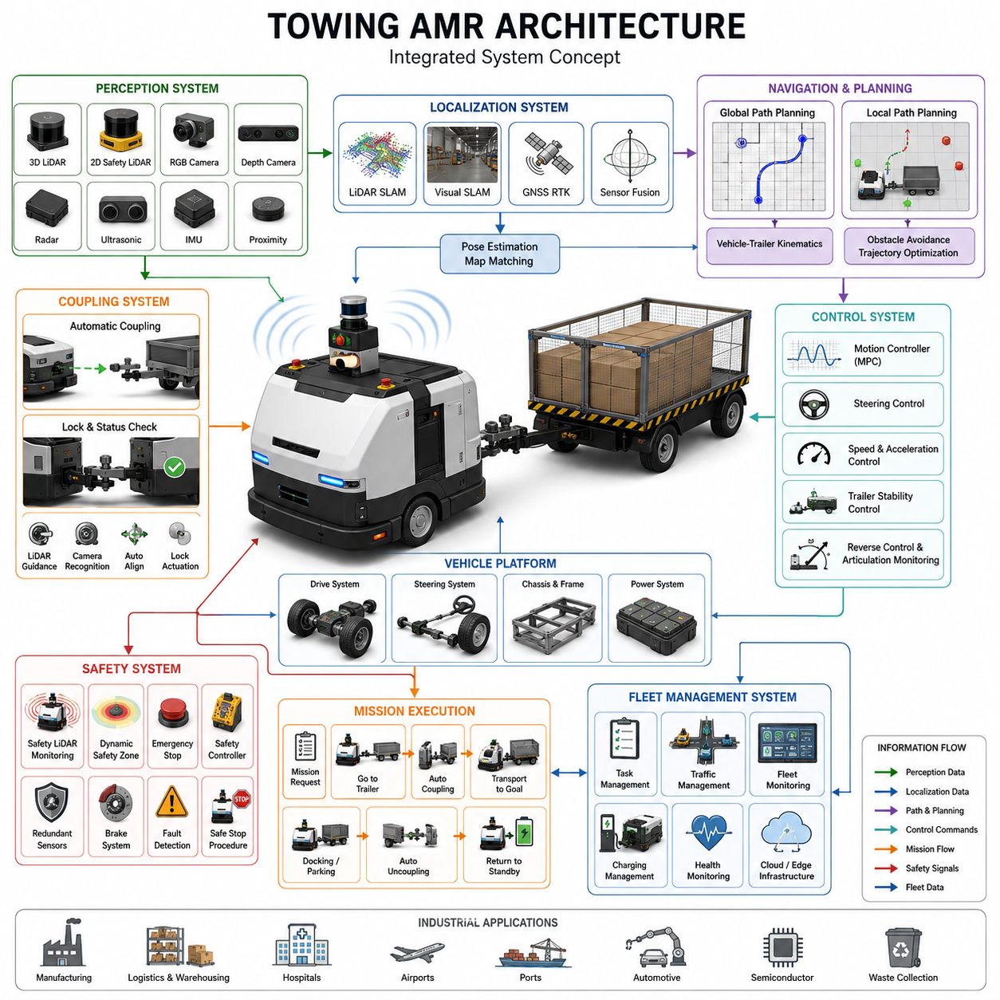
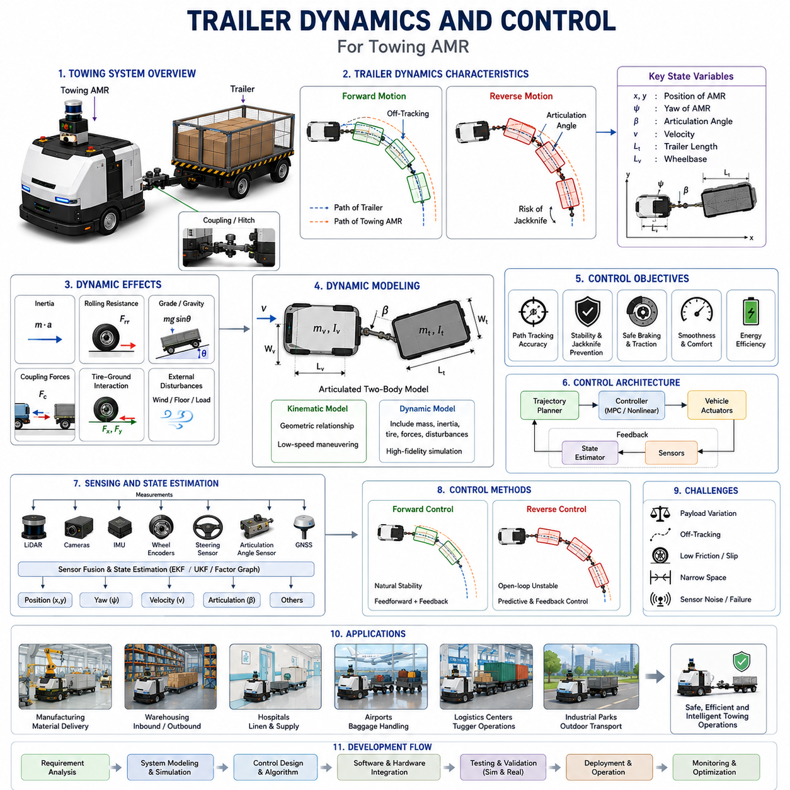
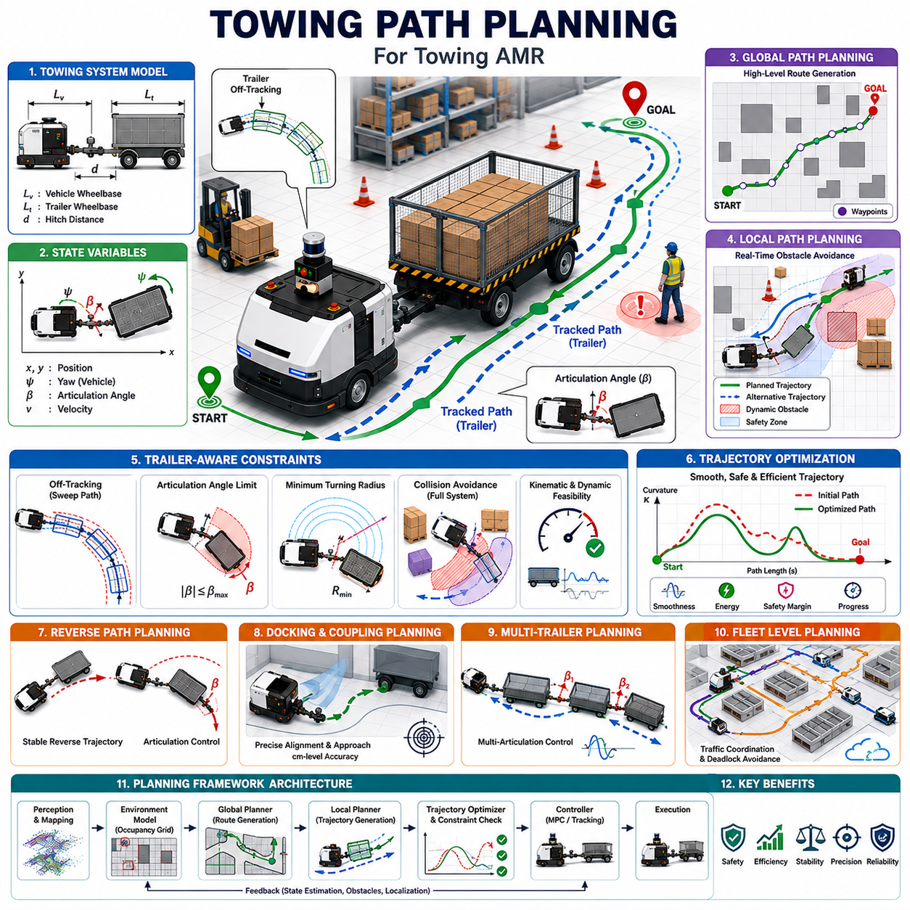
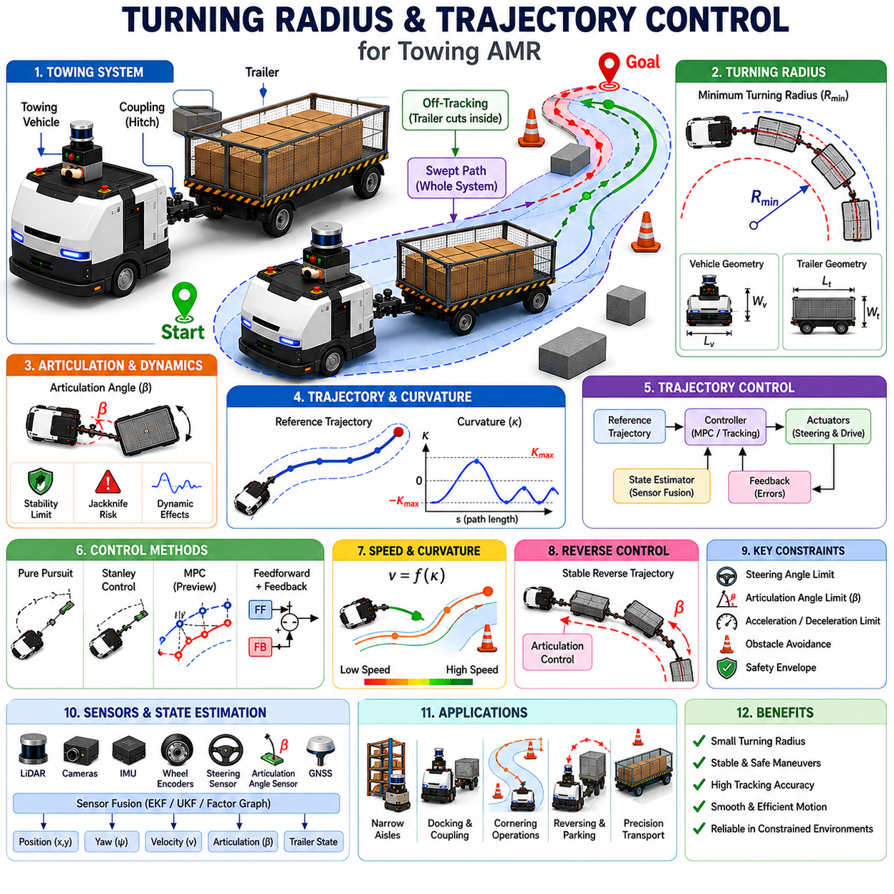
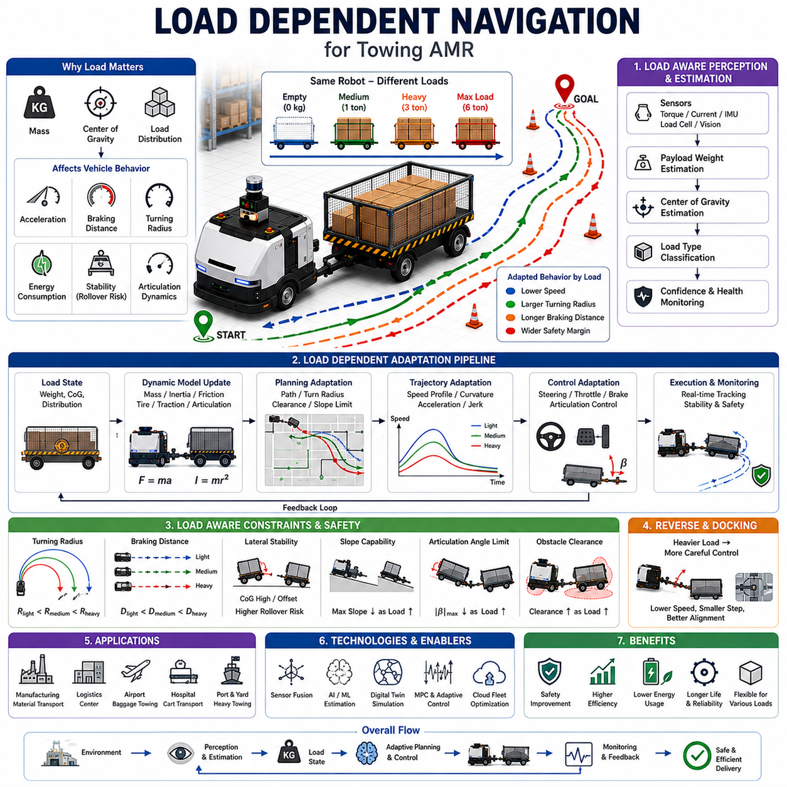
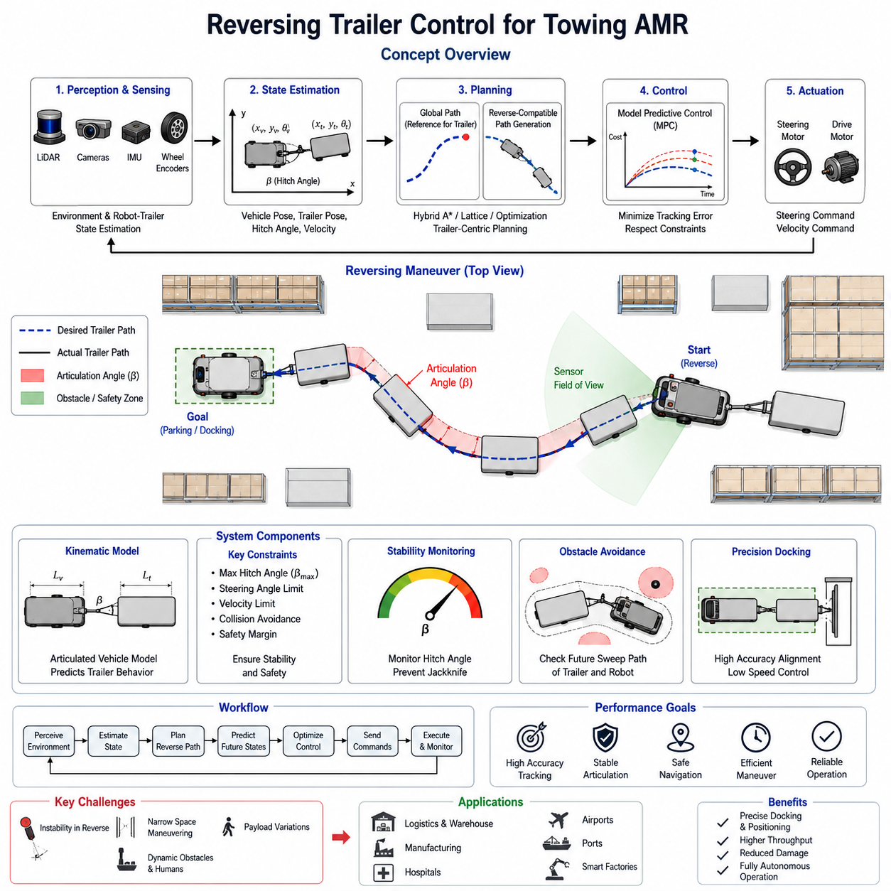
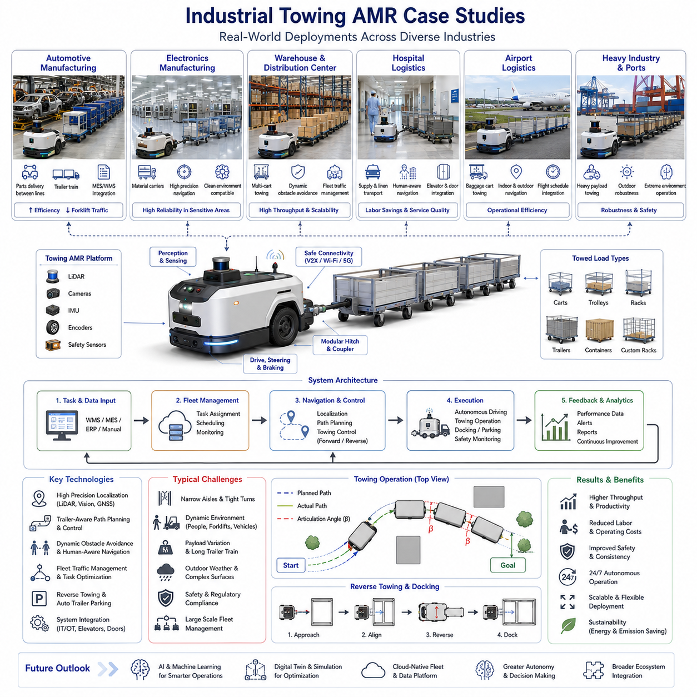
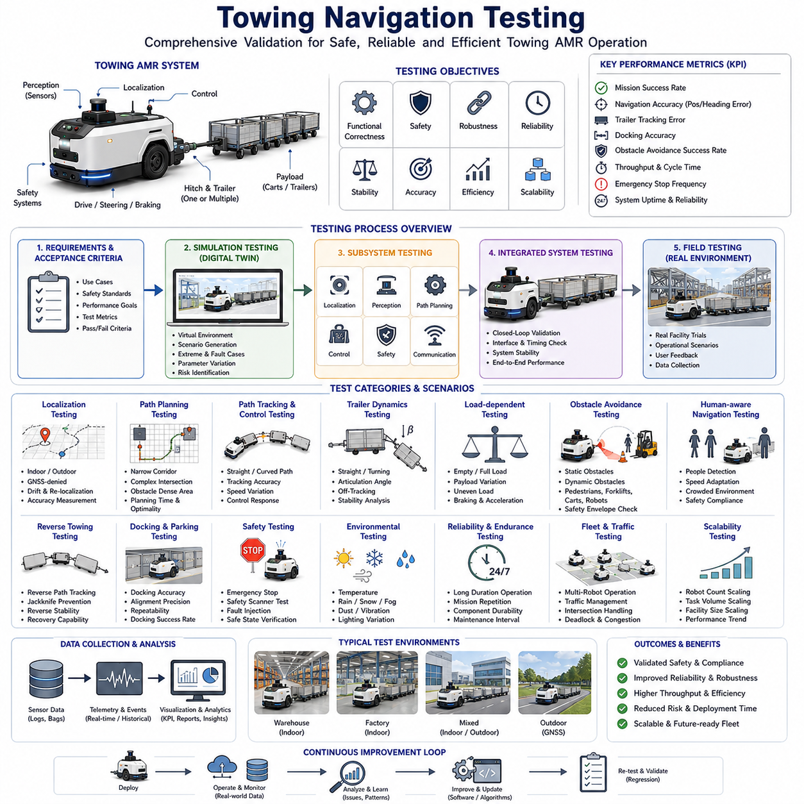

**Volume 05. Path Planning and Autonomous Navigation**

# Chapter 11. Towing AMR Navigation

## 11.1 Towing AMR Architecture

{width="7.268055555555556in" height="7.268055555555556in"}

Towing Autonomous Mobile Robots (Towing AMRs) represent a specialized category of autonomous robotic systems designed to transport carts, trolleys, trailers, pallets, and heavy industrial loads through autonomous navigation and intelligent material-handling operations. Unlike conventional transport AMRs that carry payloads directly on their chassis, towing AMRs move external loads through mechanical coupling systems, creating a unique set of engineering challenges involving vehicle dynamics, navigation, safety, control, and fleet coordination. As modern factories, warehouses, hospitals, airports, and logistics facilities continue to pursue automation, towing AMRs have emerged as a critical technology for enabling flexible and scalable intralogistics operations. Their ability to autonomously transport multiple trailers, heavy carts, and large payloads significantly improves operational efficiency while reducing labor costs and minimizing workplace accidents.

The architecture of a towing AMR is fundamentally different from that of a standard mobile robot because the robot itself becomes only one component of a larger articulated transportation system. The towing vehicle, trailer, coupling mechanism, load, and surrounding environment must all be considered as an integrated dynamic system. Every movement generated by the AMR affects the motion of the trailer, and every force acting on the trailer influences the behavior of the towing robot. Consequently, towing AMR architecture requires close integration between mechanical design, electrical systems, perception systems, localization technologies, navigation software, and intelligent control algorithms. The subject of Towing AMR Navigation is positioned within the broader autonomous navigation framework and forms a dedicated chapter in the navigation development process.

A typical towing AMR architecture consists of several major subsystems. These include the mobile robot platform, traction and steering systems, coupling mechanisms, perception systems, localization systems, navigation and planning modules, safety systems, fleet management infrastructure, and mission execution software. Each subsystem contributes to the overall capability of the towing robot and must operate reliably under varying environmental and operational conditions.

The mobile robot platform forms the foundation of the towing AMR. Industrial towing robots are commonly designed using differential drive, Ackermann steering, four-wheel steering, skid steering, or omnidirectional drive configurations. The choice of mobility architecture depends on application requirements such as turning radius, maneuverability, payload capacity, terrain conditions, and operational speed. In manufacturing environments, Ackermann steering systems often provide stable high-speed towing performance, while omnidirectional systems are preferred for highly constrained indoor spaces requiring lateral movement and precise positioning.

The chassis structure must be designed to withstand significant towing forces and dynamic loading conditions. Unlike carrying robots, which primarily experience vertical loading, towing robots encounter substantial horizontal traction forces. These forces can vary significantly depending on trailer weight, floor conditions, slope angles, acceleration profiles, and braking events. Structural engineers must therefore account for fatigue loading, vibration propagation, shock loading, and long-term durability requirements when designing the chassis and towing frame.

The powertrain subsystem provides propulsion for both the robot and the attached load. Motor sizing becomes considerably more complex in towing applications because the total transported mass may vary dramatically throughout operation. A robot towing an empty cart may require only a fraction of the torque needed to move a fully loaded trailer. Therefore, traction motors must be selected based on worst-case load conditions, including acceleration on inclined surfaces and emergency braking scenarios. High-efficiency brushless DC motors, permanent magnet synchronous motors, and industrial servo systems are frequently employed to provide precise torque control and energy-efficient operation.

Battery capacity and power management play a crucial role in towing AMR architecture. Since towing operations typically involve higher energy consumption than standard transport tasks, energy estimation algorithms must account for trailer weight, route length, floor friction, acceleration demands, and environmental conditions. Advanced battery management systems continuously monitor battery health, state of charge, temperature, and discharge rates to optimize mission planning and charging schedules.

One of the most distinctive components of towing AMR architecture is the coupling mechanism. The coupling system physically connects the robot to the trailer and transfers towing forces between them. Coupling mechanisms may be manual, semi-automatic, or fully automatic. Modern industrial deployments increasingly favor automatic coupling systems because they eliminate human intervention and enable fully autonomous operation. Automatic couplers may utilize mechanical locking devices, pneumatic actuators, electromagnetic latches, or hybrid systems depending on application requirements.

The coupling subsystem must accommodate misalignment during docking while maintaining sufficient mechanical strength during operation. Precision alignment technologies often employ LiDAR sensors, cameras, depth sensors, fiducial markers, or specialized docking sensors to guide the robot toward the trailer connection point. Once alignment is achieved, automated locking mechanisms secure the connection and verify coupling status before mission execution begins.

Perception architecture serves as the sensory foundation of towing AMR operation. Since towing robots frequently operate in dynamic environments populated by humans, forklifts, vehicles, and other robots, robust perception systems are essential for safe navigation. A typical sensor suite includes two-dimensional safety LiDARs, three-dimensional LiDARs, RGB cameras, depth cameras, ultrasonic sensors, radar systems, inertial measurement units, wheel encoders, and proximity sensors.

Safety LiDAR systems provide real-time obstacle detection and safety zone monitoring. Multiple safety fields may be dynamically adjusted based on robot speed, trailer length, load weight, and environmental conditions. Three-dimensional LiDAR sensors enhance environmental understanding by generating detailed point cloud representations of surrounding objects. These sensors are particularly valuable when operating in cluttered industrial environments where obstacles may exist at varying heights.

Camera systems provide visual perception capabilities for object detection, trailer recognition, docking operations, semantic navigation, and safety monitoring. Advances in deep learning have enabled camera-based systems to recognize humans, forklifts, pallet carts, loading stations, docking zones, and operational hazards. Multi-camera configurations can provide complete 360-degree situational awareness around the towing vehicle and attached trailer.

Localization architecture enables accurate positioning of the towing AMR within its operating environment. Depending on application requirements, localization may be achieved using LiDAR SLAM, Visual SLAM, GNSS RTK, sensor fusion approaches, or infrastructure-assisted positioning systems. Indoor facilities commonly rely on LiDAR-based localization and map matching, while outdoor towing robots frequently integrate GNSS RTK with LiDAR and inertial navigation systems.

Sensor fusion algorithms combine information from multiple sensors to improve localization robustness and accuracy. Extended Kalman Filters, Unscented Kalman Filters, Particle Filters, Factor Graph Optimization, and Pose Graph Optimization techniques are commonly employed to estimate robot pose under challenging conditions. Accurate localization becomes particularly important during trailer docking, reverse parking, and navigation through narrow passages.

The navigation architecture of a towing AMR extends beyond traditional path planning because the system must account for trailer dynamics. Standard navigation algorithms developed for standalone robots often fail when towing articulated loads. As a result, specialized towing navigation frameworks incorporate vehicle-trailer kinematic models, articulation angle constraints, trailer tracking behavior, and load-dependent motion characteristics.

Global path planning modules generate collision-free routes through the facility while considering operational constraints. Cost maps are typically expanded to account for the combined footprint of the robot and trailer. Path planning algorithms such as A\*, Dijkstra, Hybrid A\*, State Lattice Planning, and Sampling-Based Planning may be employed depending on environmental complexity and computational requirements.

Local navigation systems continuously adjust trajectories based on dynamic obstacles and changing environmental conditions. The planner must ensure that both the robot and trailer remain within safe operating boundaries throughout the planned maneuver. Special attention is required when negotiating corners, intersections, narrow corridors, and loading areas where trailer swing and off-tracking effects become significant.

Control architecture transforms navigation commands into physical vehicle motion. The controller must regulate steering angles, wheel velocities, acceleration profiles, and braking actions while maintaining stability of the entire articulated system. Model-based control strategies are commonly employed to predict trailer behavior and compensate for dynamic effects. Model Predictive Control has emerged as a particularly effective approach because it can explicitly incorporate system constraints and optimize future motion trajectories.

Reverse motion represents one of the most challenging aspects of towing AMR operation. Unlike forward driving, reversing a trailer introduces instability due to jackknifing tendencies. Small steering errors can rapidly propagate into large articulation angles, potentially leading to loss of control. Advanced towing AMR architectures therefore incorporate dedicated reverse control modules that continuously monitor articulation angles and generate corrective steering commands. Specialized path planning algorithms may also be employed to generate feasible reverse trajectories while avoiding unstable configurations.

Safety architecture is a critical component of towing AMR systems. Industrial environments require compliance with numerous functional safety standards and risk management practices. Safety systems typically include emergency stop circuits, safety controllers, redundant sensors, obstacle detection systems, safety LiDARs, speed monitoring modules, braking systems, and fault management frameworks.

Dynamic safety zones are particularly important for towing applications because stopping distances increase significantly with heavier loads. The safety system continuously adjusts protective field dimensions based on robot speed, trailer weight, braking performance, and environmental conditions. If a hazard is detected within the safety zone, the robot initiates a controlled stop or emergency stop procedure depending on the severity of the threat.

Fleet management architecture enables coordination among multiple towing robots operating within the same environment. The Fleet Management System assigns transportation tasks, optimizes routes, manages traffic flow, schedules charging operations, and monitors robot health. Traffic management becomes increasingly important as fleet size grows because towing robots require larger maneuvering spaces than standard AMRs.

Cloud-based fleet coordination systems may provide centralized optimization while edge computing platforms support real-time decision making. Communication infrastructure typically relies on Wi-Fi, private 5G networks, industrial Ethernet, or hybrid communication architectures. Real-time monitoring dashboards allow operators to visualize robot locations, mission progress, trailer status, battery conditions, and system alerts.

Mission execution software orchestrates the complete towing workflow. A typical mission may involve receiving a transport request, navigating to a trailer, performing automatic coupling, transporting the load to a destination, executing docking or parking maneuvers, uncoupling the trailer, and returning to standby mode. State machines, behavior trees, and task planners coordinate these activities while managing error recovery and exception handling.

Industrial towing AMRs are increasingly being deployed in manufacturing plants, hospitals, warehouses, airports, logistics centers, semiconductor facilities, automotive factories, and distribution hubs. Applications range from material transport and production line replenishment to waste collection, linen delivery, baggage transport, and pallet movement. The flexibility offered by autonomous towing systems enables organizations to adapt rapidly to changing operational requirements while maintaining high levels of efficiency and safety.

As robotics technology continues to evolve, future towing AMR architectures will increasingly incorporate artificial intelligence, semantic understanding, predictive control, digital twins, cloud robotics, and large-scale fleet coordination. Advanced perception systems will enable deeper understanding of complex environments, while foundation models and embodied AI technologies will enhance decision-making capabilities. Autonomous coupling, intelligent trailer management, adaptive navigation, and predictive maintenance will further expand the operational capabilities of next-generation towing robots.

Ultimately, the architecture of a towing AMR represents the convergence of mechanical engineering, electrical engineering, perception systems, localization technologies, navigation algorithms, control theory, functional safety, and fleet management. Successful implementation requires holistic system integration and rigorous engineering practices. As industrial automation continues to accelerate, towing AMRs will play an increasingly important role in enabling efficient, scalable, and intelligent material transportation systems across diverse sectors of the global economy.

## 11.2 Trailer Dynamics and Control

{width="7.268055555555556in" height="7.268055555555556in"}

Trailer Dynamics and Control is one of the most critical engineering disciplines in the development of Towing Autonomous Mobile Robots (Towing AMRs). Unlike conventional AMRs that transport loads directly on their own chassis, towing robots must manage the dynamic interaction between the towing vehicle and one or more connected trailers. This interaction introduces additional degrees of freedom, nonlinear motion characteristics, load-dependent behaviors, and stability challenges that significantly increase the complexity of navigation and motion control. A towing robot is not merely controlling its own movement; it is controlling an articulated transportation system whose behavior changes continuously depending on payload, trailer geometry, coupling characteristics, floor conditions, vehicle speed, and environmental disturbances.

The study of trailer dynamics focuses on understanding how trailers move in response to the motion of the towing vehicle and how forces are transmitted throughout the combined system. Control engineering focuses on developing algorithms that ensure stable, safe, and efficient motion under all operational conditions. Together, trailer dynamics and control form the foundation for autonomous towing operations in manufacturing facilities, warehouses, hospitals, airports, logistics centers, and industrial campuses. Within the overall Towing AMR Navigation architecture, trailer dynamics serves as the physical model upon which navigation, trajectory planning, motion control, reversing, docking, and safety systems are built.

At the most fundamental level, a towing system can be represented as a multi-body articulated vehicle. The towing robot acts as the primary control body, while the trailer acts as a passive body connected through a coupling mechanism. The movement of the trailer is determined indirectly by the motion of the towing robot and the mechanical constraints imposed by the coupling system. Unlike a rigid vehicle, where all wheels follow predictable trajectories, an articulated towing system exhibits complex geometric relationships between the robot and the trailer. Small changes in steering angle can produce significant changes in trailer position, orientation, and articulation angle.

The kinematic behavior of a trailer is largely governed by geometric constraints. During forward motion, the trailer naturally follows the towing robot while exhibiting a phenomenon known as off-tracking. Off-tracking occurs because the trailer wheels do not follow the exact path of the towing vehicle. Instead, they travel along a path that is shifted toward the inside of a turn. The amount of off-tracking depends on trailer length, wheelbase, hitch geometry, turning radius, and vehicle speed. In narrow industrial corridors or constrained production environments, excessive off-tracking may result in collisions with walls, equipment, or infrastructure.

As trailer length increases, off-tracking becomes more pronounced. Multi-trailer systems introduce even greater complexity because each additional trailer contributes another articulation point and another layer of geometric deviation. Consequently, navigation algorithms for towing AMRs must explicitly account for trailer geometry when generating paths and performing collision avoidance.

The dynamic behavior of trailers extends beyond pure geometry. Forces acting on the trailer significantly influence overall system performance. These forces include inertial forces, rolling resistance, aerodynamic drag, gravitational effects, coupling forces, tire-ground interaction forces, and external disturbances. During acceleration, the towing vehicle must generate sufficient traction force not only to move itself but also to accelerate the trailer and its payload. During braking, the towing vehicle must absorb and control the kinetic energy of the entire articulated system.

Payload variation represents one of the most significant challenges in trailer dynamics. An empty trailer may weigh only a few hundred kilograms, while a fully loaded trailer may weigh several tons. In industrial towing applications, load variations can exceed an order of magnitude. These changes affect acceleration performance, braking distance, turning stability, wheel slip characteristics, energy consumption, and overall control behavior. Consequently, control systems must continuously adapt to changing payload conditions.

Mass distribution within the trailer also influences dynamic behavior. A centrally distributed load produces different handling characteristics than a load concentrated at the front or rear of the trailer. Uneven loading may shift the center of gravity, altering yaw response, stability margins, and coupling forces. In severe cases, poor load distribution can contribute to instability, excessive oscillation, or rollover risk.

The coupling mechanism plays a crucial role in trailer dynamics. The hitch forms the physical connection between the towing robot and the trailer, transmitting both forces and moments between the two bodies. Different hitch designs produce different dynamic characteristics. Fixed hitches constrain relative motion between the robot and trailer, while articulated hitches allow rotational movement around one or more axes. The design of the coupling system directly affects maneuverability, stability, and control complexity.

Articulation angle is one of the most important state variables in trailer control. The articulation angle represents the relative orientation between the towing vehicle and the trailer. During normal operation, the articulation angle changes continuously as the robot navigates turns and maneuvers through the environment. Excessive articulation angles may indicate unstable conditions and can lead to jackknifing during reverse motion.

Jackknifing is a well-known instability phenomenon in articulated vehicles. It occurs when the articulation angle increases beyond a controllable range, causing the trailer to fold toward the towing vehicle. Once jackknifing begins, the system becomes increasingly difficult to control. Autonomous towing systems must therefore continuously monitor articulation angles and apply corrective steering actions before instability develops.

Forward motion control is generally more stable than reverse motion. During forward travel, the trailer naturally aligns itself behind the towing vehicle. Small disturbances tend to self-correct due to the geometric properties of the system. This natural stability simplifies trajectory tracking and path-following control. Nevertheless, high-speed operation, heavy payloads, and sharp turns still require advanced control algorithms to maintain smooth and predictable behavior.

Reverse motion introduces fundamentally different dynamics. In reverse, the trailer no longer follows the towing vehicle naturally. Instead, the system becomes open-loop unstable. Small steering inputs can rapidly increase articulation angles, leading to loss of control. Human drivers often require extensive training to reverse trailers successfully. For autonomous systems, reverse trailer control represents one of the most advanced challenges in robotics and vehicle automation.

To address this challenge, towing AMRs employ specialized reverse control algorithms. These algorithms continuously estimate trailer position, articulation angle, and predicted future motion. Control actions are generated to maintain stability while guiding the trailer toward the desired trajectory. Advanced approaches may use Model Predictive Control, Nonlinear Control, Optimal Control, Reinforcement Learning, or Hybrid Control architectures.

Modeling accuracy is essential for effective trailer control. Various mathematical models are used depending on operational requirements. Kinematic models describe geometric motion relationships and are suitable for low-speed maneuvering. Dynamic models incorporate forces, masses, inertia, tire behavior, and external disturbances. High-fidelity simulation environments often combine multi-body dynamics with tire models, suspension models, and actuator dynamics to achieve realistic performance prediction.

Tire-ground interaction significantly influences towing performance. The available traction force depends on surface conditions, tire properties, vehicle weight, and environmental factors. Industrial environments may contain polished concrete, painted floors, steel plates, wet surfaces, ramps, or uneven terrain. Variations in friction coefficients can affect acceleration, braking, steering performance, and stability.

Wheel slip is particularly important in heavy-duty towing applications. Excessive slip reduces control authority and may compromise localization accuracy. Modern towing AMRs frequently employ traction control systems that monitor wheel speeds and regulate motor torque to maintain optimal traction conditions.

Braking control represents another critical aspect of trailer dynamics. The braking system must safely decelerate both the towing robot and the attached trailer under all operating conditions. Stopping distance increases with payload mass and vehicle speed. Emergency braking scenarios require careful management because sudden deceleration can generate large coupling forces and destabilize the articulated system.

Some industrial towing systems incorporate trailer braking mechanisms that operate in coordination with the towing robot. Cooperative braking reduces hitch loading, improves stopping performance, and enhances safety. Advanced braking controllers may dynamically distribute braking forces based on payload estimates and operating conditions.

Steering control must account for both vehicle trajectory and trailer behavior. Traditional path-following controllers designed for standalone robots are insufficient because they ignore trailer dynamics. Towing-specific controllers integrate trailer state estimation, articulation angle feedback, and predictive models to ensure accurate trajectory tracking.

Path tracking performance is often evaluated using metrics such as lateral error, heading error, articulation angle error, trailer tracking deviation, and trajectory smoothness. High-precision industrial applications may require centimeter-level tracking accuracy, particularly during docking, coupling, unloading, and production-line interactions.

State estimation is a fundamental component of trailer control systems. Accurate control requires knowledge of vehicle position, orientation, velocity, trailer orientation, articulation angle, and dynamic state variables. Sensors commonly used for state estimation include wheel encoders, steering sensors, IMUs, LiDAR systems, cameras, GNSS receivers, and articulation angle encoders.

Sensor fusion algorithms combine measurements from multiple sensors to improve estimation accuracy and robustness. Extended Kalman Filters, Unscented Kalman Filters, Particle Filters, and Factor Graph Optimization frameworks are widely used for this purpose. Accurate state estimation becomes especially important during reverse operations, where small errors can rapidly lead to unstable conditions.

Trajectory planning and trailer dynamics are tightly interconnected. The trajectory planner must generate paths that are not only collision-free but also dynamically feasible. Sharp turns, excessive curvature, abrupt velocity changes, and unstable articulation configurations must be avoided. Dynamic constraints are therefore incorporated directly into the planning process.

Modern towing AMRs increasingly utilize predictive control architectures. Model Predictive Control has become particularly attractive because it explicitly considers future system behavior when computing control actions. MPC can simultaneously optimize trajectory tracking, stability, energy consumption, passenger comfort, load protection, and actuator constraints. This capability makes it highly suitable for industrial towing applications involving complex maneuvering tasks.

Artificial Intelligence is also beginning to influence trailer control technology. Machine learning models can estimate payload characteristics, predict dynamic behavior, detect abnormal operating conditions, and improve controller performance through adaptive learning. Reinforcement learning approaches have demonstrated promising results for complex trailer reversing tasks that are difficult to solve using traditional control methods.

Simulation plays an essential role in trailer dynamics development. Because real-world testing of heavy towing systems can be expensive and potentially hazardous, engineers rely extensively on digital twins and simulation environments. Physics-based simulation platforms enable testing under a wide range of operating conditions, including extreme payloads, emergency scenarios, surface variations, and fault conditions. These simulations provide valuable insights before deployment in operational environments.

Safety considerations permeate every aspect of trailer dynamics and control. Functional safety requirements demand robust fault detection, redundancy management, emergency response mechanisms, and risk mitigation strategies. The control system must remain stable even when sensors fail, communication is interrupted, or environmental conditions change unexpectedly.

Industrial applications of trailer dynamics and control span a broad range of sectors. Manufacturing plants utilize towing AMRs for just-in-time material delivery and production line replenishment. Hospitals use towing robots to transport linen carts, waste containers, and medical supplies. Airports employ towing systems for baggage handling and logistics support. Warehouses and distribution centers use towing AMRs for high-throughput material movement. Each application imposes unique operational constraints and control requirements.

Future developments in trailer dynamics and control will likely focus on greater autonomy, improved adaptability, and tighter integration with artificial intelligence. Advanced perception systems will provide richer environmental awareness. Digital twins will enable real-time dynamic optimization. Cloud-connected control architectures will support fleet-wide learning and coordination. Embodied AI systems may eventually allow towing robots to understand operational objectives at a semantic level and adapt their behavior accordingly.

Ultimately, Trailer Dynamics and Control serves as the bridge between mechanical engineering and autonomous intelligence. It transforms a towing AMR from a simple mobile platform into a highly capable autonomous transportation system capable of moving heavy loads safely, efficiently, and reliably through complex industrial environments. As autonomous logistics continues to expand across industries, advances in trailer dynamics and control will remain a key enabler of next-generation towing robotics and intelligent material handling systems.

## 11.3 Towing Path Planning

{width="7.268055555555556in" height="7.268055555555556in"}

Towing Path Planning is a specialized branch of autonomous navigation that focuses on generating safe, efficient, and dynamically feasible trajectories for Autonomous Mobile Robots towing one or more trailers. Unlike conventional AMR navigation, where the vehicle itself is the primary object being controlled, towing path planning must consider the behavior of an entire articulated system consisting of a towing vehicle, coupling mechanism, trailer, payload, and surrounding environment. The presence of a trailer fundamentally changes the geometry, kinematics, dynamics, and control constraints of the navigation problem. As a result, path planning algorithms designed for standalone robots are often insufficient for towing applications and must be extended to incorporate trailer-aware constraints and predictive models.

In modern manufacturing facilities, logistics centers, airports, hospitals, warehouses, and industrial parks, towing AMRs play a crucial role in transporting heavy loads through complex environments. These environments often contain narrow aisles, intersections, shared workspaces, dynamic obstacles, and highly constrained maneuvering zones. Towing path planning enables the robot to move safely and efficiently while ensuring that both the towing vehicle and the trailer remain within operational boundaries. The planner must account not only for collision avoidance but also for trailer tracking behavior, articulation limits, turning constraints, payload stability, and dynamic safety requirements. Consequently, towing path planning represents one of the most advanced topics within autonomous navigation systems.

The primary objective of towing path planning is to generate a continuous sequence of motions that guide the articulated vehicle system from an initial state to a desired destination while satisfying all geometric, kinematic, dynamic, and safety constraints. Unlike standard AMRs, which can often approximate their motion using a single vehicle model, towing systems require multi-body representations. The planner must understand how the trailer will move in response to the actions of the towing robot and predict future trailer positions throughout the planned maneuver.

One of the first challenges encountered in towing path planning is the increase in system dimensionality. A standalone mobile robot typically requires only position and orientation information to describe its state. In contrast, a towing system must additionally consider trailer position, trailer orientation, articulation angle, and in some cases multiple articulation angles when multiple trailers are present. This expanded state space significantly increases planning complexity and computational requirements.

The geometry of the towing system has a profound impact on path planning. The physical footprint of the articulated vehicle changes continuously during operation. During straight-line motion, the combined footprint may remain relatively compact. However, during turning maneuvers, the trailer follows a different path than the towing vehicle due to off-tracking effects. This means that a path that appears collision-free for the robot alone may result in a collision involving the trailer. Therefore, towing path planners must evaluate the future positions of all components within the articulated system.

Off-tracking is one of the most important geometric phenomena in towing navigation. When the towing robot executes a turn, the trailer wheels follow a trajectory that deviates from the path traveled by the robot. The trailer generally cuts inside the turn, reducing clearance from nearby obstacles. In narrow industrial corridors, loading docks, and warehouse aisles, this effect can become significant. Path planners must therefore incorporate trailer sweep analysis to ensure adequate clearance throughout the entire maneuver.

Another important consideration is the articulation angle between the towing vehicle and trailer. Excessive articulation angles may indicate unstable conditions and increase the risk of jackknifing. The path planner must generate trajectories that maintain articulation angles within safe operating limits. This often requires imposing explicit constraints during trajectory optimization and avoiding maneuvers that could produce unstable vehicle configurations.

The kinematic model serves as the foundation of towing path planning. Kinematic models describe how the articulated vehicle moves without considering forces and inertia. For low-speed industrial applications, kinematic models often provide sufficient accuracy for path generation. These models define the geometric relationships between vehicle position, steering angle, trailer orientation, and articulation angle. By incorporating these relationships into the planning process, the system can generate paths that are physically achievable by the towing robot.

Dynamic models become increasingly important as vehicle speed, payload mass, and environmental complexity increase. Dynamic path planning considers inertia, tire forces, traction limitations, braking performance, and load-dependent behavior. A path that is geometrically feasible may still be dynamically unsafe if it requires excessive acceleration, abrupt steering changes, or unstable trailer motions. Dynamic planning therefore introduces additional constraints that improve safety and operational reliability.

Global path planning is responsible for determining a high-level route through the environment. This route typically connects the starting location and destination while avoiding static obstacles and restricted areas. Traditional algorithms such as Dijkstra, A\*, Hybrid A\*, State Lattice Planning, and Probabilistic Roadmaps can be adapted for towing applications. However, modifications are required to account for the larger footprint and unique maneuvering characteristics of articulated vehicles.

Hybrid A\* has become particularly popular for towing applications because it combines graph search methods with continuous vehicle motion models. Unlike traditional grid-based planners, Hybrid A\* generates paths that respect vehicle kinematic constraints. This capability is especially valuable for towing systems because it ensures that generated trajectories can be executed by the articulated vehicle without violating steering limitations or articulation constraints.

State Lattice Planning offers another powerful approach for towing path generation. In a lattice-based planner, motion primitives are precomputed using accurate vehicle-trailer models. These primitives represent feasible vehicle motions and can be combined to generate complete trajectories. Because all primitives are dynamically feasible, the resulting paths naturally satisfy many vehicle constraints.

Sampling-based planners such as Rapidly Exploring Random Trees (RRT), RRT\*, and Probabilistic Roadmaps provide additional flexibility for complex environments. These algorithms are particularly useful in high-dimensional state spaces where conventional graph search methods become computationally expensive. For towing systems, specialized sampling strategies are often employed to improve planning efficiency and avoid unstable vehicle configurations.

Local path planning operates at a lower level and continuously refines the global route based on real-time environmental information. Dynamic obstacles, temporary obstructions, human workers, forklifts, and other vehicles may require immediate trajectory adjustments. The local planner must generate collision-free motions while preserving trailer stability and maintaining progress toward the mission objective.

Trajectory optimization plays a central role in towing path planning. Once an initial path has been generated, optimization algorithms refine the trajectory to improve smoothness, safety, efficiency, and controllability. Optimization objectives may include minimizing travel distance, reducing energy consumption, limiting steering effort, minimizing articulation angle variations, and maintaining safe obstacle clearance.

Smooth trajectories are particularly important for towing applications. Abrupt steering changes can induce trailer oscillations, increase mechanical stress on the coupling mechanism, and reduce payload stability. Path smoothing algorithms therefore seek to generate continuous curvature profiles that allow comfortable and predictable vehicle motion.

Load-dependent planning represents another important capability of advanced towing systems. The dynamic characteristics of the vehicle-trailer system vary significantly with payload mass. A lightly loaded trailer may tolerate aggressive maneuvers, while a heavily loaded trailer may require more conservative trajectories. Modern path planners increasingly incorporate payload estimation and adaptive planning strategies to accommodate these variations.

Reverse path planning is among the most challenging aspects of towing navigation. During reverse motion, the articulated system becomes inherently unstable. Small steering errors can rapidly amplify into large articulation angles, potentially leading to jackknifing. Generating stable reverse trajectories therefore requires specialized planning algorithms that explicitly consider reverse vehicle dynamics.

Reverse planners often incorporate articulation angle constraints, stability criteria, and predictive control techniques. In many industrial environments, reverse operations are necessary for trailer docking, parking, loading, unloading, and automatic coupling procedures. Consequently, robust reverse planning capabilities are essential for fully autonomous towing operations.

Docking and coupling maneuvers impose particularly demanding path planning requirements. During these operations, the towing robot must align precisely with a trailer or docking station while maintaining safe articulation angles and avoiding collisions. Positioning accuracy may need to reach centimeter-level precision. Dedicated docking planners typically combine global planning, local optimization, sensor feedback, and closed-loop control to achieve the required accuracy.

Safety considerations permeate every aspect of towing path planning. The planner must account for stopping distance, vehicle speed, payload characteristics, environmental hazards, and functional safety requirements. Safety margins are typically incorporated into cost maps and collision-checking algorithms to ensure sufficient clearance between the articulated vehicle and surrounding obstacles.

Dynamic safety zones are often employed to enhance operational safety. These zones expand or contract based on vehicle speed, payload weight, braking capability, and environmental conditions. The path planner continuously evaluates future vehicle states against these safety zones to prevent hazardous situations.

Obstacle avoidance becomes more complex when trailers are involved. Traditional obstacle avoidance algorithms focus primarily on the towing vehicle. However, towing systems require full articulated-body collision checking. Future trailer positions must be predicted and evaluated against environmental obstacles. This process may involve swept-volume analysis, occupancy prediction, and continuous collision detection methods.

Environmental uncertainty introduces additional planning challenges. Sensor noise, localization errors, map inaccuracies, and dynamic environmental changes can affect planning reliability. Robust path planning frameworks incorporate uncertainty modeling and risk-aware decision making to maintain safe operation under imperfect conditions.

Fleet-level towing operations introduce another layer of complexity. In large industrial facilities, multiple towing robots may operate simultaneously. The path planning system must coordinate vehicle movements, avoid traffic congestion, prevent deadlocks, and optimize overall fleet efficiency. Fleet-aware planning algorithms integrate local vehicle constraints with global traffic management objectives.

Simulation and digital twins have become indispensable tools for towing path planning development. High-fidelity simulation environments allow engineers to evaluate planning algorithms under a wide range of operating conditions without risking damage to equipment or infrastructure. Simulations can model trailer dynamics, payload variations, environmental disturbances, sensor behavior, and emergency scenarios with remarkable accuracy.

Artificial Intelligence is increasingly influencing towing path planning. Machine learning models can predict trailer behavior, estimate payload characteristics, classify environmental complexity, and improve planning performance through experience. Reinforcement learning approaches have shown promise in generating sophisticated maneuvers that would be difficult to design manually.

Large-scale industrial deployments are beginning to combine traditional planning algorithms with AI-driven decision-making systems. This hybrid approach leverages the predictability and safety of model-based planning while benefiting from the adaptability of machine learning techniques. Future towing AMRs may employ foundation models and embodied intelligence systems capable of understanding operational objectives and generating context-aware navigation strategies.

Cloud-based planning architectures are also emerging as a significant trend. In these systems, computationally intensive planning tasks can be performed in cloud infrastructure while real-time control remains on the edge device. This architecture enables large-scale optimization, fleet coordination, and continuous learning across multiple robots operating within the same facility.

Future developments in towing path planning will likely focus on higher levels of autonomy, improved scalability, tighter integration with perception systems, and greater adaptability to changing environments. Advances in digital twins, predictive simulation, semantic navigation, world models, and embodied AI will enable towing robots to plan more intelligently and operate more efficiently in increasingly complex industrial settings.

Ultimately, towing path planning serves as the intelligence layer that transforms a towing AMR from a simple mobile machine into an autonomous transportation system capable of moving heavy loads safely and efficiently. By integrating vehicle-trailer kinematics, dynamic constraints, environmental awareness, safety considerations, and advanced optimization techniques, towing path planning enables reliable operation in real-world industrial environments. As autonomous logistics continues to expand across manufacturing, healthcare, transportation, and supply-chain industries, towing path planning will remain a foundational technology driving the next generation of intelligent material handling systems.

## 11.4 Turning Radius and Trajectory Control

{width="7.268055555555556in" height="7.268055555555556in"}

Turning Radius and Trajectory Control represent two of the most important engineering disciplines in the development of Towing Autonomous Mobile Robots (Towing AMRs). While path planning determines where a robot should travel, turning radius analysis and trajectory control determine how the articulated vehicle system physically executes that movement. In towing applications, the relationship between turning behavior and trajectory control becomes significantly more complex than in conventional Autonomous Mobile Robots because the system consists of multiple interconnected bodies. The towing vehicle, coupling mechanism, trailer, payload, and environmental constraints all influence the final trajectory. Consequently, successful autonomous towing requires a deep understanding of vehicle geometry, trailer kinematics, dynamic behavior, steering constraints, articulation angle control, and real-time trajectory tracking.

The primary objective of turning radius analysis is to determine the minimum space required for a towing system to safely execute a maneuver. The objective of trajectory control is to ensure that the towing vehicle and trailer accurately follow the planned path while maintaining stability, safety, efficiency, and operational smoothness. Together, these technologies form the foundation of autonomous maneuvering, docking, parking, cornering, obstacle avoidance, and precision transportation in industrial environments. Within the overall Towing AMR Navigation framework, turning radius and trajectory control serve as the bridge between path planning and physical motion execution.

In a conventional vehicle, turning radius is primarily determined by wheelbase length, steering geometry, steering angle limits, and tire characteristics. In a towing system, however, turning radius becomes a system-level property involving both the towing vehicle and the trailer. As the robot executes a turn, the trailer follows a different path due to articulation dynamics and off-tracking behavior. Therefore, the effective turning radius of the articulated system is not simply the turning radius of the towing vehicle.

The concept of minimum turning radius is fundamental to towing robot design. Minimum turning radius refers to the smallest circular path that the vehicle can follow while respecting steering limitations and maintaining stable operation. This parameter directly influences maneuverability within warehouses, factories, hospitals, logistics centers, and industrial facilities. A smaller turning radius allows operation within tighter spaces, while a larger turning radius may require wider corridors and larger maneuvering zones.

Vehicle geometry strongly affects turning radius. Wheelbase length, track width, steering configuration, hitch position, trailer length, and coupling geometry all contribute to the final turning characteristics. Ackermann steering systems typically produce larger turning radii but offer smooth and stable operation. Four-wheel steering configurations can significantly reduce turning radius and improve maneuverability. Omnidirectional platforms may achieve near-zero turning radius capabilities but introduce additional control complexity.

Trailer geometry further complicates turning behavior. Longer trailers generally require larger maneuvering spaces and exhibit greater off-tracking effects. The distance between the hitch point and trailer axle influences how aggressively the trailer responds to steering inputs. Multiple trailers introduce additional articulation points that amplify trajectory complexity and increase swept path requirements.

Off-tracking is one of the most important considerations in turning radius analysis. During a turn, the trailer wheels do not follow the same trajectory as the towing vehicle. Instead, they travel along an inner path that cuts closer to obstacles. This phenomenon becomes particularly significant in narrow aisles, production lines, storage areas, and loading zones. Engineers must therefore analyze the complete swept path of the articulated system rather than considering only the robot footprint.

Swept path analysis is widely used to evaluate turning performance. Swept path refers to the total area occupied by the vehicle-trailer system during a maneuver. This includes the towing vehicle, trailer body, load envelope, and safety clearance zones. Accurate swept path prediction is essential for collision avoidance, facility design, traffic management, and operational safety.

Turning maneuvers generate complex articulation dynamics between the towing vehicle and the trailer. The articulation angle continuously changes as the vehicle navigates curved paths. Larger steering angles generally produce larger articulation angles. If articulation angles become excessive, vehicle stability may be compromised and the risk of jackknifing increases. Therefore, trajectory control systems must actively regulate articulation behavior during turning operations.

Curvature plays a central role in trajectory control. Curvature describes how rapidly a path changes direction and serves as a direct measure of turning intensity. High-curvature trajectories require larger steering inputs and generate greater articulation angle changes. Smooth curvature profiles are preferred because they reduce mechanical stress, improve payload stability, minimize energy consumption, and enhance passenger or operator comfort.

Trajectory control begins with a reference path generated by the path planner. This reference trajectory defines the desired vehicle position, orientation, velocity, acceleration, and curvature over time. The trajectory controller continuously compares the actual vehicle state with the reference trajectory and generates control commands that minimize tracking errors.

Tracking accuracy is a critical performance metric for towing AMRs. Even small tracking errors can produce significant trailer deviations, especially when transporting long trailers through constrained environments. High-precision industrial applications often require centimeter-level trajectory tracking performance to ensure safe operation near equipment, racks, walls, loading stations, and production machinery.

Lateral error and heading error are commonly used to evaluate trajectory tracking performance. Lateral error measures the distance between the actual vehicle position and the desired path. Heading error measures the difference between the actual vehicle orientation and the desired trajectory orientation. In towing systems, additional metrics such as articulation angle error and trailer tracking error are also monitored.

The trajectory controller must compensate for numerous disturbances and uncertainties. These include wheel slip, uneven surfaces, varying payload masses, sensor noise, actuator delays, environmental disturbances, localization errors, and trailer dynamics. Robust control algorithms are required to maintain tracking performance under all operating conditions.

Kinematic control approaches are frequently used for low-speed industrial towing applications. These methods rely on geometric vehicle models and typically assume negligible dynamic effects. Pure Pursuit, Stanley Control, and geometric tracking algorithms are widely employed due to their simplicity and computational efficiency. When properly configured, kinematic controllers can provide excellent performance in structured industrial environments.

As operating speeds increase or payloads become heavier, dynamic control methods become increasingly important. Dynamic controllers explicitly consider mass, inertia, tire forces, coupling forces, and external disturbances. These methods provide improved stability and accuracy when operating near vehicle performance limits.

Model Predictive Control has emerged as one of the most powerful trajectory control techniques for towing AMRs. MPC predicts future vehicle behavior using mathematical models and optimizes control actions over a future prediction horizon. Unlike conventional feedback controllers, MPC can simultaneously consider multiple constraints including steering limits, acceleration limits, articulation angle limits, obstacle avoidance requirements, and safety constraints.

One of the major advantages of MPC is its ability to explicitly manage trailer dynamics. The controller can predict future articulation angles and adjust steering commands proactively to prevent instability. This predictive capability is particularly valuable during sharp turns, reverse maneuvers, docking operations, and navigation through narrow spaces.

Feedforward and feedback control are often combined in practical systems. Feedforward control generates commands based on the planned trajectory and known vehicle dynamics. Feedback control compensates for modeling errors, disturbances, and unexpected environmental conditions. The combination provides both responsiveness and robustness.

Velocity control is closely integrated with turning radius management. High-speed turns generate larger lateral forces and may reduce vehicle stability. Consequently, many towing AMRs dynamically adjust vehicle speed based on path curvature. Sharp turns are executed at lower speeds, while straight segments permit higher travel velocities. This approach improves safety and reduces mechanical stress.

Payload characteristics significantly influence turning performance. Heavier loads increase system inertia, extend stopping distances, and reduce maneuverability. Uneven load distribution may shift the center of gravity and alter dynamic behavior. Advanced trajectory control systems therefore incorporate load estimation mechanisms and adapt control parameters based on current payload conditions.

Reverse trajectory control presents one of the most challenging problems in autonomous towing. During reverse motion, the articulated system becomes inherently unstable. Small steering errors can rapidly produce large articulation angles, potentially leading to jackknife conditions. Specialized reverse trajectory controllers continuously monitor articulation angles and apply corrective steering actions to maintain stability.

Many modern towing AMRs utilize dedicated reverse path planners and reverse control modules. These systems incorporate stability constraints directly into the planning and control process. Predictive algorithms estimate future articulation behavior and generate control actions that maintain safe operating conditions throughout the maneuver.

State estimation plays a crucial role in turning radius and trajectory control. Accurate knowledge of vehicle position, orientation, velocity, articulation angle, steering angle, and trailer state is required for effective control. Sensors commonly used include wheel encoders, steering sensors, articulation angle sensors, IMUs, LiDAR systems, cameras, GNSS receivers, and proximity sensors.

Sensor fusion algorithms combine measurements from multiple sensors to improve estimation accuracy. Extended Kalman Filters, Unscented Kalman Filters, Particle Filters, and Factor Graph methods are commonly used. Reliable state estimation becomes especially important during tight turning maneuvers where small position errors can lead to collisions.

Obstacle avoidance must be integrated with trajectory control. In dynamic environments, the planned trajectory may require real-time adjustments due to moving obstacles, pedestrians, forklifts, or other robots. The controller must modify vehicle motion while preserving stability and maintaining acceptable tracking performance.

Safety considerations influence every aspect of turning radius management and trajectory control. Functional safety requirements demand predictable vehicle behavior under both normal and fault conditions. Safety controllers continuously monitor vehicle state, articulation angles, obstacle proximity, speed, and system health. If unsafe conditions are detected, corrective actions such as speed reduction, controlled stopping, or emergency braking may be initiated.

Industrial deployments often define safety envelopes around the articulated vehicle. These envelopes account for trailer sweep, stopping distance, payload characteristics, and environmental conditions. Trajectory controllers ensure that the vehicle remains within safe operating boundaries throughout all maneuvers.

Simulation and digital twins play a vital role in developing turning radius and trajectory control systems. High-fidelity simulation environments allow engineers to evaluate performance under thousands of operating scenarios before field deployment. These simulations can model different payloads, trailer configurations, surface conditions, obstacle layouts, and fault conditions with high accuracy.

Artificial Intelligence is beginning to enhance trajectory control systems. Machine learning algorithms can estimate dynamic parameters, predict trailer behavior, identify unstable conditions, and optimize controller performance. Reinforcement learning approaches have demonstrated the ability to learn highly complex steering and trajectory control policies that would be difficult to design manually.

Future developments will likely combine traditional control theory with AI-driven adaptive intelligence. Digital twins, cloud-connected optimization platforms, semantic navigation systems, and embodied AI technologies will enable towing robots to achieve unprecedented levels of maneuverability and operational efficiency.

Ultimately, Turning Radius and Trajectory Control represent the operational core of autonomous towing. These technologies transform high-level navigation plans into precise physical motion while ensuring safety, stability, efficiency, and reliability. By integrating vehicle geometry, trailer dynamics, predictive control, sensor fusion, and intelligent optimization, modern towing AMRs can successfully perform complex transportation tasks in highly constrained industrial environments. As autonomous logistics continues to expand across global industries, advances in turning radius analysis and trajectory control will remain essential for the next generation of intelligent towing robotics.

## 11.5 Load-Dependent Navigation

{width="7.268055555555556in" height="7.268055555555556in"}

Load Dependent Navigation is a specialized navigation methodology for Autonomous Mobile Robots (AMRs) and Towing AMRs that dynamically adapts navigation behavior according to payload conditions. Unlike traditional navigation systems that assume fixed vehicle characteristics, load-dependent navigation recognizes that a robot\'s physical and dynamic behavior changes significantly depending on the weight, size, center of gravity, load distribution, and trailer configuration being transported. As industrial robots increasingly handle a wide variety of payloads ranging from lightweight materials to multi-ton industrial equipment, navigation systems must evolve from static path-following approaches into adaptive intelligence systems capable of understanding and responding to changing vehicle dynamics in real time.

Within the Towing AMR Navigation framework, Load Dependent Navigation serves as an advanced layer that bridges perception, localization, path planning, trajectory generation, vehicle control, and safety management. The navigation system continuously estimates payload conditions and adjusts operational parameters to maintain safety, efficiency, stability, and productivity. This capability is particularly important in manufacturing plants, logistics centers, warehouses, airports, hospitals, seaports, and industrial facilities where the same towing robot may transport dramatically different loads throughout a single operational shift. The topic naturally extends the concepts introduced in Towing AMR Architecture, Trailer Dynamics and Control, Towing Path Planning, and Turning Radius and Trajectory Control.

Traditional navigation algorithms often assume constant vehicle mass, fixed turning characteristics, stable braking performance, and predictable dynamic behavior. While these assumptions may be acceptable for small indoor AMRs carrying uniform loads, they become inadequate for towing applications. A towing robot pulling an empty trailer behaves very differently from the same robot pulling a six-ton industrial trolley. Acceleration performance, stopping distance, turning radius, articulation response, energy consumption, tire traction, wheel slip, and rollover risk all change as payload conditions vary.

The fundamental purpose of load-dependent navigation is to create a navigation system that understands these variations and automatically adapts its decision-making processes. Rather than treating the robot as a fixed machine, the navigation system treats it as a dynamic transportation platform whose operational characteristics evolve continuously according to payload conditions. This adaptive behavior significantly improves safety, efficiency, and operational reliability.

One of the most important variables in load-dependent navigation is total system mass. Total mass includes the towing vehicle, trailer, payload, and any additional equipment connected to the system. As total mass increases, the vehicle requires more energy to accelerate, more distance to stop, and greater traction force to climb slopes or traverse difficult terrain. Navigation systems must therefore incorporate mass-dependent models into both planning and control processes.

Payload estimation becomes a critical capability. Modern towing robots may estimate payload mass using motor current measurements, wheel torque sensors, suspension displacement sensors, brake pressure sensors, acceleration response analysis, load cells, force sensors, or AI-based estimation algorithms. By continuously estimating the transported mass, the navigation system can dynamically adjust its operational parameters without requiring manual input from operators.

Center of gravity estimation represents another important component. Payloads are not always distributed evenly across a trailer. A centrally located load may produce stable behavior, while an off-center load can significantly alter vehicle dynamics. The location of the center of gravity influences turning stability, braking performance, rollover risk, articulation dynamics, and obstacle avoidance behavior. Consequently, advanced navigation systems increasingly incorporate center-of-gravity monitoring and estimation mechanisms.

Load distribution affects vehicle stability during turning maneuvers. When the center of gravity shifts upward or laterally, the risk of rollover increases. This risk becomes particularly significant in outdoor applications, uneven terrain environments, ramps, slopes, and high-speed operations. Navigation algorithms must therefore adjust trajectory generation and speed planning to account for changing stability margins.

Path planning is directly influenced by payload conditions. An empty trailer may be capable of navigating through narrow corridors and executing aggressive turns. A heavily loaded trailer may require wider turns, smoother trajectories, and larger safety margins. Load-dependent path planning continuously evaluates vehicle capabilities and generates routes that remain feasible under current loading conditions.

Global path planning can incorporate load-dependent cost maps. Different routes may be assigned different costs depending on slope angles, turning requirements, floor conditions, traffic density, and available maneuvering space. When carrying heavy loads, the planner may intentionally avoid steep ramps, sharp corners, or congested areas. When carrying lighter loads, more direct routes may be selected to maximize efficiency.

Local path planning must respond to dynamic environmental conditions while simultaneously respecting payload constraints. The local planner continuously adjusts velocity profiles, obstacle clearance margins, and maneuvering strategies according to estimated payload characteristics. Heavy payloads typically require more conservative local navigation behavior than lightweight loads.

Trajectory generation is particularly sensitive to payload conditions. Trajectories that are acceptable for unloaded vehicles may become unsafe when carrying heavy loads. High acceleration rates, abrupt steering commands, and aggressive braking maneuvers can destabilize the payload and increase mechanical stress throughout the towing system. Therefore, load-dependent trajectory planners emphasize smooth motion profiles and gradual state transitions.

Curvature management plays a significant role in load-aware navigation. Heavier loads generate larger inertial forces during turning maneuvers. As a result, the navigation system often reduces allowable curvature and increases turning radii when transporting heavy payloads. This strategy minimizes lateral forces and improves overall stability.

Speed planning is one of the most visible aspects of load-dependent navigation. Vehicle speed directly influences stopping distance, energy consumption, dynamic stability, and operational safety. Modern navigation systems dynamically adjust speed limits based on payload weight, center of gravity location, floor conditions, environmental complexity, and traffic conditions.

Heavy loads typically require lower operating speeds, particularly in corners, intersections, docking areas, and pedestrian zones. Empty or lightly loaded vehicles may travel at higher speeds while maintaining acceptable safety margins. Dynamic speed adaptation enables the robot to optimize productivity without compromising safety.

Braking behavior changes significantly with payload mass. Stopping distance generally increases as total system mass increases. Navigation systems must therefore predict stopping requirements and incorporate braking constraints into path planning and obstacle avoidance calculations. Emergency stop distances may vary dramatically depending on load conditions.

Load-dependent obstacle avoidance represents another important capability. Traditional obstacle avoidance algorithms often assume fixed vehicle dynamics. However, a heavily loaded towing robot may not be capable of executing aggressive avoidance maneuvers. The navigation system must account for braking limitations, steering constraints, trailer dynamics, and load stability when responding to unexpected obstacles.

Towing applications introduce additional complexity because payload conditions influence trailer behavior. Heavy loads affect articulation dynamics, off-tracking characteristics, coupling forces, and reverse maneuvering performance. Load-dependent navigation systems continuously update trailer models to reflect current operating conditions.

Articulation angle control becomes increasingly important as payload mass increases. Large articulation angles may produce excessive mechanical stress or increase the risk of instability. Consequently, navigation systems often impose stricter articulation constraints when carrying heavy loads.

Reverse navigation is particularly sensitive to payload conditions. Trailer reversing is already a challenging control problem due to inherent instability. Heavy payloads further complicate the situation by increasing inertia and reducing maneuverability. Advanced navigation systems therefore employ specialized reverse planning and control strategies that adapt to current load conditions.

Docking and automatic coupling operations require extremely precise navigation. Payload conditions influence vehicle positioning accuracy, braking behavior, steering response, and final approach dynamics. Load-aware docking systems adjust approach velocities and control parameters to ensure reliable alignment and safe coupling operations.

Slope navigation represents a major challenge in load-dependent navigation. Heavy payloads increase the risk of rollback, wheel slip, traction loss, and braking failures on inclined surfaces. Navigation systems must evaluate slope gradients and determine whether a planned route remains safe under current loading conditions.

Load-dependent stability monitoring continuously evaluates the safety state of the vehicle. Parameters such as center of gravity position, lateral acceleration, roll angle, pitch angle, articulation angle, wheel slip, and tire forces are monitored in real time. If stability margins become too small, the navigation system may reduce speed, modify the route, or suspend operations.

Energy management is also closely connected to load-dependent navigation. Heavy loads increase energy consumption and reduce operating range. Navigation systems can incorporate battery state-of-charge information and payload estimates to optimize route selection and charging schedules. Energy-aware navigation becomes particularly valuable in large facilities where travel distances are significant.

Sensor fusion plays a critical role in payload-aware navigation. Information from motor controllers, IMUs, wheel encoders, torque sensors, load sensors, cameras, LiDAR systems, GNSS receivers, and trailer sensors can be combined to create an accurate representation of current vehicle conditions. Advanced sensor fusion algorithms enable reliable payload estimation even when direct weight measurements are unavailable.

Artificial Intelligence is increasingly being applied to load-dependent navigation. Machine learning models can estimate payload mass, predict dynamic behavior, classify cargo types, identify stability risks, and optimize navigation strategies. Reinforcement learning approaches may enable robots to learn efficient navigation behaviors across a wide range of payload conditions.

Digital twins provide valuable support for load-dependent navigation development. Simulation environments allow engineers to evaluate vehicle behavior under thousands of loading scenarios without exposing equipment to risk. Digital twin models can represent payload characteristics, trailer dynamics, tire behavior, environmental conditions, and safety constraints with high fidelity.

Fleet-level load-dependent navigation introduces additional optimization opportunities. In multi-robot environments, task assignment systems can consider payload characteristics when selecting which robot should perform a particular transport mission. Heavy loads may be assigned to higher-capacity vehicles, while lighter tasks can be distributed among smaller robots to maximize overall fleet efficiency.

Industrial applications of load-dependent navigation are widespread. Manufacturing plants use load-aware navigation to transport raw materials, components, and finished goods. Logistics centers employ payload-adaptive routing for warehouse operations. Hospitals use load-dependent navigation for medical carts, linen transport, and waste management. Airports utilize load-aware towing systems for baggage handling and logistics support. Heavy industrial facilities rely on these technologies for transporting large equipment and production materials.

Future developments in load-dependent navigation will likely involve tighter integration between AI, digital twins, fleet management systems, and autonomous control architectures. Embodied AI systems may eventually understand not only the weight of a payload but also its semantic characteristics, fragility, value, handling requirements, and operational priority. Navigation decisions could then be optimized according to broader business and operational objectives.

Cloud-connected navigation systems will enable fleet-wide learning and continuous optimization. Knowledge gained from one robot operating under specific load conditions can be shared across an entire fleet. Over time, this collective learning process will improve navigation performance, safety, and operational efficiency.

Ultimately, Load Dependent Navigation transforms a towing AMR from a vehicle that merely follows predefined routes into an intelligent transportation system capable of adapting its behavior according to real-world operating conditions. By integrating payload estimation, dynamic modeling, adaptive planning, intelligent control, stability monitoring, and predictive safety management, load-dependent navigation enables safe and efficient autonomous transportation across a broad range of industrial applications. As payload diversity and operational complexity continue to increase, load-dependent navigation will become an essential capability for next-generation towing robots and advanced autonomous logistics systems.

## 11.6 Reversing Trailer Control

{width="7.268055555555556in" height="7.268055555555556in"}

Reversing Trailer Control is one of the most challenging problems in autonomous mobile robotics, vehicle automation, and industrial towing systems. While forward motion can generally be managed through conventional path tracking algorithms and vehicle kinematic models, reverse motion with a trailer introduces highly nonlinear dynamics and instability characteristics that significantly increase the complexity of navigation and control. In industrial environments, towing Autonomous Mobile Robots (AMRs) are frequently required to move carts, trolleys, racks, containers, and heavy payload carriers into confined spaces where forward maneuvering is impossible or inefficient. As a result, reversing trailer control becomes a critical capability for advanced towing robots operating in warehouses, factories, logistics centers, hospitals, airports, and manufacturing facilities. The importance of this capability has grown as industries increasingly demand fully autonomous material handling systems that can perform precise positioning tasks without human intervention. The topic belongs to the Towing AMR Navigation domain within the autonomous navigation architecture.

The fundamental challenge of reversing a trailer arises from the fact that the trailer behaves as an unstable system when moving backward. During forward motion, the trailer naturally follows the towing vehicle. Small steering corrections generally result in stable behavior because the trailer alignment tends to self-correct. During reverse motion, however, the trailer responds in the opposite manner. Small angular deviations between the towing robot and the trailer can rapidly increase, causing a phenomenon commonly known as jackknifing. Once jackknifing begins, the articulated angle between the towing vehicle and trailer grows uncontrollably, potentially resulting in loss of control, obstacle collisions, operational failure, or mechanical damage. Therefore, reverse trailer control requires continuous monitoring and active stabilization of the articulation angle between the towing robot and the trailer.

The kinematic structure of a towing system is fundamentally different from that of a standard mobile robot. The vehicle and trailer combination forms an articulated multi-body system with additional degrees of freedom. The motion of the trailer is influenced not only by the steering commands of the towing robot but also by trailer geometry, hitch location, wheelbase dimensions, payload distribution, and surface conditions. These parameters create complex relationships between vehicle motion and trailer response. A control system must continuously estimate these relationships in real time to ensure accurate path tracking during reverse operations.

A typical towing AMR consists of a powered robot platform equipped with steering and drive actuators connected to a passive trailer through a mechanical coupling mechanism. The coupling may be rigid, semi-rigid, or articulated depending on the application. Industrial towing systems often employ a pivoting hitch that allows rotational freedom between the robot and trailer. During reverse movement, the hitch angle becomes one of the most critical control variables. Excessive hitch angles indicate instability and increase the risk of jackknifing. Therefore, reverse control systems continuously measure hitch angles using sensors such as rotary encoders, IMUs, LiDAR-based tracking systems, vision systems, or articulated joint sensors.

The mathematical foundation of reversing trailer control is based on articulated vehicle kinematics. The state of the system typically includes the position and orientation of the towing robot, the position and orientation of the trailer, the articulation angle, steering angle, velocity, and acceleration. Differential equations describe how these states evolve over time. Unlike forward motion, reverse motion introduces unstable equilibrium points that require active stabilization. Control algorithms must therefore predict future trailer behavior and compensate before instability develops.

One of the most widely used approaches is the virtual target tracking method. In this approach, the control system defines a desired path for the trailer rather than the towing vehicle. The controller continuously computes the required steering commands that will guide the trailer toward the target trajectory. Since the trailer represents the actual payload location, controlling trailer position directly often produces superior results compared to controlling the towing vehicle alone. This strategy is particularly useful in narrow industrial environments where precise trailer placement is required.

Model Predictive Control (MPC) has emerged as one of the most effective techniques for reversing trailer control. MPC uses a predictive mathematical model to estimate future vehicle and trailer states over a finite horizon. At each control cycle, the controller evaluates multiple steering trajectories and selects the one that minimizes tracking error while satisfying operational constraints. These constraints may include steering limits, maximum articulation angles, collision avoidance boundaries, velocity restrictions, and safety margins. MPC provides a powerful framework for handling nonlinear trailer dynamics and is increasingly adopted in modern industrial towing AMRs.

Another commonly used approach is the Linear Quadratic Regulator (LQR). LQR-based controllers linearize the articulated vehicle model around a desired operating point and compute optimal control inputs that minimize a cost function. The cost function typically penalizes position error, orientation error, articulation angle deviation, and excessive steering effort. LQR controllers offer computational efficiency and can achieve excellent performance in structured environments with well-defined operating conditions.

Pure Pursuit and Stanley controllers, originally developed for autonomous vehicles, can also be adapted for reverse trailer operation. However, these controllers require significant modifications because reverse motion fundamentally changes vehicle dynamics. Reverse path tracking algorithms often use trailer-centric reference points rather than vehicle-centric reference points. Additional stabilization layers are usually incorporated to prevent articulation angle divergence.

Artificial intelligence and machine learning techniques are increasingly being investigated for reverse trailer control. Reinforcement learning algorithms can learn complex reversing behaviors through simulation-based training. During training, virtual towing robots perform thousands of reverse maneuvers under varying conditions, gradually learning optimal steering strategies. Once deployed, the learned policy can generate steering commands directly from sensor observations. Such systems may outperform traditional controllers in highly nonlinear environments where analytical models become difficult to construct.

Sensor integration plays a critical role in successful reversing operations. LiDAR sensors provide environmental awareness and obstacle detection capabilities. RGB cameras enable visual monitoring of trailer alignment and surrounding infrastructure. Depth cameras offer close-range distance measurements during precision parking operations. IMUs provide orientation estimation, while wheel encoders measure vehicle motion. In advanced systems, sensor fusion algorithms combine information from multiple sources to generate accurate state estimates for both the towing robot and the trailer.

Perception systems must be capable of tracking trailer position even when portions of the trailer become temporarily occluded. For example, during tight reverse turns, parts of the trailer may fall outside camera fields of view. Robust tracking algorithms utilize predictive models, multi-sensor fusion, and temporal filtering techniques to maintain accurate trailer state estimation despite temporary sensing limitations.

Obstacle avoidance becomes particularly challenging during reverse trailer operation. Standard obstacle avoidance systems often focus primarily on the robot platform itself. However, when towing a trailer, the swept path of the trailer may differ substantially from that of the towing vehicle. A collision-free trajectory for the robot does not necessarily guarantee a collision-free trajectory for the trailer. Therefore, modern towing AMRs generate safety envelopes around both the towing robot and the trailer. Collision prediction algorithms evaluate future positions of all articulated components and ensure sufficient clearance throughout the maneuver.

Industrial environments frequently contain narrow aisles, storage racks, machinery, workstations, and human workers. Reversing operations must therefore be executed with exceptional precision and safety. Safety-certified LiDAR systems often establish dynamic protection zones around the robot-trailer combination. If an obstacle enters a predefined safety zone, the system may reduce speed, halt movement, or trigger emergency stopping procedures. Human-aware navigation strategies further enhance safety by predicting pedestrian movement and maintaining conservative safety margins.

Reverse trailer parking represents a specialized application of reversing control. In many facilities, trailers must be positioned precisely within loading bays, docking stations, conveyor interfaces, or storage locations. Parking tolerances may be as small as a few centimeters. To achieve this level of precision, control systems often transition from global navigation mode to fine positioning mode. High-resolution sensors, low-speed motion control, and advanced trajectory tracking algorithms enable accurate final alignment.

Trajectory generation for reversing operations differs significantly from forward navigation. Forward trajectories can often be generated using conventional path planning algorithms. Reverse trajectories must account for trailer stability constraints, articulation limits, and vehicle kinematics. Specialized planners generate reverse-compatible paths that maintain stable articulation angles throughout the maneuver. Hybrid A\*, lattice planning, and optimization-based planners are frequently used for this purpose.

Simulation environments play a critical role in reverse trailer controller development. High-fidelity digital twins allow engineers to evaluate thousands of scenarios before field deployment. Simulated environments can model different trailer lengths, payload distributions, friction conditions, floor surfaces, steering mechanisms, and obstacle configurations. Extensive simulation testing significantly reduces development risk and accelerates algorithm refinement.

Payload characteristics strongly influence reversing behavior. Empty trailers often respond differently from fully loaded trailers. Heavy payloads increase inertia and may introduce delayed responses during steering maneuvers. Uneven load distributions can alter trailer dynamics and affect stability. Advanced towing AMRs therefore incorporate load estimation algorithms that adjust controller parameters based on measured or estimated payload conditions. Adaptive control techniques allow the system to maintain consistent performance across varying operational scenarios.

Field validation is essential before deploying reverse trailer control systems in production environments. Validation programs typically include straight-line reverse motion tests, curved path tracking evaluations, obstacle avoidance scenarios, docking procedures, emergency stop verification, and long-duration operational assessments. Performance metrics may include lateral tracking error, orientation error, articulation angle stability, parking accuracy, maneuver completion time, and safety intervention frequency. Successful validation demonstrates that the system can consistently achieve operational objectives while maintaining acceptable safety margins.

Modern industrial towing robots increasingly integrate reverse trailer control with fleet management systems. When multiple towing AMRs operate simultaneously, centralized traffic management systems coordinate reversing maneuvers to prevent congestion and collisions. Shared maps, reservation-based traffic control, and cooperative planning mechanisms enable efficient operation within complex facilities. Fleet-level coordination becomes particularly important in high-density logistics centers where numerous robots must share limited maneuvering space.

Future developments in reversing trailer control are expected to leverage advances in embodied AI, foundation models, real-time simulation, and predictive world models. Autonomous systems may eventually learn reversing strategies from human demonstrations, adapt automatically to new trailer configurations, and generate optimal maneuvers without requiring explicit vehicle models. Integration with digital twin infrastructures will allow continuous controller improvement through large-scale operational data analysis. As industrial automation continues to expand, reversing trailer control will remain a foundational capability enabling fully autonomous towing operations across manufacturing, logistics, healthcare, airports, ports, smart factories, and large-scale industrial facilities. The ability to safely and accurately reverse trailers under diverse operating conditions represents one of the key technological milestones in the evolution of advanced towing AMRs and autonomous material handling systems.

## 11.7 Industrial Towing Case Studies

{width="7.268055555555556in" height="7.268055555555556in"}

Industrial Towing Autonomous Mobile Robots (AMRs) have become one of the most important categories of mobile robotics within modern manufacturing, logistics, healthcare, airports, ports, and large industrial facilities. Unlike conventional transport robots that carry loads directly on their chassis, towing AMRs move multiple carts, trolleys, trailers, racks, and material carriers simultaneously. This approach significantly increases transportation efficiency while reducing fleet size, labor requirements, and operational costs. As industries continue their transition toward smart factories and autonomous logistics ecosystems, towing AMRs are increasingly being deployed in complex real-world environments where reliability, safety, scalability, and operational flexibility are critical. Understanding industrial towing case studies provides valuable insight into the practical challenges, engineering decisions, and performance outcomes associated with large-scale autonomous towing deployments.

One of the most common applications of towing AMRs is found in automotive manufacturing plants. Modern vehicle production facilities involve thousands of components moving continuously between warehouses, sub-assembly stations, production lines, quality inspection areas, and shipping zones. Traditionally, these material movements relied heavily on forklifts, manual tugger trains, and human-operated towing vehicles. Such systems often create congestion, safety risks, and inefficiencies due to inconsistent driving behavior and limited scheduling coordination.

In a large automotive manufacturing facility, towing AMRs were introduced to automate the transportation of component carts between logistics warehouses and assembly lines. The autonomous towing vehicles operated continuously throughout multiple shifts and transported multiple trailers simultaneously. The deployment required integration with Manufacturing Execution Systems (MES), Warehouse Management Systems (WMS), and Fleet Management Systems (FMS). The robots received transportation tasks automatically, optimized routes based on current traffic conditions, and dynamically adjusted schedules according to production demands.

A key engineering challenge in this deployment involved handling long trailer trains in narrow factory corridors. Traditional navigation algorithms designed for standard AMRs were insufficient because trailer tracking errors increased significantly during turns. Engineers implemented trailer-aware trajectory planning, articulation angle monitoring, and load-dependent navigation control. The resulting system achieved substantial improvements in material transportation efficiency while reducing forklift traffic and workplace accidents.

Another important industrial case study involves electronics manufacturing facilities. Electronics production often requires highly synchronized material delivery due to just-in-time manufacturing principles. Delays in component delivery can stop entire production lines and result in significant financial losses. In one large semiconductor manufacturing plant, towing AMRs were deployed to transport material carriers between cleanroom support areas and production equipment zones.

The operating environment presented unique challenges. Strict cleanliness requirements limited the types of mechanical systems and tires that could be used. Precision navigation was essential because transportation corridors were narrow and frequently occupied by personnel and equipment. The towing robots employed LiDAR-based localization, high-resolution facility maps, and precision docking capabilities. Multiple towing vehicles operated simultaneously under centralized fleet coordination. The deployment demonstrated how autonomous towing systems can support highly sensitive manufacturing operations while maintaining strict reliability and cleanliness standards.

Warehouse and distribution center applications represent another major category of industrial towing deployments. Modern e-commerce facilities process enormous volumes of products with extremely demanding throughput requirements. Traditional forklift-based transportation systems struggle to scale efficiently as order volumes increase. Towing AMRs offer a flexible alternative capable of transporting multiple carts in a single trip while operating continuously throughout the day.

In a large distribution center, autonomous towing robots were assigned responsibility for moving order carts between picking zones, sorting stations, packing areas, and outbound shipping docks. The robots navigated through dynamic environments containing workers, forklifts, pallet jacks, and other mobile equipment. Advanced obstacle avoidance algorithms enabled safe operation despite constant environmental changes. Fleet management software coordinated hundreds of transportation missions simultaneously, optimizing robot utilization and minimizing travel distances.

The deployment revealed the importance of traffic management in large towing fleets. Intersections, narrow corridors, and high-traffic zones frequently became bottlenecks. Engineers implemented reservation-based traffic control, dynamic route planning, and congestion-aware navigation strategies. These improvements significantly increased throughput and demonstrated the scalability of towing AMR systems within large logistics environments.

Hospital logistics presents another compelling towing AMR application. Healthcare facilities require continuous movement of medications, linens, laboratory samples, food carts, medical supplies, and waste containers. Human staff often spend significant time performing transportation tasks rather than focusing on patient care. Autonomous towing robots provide an opportunity to automate these repetitive logistics activities.

In a large medical center, towing AMRs were deployed to transport supply carts throughout multiple hospital buildings. The robots integrated with elevators, automatic doors, and building management systems. Transportation tasks were generated automatically by hospital logistics software. The robots navigated crowded hallways while maintaining safe distances from patients, visitors, and healthcare workers.

One of the primary challenges involved operating within highly dynamic environments where pedestrian behavior was often unpredictable. Human-aware navigation algorithms were implemented to reduce robot speed near people and adjust paths proactively when congestion occurred. The deployment successfully reduced labor requirements for routine transportation tasks while improving logistics reliability throughout the hospital.

Airport logistics provides another significant case study. Airports contain extensive transportation requirements involving baggage carts, maintenance equipment, catering supplies, cargo containers, and service trolleys. These environments combine indoor and outdoor operations, large travel distances, strict safety regulations, and continuous operational demands.

In one international airport deployment, autonomous towing vehicles were introduced to transport baggage carts between sorting facilities and aircraft service zones. The robots operated in both indoor logistics areas and outdoor transportation routes. Localization systems combined GNSS, LiDAR, and visual positioning technologies to maintain accurate navigation across diverse environments. Fleet coordination software managed vehicle assignments based on flight schedules and operational priorities.

The project highlighted the importance of robust outdoor navigation capabilities. Weather conditions, varying lighting environments, and temporary operational obstacles required adaptive perception and planning systems. Despite these challenges, the deployment demonstrated significant reductions in operational costs and improved transportation consistency.

Industrial towing AMRs have also been deployed extensively in large manufacturing campuses. Such facilities may cover hundreds of thousands of square meters and include multiple buildings connected by outdoor transportation routes. Traditional material transportation often requires numerous human-operated vehicles and extensive coordination efforts.

In a smart factory deployment, towing AMRs were used to transport materials between production buildings, warehouses, testing facilities, and shipping areas. The robots operated on mixed indoor-outdoor routes and handled varying payload types throughout the day. Navigation systems integrated GNSS RTK, LiDAR SLAM, visual localization, and semantic mapping technologies to achieve reliable positioning across the entire facility.

The deployment demonstrated the advantages of centralized fleet optimization. Transportation requests from multiple facilities were managed through a cloud-based scheduling platform. Route optimization algorithms minimized travel times while balancing workload across the robot fleet. The system improved operational efficiency and reduced transportation delays throughout the manufacturing campus.

Heavy industry applications present unique engineering challenges for towing AMRs. Steel mills, mining facilities, shipyards, and heavy equipment manufacturers frequently require transportation of extremely large and heavy payloads. In these environments, towing robots may be required to pull loads weighing several tons while maintaining precise positioning accuracy.

A heavy manufacturing deployment involved towing robots transporting large assemblies between machining centers, welding stations, and final assembly areas. Payload weights varied significantly depending on production schedules. Engineers developed load-aware control algorithms capable of adjusting acceleration, braking, and steering behavior based on estimated payload characteristics.

Safety considerations played a particularly important role in this deployment. Large payloads increased stopping distances and created substantial kinetic energy during operation. Dynamic safety zones, predictive braking systems, and redundant sensing architectures were implemented to ensure safe operation. The deployment demonstrated that autonomous towing technology can be successfully applied even in demanding heavy-industry environments.

Port and harbor operations represent another emerging application area. Shipping terminals require continuous movement of containers, equipment, maintenance tools, and cargo support assets. Autonomous towing robots offer opportunities to improve efficiency while reducing labor costs and emissions.

In a port logistics pilot project, towing robots transported cargo support trailers between storage areas and loading zones. Outdoor navigation systems relied heavily on GNSS RTK positioning, supplemented by LiDAR-based localization near structures and equipment. The robots operated alongside trucks, cranes, and human workers in highly dynamic environments.

The project revealed the importance of environmental robustness. Salt exposure, rain, wind, dust, and temperature fluctuations placed significant demands on hardware reliability. Enhanced environmental protection systems and industrial-grade sensor packages were required to achieve acceptable operational performance.

A particularly advanced case study involved autonomous reverse towing and automatic trailer parking. In many industrial facilities, trailers must be positioned accurately within loading bays, storage racks, or conveyor interfaces. Human operators often require substantial training to perform these maneuvers safely and efficiently. Autonomous systems face similar challenges because trailer dynamics become highly unstable during reverse motion.

Engineers developed specialized reversing trailer control algorithms using Model Predictive Control, articulation angle stabilization, and trailer-centric trajectory planning. The robots successfully performed autonomous reverse docking operations with centimeter-level accuracy. This capability significantly expanded the range of logistics tasks that could be automated using towing AMRs.

Fleet-level towing deployments provide valuable lessons regarding scalability. While individual towing robots may perform well in isolated testing environments, large-scale deployments introduce additional challenges related to traffic management, task scheduling, charging infrastructure, maintenance planning, and communication reliability. Successful industrial projects typically integrate Fleet Management Systems that coordinate robot activities across entire facilities.

These systems continuously monitor robot locations, battery status, task assignments, traffic conditions, and operational priorities. Advanced scheduling algorithms allocate transportation missions dynamically to maximize efficiency and minimize idle time. Fleet-level optimization often produces benefits that exceed those achieved through individual robot performance improvements.

Across all industrial towing case studies, several common themes consistently emerge. Reliable localization is essential for long-term autonomous operation. Trailer-aware navigation significantly improves transportation accuracy and safety. Fleet coordination becomes increasingly important as deployment scale grows. Human-aware navigation remains critical in shared environments. Load-dependent control strategies improve performance under varying operational conditions. Comprehensive simulation and testing programs reduce deployment risk and accelerate system development.

The future of industrial towing AMRs is expected to involve increasing levels of autonomy, intelligence, and operational integration. Emerging technologies such as foundation models, embodied AI, digital twins, predictive world models, and cloud-native fleet architectures will further enhance towing robot capabilities. Future systems may autonomously learn optimal transportation strategies, adapt to changing facility layouts, predict operational bottlenecks, and continuously optimize fleet performance based on real-world operational data.

Industrial towing case studies demonstrate that autonomous towing technology has evolved from experimental prototypes into practical production systems capable of delivering measurable operational value. Whether deployed in manufacturing plants, hospitals, airports, logistics centers, ports, or large industrial campuses, towing AMRs continue to redefine how materials move through modern facilities. Their ability to transport multiple payloads efficiently, operate continuously, integrate with enterprise systems, and function safely alongside human workers makes them a foundational technology for the next generation of industrial automation and intelligent logistics ecosystems.

## 11.8 Towing Navigation Testing

{width="7.268055555555556in" height="7.268055555555556in"}

Towing Navigation Testing is a critical phase in the development and deployment of Autonomous Mobile Robots (AMRs) designed for towing applications. While perception systems, localization algorithms, path planning modules, and vehicle control systems may demonstrate acceptable performance individually, the ultimate success of a towing AMR depends on how effectively all subsystems operate together under real-world conditions. Testing validates not only functional correctness but also operational safety, robustness, reliability, scalability, and long-term performance. Since towing robots interact with trailers, carts, payload carriers, industrial infrastructure, and human workers, the testing process is significantly more complex than that of standard AMRs. Comprehensive validation programs must therefore address vehicle dynamics, trailer behavior, environmental variability, safety requirements, and operational constraints throughout the entire system lifecycle.

The objective of towing navigation testing is to verify that the robot can safely and efficiently transport payloads under all expected operating conditions. Testing begins by defining performance requirements and acceptance criteria. These requirements are derived from operational use cases, customer expectations, safety regulations, and engineering specifications. Typical performance objectives include navigation accuracy, path tracking precision, obstacle avoidance capability, towing stability, docking accuracy, throughput efficiency, recovery performance, and overall mission success rate. The testing program must establish measurable metrics for each objective and provide repeatable procedures for evaluating performance.

One of the first stages of towing navigation validation involves simulation-based testing. High-fidelity simulation environments allow engineers to evaluate navigation algorithms before deploying physical robots. Digital twins of the robot, trailer, sensors, facility layout, and operational workflows are created within simulation platforms such as Gazebo, Isaac Sim, Webots, Unity, or proprietary robotics simulation frameworks. These environments enable thousands of test scenarios to be executed rapidly while minimizing development costs and reducing risk.

Simulation testing provides the opportunity to evaluate extreme situations that may be difficult or dangerous to reproduce physically. Engineers can examine trailer instability, localization failures, sensor degradation, communication interruptions, emergency stopping events, and unexpected obstacle encounters. Simulation environments also support parameter variation studies where payload mass, trailer length, floor friction, sensor noise, and vehicle speed are systematically modified. Such testing helps identify performance boundaries and potential failure modes before field deployment.

Following simulation validation, subsystem testing is conducted on individual components of the towing navigation stack. Localization systems are evaluated to determine positioning accuracy across different operating environments. Testing may include indoor warehouses, manufacturing facilities, outdoor transportation routes, mixed indoor-outdoor transitions, and GNSS-denied environments. Localization performance is measured using metrics such as position error, heading error, drift accumulation, convergence time, and recovery capability after temporary signal loss.

Path planning modules are tested independently to verify route generation quality and computational efficiency. Engineers assess whether the planner can generate collision-free trajectories that satisfy towing constraints, trailer geometry requirements, turning radius limitations, and safety margins. Testing includes narrow corridors, complex intersections, obstacle-dense environments, loading zones, docking stations, and constrained maneuvering areas. Path optimality, planning time, smoothness, and success rate are carefully analyzed.

Local navigation and motion control systems require extensive validation because towing robots operate as articulated vehicle systems rather than simple mobile platforms. Testing focuses on path tracking performance, steering response, articulation angle control, stability management, and load-dependent behavior. Engineers evaluate how accurately the towing vehicle and trailer follow planned trajectories under varying speeds and payload conditions. Particular attention is given to articulation angle behavior because excessive articulation may lead to jackknife instability and loss of control.

Trailer dynamics testing forms one of the most important aspects of towing navigation validation. Unlike conventional AMRs, towing systems must account for the motion of both the towing vehicle and attached trailers. Testing evaluates trailer tracking accuracy during straight-line movement, curved trajectories, lane changes, obstacle avoidance maneuvers, and reverse operations. Engineers analyze trailer off-tracking behavior, swept path characteristics, hitch angle evolution, and dynamic response to steering commands. Multiple trailer configurations may be tested, including single trailers, tandem trailers, articulated trailer trains, and heavy-load transport systems.

Load-dependent testing is equally important because payload characteristics significantly influence towing behavior. Empty trailers often behave differently from fully loaded trailers due to differences in inertia, tire deformation, and dynamic response. Testing programs therefore include a wide range of payload conditions. Engineers evaluate navigation accuracy, braking distance, acceleration performance, stability margins, and energy consumption under varying load distributions. Unevenly distributed loads are also tested to determine their impact on steering behavior and trailer stability.

Obstacle avoidance testing examines how effectively the towing AMR responds to static and dynamic hazards. Static obstacle testing includes walls, shelving systems, machinery, support columns, pallets, storage racks, and parked vehicles. Dynamic obstacle testing involves pedestrians, forklifts, mobile robots, carts, and moving equipment. Since trailers often follow different trajectories than the towing vehicle, testing must verify that the entire robot-trailer system remains collision-free throughout the maneuver. Safety envelopes and swept path prediction algorithms are evaluated extensively during these tests.

Human-aware navigation testing is particularly important in industrial environments where robots and workers share operational space. Testing scenarios include pedestrian crossings, unexpected human movement, crowd formation, corridor congestion, and close-proximity interactions. Engineers evaluate safety zone activation, speed reduction behavior, stopping performance, path replanning effectiveness, and overall compliance with safety requirements. Human behavior models may be incorporated into simulation environments to generate repeatable test conditions.

Reverse towing validation represents one of the most technically demanding areas of towing navigation testing. Reverse motion introduces inherent instability into articulated vehicle systems and significantly increases navigation complexity. Testing procedures examine reverse path tracking, trailer stabilization, articulation angle control, jackknife prevention, and reverse docking accuracy. Engineers measure reverse tracking errors, maneuver completion times, recovery success rates, and overall operational reliability. Reverse testing is typically conducted under both nominal and worst-case conditions to ensure robust performance.

Docking and parking tests evaluate the robot\'s ability to position trailers accurately at designated locations. Industrial applications often require trailers to be aligned precisely with loading docks, conveyor systems, storage racks, production stations, and transfer points. Testing focuses on final positioning accuracy, orientation error, repeatability, and docking success rate. Precision measurements may be conducted using laser trackers, optical measurement systems, or survey-grade positioning equipment. Many industrial customers require docking accuracies measured in centimeters or even millimeters depending on the application.

Safety validation forms the foundation of every towing navigation testing program. Safety testing ensures compliance with applicable standards and regulatory requirements while protecting personnel, equipment, and infrastructure. Testing includes emergency stop verification, safety scanner validation, collision detection performance, braking effectiveness, redundancy evaluation, fault handling, and safe-state transitions. Engineers intentionally introduce faults into the system to verify that safety mechanisms respond appropriately. Fault scenarios may include sensor failures, communication interruptions, localization degradation, actuator malfunctions, and software crashes.

Environmental testing evaluates performance under realistic operating conditions. Industrial facilities expose robots to diverse environmental challenges including temperature variations, humidity, dust, vibration, lighting changes, reflections, electromagnetic interference, and floor surface irregularities. Outdoor towing systems may additionally encounter rain, snow, fog, wind, direct sunlight, and GNSS variability. Environmental testing determines whether the navigation system can maintain acceptable performance despite these external influences.

Reliability testing examines long-duration operational performance. While short demonstrations may show successful navigation behavior, industrial customers require continuous operation over weeks, months, and years. Reliability testing therefore includes endurance trials involving thousands of missions, extended operating hours, repeated docking cycles, and continuous towing operations. Engineers monitor navigation accuracy, system stability, hardware degradation, software reliability, sensor health, and maintenance requirements throughout these tests.

Fleet-level testing becomes increasingly important as multiple towing robots are deployed within the same facility. Individual robots may perform successfully in isolation, yet operational challenges emerge when numerous vehicles share common infrastructure. Fleet testing evaluates traffic management systems, task allocation algorithms, congestion handling, route scheduling, intersection coordination, charging management, and cooperative behaviors. Engineers analyze throughput, utilization rates, traffic flow efficiency, and conflict resolution effectiveness across the entire fleet.

Scalability testing investigates how system performance changes as operational complexity increases. Variables such as robot count, trailer count, task volume, facility size, obstacle density, and communication load are gradually increased. Testing identifies bottlenecks within fleet management systems, communication infrastructure, navigation algorithms, and computational resources. Scalability assessments are essential for predicting long-term deployment success and future expansion capability.

Field testing represents the final stage of towing navigation validation. Unlike simulation environments and laboratory facilities, real-world deployments introduce unpredictable conditions that cannot always be modeled accurately. Field trials are conducted within actual customer facilities and operational environments. Engineers observe robot behavior during routine operations while collecting extensive performance data. Operational feedback from end users, maintenance personnel, safety managers, and facility operators provides valuable insight into system effectiveness and usability.

Data collection plays a central role throughout the testing process. Modern towing AMRs generate large volumes of information including sensor recordings, localization estimates, navigation decisions, control commands, diagnostic messages, safety events, and operational metrics. Logging systems capture this data for offline analysis and performance evaluation. Engineers use visualization tools, playback systems, and analytics platforms to identify anomalies, investigate failures, and refine system performance.

Key performance indicators commonly used in towing navigation testing include mission completion rate, navigation accuracy, trailer tracking error, docking precision, obstacle avoidance success rate, average mission duration, fleet throughput, energy consumption, emergency stop frequency, safety intervention rate, localization accuracy, and system uptime. These metrics provide quantitative evidence of system performance and support objective decision-making during development and deployment.

Regression testing ensures that software updates do not introduce unintended performance degradation. As navigation algorithms evolve, previously validated scenarios are repeated automatically using simulation and field test data. Continuous integration and automated testing frameworks help maintain system quality while accelerating development cycles. This approach is particularly important for large-scale towing AMR programs where software complexity increases over time.

Modern towing navigation testing increasingly incorporates artificial intelligence and machine learning technologies. Data-driven validation frameworks can automatically identify abnormal behaviors, classify operational failures, and predict potential performance issues before they occur. Digital twin platforms enable continuous testing using operational data collected from deployed fleets. This creates a feedback loop where field experience directly contributes to ongoing system improvement.

The future of towing navigation testing will be characterized by greater automation, higher simulation fidelity, cloud-based validation platforms, and AI-driven analytics. Large-scale digital twins may continuously evaluate navigation software against millions of virtual scenarios while deployed fleets provide real-world performance feedback. Foundation models and embodied AI systems may eventually learn validation criteria directly from operational data, reducing the need for manually designed test procedures.

Ultimately, towing navigation testing serves as the bridge between engineering development and industrial deployment. It transforms theoretical algorithms into verified operational capabilities and provides confidence that autonomous towing systems can perform safely, reliably, and efficiently under real-world conditions. As industrial automation continues to expand across manufacturing, logistics, healthcare, airports, ports, and smart infrastructure, comprehensive towing navigation testing will remain a fundamental requirement for achieving successful and scalable autonomous transportation systems.
