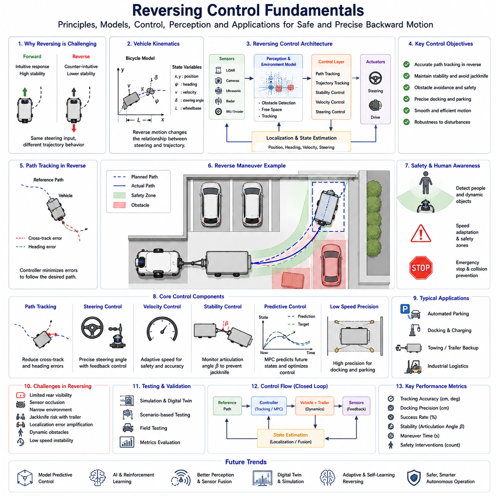
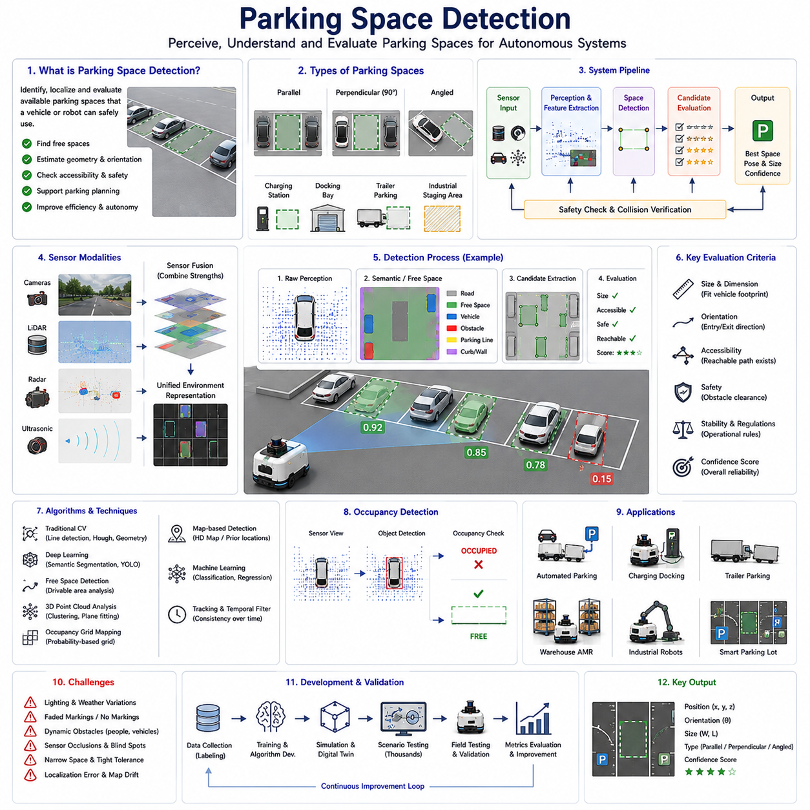
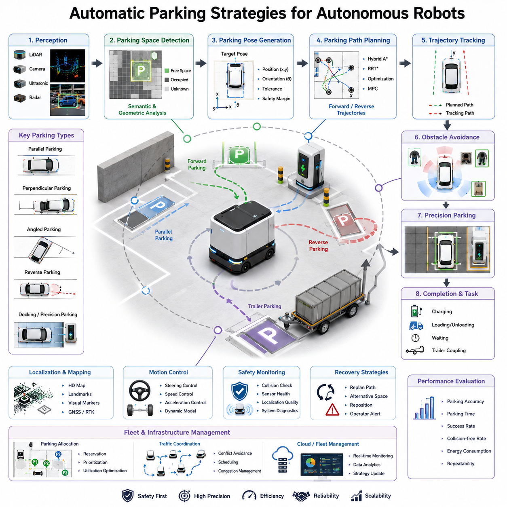
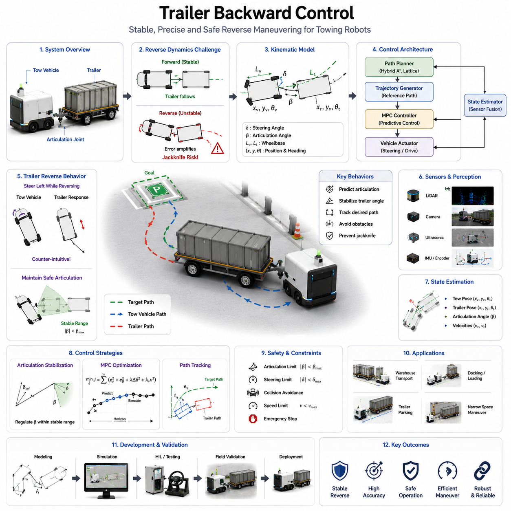
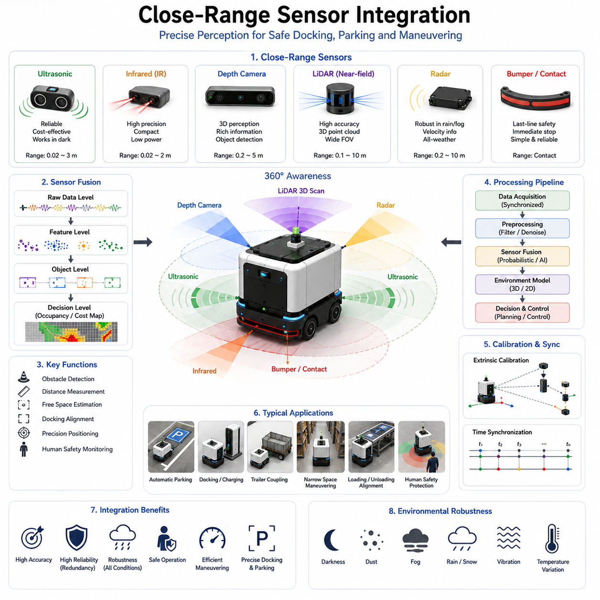
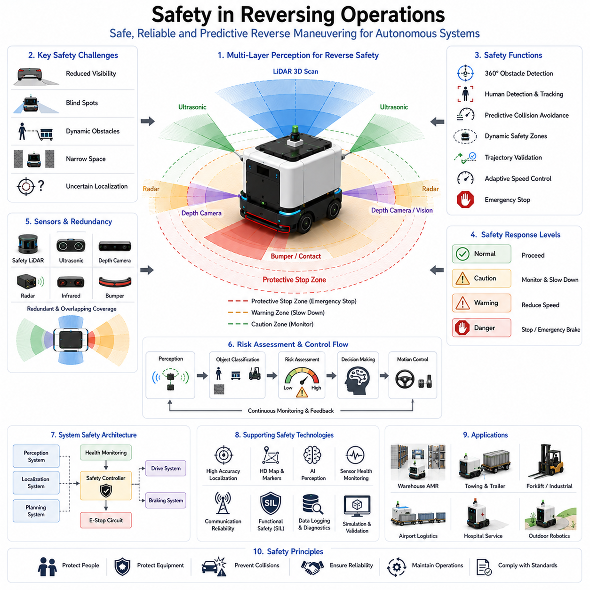
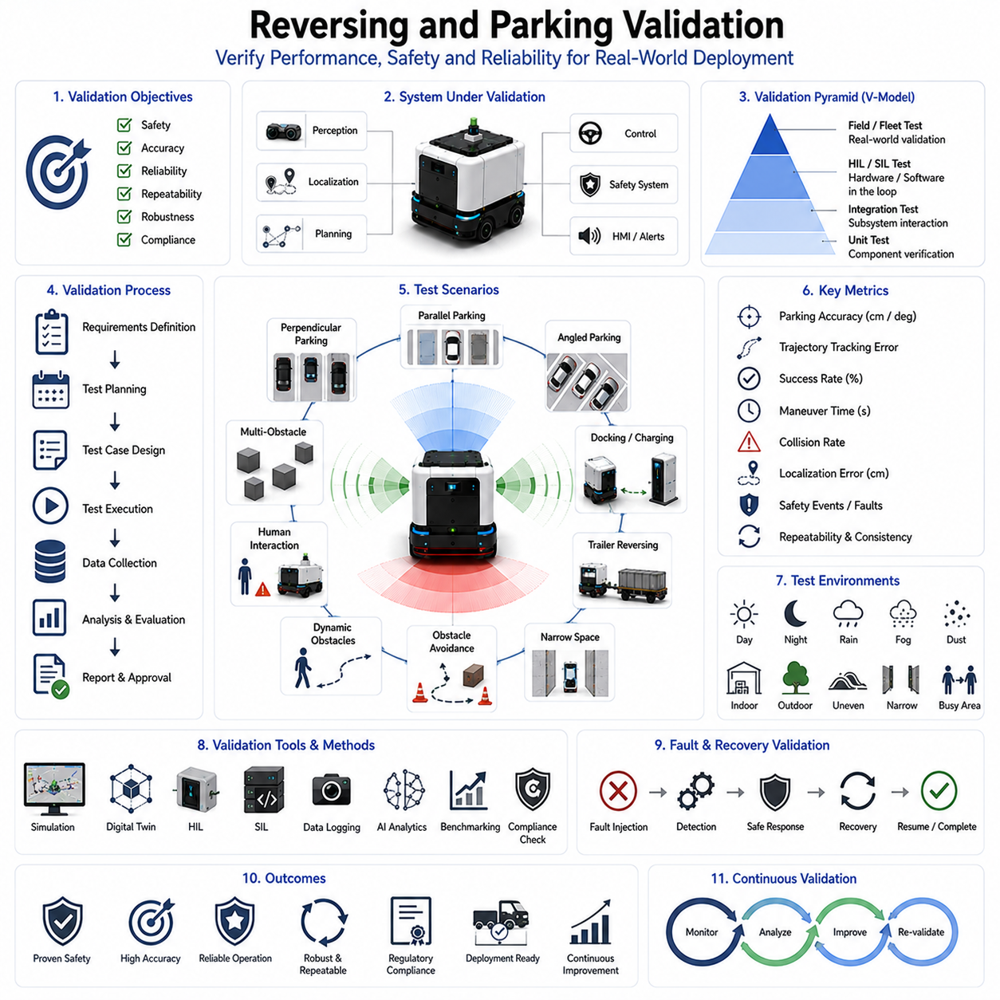

**Volume 05. Path Planning and Autonomous Navigation**

# Chapter 12. Reversing and Parking

## 12.1 Reversing Control Fundamentals
# 12_01_Reversing_Control_Fundamentals

{width="7.268055555555556in" height="7.268055555555556in"}

후진 제어(Reversing Control)는 자율주행 로봇, AMR(Autonomous Mobile Robot), 자율주행 차량, 산업용 견인 로봇, 자율 지게차, 물류 자동화 시스템에서 후진 주행, 자동 주차, 도킹 및 정밀 위치 제어를 가능하게 하는 핵심 기술이다. 전진 주행은 일반적으로 안정적이며 비교적 단순한 제어 문제로 간주되지만, 후진 주행은 전혀 다른 동역학적 특성과 제어 문제를 갖는다. 따라서 후진 제어는 독립적인 연구 분야로 발전해 왔으며, 실제 산업 현장에서 매우 중요한 기술로 평가받고 있다.

후진 제어가 어려운 이유는 대부분의 차량이 전진 주행을 기준으로 설계되기 때문이다. 조향 시스템, 차량 운동학, 센서 배치, 인지 시스템, 경로 계획 알고리즘 모두 전진 주행에 최적화되어 있다. 그러나 차량이 후진할 경우 이러한 가정들이 성립하지 않는다. 차량의 응답 특성이 변화하고 센서 시야가 제한되며 안정성도 감소한다. 따라서 전진 주행 알고리즘을 단순히 반대로 적용하는 것만으로는 안정적인 후진 제어가 불가능하다.

운동학적 관점에서 보면 후진은 조향 입력과 차량 궤적의 관계를 완전히 바꾼다. 전진 시에는 조향을 왼쪽으로 하면 차량도 자연스럽게 왼쪽 방향으로 회전한다. 그러나 후진 시에는 동일한 조향 입력이 직관과 다른 차량 움직임을 만들어낸다. 차량의 회전 중심과 진행 방향의 관계가 달라지기 때문이다. 이러한 특성 때문에 후진 제어는 보다 정교한 수학적 모델링과 제어 기법을 필요로 한다.

후진 제어의 수학적 기반은 차량 운동학 모델에 있다. 가장 널리 사용되는 모델은 자전거 모델(Bicycle Model)이다. 이 모델은 차량을 하나의 전륜과 하나의 후륜으로 단순화하여 차량 위치, 자세, 조향각, 속도, 휠베이스 및 회전 반경 사이의 관계를 분석한다. 실제 차량은 훨씬 복잡하지만 자전거 모델은 후진 제어를 이해하는 데 매우 유용한 기초를 제공한다.

자율주행 시스템에서는 차량 상태 추정(State Estimation)이 매우 중요하다. 차량은 자신의 위치, 방향, 속도, 조향 상태 및 주변 환경을 지속적으로 파악해야 한다. 이를 위해 LiDAR, 카메라, GNSS, IMU, 휠 엔코더 및 센서 융합 기술이 활용된다. 특히 후진은 좁은 공간에서 수행되는 경우가 많기 때문에 전진 주행보다 훨씬 높은 위치 정확도가 요구된다.

후진 제어에서 가장 중요한 개념 중 하나는 경로 추종(Path Tracking)이다. 경로 추종은 차량이 목표 궤적을 따라 이동하도록 제어하는 기술이다. 후진에서는 차량의 안정성이 낮기 때문에 작은 오차도 빠르게 확대될 수 있다. 전진 시에는 무시할 수 있는 수준의 조향 오차가 후진에서는 큰 위치 오차를 유발할 수 있다.

경로 추종 제어기는 횡방향 오차(Lateral Error), 자세 오차(Heading Error), 곡률 오차(Curvature Error), 속도 오차(Velocity Error)를 지속적으로 계산한다. 이러한 오차를 기반으로 조향 명령을 생성하여 차량을 목표 경로로 복귀시킨다. 제어기의 반응이 지나치게 공격적이면 진동(Oscillation)이 발생할 수 있고, 반대로 너무 보수적이면 경로 추종 성능이 저하될 수 있다.

후진 제어에는 다양한 제어 기법이 사용된다. Pure Pursuit는 가장 널리 사용되는 방법 중 하나이다. 목표 경로 위의 특정 지점을 추종 대상으로 설정하고 그 지점에 도달하기 위한 조향각을 계산한다. 구조가 단순하고 계산량이 적지만 후진 주행에서는 추가적인 수정이 필요하다.

Stanley Controller 역시 자율주행 차량 분야에서 널리 활용되는 제어기이다. 이 방식은 차량의 자세 오차와 횡방향 오차를 동시에 고려하여 조향 명령을 생성한다. 후진에서는 조향과 차량 움직임의 관계가 달라지므로 별도의 조정 과정이 필요하다.

최근에는 MPC(Model Predictive Control)가 후진 제어 분야에서 큰 관심을 받고 있다. MPC는 차량의 미래 상태를 예측하는 모델을 이용하여 일정 시간 동안의 최적 제어 입력을 계산한다. 이 과정에서 차량 운동학, 조향 한계, 장애물 회피 조건, 안전 거리 등을 동시에 고려할 수 있다. 특히 후진 시 발생할 수 있는 불안정성을 미리 예측하고 대응할 수 있기 때문에 매우 강력한 제어 기법으로 평가받는다.

후진 제어에서 안정성(Stability)은 매우 중요한 개념이다. 안정성은 외란이나 모델 오차가 발생해도 차량이 제어 가능한 상태를 유지하는 능력을 의미한다. 후진 상태에서는 많은 차량 구조가 전진보다 불안정하다. 작은 오차가 빠르게 확대될 수 있으며, 트레일러가 연결된 경우에는 문제가 더욱 심각해진다. 따라서 안정성 모니터링과 안정화 제어는 후진 시스템의 필수 요소이다.

조향 제어는 후진 성능에 직접적인 영향을 미친다. 조향 시스템은 높은 정밀도와 빠른 응답성을 제공해야 한다. 조향 오차는 곧 경로 오차로 이어지기 때문이다. 이를 위해 고급 시스템에서는 실제 조향각을 지속적으로 측정하고 액추에이터 지연이나 기계적 오차를 보상하는 폐루프 제어를 적용한다.

속도 제어 역시 매우 중요하다. 대부분의 후진 작업은 낮은 속도로 수행된다. 저속 주행은 장애물 회피와 안전 확보에 유리하며 충돌 시 피해도 줄일 수 있다. 그러나 지나치게 낮은 속도는 작업 효율을 떨어뜨릴 수 있다. 따라서 현대 시스템은 환경 복잡도, 주변 장애물, 위치 신뢰도 및 작업 요구사항에 따라 속도를 자동으로 조정한다.

후진 주행을 위해서는 정확한 환경 인식이 필수적이다. LiDAR는 장애물의 위치를 측정하고, 카메라는 주차 공간, 도킹 위치 및 작업 환경을 인식한다. 초음파 센서는 근거리 거리 측정에 매우 효과적이며, 레이더는 악천후 환경에서도 안정적인 감지를 제공한다. 이러한 센서들은 센서 융합 기술을 통해 통합된 환경 모델을 생성한다.

장애물 회피는 후진 제어의 중요한 부분이다. 차량 뒤쪽은 일반적으로 시야가 제한되기 때문에 충돌 위험이 높다. 작업자, 지게차, 카트, 다른 AMR과 같은 동적 장애물이 갑자기 나타날 수도 있다. 따라서 시스템은 안전 영역을 지속적으로 감시하고 미래 충돌 가능성을 예측하여 경로를 수정해야 한다.

산업 현장에서는 사람과 로봇이 함께 작업하기 때문에 사람의 안전이 최우선이다. Human-Aware Navigation 시스템은 사람의 움직임을 추적하고 이동 경로를 예측하여 적절한 안전 거리를 유지한다. 또한 차량 속도와 환경 위험도에 따라 안전 영역을 동적으로 조정한다. 비상 정지 시스템은 마지막 안전 장치 역할을 수행한다.

자동 주차는 후진 제어 기술의 대표적인 응용 사례이다. 평행 주차, 직각 주차, 각도 주차 및 산업용 정밀 주차는 모두 후진 제어를 기반으로 한다. 이러한 작업에서는 경로 계획, 위치 추정, 장애물 감지 및 제어 기술이 긴밀하게 통합되어야 한다.

도킹(Docking)은 더욱 높은 정밀도를 요구한다. 로봇은 충전 스테이션, 컨베이어, 적재 설비, 저장 랙 등에 정확히 정렬되어야 한다. 수 센티미터 수준의 오차만으로도 도킹 실패가 발생할 수 있다. 따라서 최종 접근 단계에서는 고정밀 제어 모드가 활성화된다.

궤적 생성(Trajectory Planning)은 내비게이션과 제어를 연결하는 중요한 기능이다. 경로 계획기는 차량의 운동학적 제약조건과 장애물을 고려하여 실행 가능한 후진 경로를 생성한다. Hybrid A\*, Lattice Planner, 최적화 기반 경로 생성 및 샘플링 기반 알고리즘이 널리 사용된다.

트레일러가 연결된 경우 문제는 훨씬 복잡해진다. 관절형 차량 시스템은 후진 시 매우 강한 비선형 특성을 보인다. 작은 조향 입력도 트레일러의 큰 움직임을 유발할 수 있으며, 연결 각도가 증가하면 잭나이프(Jackknife) 현상이 발생할 수 있다. 이를 방지하기 위해 히치 각도 모니터링, 예측 제어, 트레일러 중심 경로 계획이 필요하다.

환경 조건도 후진 성능에 큰 영향을 준다. 노면 마찰력, 경사도, 바닥 상태, 조명 변화, 기상 조건, 센서 오염 등이 모두 차량 거동을 변화시킨다. 따라서 적응형 제어, Gain Scheduling 및 머신러닝 기반 제어 기술이 점점 더 많이 활용되고 있다.

후진 제어 개발에서는 시험과 검증이 매우 중요하다. 시뮬레이션 환경은 수천 개의 시나리오를 반복 평가할 수 있는 안전한 공간을 제공한다. 디지털 트윈은 차량 동역학, 센서 모델, 환경 조건 및 운영 절차를 가상 환경에 재현한다. 이후 실제 현장 시험을 통해 성능을 검증한다.

평가 항목에는 경로 추종 정확도, 도킹 정밀도, 작업 완료 시간, 장애물 회피 성공률, 안정성 지표 및 안전 개입 빈도 등이 포함된다. 이러한 지표는 시스템의 성능을 정량적으로 평가하는 기준이 된다.

최근에는 인공지능이 후진 제어에 적극적으로 활용되고 있다. 머신러닝은 운영 데이터에서 복잡한 패턴을 학습하여 제어 성능을 향상시킬 수 있다. 강화학습은 시뮬레이션 환경에서 최적의 후진 전략을 학습하는 데 사용된다. 미래에는 Vision-Language Model(VLM)과 Embodied AI가 후진 작업의 고차원적 의사결정을 지원할 것으로 예상된다.

향후 후진 제어 기술은 전통적인 제어 이론, 최적화 기법, 디지털 트윈, 인공지능, 클라우드 로봇 기술이 결합된 형태로 발전할 것이다. 자율 시스템은 더욱 복잡한 후진 작업을 수행하고, 새로운 환경에 적응하며, 경험을 통해 지속적으로 성능을 향상시킬 수 있게 될 것이다.

결국 후진 제어 기초는 안전하고 효율적인 후진 이동을 가능하게 하는 이론적·실용적 기반을 제공한다. 창고 로봇, 병원 물류 로봇, 견인 AMR, 자율 지게차, 대형 산업용 운송 차량 등 어떤 형태의 자율 이동체이든 후진 제어는 핵심 기술 중 하나이며, 미래 자율주행 및 로봇 이동성 기술의 중요한 축으로 계속 발전할 것이다.

## 12.2 Backward Path Planning
# 12_02_Backward_Path_Planning

후진 경로 계획(Backward Path Planning)은 자율주행 시스템이 후진 상태에서 안전하고 효율적이며 실행 가능한 경로를 생성하는 기술 분야이다. 일반적인 경로 계획이 차량의 전진 주행을 기본 가정으로 하는 반면, 후진 경로 계획은 차량 운동학, 안정성, 센서 가시성, 조향 특성, 충돌 위험성 등에서 완전히 다른 문제를 다루어야 한다. 이러한 문제는 특히 AMR, 자율 지게차, 견인 로봇, AGV, 물류 운송 시스템 및 실외 자율주행 플랫폼이 좁은 공간에서 후진 작업을 수행해야 하는 산업 환경에서 더욱 중요해진다.

현대 산업 자동화가 발전하면서 후진 경로 계획의 중요성은 지속적으로 증가하고 있다. 실제 산업 현장에서는 로봇이 좁은 적재 공간에 진입하거나, 도킹 스테이션에 정밀하게 정렬하거나, 트레일러를 저장 위치에 배치하거나, 충전 스테이션에 접근하거나, 막다른 통로에서 방향을 전환해야 하는 경우가 매우 많다. 이러한 상황에서 후진 주행은 선택 사항이 아니라 반드시 필요한 기능이다. 효과적인 후진 경로 계획은 사람의 개입 없이도 이러한 작업을 안전하고 정확하게 수행할 수 있도록 해준다.

후진 경로 계획의 기본 목적은 현재 차량 상태에서 목표 상태까지 도달할 수 있는 충돌 없는 경로를 생성하는 것이다. 여기서 목표 상태는 일반적으로 위치, 방향, 속도 그리고 트레일러가 연결된 경우 연결 각도까지 포함한다. 전진 경로 계획과 달리 후진 경로 계획은 차량의 움직임이 더욱 제한되기 때문에 실행 가능한 경로의 수가 훨씬 적다.

후진 경로 계획의 이론적 기반은 차량 운동학(Vehicle Kinematics)에 있다. 모든 지상 이동 차량은 휠베이스, 조향 범위, 최소 회전 반경, 속도 한계, 가속도 한계 및 타이어 특성과 같은 물리적 제약조건을 가진다. 후진 시에는 조향 입력과 차량 움직임 사이의 관계가 전진과 크게 달라진다. 따라서 경로 계획 알고리즘은 반드시 후진 전용 차량 모델을 사용해야 한다.

가장 널리 사용되는 차량 모델은 자전거 모델(Bicycle Model)이다. 이 모델은 차량을 하나의 전륜과 하나의 후륜으로 단순화하여 차량의 주요 운동 특성을 표현한다. 이를 통해 경로 계획기는 미래 차량 상태를 예측하고 특정 경로가 실제로 주행 가능한지를 평가할 수 있다. 보다 정교한 시스템에서는 다물체 차량 모델(Multi-Body Model), 관절형 차량 모델(Articulated Vehicle Model), 동역학 모델(Dynamic Model) 등을 사용하기도 한다.

후진 경로 계획의 중요한 특징 중 하나는 비홀로노믹 제약(Non-Holonomic Constraint)이다. 대부분의 차량은 원하는 방향으로 자유롭게 이동할 수 없다. 차량은 조향 구조와 바퀴 배치에 따라 특정 경로만 따라갈 수 있다. 이러한 제약 때문에 경로 생성 문제는 훨씬 복잡해지며, 계획기는 실제 차량이 따라갈 수 있는 경로만 생성해야 한다.

경로 표현 방식도 중요한 요소이다. 가장 단순한 형태는 공간상의 이동 경로만 표현하는 기하학적 경로(Geometric Path)이다. 여기에 시간 정보와 속도 프로파일이 추가되면 궤적(Trajectory)이 된다. 또한 실제 차량이 수행 가능한 기본 동작을 정의한 모션 프리미티브(Motion Primitive)를 이용하기도 한다. 후진 경로 계획에서는 후진 회전, 후진 주차, 후진 도킹 등의 동작이 별도의 모션 프리미티브로 정의되는 경우가 많다.

후진 경로 생성에는 탐색 기반 알고리즘(Search-Based Planning)이 널리 사용된다. 대표적인 방법이 Hybrid A\* 알고리즘이다. Hybrid A는 기존 A 알고리즘을 차량 운동학과 연속 상태 공간에 맞게 확장한 기법이다. 일반 A는 차량이 실제로 수행할 수 없는 경로를 생성할 수 있지만, Hybrid A는 차량의 조향 제약을 고려하여 실제 주행 가능한 경로를 생성한다.

Hybrid A\*는 특히 자동 주차 분야에서 매우 효과적이다. 이 알고리즘은 차량 크기, 장애물 거리, 조향 노력, 경로 길이 및 회전 횟수 등을 고려하여 최적 경로를 생성한다. 결과적으로 전진과 후진이 혼합된 자연스럽고 실행 가능한 경로를 얻을 수 있다.

격자 기반 계획(Lattice Planning)도 자주 사용된다. 이 방식은 차량이 도달 가능한 상태들을 미리 계산하고 이를 그래프로 연결한 뒤 최적 경로를 탐색한다. 모든 연결 경로가 차량 운동학을 만족하도록 설계되어 있기 때문에 생성된 경로는 항상 실행 가능하다. 창고, 공장, 항만과 같이 구조화된 환경에서 매우 효과적이다.

RRT(Rapidly Exploring Random Tree), RRT\*, PRM(Probabilistic Roadmap)과 같은 샘플링 기반 기법도 후진 경로 계획에 활용된다. 이 방법들은 차량 상태 공간을 무작위로 탐색하면서 경로를 생성한다. 복잡한 환경에서도 경로를 찾을 수 있다는 장점이 있지만, 부드럽고 안정적인 후진 경로를 얻기 위해서는 추가적인 최적화 과정이 필요하다.

최근에는 최적화 기반 경로 계획이 널리 활용되고 있다. 이 방법은 경로 생성 문제를 수학적 최적화 문제로 정의한다. 경로 길이, 조향 변화량, 곡률 변화, 장애물 거리, 이동 시간, 에너지 소비량 등을 비용 함수로 정의하고 이를 최소화하는 경로를 계산한다. 최적화 기반 방법은 매우 부드럽고 효율적인 경로를 생성할 수 있어 산업용 로봇에서 높은 관심을 받고 있다.

장애물 회피는 후진 경로 계획에서 가장 중요한 요소 중 하나이다. 후진 작업은 일반적으로 좁은 공간에서 수행되기 때문에 장애물과의 거리가 매우 가깝다. 창고, 공장, 병원, 공항, 물류센터에는 선반, 기계설비, 벽, 파레트, 차량, 작업자 등이 존재한다. 경로 계획기는 이러한 장애물을 모두 고려해야 한다.

충돌 검사(Collision Checking)는 생성된 경로가 안전한지를 확인하는 과정이다. 최신 시스템은 점유 격자 지도(Occupancy Grid), Cost Map, Point Cloud, Semantic Map, 3차원 환경 모델 등을 활용하여 충돌 가능성을 평가한다. 또한 위치 오차와 센서 오차를 고려하여 안전 여유(Safety Margin)를 포함한다.

후진 시에는 센서 가시성 문제가 발생한다. 많은 차량은 전방 센서가 더 풍부하게 구성되어 있으며 후방은 상대적으로 제한적이다. 카메라, LiDAR, 레이더 모두 사각지대를 가질 수 있다. 따라서 후진 경로 계획기는 이러한 불확실성을 고려하여 보다 보수적인 경로를 생성하는 경우가 많다.

위치 추정(Localization) 정확도 역시 매우 중요하다. 좁은 공간에서는 수 센티미터 수준의 위치 오차도 충돌로 이어질 수 있다. 따라서 후진 내비게이션은 LiDAR SLAM, Visual SLAM, GNSS RTK, 센서 융합 및 HD Map 기반 위치 추정 기술을 적극 활용한다.

트레일러가 연결된 경우 문제는 훨씬 더 복잡해진다. 관절형 차량 시스템은 후진 시 매우 강한 비선형 특성을 보인다. 연결 각도가 급격히 증가하면 잭나이프(Jackknife) 현상이 발생할 수 있다. 따라서 경로 계획기는 트레일러 위치와 연결 각도를 지속적으로 예측하면서 경로를 생성해야 한다.

트레일러 전용 경로 계획기는 연결 각도가 안정적인 범위 내에 유지되도록 설계된다. 또한 MPC(Model Predictive Control)와 통합되어 차량과 트레일러의 미래 상태를 동시에 최적화하는 경우도 많다.

후진 경로 계획의 대표적인 응용 분야는 자동 주차이다. 평행 주차, 직각 주차, 사선 주차 및 산업용 정밀 주차는 모두 후진 경로 생성 기술에 의존한다. 계획기는 차량 크기, 주차 공간 크기, 주변 장애물 및 최종 정렬 조건을 모두 고려해야 한다.

도킹(Docking)은 더욱 높은 정밀도를 요구한다. 자율주행 로봇은 충전 스테이션, 컨베이어, 적재 도크, 제조 설비, 저장 랙 및 자동 커플러에 정확하게 정렬되어야 한다. 성공적인 도킹을 위해서는 센티미터 수준의 정밀도가 요구되며, 경로 계획기는 이를 고려한 최종 접근 경로를 생성한다.

산업 환경에서는 사람의 안전이 최우선이다. 따라서 후진 경로 계획은 사람의 이동을 예측하는 Human-Aware Planning 기능을 포함한다. 사람의 이동 방향과 속도를 예측하여 위험도를 계산하고 안전 거리를 유지하도록 경로를 수정한다.

환경 변화 역시 중요한 고려 요소이다. 바닥 마찰력, 경사도, 조명 조건, 기상 환경, 센서 오염, 임시 장애물 등은 차량 거동에 영향을 준다. 따라서 현대 경로 계획기는 환경 상태를 실시간으로 분석하고 이에 맞추어 경로를 조정한다.

후진 경로 계획 알고리즘 개발에는 시뮬레이션이 필수적이다. 디지털 트윈 환경은 차량 운동학, 센서 모델, 장애물, 운영 시나리오를 가상으로 재현하여 수천 개의 시나리오를 반복 시험할 수 있도록 해준다. 이를 통해 실제 현장에 적용하기 전에 문제점을 발견하고 개선할 수 있다.

현장 검증 역시 중요하다. 실제 환경에는 시뮬레이션으로 완벽하게 표현할 수 없는 다양한 요소들이 존재하기 때문이다. 현장 시험에서는 경로 생성 성공률, 작업 완료 시간, 경로 부드러움, 장애물 회피 성능, 도킹 정확도, 안전 개입 횟수 등을 측정한다.

최근에는 인공지능 기술이 후진 경로 계획에 적용되기 시작하고 있다. 머신러닝은 대량의 운행 데이터로부터 효율적인 후진 전략을 학습할 수 있다. 강화학습은 시뮬레이션을 통해 최적의 후진 동작을 학습한다. 미래에는 Foundation Model과 Embodied AI가 복잡한 환경을 이해하고 보다 지능적인 후진 경로를 생성할 것으로 기대된다.

향후 후진 경로 계획은 전통적인 탐색 알고리즘, 최적화 기법, 디지털 트윈, 월드 모델(World Model), 인공지능 기반 의사결정 기술이 결합된 형태로 발전할 것이다. 또한 클라우드 기반 로봇 플랫폼은 플릿 전체의 운영 데이터를 활용하여 지속적으로 경로 계획 성능을 향상시킬 수 있을 것이다.

제조업, 물류, 병원, 공항, 항만, 건설, 농업 및 스마트시티 분야에서 자율주행 시스템의 활용이 확대됨에 따라 후진 경로 계획은 더욱 중요한 핵심 기술이 될 것이다. 안전하고 효율적인 후진 주행 능력은 완전 자율주행을 실현하기 위한 필수 요소이며, 미래 로봇 이동성 기술의 핵심 기반으로 자리잡게 될 것이다.

## 12.3 Parking Space Detection

{width="7.268055555555556in" height="7.268055555555556in"}

주차 공간 인식(Parking Space Detection)은 자율주행 시스템, 자동 주차 시스템, 지능형 교통 시스템 및 로봇 이동 플랫폼의 핵심 기술 중 하나이다. 주차 공간 인식의 주요 목적은 차량이나 로봇이 안전하게 진입할 수 있는 주차 위치를 탐지하고, 분류하며, 위치를 파악하고, 사용 가능 여부를 판단하는 것이다. 자율주행 시스템에서 주차 공간 인식은 환경 인지와 주차 경로 생성 사이를 연결하는 핵심 역할을 수행한다. 아무리 우수한 경로 계획 알고리즘과 차량 제어 기술이 존재하더라도 적절한 주차 공간을 정확하게 인식하지 못한다면 자동 주차는 성공할 수 없다. 자율주행 차량, AMR, 자율 지게차, 견인 로봇 및 스마트 물류 플랫폼이 발전함에 따라 주차 공간 인식 기술의 중요성은 더욱 커지고 있다.

주차 공간 인식은 단순히 빈 공간을 찾는 문제를 의미하지 않는다. 시스템은 해당 공간의 크기, 방향, 접근 가능성, 주변 장애물, 점유 상태, 안전성 및 운영 규칙까지 종합적으로 이해해야 한다. 주차 공간이 차량을 수용할 만큼 충분한지, 접근 경로가 존재하는지, 주차 중 충돌 위험은 없는지, 해당 공간이 실제로 사용 가능한 상태인지 등을 모두 판단해야 한다. 따라서 주차 공간 인식은 단순한 센서 처리 문제가 아니라 고차원적인 환경 이해와 의사결정 문제라고 할 수 있다.

초기의 주차 보조 시스템은 초음파 센서를 이용한 거리 측정 기능에 의존하였다. 이러한 시스템은 운전자에게 장애물까지의 거리를 알려주는 역할만 수행했으며, 실제 주차 공간의 구조를 이해하지는 못했다. 이후 카메라와 LiDAR 기술이 발전하면서 차량은 주차선, 경계석, 벽, 차량 및 주변 구조물을 인식할 수 있게 되었다. 오늘날의 자율주차 시스템은 다중 센서 기반의 고급 인지 시스템을 활용하여 실시간으로 주차 공간을 분석할 수 있다.

주차 공간은 여러 형태로 분류된다. 평행 주차 공간은 도로 가장자리를 따라 배치되며 차량이 좁은 공간에 진입해야 한다. 직각 주차 공간은 도로와 90도 방향으로 배치되며 주차장과 산업 시설에서 가장 흔하게 사용된다. 사선 주차 공간은 차량 진입이 용이하도록 일정 각도로 배치된다. 산업 환경에서는 충전 스테이션, 도킹 베이, 트레일러 보관 구역, 로봇 대기 구역, 팔레트 적치 공간 및 자동 적재 위치와 같은 특수한 주차 형태도 존재한다. 각각의 주차 유형은 서로 다른 인식 및 경로 계획 전략을 필요로 한다.

주차 공간 인식의 출발점은 환경 인지(Environmental Perception)이다. 센서는 주변 환경을 관측하여 장애물, 빈 공간, 구조물 및 잠재적인 주차 공간에 대한 정보를 수집한다. 카메라는 가장 널리 사용되는 센서 중 하나로 풍부한 시각 정보를 제공한다. 단안 카메라, 스테레오 카메라, 어안 카메라, 서라운드 뷰 카메라 및 파노라마 카메라 시스템이 모두 주차 공간 인식에 활용될 수 있다.

카메라 기반 시스템은 주차선, 차선 경계, 노면 표시, 연석, 휠 스토퍼, 주차 표지판 및 주변 차량을 분석하여 주차 공간을 인식한다. 초기 컴퓨터 비전 기술은 에지 검출, 허프 변환, 특징점 추출 및 기하학적 분석에 크게 의존하였다. 하지만 조명 변화, 그림자, 마모된 주차선, 악천후와 같은 조건에서는 성능이 제한되는 경우가 많았다.

최근 딥러닝 기술의 발전은 카메라 기반 주차 공간 인식 성능을 크게 향상시켰다. CNN, Semantic Segmentation, Object Detection 네트워크, Transformer 기반 인지 모델 및 Vision Foundation Model은 카메라 영상으로부터 직접 주차 공간을 인식할 수 있다. 이러한 모델은 대규모 데이터셋을 학습하여 복잡한 환경에서도 높은 정확도를 유지할 수 있다.

특히 Semantic Segmentation은 주차 공간 인식에서 중요한 역할을 수행한다. 이 기술은 이미지의 모든 픽셀을 도로, 주차선, 차량, 보행자, 장애물 및 자유 공간 등의 의미적 클래스(Semantic Class)로 분류한다. 생성된 의미 지도(Semantic Map)를 기반으로 시스템은 주차 공간의 형태와 경계를 정확하게 추출할 수 있다.

LiDAR는 또 다른 중요한 인지 센서이다. 카메라와 달리 LiDAR는 주변 물체까지의 거리를 직접 측정하여 3차원 포인트 클라우드를 생성한다. 이를 통해 벽, 차량, 연석, 기둥 및 개방 공간을 매우 정확하게 인식할 수 있다. LiDAR 기반 시스템은 조명이 부족한 환경에서도 안정적인 성능을 제공한다는 장점이 있다.

포인트 클라우드 처리 기술은 LiDAR 기반 주차 공간 인식의 핵심이다. 바닥 분리(Ground Segmentation)를 통해 지면을 구분하고, 클러스터링 알고리즘으로 물체를 식별하며, 기하학적 분석을 통해 주차 가능한 영역을 추정한다. 특히 산업 현장에서는 팔레트, 컨테이너, 설비, 작업 장비 등 복잡한 구조물이 존재하기 때문에 3차원 인식 기술의 중요성이 더욱 크다.

레이더는 악천후 환경에서 강력한 성능을 제공한다. 비, 안개, 눈, 먼지와 같은 조건에서도 안정적인 장애물 감지가 가능하다. 비록 공간 해상도는 카메라와 LiDAR보다 낮지만, 다중 센서 시스템에서 중요한 보조 센서 역할을 수행한다.

초음파 센서는 근거리 주차 작업에서 여전히 널리 사용된다. 이 센서는 수 센티미터 수준의 정밀한 거리 측정이 가능하여 최종 주차 단계에서 충돌 방지와 정밀 위치 제어에 활용된다. 단독으로 주차 공간을 인식하기에는 한계가 있지만 다른 센서와 결합하면 매우 유용하다.

센서 융합(Sensor Fusion)은 현대 주차 공간 인식 시스템의 핵심 기술이다. 카메라는 풍부한 의미 정보를 제공하지만 조명에 민감하다. LiDAR는 정확한 거리 정보를 제공하지만 시각적 의미 정보는 부족하다. 레이더는 환경 변화에 강하지만 해상도가 낮다. 초음파 센서는 근거리에서만 동작한다. 센서 융합은 이러한 센서들의 장점을 결합하여 보다 정확하고 신뢰성 높은 환경 모델을 생성한다.

점유 격자 지도(Occupancy Grid Map)는 주차 공간 인식에서 자주 사용된다. 환경을 작은 셀로 분할하고 각 셀의 점유 확률을 계산한다. 이를 통해 시스템은 충분히 넓고 안전한 자유 공간을 탐색할 수 있다. 이러한 방식은 창고, 공장, 병원, 공항 및 물류센터에서 운영되는 AMR에 매우 적합하다.

자유 공간 탐지(Free Space Detection)는 또 다른 중요한 기술이다. 이 방법은 주차선 자체를 찾기보다 차량이 진입 가능한 빈 공간을 직접 탐색한다. 산업 환경에서는 명확한 주차선이 없는 경우가 많기 때문에 자유 공간 탐지가 매우 효과적이다. 시스템은 공간 크기, 접근 가능성, 안전 여유 및 작업 목적을 고려하여 적합한 주차 후보를 선정한다.

HD Map 및 사전 구축된 지도 정보를 활용하는 방식도 널리 사용된다. 지도에는 충전 스테이션, 도킹 위치, 대기 구역 및 주차 위치가 미리 정의되어 있다. 로봇은 자신의 위치를 지도와 비교하여 적절한 주차 공간을 선택하고, 센서를 이용해 실제 사용 가능 여부를 확인한다.

인공지능과 머신러닝은 주차 공간 인식 기술을 빠르게 변화시키고 있다. 딥러닝 모델은 복잡한 환경 패턴을 자동으로 학습할 수 있으며, 다양한 환경에서도 높은 일반화 성능을 보인다. 향후에는 Foundation Model과 멀티모달 AI가 더욱 높은 수준의 환경 이해 능력을 제공할 것으로 예상된다.

주차 공간 점유 상태 판단(Parking Occupancy Detection)도 매우 중요한 문제이다. 단순히 주차 공간을 찾는 것만으로는 충분하지 않다. 해당 공간이 현재 사용 중인지 여부도 판단해야 한다. 이를 위해 차량 존재 여부, 장애물 위치, 객체 분류 결과 및 주변 상황을 종합적으로 분석한다. 이러한 기능은 스마트 주차장, 자율 물류 시설 및 플릿 관리 시스템에서 매우 중요하다.

산업용 주차 공간 인식은 일반 자동차 주차보다 더욱 복잡하다. 자율 지게차, 견인 로봇, 물류 AMR, 병원 배송 로봇, 공항 물류 차량 등은 매우 동적인 환경에서 운용된다. 주차 위치는 작업 상황에 따라 수시로 변경될 수 있으며, 임시 장애물과 작업자가 지속적으로 환경을 변화시킨다. 따라서 산업용 시스템은 실시간으로 주차 가능 여부를 갱신해야 한다.

트레일러 주차와 도킹 작업은 추가적인 어려움을 제공한다. 차량뿐 아니라 트레일러의 길이, 회전 반경, 연결 각도 및 후진 경로까지 고려해야 하기 때문이다. 따라서 견인형 차량을 위한 전용 주차 공간 인식 및 경로 계획 알고리즘이 필요하다.

사람의 안전은 주차 공간 인식과 주차 수행 과정 전반에서 가장 중요한 요소이다. 주차 구역에는 작업자, 유지보수 인력, 운전자 및 기타 차량이 존재할 수 있다. 따라서 시스템은 사람의 움직임을 지속적으로 감시하고 위험도를 평가하여 안전한 주차 결정을 내려야 한다.

조명 변화, 기상 조건, 그림자, 반사광, 센서 오염, 노면 상태 변화 등 다양한 환경 변화도 주차 공간 인식 성능에 영향을 준다. 고급 시스템은 이러한 변화에 적응할 수 있는 강인한 인식 알고리즘을 적용한다.

시뮬레이션과 디지털 트윈은 주차 공간 인식 기술 개발에 매우 중요한 역할을 한다. 가상 환경에서는 수천 개의 다양한 주차 시나리오를 생성하여 알고리즘을 학습시키고 검증할 수 있다. 이를 통해 개발 비용과 시간을 크게 절감할 수 있다.

실제 현장 검증 또한 필수적이다. 실제 환경에서는 시뮬레이션으로 재현하기 어려운 다양한 변수가 존재하기 때문이다. 주차 공간 인식 정확도, 오탐지율, 미탐지율, 위치 정확도, 주차 성공률, 점유 상태 판단 정확도 및 장기 신뢰성이 주요 평가 지표가 된다.

미래의 주차 공간 인식 시스템은 인공지능, 디지털 인프라, 차량 간 통신, 클라우드 기반 인지 서비스 및 협력형 로봇 기술과 결합될 것으로 예상된다. 스마트 시설은 주차 가능 정보를 자율주행 차량에 직접 제공할 수 있으며, 여러 대의 로봇이 주차 정보를 공유하여 더욱 효율적인 운영이 가능해질 것이다.

자율주행 기술이 물류, 제조, 병원, 공항, 항만, 창고 및 스마트시티로 확산됨에 따라 주차 공간 인식은 필수적인 핵심 기술로 자리잡고 있다. 안전하고 접근 가능한 주차 공간을 정확하게 인식하는 능력은 자동 주차, 자동 도킹, 자동 충전, 물류 대기 구역 관리 및 플릿 운영의 기반이 된다. 센서 기술, 센서 융합, 인공지능, 환경 모델링 및 지능형 의사결정 기술의 발전과 함께 주차 공간 인식은 차세대 자율 이동 시스템의 핵심 구성 요소로 지속적으로 발전할 것이다.

## 12.4 Automatic Parking Strategies

{width="7.268055555555556in" height="7.268055555555556in"}

자동 주차(Automatic Parking)는 자율주행 시스템에서 가장 고도화된 기능 중 하나이다. 그 이유는 매우 제한된 공간에서 높은 정밀도로 동작해야 하며, 작은 위치 오차만 발생해도 충돌, 작업 실패, 안전 문제로 이어질 수 있기 때문이다. 자율이동로봇(AMR), 견인 로봇, 물류 로봇, 병원 서비스 로봇, 산업용 운반 차량, 야외 자율주행 플랫폼 등에서 주차는 단순히 이동의 마지막 단계가 아니다. 오히려 인지(Perception), 위치추정(Localization), 경로계획(Path Planning), 궤적생성(Trajectory Generation), 차량제어(Motion Control), 장애물 회피, 안전 검증, 복구 전략이 통합적으로 수행되는 복합적인 자율주행 과정이다.

전체 내비게이션 구조에서 자동 주차는 로봇이 특정 작업 상태에 도달하기 위한 최종 정밀 기동 단계로 볼 수 있다. 이는 충전, 도킹, 적재, 하역, 대기, 작업 준비, 트레일러 결합, 작업자와의 상호작용 등을 위한 정확한 위치 정렬을 의미한다. 산업 현장에서 로봇 활용이 확대되고 대규모 플릿(Fleet) 운영이 증가하면서 자동 주차 기술의 중요성은 더욱 커지고 있다.

자동 주차의 핵심 목표는 임의의 시작 위치에서 목표 주차 위치까지 로봇을 이동시키면서 환경 제약, 차량 운동학적 한계, 동적 안전 요구사항, 작업 목표를 모두 만족시키는 것이다. 일반적인 경로 추종과 달리 주차는 매우 제한된 공간에서 수행되는 경우가 많으며, 사용 가능한 공간이 차량 크기보다 약간 큰 수준인 경우도 존재한다. 따라서 주차 알고리즘은 경로의 실행 가능성과 위치 정확성을 동시에 고려해야 한다.

현대의 자동 주차 시스템은 일반적으로 주차 공간 인식에서 시작된다. 주차 동작을 계획하기 전에 로봇은 주차 가능한 공간이 존재하는지, 그리고 해당 공간이 운영 조건을 만족하는지를 판단해야 한다. 이를 위해 LiDAR, 카메라 기반 인식, 시맨틱 맵, 점유격자지도(Occupancy Grid), 사전 구축 지도 등이 활용된다. 산업 현장에서는 주차 위치가 충전 스테이션, 적재 장소, 엘리베이터 대기 지점, 물류 대기 구역 등과 연계된 고정 좌표로 정의되는 경우가 많다. 반면 동적인 환경에서는 실시간으로 빈 공간을 탐색하고 활용 가능한 주차 위치를 판단해야 한다.

주차 공간은 다양한 형태로 분류할 수 있다. 평행 주차는 벽이나 경계면을 따라 차량을 정렬하는 방식이며, 직각 주차는 목표 공간을 향해 직접 진입하는 형태이다. 사선 주차는 두 방식의 특성을 혼합한 형태이며 산업 현장에서 자주 활용된다. 정밀 도킹 주차는 충전 커넥터, 컨베이어 시스템, 자동 적재 장치, 트레일러 커플러 등과의 정밀 정렬을 요구한다. 후진 주차는 작업 효율성을 높이거나 이후 이동을 용이하게 하기 위해 차량을 후진하여 위치시키는 방식이다.

자동 주차에서 중요한 요소 중 하나는 주차 자세(Parking Pose) 생성이다. 단순히 좌표를 지정하는 것이 아니라 위치, 방향, 속도 조건, 허용 오차, 안전 여유 공간 등을 포함하는 완전한 목표 자세를 정의해야 한다. 예를 들어 자동 충전 스테이션에서는 위치 오차보다 방향 정렬 오차가 더 중요할 수 있으며, 창고의 대기 공간에서는 공간 활용도가 더 중요한 요소가 될 수 있다.

주차를 위한 경로 계획은 일반 주행 경로 계획과 상당히 다르다. 일반 내비게이션에서는 전체 이동 효율과 장애물 회피가 주요 목표이지만, 주차에서는 제한된 공간 안에서 차량 운동학을 만족하는 경로를 생성해야 한다. 특히 대부분의 AMR은 비홀로노믹(Non-Holonomic) 특성을 가지므로 임의 방향으로 이동할 수 없으며 조향각과 회전 반경을 고려해야 한다.

가장 널리 사용되는 방법 중 하나는 기하학적 주차 경로 생성이다. 이 방법은 차량 크기와 주차 공간의 형상을 이용하여 수학적으로 주차 경로를 생성한다. 원호(Circular Arc), 클로소이드(Clothoid), 스플라인(Spline), 베지어 곡선(Bézier Curve) 등이 대표적으로 사용된다. 이러한 방법은 계산량이 적고 동작이 예측 가능하여 산업 현장에서 많이 활용된다.

최근에는 최적화 기반 주차 전략이 널리 연구되고 있다. 이러한 방법은 주차 문제를 최적화 문제로 정의하고 이동 거리, 소요 시간, 에너지 소비, 조향량, 제어 입력 등을 최소화하면서 충돌 회피와 차량 제약 조건을 만족하도록 경로를 생성한다. 특히 MPC(Model Predictive Control)는 미래 차량 상태를 지속적으로 예측하면서 최적 제어 입력을 계산할 수 있기 때문에 자동 주차 분야에서 매우 중요한 역할을 수행한다.

RRT, RRT\*, Hybrid A\*, State Lattice Planner와 같은 샘플링 기반 알고리즘도 복잡한 주차 환경에서 널리 사용된다. 특히 Hybrid A\*는 그래프 탐색과 차량 운동학 모델을 결합한 방식으로 실제 차량이 주행 가능한 경로를 직접 생성할 수 있기 때문에 좁은 공간 주차와 후진 주차에서 매우 효과적이다.

후진 주차는 자동 주차 중에서도 가장 어려운 작업에 속한다. 사람 운전자도 후진 주차를 어려워하는 이유는 차량의 방향 변화가 비선형적으로 발생하기 때문이다. 자율주행 시스템 역시 동일한 문제를 해결해야 한다. 후진 시에는 차량 후방이 장애물에 더욱 가까워지므로 위치 추정 정확도와 장애물 감지 능력이 더욱 중요해진다. 따라서 시스템은 여러 후보 경로를 생성한 후 안전성, 부드러움, 실행 가능성을 평가하여 최적의 경로를 선택한다.

견인 AMR과 트레일러 시스템에서는 주차 난이도가 더욱 증가한다. 트레일러의 관절 구조 때문에 자유도가 증가하며, 잘못 제어될 경우 잭나이프(Jackknife) 현상이나 트레일러 흔들림이 발생할 수 있다. 따라서 고급 주차 시스템은 트레일러 동역학 모델을 포함한 경로 계획 및 제어 알고리즘을 사용한다. 예측 제어 기법은 미래의 트레일러 자세를 추정하면서 안정적인 후진 주차를 수행하도록 조향을 조정한다. 이는 물류센터, 공장, 공항, 대형 창고에서 운용되는 견인형 AMR에 특히 중요하다.

자동 주차 과정에서 센서 시스템은 핵심적인 역할을 수행한다. LiDAR는 정확한 거리 측정과 환경 형상 인식을 제공한다. RGB 카메라는 주차 마커와 시각적 특징을 인식한다. Depth Camera는 3차원 장애물 정보를 생성하며, 초음파 센서는 근거리 장애물 탐지에 매우 효과적이다. 레이더는 악천후나 먼지 환경에서도 안정적인 성능을 제공한다.

센서 융합(Sensor Fusion)은 자동 주차 성능을 크게 향상시킨다. LiDAR는 벽과 구조물을 정확히 인식할 수 있고, 카메라는 시맨틱 정보를 제공하며, 초음파 센서는 근거리 정밀 측정을 수행한다. 이러한 정보를 통합하여 주차 환경에 대한 일관된 모델을 생성함으로써 보다 안전하고 정밀한 주차가 가능해진다.

주차 단계에서는 위치추정 정확도가 매우 중요하다. 일반적인 자율주행에서는 수 센티미터 수준의 오차가 허용될 수 있지만, 자동 주차에서는 수 밀리미터에서 수 센티미터 수준의 정밀도가 요구될 수 있다. 이를 위해 HD Map, 비전 마커, LiDAR 랜드마크, GNSS RTK, 인공 기준점 등이 활용된다. 산업 현장에서는 반복성과 신뢰성을 높이기 위해 주차 구역 주변에 전용 기준 마커를 설치하는 경우도 많다.

경로를 따라 정확하게 주행하는 궤적 추종(Trajectory Tracking) 역시 중요하다. 아무리 최적의 주차 경로가 생성되더라도 이를 정확하게 따라가지 못하면 충돌이나 위치 오차가 발생한다. 따라서 주차 제어기는 실제 차량 상태와 계획 경로를 지속적으로 비교하며 조향각, 속도, 가속도를 조정한다. 고급 제어기는 차량 동역학, 타이어 미끄러짐, 적재 중량 변화, 지형 특성까지 고려한다.

장애물 회피 기능도 주차 중 계속 활성화되어야 한다. 주차 공간은 장애물과 매우 가까운 경우가 많으며, 사람이나 지게차, 다른 로봇, 차량 등이 갑자기 진입할 수 있다. 따라서 시스템은 충돌 가능성을 지속적으로 평가하며 필요 시 감속, 정지, 재계획 또는 주차 취소를 수행해야 한다.

안전성은 자동 주차의 최우선 목표이다. 안전 모니터링 시스템은 센서 상태, 위치추정 신뢰도, 장애물 거리, 차량 안정성, 액추에이터 상태, 제어 성능 등을 지속적으로 감시한다. 이상이 발생하면 비상 정지, 제어 중단, 주차 취소, 운영자 알림 등의 절차가 즉시 수행된다. 기능 안전(Functional Safety) 구조는 단일 고장이 위험한 상황으로 이어지지 않도록 설계된다.

복구 전략(Recovery Strategy)도 필수적이다. 실제 환경에서는 주차 공간이 이미 점유되어 있거나, 센서가 일시적으로 동작하지 않거나, 위치추정 신뢰도가 저하되거나, 예기치 않은 장애물이 나타날 수 있다. 복구 시스템은 원인을 분석하고 새로운 경로를 생성하거나 다른 주차 공간을 선택하며, 필요 시 운영자 개입을 요청한다.

플릿 수준의 주차 관리에서는 수십 대 또는 수백 대의 로봇이 제한된 주차 공간을 공유하게 된다. 따라서 교통 관리 시스템은 주차 공간 예약, 충돌 방지, 혼잡 관리, 주차 우선순위 결정 등을 수행해야 한다. 클라우드 기반 플릿 관리자는 실시간으로 주차 공간 상태를 파악하고 가장 효율적인 주차 전략을 전체 로봇군에 적용한다.

최근에는 머신러닝과 AI가 자동 주차 기술에 적극적으로 적용되고 있다. 딥러닝 모델은 주차 공간 인식, 자유 공간 추정, 장애물 행동 예측, 주차 가능성 평가 등을 수행할 수 있다. 강화학습은 시뮬레이션을 통해 최적의 주차 행동을 학습하게 하며, VLM 및 Embodied AI는 자연어 기반 주차 지시와 상황 이해를 가능하게 한다.

시뮬레이션은 자동 주차 개발 과정에서 매우 중요한 역할을 한다. 고정밀 시뮬레이터는 수천 개의 주차 시나리오를 반복 검증할 수 있으며, 다양한 센서 구성과 환경 조건에서 알고리즘을 평가할 수 있다. 디지털 트윈은 실제 운영 환경을 가상으로 재현하여 주차 전략을 지속적으로 개선하는 데 활용된다.

자동 주차 시스템의 성능 평가는 일반적으로 주차 정확도, 주차 시간, 조향 횟수, 충돌 여부, 에너지 소비량, 성공률, 반복성 등의 지표를 사용한다. 이러한 지표들은 시스템의 효율성, 안정성, 신뢰성을 정량적으로 평가하는 기준이 된다.

향후 자동 주차 기술은 더욱 지능화될 것으로 예상된다. 미래의 로봇은 고급 인지 기술, 시맨틱 추론, 월드 모델(World Model), 예측 계획(Predictive Planning), Embodied AI를 통합하여 인간 수준의 정밀성과 상황 이해 능력을 갖춘 주차를 수행하게 될 것이다. 또한 다른 로봇과 협력하고 미래 상황을 예측하며 최적의 주차 전략을 스스로 선택할 수 있게 될 것이다. 이러한 발전은 자동 주차를 단순한 이동 종료 동작이 아닌 지능형 자율 이동 시스템의 핵심 기능으로 발전시키며, 산업, 물류, 의료, 서비스, 스마트시티 및 야외 로봇 운영 전반의 효율성과 안전성을 크게 향상시킬 것이다.

## 12.5 Trailer Backward Control

{width="7.268055555555556in" height="7.268055555555556in"}

트레일러 후진 제어(Trailer Backward Control)는 자율주행 차량, 산업 자동화 시스템, 이동 로봇 분야에서 가장 어려운 제어 문제 중 하나로 알려져 있다. 견인 차량이 전진할 때는 비교적 안정적이고 예측 가능한 거동을 보이지만, 트레일러를 연결한 상태에서 후진할 경우 복잡한 비선형 동역학이 발생하여 제어 난이도가 급격히 증가한다. 자율이동로봇(AMR), 견인형 물류 로봇, 공항 수하물 운반 차량, 창고 물류 시스템, 농업용 로봇, 산업용 견인 플랫폼 등에서 트레일러 후진 제어는 매우 중요한 핵심 기술이다. 안정적인 후진 제어가 없다면 트레일러 주차, 도킹, 적재, 하역, 창고 내 정밀 위치 정렬과 같은 작업을 자동화하는 것이 사실상 불가능하다. 따라서 트레일러 후진 제어는 차세대 자율 운송 시스템을 구현하기 위한 필수 기술로 간주된다.

트레일러 후진 제어가 어려운 가장 근본적인 이유는 견인 차량과 트레일러 사이의 관절 구조(Articulated Structure)에 있다. 전진 시에는 히치(Hitch)의 기하학적 특성에 의해 트레일러가 자연스럽게 차량의 이동 방향을 따라가면서 안정성을 유지한다. 작은 오차가 발생하더라도 시간이 지나면서 스스로 보정되는 경향이 있다. 그러나 후진 시에는 정반대의 현상이 발생한다. 작은 관절각 오차가 점점 증폭되며, 적절한 조향 보정이 이루어지지 않으면 트레일러는 원하는 경로에서 빠르게 벗어나게 된다. 이러한 불안정성은 잭나이프(Jackknife) 현상을 유발하며, 트레일러가 견인 차량에 대해 과도하게 회전하여 더 이상 제어할 수 없는 상태에 도달할 수 있다.

효율적인 후진 제어 시스템을 설계하기 위해서는 트레일러 운동학(Kinematics)에 대한 이해가 필수적이다. 일반적인 트레일러 시스템은 견인 차량과 하나 이상의 트레일러가 연결된 구조를 가진다. 각각의 구성 요소는 위치와 방향이 서로 연결되어 있으며 비선형적인 기하학적 관계를 형성한다. 차량의 조향각이 변화하면 그 영향이 히치를 통해 전달되어 트레일러 자세가 변화하게 된다. 후진 제어 시스템은 이러한 상호작용을 예측하고 미래의 트레일러 위치를 계산하여 적절한 조향 명령을 생성해야 한다.

트레일러 수가 증가할수록 제어 난이도는 더욱 커진다. 단일 트레일러만으로도 비선형 불안정성이 존재하지만 다중 트레일러 시스템은 여러 개의 관절점을 포함하기 때문에 자유도가 크게 증가한다. 물류센터, 공항, 항만, 대형 공장에서 사용되는 장거리 트레일러 열차 구조에서는 후진 제어 복잡성이 기하급수적으로 증가한다. 따라서 이러한 시스템은 고도의 예측 제어와 안정화 알고리즘을 필요로 한다.

후진 시 트레일러의 기하학적 움직임은 전진 주행과 매우 다르다. 차량이 후진하면서 좌측으로 조향할 경우 트레일러는 직관적이지 않은 방향으로 반응할 수 있다. 이러한 특성 때문에 사람 운전자도 후진 트레일러 조작을 익히기 위해 상당한 훈련이 필요하다. 자율주행 시스템 역시 현재 상태에 반응하는 수준을 넘어 미래의 트레일러 움직임을 예측하며 제어해야 한다.

수학적 모델링은 트레일러 후진 제어의 기초를 형성한다. 운동학 모델은 차량 상태, 조향각, 관절각, 트레일러 위치 간의 관계를 수식으로 표현한다. 일반적으로 Bicycle Model, Articulated Vehicle Model, Multi-Body Dynamic Model 등이 사용된다. 이러한 모델은 차량과 트레일러의 미래 상태를 예측하는 기반이 되며, 경로 계획과 제어기 설계에 활용된다.

저속 산업용 견인 로봇은 일반적으로 운동학 모델만으로도 충분한 성능을 얻을 수 있다. 창고나 공장 내에서 10 km/h 이하로 주행하는 AMR의 경우 관성 효과보다 기하학적 제약이 더 큰 영향을 미친다. 따라서 상대적으로 단순한 운동학 모델로도 정확한 제어가 가능하다. 그러나 속도가 증가하면 타이어 미끄러짐, 질량 이동, 관성 효과, 노면 특성 등의 동역학적 요소를 고려해야 한다.

트레일러 후진을 위한 경로 생성은 일반적인 이동 로봇보다 훨씬 복잡하다. 트레일러 시스템은 임의의 경로를 따라 후진할 수 없으며 차량의 운동학 제약, 관절각 제한, 조향각 한계, 충돌 회피 조건, 안정성 조건 등을 동시에 만족해야 한다. 계획된 경로가 과도한 관절각을 유발하면 제어 불가능한 상태에 빠질 수 있으므로 경로 생성 단계부터 안정성을 고려해야 한다.

Hybrid A는 트레일러 후진 경로 생성에 가장 널리 사용되는 알고리즘 중 하나이다. Hybrid A는 그래프 탐색과 차량 운동학 모델을 결합하여 실제 차량이 주행 가능한 경로를 생성한다. State Lattice Planner 역시 트레일러의 동작 특성을 고려한 Motion Primitive를 사용하여 실행 가능한 경로를 생성한다. 이러한 방법들은 좁은 산업 환경에서 정밀 기동을 수행하는 데 매우 효과적이다.

Model Predictive Control(MPC)은 현재 가장 강력한 트레일러 후진 제어 기법 중 하나로 평가받는다. MPC는 일정 시간 구간 동안의 미래 상태를 예측하고 최적의 조향 명령을 계산한다. 트레일러는 본질적으로 불안정한 역동학 특성을 가지기 때문에 미래를 예측하며 제어하는 MPC가 매우 효과적이다. 제어기는 불안정성이 발생하기 전에 미리 보정 명령을 생성하여 안정성을 유지할 수 있다.

또 다른 접근 방법은 관절각 안정화(Articulation Angle Stabilization)이다. 이 방법은 트레일러 위치를 직접 제어하기보다 견인 차량과 트레일러 사이의 관절각을 안정적인 범위로 유지하는 데 집중한다. 상위 계층의 경로 추종 알고리즘은 목표 관절각을 생성하고, 하위 계층의 제어기는 이를 추종하면서 잭나이프 현상을 방지한다. 이러한 계층적 구조는 안정성과 경로 추종 성능을 동시에 향상시킨다.

상태 추정(State Estimation)은 트레일러 후진 제어에서 매우 중요하다. 제어기는 차량 위치, 트레일러 위치, 자세, 관절각, 속도 등의 상태를 정확히 알아야 한다. 이를 위해 엔코더, 조향 센서, IMU, LiDAR, 카메라, GNSS 등의 다양한 센서가 활용된다. 센서 융합 알고리즘은 여러 센서의 정보를 통합하여 더욱 정확하고 안정적인 상태 추정을 제공한다.

인지 시스템 역시 후진 제어에서 중요한 역할을 한다. 트레일러는 견인 차량 후방의 넓은 영역을 차지하기 때문에 직접 관측하기 어려운 공간이 존재한다. 이를 해결하기 위해 후방 카메라, LiDAR, 초음파 센서, 레이더, Depth Camera 등이 사용된다. 이러한 센서는 후진 시 장애물 감지와 안전 확보를 담당하며, 센서 배치는 사각지대를 최소화하도록 설계되어야 한다.

충돌 회피는 후진 주행에서 더욱 어려운 문제이다. 트레일러의 이동 궤적은 견인 차량의 궤적과 다르기 때문에 차량은 안전해 보여도 트레일러가 장애물과 충돌할 수 있다. 따라서 고급 충돌 검사 알고리즘은 견인 차량과 트레일러 전체의 미래 이동 경로를 예측하여 충돌 가능성을 지속적으로 평가한다.

산업용 견인 AMR은 매우 높은 정밀도의 위치 정렬이 요구되는 경우가 많다. 생산 설비, 컨베이어 시스템, 자동 적재 장치, 저장 랙과 연결되는 작업에서는 수 센티미터 또는 수 밀리미터 수준의 정밀도가 요구될 수 있다. 따라서 후진 제어 시스템은 안정성과 안전성을 유지하면서도 매우 높은 경로 추종 정확도를 제공해야 한다.

적재 중량은 후진 제어 성능에 큰 영향을 미친다. 빈 트레일러와 수 톤의 화물을 적재한 트레일러는 질량 분포, 관성, 타이어 변형, 응답 특성이 모두 다르다. 산업용 견인 시스템은 수백 킬로그램에서 수 톤까지 다양한 하중을 운반하므로 적응형 제어(Adaptive Control)가 중요하다. 이러한 제어기는 적재 상태를 추정하여 제어 파라미터를 자동 조정함으로써 다양한 조건에서 일관된 성능을 제공한다.

환경 조건 역시 후진 제어를 어렵게 만든다. 경사면, 울퉁불퉁한 노면, 젖은 바닥, 자갈길, 산업 현장의 이물질 등은 차량 거동에 영향을 미친다. 바퀴 미끄러짐은 계획 경로와 실제 이동 경로의 차이를 발생시키며, 노면 불균형은 예기치 않은 관절각 변화를 유발할 수 있다. 따라서 강인한 제어 시스템은 외란을 추정하고 보상하는 기능을 포함해야 한다.

안전성은 트레일러 후진 제어에서 가장 중요한 요소이다. 후진 작업은 작업자, 장비, 저장 설비, 차량, 건물 구조물과 매우 가까운 거리에서 수행되는 경우가 많다. 저속 충돌이라도 큰 피해를 유발할 수 있기 때문에 안전 모니터링 시스템은 장애물 거리, 관절각 한계, 차량 속도, 센서 상태, 위치 추정 신뢰도 등을 지속적으로 감시한다. 위험 상황이 발생하면 즉시 비상 정지 또는 작업 중단이 이루어진다.

기능 안전 구조는 여러 단계의 보호 계층을 제공한다. 독립적인 안전 시스템은 관절각이 위험 범위에 진입하는지 확인하고, 안전 제어기는 이상 동작 발생 시 직접 개입한다. 또한 센서 이중화 구조는 일부 센서가 고장 나더라도 장애물 감지 기능을 유지할 수 있도록 지원한다. 이러한 구조는 사람과 로봇이 함께 작업하는 산업 현장에서 특히 중요하다.

시뮬레이션은 트레일러 후진 제어 개발 과정에서 매우 중요한 역할을 한다. 고정밀 시뮬레이터는 수천 개의 시나리오를 반복 검증할 수 있으며, 다양한 적재 조건, 노면 조건, 센서 고장, 장애물 배치 등을 평가할 수 있다. 디지털 트윈 기술은 실제 운영 환경을 가상으로 재현하여 알고리즘 검증 정확도를 더욱 향상시킨다.

그러나 실제 환경 검증 역시 필수적이다. 현실 세계에는 모델링하기 어려운 다양한 외란과 불확실성이 존재한다. 따라서 실제 차량을 이용한 검증에서는 다양한 적재 중량, 주차 형태, 노면 조건, 장애물 환경, 기상 조건 등을 포함한 종합적인 시험이 수행된다. 평가 항목에는 경로 추종 정확도, 관절각 안정성, 작업 완료 시간, 충돌 여부, 복구 성능 등이 포함된다.

복구 전략(Recovery Strategy)은 제어 한계를 초과하는 상황에 대응하기 위해 필요하다. 과도한 관절각, 경로 차단, 위치 추정 실패, 센서 성능 저하, 예기치 않은 장애물 발생 등은 작업 실패를 초래할 수 있다. 복구 시스템은 문제 원인을 분석한 후 차량 재배치, 대체 경로 생성, 난이도 감소, 운영자 지원 요청 등의 적절한 조치를 수행한다.

플릿 수준에서는 여러 대의 견인 로봇이 동시에 후진 작업을 수행할 수 있으므로 추가적인 협조가 필요하다. 교통 관리 시스템은 작업 공간을 예약하고 주차 구역을 관리하며 충돌과 혼잡을 방지한다. 클라우드 기반 플릿 관리 시스템은 전체 차량을 감독하면서 개별 로봇의 자율성을 유지하도록 지원한다.

최근에는 인공지능 기술이 트레일러 후진 제어에 적극적으로 적용되고 있다. 머신러닝 모델은 관절각 변화를 예측하고 최적의 기동 전략을 학습할 수 있다. 강화학습은 대규모 시뮬레이션을 통해 복잡한 후진 기술을 학습하게 하며, 비전 AI는 주차 공간, 도킹 위치, 적재 지점을 인식하고 변화하는 환경에 적응할 수 있도록 지원한다.

미래의 트레일러 후진 제어 시스템은 전통적인 제어 이론, 최적화 알고리즘, 예측 계획, 고급 인지 기술, Embodied AI를 통합한 형태로 발전할 것이다. 이러한 시스템은 더욱 뛰어난 상황 인식 능력과 예측 능력, 환경 적응 능력을 갖추게 될 것이다. 자율 견인 로봇은 최소한의 인간 개입만으로도 복잡한 후진 작업을 수행할 수 있게 되며, 공장, 물류센터, 병원, 공항, 항만, 농업 시설, 스마트시티 등 다양한 분야에서 활용될 것이다. 앞으로도 트레일러 후진 제어는 안전하고 정밀하며 효율적인 자율 물류 이동을 가능하게 하는 핵심 기술로서 중요한 역할을 계속 수행할 것이다.

## 12.6 Close Range Sensor Integration

{width="7.268055555555556in" height="7.268055555555556in"}

근거리 센서 통합(Close-Range Sensor Integration)은 자율주행 시스템에서 매우 중요한 기술 요소이며, 특히 후진 주행, 자동 주차, 도킹, 트레일러 제어, 자동 충전, 정밀 위치 정렬, 협소 공간 기동과 같은 작업에서 핵심적인 역할을 수행한다. 글로벌 내비게이션과 장거리 인지 시스템이 넓은 운영 공간에서의 환경 인식을 담당한다면, 근거리 센서 시스템은 로봇 이동의 마지막 수 미터, 경우에 따라 마지막 수 센티미터 구간을 담당한다. 실제로 많은 자율이동로봇 시스템에서 가장 어렵고 안전이 중요한 구간은 장거리 이동이 아니라 목표 위치에 접근하는 마지막 단계이다. 로봇이 좁은 공간에 주차하거나, 충전기에 정렬하거나, 컨베이어 시스템에 도킹하거나, 트레일러와 결합하거나, 병원 침대 근처에 접근하거나, 산업 장비와 정밀하게 위치를 맞추는 과정에서는 고정밀 근거리 인지가 필수적이다. 따라서 근거리 센서 통합은 실제 환경에서 신뢰성 있는 자율 동작을 구현하기 위한 핵심 기반 기술이라 할 수 있다.

근거리 센서 통합의 주요 목적은 로봇 주변의 매우 가까운 영역에 대한 정확하고 신뢰성 있으며 중복성을 갖춘 환경 정보를 제공하는 것이다. 장거리 인지 시스템이 수 미터에서 수백 미터 범위의 장애물과 환경을 인식하는 데 초점을 맞춘다면, 근거리 센서 시스템은 수 밀리미터에서 수 미터 범위의 공간을 정밀하게 측정하는 데 집중한다. 이 구간에서는 매우 작은 오차조차도 충돌, 도킹 실패, 장비 손상, 안전 사고로 이어질 수 있기 때문에 장거리 센서보다 훨씬 높은 정확도와 신뢰성이 요구된다.

자율주행 로봇은 일반적인 내비게이션 센서만으로는 달성하기 어려운 정밀 위치 제어를 요구받는 경우가 많다. 예를 들어 창고 내에서 LiDAR 기반 위치추정을 이용해 센티미터 수준의 정확도로 이동하더라도 충전 스테이션과 연결될 때는 밀리미터 수준의 정밀도가 필요할 수 있다. 또한 견인형 로봇은 수백 미터를 이동한 후 트레일러를 적재 구역에 정밀하게 후진 주차해야 하는 경우가 많다. 이러한 이유로 최종 위치 정렬 단계에서는 별도의 근거리 센서 통합 구조가 필요하다.

근거리 인지에는 다양한 센서 기술이 활용된다. 초음파 센서(Ultrasonic Sensor)는 가장 널리 사용되는 근거리 센서 중 하나이다. 초음파를 송신한 후 반사되어 돌아오는 시간을 측정하여 거리를 계산한다. 초음파 센서는 벽, 차량, 팔레트, 랙과 같은 대형 구조물을 근거리에서 안정적으로 감지할 수 있으며, 어두운 환경이나 먼지, 안개가 있는 산업 환경에서도 비교적 안정적으로 동작한다.

적외선 센서(Infrared Sensor) 역시 근거리 감지에 널리 사용된다. 적외선 빛을 방출하고 반사량을 측정하여 물체와의 거리를 추정한다. 적외선 센서는 짧은 거리에서 높은 측정 정밀도를 제공하며, 도킹 정렬, 가장자리 감지, 물체 존재 여부 확인, 안전 모니터링 등에 자주 활용된다. 또한 크기가 작고 소비 전력이 낮아 다양한 로봇 시스템에 쉽게 통합할 수 있다.

Depth Camera는 최근 자율주행 플랫폼에서 매우 중요한 역할을 수행하고 있다. RGB 카메라와 달리 3차원 거리 정보를 직접 제공할 수 있으며, Structured Light, Stereo Vision, ToF(Time-of-Flight) 기술 등을 사용하여 공간의 깊이 정보를 생성한다. 이러한 정보는 장애물 감지, 자유 공간 분석, 도킹 지원, 객체 인식, 정밀 위치추정 등에 활용된다.

LiDAR 역시 근거리 인지에 중요한 역할을 수행한다. 일반적으로 LiDAR는 장거리 지도 생성과 위치추정에 사용되는 것으로 알려져 있지만, 최신 고해상도 LiDAR는 매우 우수한 근거리 성능을 제공한다. 근거리 LiDAR 데이터는 장애물 감지, 공간 형상 분석, 여유 공간 측정, 정밀 위치 제어 등에 활용될 수 있다. 특히 다층(Multi-Layer) LiDAR는 로봇 주변의 3차원 공간을 폭넓게 감지할 수 있어 사각지대를 줄이는 데 효과적이다.

레이더(Radar) 역시 근거리 센서 통합 구조에 점차 포함되고 있다. 레이더는 비, 눈, 안개, 먼지, 연기와 같은 환경에서도 안정적인 성능을 제공한다. 전통적으로는 공간 해상도가 낮았지만 최근 Imaging Radar 기술의 발전으로 근거리 장애물 인식 능력이 크게 향상되었다. 따라서 레이더는 안전성과 환경 강인성을 향상시키는 중요한 보조 센서로 활용된다.

접촉 센서(Contact Sensor)와 범퍼 센서(Bump Sensor)는 최신 인지 기술이 발전한 이후에도 여전히 중요한 역할을 수행한다. 이러한 센서는 모든 인지 시스템이 실패했을 때 마지막 안전 보호 계층 역할을 한다. 산업용 로봇은 압력 감지 범퍼나 접촉 스트립을 이용하여 실제 접촉이 발생하는 즉시 차량을 정지시킬 수 있다.

다양한 근거리 센서를 통합하는 것은 단일 센서 사용보다 훨씬 큰 장점을 제공한다. 모든 센서는 고유한 한계를 가지고 있다. 초음파 센서는 불규칙한 표면에 취약할 수 있고, 카메라는 조명 환경의 영향을 받으며, LiDAR는 특정 재질에서 반사 문제가 발생할 수 있다. 레이더는 공간 해상도가 상대적으로 낮다. 따라서 여러 센서를 결합하면 각각의 약점을 보완하면서 전체 인지 성능을 향상시킬 수 있다.

센서 융합(Sensor Fusion)은 근거리 센서 통합의 핵심 기술이다. 센서 융합 알고리즘은 다양한 센서의 측정 결과를 하나의 통합된 환경 모델로 결합한다. 이는 Raw Data Level, Feature Level, Object Level, Decision Level 등 다양한 수준에서 수행될 수 있다. 결과적으로 단일 센서보다 더 정확하고 신뢰성 높은 환경 인식이 가능해진다.

시간 동기화(Time Synchronization)는 매우 중요한 요소이다. 여러 센서는 서로 다른 주기로 데이터를 생성하기 때문에 시간 정렬이 정확하지 않으면 인식 결과의 일관성이 저하될 수 있다. 따라서 정밀한 타임스탬프 관리와 하드웨어 동기화 기술이 필요하다.

공간 보정(Spatial Calibration) 역시 필수적이다. 각 센서는 로봇 기준 좌표계에서 서로 다른 위치와 방향을 가지고 있기 때문에 정확한 위치 관계를 계산해야 한다. 이러한 보정 정보는 센서 데이터를 공통 좌표계로 변환하는 데 사용되며, 장애물 위치 계산과 센서 융합의 정확도를 결정한다.

자동 주차 시스템에서는 근거리 인지가 특히 중요하다. 주차 공간은 매우 협소하며 차량과 장애물 사이의 간격이 수 센티미터 수준인 경우도 많다. 근거리 센서는 주변 장애물을 지속적으로 감시하고 이용 가능한 공간을 계산하며 목표 위치로의 정밀한 접근을 지원한다.

도킹(Docking) 역시 대표적인 활용 분야이다. 자율주행 로봇은 충전 스테이션, 컨베이어 시스템, 자동 적재 장치, 엘리베이터, 생산 설비 등과 상호작용해야 한다. 성공적인 도킹을 위해서는 매우 정밀한 위치 정렬이 필요하며, 근거리 센서는 이러한 정렬을 가능하게 한다.

트레일러 작업에서는 근거리 인지의 중요성이 더욱 증가한다. 후진 과정에서 트레일러 일부는 차량 센서의 시야 밖에 존재할 수 있다. 따라서 차량과 트레일러 양쪽에 추가 센서를 설치하여 전체 환경을 감시한다. 이러한 시스템은 관절각, 장애물 거리, 적재 구역 정렬 상태 등을 실시간으로 모니터링한다.

인간 안전은 근거리 센서 설계의 최우선 고려 사항이다. 자율주행 로봇은 작업자, 의료진, 물류 인력, 유지보수 인력과 동일한 공간에서 작업하는 경우가 많다. 근거리 센서는 사람의 접근을 감지하고 동적 안전 구역(Dynamic Safety Zone)을 생성한다. 사람이 위험 구역에 진입하면 로봇은 감속하거나 경로를 수정하거나 비상 정지를 수행할 수 있다.

동적 장애물 감지 역시 중요하다. 지게차, 카트, 차량, 다른 로봇, 보행자는 예측하기 어려운 움직임을 보일 수 있다. 따라서 근거리 센서는 높은 갱신 속도와 낮은 지연시간을 바탕으로 빠르게 위험 요소를 인식하고 회피 동작을 수행해야 한다.

최근에는 인공지능 기술이 근거리 인지 시스템에 적극적으로 적용되고 있다. 딥러닝 모델은 객체 인식, 시맨틱 환경 이해, 자유 공간 추정, 장애물 분류 등을 수행한다. 또한 충전 포트, 도킹 마커, 팔레트 위치, 주차 기준점 등을 자동으로 인식하여 정밀 작업을 지원한다.

AprilTag, QR 코드, ArUco Marker, 반사 마커와 같은 시각 마커 시스템도 널리 사용된다. 이러한 마커는 도킹과 주차 과정에서 매우 정확한 위치 기준점을 제공하여 복잡한 환경 인식 과정을 단순화할 수 있다.

환경 조건은 근거리 센서 성능에 큰 영향을 미친다. 먼지, 습기, 안개, 직사광선, 반사체, 투명 재질, 진동, 온도 변화, 전자기 간섭 등은 측정 품질을 저하시킬 수 있다. 따라서 강인한 센서 통합 구조는 센서 중복성, 신뢰도 평가, 상태 모니터링, 적응형 융합 기법 등을 포함해야 한다.

센서 상태 모니터링은 신뢰성 있는 인지 시스템의 필수 요소이다. 시스템은 센서 기능 상태, 신호 품질, 통신 상태, 보정 상태, 측정 일관성을 지속적으로 점검해야 한다. 특정 센서에 문제가 발생하면 다른 센서를 활용하여 안전성을 유지해야 한다.

기능 안전 규격은 근거리 인지 시스템에 중복성을 요구하는 경우가 많다. 안전 인증을 받은 시스템은 일반적으로 서로 독립적인 여러 센서를 사용하여 장애물 감지 기능을 이중화한다. 이를 통해 일부 센서가 고장 나더라도 안전 기능을 유지할 수 있다.

시뮬레이션과 디지털 트윈은 근거리 센서 통합 시스템 개발에 매우 유용한 도구이다. 가상 환경에서 다양한 센서 배치, 융합 알고리즘, 고장 시나리오, 환경 조건을 평가할 수 있으며 개발 기간과 비용을 크게 줄일 수 있다.

그러나 실제 환경 시험도 필수적이다. 조명 변화, 기상 조건, 장애물 배치, 시설 구조 등은 실제 환경에서만 검증 가능한 요소들이 많다. 따라서 종합적인 현장 시험을 통해 센서 시스템의 신뢰성과 안정성을 검증해야 한다.

근거리 센서 통합의 성능 평가는 일반적으로 측정 정확도, 장애물 검출률, 오검출률, 미검출률, 갱신 속도, 지연시간, 도킹 정확도, 주차 정밀도, 충돌 없는 작업 비율, 센서 가용성, 장애 허용성 등을 기준으로 수행된다.

미래의 근거리 센서 통합 시스템은 첨단 센서 기술, AI 기반 인지, 멀티모달 센서 융합, 예측 환경 모델링, Embodied AI를 통합한 형태로 발전할 것으로 예상된다. 이를 통해 자율주행 로봇은 좁은 공간에서도 인간에 가까운 공간 인지 능력을 갖추게 될 것이며, 더욱 안전하고 효율적이며 정밀한 작업을 수행할 수 있게 될 것이다. 근거리 센서 통합은 앞으로도 고수준 내비게이션과 실제 물리적 작업 환경을 연결하는 핵심 기술로서 자율주행 로봇의 발전을 이끄는 중요한 역할을 계속 수행할 것이다.

## 12.7 Safety in Reversing Operations

{width="7.268055555555556in" height="7.268055555555556in"}

후진 작업 안전성(Safety in Reversing Operations)은 자율주행, 산업용 차량 제어, 모바일 로보틱스, 물류 자동화, 지능형 운송 시스템 분야에서 가장 중요한 요소 중 하나이다. 자율주행 로봇은 일반적으로 전진 주행 시 안전하게 이동하도록 설계되지만, 후진 주행은 전진과는 다른 특수한 위험 요소를 포함한다. 사람은 전진 시 직접 시야를 확보할 수 있지만 후진 시에는 시야가 제한되며 상황 인지 능력이 저하된다. 자율주행 시스템 역시 마찬가지로 후진 시에는 가시성 감소, 환경 인식 불확실성 증가, 장애물 탐지 난이도 상승과 같은 문제를 겪게 된다. 자율이동로봇(AMR), 견인형 AMR, 자율 지게차, 물류 운반 차량, 공항 물류 시스템, 병원 서비스 로봇, 야외 자율주행 플랫폼 등은 대부분 협소한 공간에서 후진 작업을 수행하므로 안전 확보가 매우 중요하다. 따라서 후진 안전성은 단순한 부가 기능이 아니라 자율주행 아키텍처의 핵심 구성 요소로 간주되어야 한다.

후진 안전성의 가장 중요한 목적은 로봇이 후진 동작을 수행하는 동안 사람, 장비, 시설물, 화물, 그리고 로봇 자체에 피해를 주지 않도록 하는 것이다. 전진 주행에서는 대부분의 센서와 인지 시스템이 이동 방향을 기준으로 최적화되어 있지만, 후진 시에는 사각지대가 존재하고 센서 커버리지가 부족할 수 있으며 예측하지 못한 장애물이 나타날 가능성이 높다. 따라서 후진 안전 시스템은 강화된 인지 능력, 예측 기반 판단, 중복 안전 구조, 보수적인 제어 전략을 통해 이러한 위험을 보완해야 한다.

후진 작업에서 가장 큰 위험 요소 중 하나는 시야 제한이다. 고성능 자율주행 시스템이라 하더라도 후진 시에는 특정 영역의 인지 성능이 저하될 수 있다. 창고, 병원, 공항, 항만, 공장과 같은 환경에서는 차량 뒤쪽에 팔레트, 카트, 설비, 작업자, 다른 차량 등이 존재할 수 있다. 따라서 인지 시스템은 로봇의 예상 이동 경로와 교차할 수 있는 모든 공간을 지속적으로 감시해야 한다.

근거리 센서는 후진 안전성의 핵심 요소이다. 후진 작업은 대부분 장애물과 매우 가까운 거리에서 수행되므로 로봇은 주변 환경을 고정밀로 감시해야 한다. 이를 위해 초음파 센서, 근거리 LiDAR, Depth Camera, 레이더, 적외선 센서, 범퍼 센서 등이 사용된다. 이러한 센서들은 서로 겹치는 감지 영역을 형성하여 사각지대를 최소화하고 센서 고장 시에도 안전성을 유지할 수 있도록 한다.

특히 Safety LiDAR는 후진 안전성 확보에 매우 중요한 역할을 수행한다. 일반 LiDAR와 달리 Safety LiDAR는 기능 안전 규격을 만족하도록 설계된 센서이다. 이 센서는 로봇 주변에 설정된 안전 구역을 지속적으로 감시하며, 물체가 보호 영역에 진입하면 자동으로 감속, 경고, 정지, 비상 제동 등의 동작을 수행한다. 현재 산업용 자율주행 차량의 대부분은 Safety LiDAR를 핵심 안전 장치로 채택하고 있다.

동적 안전 구역(Dynamic Safety Zone) 역시 중요한 개념이다. 고정된 안전 영역 대신 차량 속도, 적재 중량, 제동 거리, 환경 조건, 작업 난이도에 따라 안전 영역을 실시간으로 조정한다. 고속 후진 시에는 더 넓은 안전 구역이 필요하며, 정밀 도킹이나 주차 시에는 작업 효율성을 고려하여 안전 영역을 조정할 수 있다.

사람 감지(Human Detection)는 후진 안전성에서 가장 우선순위가 높은 기능 중 하나이다. 자율주행 로봇은 작업자, 유지보수 인력, 의료진, 물류 담당자 등과 동일한 공간에서 작업하는 경우가 많다. 따라서 비전 AI, LiDAR 추적, 열화상 카메라, 객체 분류 알고리즘 등을 활용하여 사람을 식별하고 이동 경로를 예측해야 한다. 이러한 기능은 위험 상황이 발생하기 전에 로봇이 선제적으로 대응할 수 있도록 한다.

예측 충돌 회피(Predictive Collision Avoidance)는 추가적인 안전 계층을 제공한다. 일반적인 장애물 감지는 현재 위치를 기준으로 위험을 판단하지만, 예측 기반 시스템은 로봇과 장애물의 미래 위치를 계산한다. 이를 통해 충돌 가능성을 조기에 발견하고 충분한 대응 시간을 확보할 수 있다.

경로 검증(Trajectory Validation)은 안전한 후진 작업의 필수 요소이다. 후진 경로를 생성한 후에는 장애물 위치, 차량 크기, 트레일러 각도 제한, 안전 여유 공간 등을 고려하여 실행 가능성을 평가해야 한다. 또한 경로 실행 중에도 지속적으로 검증이 이루어져야 하며, 새로운 장애물이 나타나면 감속, 정지, 재계획 등의 조치가 수행되어야 한다.

속도 제어 역시 후진 안전성과 밀접한 관련이 있다. 후진은 전진보다 불확실성이 크기 때문에 일반적으로 더 낮은 속도 제한이 적용된다. 적응형 속도 제어는 환경 복잡도, 센서 신뢰도, 장애물 거리, 위치추정 정확도 등을 고려하여 적절한 속도를 결정한다. 저속 주행은 반응 시간을 증가시키고 충돌 시 피해를 줄이는 효과가 있다.

위치추정 정확도(Localization Accuracy)는 후진 안전성에 직접적인 영향을 미친다. 장거리 주행에서는 허용 가능한 오차라도 근거리 후진 작업에서는 위험 요소가 될 수 있다. 따라서 LiDAR Localization, Visual Marker, GNSS RTK, Fiducial Marker, HD Map 기반 위치추정 기술 등이 활용된다. 또한 위치추정 신뢰도를 지속적으로 평가하여 오차가 허용 범위를 초과하면 차량 동작을 제한해야 한다.

견인 로봇과 트레일러 시스템은 추가적인 안전 문제를 가진다. 트레일러는 관절 구조를 포함하므로 후진 시 복잡한 동작을 보인다. 과도한 관절각은 잭나이프 현상을 유발할 수 있으며, 이는 차량 제어 상실로 이어질 수 있다. 따라서 안전 시스템은 관절각을 지속적으로 모니터링하고 안정성 한계를 초과하지 않도록 관리해야 한다.

장애물 분류(Obstacle Classification)는 보다 효과적인 안전 대응을 가능하게 한다. 모든 장애물이 동일한 위험 수준을 가지는 것은 아니다. 고정 구조물, 이동 장비, 차량, 팔레트, 사람은 각각 다른 대응 전략이 필요하다. AI 기반 인지 시스템은 객체 유형과 움직임 특성을 분석하여 위험도를 평가하고 적절한 대응 방식을 결정한다.

비상 정지(Emergency Stop)는 후진 안전 시스템의 마지막 보호 계층이다. 모든 안전 기능이 실패하거나 즉각적인 충돌 위험이 감지되면 로봇은 즉시 정지할 수 있어야 한다. 비상 정지 시스템은 일반적으로 상위 제어 소프트웨어와 독립적으로 동작하며 안전 인증을 받은 하드웨어와 제어 경로를 사용한다. 또한 이중화된 제동 시스템을 통해 일부 구성 요소가 고장 나더라도 안전 정지가 가능해야 한다.

기능 안전(Functional Safety) 규격은 후진 안전 시스템 설계에 큰 영향을 미친다. 산업용 자율주행 차량은 기계 안전, AMR 안전, 산업용 차량 안전, 기능 안전 인증과 관련된 다양한 국제 규격을 준수해야 한다. 이러한 규격은 위험 분석, 안전 무결성 수준(SIL), 이중화, 장애 허용성, 비상 대응 절차 등을 정의한다.

위험 분석(Hazard Analysis)은 후진 안전 설계의 출발점이다. 엔지니어는 잠재적 고장 모드, 운영 위험, 환경 위험, 인간과의 상호작용 시나리오를 체계적으로 분석한다. 각 위험 요소는 심각도, 발생 가능성, 검출 가능성 측면에서 평가되며, 이를 기반으로 위험 저감 대책이 수립된다.

환경 조건 역시 후진 안전성에 큰 영향을 미친다. 조명 변화, 먼지, 안개, 비, 눈, 반사체, 좁은 복도, 혼잡한 작업 공간, 불균일한 노면은 센서 성능과 제어 성능을 저하시킬 수 있다. 따라서 안전 시스템은 환경 상태를 지속적으로 평가하고 필요 시 감속, 안전 거리 확대, 작업 중단 등의 조치를 수행해야 한다.

센서 이중화(Sensor Redundancy)는 안전 시스템의 핵심 원칙이다. 단일 센서에 의존하면 환경 변화나 센서 고장에 취약해질 수 있다. 따라서 여러 종류의 센서를 함께 사용하여 장애물 존재 여부를 독립적으로 검증해야 한다. 이러한 구조는 인지 실패 확률을 크게 줄여준다.

헬스 모니터링(Health Monitoring) 시스템은 센서, 액추에이터, 제어기, 통신망, 전원 시스템의 상태를 지속적으로 점검한다. 이상 징후가 감지되면 감속 모드, 제한 운행 모드, 안전 정지 모드 등으로 전환하여 위험한 상황을 예방한다.

시스템 간 통신 역시 중요하다. 후진 안전성은 인지 시스템, 위치추정 모듈, 경로 계획기, 제어기, 플릿 관리 시스템, 안전 제어기가 긴밀하게 협력해야 달성할 수 있다. 따라서 안전 관련 데이터는 지연 없이 안정적으로 전달되어야 하며, 중요한 안전 통신은 이중화 구조를 갖추는 것이 일반적이다.

플릿 수준의 안전 관리(Fleet-Level Safety Management)는 다수의 로봇이 동시에 운영되는 환경에서 중요하다. 여러 대의 로봇이 후진 작업을 수행할 경우 충돌 위험이 증가할 수 있다. 플릿 관리 시스템은 작업 공간을 예약하고 교통 흐름을 조정하며 위험한 상호작용을 방지한다.

인간-기계 상호작용(Human-Machine Interaction)도 후진 안전성의 중요한 부분이다. 경고등, 경고음, 프로젝션 안전 구역, 디스플레이, 알림 시스템 등을 통해 주변 작업자에게 로봇의 의도를 알려야 한다. 명확한 의사소통은 작업자의 불확실성을 줄이고 안전성을 향상시킨다.

시뮬레이션 기반 안전 검증은 현대 자율주행 개발 과정에서 필수적인 도구가 되었다. 고정밀 시뮬레이터는 실제 환경에서 재현하기 어렵거나 위험한 수천 개의 후진 시나리오를 테스트할 수 있다. 이를 통해 인지 시스템, 안전 로직, 비상 정지 기능, 복구 전략 등을 사전에 검증할 수 있다.

그러나 실제 환경 시험 역시 반드시 필요하다. 현실 세계에는 시뮬레이션으로 완벽하게 재현할 수 없는 다양한 변수가 존재한다. 따라서 다양한 환경, 장애물 구성, 적재 조건, 교통 상황, 기상 조건에서 종합적인 현장 검증이 수행되어야 한다. 충돌 없는 운행 비율, 비상 정지 성능, 장애물 검출률, 위험 대응 성공률 등이 주요 평가 지표로 사용된다.

최근에는 인공지능이 후진 안전성 향상에 적극적으로 활용되고 있다. 딥러닝 알고리즘은 사람 인식, 행동 예측, 장애물 분류, 자유 공간 추정, 이상 상황 탐지 성능을 향상시킨다. 강화학습은 대규모 시뮬레이션을 통해 더욱 안전한 후진 전략을 학습할 수 있게 해준다. 미래에는 AI가 위험도를 실시간으로 예측하고 잠재적인 사고를 사전에 방지하는 역할까지 수행하게 될 것으로 예상된다.

미래의 후진 안전 시스템은 고급 인지 기술, 멀티모달 센서 융합, 월드 모델(World Model), Embodied AI, 클라우드 기반 안전 분석, 적응형 위험 관리 기술을 통합한 형태로 발전할 것이다. 자율주행 로봇은 더욱 높은 수준의 상황 인식 능력과 예측 능력을 갖추게 되며, 복잡한 환경에서도 안전하게 작업을 수행할 수 있게 될 것이다.

물류, 제조, 의료, 교통, 농업, 스마트시티, 인프라 점검 등 다양한 분야에서 자율주행 로봇의 활용이 확대됨에 따라 후진 안전성은 앞으로도 자율주행 기술의 핵심 분야로 남을 것이다. 효과적인 후진 안전 시스템은 사람과 장비, 시설물을 보호하고 운영 연속성을 유지하며, 로봇이 복잡한 후진 작업을 높은 신뢰성과 정밀도로 수행할 수 있도록 지원한다. 궁극적으로 실제 산업 현장에서 자율주행 시스템의 성공 여부는 모든 예상 환경에서 안전한 후진 작업을 수행할 수 있는 능력에 크게 의존하게 될 것이다.

## 12.8 Reversing and Parking Validation

{width="7.268055555555556in" height="7.268055555555556in"}

후진 및 주차 검증(Reversing and Parking Validation)은 후진 기동, 정밀 주차, 도킹, 트레일러 제어, 협소 공간 주행을 담당하는 자율주행 시스템 개발 과정에서 가장 중요하고 최종적인 단계이다. 후진 알고리즘, 주차 계획기, 센서 통합 시스템, 위치추정 모듈, 차량 제어기가 실험실 환경에서 우수한 성능을 보이더라도 실제 환경에서의 신뢰성은 철저한 검증 과정을 통해서만 확인할 수 있다. 검증은 자율주행 시스템이 실제 운영 환경에서 안전성, 정확성, 신뢰성, 반복성 및 운영 성능 요구사항을 만족하는지를 확인하는 과정이다. 자율이동로봇(AMR), 견인형 AMR, 자율 지게차, 병원 서비스 로봇, 공항 물류 차량, 농업용 로봇, 야외 자율주행 플랫폼 등에서는 후진 및 주차 검증이 상용화와 현장 배치를 위한 필수 단계로 간주된다. 아무리 뛰어난 알고리즘이라도 충분한 검증이 이루어지지 않으면 실제 산업 현장에서 신뢰할 수 없다.

후진 및 주차 검증의 가장 중요한 목적은 로봇이 정의된 성능, 안전성, 신뢰성, 운영 요구사항을 만족하면서 반복적으로 후진 및 주차 작업을 수행할 수 있는지를 확인하는 것이다. 검증은 단순히 한 번의 주차 성공 여부를 확인하는 것이 아니라 수천 번 반복 수행하더라도 동일한 수준의 정확도와 안전성을 유지할 수 있는지를 평가한다. 따라서 검증 과정에서는 인지 시스템, 위치추정 시스템, 경로 계획 알고리즘, 궤적 생성기, 제어기, 안전 시스템, 복구 전략 등 전체 자율주행 스택을 종합적으로 평가해야 한다.

성공적인 검증 프로그램은 요구사항 정의에서 시작된다. 테스트를 수행하기 전에 성능 평가 기준을 명확하게 설정해야 한다. 이러한 기준에는 주차 정확도, 경로 추종 오차, 충돌 없는 운행, 작업 완료 시간, 성공률, 위치추정 정확도, 장애물 회피 성능, 트레일러 관절각 안정성, 안전 규정 준수 여부, 장애 복구 능력 등이 포함된다. 각각의 평가 항목은 수치화된 허용 기준을 가져야 하며, 이를 통해 객관적인 성능 평가가 가능해진다.

시뮬레이션 기반 검증은 일반적으로 가장 먼저 수행되는 단계이다. 현대 시뮬레이션 환경은 차량, 센서, 인프라, 장애물, 운영 시나리오를 정밀하게 재현할 수 있다. 이를 통해 실제 차량을 위험에 노출시키지 않고 수천 개의 후진 및 주차 시나리오를 테스트할 수 있다. 다양한 주차 형태, 장애물 배치, 환경 조건, 차량 크기, 트레일러 구성, 센서 고장 상황 등을 반복적으로 평가할 수 있어 알고리즘의 약점을 조기에 발견할 수 있다.

디지털 트윈(Digital Twin)은 시뮬레이션 검증을 더욱 발전시킨 기술이다. 디지털 트윈은 실제 운영 환경을 가상 공간에 그대로 재현한 모델로서 시설 구조, 교통 흐름, 작업 프로세스, 환경 특성 등을 포함한다. 실제 현장과 매우 유사한 환경에서 검증이 가능하므로 현장 배치 이전에 높은 수준의 신뢰성을 확보할 수 있다.

단위 시험(Unit Testing)은 검증의 기초를 형성한다. 주차 계획기, 궤적 생성기, 위치추정 모듈, 충돌 검사기, 차량 제어기 등 각각의 소프트웨어 구성 요소를 개별적으로 검증하여 정상 동작 여부를 확인한다. 단위 시험은 전체 시스템 통합 이전에 잠재적인 문제를 조기에 발견하고 디버깅을 단순화하는 데 큰 도움이 된다.

통합 시험(Integration Testing)은 여러 서브시스템을 결합한 후 수행된다. 센서 융합, 위치추정, 경로 계획, 제어, 안전 시스템이 서로 정확하게 데이터를 교환하고 협력하는지를 검증한다. 데이터 동기화, 통신 지연, 좌표 변환, 오류 처리, 시스템 간 상호 운용성을 확인하며, 실제 운영 환경에서 발생할 수 있는 통합 문제를 사전에 발견할 수 있다.

하드웨어-인-더-루프(HIL) 검증은 시뮬레이션과 실제 차량 검증 사이의 중간 단계 역할을 한다. 실제 센서, 제어기, 통신 장치 등을 시뮬레이션 환경과 연결하여 테스트를 수행한다. 이를 통해 실제 하드웨어의 응답 특성과 타이밍 문제를 확인하면서도 안전한 환경에서 검증을 수행할 수 있다.

소프트웨어-인-더-루프(SIL) 검증 역시 중요한 역할을 한다. 실제 차량 없이 전체 자율주행 소프트웨어를 가상 환경에서 실행하여 다양한 상황을 테스트한다. 소프트웨어 업데이트나 알고리즘 변경이 시스템 성능에 미치는 영향을 빠르게 평가할 수 있으며, 지속적 통합(CI/CD) 환경에서도 널리 사용된다.

현장 검증(Field Validation)은 후진 및 주차 검증에서 가장 중요한 단계이다. 실제 환경에는 노면 불균형, 센서 노이즈, 예상치 못한 장애물, 인간 행동, 기상 변화 등 시뮬레이션으로 완벽하게 재현하기 어려운 요소들이 존재한다. 따라서 실제 운영 환경에서 충분한 검증을 수행해야만 시스템의 실질적인 신뢰성을 확보할 수 있다.

주차 정확도는 가장 중요한 성능 평가 지표 중 하나이다. 차량이 최종적으로 정지한 위치와 목표 위치를 비교하여 위치 오차, 방향 오차, 횡방향 편차, 종방향 편차, 도킹 정렬 오차 등을 측정한다. 고정밀 시스템의 경우 수 센티미터 또는 수 밀리미터 수준의 정확도가 요구될 수 있다.

경로 추종 성능 역시 핵심 평가 항목이다. 후진 및 주차 과정에서 차량은 계획된 경로를 정확하게 따라야 하며, 외란과 불확실성을 효과적으로 보상해야 한다. 실제 이동 경로와 계획 경로 사이의 차이를 측정하여 제어 성능을 평가한다.

반복성(Repeatability)은 산업 현장에서 매우 중요한 요소이다. 한 번 성공했다고 해서 시스템이 신뢰할 수 있는 것은 아니다. 동일한 조건에서 수백 번 또는 수천 번 반복 시험을 수행하여 성능의 일관성을 평가해야 한다. 반복성 분석은 시스템의 강인성과 신뢰성을 정량적으로 평가하는 중요한 방법이다.

충돌 회피 검증은 안전성 평가의 핵심이다. 정적 장애물, 동적 장애물, 갑작스러운 장애물 출현, 인간과의 상호작용 등 다양한 시나리오를 구성하여 장애물 감지 정확도, 반응 시간, 제동 성능, 회피 성공률을 평가한다. 충돌 회피 성능은 안전 인증과 상용 배치에 필수적인 요소이다.

인간 안전 검증은 가장 높은 우선순위를 가진다. 자율주행 로봇은 사람과 함께 작업하는 경우가 많기 때문에 보행자 감지 성능, 인간 추적 정확도, 안전 구역 기능, 비상 정지 성능, 인간 친화적 주행 특성 등을 평가해야 한다. 이러한 검증을 통해 로봇이 사람 주변에서도 안전하게 동작할 수 있음을 확인한다.

환경 강인성(Environmental Robustness) 검증은 다양한 운영 조건에서 성능을 평가한다. 조명 변화, 비, 안개, 먼지, 눈, 반사체, 온도 변화, 진동, 전자기 간섭 등이 위치추정, 인지, 경로 추종, 안전 시스템에 미치는 영향을 분석한다.

트레일러 후진 검증은 추가적인 복잡성을 가진다. 견인 로봇과 트레일러 시스템은 관절 구조를 가지므로 관절각 제어, 잭나이프 방지, 트레일러 경로 추종 성능, 적재 중량 변화에 따른 영향 등을 평가해야 한다. 다양한 트레일러 구성과 적재 조건에서 안정성을 검증하는 것이 중요하다.

근거리 센서 검증은 후진 및 주차 성능에 직접적인 영향을 미친다. 초음파 센서, Depth Camera, LiDAR, 레이더, 적외선 센서, 접촉 센서 등의 측정 정확도, 검출 신뢰성, 지연 시간, 환경 적응성, 센서 융합 성능 등을 종합적으로 평가한다.

위치추정 검증은 정밀 주차에 필수적인 요소이다. 위치 드리프트, 자세 추정 정확도, 맵 매칭 성능, 마커 검출 신뢰도, 위치추정 실패 후 복구 성능 등을 측정한다. 주차는 일반 주행보다 훨씬 높은 정밀도를 요구하기 때문에 위치추정 검증 기준도 더욱 엄격하다.

고장 주입 시험(Fault Injection Testing)은 시스템의 장애 대응 능력을 평가한다. 센서 고장, 통신 장애, 위치추정 오류, 액추에이터 이상, 전원 문제, 소프트웨어 오류 등을 인위적으로 발생시켜 안전 시스템과 복구 전략이 정상적으로 작동하는지를 확인한다.

복구 전략 검증(Recovery Validation)은 운영 중 발생할 수 있는 실패 상황에 대한 대응 능력을 평가한다. 주차 공간 점유, 경로 차단, 위치추정 신뢰도 저하, 환경 변화 등의 상황에서 로봇이 문제를 감지하고 적절한 복구 동작을 수행할 수 있는지를 검증한다.

성능 벤치마킹은 서로 다른 알고리즘과 시스템 구성을 비교하는 데 사용된다. 표준화된 시나리오를 이용하여 주차 정확도, 작업 시간, 경로 부드러움, 에너지 소비량, 충돌률, 계산 효율성, 성공률 등을 비교 평가한다.

플릿 수준 검증은 다수의 자율주행 차량이 동시에 운영되는 환경에서 필요하다. 주차 공간 할당, 교통 관리, 충돌 방지, 공동 인프라 사용 등을 평가하여 개별 차량 성능이 전체 시스템 수준에서도 유지되는지를 확인한다.

규제 및 인증 검증은 산업 안전 규격, 기능 안전 규격, AMR 관련 국제 표준, 고객 요구사항 등을 충족하는지를 평가한다. 이러한 검증 결과는 인증 획득과 상용화 과정에서 중요한 근거 자료가 된다.

데이터 로깅과 분석은 검증 과정 전체에서 중요한 역할을 한다. 센서 데이터, 위치추정 결과, 제어 명령, 차량 상태, 안전 이벤트, 환경 정보를 모두 기록하여 사후 분석을 수행한다. 이를 통해 문제 원인을 파악하고 알고리즘을 지속적으로 개선할 수 있다.

최근에는 인공지능이 검증 과정에도 활용되고 있다. 머신러닝 기반 분석 시스템은 대규모 시험 데이터를 분석하여 이상 상황을 탐지하고 실패 원인을 분류하며 성능 개선 방향을 제안할 수 있다. 이를 통해 검증 효율성과 정확성을 크게 향상시킬 수 있다.

지속적 검증(Continuous Validation)은 현대 로봇 개발의 중요한 개념으로 자리 잡고 있다. 검증을 단발성 활동으로 끝내는 것이 아니라 소프트웨어 업데이트, 센서 교체, 하드웨어 변경, 운영 환경 변화가 발생할 때마다 반복적으로 수행한다. 이를 통해 시스템이 장기간 안정적으로 운영될 수 있도록 보장한다.

미래의 후진 및 주차 검증 시스템은 디지털 트윈, 클라우드 기반 테스트 인프라, AI 분석 기술, 대규모 시뮬레이션, 자동 테스트 생성, 실시간 운영 모니터링 등을 통합한 형태로 발전할 것이다. 검증 과정은 더욱 자동화되고 데이터 중심적으로 변화하면서도 높은 안전성을 유지하게 될 것이다.

궁극적으로 후진 및 주차 검증은 자율주행 시스템이 가장 어려운 차량 기동 작업을 안전하고 신뢰성 있게 수행할 수 있음을 입증하는 최종 단계이다. 철저한 시험, 객관적인 측정, 정량적 분석, 지속적인 개선 과정을 통해 이론적 성능은 실제 현장에서 신뢰할 수 있는 운영 능력으로 전환된다. 앞으로 자율주행 로봇이 물류, 제조, 의료, 교통, 농업, 스마트 인프라 분야에 더욱 광범위하게 적용됨에 따라 후진 및 주차 검증은 안전하고 신뢰성 있는 자율주행 시스템 구축의 핵심 요소로 계속해서 중요한 역할을 수행할 것이다.
