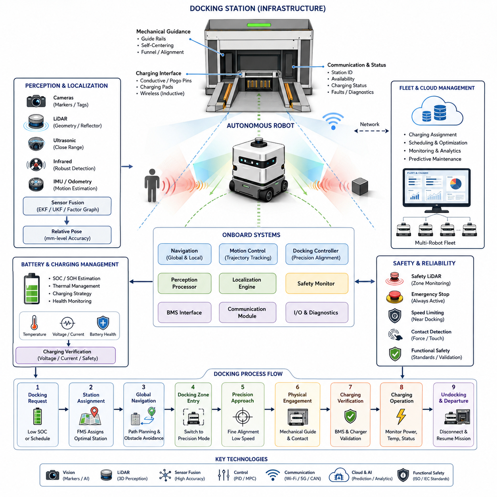
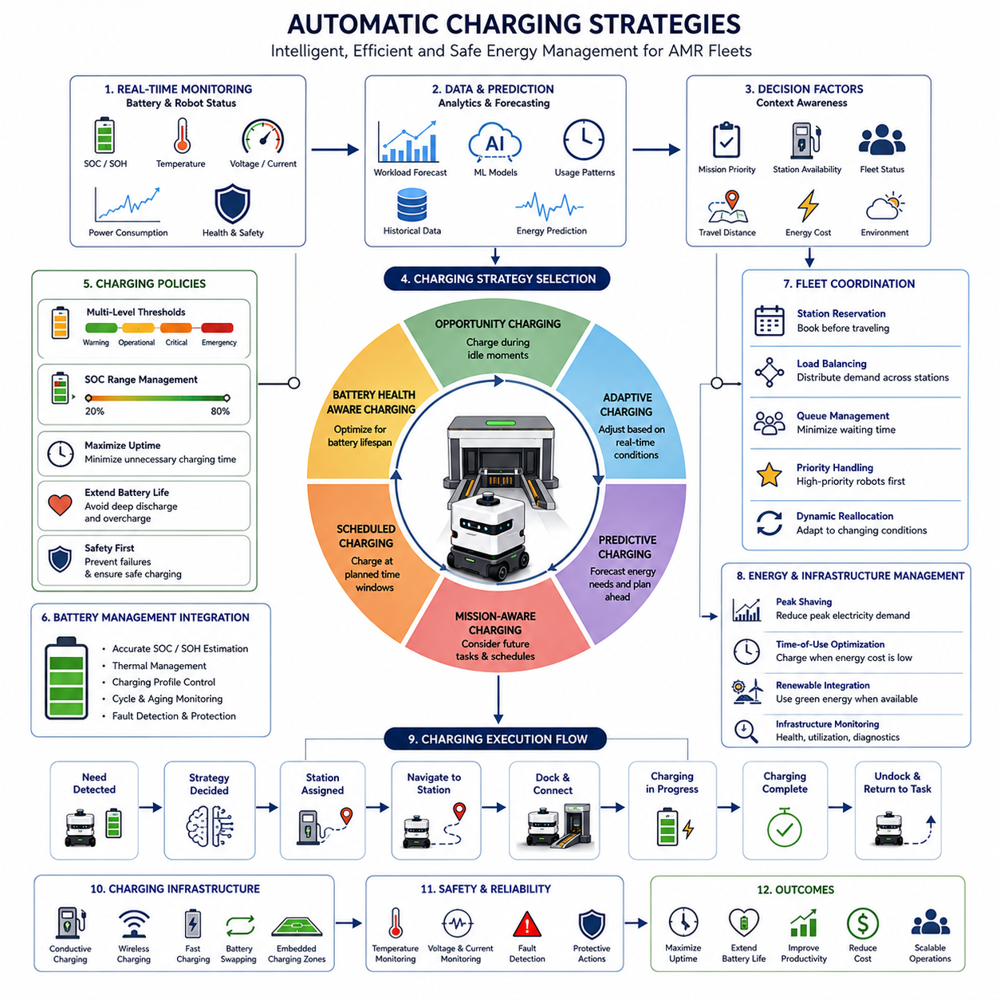
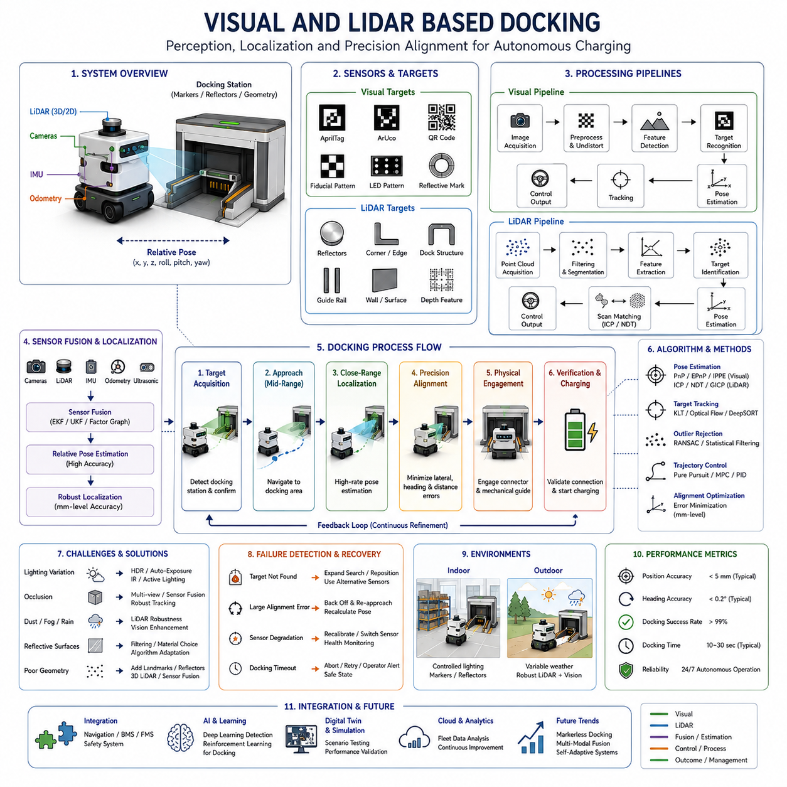
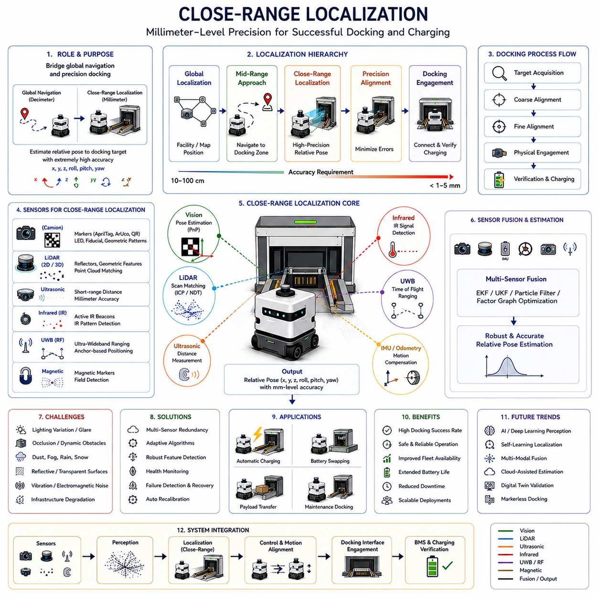
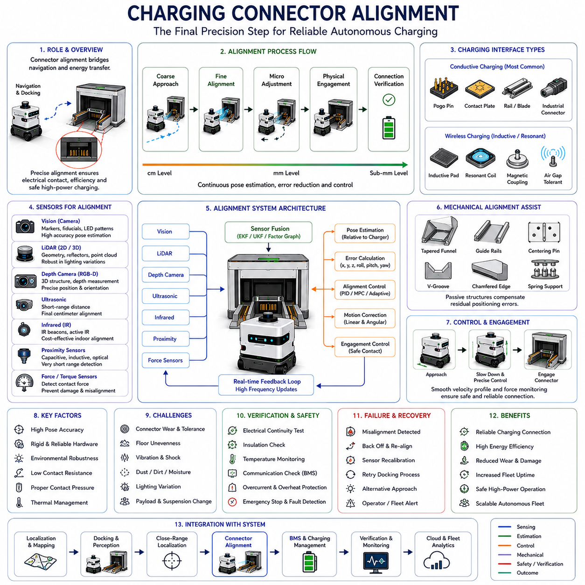
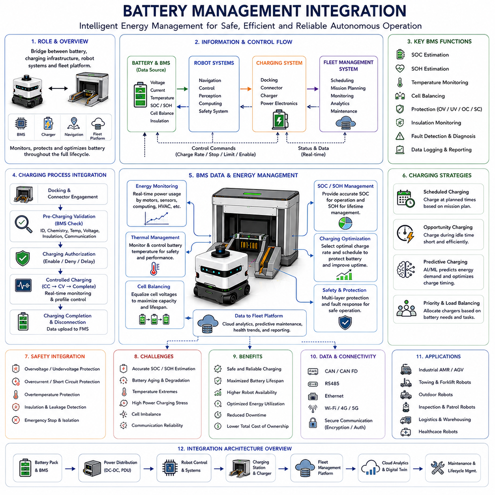
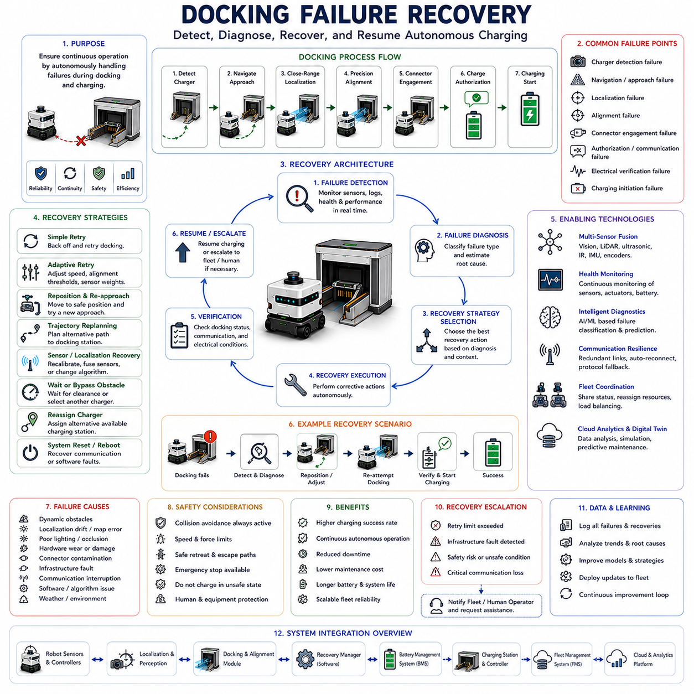
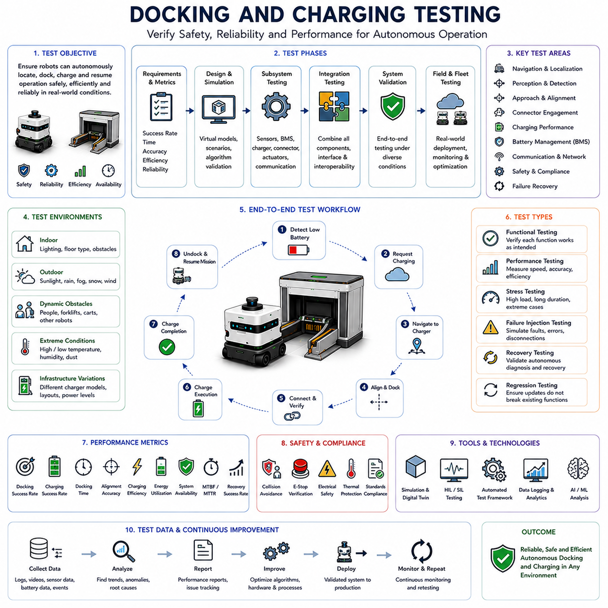

**Volume 05. Path Planning and Autonomous Navigation**

# Chapter 13. Docking and Charging

## 13.1 Docking System Architecture

{width="7.268055555555556in" height="7.268055555555556in"}

Docking System Architecture is one of the most critical subsystems in autonomous mobile robots because it enables fully autonomous energy replenishment, task continuation, and long-duration operation without human intervention. In modern AMR deployments, docking is no longer considered a simple charging procedure. Instead, it is a tightly integrated autonomous behavior that combines perception, localization, navigation, motion control, safety management, battery monitoring, communication infrastructure, and fleet coordination into a unified operational framework. Within the broader Docking and Charging domain of autonomous navigation, Docking System Architecture serves as the foundation that connects navigation systems with charging infrastructure and operational management systems. It defines how a robot identifies a docking station, plans an approach trajectory, aligns itself with charging hardware, establishes electrical contact, verifies charging conditions, and safely exits the station after charging is completed. This chapter belongs to the Docking and Charging section of the autonomous navigation framework and forms the basis for subsequent topics such as automatic charging strategies, visual docking, close-range localization, connector alignment, battery management integration, docking recovery, and charging validation.

A complete docking architecture can be viewed as a multi-layered system composed of infrastructure components, robot-side hardware, perception modules, localization systems, control algorithms, communication services, charging interfaces, safety mechanisms, and operational management software. Each layer performs a specific function while interacting continuously with neighboring layers. The overall objective is to achieve highly reliable docking operations under diverse environmental conditions while maintaining safety, repeatability, and efficiency.

At the infrastructure level, the docking station represents the physical interface between the robot and the charging ecosystem. Depending on the application, docking stations may be wall-mounted, floor-mounted, embedded into workstations, integrated into conveyor systems, attached to loading stations, or distributed throughout industrial facilities. In hospitals, docking stations may be located near nursing stations, storage rooms, and logistics hubs. In warehouses, charging stations are typically positioned near fleet waiting zones or traffic-neutral locations. Outdoor autonomous robots may utilize weather-resistant charging stations with protective enclosures and environmental monitoring capabilities.

The docking station contains several major subsystems. The first subsystem is the mechanical guidance structure. Mechanical guides help compensate for residual positioning errors and ensure proper alignment during final approach. These guides may include tapered rails, alignment funnels, guiding plates, mechanical grooves, spring-loaded structures, or passive self-centering mechanisms. Their purpose is to reduce dependence on ultra-high localization accuracy and increase docking reliability.

The second subsystem is the electrical charging interface. Charging interfaces vary depending on robot design and operational requirements. Conductive charging systems use physical electrical contacts, charging pads, pogo pins, conductive rails, or industrial charging connectors. Wireless charging systems use inductive power transfer or resonant charging technologies. Conductive charging generally offers higher efficiency and lower cost, while wireless charging reduces mechanical wear and maintenance requirements.

The third subsystem is the communication interface. Modern docking stations communicate with robots before, during, and after docking operations. Communication may occur through Wi-Fi, Bluetooth, Ethernet, CAN networks, industrial fieldbus systems, or proprietary wireless protocols. The docking station reports its operational status, charging availability, fault conditions, environmental status, and charging progress to the robot and fleet management systems.

On the robot side, the docking architecture includes perception sensors, localization systems, navigation modules, motion controllers, charging controllers, and battery management systems. These subsystems collaborate to achieve precise positioning and reliable charging engagement. The robot must continuously evaluate its state of charge, mission priorities, traffic conditions, charging station availability, and operational constraints before initiating docking procedures.

The perception layer plays a fundamental role in docking operations. During long-range navigation, the robot relies on global localization systems such as LiDAR SLAM, Visual SLAM, GNSS RTK, map matching, or sensor fusion localization. However, as the robot approaches the docking station, higher precision becomes necessary. Standard navigation localization may achieve accuracy within several centimeters, but charging operations often require millimeter-level alignment. Therefore, specialized docking perception systems become active during the final docking phase.

Various sensing technologies may be used for docking perception. Visual docking systems employ cameras and computer vision algorithms to detect markers, AprilTags, QR codes, fiducial markers, reflective targets, or dedicated docking patterns. LiDAR-based docking systems use geometric features, reflective landmarks, or environmental structures to estimate precise relative positioning. Ultrasonic sensors provide close-range distance measurements during final alignment. Infrared sensors detect docking targets under varying lighting conditions. Radar sensors can be used in challenging environmental situations where dust, fog, rain, or poor visibility may affect optical sensors.

Sensor fusion often provides the most robust solution. By combining visual, LiDAR, ultrasonic, IMU, odometry, and proximity sensing information, the robot can maintain accurate localization even when one sensing modality experiences temporary degradation. Sensor fusion architectures typically employ Extended Kalman Filters, Unscented Kalman Filters, factor graph optimization, or advanced probabilistic estimation frameworks.

Docking architecture typically divides navigation into multiple operational phases. The first phase is docking request generation. This phase begins when the robot determines that docking is necessary. Reasons may include low battery conditions, scheduled charging windows, mission completion, maintenance requirements, operational standby modes, or fleet optimization directives.

The second phase is charging station assignment. Fleet Management Systems evaluate available charging resources and assign an appropriate docking station. Assignment decisions consider battery state, robot priority, queue lengths, traffic conditions, travel distance, expected charging duration, and operational scheduling constraints.

The third phase is global navigation toward the charging station. During this phase, conventional navigation systems generate collision-free paths through the operational environment. Dynamic obstacle avoidance, traffic management, and safety systems remain active throughout the approach process.

The fourth phase is docking zone entry. Once the robot enters a predefined docking region, control authority gradually transitions from global navigation modules to precision docking controllers. Localization algorithms switch to close-range positioning modes. Sensor update rates increase, and precision alignment procedures become active.

The fifth phase is precision approach. During this phase, the robot continuously estimates its relative position with respect to the docking station. Specialized control algorithms generate fine motion commands that minimize lateral errors, angular errors, and longitudinal positioning deviations. Velocity limits are significantly reduced to ensure safe and precise operation.

The sixth phase is physical engagement. Mechanical alignment mechanisms assist the robot in establishing physical contact with the charging interface. Contact sensors, force sensors, proximity sensors, and electrical continuity verification systems confirm successful engagement.

The seventh phase is charging verification. The Battery Management System communicates with charging infrastructure to validate charging conditions. Voltage levels, current flow, connector status, battery temperature, insulation resistance, charging authorization, and communication integrity are verified before charging begins.

The eighth phase is charging operation. During charging, multiple subsystems monitor system performance. Charging power, battery health, temperature conditions, charging efficiency, connector integrity, and operational safety parameters are continuously evaluated.

The final phase is undocking and departure. After charging completion, the robot disconnects safely from the charging station, verifies readiness for operation, exits the docking area, and resumes mission execution.

Motion control architecture is particularly important during docking. Unlike normal navigation where moderate positional errors may be acceptable, docking operations require precise trajectory execution. Controllers typically use hierarchical architectures. High-level planners determine docking trajectories. Mid-level controllers generate velocity commands. Low-level controllers manage wheel motors, steering systems, and braking systems.

Several control strategies are commonly applied. PID controllers remain widely used due to simplicity and robustness. Model Predictive Control offers superior trajectory tracking and constraint handling. Pure Pursuit algorithms may be applied during structured approach paths. Advanced adaptive controllers compensate for wheel slip, payload variations, and environmental disturbances. For towing AMRs and heavy industrial robots, dynamic models may incorporate trailer behavior, articulation constraints, and load-dependent dynamics.

Safety architecture is an essential component of docking systems. Docking occurs near infrastructure, charging equipment, and often human operators. Multiple safety layers are therefore required. Safety LiDARs monitor docking zones for unexpected obstacles. Emergency stop systems remain active throughout docking operations. Speed limitations are enforced automatically during close-range maneuvers. Contact detection systems monitor abnormal forces during engagement. Redundant communication channels improve reliability in safety-critical environments.

Functional safety requirements often require compliance with industrial standards governing autonomous machinery, charging infrastructure, and collaborative robotics. Safety validation includes fault injection testing, communication loss scenarios, sensor failure simulations, power interruption testing, emergency stop verification, and abnormal alignment recovery procedures.

Battery Management System integration is another major architectural component. The docking system continuously exchanges information with the BMS. Battery state-of-charge estimation determines charging requirements. State-of-health monitoring evaluates battery degradation. Thermal management systems ensure safe charging temperatures. Charging strategies may vary according to battery chemistry, operational priorities, and energy optimization objectives.

Modern fleet-level deployments extend docking architecture beyond individual robots. Fleet Management Systems coordinate charging schedules across large robot populations. Predictive charging strategies balance operational availability and charging infrastructure utilization. Charging queues are optimized dynamically. Energy consumption forecasts influence charging decisions. Peak energy demand may be reduced through intelligent charging orchestration.

Cloud-connected docking architectures further enhance operational efficiency. Cloud platforms collect charging analytics, battery health metrics, docking success statistics, maintenance indicators, and infrastructure utilization data. Machine learning models can predict charging demand, identify abnormal behaviors, estimate component degradation, and optimize charging schedules. Digital twin systems can simulate docking operations and evaluate performance under various operational conditions before deployment.

Outdoor autonomous robots introduce additional architectural challenges. Environmental conditions such as rain, dust, snow, mud, temperature extremes, and sunlight variations affect docking reliability. Outdoor docking systems often require weatherproof enclosures, self-cleaning mechanisms, environmental sensing systems, protective covers, and ruggedized charging connectors. Localization systems may combine GNSS RTK, LiDAR mapping, visual landmarks, and close-range sensors to maintain docking accuracy in large outdoor environments.

For advanced industrial robots such as heavy-payload AMRs, autonomous forklifts, towing robots, and outdoor inspection platforms, docking architecture may support additional functions beyond charging. These functions include automated data upload, maintenance diagnostics, sensor calibration, software updates, battery swapping, payload exchange, mission synchronization, and fleet coordination services.

As AMR deployments continue to scale, Docking System Architecture increasingly becomes a strategic component of overall robot productivity. Reliable docking directly influences fleet availability, operational efficiency, maintenance costs, energy utilization, and system scalability. A well-designed docking architecture integrates navigation, perception, localization, control, charging, safety, and fleet management into a seamless autonomous process. The result is a robot ecosystem capable of operating continuously with minimal human intervention while maintaining high levels of safety, reliability, and operational performance. This architectural foundation supports the broader goals of intelligent autonomous mobility and enables the realization of large-scale industrial, logistics, healthcare, outdoor inspection, and smart city robotic deployments envisioned throughout modern AMR development frameworks.

## 13.2 Automatic Charging Strategies

{width="7.268055555555556in" height="7.268055555555556in"}

Automatic Charging Strategies represent one of the most important operational capabilities in modern Autonomous Mobile Robots (AMRs). While docking architecture provides the physical and software framework necessary for a robot to connect with a charging station, automatic charging strategies determine when, where, how, and for how long a robot should charge. These strategies directly influence fleet productivity, robot availability, battery lifespan, operational costs, energy efficiency, and overall system scalability. In large-scale autonomous robot deployments, charging behavior is no longer treated as a simple maintenance activity. Instead, it becomes an intelligent decision-making process that is tightly integrated with navigation systems, fleet management software, battery management systems, mission scheduling engines, cloud analytics platforms, and facility energy infrastructure. Within the Docking and Charging domain of autonomous navigation, Automatic Charging Strategies provide the operational intelligence that enables robots to maintain continuous autonomous operation with minimal human intervention.

In traditional robotic systems, charging often occurs when the battery reaches a predefined low threshold. The robot stops its current operation, navigates to a charging station, charges to full capacity, and then resumes work. While this approach is straightforward, it becomes inefficient as robot fleets scale and operational complexity increases. Modern AMR systems require more sophisticated charging policies capable of balancing battery health, mission priorities, charging infrastructure availability, energy consumption patterns, and fleet-wide operational objectives.

The primary objective of an automatic charging strategy is to ensure that a robot never reaches a critical energy state that could jeopardize mission execution or safety. At the same time, the charging strategy must maximize productive working time and minimize unnecessary charging interruptions. Achieving these goals requires continuous monitoring of battery status, workload forecasts, mission schedules, traffic conditions, charging station availability, and operational constraints.

The foundation of all automatic charging systems begins with battery state estimation. The Battery Management System continuously monitors State of Charge (SOC), State of Health (SOH), battery temperature, charging cycles, voltage levels, current flow, internal resistance, and thermal conditions. These measurements provide the information necessary for charging decisions. Accurate SOC estimation is particularly important because charging decisions based on inaccurate battery information may lead to unexpected shutdowns, mission failures, or excessive battery degradation.

Modern AMRs typically employ multiple charging thresholds rather than a single low-battery trigger. A warning threshold may indicate that charging should be planned soon. An operational threshold may initiate charging requests when mission conditions permit. A critical threshold may require immediate charging regardless of mission priorities. An emergency threshold may trigger safety procedures to prevent battery damage or unexpected robot shutdown. This multi-level architecture allows charging behavior to adapt dynamically to operational requirements.

One of the most widely used charging strategies is Opportunity Charging. In this approach, robots charge whenever short periods of inactivity become available during normal operations. Rather than waiting until batteries are nearly depleted, robots opportunistically replenish energy during idle intervals. For example, a hospital delivery robot may spend several minutes charging while waiting for the next transportation request. A warehouse AMR may perform brief charging sessions while waiting for inventory assignments. Opportunity charging reduces deep battery discharge cycles and often extends battery lifespan while maximizing robot availability.

Opportunity charging becomes especially effective in environments where tasks are distributed throughout the day with intermittent idle periods. The strategy requires close integration between task scheduling systems and charging infrastructure. Fleet management software continuously evaluates whether a robot should remain available for work or temporarily charge during periods of low operational demand.

Another common approach is Scheduled Charging. Scheduled charging uses predefined charging windows established according to operational schedules. Manufacturing facilities operating multiple work shifts often employ scheduled charging strategies. Robots may charge during shift transitions, planned production breaks, lunch periods, maintenance windows, or overnight downtime. This approach simplifies energy planning and charging infrastructure utilization but may reduce operational flexibility when unexpected workloads occur.

Adaptive charging strategies provide a more advanced alternative. These strategies dynamically adjust charging behavior based on real-time operational conditions. Adaptive charging systems continuously analyze mission priorities, battery status, charging station availability, traffic conditions, and energy demand forecasts. A robot with sufficient battery reserves may postpone charging if critical tasks are pending. Conversely, charging may be initiated earlier if future charging opportunities are expected to become limited.

Predictive charging represents one of the most sophisticated charging approaches used in modern AMR fleets. Predictive systems leverage historical operational data, machine learning algorithms, workload forecasts, and energy consumption models to anticipate future charging requirements. Rather than reacting to current battery conditions, predictive charging systems estimate future energy demand and proactively schedule charging activities. For example, if a warehouse experiences peak order volumes every afternoon, robots may perform charging sessions during the morning to ensure maximum availability during high-demand periods.

Machine learning models can further enhance predictive charging by identifying patterns in robot utilization, task assignments, traffic congestion, environmental conditions, and battery performance. These models continuously improve charging decisions based on operational experience, enabling increasingly efficient fleet-wide energy management.

Charging strategy design must also account for battery chemistry characteristics. Different battery technologies exhibit different charging behaviors and degradation mechanisms. Lithium-ion batteries generally benefit from avoiding deep discharge cycles and prolonged operation at maximum charge levels. Frequent charging between moderate SOC ranges often improves long-term battery health. Consequently, many industrial AMR fleets avoid maintaining batteries continuously at 100% charge unless operational requirements justify doing so.

Battery aging considerations significantly influence charging policies. Aggressive charging strategies may maximize short-term availability but accelerate long-term battery degradation. Conversely, conservative charging strategies may preserve battery lifespan but reduce operational productivity. Effective charging systems balance these competing objectives by incorporating battery health metrics into charging decisions.

Fleet-level charging coordination introduces additional complexity. In environments with dozens or hundreds of robots, charging stations become shared resources that must be managed efficiently. Fleet Management Systems continuously coordinate charging schedules to avoid congestion and charging bottlenecks. Charging assignments consider battery status, task priorities, station availability, travel distance, queue lengths, and expected charging durations.

Charging station reservation mechanisms are frequently implemented in large fleets. Robots may reserve charging stations before initiating navigation toward them. Reservation systems reduce conflicts, eliminate unnecessary waiting, and improve charging predictability. Dynamic reservation systems can reassign charging resources in response to changing operational conditions.

Load balancing is another important charging strategy component. Rather than directing all robots toward the nearest charging station, fleet managers distribute charging demand across multiple stations. This approach improves infrastructure utilization and prevents localized congestion. Load balancing algorithms often consider travel time, charging capacity, station occupancy, and future charging forecasts.

Energy management considerations become increasingly important as fleet sizes grow. Industrial facilities may face utility demand charges associated with peak electrical consumption. Smart charging strategies can reduce operational costs by scheduling charging activities during periods of lower electricity prices or reduced facility energy demand. Time-of-use energy pricing, renewable energy availability, and facility power constraints may all influence charging decisions.

Cloud-based charging management systems provide additional optimization opportunities. Cloud platforms aggregate operational data from entire fleets and perform large-scale analytics. These systems monitor charging performance, battery health trends, infrastructure utilization, charging success rates, and energy consumption patterns. Predictive analytics can identify potential charging failures, infrastructure degradation, or battery performance anomalies before operational disruptions occur.

Charging strategy implementation typically requires close integration with navigation systems. When charging becomes necessary, the navigation system must generate safe and efficient routes to charging stations. Dynamic obstacle avoidance, traffic management, and fleet coordination remain active throughout the charging journey. Navigation decisions may also be influenced by charging priorities. Robots approaching critical battery levels may receive elevated traffic priority to ensure timely charging access.

Mission-aware charging strategies represent another advanced capability. Rather than treating charging independently from operational tasks, mission-aware systems consider future assignments when making charging decisions. A robot expected to perform a long transportation task may charge proactively before receiving the assignment. Conversely, a robot nearing completion of a mission may delay charging until task execution is finished.

Industrial environments often require differentiated charging policies for different robot classes. Heavy-payload transport robots may consume energy at significantly different rates than lightweight service robots. Outdoor autonomous vehicles operating on rough terrain may exhibit highly variable power consumption depending on environmental conditions. Inspection robots carrying high-performance AI computing platforms may experience substantial energy demand fluctuations. Charging strategies must account for these operational differences.

Outdoor autonomous robots introduce additional challenges for charging management. Environmental conditions such as temperature, humidity, rainfall, dust, and solar radiation influence battery performance and charging efficiency. Cold environments may require battery preconditioning before charging begins. High-temperature conditions may necessitate thermal management procedures to prevent battery degradation. Charging strategies for outdoor robots often incorporate weather forecasts and environmental monitoring data.

Wireless charging systems create new opportunities for automatic charging strategies. Unlike conventional conductive charging systems, wireless charging may support partial charging during routine operations without requiring precise mechanical alignment. Some facilities deploy embedded charging zones in waiting areas, intersections, workstations, or loading zones. Robots can replenish energy continuously throughout normal operations, reducing dependence on dedicated charging sessions.

Battery swapping strategies provide an alternative approach for applications requiring maximum operational availability. Rather than waiting for batteries to recharge, robots exchange depleted batteries for fully charged replacements. Automated battery exchange systems can perform this process within minutes. While battery swapping introduces additional infrastructure complexity, it significantly reduces operational downtime and is particularly valuable in high-throughput logistics environments.

Safety remains a central consideration throughout automatic charging operations. Charging systems continuously monitor voltage, current, temperature, insulation integrity, communication status, connector conditions, and environmental factors. Abnormal conditions trigger protective actions such as charging suspension, emergency shutdown, fault reporting, or maintenance requests. Redundant monitoring systems help ensure safe operation even under fault conditions.

Cybersecurity has also become increasingly important in charging infrastructure. Charging systems are often connected to facility networks, cloud platforms, and fleet management systems. Secure communication protocols, authentication mechanisms, encryption technologies, and access control policies protect charging operations from unauthorized access and cyber threats.

As AMR deployments continue to expand across manufacturing, logistics, healthcare, agriculture, smart cities, and industrial inspection applications, automatic charging strategies are evolving from simple battery management functions into sophisticated operational intelligence systems. Future charging architectures will increasingly incorporate artificial intelligence, predictive analytics, digital twins, cloud-native optimization platforms, renewable energy integration, autonomous energy forecasting, and fleet-wide learning mechanisms.

The ultimate goal of automatic charging strategies is not merely to recharge batteries but to optimize the entire operational lifecycle of autonomous robots. By intelligently coordinating charging decisions with mission execution, fleet operations, energy management, infrastructure utilization, and battery health preservation, automatic charging systems become a fundamental enabler of scalable autonomous mobility. Their effectiveness directly influences robot productivity, fleet efficiency, operational reliability, and long-term deployment success, making them one of the most strategically important components of modern autonomous robotic ecosystems.

## 13.3 Visual and LiDAR-Based Docking

{width="7.268055555555556in" height="7.268055555555556in"}

Visual and LiDAR-Based Docking is one of the most important enabling technologies in autonomous mobile robot systems because it provides the precision localization capabilities required during the final stage of docking operations. While conventional navigation systems are designed to guide a robot through an environment with centimeter-level accuracy, successful docking often requires millimeter-level positioning accuracy to establish reliable electrical connections, align charging interfaces, engage mechanical guidance systems, and ensure safe charging operations. Visual and LiDAR-based docking systems bridge the gap between global navigation and precision positioning by providing robust close-range localization and alignment capabilities. Within the Docking and Charging domain of autonomous navigation, Visual and LiDAR-Based Docking serves as the perception and localization foundation that enables autonomous robots to consistently locate, approach, align with, and connect to docking stations under a wide range of environmental and operational conditions.

The docking process can generally be divided into long-range navigation, medium-range approach, close-range localization, precision alignment, physical engagement, and charging verification. During long-range navigation, robots typically rely on localization technologies such as LiDAR SLAM, Visual SLAM, GNSS RTK, map matching, odometry, or multi-sensor fusion. These systems provide sufficient accuracy for navigation throughout a facility or outdoor environment. However, as the robot approaches the docking station, the localization requirements become significantly more demanding. Small positioning errors that are acceptable during navigation may become unacceptable during charging operations. Consequently, specialized visual and LiDAR docking systems become active during the final docking stages.

Visual docking systems utilize cameras and computer vision algorithms to identify docking targets and estimate the relative position between the robot and the docking station. The docking station typically contains dedicated visual markers designed to facilitate reliable detection and localization. These markers may include AprilTags, ArUco markers, QR codes, fiducial patterns, reflective targets, geometric structures, LED patterns, colored landmarks, or custom-designed visual identifiers. By detecting these features, the robot can calculate its position, orientation, and alignment relative to the docking infrastructure.

One of the primary advantages of visual docking systems is their ability to provide highly accurate pose estimation. Modern computer vision algorithms can determine six-degree-of-freedom relative positioning, including lateral displacement, longitudinal displacement, vertical offset, roll, pitch, and yaw orientation. This information enables the docking controller to generate precise motion commands that guide the robot toward the docking station with minimal positioning error.

Camera selection significantly influences docking performance. Monocular cameras provide cost-effective solutions and are widely used in indoor environments. Stereo cameras offer depth perception and improved three-dimensional localization capabilities. RGB-D cameras combine conventional image information with depth measurements, simplifying close-range pose estimation. High-resolution industrial cameras may be used when extremely precise alignment is required. Wide-angle cameras provide increased target acquisition capabilities, while telephoto lenses may improve long-distance detection performance.

Image processing pipelines form the computational foundation of visual docking systems. These pipelines typically include image acquisition, distortion correction, feature extraction, target detection, marker identification, pose estimation, tracking, and control command generation. Advanced systems may also incorporate machine learning models capable of recognizing docking stations under varying lighting conditions, partial occlusions, environmental clutter, and structural variations.

Artificial intelligence has become increasingly important in visual docking applications. Deep learning-based object detection models can identify docking stations without relying exclusively on artificial markers. Neural networks can learn visual characteristics associated with charging infrastructure and maintain robust detection performance even when environmental conditions change significantly. Semantic understanding techniques may further improve docking reliability by incorporating contextual information about surrounding structures and operational environments.

Lighting conditions represent one of the major challenges for visual docking systems. Variations in ambient illumination, shadows, reflections, glare, sunlight exposure, and artificial lighting can significantly affect image quality. Indoor environments generally provide more controlled lighting conditions, whereas outdoor deployments may experience substantial variations throughout the day. To address these challenges, docking systems often employ adaptive exposure control, high dynamic range imaging, infrared illumination, active lighting systems, or image enhancement algorithms.

LiDAR-based docking systems provide an alternative and highly robust approach to precision docking. Rather than relying on visual appearance, LiDAR sensors measure distances by emitting laser pulses and analyzing reflected signals. This approach generates detailed geometric representations of the environment and enables accurate localization regardless of ambient lighting conditions. LiDAR-based docking is particularly valuable in industrial environments where visual conditions may be challenging due to dust, shadows, changing illumination, or reflective surfaces.

LiDAR docking systems typically identify geometric features associated with the docking station. These features may include docking structures, reflective targets, walls, charging cabinets, guiding rails, corner geometries, or specially designed landmarks. By comparing real-time LiDAR observations with known docking station models, the robot estimates its relative position and orientation with high accuracy.

Reflective targets are commonly used to enhance LiDAR docking performance. Highly reflective materials generate strong return signals that can be detected reliably even in complex environments. Reflectors may be installed around charging stations, loading bays, maintenance stations, or other docking locations. Specialized algorithms identify reflector patterns and use them as reference points for precision localization.

Three-dimensional LiDAR systems offer additional capabilities compared to two-dimensional sensors. While 2D LiDAR sensors primarily provide horizontal scanning information, 3D LiDAR systems generate complete spatial representations of docking environments. This additional information improves robustness against environmental variations and supports docking operations in more complex scenarios. Three-dimensional sensing becomes particularly valuable for outdoor robots, autonomous forklifts, heavy industrial platforms, and robots operating in unstructured environments.

LiDAR-based localization pipelines typically include point cloud acquisition, filtering, segmentation, feature extraction, target identification, geometric matching, pose estimation, and tracking. Point cloud registration algorithms such as ICP, NDT, GICP, and scan matching techniques are commonly employed to estimate relative positioning. These algorithms continuously compare observed LiDAR data with reference models to maintain accurate localization throughout the docking process.

Visual and LiDAR systems each possess unique strengths and limitations. Visual systems generally provide rich semantic information and highly accurate pose estimation when environmental conditions are favorable. However, performance may degrade under poor lighting conditions, heavy shadows, glare, fog, or camera contamination. LiDAR systems are less sensitive to illumination changes and often provide more consistent performance across varying environmental conditions. However, LiDAR sensors may encounter challenges with highly reflective surfaces, transparent materials, heavy precipitation, or sparse geometric features.

For this reason, many modern docking architectures employ sensor fusion approaches that combine visual and LiDAR information. Sensor fusion allows the robot to leverage the complementary strengths of multiple sensing modalities. Cameras provide semantic understanding and marker recognition, while LiDAR sensors contribute precise geometric measurements and environmental robustness. Combined systems often achieve significantly higher reliability than either technology alone.

Sensor fusion frameworks typically integrate camera data, LiDAR measurements, IMU information, wheel odometry, ultrasonic sensors, infrared sensors, and proximity detectors. Extended Kalman Filters, Unscented Kalman Filters, Particle Filters, factor graph optimization, and probabilistic fusion algorithms are commonly used to estimate the robot\'s relative pose. Redundant sensing improves fault tolerance and enables continued operation even when individual sensors experience temporary degradation.

The docking process itself generally begins with docking target acquisition. As the robot enters a predefined docking zone, visual and LiDAR sensors begin searching for docking features. Once the docking station is detected, relative pose estimation algorithms calculate the position and orientation of the robot with respect to the target.

During the medium-range approach phase, the robot navigates toward the docking station while continuously updating localization estimates. Dynamic obstacle avoidance systems remain active to ensure safe operation. Motion planning algorithms generate approach trajectories that satisfy kinematic constraints while minimizing alignment errors.

As the robot enters the precision docking region, localization update frequencies increase and tighter control parameters are applied. The docking controller continuously evaluates lateral errors, heading errors, distance errors, and alignment quality metrics. Velocity limits are progressively reduced to improve positioning accuracy and safety.

The final alignment phase requires the highest level of precision. Small corrections are applied to achieve exact positioning before physical engagement occurs. Depending on the charging infrastructure, alignment tolerances may range from several centimeters to only a few millimeters. Mechanical guidance structures often provide additional error compensation during this phase.

Physical engagement occurs when the robot establishes contact with the charging interface. Contact sensors, force sensors, proximity detectors, and electrical continuity verification systems confirm successful docking. The Battery Management System then initiates charging verification procedures before energy transfer begins.

Industrial environments introduce numerous challenges for visual and LiDAR docking systems. Warehouses often contain moving forklifts, pallets, shelving systems, and dynamic obstacles. Hospitals may experience frequent pedestrian traffic and changing environmental conditions. Manufacturing facilities may contain dust, vibrations, electromagnetic interference, and varying illumination levels. Outdoor deployments must contend with rain, fog, snow, direct sunlight, wind, mud, and temperature fluctuations.

To address these challenges, docking systems incorporate robust failure detection and recovery mechanisms. If docking targets cannot be detected, alternative sensing methods may be activated. If alignment errors exceed acceptable thresholds, the robot may back away and attempt another approach. Recovery behaviors often include sensor recalibration, trajectory replanning, docking zone repositioning, and operator notification procedures.

Artificial intelligence is increasingly being applied to docking optimization. Machine learning models can predict docking success probabilities, identify environmental factors affecting docking performance, optimize approach trajectories, and automatically adapt controller parameters. Reinforcement learning techniques have demonstrated promising results in autonomous docking scenarios where robots learn optimal docking behaviors through repeated interaction with charging infrastructure.

Cloud-connected docking architectures provide additional opportunities for performance improvement. Operational data collected from large robot fleets can be analyzed to identify recurring docking challenges, infrastructure issues, environmental influences, and sensor performance trends. Fleet-wide analytics support continuous improvement of docking algorithms and infrastructure design.

Digital twin environments are becoming valuable tools for docking system development. High-fidelity simulations allow engineers to evaluate docking performance under thousands of operating conditions before deployment. Simulation environments can model sensor behavior, environmental variability, robot dynamics, charging infrastructure characteristics, and failure scenarios. This approach reduces development costs and improves deployment reliability.

Future visual and LiDAR docking systems are expected to incorporate advanced AI perception models, foundation models for robotics, multi-modal sensor fusion, self-learning localization frameworks, cloud-assisted perception, and adaptive control architectures. Robots will increasingly be capable of identifying charging infrastructure without artificial markers, adapting automatically to changing environments, and optimizing docking behavior through continuous learning.

As autonomous robot deployments continue to expand across manufacturing, logistics, healthcare, agriculture, smart cities, defense applications, and industrial inspection environments, Visual and LiDAR-Based Docking will remain a foundational technology for reliable autonomous charging. By combining high-precision perception, robust localization, intelligent sensor fusion, adaptive control, and advanced operational analytics, these systems enable robots to achieve consistent docking performance while maintaining safety, efficiency, and operational continuity. Their successful implementation directly influences robot availability, fleet productivity, battery management effectiveness, and overall deployment scalability, making them one of the most critical subsystems within modern autonomous mobile robot ecosystems.

## 13.4 Close Range Localization

{width="7.268055555555556in" height="7.268055555555556in"}

Close-Range Localization is one of the most critical technologies within autonomous docking systems because it enables robots to achieve the final positioning accuracy required for successful docking, charging, payload transfer, maintenance operations, and precision interaction with infrastructure. While global localization systems such as LiDAR SLAM, Visual SLAM, GNSS RTK, map matching, and multi-sensor fusion can typically achieve localization accuracy ranging from several centimeters to tens of centimeters, docking operations often require positioning accuracy measured in millimeters. This significant difference in accuracy requirements creates a localization gap that must be addressed by dedicated close-range localization technologies. Within the Docking and Charging architecture, Close-Range Localization serves as the bridge between large-scale navigation and precision docking, ensuring that autonomous robots can accurately determine their relative position and orientation with respect to docking stations during the final stages of approach and engagement.

The primary objective of close-range localization is to estimate the robot's relative pose with extremely high precision. Relative pose estimation refers to determining the robot's position and orientation relative to a specific target, such as a charging station, docking interface, maintenance platform, battery swapping system, loading station, or automated workstation. Unlike global localization, which determines where the robot is within an entire map, close-range localization focuses exclusively on local geometric relationships between the robot and the docking target.

Modern autonomous robots typically operate using hierarchical localization architectures. At the highest level, global localization systems determine the robot's position within a facility, warehouse, hospital, factory, or outdoor environment. Mid-range localization systems guide the robot toward the docking zone. Once the robot enters a predefined docking region, control transitions to close-range localization modules capable of providing substantially higher precision. This hierarchical approach improves computational efficiency while maintaining high accuracy where it is most needed.

Close-range localization becomes active when the robot reaches a docking activation boundary. This boundary may be defined by distance thresholds, map zones, visual triggers, infrastructure communication signals, or fleet management commands. Once activated, localization update frequencies increase significantly, sensor processing priorities change, and specialized docking algorithms begin operating. The robot gradually shifts from navigation-oriented localization to alignment-oriented localization.

One of the fundamental challenges of close-range localization is the requirement to estimate multiple pose parameters simultaneously. The robot must determine lateral displacement, longitudinal displacement, vertical offset, heading angle, roll angle, and pitch angle relative to the docking station. Even small errors in any of these parameters can prevent successful charging engagement or mechanical alignment. Consequently, close-range localization systems often operate at significantly higher accuracy levels than conventional navigation systems.

Vision-based localization is among the most widely used close-range localization methods. Cameras provide rich environmental information and can detect specialized docking markers with high accuracy. Visual localization systems identify features such as AprilTags, ArUco markers, QR codes, fiducial markers, geometric patterns, LED indicators, reflective targets, or custom-designed docking symbols. Once detected, computer vision algorithms calculate the relative pose between the camera and the target.

Pose estimation algorithms play a central role in visual localization. Perspective-n-Point (PnP) algorithms are commonly used to estimate six-degree-of-freedom poses from known marker geometries. By combining camera calibration information with observed image features, the robot can determine its precise position relative to the docking station. Modern implementations frequently achieve millimeter-level accuracy under favorable environmental conditions.

Stereo vision systems enhance localization performance by directly estimating depth through binocular imaging. By analyzing disparities between synchronized camera images, stereo systems generate three-dimensional information about the docking environment. This additional depth information improves robustness and reduces ambiguity during final alignment procedures.

RGB-D cameras further simplify close-range localization by combining traditional color imaging with depth sensing technologies. Structured light sensors and time-of-flight cameras directly measure distance information, enabling accurate pose estimation even when visual features are sparse. RGB-D systems are widely used in indoor AMR applications due to their simplicity and relatively low computational requirements.

LiDAR-based localization provides an alternative approach that is highly robust against lighting variations. LiDAR sensors generate precise distance measurements and create geometric representations of the surrounding environment. Close-range LiDAR localization systems compare real-time observations with known docking station geometries to estimate relative positioning. This approach remains effective under challenging lighting conditions where visual systems may struggle.

Reflector-based localization is particularly common in industrial docking systems. High-reflectivity targets are strategically installed around docking stations to create easily identifiable landmarks. LiDAR sensors detect these reflectors with high reliability, allowing the robot to calculate its position relative to the docking infrastructure. Reflector-based systems often achieve excellent repeatability and are widely deployed in manufacturing and logistics environments.

Three-dimensional LiDAR systems provide additional localization capabilities by capturing complete spatial representations of docking environments. Unlike two-dimensional scanners that observe only a single horizontal plane, 3D LiDAR sensors generate volumetric point clouds. These point clouds contain rich geometric information that can be used to estimate precise poses even in complex environments with varying elevations and structural features.

Point cloud registration techniques are fundamental to LiDAR-based localization. Algorithms such as Iterative Closest Point (ICP), Generalized ICP (GICP), Normal Distribution Transform (NDT), and feature-based matching continuously align observed point clouds with reference models. These algorithms minimize geometric differences between measured and expected structures to estimate relative position and orientation.

Ultrasonic localization systems are frequently used during the final centimeters of docking. Ultrasonic sensors provide highly accurate short-range distance measurements and are particularly useful when charging connectors require extremely precise alignment. Multiple ultrasonic sensors may be positioned around the robot to estimate lateral and longitudinal offsets relative to docking surfaces.

Infrared localization technologies offer another solution for close-range positioning. Infrared emitters and receivers can establish precise spatial relationships between the robot and the docking station. Active infrared systems often perform reliably in environments where visible lighting conditions are highly variable. Infrared sensors are commonly used in consumer robots, service robots, and industrial charging applications.

Magnetic localization systems are occasionally employed when environmental conditions are particularly challenging. Embedded magnetic markers generate reference fields that can be detected by onboard sensors. Magnetic systems are generally unaffected by lighting conditions, dust, fog, or visual occlusions. However, their deployment requires specialized infrastructure and careful electromagnetic compatibility considerations.

Radio-frequency localization technologies may also contribute to close-range positioning. Ultra-Wideband (UWB) systems can provide highly accurate distance measurements between fixed anchors and mobile robots. UWB localization is particularly useful in large facilities where multiple docking stations must be managed simultaneously. Recent advancements have improved UWB accuracy to levels suitable for certain docking applications.

Although each sensing technology offers unique advantages, no single sensor performs optimally under all operating conditions. Consequently, modern close-range localization architectures increasingly rely on sensor fusion. Sensor fusion combines information from cameras, LiDAR sensors, IMUs, wheel encoders, ultrasonic sensors, infrared sensors, UWB systems, and proximity detectors. The resulting localization estimate is typically more accurate and more robust than estimates generated by individual sensors.

Probabilistic estimation frameworks are commonly used for sensor fusion. Extended Kalman Filters, Unscented Kalman Filters, Particle Filters, factor graph optimization methods, and Bayesian estimation techniques continuously integrate sensor observations while accounting for uncertainty. These algorithms provide smooth, reliable pose estimates even when individual sensor measurements contain noise or temporary errors.

Motion control systems depend heavily on close-range localization accuracy. The localization system continuously provides pose updates to the docking controller, which generates corrective motion commands. As the robot approaches the docking station, localization update rates often increase dramatically. High-frequency updates allow the controller to respond rapidly to small alignment errors and maintain precise trajectories.

The docking process generally consists of multiple localization phases. During target acquisition, the robot identifies the docking station and obtains an initial pose estimate. During coarse alignment, larger positioning errors are gradually reduced. Fine alignment follows, where the robot continuously minimizes remaining lateral, longitudinal, and angular offsets. Finally, physical engagement occurs when the robot establishes contact with the charging interface.

Mechanical guidance structures frequently complement close-range localization systems. While localization algorithms strive to achieve perfect alignment, practical systems often incorporate passive error compensation mechanisms. Tapered guides, centering rails, alignment funnels, spring-loaded connectors, and compliant charging interfaces help absorb residual positioning errors during final engagement.

Industrial deployments present numerous challenges for close-range localization. Warehouses contain moving forklifts, pallets, shelving systems, and changing inventory configurations. Hospitals introduce pedestrian traffic, dynamic obstacles, and variable lighting conditions. Manufacturing facilities may experience vibration, dust, smoke, and electromagnetic interference. Outdoor environments add weather conditions such as rain, fog, snow, mud, wind, and sunlight variability.

Environmental robustness therefore becomes a key design requirement. Localization systems must maintain accuracy despite sensor contamination, temporary occlusions, infrastructure degradation, or environmental changes. Redundant sensing modalities improve fault tolerance and increase operational reliability. Health monitoring systems continuously evaluate sensor performance and detect abnormal conditions before localization failures occur.

Failure detection and recovery mechanisms are essential components of close-range localization architectures. If pose uncertainty exceeds acceptable limits, docking operations may be suspended. Recovery procedures can include repositioning maneuvers, alternative sensor activation, recalibration routines, target reacquisition, or complete docking retries. These mechanisms prevent unsafe operations and improve overall system reliability.

Artificial intelligence is increasingly influencing close-range localization development. Deep learning models can identify docking features under challenging environmental conditions and improve pose estimation robustness. Neural networks may learn sensor fusion strategies that outperform traditional hand-engineered algorithms. Reinforcement learning approaches can optimize docking behaviors through repeated experience and continuous adaptation.

Cloud-connected localization systems introduce additional opportunities for performance improvement. Fleet-wide data analysis enables identification of recurring localization issues, environmental influences, infrastructure degradation patterns, and sensor reliability trends. Cloud-based analytics support continuous algorithm refinement and predictive maintenance strategies.

Digital twin environments have become valuable tools for localization development and validation. High-fidelity simulations allow engineers to evaluate localization performance across thousands of operating scenarios before deployment. Simulated environments can model sensor characteristics, infrastructure variations, environmental conditions, and failure situations. This capability significantly reduces development risks and improves deployment confidence.

Future close-range localization systems are expected to leverage foundation models for robotics, multi-modal AI perception, self-supervised learning, cloud-assisted localization, adaptive sensor fusion, and real-time digital twin integration. These technologies will enable robots to achieve higher accuracy, greater robustness, and increased adaptability while reducing dependence on artificial markers and specialized infrastructure.

As autonomous robot deployments continue to expand across logistics, manufacturing, healthcare, smart cities, agriculture, defense, and infrastructure inspection, Close-Range Localization will remain a cornerstone technology for autonomous docking and charging. By providing the precise relative positioning required during final alignment and engagement, close-range localization enables reliable charging, improved fleet availability, extended operational autonomy, and scalable robot deployment. Its effectiveness directly influences docking success rates, battery management efficiency, system productivity, and overall operational reliability, making it one of the most essential technologies within the modern autonomous mobile robot ecosystem.

## 13.5 Charging Connector Alignment

{width="7.268055555555556in" height="7.268055555555556in"}

Charging Connector Alignment is one of the most critical technologies within autonomous docking and charging systems because it directly determines whether electrical energy can be safely and reliably transferred between the autonomous mobile robot and the charging infrastructure. While global navigation, close-range localization, visual docking, and LiDAR-based positioning guide the robot toward the charging station, connector alignment represents the final precision operation that physically establishes the charging connection. Even if a robot successfully reaches the docking station and accurately estimates its position, charging cannot begin unless the charging connector, charging pad, contact plate, or power transfer interface is properly aligned. Consequently, Charging Connector Alignment serves as the final mechanical and electrical bridge between autonomous navigation and energy replenishment. Within the Docking and Charging framework, this technology transforms precise localization into successful charging engagement and enables continuous autonomous operation across large robot fleets.

The fundamental objective of connector alignment is to minimize positional and angular errors between the robot-side charging interface and the charging station interface. During charging operations, electrical contacts must be positioned within predefined tolerance ranges to ensure stable current flow, prevent excessive wear, avoid connector damage, and maintain operational safety. Depending on the charging technology and power transfer mechanism, alignment tolerances may vary from several millimeters to fractions of a millimeter. High-power charging systems generally require more stringent alignment requirements because larger currents increase sensitivity to contact resistance and connection quality.

Connector alignment begins long before physical contact occurs. During the docking process, the navigation system gradually transitions from facility-scale localization to docking-scale localization and finally to connector-scale alignment. Each stage progressively reduces positioning uncertainty. The final alignment phase typically occurs within the last few centimeters of approach, where specialized sensing systems, precision controllers, and mechanical guidance mechanisms work together to achieve the required accuracy.

Modern AMR charging systems employ several charging interface architectures. Conductive charging systems use physical electrical contacts that must be directly aligned and connected. These may include spring-loaded pogo pins, conductive plates, charging rails, industrial charging connectors, blade contacts, or custom-designed electrical interfaces. Wireless charging systems reduce some alignment requirements by transferring power through inductive coupling or resonant energy transfer. However, even wireless systems often require relatively precise positioning to maximize charging efficiency and minimize energy losses.

Conductive charging remains the most widely deployed charging technology in industrial AMR systems because of its high efficiency, relatively low cost, and ability to support high charging power levels. In conductive systems, connector alignment becomes a critical engineering challenge. Small positioning errors may result in incomplete electrical contact, increased contact resistance, overheating, connector wear, charging interruptions, or complete charging failure.

Mechanical alignment structures provide the first layer of alignment assistance. Rather than relying exclusively on localization accuracy, docking stations often incorporate passive guidance mechanisms that help compensate for residual positioning errors. These mechanisms may include tapered funnels, alignment rails, centering grooves, guide pins, chamfered surfaces, conical interfaces, V-shaped channels, spring-loaded supports, or self-centering structures. Such designs effectively enlarge the allowable docking tolerance window and improve charging reliability.

The geometry of the charging connector significantly influences alignment requirements. Flat contact plates generally allow greater positional flexibility but may require higher contact pressure. Pin-and-socket connectors provide secure electrical engagement but demand tighter alignment tolerances. Rail-based charging systems permit some lateral movement during engagement and are commonly used in industrial applications. Magnetic connectors introduce self-aligning behavior and reduce mechanical stress during connection.

Position estimation accuracy is one of the primary determinants of successful connector alignment. The robot must estimate the relative position between the charging connector and the charging station with sufficient precision. Visual sensors, LiDAR systems, depth cameras, ultrasonic sensors, infrared sensors, proximity detectors, force sensors, and contact switches may all contribute to alignment estimation. Multi-sensor fusion approaches are frequently employed to maximize accuracy and robustness.

Vision-based alignment systems often use dedicated markers positioned near the charging interface. Cameras observe fiducial markers such as AprilTags, ArUco markers, QR codes, geometric patterns, reflective targets, or LED arrays. Computer vision algorithms estimate the connector pose relative to the robot and continuously update alignment corrections during final approach. High-resolution cameras can achieve extremely accurate positioning under favorable environmental conditions.

Depth sensing technologies further enhance alignment accuracy. Stereo cameras, RGB-D cameras, structured-light sensors, and time-of-flight cameras provide direct three-dimensional measurements of the charging interface. These measurements allow precise estimation of connector position, orientation, and engagement geometry. Three-dimensional perception is particularly useful when vertical alignment errors must be minimized.

LiDAR-based alignment systems provide robust geometric measurements that are less sensitive to lighting conditions. High-resolution LiDAR sensors can detect charging station structures, reflective targets, connector housings, and alignment features. Point cloud processing algorithms compare observed geometries with reference models and estimate alignment corrections. LiDAR-based systems are particularly valuable in industrial environments with challenging lighting conditions.

Ultrasonic sensing is frequently employed during the final centimeters of alignment. Ultrasonic sensors provide highly accurate distance measurements and can detect small positional deviations that may not be easily observable through vision systems alone. Multiple ultrasonic sensors arranged around the charging interface allow estimation of both lateral and angular alignment errors.

Infrared sensing technologies offer another effective solution for close-range alignment. Infrared emitters and receivers establish precise positional relationships between docking interfaces. Infrared systems are relatively inexpensive and often provide excellent performance under indoor conditions. Active infrared beacon systems are commonly used in service robots, cleaning robots, and small industrial AMRs.

Proximity sensors become increasingly important as the robot approaches physical contact. Capacitive sensors, inductive sensors, optical proximity detectors, magnetic sensors, and short-range infrared sensors can detect connector positions with high precision. These sensors provide the final verification layer before mechanical engagement occurs.

Force sensing represents an additional alignment mechanism. Force sensors integrated into charging connectors can detect contact forces during docking. If abnormal force patterns are observed, the robot may adjust its position before continuing the engagement process. Force-guided alignment improves robustness and reduces the risk of connector damage. Advanced charging systems actively monitor force vectors to ensure uniform contact pressure across charging surfaces.

Motion control architecture plays a critical role in connector alignment. Once alignment errors are estimated, control algorithms generate corrective movements that minimize positional deviations. Position controllers, velocity controllers, Model Predictive Control systems, adaptive control algorithms, and trajectory optimization methods are commonly used. Control systems must balance precision, stability, and safety while ensuring smooth engagement.

The alignment process typically consists of several stages. The first stage involves coarse alignment, where the robot positions itself within the general docking area. The second stage performs fine alignment using high-precision localization systems. The third stage executes micro-adjustments that minimize residual errors. The final stage establishes physical contact and verifies electrical connectivity.

Connector alignment accuracy is influenced by numerous environmental factors. Mechanical wear may gradually alter docking station geometry. Floor unevenness can introduce vertical offsets. Payload variations may change robot suspension characteristics. Temperature fluctuations may affect material dimensions. Vibrations generated by nearby machinery can introduce positioning disturbances. Consequently, alignment systems must continuously compensate for environmental variability.

Industrial environments present additional challenges. Warehouses often contain dust, debris, and changing inventory configurations. Hospitals experience heavy pedestrian traffic and frequent equipment movement. Manufacturing facilities may generate electromagnetic interference, vibrations, and airborne contaminants. Outdoor robots face weather conditions including rain, snow, mud, fog, and temperature extremes. Connector alignment systems must remain reliable despite these environmental challenges.

Charging infrastructure design strongly influences alignment performance. High-quality docking stations are engineered to accommodate small positioning errors while maintaining reliable electrical contact. Connector materials, spring mechanisms, surface coatings, contact geometries, alignment guides, and environmental protection features all contribute to charging reliability. Proper infrastructure design often reduces the burden placed on localization and control systems.

Electrical considerations are equally important. Connector alignment affects contact resistance, current distribution, heat generation, electrical efficiency, and long-term durability. Poor alignment can increase resistance and create localized heating. Excessive heating accelerates connector degradation and may create safety hazards. Therefore, charging systems continuously monitor voltage, current, temperature, and connection quality during operation.

Battery charging protocols often include alignment verification procedures before power transfer begins. The charging controller communicates with the Battery Management System and docking infrastructure to confirm successful engagement. Electrical continuity tests, connector presence detection, insulation checks, temperature monitoring, and communication validation are performed before charging current is enabled.

Safety architecture is deeply integrated into connector alignment systems. Charging interfaces handle significant electrical power and must operate safely in environments where humans may be present. Safety mechanisms include emergency stop systems, force monitoring, collision detection, connector protection circuits, thermal monitoring, isolation verification, and fault detection algorithms. If abnormal conditions are detected, charging operations are suspended immediately.

Failure detection and recovery mechanisms are essential components of connector alignment architectures. If alignment errors exceed acceptable thresholds, the robot may retreat and attempt another docking cycle. Recovery procedures may involve sensor recalibration, localization reinitialization, docking station re-identification, alternative approach trajectories, or operator notifications. Automated recovery significantly improves overall fleet reliability.

Artificial intelligence is increasingly being incorporated into connector alignment systems. Machine learning models can predict alignment success probabilities, identify environmental factors affecting docking performance, and optimize controller parameters. Computer vision networks can improve connector recognition accuracy under challenging conditions. Reinforcement learning approaches allow robots to learn optimal alignment behaviors through repeated operational experience.

Cloud-based analytics further enhance connector alignment performance. Fleet-wide operational data can be collected and analyzed to identify recurring alignment issues, infrastructure degradation patterns, connector wear trends, and environmental influences. Predictive maintenance algorithms may recommend connector replacement before failures occur. Continuous data-driven optimization improves long-term system performance.

Digital twin technologies provide valuable tools for connector alignment development and validation. High-fidelity simulations can model connector geometries, sensor behaviors, mechanical tolerances, environmental conditions, and failure scenarios. Engineers can evaluate thousands of docking situations virtually before deploying systems in real environments. This approach reduces development costs and improves reliability.

Future charging connector alignment systems are expected to leverage advanced AI perception, self-learning docking behaviors, adaptive sensor fusion, intelligent mechanical interfaces, and autonomous calibration technologies. Multi-modal perception systems will integrate visual, LiDAR, force, proximity, and electrical sensing into unified alignment frameworks. Self-adjusting connectors may actively compensate for residual positioning errors. Wireless charging technologies may reduce alignment sensitivity while maintaining high charging efficiency.

As autonomous mobile robot deployments continue expanding across manufacturing, logistics, healthcare, smart cities, infrastructure inspection, agriculture, and defense applications, Charging Connector Alignment will remain a foundational technology for reliable autonomous charging. By transforming precise localization into safe electrical engagement, connector alignment enables continuous operation, maximizes robot availability, improves fleet productivity, extends infrastructure lifespan, and supports scalable autonomous operations. Its successful implementation directly influences charging reliability, operational efficiency, safety performance, and overall system autonomy, making it one of the most important technologies within the modern Docking and Charging ecosystem.

## 13.6 Battery Management Integration

{width="7.268055555555556in" height="7.268055555555556in"}

Battery Management Integration is one of the most important components within the Docking and Charging architecture because it establishes the connection between the robot's energy storage system and the autonomous charging infrastructure. While docking systems enable physical connection and charging connectors facilitate electrical engagement, Battery Management Integration ensures that charging operations occur safely, efficiently, intelligently, and in accordance with battery health requirements. Without proper integration between the Battery Management System (BMS), charging controller, navigation system, fleet management platform, and operational software, autonomous charging would become unreliable and potentially hazardous. Within the Docking and Charging framework, Battery Management Integration serves as the intelligence layer that continuously monitors battery conditions, controls charging processes, protects battery health, and coordinates energy management decisions across the entire robot ecosystem.

Modern autonomous mobile robots depend heavily on rechargeable battery systems as their primary energy source. These batteries power drive motors, steering actuators, sensors, communication devices, safety systems, onboard computers, GPUs, edge AI processors, lighting systems, and auxiliary equipment. As AMR deployments become larger and more sophisticated, energy management evolves from a simple charging function into a comprehensive operational discipline. Battery Management Integration provides the mechanisms necessary to monitor, control, optimize, and protect energy resources throughout the robot's operational lifecycle.

The Battery Management System serves as the central supervisory component responsible for battery monitoring and protection. The BMS continuously measures voltage, current, temperature, internal resistance, charge levels, discharge rates, cell balance conditions, insulation status, and overall battery health. These measurements provide the foundation for all charging-related decisions. Accurate battery information is essential because charging strategies, fleet scheduling, mission planning, and safety mechanisms all depend on reliable battery data.

One of the most important BMS functions is State of Charge (SOC) estimation. SOC represents the amount of energy currently stored in the battery relative to its total capacity. Accurate SOC estimation allows the robot to determine how much operational time remains before charging becomes necessary. Errors in SOC estimation can have serious consequences. Overestimation may result in unexpected shutdowns during mission execution, while underestimation may cause unnecessary charging interruptions that reduce productivity.

SOC estimation is typically performed using multiple methods simultaneously. Coulomb counting tracks current flow into and out of the battery. Voltage-based estimation uses battery voltage characteristics to estimate charge levels. Model-based estimation applies battery behavior models to improve accuracy. Advanced systems frequently employ Kalman filters, machine learning algorithms, or hybrid estimation techniques to compensate for battery aging, temperature effects, and operational variability.

Another critical parameter monitored by the BMS is State of Health (SOH). While SOC measures current energy availability, SOH reflects the long-term condition of the battery. SOH estimation evaluates capacity degradation, internal resistance growth, cycle aging, calendar aging, thermal stress effects, and overall battery performance deterioration. Monitoring SOH enables predictive maintenance and helps fleet operators determine when batteries should be serviced or replaced.

Temperature monitoring is equally important. Battery performance and safety are highly dependent on thermal conditions. Excessive temperatures can accelerate degradation, reduce lifespan, and increase safety risks. Extremely low temperatures may reduce charging efficiency and battery capacity. Consequently, the BMS continuously monitors temperatures at multiple locations within the battery pack and adjusts charging behavior accordingly.

Battery Management Integration becomes particularly important during autonomous charging operations. Once the robot successfully docks with a charging station, the charging controller initiates communication with the BMS. Before charging begins, multiple validation procedures are performed. The system verifies battery identity, battery chemistry compatibility, connector engagement status, communication integrity, insulation conditions, temperature limits, voltage conditions, and charging authorization parameters.

Charging authorization represents a key safety mechanism. The BMS determines whether charging should be permitted based on current battery conditions. If abnormal temperatures, voltage anomalies, communication failures, insulation faults, or cell imbalances are detected, charging may be delayed or prevented entirely. This protective behavior reduces the risk of battery damage and improves operational safety.

The charging process itself is governed by sophisticated charging profiles. Different battery chemistries require different charging strategies. Lithium-ion batteries typically follow Constant Current (CC) and Constant Voltage (CV) charging phases. During the constant current phase, charging current remains fixed while battery voltage gradually increases. During the constant voltage phase, voltage remains fixed while charging current gradually decreases. The BMS continuously supervises these transitions to ensure safe operation.

Battery chemistry significantly influences charging behavior. Lithium Iron Phosphate (LFP), Nickel Manganese Cobalt (NMC), Nickel Cobalt Aluminum (NCA), Lithium Titanate (LTO), and other battery chemistries exhibit unique charging characteristics, temperature sensitivities, degradation mechanisms, and safety requirements. Battery Management Integration ensures that charging profiles remain compatible with the specific chemistry installed within the robot.

Cell balancing represents another essential BMS function. Battery packs consist of multiple cells connected in series and parallel configurations. Over time, cells may develop slight differences in capacity, voltage, or resistance. Without balancing, these differences can accumulate and reduce overall battery performance. Cell balancing equalizes cell conditions and improves energy utilization, safety, and lifespan.

Passive balancing dissipates excess energy from higher-voltage cells as heat. Active balancing transfers energy between cells to achieve greater efficiency. Advanced industrial AMRs frequently employ sophisticated balancing strategies to maximize battery longevity and operational performance.

Battery Management Integration also plays a central role in automatic charging strategies. The BMS continuously communicates SOC, SOH, temperature, and energy availability information to the Fleet Management System. Based on this information, charging schedules are generated and updated dynamically. Robots with low energy reserves may receive charging priority, while robots with sufficient charge continue executing missions.

Opportunity charging strategies rely heavily on BMS integration. During idle periods, the BMS evaluates whether short charging sessions would be beneficial. By maintaining batteries within optimal charge ranges, opportunity charging can extend battery life while maximizing operational availability. The BMS continuously evaluates charging opportunities and recommends appropriate charging actions.

Predictive charging systems further extend Battery Management Integration capabilities. Historical battery performance data, mission schedules, environmental conditions, and workload forecasts are analyzed to predict future energy requirements. Machine learning models may estimate future power consumption and optimize charging schedules before energy shortages occur. Predictive charging reduces operational disruptions and improves fleet productivity.

Power consumption monitoring is another critical function. The BMS continuously measures energy usage across various subsystems. Drive motors, steering systems, perception sensors, communication modules, onboard computers, AI accelerators, cooling systems, and auxiliary devices all contribute to overall power demand. Understanding these consumption patterns enables more accurate energy forecasting and operational planning.

Modern AMRs often incorporate multiple power domains. High-voltage systems may power traction motors, while lower-voltage systems support electronics and sensors. Battery Management Integration coordinates power distribution across these domains while ensuring stable operation under varying load conditions. DC-DC converters, power distribution units, and energy management controllers work closely with the BMS to maintain system stability.

Safety remains a primary concern throughout Battery Management Integration. Battery systems store substantial amounts of energy and must be carefully managed to prevent hazardous conditions. Overvoltage protection prevents excessive charging. Undervoltage protection prevents deep discharge. Overcurrent protection limits excessive current flow. Short-circuit protection responds rapidly to electrical faults. Thermal protection mechanisms prevent overheating. Isolation monitoring detects leakage currents and insulation failures.

Functional safety architectures frequently include redundant monitoring systems. Independent safety controllers may verify BMS measurements and intervene if abnormal conditions are detected. Redundancy improves reliability and supports compliance with industrial safety standards. Safety-certified charging systems often require multiple layers of validation before energy transfer begins.

Cybersecurity has become increasingly important within Battery Management Integration. Modern charging infrastructure frequently connects to fleet management platforms, cloud services, maintenance systems, and remote monitoring applications. Secure communication protocols, authentication mechanisms, encryption technologies, and access control policies protect battery systems from unauthorized access and cyber threats.

Cloud-based Battery Management Integration enables fleet-wide optimization. Operational data from hundreds or thousands of robots can be aggregated and analyzed centrally. Cloud analytics platforms monitor battery health trends, charging performance, degradation rates, energy consumption patterns, and operational anomalies. Predictive maintenance algorithms identify batteries approaching end-of-life conditions before failures occur.

Digital twin technologies further enhance Battery Management Integration. Virtual battery models simulate battery behavior under various operating conditions. Engineers can evaluate charging strategies, thermal performance, degradation mechanisms, and energy consumption scenarios before deployment. Digital twins support optimization, troubleshooting, and continuous improvement throughout the battery lifecycle.

Outdoor autonomous robots introduce additional battery management challenges. Environmental conditions such as temperature extremes, humidity, vibration, dust, and weather exposure significantly influence battery behavior. Cold temperatures may require battery preheating before charging. High temperatures may require active cooling systems. Battery Management Integration must account for these environmental factors while maintaining safety and reliability.

Heavy industrial AMRs, towing robots, autonomous forklifts, outdoor inspection platforms, and large logistics vehicles often utilize high-capacity battery systems with substantial energy storage requirements. These platforms demand advanced battery management capabilities, including thermal management integration, high-power charging control, energy optimization algorithms, and long-term health monitoring. Battery Management Integration becomes increasingly complex as battery capacities and operational demands grow.

Artificial intelligence is expected to play an increasingly significant role in future battery management systems. Machine learning models can improve SOC estimation accuracy, predict degradation trends, optimize charging schedules, identify anomalous behaviors, and adapt charging strategies dynamically. Reinforcement learning techniques may eventually enable fully autonomous energy optimization across entire robot fleets.

Future Battery Management Integration architectures will likely incorporate cloud-native analytics, real-time digital twins, advanced AI forecasting, autonomous maintenance scheduling, renewable energy coordination, smart-grid interaction, and fleet-level energy optimization. Batteries will no longer be managed as isolated components but as intelligent participants within broader autonomous energy ecosystems.

As autonomous mobile robot deployments continue to expand across logistics, manufacturing, healthcare, agriculture, smart cities, infrastructure inspection, mining, defense, and industrial automation, Battery Management Integration will remain one of the most strategically important technologies within the Docking and Charging domain. By ensuring safe charging, protecting battery health, optimizing energy utilization, coordinating fleet operations, and supporting long-term system reliability, Battery Management Integration directly influences robot availability, operational efficiency, deployment scalability, and total cost of ownership. Its successful implementation serves as a foundational enabler of continuous autonomous operation and large-scale robotic ecosystems.

## 13.7 Docking Failure Recovery

{width="7.268055555555556in" height="7.268055555555556in"}

Docking Failure Recovery is a critical subsystem within autonomous docking and charging architectures because it ensures operational continuity when docking procedures do not proceed as expected. While modern autonomous mobile robots employ advanced navigation, localization, perception, alignment, and charging technologies to achieve high docking success rates, failures remain inevitable in real-world environments. Dynamic obstacles, localization errors, environmental disturbances, hardware degradation, communication interruptions, charging infrastructure faults, and unexpected operational conditions can all contribute to unsuccessful docking attempts. Without effective recovery mechanisms, a single docking failure could result in battery depletion, mission interruption, fleet inefficiency, increased maintenance requirements, and reduced operational reliability. Within the Docking and Charging framework, Docking Failure Recovery serves as the resilience layer that enables robots to autonomously detect failures, diagnose root causes, execute corrective actions, and safely resume charging operations without human intervention.

The primary objective of Docking Failure Recovery is to maintain uninterrupted autonomous operation despite failures occurring during the docking process. Rather than treating docking as a simple success-or-failure event, modern robotic systems consider docking as a dynamic operational sequence that may require multiple attempts, adaptive behaviors, and intelligent decision-making. Recovery systems continuously monitor docking performance, evaluate execution quality, identify anomalies, and initiate corrective actions whenever deviations from expected behavior are detected.

Docking failures may occur during multiple stages of the docking process. Failures can arise during charging station detection, navigation toward the docking area, close-range localization, precision alignment, connector engagement, charging authorization, electrical verification, or charging initiation. Each stage presents unique failure modes and therefore requires specialized recovery strategies. Effective recovery architectures must distinguish between these failure categories because the appropriate corrective action depends heavily on the specific cause of the failure.

One of the most common failure modes occurs during docking station detection. The robot may be unable to identify the charging station due to poor lighting conditions, visual occlusions, environmental clutter, damaged markers, sensor contamination, or perception algorithm limitations. In such situations, the recovery system may initiate alternative sensing methods, modify viewing angles, reposition the robot, activate additional sensors, increase scanning frequency, or perform localized search patterns. These actions increase the probability of successfully reacquiring the docking target.

Localization failures represent another major category of docking problems. Accurate docking depends on precise estimation of the robot's relative position and orientation with respect to the charging infrastructure. Sensor noise, map inaccuracies, wheel slippage, environmental changes, reflective surfaces, dynamic obstacles, and accumulated odometry errors may degrade localization accuracy. When localization uncertainty exceeds predefined thresholds, the recovery system may trigger localization reinitialization procedures, sensor recalibration, alternative localization algorithms, or additional environmental observations to improve positioning confidence.

Visual docking systems may experience failures caused by changing illumination conditions, shadows, reflections, glare, fog, dust accumulation on camera lenses, or partial occlusion of docking markers. Advanced recovery systems continuously evaluate perception confidence scores and image quality metrics. If visual reliability decreases below acceptable levels, alternative sensing modalities such as LiDAR, ultrasonic sensors, infrared sensors, or preconfigured fallback localization methods may be activated.

LiDAR-based docking systems can also encounter operational challenges. Environmental conditions such as heavy dust, rain, snow, fog, reflective materials, transparent surfaces, or geometric ambiguities may reduce localization accuracy. Recovery mechanisms may include adaptive filtering, dynamic threshold adjustment, reflector-based localization fallback, alternative scan matching algorithms, or docking station model updates.

Dynamic obstacles frequently interfere with docking operations. Human workers, forklifts, service vehicles, carts, mobile equipment, and other robots may temporarily block docking areas. In such situations, docking failure recovery systems must distinguish between transient and persistent obstacles. Temporary obstacles may simply require waiting behaviors, while persistent obstructions may necessitate trajectory replanning, charging station reassignment, or operational escalation procedures.

Environmental variability introduces additional recovery challenges. Warehouses experience continuous inventory movement. Hospitals contain unpredictable pedestrian traffic. Manufacturing facilities undergo layout modifications and equipment relocation. Outdoor deployments face weather-related disturbances such as wind, rain, snow, mud, sunlight variability, and terrain changes. Recovery architectures must adapt to these environmental dynamics while maintaining operational reliability.

Mechanical alignment failures occur when the robot reaches the docking station but cannot achieve the precise positioning required for connector engagement. Even small positioning errors may prevent successful charging connection. Recovery systems continuously monitor alignment quality metrics including lateral offset, longitudinal displacement, heading deviation, connector alignment accuracy, and engagement confidence. If alignment errors exceed allowable limits, corrective micro-adjustments may be executed automatically.

Connector engagement failures represent another important category. The charging connector may fail to establish proper contact due to mechanical wear, contamination, debris accumulation, connector deformation, spring fatigue, misalignment, damaged contacts, or infrastructure degradation. Recovery procedures often involve controlled disengagement followed by repositioning and reattempted engagement. Multiple engagement attempts may be performed before escalating the issue.

Charging authorization failures occur when communication between the robot and charging infrastructure cannot be successfully established. The Battery Management System may reject charging requests due to abnormal temperatures, voltage anomalies, communication faults, safety interlocks, or battery protection mechanisms. Recovery systems diagnose the underlying cause, verify communication channels, perform safety checks, and determine whether charging can proceed safely.

Electrical verification failures occur when physical docking appears successful but electrical continuity cannot be confirmed. Contact resistance may exceed acceptable limits, voltage verification may fail, insulation monitoring systems may detect abnormalities, or charging current may not stabilize properly. Recovery procedures often include connector reseating, contact cleaning mechanisms, repeated verification cycles, or charging parameter adjustments.

Communication failures can significantly disrupt docking operations. Modern charging systems rely on data exchange between onboard controllers, charging stations, Battery Management Systems, Fleet Management Systems, cloud services, and safety systems. Network interruptions, protocol mismatches, hardware faults, software bugs, or electromagnetic interference may disrupt communication channels. Recovery architectures typically include communication redundancy, automatic reconnection procedures, protocol fallback modes, and network diagnostics.

Recovery decision-making depends heavily on failure classification. Modern docking systems incorporate diagnostic engines capable of identifying probable root causes based on sensor observations, operational logs, system health metrics, and historical performance data. Failure classification allows the robot to select appropriate recovery strategies rather than applying generic retry behaviors. Intelligent diagnosis significantly improves recovery efficiency and reduces unnecessary operational delays.

The simplest recovery strategy involves controlled retry operations. After detecting a failure, the robot retreats to a predefined recovery position and attempts docking again. This approach is highly effective when failures are caused by temporary environmental conditions, minor positioning errors, or transient sensor disturbances. Retry strategies typically include limits on the number of attempts to prevent endless recovery loops.

Adaptive retry systems improve upon simple repetition by modifying docking parameters between attempts. Approach speed, alignment tolerances, sensor weighting factors, trajectory geometry, localization settings, and perception thresholds may be adjusted dynamically based on previous failure observations. Adaptive recovery increases the probability of success under challenging conditions.

Trajectory replanning is frequently employed during recovery procedures. If the original docking path encounters obstacles, localization uncertainties, or environmental constraints, alternative trajectories may be generated automatically. Advanced path planning algorithms evaluate multiple candidate approaches and select the most reliable recovery route based on current operating conditions.

Sensor fusion plays a central role in docking failure recovery. Modern robots rarely depend on a single sensing modality. Instead, visual sensors, LiDAR, ultrasonic sensors, infrared sensors, IMUs, wheel encoders, force sensors, and proximity sensors contribute to docking decisions. When one sensor experiences degradation, other sensors can compensate and maintain operational capability. Sensor redundancy substantially improves recovery performance.

Health monitoring systems continuously evaluate sensor performance throughout docking operations. Camera image quality, LiDAR return intensity, communication signal strength, battery conditions, actuator performance, and controller status are monitored in real time. Early detection of degradation enables proactive recovery actions before complete failures occur.

Fleet-level coordination introduces additional recovery opportunities. In large robotic fleets, charging resources can be dynamically reassigned when individual docking stations experience problems. If a charging station becomes unavailable, robots may be redirected to alternative charging locations. Fleet Management Systems continuously evaluate charging infrastructure availability and optimize recovery decisions across the entire fleet.

Charging station diagnostics are equally important. Recovery systems must determine whether failures originate from the robot or from the charging infrastructure itself. Docking stations may experience power supply failures, communication problems, connector damage, sensor malfunctions, environmental contamination, or mechanical degradation. Automated diagnostics help isolate the fault source and support appropriate corrective actions.

Predictive maintenance significantly enhances recovery effectiveness. Historical docking data can reveal emerging trends such as increasing alignment errors, rising connector resistance, deteriorating sensor performance, or declining charging success rates. Machine learning algorithms can identify these patterns before failures become operationally significant. Maintenance activities can then be scheduled proactively.

Artificial intelligence is increasingly influencing docking failure recovery. Machine learning models can predict docking success probabilities, identify failure patterns, optimize recovery strategies, and recommend corrective actions. Reinforcement learning systems may learn effective recovery behaviors through repeated operational experience. AI-based diagnostics often outperform traditional rule-based approaches in complex environments.

Cloud-connected recovery systems provide additional capabilities. Operational data collected from large fleets can be aggregated and analyzed centrally. Fleet-wide analytics identify recurring failure modes, infrastructure weaknesses, environmental influences, and software improvement opportunities. Knowledge gained from one robot can be shared across the entire fleet, accelerating system-wide learning and improvement.

Digital twin technologies provide powerful tools for recovery development and validation. Engineers can simulate thousands of failure scenarios under controlled conditions. Sensor faults, communication disruptions, infrastructure degradation, environmental disturbances, and operational anomalies can be evaluated without risking physical equipment. Digital twins enable continuous refinement of recovery algorithms before deployment.

Safety remains the highest priority throughout all recovery procedures. Recovery actions must never compromise human safety, equipment protection, or operational integrity. Emergency stop systems, collision avoidance algorithms, safe motion constraints, power isolation mechanisms, and fault containment procedures remain active during all recovery operations. If uncertainty exceeds acceptable limits, the robot may enter a safe standby mode and request human assistance.

Future docking failure recovery systems are expected to incorporate self-learning diagnostics, foundation models for robotic reasoning, adaptive sensor fusion, cloud-assisted decision-making, autonomous infrastructure inspection, predictive maintenance integration, and collaborative fleet intelligence. Robots will increasingly be capable of understanding failure causes, selecting optimal recovery strategies, and continuously improving recovery performance through operational experience.

As autonomous mobile robots continue expanding into logistics, manufacturing, healthcare, infrastructure inspection, agriculture, mining, defense, and smart city applications, Docking Failure Recovery will remain a foundational capability for reliable autonomous charging. By enabling robots to detect, diagnose, and recover from docking failures without human intervention, recovery systems improve operational continuity, increase charging reliability, maximize fleet availability, reduce maintenance costs, and support scalable autonomous deployments. Their effectiveness directly influences system resilience, operational efficiency, and long-term deployment success, making Docking Failure Recovery one of the most strategically important subsystems within modern Docking and Charging architectures.

## 13.8 Docking and Charging Testing

{width="7.268055555555556in" height="7.268055555555556in"}

Docking and Charging Testing is one of the most important phases in the development and deployment of autonomous mobile robots because it verifies that the complete docking and charging system operates safely, reliably, efficiently, and repeatedly under real-world conditions. While individual technologies such as navigation, localization, perception, docking control, connector alignment, charging management, and battery management may perform well in isolated laboratory environments, the true measure of system performance is determined by how these components function together during autonomous docking and charging operations. Docking and Charging Testing provides the structured validation framework required to evaluate system readiness, identify operational weaknesses, verify safety compliance, and ensure long-term deployment reliability. Within the Docking and Charging architecture, testing serves as the final verification mechanism that transforms engineering designs into proven operational capabilities.

The primary objective of Docking and Charging Testing is to demonstrate that autonomous robots can consistently locate charging stations, navigate toward them, align correctly, establish charging connections, transfer energy safely, terminate charging appropriately, and return to operational missions without human intervention. This process must be validated across a wide range of environmental conditions, operational scenarios, battery states, infrastructure configurations, and failure situations. Successful testing ensures that charging becomes a dependable and predictable component of the overall autonomous system.

Testing activities generally begin during the early design stages of the docking system. Requirements are defined based on operational objectives, safety standards, environmental conditions, fleet utilization targets, charging performance expectations, and battery management requirements. These requirements establish measurable success criteria that guide subsequent validation activities. Typical performance metrics include docking success rate, charging success rate, docking time, alignment accuracy, charging efficiency, battery utilization, system availability, fault recovery performance, and operational reliability.

Simulation testing represents the first stage of validation. Digital simulation environments provide cost-effective platforms for evaluating docking algorithms before physical deployment. Virtual environments can model robot kinematics, charging stations, sensors, communication systems, environmental conditions, and battery behavior. Engineers can evaluate thousands of docking attempts under diverse conditions while identifying weaknesses and optimizing algorithms without risking physical equipment.

Digital twins have become increasingly important in docking validation. A digital twin creates a high-fidelity virtual representation of the robot, charging infrastructure, battery system, and operating environment. These virtual models enable detailed evaluation of docking behaviors, charging performance, sensor interactions, connector engagement characteristics, and recovery procedures. Engineers can test rare failure scenarios that would be difficult or dangerous to reproduce physically.

Simulation environments are particularly valuable for validating perception systems. Visual docking algorithms can be evaluated under varying lighting conditions, shadow patterns, reflections, occlusions, environmental clutter, and camera degradation scenarios. LiDAR-based systems can be tested against dust, fog, rain, reflective surfaces, dynamic obstacles, and structural variations. These simulations help ensure robust perception performance before field deployment.

Battery charging simulations provide another important testing capability. Virtual battery models allow engineers to evaluate charging profiles, thermal behavior, State of Charge estimation, State of Health tracking, charging efficiency, degradation patterns, and energy management strategies. Simulation-based battery testing significantly accelerates development while reducing the risks associated with physical battery experimentation.

Following simulation validation, subsystem testing begins. Individual components such as cameras, LiDAR sensors, ultrasonic sensors, infrared sensors, proximity detectors, communication modules, charging controllers, Battery Management Systems, and docking actuators are evaluated independently. Subsystem testing verifies that each component meets design specifications before integration occurs.

Sensor testing focuses on accuracy, repeatability, robustness, response time, environmental resistance, and operational reliability. Cameras are evaluated under multiple lighting conditions. LiDAR systems are tested against various target materials and environmental disturbances. Ultrasonic sensors are validated across different distances and surface geometries. Communication systems are tested for latency, reliability, and fault tolerance.

Localization testing represents a critical validation activity. Accurate docking depends on precise estimation of the robot's relative position and orientation with respect to the charging station. Localization performance is evaluated using visual markers, LiDAR landmarks, reflector targets, sensor fusion systems, and infrastructure-based positioning technologies. Metrics typically include positional accuracy, angular accuracy, update frequency, repeatability, and recovery performance after disturbances.

Docking alignment testing evaluates the robot's ability to position itself correctly before charging engagement occurs. Alignment accuracy is measured in terms of lateral displacement, longitudinal displacement, vertical offset, and angular orientation. High-precision measurement systems may be used to quantify alignment errors and verify compliance with connector tolerance requirements.

Charging connector testing focuses on the physical engagement process. Connector insertion accuracy, contact force, electrical continuity, contact resistance, wear characteristics, alignment tolerance, and mechanical durability are evaluated extensively. Thousands of docking cycles may be performed to assess long-term connector reliability and identify potential degradation mechanisms.

Electrical charging validation examines energy transfer performance after successful docking. Charging current, charging voltage, power transfer efficiency, thermal behavior, charging duration, energy utilization, and communication stability are continuously monitored. Engineers verify that charging profiles remain within battery manufacturer specifications while achieving operational performance targets.

Battery Management System testing is another essential component of the validation process. SOC estimation accuracy, SOH estimation accuracy, thermal management performance, fault detection capabilities, cell balancing behavior, charging authorization logic, and safety protection mechanisms are thoroughly evaluated. BMS testing ensures that charging operations remain safe and efficient throughout the battery lifecycle.

Integration testing follows subsystem validation. During integration testing, navigation systems, localization systems, perception systems, docking controllers, charging hardware, communication networks, Battery Management Systems, Fleet Management Systems, and cloud services are combined into a unified operational architecture. Integration testing verifies interoperability and identifies interface-related issues that may not be apparent during isolated component testing.

End-to-end testing evaluates the complete autonomous charging workflow. The robot begins with an active mission, detects low battery conditions, requests charging authorization, navigates to the charging station, performs docking, initiates charging, completes charging, undocks, and resumes operational activities. This complete operational sequence is repeated extensively to validate overall system performance.

Repeatability testing plays a central role in docking validation. A single successful docking event provides limited information regarding operational reliability. Consequently, robots are typically required to perform hundreds or thousands of consecutive docking cycles. Statistical analysis is then used to evaluate docking success rates, charging success rates, failure frequencies, and performance consistency.

Environmental testing ensures that docking systems remain reliable under varying operating conditions. Indoor testing may include different lighting levels, floor materials, temperature conditions, humidity levels, and obstacle configurations. Outdoor testing expands validation to include sunlight, rain, fog, snow, dust, wind, mud, and terrain variability. Environmental robustness is essential for long-term deployment success.

Dynamic obstacle testing evaluates system behavior when moving objects interfere with docking operations. Human workers, forklifts, carts, service vehicles, and other robots may enter docking areas unexpectedly. Testing verifies that obstacle detection, collision avoidance, waiting behaviors, trajectory replanning, and recovery procedures function correctly under realistic operational conditions.

Communication testing validates interactions among all connected systems. Modern docking architectures depend on communication between robots, charging stations, Fleet Management Systems, cloud platforms, Battery Management Systems, and safety controllers. Communication validation includes latency measurements, network resilience testing, failover verification, reconnection procedures, and cybersecurity assessments.

Safety testing is among the most critical aspects of Docking and Charging Testing. Autonomous charging systems handle significant electrical power and frequently operate in environments shared with humans. Safety validation includes collision avoidance testing, emergency stop verification, force limitation evaluation, electrical isolation testing, thermal protection verification, connector protection testing, fault containment analysis, and human interaction assessments.

Functional safety testing verifies compliance with relevant industrial standards and regulatory requirements. Hazard analysis, risk assessment, failure mode evaluation, safety integrity verification, and fault response validation are performed systematically. Safety testing ensures that the system responds appropriately to abnormal conditions and minimizes operational risks.

Failure testing intentionally introduces faults to evaluate system resilience. Sensor failures, communication interruptions, connector contamination, localization degradation, charging station malfunctions, battery faults, environmental disturbances, and software errors are deliberately injected into the system. Engineers observe recovery behaviors and verify that the system can safely detect, diagnose, and recover from failures.

Docking Failure Recovery testing specifically evaluates autonomous recovery capabilities. Robots may be required to perform repeated docking attempts after induced failures. Recovery metrics include fault detection time, diagnostic accuracy, recovery success rate, retry effectiveness, alternative strategy selection, and operational downtime. Robust recovery performance significantly improves long-term fleet reliability.

Stress testing evaluates performance under extreme operating conditions. Robots may be subjected to continuous docking cycles, high charging frequencies, elevated temperatures, low temperatures, communication congestion, heavy workloads, and prolonged operational periods. Stress testing reveals weaknesses that may only emerge after extended deployment.

Performance benchmarking provides quantitative measures of docking system capability. Typical benchmarks include average docking duration, average charging initiation time, connector engagement success rate, energy transfer efficiency, battery utilization efficiency, localization accuracy, alignment precision, and charging station throughput. Benchmark results support objective comparison among different system configurations.

Fleet-level testing becomes increasingly important as deployments scale. Large fleets introduce additional complexities such as charging station scheduling, resource allocation, traffic coordination, charging prioritization, battery balancing across fleets, and infrastructure utilization optimization. Fleet testing verifies that charging operations remain efficient under multi-robot conditions.

Cloud-based testing platforms provide centralized monitoring and analytics capabilities. Operational data collected from large numbers of docking events can be analyzed to identify trends, recurring failures, infrastructure weaknesses, and optimization opportunities. Fleet-wide performance metrics enable continuous improvement throughout the deployment lifecycle.

Artificial intelligence is increasingly utilized during testing activities. Machine learning algorithms can identify hidden performance patterns, predict failure conditions, optimize charging schedules, classify operational anomalies, and support automated validation processes. AI-assisted testing significantly improves test coverage and accelerates system refinement.

Automated testing frameworks further enhance validation efficiency. Continuous integration pipelines can automatically execute simulation scenarios, regression tests, software verification procedures, communication validation routines, and performance assessments whenever system updates are introduced. Automated testing reduces development cycles while maintaining quality standards.

Certification testing may be required before commercial deployment. Regulatory agencies, industry organizations, customers, and safety authorities may require formal validation of charging safety, electrical performance, operational reliability, cybersecurity protection, and environmental compliance. Certification activities provide independent verification of system quality and safety.

Long-term field testing represents the final stage of validation. Robots are deployed within actual operating environments and monitored over extended periods. Real-world deployments provide valuable insights into user interactions, infrastructure behavior, environmental influences, maintenance requirements, operational reliability, and lifecycle performance. Lessons learned from field testing often drive subsequent design improvements.

Future Docking and Charging Testing frameworks are expected to incorporate AI-driven validation, autonomous test generation, cloud-based simulation environments, real-time digital twins, predictive testing analytics, and self-adaptive verification systems. These technologies will increase testing coverage while reducing development costs and deployment risks.

As autonomous mobile robots continue expanding into logistics, manufacturing, healthcare, agriculture, mining, infrastructure inspection, defense, and smart city applications, Docking and Charging Testing will remain a foundational engineering discipline. By validating performance, safety, reliability, scalability, and operational robustness, testing ensures that autonomous charging systems can support continuous robot operation in demanding real-world environments. Its successful implementation directly influences deployment success, fleet productivity, maintenance costs, operational safety, and long-term system sustainability, making Docking and Charging Testing one of the most important activities within the entire Docking and Charging lifecycle.
