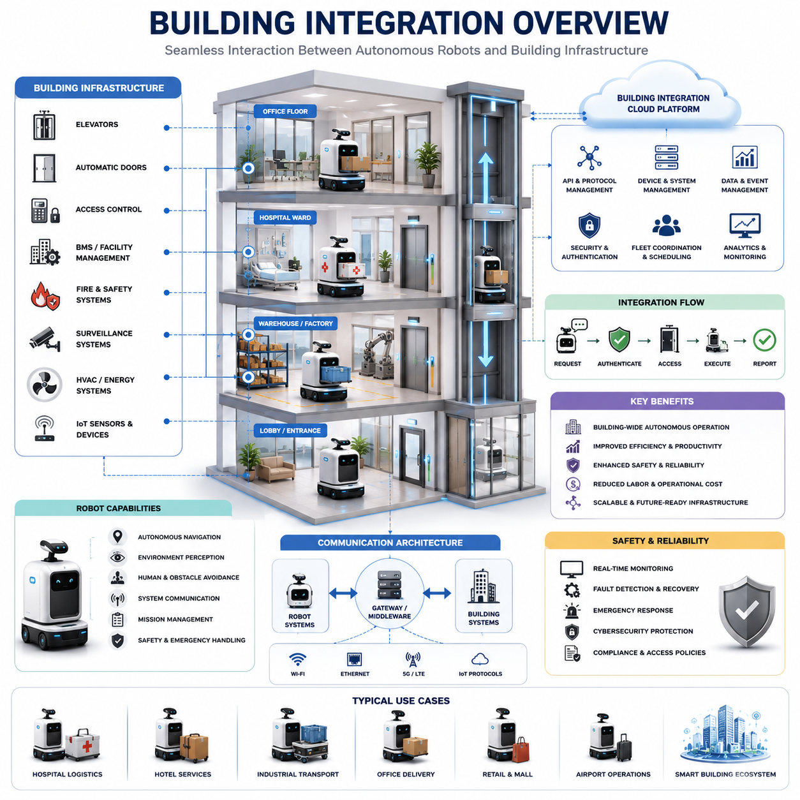
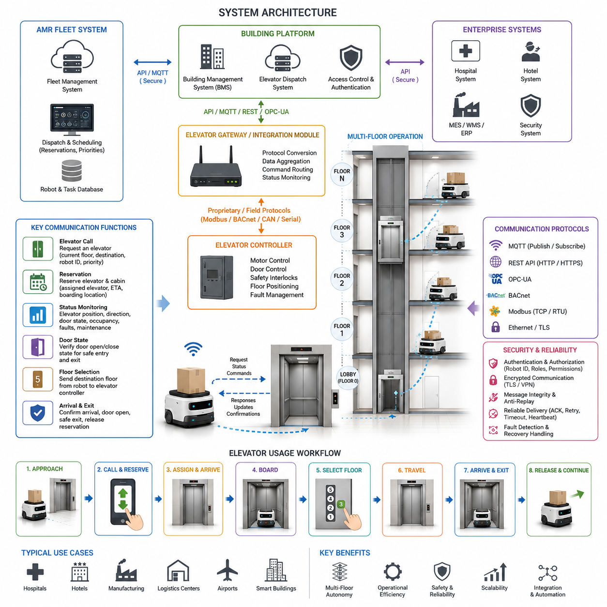
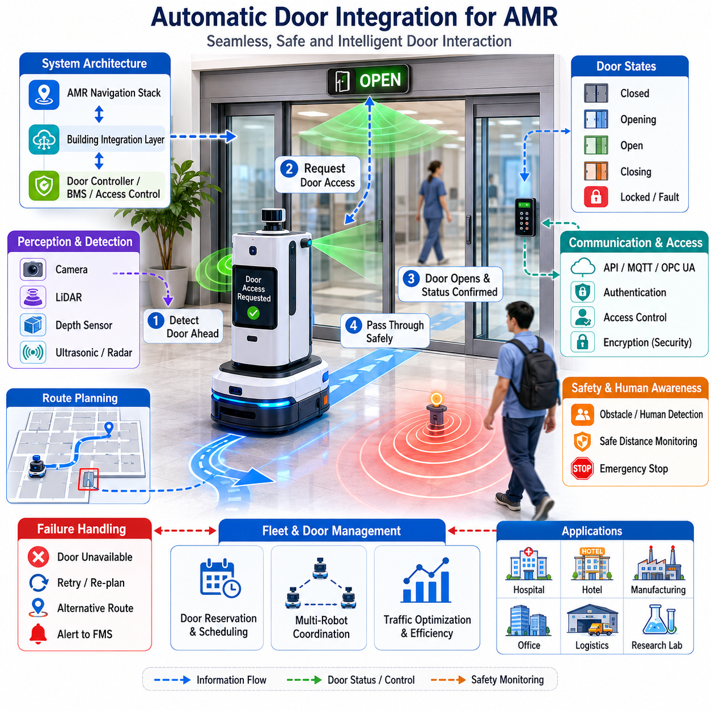
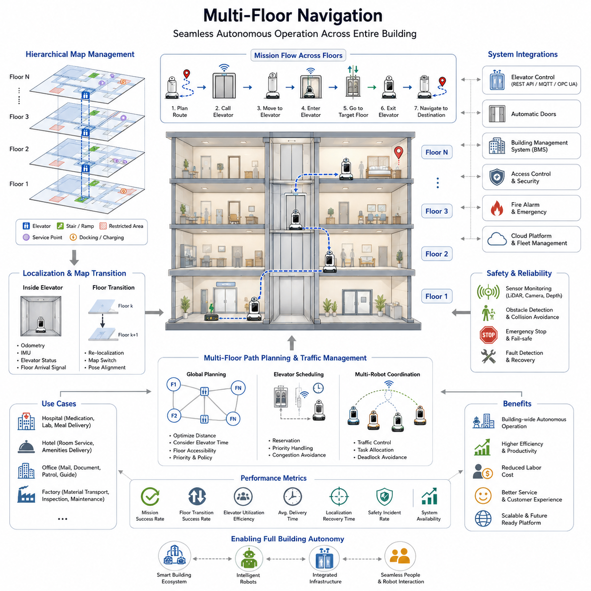
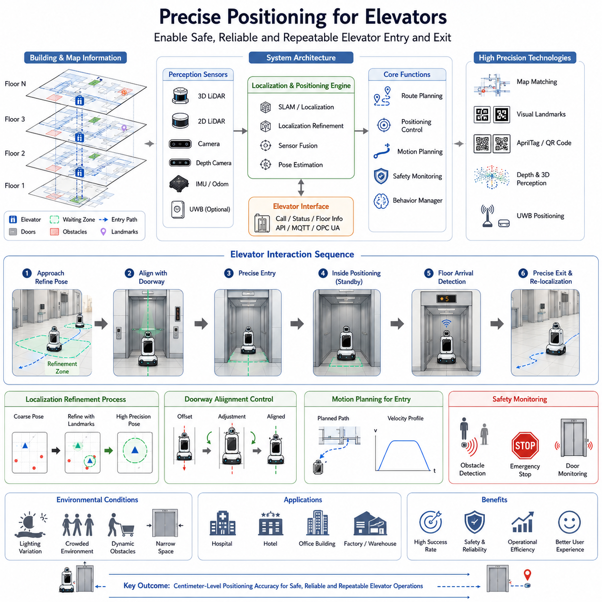
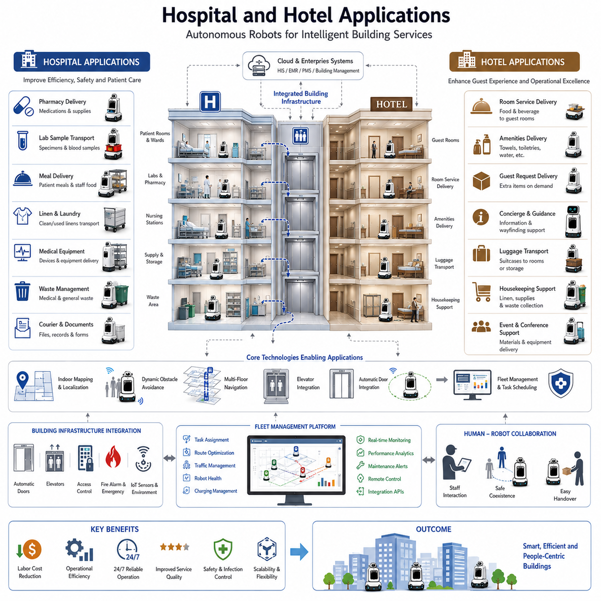
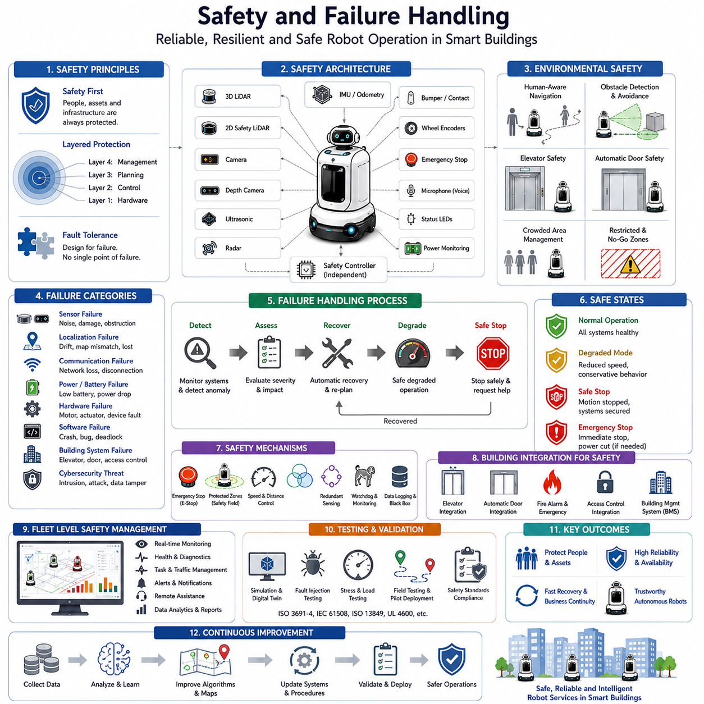
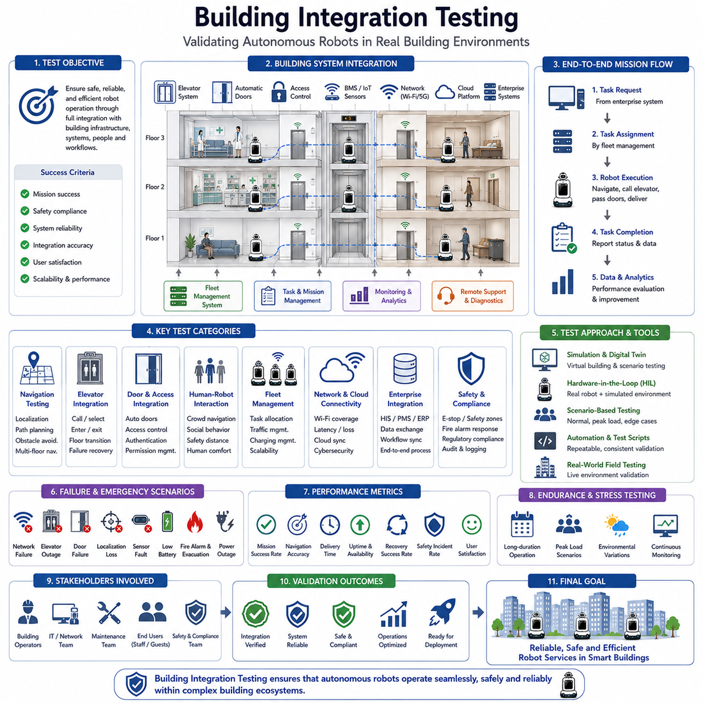

**Volume 05. Path Planning and Autonomous Navigation**


# Chapter 14. Elevator and Door Integration

##  

## 14.1 Building Integration Overview

{width="7.268055555555556in" height="7.268055555555556in"}

Building integration is one of the most important enabling technologies for the widespread deployment of Autonomous Mobile Robots (AMRs) in real-world facilities. While robot navigation inside a single open floor is a mature technology, true autonomous operation across an entire building requires seamless interaction between robots and building infrastructure. Elevators, automatic doors, access control systems, security checkpoints, building management systems, fire safety systems, and facility operation platforms must work together as part of a unified robotic ecosystem. Building integration transforms a mobile robot from an isolated autonomous machine into a fully connected operational entity capable of performing useful tasks throughout complex multi-floor environments. This capability is particularly important in hospitals, hotels, airports, shopping malls, office towers, factories, logistics centers, research campuses, and smart city facilities where robots must travel across multiple floors and pass through controlled access areas while maintaining safety, reliability, and operational efficiency. The chapter "14_01_Building_Integration_Overview" serves as the foundation for understanding how autonomous robots become integrated participants within intelligent buildings and modern facility infrastructures.

Traditional robot navigation systems primarily focus on localization, mapping, path planning, obstacle avoidance, and motion control. However, in real deployments, navigation alone is insufficient. A robot may successfully reach an elevator lobby but still be unable to complete its mission if it cannot communicate with the elevator system. Likewise, a robot may navigate accurately to a hospital ward but become blocked by secured doors or access-controlled zones. Building integration addresses these operational barriers by allowing robots to interact digitally with infrastructure systems. Through software interfaces, communication protocols, cloud services, and local control mechanisms, robots can request elevator access, open automatic doors, verify security permissions, reserve navigation corridors, and coordinate with facility management systems. As a result, robots can execute end-to-end workflows without requiring human intervention.

Modern buildings contain numerous subsystems that operate independently. These include elevators, escalators, automatic doors, HVAC systems, access control systems, surveillance systems, fire alarm systems, emergency response systems, energy management systems, and occupancy monitoring systems. Building integration establishes a communication framework that enables robots to interact with these systems in a standardized and secure manner. Rather than treating the building as a passive environment, integrated robots view the building as an active digital platform that provides services, information, and operational support. This shift represents a major evolution in autonomous robotics and smart building technologies.

Elevator integration is often considered the most critical building integration capability. In multi-floor environments, elevators act as vertical transportation infrastructure. Without elevator access, robot operations become restricted to a single floor, severely limiting deployment value. Elevator integration enables robots to automatically call elevators, request specific destination floors, verify cabin availability, enter and exit elevators safely, and resume navigation upon arrival. This process requires coordination between localization systems, navigation planners, perception modules, safety controllers, and elevator communication interfaces. The robot must determine its position relative to the elevator entrance, predict door opening events, detect passenger movement, and execute precise motion control during boarding and exiting operations. Successful elevator integration transforms isolated floor-level robots into building-wide autonomous service systems.

Automatic door integration represents another fundamental requirement. Many buildings contain numerous doors separating corridors, departments, warehouses, laboratories, offices, and restricted zones. These doors may use motion sensors, access control readers, push-button activation systems, or centralized building automation controllers. Robots must be capable of requesting door access through digital communication channels. The integration framework may involve wireless communication, Ethernet-based protocols, IoT gateways, programmable logic controllers, or cloud-connected building management systems. Once access permission is granted, the robot coordinates its navigation behavior with the door opening process, ensuring smooth and safe passage without collisions or unnecessary waiting.

Access control integration becomes particularly important in hospitals, research laboratories, pharmaceutical facilities, data centers, and industrial manufacturing plants. These facilities often contain zones with different security levels. Robots must authenticate themselves before entering controlled areas. Digital credentials, role-based permissions, mission authorization tokens, and cybersecurity mechanisms are commonly used to establish trust between robots and facility infrastructure. The robot\'s identity may be verified through centralized authentication services, allowing access decisions to be made dynamically based on operational requirements and security policies. This approach enables robots to operate safely within environments that require strict regulatory compliance and controlled access procedures.

Hospital environments provide some of the most advanced examples of building integration. Hospital logistics robots frequently transport medications, laboratory samples, medical equipment, linens, meals, and waste materials throughout large healthcare facilities. These robots must navigate across multiple floors, interact with elevators, access secure pharmacy zones, coordinate with automatic doors, and comply with infection control procedures. Building integration enables these workflows by creating seamless communication between robot fleets and hospital infrastructure systems. Robots can receive priority elevator access during urgent deliveries, avoid restricted areas during emergencies, and coordinate with facility management systems to ensure operational continuity. Such integration significantly improves hospital efficiency while reducing manual labor requirements.

Hotel service robots also rely heavily on building integration technologies. Delivery robots transporting food, beverages, luggage, or guest amenities must move between floors autonomously. Elevator integration allows robots to travel from service areas to guest rooms. Access control integration enables robots to enter designated zones while maintaining guest privacy and security. Hotel management systems can automatically generate robot tasks based on guest requests, and robots can provide delivery status updates through mobile applications or room management systems. Building integration therefore creates a seamless guest experience while improving operational efficiency for hotel staff.

Industrial facilities present unique building integration challenges due to their scale, complexity, and safety requirements. Manufacturing plants often contain multiple production areas separated by automated doors, safety gates, and controlled access zones. Autonomous robots must coordinate with factory automation systems, manufacturing execution systems, warehouse management systems, and safety infrastructure. Building integration allows robots to interact with these systems while maintaining compliance with industrial safety standards. For example, robots may receive temporary access permissions to enter production zones, synchronize movement with automated machinery, or coordinate material transport activities with factory scheduling systems.

Communication architecture plays a central role in building integration. Various communication models can be used depending on facility requirements and infrastructure capabilities. Direct communication allows robots to interact with building devices through local network interfaces. Middleware-based architectures introduce gateway services that translate between robot protocols and building protocols. Cloud-centric architectures use centralized platforms to coordinate interactions between robots and infrastructure systems. Hybrid architectures combine local control with cloud-based supervision, offering both low latency and scalable management. The selection of communication architecture depends on factors such as reliability, security, scalability, interoperability, and operational complexity.

Standardization is increasingly important as robot deployments become more widespread. Historically, building integration projects were implemented using custom interfaces tailored to specific facilities. While effective for individual deployments, such approaches limit scalability and increase maintenance costs. Industry efforts now focus on developing standardized communication frameworks that enable robots from different manufacturers to interact with building infrastructure through common interfaces. Standardized APIs, middleware platforms, and interoperability frameworks simplify deployment, reduce integration costs, and accelerate adoption across diverse facilities.

Cybersecurity represents a critical consideration in building integration. Connected robots become part of the broader building information technology ecosystem, increasing potential attack surfaces. Unauthorized access to elevator systems, door controllers, or building management systems could create significant operational and safety risks. Consequently, building integration architectures must incorporate robust cybersecurity measures including authentication, authorization, encryption, certificate management, network segmentation, intrusion detection, and security monitoring. Secure communication channels protect both robot operations and building infrastructure while ensuring compliance with organizational cybersecurity policies.

Reliability and fault tolerance are equally important. Building infrastructure components may occasionally become unavailable due to maintenance activities, communication failures, hardware malfunctions, or emergency situations. Robots must detect these conditions and execute appropriate recovery behaviors. If an elevator becomes unavailable, alternative routes may need to be selected. If a door controller fails, the robot may request assistance from facility personnel or reroute its mission. Robust building integration frameworks therefore include health monitoring, fault detection, redundancy mechanisms, and recovery strategies to ensure continued operation under adverse conditions.

Safety remains the highest priority throughout all building integration activities. Robots must never compromise human safety while interacting with building infrastructure. Elevator boarding and exiting operations require continuous monitoring of passenger movement and cabin occupancy. Automatic door traversal must ensure that humans are not obstructed or endangered. Emergency events such as fire alarms, evacuation procedures, or facility lockdowns require robots to suspend normal operations and follow predefined safety protocols. Integration with emergency management systems allows robots to respond appropriately during abnormal situations, supporting both safety and operational resilience.

The emergence of smart buildings is accelerating the importance of building integration technologies. Modern facilities increasingly incorporate IoT devices, cloud platforms, digital twins, occupancy analytics, and intelligent automation systems. Robots are becoming active participants within these digital ecosystems. Rather than functioning as isolated machines, robots contribute data, consume building services, and collaborate with other intelligent systems. Building integration therefore serves as a foundational component of future smart facility architectures where physical infrastructure and autonomous systems operate as a unified intelligent environment.

Digital twin technology further enhances building integration capabilities. A digital representation of the facility allows robots to access real-time information about building status, occupancy patterns, elevator availability, door states, maintenance activities, and operational constraints. By combining digital twin information with navigation intelligence, robots can make more informed decisions and optimize mission execution. This integration improves efficiency, reduces travel time, and enhances overall system reliability.

Fleet management systems also benefit from building integration. Multiple robots operating within the same facility can coordinate access to elevators, doors, and shared resources through centralized fleet controllers. Elevator reservations, traffic scheduling, congestion management, and mission prioritization can be optimized at the fleet level. This coordination becomes increasingly important as robot populations grow and facilities transition toward large-scale autonomous operations. Fleet-level building integration enables efficient utilization of infrastructure resources while minimizing delays and operational conflicts.

Looking toward the future, building integration will become a standard requirement for nearly all large-scale autonomous robot deployments. Advances in smart building technologies, cloud computing, artificial intelligence, IoT connectivity, and digital infrastructure will continue to expand integration possibilities. Robots will interact seamlessly with elevators, doors, security systems, facility management platforms, energy systems, and urban infrastructure. Buildings themselves will evolve into intelligent environments designed to support autonomous machines as naturally as they support human occupants. Building integration therefore represents not merely a technical feature but a fundamental architectural principle for the next generation of autonomous robotic systems. Within the broader context of autonomous navigation, building integration bridges the gap between robot autonomy and real-world operational effectiveness, enabling robots to function as fully connected participants in modern intelligent facilities.

빌딩 통합(Building Integration)은 자율이동로봇(AMR)이 실제 환경에서 광범위하게 활용되기 위해 반드시 필요한 핵심 기술 중 하나이다. 단일 층의 개방된 공간에서 자율주행을 수행하는 기술은 이미 상당히 성숙한 수준에 도달했지만, 건물 전체를 대상으로 완전한 자율 운영을 구현하기 위해서는 로봇과 건물 인프라 간의 긴밀한 연동이 필요하다. 엘리베이터, 자동문, 출입통제 시스템, 보안 게이트, 건물관리시스템(BMS), 화재안전시스템, 시설운영 플랫폼 등이 하나의 통합된 생태계로 연결되어야 한다. 빌딩 통합은 이동 로봇을 단순한 독립 장비에서 벗어나 복잡한 다층 건물 내에서 다양한 업무를 수행할 수 있는 지능형 운영 주체로 발전시킨다. 특히 병원, 호텔, 공항, 쇼핑몰, 오피스 빌딩, 공장, 물류센터, 연구단지 및 스마트시티 환경에서는 로봇이 여러 층을 이동하고 출입 제한 구역을 통과해야 하므로 빌딩 통합 기술의 중요성이 매우 크다. 이 장에서는 자율주행 로봇이 현대 건물 및 시설 인프라와 어떻게 통합되어 운영되는지를 설명하는 기본 개념을 다룬다.

전통적인 로봇 내비게이션 시스템은 위치추정, 지도작성, 경로계획, 장애물 회피 및 모션 제어에 집중해 왔다. 그러나 실제 현장에서는 이러한 기능만으로는 충분하지 않다. 예를 들어 로봇이 엘리베이터 앞까지 정확하게 이동하더라도 엘리베이터와 통신할 수 없다면 임무를 완료할 수 없다. 또한 병원 병동까지 이동하더라도 보안문이나 출입통제 구역을 통과하지 못하면 서비스가 중단된다. 빌딩 통합은 이러한 운영상의 제약을 해결하기 위해 로봇이 건물 설비와 디지털 방식으로 상호작용할 수 있도록 한다. 소프트웨어 인터페이스, 통신 프로토콜, 클라우드 서비스 및 로컬 제어 시스템을 통해 로봇은 엘리베이터 호출, 자동문 개방 요청, 보안 인증, 이동 경로 예약 및 시설관리 시스템과의 협업을 수행할 수 있다. 이를 통해 사람의 개입 없이도 완전한 End-to-End 업무 수행이 가능해진다.

현대 건물은 다양한 하위 시스템으로 구성되어 있다. 엘리베이터, 에스컬레이터, 자동문, HVAC 시스템, 출입통제 시스템, CCTV 시스템, 화재경보 시스템, 비상대응 시스템, 에너지 관리 시스템, 점유 상태 모니터링 시스템 등이 각각 독립적으로 운영된다. 빌딩 통합은 이러한 시스템들과 로봇 간에 표준화된 통신 체계를 구축한다. 이로써 건물은 단순한 물리적 공간이 아니라 로봇에게 서비스와 정보를 제공하는 능동적인 디지털 플랫폼으로 변화하게 된다. 이는 자율주행 로봇과 스마트빌딩 기술의 중요한 진화 방향이라 할 수 있다.

엘리베이터 연동은 빌딩 통합의 핵심 요소로 평가된다. 다층 건물에서는 엘리베이터가 수직 이동을 담당하는 필수 인프라이다. 엘리베이터를 사용할 수 없다면 로봇은 한 층에서만 활동할 수 있으므로 활용 가치가 크게 제한된다. 엘리베이터 통합 기술은 로봇이 자동으로 엘리베이터를 호출하고, 목적 층을 선택하며, 엘리베이터 상태를 확인하고, 안전하게 승하차한 후 다시 자율주행을 수행할 수 있도록 지원한다. 이 과정에서는 위치추정, 경로계획, 인지, 안전제어 및 엘리베이터 통신 모듈이 유기적으로 협력해야 한다. 로봇은 엘리베이터 위치를 정밀하게 인식하고, 문 개방 시점을 예측하며, 승객의 움직임을 감지하고, 안전하게 탑승 및 하차해야 한다. 이러한 기능이 구현되면 로봇은 건물 전체를 자유롭게 이동할 수 있는 서비스 플랫폼으로 발전하게 된다.

자동문 연동 역시 매우 중요한 기능이다. 대부분의 건물에는 복도, 병동, 창고, 연구실, 사무실 및 보안구역을 구분하는 다양한 형태의 문이 존재한다. 자동문은 센서 기반, 버튼 기반, 출입통제 기반 또는 중앙 관리 시스템 기반으로 동작할 수 있다. 로봇은 이러한 문을 통과하기 위해 디지털 방식으로 개방을 요청해야 한다. 이를 위해 무선통신, Ethernet 기반 프로토콜, IoT 게이트웨이, PLC 또는 빌딩 자동화 시스템과의 인터페이스가 활용된다. 문이 열리면 로봇은 자신의 이동 경로를 문 동작과 동기화하여 충돌 없이 안전하게 통과하게 된다.

출입통제 시스템과의 연동은 병원, 연구소, 제약공장, 데이터센터 및 산업시설에서 특히 중요하다. 이러한 시설은 다양한 보안 등급의 구역으로 구성되어 있으며, 로봇 역시 사람과 마찬가지로 인증 절차를 거쳐야 한다. 디지털 인증서, 역할 기반 권한 관리, 임무 승인 토큰 및 보안 정책이 로봇 인증 과정에 사용될 수 있다. 로봇은 중앙 인증 시스템을 통해 자신의 신원을 확인받고, 해당 임무에 필요한 접근 권한을 동적으로 부여받는다. 이를 통해 엄격한 규제와 보안 요구사항을 만족하면서도 자율 운영이 가능해진다.

병원은 빌딩 통합 기술이 가장 활발하게 적용되는 대표적인 분야이다. 병원 물류 로봇은 약품, 검사 샘플, 의료기기, 린넨, 식사 및 폐기물을 운반한다. 이러한 업무를 수행하기 위해서는 여러 층을 이동하고, 엘리베이터를 사용하며, 약국과 같은 보안구역에 접근하고, 자동문을 통과해야 한다. 빌딩 통합을 통해 로봇은 병원 인프라와 직접 연결되어 이러한 작업을 자동으로 수행할 수 있다. 응급 상황에서는 우선적으로 엘리베이터를 이용할 수 있으며, 재난 상황에서는 특정 구역 접근이 제한되도록 설정할 수 있다. 이를 통해 병원 운영 효율성이 크게 향상되고 의료진의 반복 업무 부담이 감소한다.

호텔 서비스 로봇 역시 빌딩 통합 기술에 크게 의존한다. 객실 서비스, 음식 배달, 수하물 운반 및 각종 편의 서비스를 제공하는 로봇은 여러 층을 이동해야 한다. 엘리베이터 연동은 객실 이동을 가능하게 하며, 출입통제 시스템은 고객 프라이버시를 보호하면서 필요한 구역 접근을 허용한다. 호텔 관리 시스템과의 연동을 통해 고객 요청이 자동으로 로봇 임무로 변환될 수 있으며, 서비스 진행 상황도 실시간으로 고객에게 전달될 수 있다. 이러한 통합은 고객 만족도와 운영 효율성을 동시에 향상시킨다.

산업 현장에서는 규모와 복잡성, 그리고 높은 안전 요구사항으로 인해 빌딩 통합의 중요성이 더욱 커진다. 제조공장에는 자동문, 안전 게이트, 생산 구역 접근 통제 시스템 등이 존재한다. 자율주행 로봇은 MES, WMS, 생산 자동화 시스템 및 산업 안전 시스템과 연계되어야 한다. 이를 통해 자재 이송 작업을 자동화하고 생산 계획과 연동된 물류 서비스를 수행할 수 있다. 또한 안전 규정을 준수하면서 생산설비와 협업하는 것이 가능해진다.

통신 아키텍처는 빌딩 통합의 핵심 요소이다. 로봇은 건물 설비와 직접 통신할 수도 있고, 중간 게이트웨이를 통한 간접 통신을 수행할 수도 있다. 클라우드 기반 플랫폼을 이용하여 중앙집중형으로 관리할 수도 있으며, 로컬 제어와 클라우드 관리를 혼합한 하이브리드 방식도 사용된다. 어떤 구조를 선택할지는 시스템의 신뢰성, 확장성, 보안성 및 운영 요구사항에 따라 결정된다.

표준화는 향후 빌딩 통합 기술 발전의 핵심 과제이다. 과거에는 건물마다 개별적으로 맞춤형 인터페이스를 개발하는 경우가 많았다. 하지만 이러한 방식은 유지보수 비용이 높고 확장성이 떨어진다. 따라서 최근에는 로봇 제조사와 건물 설비 업체 간의 상호운용성을 높이기 위한 표준 API와 통신 프레임워크 개발이 활발하게 진행되고 있다. 표준화가 이루어질수록 구축 비용은 감소하고 적용 범위는 확대될 것이다.

사이버 보안은 반드시 고려해야 할 요소이다. 건물 인프라와 연결된 로봇은 IT 네트워크의 일부가 되므로 보안 위협에 노출될 수 있다. 만약 엘리베이터 제어나 출입통제 시스템이 해킹된다면 심각한 운영 및 안전 문제가 발생할 수 있다. 따라서 인증, 권한 관리, 암호화, 인증서 관리, 네트워크 분리 및 침입 탐지 기술을 포함한 강력한 보안 체계가 필요하다. 이를 통해 로봇과 건물 시스템 모두를 안전하게 보호할 수 있다.

신뢰성과 장애 대응 역시 중요한 요소이다. 엘리베이터 고장, 네트워크 장애, 자동문 오작동 또는 시설 점검과 같은 상황은 언제든 발생할 수 있다. 로봇은 이러한 상태를 감지하고 적절한 복구 전략을 수행해야 한다. 예를 들어 엘리베이터를 사용할 수 없는 경우 다른 경로를 선택하거나 운영자에게 지원을 요청해야 한다. 따라서 빌딩 통합 시스템은 상태 모니터링, 장애 감지 및 복구 기능을 반드시 포함해야 한다.

안전성은 모든 빌딩 통합 기능에서 최우선적으로 고려되어야 한다. 로봇은 사람의 안전을 절대로 위협해서는 안 된다. 엘리베이터 승하차 과정에서는 승객의 움직임을 지속적으로 감시해야 하며, 자동문 통과 시에도 사람과의 충돌을 방지해야 한다. 화재, 대피, 시설 봉쇄와 같은 비상 상황에서는 일반 업무를 중단하고 비상 절차를 수행해야 한다. 이를 위해 로봇은 비상관리 시스템과 연동되어야 하며, 재난 상황에서도 안전하게 동작해야 한다.

스마트빌딩의 확산은 빌딩 통합 기술의 중요성을 더욱 높이고 있다. 현대 건물은 IoT, 디지털 트윈, 클라우드 플랫폼, 점유 분석 시스템 및 지능형 자동화 기술을 적극적으로 도입하고 있다. 로봇은 이러한 디지털 생태계의 구성원으로 참여하게 된다. 즉, 로봇은 단순히 건물 내부를 이동하는 장비가 아니라 건물 시스템과 데이터를 공유하고 서비스를 활용하는 지능형 에이전트가 된다.

디지털 트윈 기술은 빌딩 통합의 가치를 더욱 향상시킨다. 로봇은 건물의 가상 모델을 통해 엘리베이터 상태, 문 개방 상태, 점유 현황, 유지보수 일정 및 운영 제약 조건을 실시간으로 확인할 수 있다. 이러한 정보를 활용하여 보다 효율적이고 지능적인 의사결정을 수행할 수 있으며, 이동 시간 단축과 운영 효율 향상이 가능하다.

플릿 관리 시스템 역시 빌딩 통합을 통해 큰 효과를 얻는다. 여러 대의 로봇이 동시에 운영되는 환경에서는 엘리베이터 예약, 문 사용 순서, 교통 흐름 제어 및 임무 우선순위 관리가 중요하다. 중앙 플릿 관리 시스템은 이러한 자원을 최적화하여 운영 효율을 극대화할 수 있다. 특히 대규모 병원, 호텔, 물류센터에서는 플릿 수준의 빌딩 통합이 필수 요소가 된다.

미래에는 빌딩 통합이 거의 모든 대형 자율주행 로봇 시스템의 기본 기능이 될 것으로 예상된다. 스마트빌딩, 클라우드 컴퓨팅, 인공지능, IoT 및 디지털 인프라 기술의 발전에 따라 로봇은 엘리베이터, 자동문, 보안 시스템, 시설관리 플랫폼, 에너지 시스템 및 도시 인프라와 자연스럽게 연결될 것이다. 건물은 사람뿐 아니라 자율주행 로봇을 위한 지능형 환경으로 발전하게 될 것이며, 빌딩 통합은 이러한 미래 로봇 생태계를 구현하는 핵심 기반 기술이 될 것이다. 결국 빌딩 통합은 단순한 기능이 아니라, 자율주행 로봇이 실제 환경에서 완전한 운영 능력을 확보하기 위한 필수 아키텍처라고 할 수 있다.

##  

## 14.2 Elevator Communication Protocols

{width="7.268055555555556in" height="7.268055555555556in"}

Modern Autonomous Mobile Robots (AMRs) are increasingly required to operate across multiple floors within large facilities such as hospitals, hotels, office towers, manufacturing plants, logistics centers, airports, and smart buildings. While navigation technologies enable robots to move autonomously within a floor, true building-wide autonomy requires seamless interaction with elevator systems. Elevator communication protocols serve as the critical interface between robotic platforms and building transportation infrastructure, allowing robots to request elevators, verify availability, reserve cabins, select destination floors, monitor elevator status, and safely enter and exit elevator cars. Elevator communication has therefore become one of the most important enabling technologies for multi-floor autonomous navigation systems. The development of reliable elevator communication protocols transforms isolated floor-level robots into building-wide autonomous service systems capable of performing end-to-end logistics and transportation tasks.

The primary objective of elevator communication protocols is to establish a secure and deterministic communication channel between the AMR fleet management system, robot navigation stack, building management system, and elevator controller. This communication infrastructure allows robots to coordinate their movement with elevator operations while maintaining safety, efficiency, and compliance with building regulations. Without such integration, robots would require human intervention whenever a floor transition becomes necessary, significantly limiting operational efficiency and reducing the value of autonomous deployment.

A typical elevator communication architecture consists of multiple layers. At the lowest level lies the elevator controller responsible for managing motor operation, door control, safety interlocks, floor positioning, and passenger requests. Above the controller resides an elevator gateway or integration module that exposes communication interfaces suitable for robotic applications. The gateway communicates with a building management system, elevator dispatch system, or cloud integration platform. The AMR fleet management system interacts with these services through standardized protocols and APIs. Individual robots communicate with the fleet manager or directly with elevator gateways depending on deployment requirements. This layered architecture separates navigation functions from elevator control functions while preserving operational safety.

Communication protocols may vary significantly depending on elevator manufacturers, building age, regional regulations, and integration requirements. Traditional elevator systems often rely on proprietary serial communication interfaces that were originally designed for maintenance personnel rather than robotic integration. Modern elevator systems increasingly provide Ethernet-based interfaces, REST APIs, MQTT services, OPC-UA interfaces, BACnet connectivity, Modbus communication, or dedicated robotic integration SDKs. Some advanced smart buildings provide digital twin environments where elevator resources can be managed as network-accessible services.

The most fundamental elevator communication function is elevator calling. When a robot approaches an elevator lobby, it transmits a request containing its current floor, desired destination floor, robot identification number, priority level, and operational status. The elevator management system evaluates current elevator availability, traffic conditions, cabin occupancy, maintenance status, and dispatch schedules before assigning an elevator. Once assigned, the system communicates the elevator identifier, estimated arrival time, cabin location, and reservation status back to the robot. The robot then navigates to the designated boarding location and prepares for elevator entry.

Elevator reservation mechanisms play a critical role in reliable robotic transportation. Unlike human passengers who can dynamically adapt to changing conditions, robots require predictable operating conditions for safe navigation. Reservation protocols allow robots to secure elevator resources before arrival, reducing uncertainty and minimizing waiting time. Reservation systems may support exclusive cabin access, shared passenger access, or dynamic allocation depending on operational requirements. In hospital environments, robots carrying medical supplies may receive higher scheduling priority than routine logistics tasks. Similarly, emergency transportation robots may obtain temporary priority access during critical situations.

Status monitoring is another essential component of elevator communication. Continuous updates allow robots to monitor elevator movement, door state, cabin occupancy, current floor position, destination queue, fault conditions, and maintenance status. Real-time status information enables robots to make informed navigation decisions and respond appropriately to changing conditions. If an elevator unexpectedly becomes unavailable due to maintenance or fault conditions, the robot can automatically replan its route, select an alternative elevator, or request assistance from fleet management software.

Door state communication represents a particularly important safety function. Before entering an elevator, the robot must verify that elevator doors are fully open and that entry conditions are safe. Sensors on the robot may independently verify door position, but protocol-based confirmation provides an additional layer of validation. Door state messages typically include indicators such as opening, open, closing, closed, obstructed, and fault conditions. Combining protocol information with onboard perception systems improves reliability and reduces the likelihood of navigation errors.

Floor selection communication enables robots to specify destination floors after entering an elevator cabin. Traditional elevators rely on human interaction with physical buttons, whereas integrated robotic systems issue digital destination requests through communication interfaces. The elevator controller receives the requested destination floor and updates its dispatch logic accordingly. The robot then monitors progress toward the target floor through continuous status updates. Upon arrival, the robot receives confirmation that the correct floor has been reached and that doors are available for safe exit.

Authentication and access control are critical considerations in elevator communication systems. Many facilities restrict access to specific floors for security reasons. Elevator protocols must therefore support role-based access control, robot identity verification, digital certificates, authentication tokens, and encrypted communication channels. Each robot may possess unique credentials that determine which floors can be accessed and under what operational conditions. Hospitals, government facilities, research laboratories, and data centers frequently require strict access management to prevent unauthorized movement between secure zones.

Cybersecurity has become increasingly important as elevator systems evolve into connected infrastructure components. Elevator communication protocols must protect against unauthorized access, message tampering, replay attacks, denial-of-service attacks, and network intrusion attempts. Modern implementations employ Transport Layer Security (TLS), Virtual Private Networks (VPNs), secure authentication mechanisms, certificate-based trust models, and encrypted communication channels. Security monitoring systems continuously evaluate network activity to detect anomalies and potential threats. Cybersecurity requirements are particularly stringent in critical infrastructure, healthcare environments, and defense-related facilities.

Message reliability is another key design consideration. Elevator communication systems must operate predictably even under network congestion, temporary connectivity loss, or hardware failures. Reliable communication protocols incorporate acknowledgment messages, retry mechanisms, timeout monitoring, heartbeat signals, and fault recovery procedures. If a communication failure occurs during elevator operations, predefined fallback strategies ensure safe robot behavior. For example, a robot may halt movement, maintain its current position, request assistance, or transition to a predefined recovery state.

Several communication technologies are commonly used in elevator integration projects. Ethernet-based communication offers high bandwidth, low latency, and compatibility with modern networking infrastructure. MQTT provides lightweight publish-subscribe messaging suitable for large-scale robot fleets. REST APIs simplify integration with cloud-based fleet management systems. OPC-UA supports industrial interoperability and structured information modeling. BACnet integration enables interaction with building automation systems. Modbus remains common in industrial environments where legacy equipment continues to operate. The choice of protocol depends on facility requirements, vendor support, scalability objectives, and regulatory constraints.

In large facilities containing multiple elevators, advanced dispatch coordination becomes necessary. Multi-elevator communication protocols enable robots to interact with centralized elevator management systems capable of optimizing resource utilization across an entire building. Intelligent dispatch algorithms consider elevator locations, passenger traffic, robot priorities, predicted demand, energy efficiency objectives, and operational constraints. The result is improved throughput, reduced waiting time, and enhanced overall building efficiency.

Hospital deployments represent one of the most demanding use cases for elevator communication protocols. Medical logistics robots transport medications, laboratory samples, meals, linens, medical equipment, and waste materials between departments located on different floors. Elevator integration must support high reliability, infection control procedures, priority scheduling, and 24-hour operation. Communication systems often integrate directly with hospital management platforms to coordinate logistics workflows and ensure timely delivery of critical materials.

Hotel applications introduce additional operational requirements. Service robots may deliver food, beverages, amenities, luggage, and housekeeping supplies to guest rooms across multiple floors. Elevator protocols must support guest privacy, smooth operation, and efficient coordination with hospitality management systems. Elevator interactions should occur transparently without disrupting guest experiences. Integration with hotel property management systems can further optimize robot task scheduling and resource allocation.

Manufacturing facilities use elevator communication protocols to connect production areas, warehouses, assembly lines, and storage zones distributed across multiple floors. Industrial robots may transport raw materials, components, tools, and finished products throughout the facility. Communication systems must support high throughput, predictable performance, and integration with Manufacturing Execution Systems (MES), Warehouse Management Systems (WMS), and Enterprise Resource Planning (ERP) platforms.

Fleet management integration provides centralized coordination of elevator usage across multiple robots. The fleet manager maintains awareness of robot locations, task assignments, elevator status, traffic patterns, and operational priorities. By coordinating elevator requests centrally, fleet management software can reduce congestion, improve utilization efficiency, and prevent conflicts among robots competing for limited elevator resources. Predictive scheduling algorithms may reserve elevator capacity in advance based on anticipated transportation demands.

Simulation environments are commonly used to validate elevator communication protocols before deployment. Digital twins of buildings, elevators, and robot fleets enable engineers to evaluate performance under realistic operating conditions. Simulation scenarios may include network failures, elevator faults, high traffic conditions, emergency situations, cybersecurity incidents, and large-scale fleet operations. Validation activities help identify integration challenges and verify system robustness before deployment in production environments.

Fault handling and recovery procedures are essential components of elevator communication architectures. Elevators may become unavailable due to maintenance activities, emergency operations, power failures, communication interruptions, or mechanical faults. Robust protocols define clear recovery workflows that enable robots to detect abnormal conditions, notify fleet management systems, replan routes, select alternative transportation resources, and maintain safe operational states. Comprehensive fault management significantly improves overall system availability and reliability.

As smart building technologies continue to evolve, elevator communication protocols are becoming increasingly intelligent and service-oriented. Future systems are expected to integrate artificial intelligence, predictive traffic management, cloud-native building services, digital twins, and autonomous infrastructure coordination. Elevators may dynamically collaborate with robot fleets, building automation systems, security platforms, and energy management systems to optimize overall facility performance. The convergence of robotics and intelligent building infrastructure will create highly autonomous environments where robots move seamlessly across floors, departments, and operational zones with minimal human intervention.

Ultimately, elevator communication protocols serve as the foundation of multi-floor robotic autonomy. They enable safe, reliable, and scalable interaction between robots and vertical transportation systems while supporting operational efficiency, cybersecurity, fault tolerance, and regulatory compliance. As AMR deployments expand across hospitals, hotels, factories, airports, logistics centers, and smart cities, elevator communication technologies will remain a critical component of building-wide autonomous mobility systems and a key enabler of next-generation robotic infrastructure.

현대의 자율주행 모바일 로봇(AMR)은 병원, 호텔, 오피스 빌딩, 제조 공장, 물류센터, 공항, 스마트 빌딩과 같은 대형 시설에서 여러 층을 이동하며 작업해야 하는 경우가 점점 증가하고 있다. 로봇 내비게이션 기술은 동일한 층 내에서의 자율 이동을 가능하게 하지만, 진정한 의미의 건물 전체 자율 운영을 위해서는 엘리베이터 시스템과의 원활한 연동이 필수적이다. 엘리베이터 통신 프로토콜은 로봇과 건물의 수직 이동 인프라를 연결하는 핵심 인터페이스로서, 로봇이 엘리베이터를 호출하고, 사용 가능 여부를 확인하며, 캐빈을 예약하고, 목적 층을 지정하고, 엘리베이터 상태를 모니터링하며, 안전하게 승하차할 수 있도록 지원한다. 따라서 엘리베이터 통신은 다층 자율주행 시스템을 구현하는 핵심 기술 가운데 하나로 자리 잡고 있다. 이러한 기술을 통해 로봇은 단일 층에서만 동작하는 장비를 넘어 건물 전체를 자유롭게 이동하는 자율 서비스 시스템으로 발전할 수 있다.

엘리베이터 통신 프로토콜의 주요 목적은 AMR 플릿 관리 시스템, 로봇 내비게이션 스택, 건물 관리 시스템(Building Management System), 그리고 엘리베이터 제어기 사이에 안전하고 예측 가능한 통신 채널을 구축하는 것이다. 이를 통해 로봇은 건물의 수직 이동 시스템과 협력하여 이동할 수 있으며, 동시에 안전성, 효율성, 그리고 규제 준수를 유지할 수 있다. 만약 이러한 통합이 존재하지 않는다면 로봇은 층간 이동 시마다 사람의 개입이 필요하게 되며, 이는 자율화의 가치를 크게 떨어뜨리게 된다.

일반적인 엘리베이터 통신 아키텍처는 여러 계층으로 구성된다. 가장 하위 계층에는 모터 구동, 문 제어, 안전 인터록, 층 위치 인식, 호출 처리 등을 담당하는 엘리베이터 제어기가 존재한다. 그 상위에는 로봇과 통신할 수 있는 인터페이스를 제공하는 엘리베이터 게이트웨이 또는 통합 모듈이 위치한다. 게이트웨이는 건물 관리 시스템, 엘리베이터 디스패치 시스템 또는 클라우드 기반 통합 플랫폼과 연결된다. AMR 플릿 관리 시스템은 이러한 서비스와 표준 프로토콜을 통해 통신하며, 개별 로봇은 플릿 관리자 또는 엘리베이터 게이트웨이와 연결된다. 이러한 계층형 구조는 내비게이션 기능과 엘리베이터 제어 기능을 분리하면서도 안전한 협력을 가능하게 한다.

엘리베이터 통신 방식은 제조사, 건물의 연식, 지역 규제, 통합 요구사항에 따라 다양하게 구성된다. 기존 엘리베이터는 주로 유지보수 목적의 독자적인 시리얼 통신 인터페이스를 제공했지만, 최근의 스마트 엘리베이터는 Ethernet 기반 인터페이스, REST API, MQTT 서비스, OPC-UA, BACnet, Modbus 및 전용 로봇 통합 SDK 등을 제공하고 있다. 일부 첨단 스마트 빌딩은 디지털 트윈 환경을 구축하여 엘리베이터를 네트워크 기반 서비스 자원으로 관리하기도 한다.

가장 기본적인 기능은 엘리베이터 호출이다. 로봇이 엘리베이터 홀에 접근하면 현재 층, 목적 층, 로봇 ID, 우선순위, 운영 상태 등의 정보를 포함한 호출 요청을 전송한다. 엘리베이터 관리 시스템은 현재 엘리베이터 위치, 운행 상태, 승객 수, 유지보수 여부, 스케줄 등을 고려하여 적절한 엘리베이터를 배정한다. 이후 로봇은 배정된 엘리베이터 번호, 예상 도착 시간, 현재 위치 및 예약 상태 정보를 수신하고 지정된 승차 위치로 이동한다.

예약 기능은 신뢰성 높은 자율 운행을 위해 매우 중요하다. 사람은 상황 변화에 즉시 대응할 수 있지만 로봇은 예측 가능한 환경이 필요하다. 예약 시스템을 활용하면 로봇은 미리 엘리베이터 사용 권한을 확보할 수 있으며, 이를 통해 대기 시간을 줄이고 운영 효율을 향상시킬 수 있다. 일부 시스템은 로봇 전용 캐빈 예약을 지원하며, 다른 시스템은 일반 승객과 공유 운행을 허용한다. 병원에서는 응급 의료 물품을 운반하는 로봇이 일반 물류 작업보다 높은 우선순위를 부여받을 수 있다.

상태 모니터링 역시 필수적인 기능이다. 로봇은 엘리베이터의 현재 층, 이동 방향, 문 상태, 승객 수, 운행 스케줄, 장애 상태, 유지보수 상태 등을 실시간으로 수신할 수 있다. 이러한 정보는 로봇이 보다 정확한 의사결정을 내리도록 돕는다. 만약 엘리베이터에 장애가 발생하거나 유지보수로 인해 사용할 수 없는 경우, 로봇은 자동으로 다른 엘리베이터를 선택하거나 경로를 재계획할 수 있다.

문 상태 통신은 안전과 직결된다. 로봇은 승차 전 엘리베이터 문이 완전히 열렸는지 확인해야 하며, 안전한 진입 조건이 확보되었는지를 판단해야 한다. 로봇의 센서가 이를 확인할 수도 있지만, 통신 프로토콜을 통한 상태 확인은 추가적인 안전 계층을 제공한다. 일반적으로 문 상태 정보는 열림 중, 완전 개방, 닫힘 중, 완전 폐쇄, 장애물 감지, 오류 상태 등의 정보를 포함한다.

층 선택 기능은 로봇이 엘리베이터 탑승 후 목적 층을 디지털 방식으로 지정할 수 있게 해준다. 사람이 버튼을 누르는 방식 대신, 로봇은 통신 인터페이스를 통해 목적 층 정보를 전달한다. 엘리베이터 제어기는 이를 수신하여 운행 계획에 반영하며, 로봇은 목적 층 도착 여부를 지속적으로 모니터링한다. 도착 후에는 정확한 층에 도달했는지와 안전하게 하차할 수 있는지를 확인한다.

보안 및 접근 제어는 현대 엘리베이터 통합 시스템에서 매우 중요한 요소이다. 많은 건물은 특정 층에 대한 접근을 제한하고 있기 때문에, 로봇 역시 인증된 권한을 기반으로 이동해야 한다. 이를 위해 디지털 인증서, 접근 토큰, 암호화 통신, 역할 기반 접근 제어(RBAC) 등이 사용된다. 각 로봇은 고유한 권한을 가지며, 허용된 층과 이동 범위가 사전에 정의된다. 병원, 연구소, 정부 기관, 데이터센터 등은 특히 강력한 보안 정책을 요구한다.

사이버 보안의 중요성도 지속적으로 증가하고 있다. 엘리베이터가 네트워크에 연결되면서 무단 접근, 메시지 변조, 재전송 공격, 서비스 거부 공격, 네트워크 침입 등의 위협이 발생할 수 있다. 이를 방지하기 위해 TLS 암호화, VPN, 인증서 기반 인증, 보안 토큰 및 네트워크 모니터링 기술이 활용된다. 의료 시설이나 국가 기반 시설과 같은 중요 환경에서는 더욱 엄격한 보안 체계가 요구된다.

통신 신뢰성 역시 중요한 설계 요소이다. 엘리베이터 통신은 네트워크 지연이나 일시적 연결 끊김 상황에서도 안정적으로 동작해야 한다. 이를 위해 ACK 응답, 재전송 메커니즘, 타임아웃 관리, 하트비트 신호, 장애 복구 절차 등이 사용된다. 통신이 중단될 경우 로봇은 정지 상태를 유지하거나, 안전 모드로 전환하거나, 운영 서버에 도움을 요청하는 등 사전에 정의된 복구 절차를 수행한다.

현재 많이 사용되는 통신 기술로는 Ethernet, MQTT, REST API, OPC-UA, BACnet, Modbus 등이 있다. Ethernet은 높은 대역폭과 낮은 지연시간을 제공하며, MQTT는 대규모 플릿 환경에 적합한 경량 메시징 방식을 제공한다. REST API는 클라우드 시스템과의 연동을 단순화하며, OPC-UA는 산업 자동화 환경에서 높은 상호운용성을 제공한다. BACnet은 건물 자동화 시스템과의 연계에 적합하고, Modbus는 기존 산업 설비와의 통합에 널리 활용된다.

대형 건물에서는 여러 대의 엘리베이터를 동시에 운영하기 때문에 고급 디스패치 시스템이 필요하다. 중앙 관리 시스템은 모든 엘리베이터와 로봇의 상태를 실시간으로 분석하여 최적의 엘리베이터를 배정한다. 이러한 알고리즘은 엘리베이터 위치, 승객 수요, 로봇 우선순위, 에너지 효율성 등을 고려하여 전체 시스템의 처리량을 극대화한다.

병원은 엘리베이터 통합 기술이 가장 활발하게 활용되는 대표적인 환경이다. 약품, 검체, 식사, 린넨, 의료 장비, 폐기물 등을 운반하는 로봇이 여러 층을 이동해야 하기 때문이다. 병원 환경에서는 높은 신뢰성, 감염 관리, 우선순위 운행, 24시간 운영이 요구되며, 엘리베이터 시스템은 병원 운영 시스템과 긴밀하게 통합된다.

호텔 환경에서는 서비스 로봇이 객실까지 음식, 음료, 생필품, 수하물 등을 배송한다. 이 경우 엘리베이터 통신은 고객 경험을 방해하지 않으면서도 효율적인 서비스를 제공해야 한다. 또한 호텔 관리 시스템과 연계하여 객실 서비스 요청과 로봇 스케줄을 자동으로 조정할 수 있다.

제조 공장에서는 생산라인, 창고, 자재 보관 구역이 여러 층에 분산되어 있는 경우가 많다. 따라서 로봇은 원자재, 부품, 공구, 완제품 등을 운반하기 위해 엘리베이터를 사용한다. 이러한 환경에서는 MES, WMS, ERP 시스템과의 연계가 중요하며, 높은 처리량과 안정성이 요구된다.

플릿 관리 시스템은 여러 대의 로봇이 엘리베이터를 효율적으로 공유하도록 조정한다. 중앙 서버는 각 로봇의 위치, 작업 상태, 엘리베이터 사용 계획을 관리하며, 충돌과 혼잡을 최소화한다. 또한 예측 기반 스케줄링을 통해 미래 수요를 미리 분석하고 엘리베이터 자원을 예약할 수 있다.

실제 구축 이전에는 시뮬레이션과 디지털 트윈을 활용한 검증이 수행된다. 이를 통해 통신 장애, 엘리베이터 고장, 대규모 트래픽, 사이버 보안 사고, 다수 로봇 운영 상황 등을 사전에 시험할 수 있다. 이러한 검증 과정은 실제 구축 시 발생할 수 있는 문제를 줄이고 시스템 안정성을 높인다.

장애 대응과 복구 절차도 매우 중요하다. 유지보수, 정전, 네트워크 장애, 기계적 결함 등으로 엘리베이터가 사용할 수 없게 될 수 있다. 강건한 프로토콜은 이러한 상황을 자동으로 감지하고, 로봇이 다른 엘리베이터를 선택하거나 경로를 변경하며, 필요 시 안전 모드로 전환할 수 있도록 지원한다.

향후 스마트 빌딩 기술이 발전함에 따라 엘리베이터 통신 프로토콜 역시 더욱 지능화될 전망이다. 인공지능 기반 교통 최적화, 디지털 트윈, 클라우드 네이티브 서비스, 자율 인프라 협력 기술 등이 통합되면서 엘리베이터는 단순한 이동 수단을 넘어 로봇 생태계의 핵심 구성 요소가 될 것이다. 로봇, 건물 관리 시스템, 보안 시스템, 에너지 관리 시스템이 상호 협력함으로써 건물 전체가 하나의 지능형 자동화 플랫폼으로 발전하게 될 것이다.

결론적으로 엘리베이터 통신 프로토콜은 다층 자율주행 로봇 시스템의 핵심 기반 기술이다. 이는 로봇과 수직 이동 인프라 사이의 안전하고 신뢰성 있는 협력을 가능하게 하며, 운영 효율성, 보안성, 확장성 및 규제 준수를 동시에 보장한다. 앞으로 병원, 호텔, 공장, 공항, 물류센터, 스마트시티 등 다양한 분야에서 AMR이 확산될수록 엘리베이터 통합 기술은 건물 단위 자율 이동 시스템의 필수 요소로 자리 잡게 될 것이다.

##  

## 14.3 Automatic Door Integration

{width="7.268055555555556in" height="7.268055555555556in"}

Automatic door integration is a critical capability for modern Autonomous Mobile Robots (AMRs) operating in complex indoor environments such as hospitals, hotels, office buildings, manufacturing facilities, research laboratories, airports, logistics centers, and smart buildings. While navigation systems often focus on localization, mapping, path planning, obstacle avoidance, and fleet coordination, the practical deployment of robots frequently encounters physical barriers that interrupt autonomous movement. Among these barriers, automatic doors represent one of the most common and operationally significant interfaces between robots and building infrastructure. Successful robot deployment requires seamless interaction with automatic doors so that robots can move freely between rooms, corridors, restricted zones, and service areas without human intervention. Automatic door integration therefore becomes a fundamental component of building-aware navigation systems and an essential element of end-to-end autonomous operation. This topic belongs to the Elevator and Door Integration section of autonomous navigation systems and serves as a bridge between robot intelligence and smart building infrastructure.

In traditional facilities, automatic doors are designed primarily for human users. Motion sensors, push buttons, RFID access systems, and safety devices are configured around human movement patterns. Robots introduce a different set of requirements because they may travel at lower speeds, approach doors from unusual angles, carry payloads that change their dimensions, or require precise timing for safe passage. As a result, simply placing robots into buildings with existing automatic doors often leads to operational challenges. Robots may fail to trigger motion sensors, arrive before doors are fully open, lose localization during door transitions, or encounter unexpected delays that disrupt navigation schedules. Effective automatic door integration addresses these issues through coordinated communication, sensing, control, and safety mechanisms.

The primary objective of automatic door integration is to allow robots to request, monitor, utilize, and verify door operations autonomously. The robot should be capable of recognizing the presence of a door, determining its current state, requesting access when necessary, waiting for confirmation that the door is open, passing through safely, and confirming successful completion of the transition. This process must be performed reliably under varying environmental conditions while maintaining safety for humans and compliance with building regulations.

A typical automatic door integration architecture consists of several interconnected subsystems. The robot navigation stack communicates with a building integration layer, which acts as an intermediary between the robot and building automation systems. The building integration layer interfaces with door controllers, access control systems, facility management systems, and security infrastructure. Communication may occur through wired Ethernet networks, wireless Wi-Fi connections, industrial protocols, cloud-based APIs, or dedicated IoT gateways. The architecture enables robots to interact with doors as intelligent infrastructure components rather than passive environmental objects.

Door state awareness forms the foundation of autonomous interaction. Robots must understand whether a door is open, closed, opening, closing, locked, unavailable, or experiencing faults. This information may be obtained through direct communication with door controllers or indirectly through perception systems. Modern smart buildings often provide door status information through building management systems. In older facilities where digital integration is unavailable, robots may rely on sensors such as cameras, LiDAR systems, depth sensors, radar units, or ultrasonic sensors to estimate door states. Sensor fusion techniques improve reliability by combining multiple sources of information and reducing uncertainty.

Door detection is another important capability. Before a robot can interact with a door, it must identify the door within its environment model. During mapping and localization processes, doors are typically represented as semantic landmarks within navigation maps. Semantic mapping systems classify environmental elements according to their functional roles, allowing robots to recognize doors as navigational resources rather than ordinary obstacles. Semantic maps may contain metadata such as door location, door type, access permissions, opening direction, operating schedule, and communication interfaces. This enriched information enables intelligent navigation decisions and efficient route planning.

Several types of automatic doors are commonly encountered in real-world deployments. Sliding doors are among the most robot-friendly because they create wide openings and minimize interference with robot trajectories. Swing doors introduce additional complexity because their motion creates dynamic obstacles that must be modeled and predicted. Revolving doors present significant challenges due to continuous motion and limited robot compatibility. Folding doors, high-speed industrial doors, cleanroom airlock doors, and security access doors each require specialized integration strategies. The navigation system must account for the operational characteristics of each door type and adapt its behavior accordingly.

Communication protocols play a central role in modern door integration systems. Robots may communicate with doors using REST APIs, MQTT messaging systems, OPC UA protocols, Modbus interfaces, BACnet building automation protocols, or custom vendor-specific APIs. Through these interfaces, robots can send door opening requests, receive status updates, verify authorization credentials, and monitor operational health. Standardized communication frameworks improve interoperability and reduce deployment complexity across different building environments.

The door request process typically begins when the navigation planner predicts an upcoming door crossing. Rather than waiting until the robot reaches the door, the system proactively initiates communication to reduce delays. The robot transmits a request containing its identification, destination, estimated arrival time, and access credentials. The door controller validates the request and determines whether access should be granted. Upon approval, the controller initiates the opening sequence and transmits status updates back to the robot. The robot adjusts its speed to synchronize arrival with door availability, thereby minimizing waiting time and improving operational efficiency.

Timing coordination is essential for smooth operation. If the robot arrives too early, it may block traffic or experience unnecessary delays. If it arrives too late, the door may begin closing before passage is complete. Advanced navigation systems use predictive motion planning and estimated time-of-arrival calculations to coordinate robot movement with door operation schedules. This synchronization improves throughput and reduces energy consumption for both robots and building infrastructure.

Access control integration becomes particularly important in secure facilities. Hospitals, pharmaceutical manufacturing sites, research laboratories, government facilities, and data centers often implement strict access policies. Robots must authenticate themselves before entering restricted areas. Authentication mechanisms may include digital certificates, API tokens, RFID credentials, secure wireless authentication, encrypted communications, or centralized identity management systems. Access permissions may vary depending on robot type, task assignment, operational schedule, or organizational policies.

Cybersecurity considerations are increasingly important as building systems become more connected. Unauthorized access to door control systems could create significant safety and security risks. Therefore, communication between robots and door controllers should employ secure authentication, encrypted data transmission, role-based access control, network segmentation, intrusion detection systems, and security auditing mechanisms. Cybersecurity must be integrated into system architecture from the beginning rather than added as an afterthought.

Robot perception remains important even when digital communication is available. The robot should independently verify that a door is open before attempting passage. Visual perception systems can detect door positions, estimate opening widths, and identify obstacles that may interfere with traversal. LiDAR sensors provide accurate geometric measurements, while depth cameras contribute three-dimensional environmental understanding. Multi-sensor fusion improves robustness under varying lighting conditions and environmental disturbances.

Path planning behavior near doors differs from general corridor navigation. The robot must approach doors with appropriate alignment, speed, and positioning. Misalignment can lead to collisions with door frames or moving door panels. Navigation algorithms often define specialized approach zones that guide robots into optimal positions before crossing. These zones account for robot dimensions, payload size, localization uncertainty, and door geometry. Dynamic trajectory planning continuously adjusts motion as new sensor information becomes available.

Safety is a primary consideration in automatic door integration. Doors represent dynamic environmental elements whose motion can create potential hazards. Robots must predict door movements and maintain safe distances during opening and closing operations. Safety-certified sensors monitor the interaction zone and prevent dangerous situations. If unexpected obstacles or people appear near the door, the robot may pause, replan its path, or abort the crossing operation. Human safety always takes priority over operational efficiency.

Human-robot coexistence introduces additional complexity. Doors are shared resources used simultaneously by people and robots. The navigation system must anticipate human behavior, avoid blocking pedestrian traffic, and communicate its intentions clearly. Visual indicators, audio notifications, display screens, and signaling lights may help humans understand robot actions. Human-aware navigation algorithms reduce interference and improve acceptance of robotic systems in public environments.

Failure handling mechanisms are essential for maintaining reliability. Automatic doors may become unavailable due to power failures, mechanical faults, communication errors, sensor malfunctions, or maintenance activities. When failures occur, robots must detect the problem and respond appropriately. Recovery strategies may include retrying communication, selecting alternative routes, requesting human assistance, reporting incidents to fleet management systems, or entering safe waiting states. Robust recovery procedures significantly improve overall system availability.

Fleet-level door management becomes increasingly important when multiple robots operate within the same facility. A single door may serve dozens or hundreds of robot crossings each day. Traffic coordination systems manage access requests, schedule crossings, prevent congestion, and optimize resource utilization. Reservation-based systems allow robots to book door access windows in advance, reducing conflicts and improving throughput. Fleet management platforms maintain global awareness of door status and coordinate robot activities accordingly.

Hospital environments provide one of the most important application domains for automatic door integration. Service robots transport medications, laboratory samples, meals, linens, waste materials, and medical equipment throughout healthcare facilities. These tasks require frequent movement through automatic doors connecting wards, operating rooms, laboratories, pharmacies, and support areas. Reliable door integration significantly improves operational efficiency and reduces staff workload. Hospital deployments also demonstrate the importance of infection control, access management, and patient safety considerations.

Hotels represent another significant deployment environment. Service robots delivering food, amenities, luggage, and housekeeping supplies must navigate through automatic doors connecting lobbies, service corridors, conference areas, and guest facilities. Integration with building automation systems enables seamless guest services and enhances overall operational effectiveness.

Manufacturing facilities utilize automatic door integration to support material transport robots operating between production lines, warehouses, inspection stations, and shipping areas. Industrial environments often employ high-speed doors, safety interlocks, and environmental separation zones that require specialized integration approaches. Reliable operation contributes directly to productivity and workflow optimization.

Testing and validation activities are critical before deployment. Door integration systems must be evaluated under a wide range of operating conditions, including varying traffic levels, network delays, sensor failures, power interruptions, and emergency scenarios. Performance metrics may include door crossing success rate, average waiting time, communication latency, recovery effectiveness, safety compliance, and operational availability. Comprehensive testing ensures that robots can operate reliably in real-world environments over extended periods.

Simulation platforms provide valuable tools for development and validation. Digital twin environments model robots, doors, building infrastructure, human traffic, and communication systems. Engineers can evaluate integration strategies, identify potential issues, optimize control algorithms, and verify safety requirements before physical deployment. Simulation significantly reduces development risk and accelerates deployment timelines.

Future developments in automatic door integration will be driven by advances in smart buildings, IoT technologies, cloud robotics, artificial intelligence, and digital twins. Doors will increasingly become intelligent infrastructure components capable of predictive operation, self-diagnostics, adaptive behavior, and autonomous coordination with robotic fleets. AI-driven building systems may anticipate robot arrivals, optimize traffic flow, and dynamically allocate resources to maximize efficiency. Integration with broader building ecosystems will enable seamless interaction among robots, elevators, doors, HVAC systems, lighting controls, security systems, and facility management platforms.

Ultimately, automatic door integration transforms isolated navigation capabilities into true building-scale autonomy. By enabling robots to interact intelligently with architectural infrastructure, organizations can unlock higher levels of automation, operational efficiency, scalability, and service quality. As smart buildings and autonomous robots continue to evolve together, automatic door integration will remain a foundational technology supporting the next generation of intelligent indoor mobility systems.

자동문 통합(Automatic Door Integration)은 병원, 호텔, 오피스 빌딩, 제조 공장, 연구소, 공항, 물류센터 및 스마트 빌딩과 같은 복잡한 실내 환경에서 운영되는 자율주행 이동로봇(AMR)의 핵심 기능 중 하나이다. 일반적으로 자율주행 시스템은 위치추정, 지도 생성, 경로 계획, 장애물 회피, 다중 로봇 협업 등에 초점을 맞추지만, 실제 현장에서는 로봇의 이동을 방해하는 다양한 물리적 장벽이 존재한다. 그중에서도 자동문은 가장 빈번하게 등장하는 건물 인프라 요소이며, 로봇의 완전한 자율 운영을 위해 반드시 해결해야 하는 중요한 통합 대상이다. 자동문과의 원활한 연동이 가능해야 로봇은 복도, 병실, 연구실, 제한구역, 서비스 공간 등을 사람의 개입 없이 자유롭게 이동할 수 있다. 따라서 자동문 통합은 건물 인프라와 로봇 지능을 연결하는 핵심 기술이며, 건물 단위의 완전한 자율운영을 실현하는 중요한 구성 요소이다.

기존 건물의 자동문은 주로 사람을 대상으로 설계되었다. 모션 센서, 버튼, RFID 출입 시스템 및 안전장치는 인간의 이동 특성을 기준으로 동작한다. 반면 로봇은 사람보다 느린 속도로 이동하거나, 특정 각도로 접근하거나, 적재물에 따라 크기가 달라질 수 있으며, 정밀한 시간 동기화가 필요하다. 이러한 차이로 인해 로봇을 단순히 기존 건물에 투입하는 것만으로는 안정적인 운용이 어렵다. 로봇이 자동문 센서를 인식시키지 못하거나, 문이 완전히 열리기 전에 도착하거나, 문 통과 과정에서 위치추정이 불안정해지는 문제가 발생할 수 있다. 자동문 통합 기술은 이러한 문제를 해결하기 위해 통신, 센서, 제어, 안전 시스템을 유기적으로 결합한다.

자동문 통합의 가장 중요한 목적은 로봇이 자동으로 문을 요청하고, 문 상태를 확인하며, 안전하게 통과하고, 통과 완료를 검증할 수 있도록 하는 것이다. 로봇은 문의 존재를 인식하고 현재 상태를 파악한 후 접근 권한을 요청하며, 문이 열렸음을 확인하고 안전하게 통과한 뒤, 이동이 정상적으로 완료되었는지 확인해야 한다. 이러한 모든 과정은 다양한 환경 조건 속에서도 안정적으로 수행되어야 하며 인간의 안전과 건물 규정을 준수해야 한다.

일반적인 자동문 통합 시스템은 여러 하위 시스템으로 구성된다. 로봇의 내비게이션 스택은 건물 통합 계층(Building Integration Layer)과 연결되며, 이 계층은 로봇과 건물 자동화 시스템 사이의 중재자 역할을 수행한다. 건물 통합 계층은 자동문 제어기, 출입통제 시스템, 시설관리 시스템, 보안 시스템과 연결된다. 통신은 Ethernet, Wi-Fi, 산업용 프로토콜, 클라우드 API 또는 IoT 게이트웨이를 통해 이루어질 수 있다. 이를 통해 자동문은 단순한 장애물이 아니라 로봇과 상호작용하는 지능형 인프라로 동작하게 된다.

문 상태 인식은 자동문 통합의 기본 요소이다. 로봇은 문이 열려 있는지, 닫혀 있는지, 열리는 중인지, 닫히는 중인지, 잠겨 있는지, 사용 불가능한지 또는 고장 상태인지를 이해해야 한다. 이러한 정보는 문 제어기와의 직접 통신을 통해 얻거나, 카메라, LiDAR, Depth Camera, Radar, Ultrasonic Sensor 등의 센서를 이용하여 추정할 수 있다. 여러 센서를 동시에 사용하는 센서 융합 기법은 상태 판단의 정확성과 신뢰성을 향상시킨다.

자동문을 인식하는 기능 또한 중요하다. 로봇은 문을 통과하기 전에 문의 위치를 정확히 알아야 한다. 이를 위해 SLAM 및 지도 생성 과정에서 자동문은 의미 기반 지도(Semantic Map)의 일부로 저장된다. 의미 기반 지도에서는 문이 단순한 구조물이 아니라 이동 경로를 구성하는 기능적 요소로 정의된다. 지도에는 문의 위치뿐 아니라 문 종류, 개방 방향, 접근 권한, 운영 시간, 통신 인터페이스 등의 정보가 포함될 수 있다. 이러한 정보는 보다 지능적인 경로 계획과 의사결정을 가능하게 한다.

실제 환경에는 다양한 형태의 자동문이 존재한다. 슬라이딩 도어는 가장 로봇 친화적인 형태로 넓은 통과 공간을 제공한다. 스윙 도어는 회전 운동을 수행하기 때문에 동적 장애물 모델링이 필요하다. 회전문은 구조적으로 로봇 통과가 어려워 별도의 통합 전략이 요구된다. 또한 접이식 문, 산업용 고속문, 클린룸 에어락 도어, 보안 출입문 등은 각각의 특성에 맞는 제어 방식이 필요하다.

현대적인 자동문 통합에서는 다양한 통신 프로토콜이 활용된다. REST API, MQTT, OPC UA, Modbus, BACnet, 제조사 전용 프로토콜 등을 통해 로봇은 문 열림 요청을 전송하고 상태 정보를 수신할 수 있다. 표준화된 통신 인터페이스는 건물 및 제조사 간 호환성을 향상시키고 시스템 구축 비용을 줄여준다.

일반적인 문 개방 절차는 로봇이 문에 도착하기 전에 시작된다. 경로 계획기는 향후 문 통과가 필요함을 예측하면 미리 문 제어기에 요청을 보낸다. 요청 메시지에는 로봇 ID, 목적지, 예상 도착 시간, 인증 정보 등이 포함된다. 문 제어기는 요청을 검증하고 승인 여부를 결정한다. 승인이 이루어지면 문 개방 명령이 실행되며, 상태 정보가 로봇에 전달된다. 로봇은 이러한 정보를 기반으로 속도를 조정하여 문이 열리는 시점에 맞춰 도착함으로써 대기 시간을 최소화한다.

시간 동기화는 매우 중요하다. 너무 빨리 도착하면 불필요한 대기가 발생하고, 너무 늦게 도착하면 문이 다시 닫히기 시작할 수 있다. 따라서 고급 내비게이션 시스템은 ETA(Estimated Time of Arrival)를 계산하고 문 개방 시간과 로봇 이동 시간을 동기화하여 최적의 통과 시점을 결정한다.

병원, 연구소, 데이터센터, 정부기관과 같은 보안 환경에서는 출입 통합이 필수적이다. 로봇은 제한구역에 진입하기 전에 자신의 신원을 인증해야 한다. 인증 방법으로는 디지털 인증서, API 토큰, RFID, 암호화된 통신 채널, 중앙 집중형 권한 관리 시스템 등이 사용된다. 접근 권한은 로봇의 종류, 임무, 시간대 또는 운영 정책에 따라 달라질 수 있다.

사이버 보안도 점점 중요해지고 있다. 자동문 제어 시스템이 해킹될 경우 물리적 보안과 안전에 심각한 문제가 발생할 수 있다. 따라서 로봇과 문 제어기 간 통신은 암호화되어야 하며, 강력한 인증 체계와 접근 권한 관리가 적용되어야 한다. 또한 네트워크 분리, 침입 탐지, 로그 감사 기능도 포함되어야 한다.

디지털 통신이 가능하더라도 로봇은 자체 센서를 활용하여 문이 실제로 열려 있는지 검증해야 한다. 카메라는 문 개방 상태와 통과 가능 폭을 확인할 수 있으며, LiDAR는 정밀한 거리 정보를 제공한다. Depth Camera는 3차원 공간 정보를 제공하여 문 통과 과정의 안정성을 높인다. 여러 센서를 융합하면 조명 변화나 환경 변화에도 강인한 인식이 가능해진다.

문 근처의 경로 계획은 일반적인 복도 주행과 다르다. 로봇은 적절한 위치와 각도로 접근해야 하며, 문틀이나 문짝과 충돌하지 않도록 정밀하게 정렬되어야 한다. 이를 위해 자동문 주변에는 전용 접근 영역(Approach Zone)이 정의되며, 로봇의 크기, 적재물, 위치추정 오차 등을 고려하여 최적의 통과 경로가 생성된다.

안전성은 자동문 통합에서 가장 중요한 요소 중 하나이다. 문은 움직이는 구조물이므로 충돌 위험이 존재한다. 로봇은 문 개방 및 폐쇄 동작을 예측하고 충분한 안전거리를 유지해야 한다. 또한 사람이 문 근처에 나타나거나 예상치 못한 장애물이 발생하면 정지하거나 새로운 경로를 계획해야 한다. 어떠한 상황에서도 인간의 안전은 시스템 효율성보다 우선시되어야 한다.

사람과 로봇이 함께 사용하는 환경에서는 협업 능력도 중요하다. 자동문은 사람과 로봇이 공유하는 자원이다. 로봇은 보행자의 이동을 방해하지 않아야 하며, 자신의 의도를 명확하게 전달해야 한다. 이를 위해 LED 표시등, 음성 안내, 디스플레이 메시지 등이 활용될 수 있다. 인간 중심 내비게이션(Human-Aware Navigation)은 이러한 상호작용을 더욱 자연스럽게 만든다.

고장 대응 기능은 시스템 신뢰성을 결정하는 핵심 요소이다. 자동문은 전원 장애, 기계적 고장, 통신 오류, 센서 고장 또는 유지보수 작업으로 인해 사용 불가능해질 수 있다. 이러한 상황에서 로봇은 문제를 감지하고 재시도, 우회 경로 선택, 관리자 호출, Fleet Management System 보고, 안전 대기 상태 진입 등의 대응 전략을 수행해야 한다.

다수의 로봇이 운영되는 환경에서는 문 관리 또한 중요해진다. 하나의 자동문을 수십 대의 로봇이 공유할 수 있기 때문이다. Fleet Management System은 문 통과 예약, 우선순위 관리, 교통 혼잡 방지, 자원 최적화를 수행한다. 예약 기반 시스템은 특정 시간 슬롯을 할당하여 로봇 간 충돌과 대기 시간을 줄여준다.

병원은 자동문 통합 기술이 가장 활발히 활용되는 분야 중 하나이다. 약품, 검사 샘플, 식사, 린넨, 폐기물, 의료 장비를 운반하는 서비스 로봇은 수많은 자동문을 통과해야 한다. 안정적인 자동문 통합은 의료진의 업무 부담을 줄이고 운영 효율을 향상시킨다. 또한 감염 관리, 출입 통제, 환자 안전 등의 요구사항도 함께 충족해야 한다.

호텔 역시 중요한 적용 분야이다. 룸서비스, 물품 배송, 수하물 운송, 하우스키핑 지원 로봇은 로비, 서비스 구역, 회의실, 고객 공간을 연결하는 자동문을 지속적으로 이용한다. 건물 자동화 시스템과의 통합은 고객 경험 향상과 운영 효율성 증대에 기여한다.

제조 공장에서는 자재 운반 로봇이 생산라인, 창고, 검사 구역, 출하 구역 사이를 이동하면서 자동문을 통과한다. 산업용 환경에서는 고속문과 안전 인터록이 자주 사용되므로 보다 정교한 통합 기술이 요구된다.

실제 배포 이전에는 충분한 시험과 검증이 필요하다. 다양한 트래픽 조건, 네트워크 지연, 센서 오류, 전원 장애, 비상 상황 등을 가정하여 자동문 통합 시스템을 평가해야 한다. 주요 성능 지표에는 문 통과 성공률, 평균 대기 시간, 통신 지연 시간, 장애 복구 성공률, 안전성 준수 여부, 시스템 가용성 등이 포함된다.

시뮬레이션과 디지털 트윈은 개발 과정에서 매우 유용한 도구이다. 가상 환경에서 로봇, 자동문, 건물 구조, 사람의 이동, 통신 시스템을 모델링함으로써 실제 구축 이전에 다양한 시나리오를 검증할 수 있다. 이를 통해 개발 위험을 줄이고 구축 기간을 단축할 수 있다.

미래의 자동문 통합은 스마트 빌딩, IoT, 클라우드 로보틱스, 인공지능, 디지털 트윈 기술과 함께 더욱 발전할 것이다. 자동문은 단순한 출입 장치가 아니라 예측형 지능 인프라로 진화할 것이다. AI 기반 건물 시스템은 로봇의 도착을 예측하고, 교통 흐름을 최적화하며, 건물 전체 자원을 효율적으로 관리할 수 있게 될 것이다. 또한 자동문은 엘리베이터, HVAC, 조명, 보안 시스템, 시설관리 플랫폼과 통합되어 하나의 스마트 건물 생태계를 형성하게 된다.

궁극적으로 자동문 통합은 단순한 자율주행 기능을 건물 규모의 완전한 자율운영으로 확장시키는 핵심 기술이다. 로봇이 건물 인프라와 지능적으로 상호작용할 수 있게 함으로써 더 높은 수준의 자동화, 운영 효율성, 확장성, 서비스 품질을 실현할 수 있다. 스마트 빌딩과 자율로봇이 함께 발전하는 미래에서 자동문 통합은 실내 자율 이동 시스템의 필수 기반 기술로 자리 잡게 될 것이다.

##  

## 14.4 Multi-Floor Navigation

{width="7.268055555555556in" height="7.268055555555556in"}

Multi-floor navigation is one of the most advanced capabilities required for modern Autonomous Mobile Robots (AMRs) operating in large buildings such as hospitals, hotels, shopping malls, airports, office complexes, logistics centers, and smart factories. Traditional robot navigation systems are often designed for operation within a single floor or a single mapped environment. However, real-world service robots must frequently move between multiple floors to complete delivery tasks, inspection missions, security patrols, maintenance activities, and customer service operations. Multi-floor navigation extends conventional navigation systems by integrating localization, mapping, path planning, building infrastructure communication, elevator coordination, automatic door control, and mission management into a unified framework. Within the building integration architecture of autonomous robots, multi-floor navigation represents the bridge between local robot mobility and facility-wide operational intelligence. The concept is positioned as a critical component within Elevator and Door Integration systems and enables robots to become true building-wide autonomous agents rather than isolated floor-level machines.

The fundamental objective of multi-floor navigation is to allow a robot to autonomously travel from any location in a building to any other location regardless of floor boundaries. From the perspective of a human user, requesting a robot to deliver medicine from a pharmacy on the first floor to a patient room on the seventh floor should appear as a simple task. Internally, however, the robot must execute a complex sequence of operations. It must localize itself within the current floor map, generate a route to the nearest elevator, request elevator service, navigate to the elevator entrance, verify elevator arrival, enter the elevator safely, communicate the destination floor, maintain localization while inside the moving elevator, exit at the correct floor, transition to the destination floor map, re-establish precise localization, and continue navigation toward the final goal. Every step must be performed reliably and safely under dynamic real-world conditions.

The architecture of a multi-floor navigation system begins with hierarchical map management. Instead of representing an entire building as a single monolithic map, the building is divided into floor-specific maps. Each floor contains its own localization framework, semantic information, obstacle layers, navigation corridors, restricted areas, docking stations, service points, and operational zones. A higher-level building map maintains the relationships between floors and the connections established by elevators, stairways, ramps, and service corridors. This hierarchical mapping approach significantly reduces computational complexity while allowing large-scale deployment across buildings containing dozens of floors and thousands of rooms.

Map transitions are among the most important functions of multi-floor navigation. When a robot moves from one floor to another, the localization system must seamlessly transition between independent coordinate systems. Each floor may possess its own local coordinate frame generated during SLAM operations. The navigation framework therefore requires transformation relationships between floors so that the robot can maintain a consistent global understanding of its location within the building. Building-level reference coordinates are often established to unify floor maps and simplify route planning across the entire facility.

Localization challenges become particularly significant during elevator travel. Conventional localization methods depend heavily on environmental features such as walls, corridors, doors, and landmarks. Inside an elevator, these features may disappear or become insufficient for reliable positioning. The robot therefore relies on a combination of wheel odometry, IMU measurements, elevator communication messages, floor arrival notifications, and time-based motion estimation to maintain awareness during transit. Once the elevator reaches the target floor, the robot must rapidly reacquire environmental features and verify that it has arrived at the correct destination before resuming navigation.

Elevator integration forms the core operational mechanism of multi-floor navigation. Modern elevators increasingly support communication interfaces that allow external systems to request elevator services. Robots communicate with elevator controllers using protocols such as REST APIs, MQTT, OPC UA, BACnet, Modbus TCP, proprietary manufacturer interfaces, or middleware integration platforms. Through these interfaces, the robot can request elevator arrival, reserve elevator usage, select destination floors, receive status updates, and monitor elevator availability. Elevator communication eliminates the need for physical interaction with elevator buttons and significantly improves operational reliability.

A typical elevator mission begins when the fleet management system identifies that the destination lies on a different floor. The navigation planner computes an optimal route to an elevator that minimizes travel distance, waiting time, and congestion. The robot then travels to the elevator waiting area while continuously monitoring elevator status. Once the elevator arrives, sensors verify door opening conditions and cabin availability. The robot enters the elevator using carefully controlled motion profiles designed to prevent collisions with passengers and building infrastructure.

Safe elevator entry and exit require specialized navigation behaviors. Elevator cabins often represent constrained environments with limited maneuvering space. Precision localization is necessary to align the robot correctly before entering. LiDAR sensors, depth cameras, visual markers, AprilTags, QR codes, and semantic landmarks may be used to support accurate positioning. The navigation controller must generate smooth trajectories that account for door boundaries, cabin dimensions, passenger movement, and obstacle avoidance requirements. Similar procedures are executed when exiting the elevator at the destination floor.

Mission planning across multiple floors introduces additional complexity compared to conventional path planning. The navigation system must consider not only physical distance but also elevator travel time, elevator availability, passenger traffic patterns, floor accessibility restrictions, and operational priorities. In large hospitals, for example, certain elevators may be reserved for patient transport, emergency services, or medical staff. Service robots must intelligently select elevators based on current operational constraints. Dynamic route optimization enables robots to adapt when elevators become unavailable or congested.

Semantic building understanding significantly enhances multi-floor navigation performance. Rather than treating elevators merely as navigation nodes, semantic maps represent elevators as functional building assets with attributes such as capacity, operating schedules, accessibility characteristics, priority levels, and service restrictions. The robot can reason about these semantic properties when selecting routes and making navigation decisions. Semantic understanding also allows robots to interpret human instructions such as "deliver this package to the fifth-floor conference room" or "go to the pharmacy on the second floor."

Hospital environments represent one of the most demanding applications of multi-floor navigation. Medical facilities often contain multiple buildings, numerous elevators, restricted zones, intensive care units, operating rooms, pharmacies, laboratories, and patient wards distributed across many floors. Service robots must transport medication, meals, laboratory samples, linens, waste materials, and medical supplies while complying with strict operational protocols. Multi-floor navigation enables continuous autonomous operation throughout the entire hospital infrastructure, reducing labor costs and improving service efficiency.

Hotel service robots also depend heavily on multi-floor navigation capabilities. Delivery robots transport food, beverages, toiletries, and customer packages to guest rooms located on various floors. The robot receives service requests through hotel management systems, navigates to service stations, uses elevators autonomously, accesses guest corridors, and completes deliveries without human intervention. Integration with elevator systems and automatic doors allows robots to function as autonomous hospitality assistants.

Office buildings present another important deployment scenario. Robots may perform mail delivery, document transport, security patrols, visitor guidance, cleaning support, and facility inspections. Multi-floor navigation allows a single robotic platform to serve the entire building rather than being restricted to a single floor. Fleet management systems can coordinate multiple robots operating across large office complexes while dynamically balancing workloads and optimizing travel efficiency.

Industrial facilities increasingly deploy multi-floor autonomous robots for manufacturing logistics, warehouse operations, equipment inspection, and predictive maintenance. Production facilities often include multiple levels connected by freight elevators and industrial lifts. Robots equipped with advanced navigation systems can move materials between floors, perform scheduled inspections, collect sensor data, and support maintenance operations. Integration with manufacturing execution systems further enhances operational coordination.

Traffic management becomes increasingly important as the number of robots operating within a building grows. Multiple robots may simultaneously request elevator access, creating potential congestion and scheduling conflicts. Fleet-level traffic optimization systems coordinate elevator usage through reservation mechanisms and priority scheduling algorithms. High-priority missions such as medical deliveries can receive preferential elevator access, while routine logistics tasks may be scheduled during lower-demand periods. Such coordination significantly improves system throughput and operational efficiency.

Cloud-based building management integration provides an additional layer of intelligence. Robots communicate with centralized facility management platforms that maintain real-time awareness of elevator status, door conditions, occupancy levels, maintenance schedules, and emergency situations. This information enables proactive route planning and dynamic adaptation to changing building conditions. Cloud-based architectures also support analytics, performance monitoring, predictive maintenance, and long-term operational optimization.

Safety remains the highest priority throughout multi-floor navigation operations. Elevator doors represent dynamic hazards that require continuous monitoring. The robot must verify safe entry conditions before movement and immediately stop if unexpected obstacles appear. Emergency stop mechanisms, safety LiDAR systems, depth sensing technologies, collision avoidance algorithms, and fail-safe communication protocols work together to ensure safe operation in public environments. Functional safety requirements often follow international standards governing autonomous mobile robots and service robotics platforms.

Failure handling strategies are essential because building infrastructure may occasionally malfunction. Elevator communication links may fail, elevators may become unavailable, doors may not open as expected, or localization errors may occur during floor transitions. Robust recovery mechanisms allow the robot to retry operations, select alternative elevators, request human assistance, notify fleet management systems, or safely pause operations until conditions are restored. These recovery procedures significantly improve system reliability in real-world deployments.

Simulation environments play a crucial role during development and validation. Digital twins of buildings allow engineers to evaluate multi-floor navigation algorithms under realistic conditions before deployment. Elevators, doors, corridors, human traffic, and building layouts can be modeled accurately within simulation platforms. Extensive testing helps identify edge cases and validate safety behaviors before robots operate in live facilities.

Performance metrics for multi-floor navigation include mission completion rate, elevator utilization efficiency, floor transition success rate, localization recovery time, average delivery duration, navigation accuracy, safety incident frequency, and system availability. Continuous monitoring of these metrics provides valuable insights into operational performance and supports ongoing optimization efforts.

As autonomous robots become more deeply integrated into smart buildings, multi-floor navigation will evolve beyond simple elevator usage. Future systems will incorporate advanced building intelligence, predictive traffic management, AI-driven route optimization, digital twins, semantic reasoning, and collaborative interactions between robots and building infrastructure. Buildings themselves may become active participants in robot navigation by providing localization assistance, route recommendations, occupancy information, and predictive scheduling services.

The long-term vision of multi-floor navigation is the creation of fully autonomous building ecosystems in which robots move seamlessly across floors, departments, and facilities while coordinating with elevators, doors, security systems, energy management systems, and human occupants. In such environments, robots become integral components of the building infrastructure, delivering services efficiently, safely, and continuously. Multi-floor navigation therefore serves as a foundational technology that transforms autonomous mobile robots from localized machines into facility-wide intelligent agents capable of operating across complex vertical environments and supporting the next generation of smart buildings, hospitals, hotels, factories, and urban infrastructure systems.

다층 내비게이션(Multi-Floor Navigation)은 병원, 호텔, 쇼핑몰, 공항, 오피스 빌딩, 물류센터, 스마트 팩토리와 같은 대형 건물에서 운용되는 자율주행 모바일 로봇(AMR)에 필수적인 핵심 기술이다. 기존의 로봇 내비게이션 시스템은 일반적으로 단일 층 또는 제한된 영역 내에서 이동하도록 설계되지만, 실제 서비스 환경에서는 로봇이 여러 층을 자유롭게 이동하며 배송, 순찰, 검사, 유지보수, 고객 지원 등의 업무를 수행해야 한다. 다층 내비게이션은 단순한 경로 계획을 넘어 위치추정, 지도 관리, 건물 인프라 연동, 엘리베이터 제어, 자동문 통합, 임무 관리 시스템을 하나의 통합 프레임워크로 연결하는 기술이다. 이는 건물 통합(Building Integration) 아키텍처의 핵심 요소이며, 로봇을 단일 층의 이동 장비가 아닌 건물 전체를 활용하는 지능형 에이전트로 발전시키는 기반이 된다.

다층 내비게이션의 궁극적인 목표는 건물 내 어느 위치에서든 다른 층의 임의 위치까지 로봇이 완전 자율적으로 이동할 수 있도록 하는 것이다. 예를 들어 사용자가 1층 약국에서 7층 병실로 의약품을 배송하라고 지시하는 경우, 사용자는 이를 단순한 명령으로 인식하지만 로봇 내부에서는 매우 복잡한 절차가 수행된다. 로봇은 현재 위치를 정확히 파악한 후 가장 적합한 엘리베이터까지 경로를 생성하고, 엘리베이터를 호출하며, 승강장까지 이동한다. 이후 엘리베이터 도착을 확인하고 안전하게 탑승한 뒤 목적 층을 지정하고, 이동 중 위치 정보를 유지하며, 도착 후 정확한 층에서 하차하여 새로운 층의 지도에 맞춰 위치를 재설정한 후 최종 목적지까지 이동한다. 이러한 과정은 모두 안전하고 신뢰성 있게 수행되어야 한다.

다층 내비게이션 시스템의 핵심은 계층적 지도 관리(Hierarchical Map Management)이다. 건물 전체를 하나의 거대한 지도로 구성하는 대신 각 층별로 독립된 지도를 생성한다. 각 층의 지도에는 복도, 출입구, 장애물 정보, 제한 구역, 서비스 포인트, 충전 스테이션 등의 정보가 포함된다. 상위 계층의 건물 지도(Building Map)는 엘리베이터, 계단, 경사로, 서비스 통로와 같은 층 간 연결 관계를 관리한다. 이러한 구조는 대규모 건물에서도 효율적인 연산과 확장성을 제공한다.

층 간 이동 시 가장 중요한 기능 중 하나는 지도 전환(Map Transition)이다. 각 층은 독립적인 좌표계를 가질 수 있으므로 로봇은 층을 이동할 때 좌표 변환을 수행해야 한다. 이를 위해 건물 전체를 기준으로 하는 글로벌 좌표 체계를 정의하고 각 층의 좌표계를 연결한다. 이러한 방식은 로봇이 건물 내 자신의 위치를 일관성 있게 이해하도록 지원하며, 전체 건물 단위의 경로 계획을 가능하게 한다.

엘리베이터 내부는 위치추정 측면에서 매우 어려운 환경이다. 일반적인 위치추정은 벽, 문, 복도, 랜드마크와 같은 환경 특징에 의존하지만 엘리베이터 내부에서는 이러한 특징이 거의 존재하지 않는다. 따라서 로봇은 휠 오도메트리, IMU 센서, 엘리베이터 제어 시스템으로부터 전달되는 상태 정보, 층 도착 신호 등을 활용하여 이동 중 자신의 상태를 추정한다. 엘리베이터가 목적 층에 도착하면 로봇은 주변 환경을 다시 인식하고 새로운 층에서 위치를 재확인한 후 정상적인 내비게이션을 재개한다.

엘리베이터 연동은 다층 내비게이션의 핵심 구성 요소이다. 최근 건물의 엘리베이터는 외부 시스템과 통신할 수 있는 인터페이스를 제공하는 경우가 많다. 로봇은 REST API, MQTT, OPC UA, BACnet, Modbus TCP 또는 제조사 전용 프로토콜을 이용하여 엘리베이터를 호출하고, 목적 층을 지정하며, 현재 상태를 확인할 수 있다. 이러한 통신 방식은 물리적으로 버튼을 누르는 방식보다 훨씬 안정적이며 운영 효율성을 향상시킨다.

일반적인 엘리베이터 사용 절차는 목적지가 다른 층에 위치해 있다고 판단되는 순간 시작된다. 내비게이션 시스템은 가장 가까우면서도 대기 시간이 짧고 혼잡도가 낮은 엘리베이터를 선택한다. 로봇은 승강장까지 이동하며 엘리베이터 상태를 지속적으로 확인한다. 도착 후 문이 열리고 탑승이 가능한 상태임을 검증한 뒤 안전하게 엘리베이터 안으로 진입한다.

엘리베이터 승하차는 고정밀 제어가 요구되는 작업이다. 엘리베이터 내부 공간은 제한적이기 때문에 매우 정확한 위치 제어가 필요하다. 이를 위해 LiDAR, Depth Camera, 비전 카메라, AprilTag, QR 코드, 랜드마크 인식 기술 등이 활용된다. 내비게이션 시스템은 문 경계, 승객 이동, 엘리베이터 크기 등을 고려하여 부드럽고 안전한 주행 궤적을 생성한다. 목적 층에서도 동일한 수준의 정밀 제어를 통해 안전하게 하차한다.

다층 경로 계획은 단순 거리 계산보다 훨씬 복잡하다. 이동 거리뿐 아니라 엘리베이터 대기 시간, 엘리베이터 이용 가능 여부, 층별 혼잡도, 접근 제한 구역, 우선순위 정책 등을 함께 고려해야 한다. 예를 들어 병원에서는 응급 환자 이송용 엘리베이터와 일반 서비스용 엘리베이터가 분리되어 있을 수 있으며, 로봇은 이러한 운영 정책을 이해하고 적절한 경로를 선택해야 한다.

의미 기반 지도(Semantic Map)는 다층 내비게이션의 효율성을 크게 향상시킨다. 엘리베이터를 단순한 이동 노드가 아니라 용량, 운행 시간, 우선순위, 접근 권한 등의 속성을 가진 건물 자산으로 표현한다. 이를 통해 로봇은 단순 최단 경로가 아니라 운영 목적에 가장 적합한 경로를 선택할 수 있다. 또한 사용자의 자연어 명령을 이해하고 목적지를 추론하는 데에도 활용된다.

병원은 다층 내비게이션이 가장 활발하게 적용되는 환경 중 하나이다. 병원은 여러 건물과 수십 개의 층, 수많은 병실, 수술실, 약국, 검사실로 구성된다. 로봇은 의약품, 식사, 혈액 샘플, 의료 물품, 세탁물 등을 운반해야 하며 엄격한 운영 규정을 준수해야 한다. 다층 내비게이션은 이러한 복잡한 환경에서 24시간 자율 서비스를 가능하게 한다.

호텔 환경에서도 다층 내비게이션은 필수적이다. 서비스 로봇은 고객이 요청한 음식, 음료, 생필품, 택배 등을 객실까지 배송한다. 로봇은 호텔 관리 시스템과 연동되어 임무를 수신하고, 엘리베이터를 이용하며, 고객 객실 앞까지 이동하여 서비스를 제공한다. 자동문 및 엘리베이터와의 통합은 호텔 서비스 로봇 운영의 핵심 요소이다.

오피스 빌딩에서는 우편물 배송, 문서 운반, 보안 순찰, 방문객 안내, 시설 점검 등의 업무에 활용된다. 다층 내비게이션을 통해 하나의 로봇이 건물 전체를 서비스할 수 있으며, 여러 대의 로봇이 협력하여 대규모 시설을 효율적으로 운영할 수 있다.

산업 현장에서는 자재 운송, 설비 점검, 예지보전, 창고 운영 등에 활용된다. 제조 공장은 여러 층으로 구성된 경우가 많으며 화물용 엘리베이터와 산업용 리프트가 사용된다. 로봇은 이러한 설비와 연동하여 생산 라인 간 자재 이동과 자동화된 물류 서비스를 수행할 수 있다.

다수의 로봇이 동시에 운용되는 환경에서는 교통 관리(Traffic Management)가 매우 중요하다. 여러 로봇이 동일한 엘리베이터를 동시에 요청할 수 있으므로 예약 시스템과 우선순위 스케줄링이 필요하다. 응급 의약품 배송과 같은 고우선순위 작업은 우선적으로 처리하고, 일반 물류 작업은 여유 시간대에 배치할 수 있다. 이러한 전략은 전체 시스템의 처리량을 향상시킨다.

클라우드 기반 건물 관리 시스템과의 통합은 더욱 높은 수준의 지능을 제공한다. 로봇은 엘리베이터 상태, 출입문 상태, 건물 점유율, 유지보수 일정, 비상 상황 정보를 실시간으로 수신할 수 있다. 이를 통해 사전 예측 기반의 경로 계획과 동적 재계획이 가능해진다. 또한 운영 데이터 분석, 성능 모니터링, 예지보전 기능도 함께 제공할 수 있다.

안전성은 다층 내비게이션의 최우선 요소이다. 엘리베이터 문은 지속적으로 움직이는 위험 요소이므로 로봇은 항상 주변 상황을 감시해야 한다. 사람이나 장애물이 감지되면 즉시 정지할 수 있어야 하며, 안전 LiDAR, Depth Camera, 충돌 회피 알고리즘, 비상 정지 시스템이 함께 동작해야 한다. 이러한 기능은 국제 안전 규격을 충족하는 수준으로 설계되어야 한다.

실제 환경에서는 다양한 장애 상황이 발생할 수 있으므로 복구 전략이 필수적이다. 엘리베이터 통신 장애, 엘리베이터 고장, 문 개방 실패, 위치추정 오류 등이 발생할 수 있다. 이러한 상황에서 로봇은 재시도, 대체 엘리베이터 선택, 운영 시스템 보고, 인간 관리자 호출 등의 절차를 수행하여 안전하게 임무를 유지해야 한다.

시뮬레이션과 디지털 트윈 기술은 다층 내비게이션 개발 과정에서 중요한 역할을 한다. 건물 전체를 가상 환경으로 모델링하여 엘리베이터, 출입문, 복도, 사람의 이동 패턴을 재현할 수 있다. 이를 통해 실제 배치 이전에 다양한 시나리오를 검증하고 잠재적인 문제를 사전에 발견할 수 있다.

다층 내비게이션의 주요 성능 지표에는 임무 성공률, 층 전환 성공률, 엘리베이터 이용 효율, 위치 재획득 시간, 평균 배송 시간, 내비게이션 정확도, 안전 사고 발생률, 시스템 가동률 등이 포함된다. 이러한 지표를 지속적으로 분석함으로써 시스템 성능을 향상시킬 수 있다.

향후 다층 내비게이션은 단순한 엘리베이터 연동 수준을 넘어 건물 전체의 지능형 인프라와 긴밀하게 통합될 것이다. 인공지능 기반 경로 최적화, 디지털 트윈, 의미 기반 추론, 예측형 교통 관리, 건물-로봇 협업 기술이 발전하면서 건물 자체가 로봇의 이동을 지원하는 능동적인 플랫폼으로 진화할 것이다.

궁극적으로 다층 내비게이션은 로봇이 건물 전체를 자유롭게 이동하며 엘리베이터, 자동문, 보안 시스템, 에너지 관리 시스템, 건물 관리 플랫폼과 협력하는 완전 자율형 스마트 빌딩 생태계를 구현하는 핵심 기술이 될 것이다. 이를 통해 병원, 호텔, 공장, 물류센터, 스마트 시티 시설에서 로봇은 단순한 이동 장비를 넘어 건물 운영을 지원하는 핵심 인프라로 자리 잡게 될 것이다.

##  

## 14.5 Precise Positioning for Elevators

{width="7.268055555555556in" height="7.268055555555556in"}

Precise positioning for elevators is one of the most critical technologies within autonomous mobile robot navigation systems operating in multi-floor buildings. While global navigation, path planning, localization, and elevator communication enable robots to travel throughout a facility, the actual success of elevator usage depends heavily on the robot\'s ability to position itself with extremely high accuracy before entering and exiting the elevator cabin. Even a navigation system capable of achieving decimeter-level accuracy in corridors may fail when interacting with elevators because elevator operations require centimeter-level positioning precision. Elevator entrances represent constrained, dynamic, and safety-critical environments where small positioning errors can lead to navigation failures, collisions, mission interruptions, passenger inconvenience, and reduced operational reliability. Consequently, precise elevator positioning has become a dedicated subsystem within advanced building-integrated robotic platforms.

The fundamental objective of elevator positioning is to ensure that a robot can repeatedly align itself with the elevator entrance, navigate through the doorway safely, occupy an appropriate location within the elevator cabin, and subsequently exit the elevator accurately upon arrival at the destination floor. Unlike conventional navigation tasks where minor deviations may be acceptable, elevator interactions impose strict spatial constraints. The width of the elevator doorway may only exceed the robot width by a limited margin. Additionally, passengers, carts, wheelchairs, medical equipment, luggage, and other dynamic obstacles may occupy portions of the available space. Under such conditions, navigation precision becomes directly linked to safety and operational effectiveness.

A typical autonomous robot begins the elevator interaction sequence long before reaching the elevator itself. During route planning, the navigation system identifies elevator locations as special infrastructure nodes within the semantic map. These nodes contain detailed information regarding elevator geometry, doorway dimensions, waiting zones, entry trajectories, cabin layouts, and preferred stopping positions. As the robot approaches the elevator area, it transitions from standard corridor navigation to a high-precision positioning mode specifically designed for elevator operations.

High-precision positioning begins with localization refinement. Conventional localization systems based on LiDAR SLAM, Visual SLAM, GNSS-denied localization, or multi-sensor fusion may achieve position accuracy ranging from several centimeters to tens of centimeters depending on environmental conditions. While sufficient for general navigation, such accuracy may not guarantee reliable elevator interaction. Therefore, additional localization refinement methods are employed as the robot approaches the elevator.

LiDAR-based positioning remains one of the most widely adopted approaches. Modern AMRs often utilize high-resolution 2D safety LiDARs and 3D LiDAR sensors to detect elevator door frames, wall structures, corner features, and surrounding geometric landmarks. By matching live sensor observations against pre-mapped elevator environments, the robot can estimate its position with significantly greater accuracy than standard localization techniques. The rigid and highly structured geometry of elevator entrances provides ideal reference features for localization refinement.

Visual positioning techniques provide another powerful layer of precision. Cameras mounted on the robot detect visual landmarks near elevator entrances, including door edges, wall patterns, signs, markers, floor indicators, and architectural features. Computer vision algorithms identify these landmarks and estimate relative pose information. Advanced systems employ deep learning-based feature extraction networks capable of operating under varying lighting conditions. Vision-based positioning can often compensate for localization errors that arise when LiDAR observations are partially obstructed by pedestrians or temporary obstacles.

Many commercial deployments incorporate artificial landmarks specifically designed for robotic navigation. QR codes, AprilTags, ArUco markers, fiducial markers, reflective targets, and custom visual tags are installed near elevator entrances. These markers provide highly reliable reference points that can be detected quickly and accurately by onboard cameras. The robot calculates its position relative to the marker and uses this information to align itself precisely with the elevator doorway. Such systems are commonly found in hospitals, hotels, and logistics facilities where operational reliability is prioritized over architectural aesthetics.

Depth cameras further enhance positioning performance by providing three-dimensional information about the surrounding environment. Depth measurements allow robots to estimate the exact location of elevator doors, wall boundaries, floor transitions, and obstacles. Combining depth information with visual features creates robust localization solutions capable of maintaining precision even in challenging environments.

Ultra-Wideband (UWB) positioning systems are increasingly being integrated into modern buildings to support robotic operations. UWB anchors installed throughout the facility provide highly accurate indoor positioning measurements. Elevator zones can be equipped with dedicated UWB reference points that allow robots to achieve sub-decimeter localization accuracy. Such infrastructure-based positioning systems complement onboard perception and provide redundancy in environments where visual or LiDAR features may be unreliable.

The concept of localization refinement zones is frequently employed in advanced navigation architectures. As the robot approaches an elevator, it enters a predefined positioning zone. Within this zone, navigation speed is reduced, sensor update rates are increased, and localization algorithms switch to high-precision modes. Additional computational resources may be allocated to pose estimation, ensuring maximum positioning accuracy before elevator interaction begins.

Doorway alignment is among the most challenging aspects of elevator positioning. The robot must align its orientation precisely with the elevator entrance to ensure smooth entry. Even small angular errors can cause the robot to drift toward the door frame during entry. Therefore, alignment controllers continuously adjust the robot\'s heading using feedback from LiDAR, vision systems, and inertial sensors. Advanced control algorithms employ closed-loop feedback mechanisms to minimize both translational and rotational errors before movement through the doorway begins.

Motion planning for elevator entry differs significantly from standard navigation. Traditional navigation systems prioritize obstacle avoidance and path efficiency, whereas elevator entry prioritizes precision and safety. Specialized motion planners generate smooth trajectories that guide the robot toward the center of the doorway while maintaining appropriate clearance from surrounding structures. Velocity profiles are carefully controlled to prevent abrupt movements that could reduce positioning accuracy.

Once inside the elevator cabin, the robot must occupy a designated parking position. This position is typically selected to maximize passenger space, maintain safe distances from doors, and ensure efficient exit upon arrival. Precise positioning inside the cabin is particularly important in crowded environments where multiple passengers may enter and exit during elevator travel.

Maintaining localization inside the elevator introduces additional technical challenges. Traditional localization systems may experience degradation because elevator cabins provide limited environmental features. The robot therefore relies on a combination of wheel odometry, IMU measurements, cabin geometry recognition, and elevator communication data. Sensor fusion algorithms estimate the robot\'s position throughout the elevator journey and prepare the system for re-localization upon arrival.

Elevator floor arrival detection is another essential component of precise positioning systems. Robots must determine exactly when the elevator reaches the target floor. Building communication interfaces often provide floor arrival notifications directly from elevator controllers. However, robust systems typically combine multiple sources of information, including elevator status messages, visual floor indicators, door opening detection, inertial measurements, and timing models. Redundant detection mechanisms improve reliability and reduce the likelihood of navigation errors.

Upon reaching the destination floor, the robot must execute a controlled exit maneuver. Before moving, it verifies that the correct floor has been reached and that the doorway is clear. Localization systems immediately begin searching for floor-specific landmarks to establish accurate positioning within the destination map. Once localization confidence exceeds predefined thresholds, the robot proceeds through the doorway and transitions back to standard navigation mode.

Human-aware positioning represents an increasingly important aspect of elevator navigation. Elevators are shared spaces where robots interact closely with people. The robot must account for passenger movement, social behavior, accessibility requirements, and personal space considerations. Human-aware navigation algorithms adjust positioning strategies dynamically to avoid obstructing passengers and to create comfortable interactions.

In hospital environments, precise positioning becomes particularly critical. Medical robots frequently transport medications, laboratory samples, blood products, and sensitive equipment between floors. Elevator navigation failures can disrupt healthcare workflows and delay critical deliveries. Consequently, hospital deployments often employ multiple redundant positioning technologies including LiDAR, vision, markers, depth sensing, and building infrastructure integration to maximize reliability.

Hotels present a different set of requirements. Service robots delivering food, amenities, and guest packages must operate in aesthetically designed environments where visible infrastructure modifications may be limited. Positioning systems therefore rely more heavily on natural visual landmarks, semantic mapping, and advanced perception algorithms. The robot must achieve high positioning accuracy while remaining unobtrusive to guests.

Industrial facilities often utilize freight elevators, heavy-duty lifts, and material transport systems. These environments may involve large payload robots, autonomous forklifts, towing AMRs, and inspection platforms. Precise positioning is necessary not only for safe operation but also for alignment with loading docks, conveyor systems, and automated material handling equipment integrated with elevator infrastructure.

Safety remains the highest priority throughout elevator positioning operations. Multiple layers of protection are typically implemented. Safety LiDAR sensors continuously monitor surrounding areas for obstacles. Emergency stop mechanisms remain active at all times. Collision avoidance systems evaluate potential hazards before and during movement. Doorway crossing operations are interrupted immediately if unexpected obstacles are detected. These safety mechanisms ensure compliance with industrial and service robot safety standards.

Failure handling and recovery strategies play a crucial role in maintaining operational robustness. Positioning errors may result from sensor failures, localization drift, environmental changes, temporary obstructions, communication issues, or unexpected building conditions. Recovery procedures include re-localization attempts, alternative positioning strategies, fallback sensor utilization, remote operator assistance, and mission replanning. Robust recovery capabilities significantly improve long-term deployment reliability.

Simulation and digital twin technologies are widely used during system development. Engineers create detailed virtual representations of elevator environments, including doorway geometries, cabin layouts, passenger traffic patterns, and sensor characteristics. Simulation allows extensive testing of positioning algorithms under thousands of scenarios before deployment in real-world facilities. Such testing reduces development risk and accelerates system validation.

Performance evaluation metrics for elevator positioning include positioning accuracy, alignment error, entry success rate, exit success rate, localization recovery time, docking precision, mission completion rate, passenger interference incidents, and overall operational reliability. Continuous monitoring of these metrics enables data-driven optimization and long-term system improvement.

Future elevator positioning systems will increasingly leverage artificial intelligence, semantic understanding, multimodal sensor fusion, and intelligent building infrastructure. Vision-language models may enable robots to understand elevator environments semantically. Building digital twins may provide predictive information regarding elevator availability and passenger traffic. Smart buildings may actively support robot positioning by broadcasting localization references and environmental updates. Advanced embodied AI systems may further improve the robot\'s ability to interact naturally with complex elevator environments.

Ultimately, precise positioning for elevators serves as the foundation that enables reliable multi-floor autonomy. Without accurate positioning, even the most advanced navigation, mapping, and communication systems cannot guarantee successful elevator interactions. By combining high-precision localization, sensor fusion, intelligent motion planning, safety mechanisms, and building integration technologies, modern autonomous robots can navigate elevators with a level of reliability approaching that of experienced human operators. As smart buildings and autonomous service robots continue to evolve, precise elevator positioning will remain a fundamental enabling technology supporting large-scale deployment across hospitals, hotels, factories, airports, office towers, logistics centers, and future intelligent infrastructure systems.

엘리베이터 정밀 위치결정(Precise Positioning for Elevators)은 다층 건물에서 운영되는 자율주행 모바일 로봇(AMR) 시스템의 핵심 기술 중 하나이다. 글로벌 경로 계획, 위치추정, 지도 작성, 엘리베이터 통신 기능이 로봇의 건물 내 이동을 가능하게 한다면, 실제 엘리베이터 탑승과 하차의 성공 여부는 로봇이 얼마나 정확하게 위치를 맞출 수 있는지에 달려 있다. 일반적인 복도 주행에서는 수십 센티미터 수준의 오차가 허용될 수 있지만, 엘리베이터 출입구에서는 수 센티미터 수준의 정밀도가 요구된다. 엘리베이터는 공간이 제한적이고 사람과 함께 사용하는 안전 필수 구역이므로 작은 위치 오차도 충돌, 임무 실패, 운영 중단, 사용자 불편으로 이어질 수 있다. 따라서 엘리베이터 정밀 위치결정은 건물 통합형 로봇 시스템에서 독립적인 핵심 기술 분야로 발전하고 있다.

엘리베이터 정밀 위치결정의 기본 목표는 로봇이 반복적으로 동일한 위치에 정확하게 정렬하여 엘리베이터에 진입하고, 내부에서 적절한 위치를 유지하며, 목적 층에서 정확하게 하차할 수 있도록 하는 것이다. 엘리베이터 출입구는 일반 복도와 달리 매우 좁은 공간이며, 승객, 휠체어, 카트, 의료 장비, 여행 가방 등 다양한 장애물이 존재할 수 있다. 따라서 위치 정확도는 곧 안전성과 직결된다.

일반적인 시스템에서는 로봇이 엘리베이터에 도착하기 훨씬 이전부터 정밀 위치결정 과정이 시작된다. 내비게이션 시스템은 의미 기반 지도(Semantic Map)에서 엘리베이터를 특별한 인프라 노드로 정의한다. 해당 노드에는 엘리베이터 크기, 출입구 폭, 대기 구역, 진입 경로, 내부 구조, 권장 정차 위치 등의 정보가 저장된다. 로봇이 엘리베이터 근처에 접근하면 일반 내비게이션 모드에서 고정밀 위치결정 모드로 전환된다.

정밀 위치결정의 첫 단계는 위치추정 정교화(Localization Refinement)이다. 일반적인 LiDAR SLAM, Visual SLAM, 다중 센서 융합 기반 위치추정은 수 센티미터에서 수십 센티미터 수준의 정확도를 제공한다. 그러나 이는 엘리베이터 출입을 보장하기에는 부족할 수 있다. 따라서 로봇은 엘리베이터 근처에서 추가적인 위치 보정 과정을 수행한다.

LiDAR 기반 위치결정은 가장 널리 사용되는 방법 중 하나이다. 고해상도 2D LiDAR와 3D LiDAR는 엘리베이터 문틀, 벽면, 모서리, 구조물 등의 특징을 인식한다. 실시간 센서 데이터와 사전에 구축된 지도 정보를 비교하여 위치를 재계산함으로써 일반 주행보다 훨씬 높은 정밀도를 확보할 수 있다. 엘리베이터 주변은 구조적으로 고정되어 있기 때문에 LiDAR 기반 위치 보정에 매우 적합한 환경을 제공한다.

비전 기반 위치결정 역시 중요한 역할을 수행한다. 로봇에 장착된 카메라는 엘리베이터 주변의 문 모서리, 안내 표지판, 벽면 패턴, 층 표시기, 랜드마크 등을 인식한다. 컴퓨터 비전 알고리즘은 이러한 특징을 이용하여 상대 위치와 자세를 계산한다. 최근에는 딥러닝 기반 특징 추출 기술이 적용되어 조명 변화나 부분 가림 현상에도 강인한 성능을 제공한다.

많은 상용 시스템은 인공 랜드마크를 활용한다. QR 코드, AprilTag, ArUco Marker, 반사 마커 등이 엘리베이터 주변에 설치된다. 로봇은 카메라를 통해 이러한 마커를 인식하고 자신의 위치를 매우 정확하게 계산할 수 있다. 병원, 호텔, 물류센터와 같이 높은 신뢰성이 요구되는 환경에서 자주 사용되는 방식이다.

Depth Camera는 3차원 공간 정보를 제공함으로써 위치결정 정확도를 향상시킨다. 깊이 정보를 통해 엘리베이터 문, 벽면, 바닥 경계, 주변 장애물의 정확한 위치를 계산할 수 있다. 비전 정보와 깊이 정보를 결합하면 더욱 강인한 위치결정 시스템을 구축할 수 있다.

최근에는 UWB(Ultra-Wideband) 기반 실내 위치결정 시스템도 활용되고 있다. 건물 내부에 설치된 UWB Anchor를 이용하면 매우 높은 정확도의 실내 위치 정보를 제공할 수 있다. 특히 엘리베이터 주변에 전용 기준점을 설치하면 수 센티미터 수준의 위치 정확도를 얻을 수 있으며, 이는 카메라나 LiDAR 기반 위치결정의 보조 수단으로 활용된다.

고급 내비게이션 시스템은 위치결정 정밀화 구역(Localization Refinement Zone)을 설정한다. 로봇이 엘리베이터에 접근하면 해당 영역으로 진입하면서 주행 속도를 낮추고 센서 업데이트 빈도를 높인다. 동시에 위치추정 알고리즘은 고정밀 모드로 전환되며 추가적인 연산 자원을 활용하여 위치 오차를 최소화한다.

출입구 정렬(Doorway Alignment)은 가장 중요한 기술 요소 중 하나이다. 로봇은 엘리베이터 문 중앙에 정확히 정렬되어야 하며, 작은 각도 오차도 문틀과의 접촉 위험을 증가시킨다. 따라서 제어 시스템은 LiDAR, 카메라, IMU 데이터를 활용하여 실시간으로 자세를 보정한다. 폐루프 제어(Closed-Loop Control)를 통해 위치 오차와 방향 오차를 지속적으로 최소화한다.

엘리베이터 진입을 위한 경로 계획은 일반적인 주행 경로와 다르다. 일반 내비게이션이 효율성과 장애물 회피를 우선시한다면, 엘리베이터 진입은 정확성과 안전성을 우선시한다. 특수한 모션 플래너는 출입구 중심을 향하는 부드러운 경로를 생성하며, 벽면과 충분한 안전 거리를 유지하도록 제어한다. 또한 속도 프로파일을 세밀하게 조정하여 급격한 움직임으로 인한 위치 오차를 방지한다.

엘리베이터 내부에 진입한 후에는 지정된 위치에 정차해야 한다. 이는 승객 공간을 확보하고 문과의 안전 거리를 유지하며 목적 층에서 효율적으로 하차하기 위함이다. 특히 혼잡한 환경에서는 내부 위치결정이 매우 중요하다.

엘리베이터 내부에서는 위치추정이 어려워진다. 주변 특징이 제한적이기 때문에 일반적인 SLAM 성능이 저하될 수 있다. 이를 보완하기 위해 로봇은 휠 오도메트리, IMU, 엘리베이터 상태 정보, 내부 구조 인식 결과 등을 통합하여 자신의 상태를 추정한다.

목적 층 도착 여부를 정확히 판단하는 것도 중요한 기능이다. 건물 관리 시스템이나 엘리베이터 제어기에서 제공하는 층 도착 정보를 활용할 수 있지만, 신뢰성을 높이기 위해 여러 정보를 동시에 사용한다. 층 표시기 인식, 문 개방 감지, 이동 시간 계산, 관성 센서 정보 등을 함께 분석하여 도착 여부를 판단한다.

목적 층에 도착하면 로봇은 하차 절차를 수행한다. 먼저 정확한 층에 도착했는지 확인하고 출입구가 안전한지 검증한다. 이후 해당 층의 지도와 랜드마크를 이용하여 위치를 재설정한 뒤 정상적인 내비게이션 모드로 복귀한다.

최근에는 사람 중심 내비게이션(Human-Aware Navigation)의 중요성이 커지고 있다. 엘리베이터는 사람과 로봇이 가까운 거리에서 상호작용하는 공간이다. 따라서 로봇은 승객의 움직임, 개인 공간, 접근성 요구사항 등을 고려하여 행동해야 한다. 사람의 이동을 방해하지 않으면서 자연스럽게 탑승하고 하차할 수 있어야 한다.

병원 환경에서는 정밀 위치결정의 중요성이 더욱 크다. 의약품, 혈액 샘플, 검사 물품과 같은 중요한 물품을 운송하는 과정에서 엘리베이터 진입 실패는 의료 서비스 전체에 영향을 미칠 수 있다. 따라서 병원용 로봇은 LiDAR, 카메라, 마커, UWB, 건물 시스템 연동 등 다중 중복 기술을 사용하는 경우가 많다.

호텔 환경에서는 미관이 중요하기 때문에 눈에 띄는 마커 설치가 제한될 수 있다. 따라서 자연 랜드마크 기반 비전 인식, 의미 기반 지도, 고급 AI 인식 기술이 더욱 중요한 역할을 한다. 로봇은 고객에게 방해가 되지 않으면서도 높은 정밀도를 유지해야 한다.

산업 현장에서는 화물용 엘리베이터와 대형 리프트가 주로 사용된다. 대형 AMR, 자율주행 지게차, 견인형 로봇 등이 운용되기 때문에 위치 오차는 더 큰 위험으로 이어질 수 있다. 따라서 매우 높은 수준의 정렬 정확도와 안전성이 요구된다.

안전성은 엘리베이터 위치결정의 최우선 요소이다. 안전 LiDAR는 항상 주변을 감시하며, 비상 정지 기능은 언제든지 활성화될 수 있어야 한다. 충돌 위험이 감지되면 즉시 정지하고 경로를 재계획해야 한다. 이러한 기능은 산업용 및 서비스 로봇 안전 규격을 만족하도록 설계된다.

오류 복구 기능 또한 중요하다. 센서 고장, 위치추정 드리프트, 통신 오류, 환경 변화 등으로 인해 위치결정에 실패할 수 있다. 이 경우 로봇은 재위치추정(Re-localization), 대체 센서 활용, 원격 운영자 지원 요청, 임무 재계획 등의 절차를 수행하여 안정적으로 문제를 해결한다.

시뮬레이션과 디지털 트윈은 개발 과정에서 매우 중요한 역할을 한다. 개발자는 엘리베이터 구조, 출입구 형상, 승객 흐름, 센서 특성을 포함한 가상 환경을 구축하여 수천 개의 시나리오를 반복적으로 검증할 수 있다. 이를 통해 실제 배치 이전에 대부분의 문제를 사전에 발견할 수 있다.

성능 평가 지표로는 위치 정확도, 정렬 오차, 진입 성공률, 하차 성공률, 위치 재획득 시간, 임무 성공률, 승객 간섭 발생 횟수, 시스템 신뢰성 등이 사용된다. 이러한 지표를 지속적으로 모니터링함으로써 시스템 품질을 향상시킬 수 있다.

향후 엘리베이터 정밀 위치결정 기술은 인공지능, 의미 기반 환경 이해, 다중 센서 융합, 스마트 빌딩 인프라와 결합하여 더욱 발전할 것이다. 비전-언어 모델(VLM)은 엘리베이터 환경을 사람처럼 이해할 수 있게 해주며, 디지털 트윈은 실시간 교통 상황과 엘리베이터 상태를 예측할 수 있게 해준다. 또한 스마트 빌딩은 로봇에게 위치 정보를 직접 제공하여 더욱 안정적인 운영을 지원하게 될 것이다.

결국 엘리베이터 정밀 위치결정은 다층 자율주행의 기반 기술이다. 아무리 우수한 지도 작성, 경로 계획, 통신 시스템을 갖추더라도 엘리베이터를 정확하게 이용하지 못하면 건물 전체를 활용하는 완전 자율주행은 실현될 수 없다. 고정밀 위치추정, 센서 융합, 지능형 모션 제어, 안전 기술, 건물 통합 기술이 결합됨으로써 현대의 자율주행 로봇은 인간 수준에 가까운 신뢰성으로 엘리베이터를 이용할 수 있게 되었으며, 앞으로 병원, 호텔, 공장, 공항, 물류센터, 스마트 시티 등 다양한 분야에서 대규모 로봇 운영을 가능하게 하는 핵심 기술로 자리 잡을 것이다.

##  

## 14.6 Hospital and Hotel Applications

{width="7.268055555555556in" height="7.268055555555556in"}

Hospital and hotel environments represent two of the most mature and commercially successful deployment domains for Autonomous Mobile Robots (AMRs). While both industries operate within large multi-floor buildings and require reliable autonomous transportation, their operational objectives, workflow characteristics, user expectations, safety requirements, and infrastructure constraints differ significantly. Nevertheless, both sectors rely heavily on advanced building integration technologies, including automatic door integration, elevator communication, multi-floor navigation, precise elevator positioning, fleet management systems, and intelligent task scheduling. As a result, hospitals and hotels have become primary drivers of innovation in indoor autonomous robotics and serve as important reference models for future smart building ecosystems.

The adoption of autonomous robots in hospitals has accelerated rapidly due to increasing labor shortages, rising operational costs, growing healthcare demands, and the need to improve service quality while minimizing human workload. Modern hospitals operate continuously twenty-four hours a day and involve complex logistics activities across multiple departments and floors. Medical supplies, pharmaceuticals, laboratory samples, blood products, meals, linens, medical equipment, waste materials, and patient-related items must be transported safely and efficiently throughout the facility. These repetitive transportation tasks consume significant amounts of staff time and often divert healthcare professionals from direct patient care activities.

Hospital service robots are designed to automate these logistical operations. Rather than replacing healthcare workers, they function as intelligent assistants that handle routine transportation activities. By assuming responsibility for repetitive delivery missions, robots allow nurses, pharmacists, laboratory technicians, and support staff to focus on higher-value clinical responsibilities. This operational model improves efficiency while enhancing patient care quality.

One of the most common hospital applications involves pharmaceutical delivery. Hospital pharmacies frequently receive medication requests from inpatient wards, intensive care units, emergency departments, surgical centers, and outpatient clinics. Traditionally, hospital staff manually transport medications between departments. Autonomous robots can receive delivery requests directly from hospital information systems, retrieve medication containers from designated pickup stations, navigate through corridors, utilize elevators autonomously, and deliver the medications to their destinations. This reduces delivery times while improving traceability and accountability.

Laboratory sample transportation represents another important application. Blood samples, tissue specimens, diagnostic materials, and laboratory test samples often require rapid delivery between collection points and laboratory facilities. Delays can affect diagnostic processes and patient outcomes. AMRs provide predictable transportation schedules and continuous operation, helping hospitals improve laboratory workflow efficiency and turnaround times.

Meal delivery systems have become increasingly popular in large healthcare facilities. Hospitals prepare thousands of meals daily for patients, visitors, and staff. Autonomous robots can transport meal carts from kitchen facilities to nursing stations and patient care areas. Integration with elevators and automatic doors allows robots to travel across multiple floors without human assistance, significantly reducing labor requirements while ensuring timely meal distribution.

Linen and laundry logistics constitute another major operational burden within hospitals. Clean linens must be distributed throughout the facility while used linens must be collected and transported to processing areas. Autonomous robots can perform these repetitive logistics tasks efficiently and continuously, improving operational productivity while reducing physical workload for support personnel.

Waste transportation is particularly well suited to robotic automation. Hospitals generate various categories of waste, including general waste, medical waste, biohazard materials, and recyclable materials. Autonomous robots equipped with secure transport containers can move waste safely between departments and disposal facilities while minimizing human exposure and improving compliance with safety protocols.

Medical equipment delivery and retrieval also benefit significantly from robotic automation. Portable diagnostic devices, infusion pumps, monitoring equipment, wheelchairs, and other resources are frequently shared among departments. AMRs can transport equipment between locations on demand, reducing equipment search times and improving resource utilization.

The integration of hospital robots with hospital information systems creates a highly coordinated operational environment. Robots communicate with Electronic Medical Records (EMR), Hospital Information Systems (HIS), Pharmacy Information Systems (PIS), Laboratory Information Systems (LIS), and Resource Management Systems. These integrations allow robots to receive tasks automatically, update delivery status in real time, and participate directly in hospital workflows.

Hospitals impose particularly stringent requirements on navigation reliability. Service interruptions can directly impact patient care. Consequently, hospital robots typically employ multiple layers of redundancy including LiDAR-based localization, visual positioning systems, semantic mapping, elevator communication interfaces, safety LiDARs, emergency stop mechanisms, and fleet management platforms. The objective is to achieve near-continuous operation with extremely high mission success rates.

Infection control has become an increasingly important consideration in healthcare robotics. Autonomous robots can reduce unnecessary human contact and minimize cross-department traffic. During infectious disease outbreaks, robots can transport supplies, medications, and laboratory samples while limiting staff exposure. Some healthcare robots additionally incorporate ultraviolet disinfection systems, air purification technologies, and environmental monitoring capabilities.

Hospital navigation presents unique challenges due to highly dynamic environments. Patients, visitors, nurses, physicians, wheelchairs, stretchers, mobile medical equipment, and emergency response teams continuously move throughout the facility. Robots must therefore employ advanced human-aware navigation strategies that prioritize safety, social compliance, and operational efficiency. Dynamic obstacle avoidance systems must perform reliably even during periods of heavy traffic.

Emergency situations introduce additional complexity. During emergencies, certain corridors or elevators may become temporarily unavailable. Robots must respond appropriately by yielding to emergency personnel, rerouting around restricted zones, or suspending operations when required. Integration with building management systems allows robots to receive emergency notifications and adapt their behavior accordingly.

While hospitals focus primarily on operational logistics and clinical support, hotel applications emphasize customer service, guest experience, operational efficiency, and brand differentiation. The hospitality industry has increasingly adopted autonomous service robots as a means of improving service availability while addressing labor shortages and rising operational costs.

Hotel delivery robots are among the most visible examples of service robotics. Guests frequently request amenities such as towels, toiletries, bottled water, snacks, beverages, chargers, and room service items. Traditionally, hotel staff manually deliver these items to guest rooms. Autonomous robots can receive requests from hotel management systems, retrieve requested items from service areas, navigate through hotel corridors, utilize elevators autonomously, and deliver items directly to guest rooms.

The integration of robots into hotel operations creates new service models. Guests may interact with robots through mobile applications, room tablets, voice assistants, or front desk systems. Delivery requests are automatically routed to the fleet management platform, which assigns tasks to available robots. Once a delivery is completed, guests receive notifications confirming arrival.

Room service delivery represents one of the fastest growing robotic applications within hotels. Food and beverage deliveries often involve significant labor costs, particularly during peak hours. Autonomous robots can transport meals directly from kitchens to guest rooms while maintaining delivery quality and reducing staff workload. Integration with elevators and automatic doors enables completely autonomous service across multiple floors.

Hotels increasingly utilize robots for concierge support functions. These robots may provide navigation assistance, answer frequently asked questions, guide guests to facilities, provide local information, and support multilingual communication. Although many concierge robots remain stationary, mobile robotic platforms are becoming increasingly capable of escorting guests through hotel facilities.

Luggage transportation is another emerging application. Large hotels and resorts often require staff to transport luggage between storage areas, reception desks, and guest rooms. Autonomous mobile robots equipped with secure cargo compartments can assist with these tasks while improving operational efficiency and reducing physical strain on employees.

Housekeeping support presents significant opportunities for automation. Hotels must continuously distribute cleaning supplies, collect linens, transport waste, and replenish guest amenities. Robots can automate many of these logistics activities, allowing housekeeping staff to focus on room preparation and guest-facing responsibilities.

Guest experience remains a central consideration in hospitality robotics. Unlike industrial environments, hotels emphasize aesthetics, comfort, and customer satisfaction. Robots operating in hotels must exhibit smooth motion, quiet operation, attractive design, and socially appropriate behavior. Navigation algorithms must prioritize guest comfort while maintaining operational efficiency.

Hotel robots frequently operate in environments with highly variable traffic patterns. Check-in periods, conference events, breakfast service, and evening activities can create temporary congestion. Advanced fleet management systems dynamically adjust routing strategies to accommodate changing traffic conditions and maintain service quality.

Multi-floor navigation plays a critical role in both hospitals and hotels. These facilities often contain numerous floors connected by elevators, service corridors, restricted zones, and access-controlled areas. Reliable elevator integration allows robots to function as building-wide service platforms rather than floor-specific systems. Autonomous elevator operation significantly expands the range and value of robotic services.

Building management system integration further enhances operational effectiveness. Robots can communicate with access control systems, automatic doors, elevator controllers, security systems, fire alarm systems, and facility management platforms. This integration allows robots to navigate complex environments while complying with building policies and operational constraints.

Fleet management becomes increasingly important as deployment scale grows. Large hospitals may operate dozens or even hundreds of robots simultaneously. Similarly, major hotel chains may deploy fleets of service robots throughout their properties. Fleet management platforms coordinate task assignment, route optimization, traffic management, charging schedules, maintenance planning, and performance monitoring.

Cybersecurity is a critical consideration in both industries. Hospitals manage sensitive patient information, while hotels process guest information and operational data. Robot communication systems must comply with security standards, protect sensitive information, and maintain secure connections with enterprise systems.

Performance metrics differ somewhat between hospital and hotel deployments. Hospitals emphasize delivery reliability, response time, operational availability, workflow efficiency, and patient support outcomes. Hotels focus more heavily on guest satisfaction, service response time, operational cost reduction, staff productivity, and brand differentiation. Despite these differences, both sectors require exceptionally reliable autonomous operation.

Artificial intelligence continues to expand the capabilities of service robots in healthcare and hospitality environments. Advanced perception systems improve navigation reliability. Predictive scheduling algorithms optimize fleet utilization. Natural language interfaces enable intuitive human-robot interaction. Vision-language models enhance contextual understanding and service quality. These technologies are gradually transforming robots from simple delivery platforms into intelligent service assistants.

The future of hospital and hotel robotics will likely involve deeper integration with smart building infrastructure, digital twins, cloud-based operations, and enterprise management systems. Robots will collaborate with elevators, doors, building sensors, facility management platforms, and AI-driven operational systems to create highly automated service ecosystems. Hospitals may eventually operate autonomous logistics networks that manage supplies, medications, equipment, and waste continuously throughout the facility. Hotels may provide fully automated guest service experiences supported by intelligent robotic fleets operating around the clock.

Ultimately, hospitals and hotels demonstrate the practical value of building-integrated autonomous robotics. Both industries benefit from reduced labor demands, improved operational efficiency, enhanced service quality, and increased scalability. By combining multi-floor navigation, elevator integration, precise positioning, intelligent fleet management, and advanced artificial intelligence, autonomous robots are becoming essential components of modern healthcare and hospitality infrastructure. As technology continues to mature, these applications will serve as foundational models for the broader adoption of service robotics across smart buildings, commercial facilities, and future intelligent cities.

병원과 호텔은 자율주행 모바일 로봇(AMR)이 가장 활발하게 도입되고 있는 대표적인 산업 분야이다. 두 환경 모두 대규모 다층 건물에서 운영되며 안정적인 물류 이동이 필요하다는 공통점을 가지고 있지만, 운영 목적, 업무 프로세스, 사용자 기대 수준, 안전 요구사항 및 시설 운영 방식에서는 상당한 차이를 보인다. 그럼에도 불구하고 두 산업 모두 자동문 연동, 엘리베이터 통신, 다층 내비게이션, 엘리베이터 정밀 위치결정, 플릿 관리 시스템, 지능형 작업 스케줄링과 같은 건물 통합 기술에 크게 의존한다. 이러한 이유로 병원과 호텔은 실내 서비스 로봇 산업 발전을 이끄는 핵심 시장으로 평가되며, 미래 스마트 빌딩 생태계의 대표적인 적용 사례로 여겨지고 있다.

병원 분야에서 로봇 도입은 의료 인력 부족, 운영 비용 증가, 의료 서비스 수요 확대, 업무 효율 향상에 대한 요구가 높아지면서 빠르게 확산되고 있다. 현대 병원은 24시간 운영되며 수많은 물류 활동이 복잡하게 이루어진다. 의약품, 혈액 샘플, 검사 물품, 의료 장비, 식사, 세탁물, 폐기물 등 다양한 자원이 여러 층과 부서 사이를 지속적으로 이동해야 한다. 이러한 반복적인 물류 업무는 의료진의 많은 시간을 소모시키며 본연의 환자 진료 업무에 집중하기 어렵게 만든다.

병원 서비스 로봇은 이러한 물류 업무를 자동화하기 위해 설계된다. 로봇은 의료진을 대체하는 것이 아니라 반복적인 운송 업무를 담당하는 지능형 보조 인력의 역할을 수행한다. 이를 통해 간호사, 약사, 검사실 직원, 지원 인력은 보다 전문적이고 중요한 의료 업무에 집중할 수 있게 된다.

가장 대표적인 활용 사례 중 하나는 의약품 배송이다. 병원 약국은 병동, 중환자실, 응급실, 수술실, 외래 진료실 등으로부터 지속적으로 약품 요청을 받는다. 기존에는 직원이 직접 약품을 운반했지만, 로봇은 병원 정보 시스템과 연동하여 자동으로 배송 요청을 수신하고 지정된 장소에서 약품을 수령한 뒤 엘리베이터를 이용하여 목적지까지 배송할 수 있다. 이를 통해 배송 시간이 단축되고 물품 추적성도 향상된다.

검체 및 혈액 샘플 운송 또한 중요한 응용 분야이다. 혈액, 조직 샘플, 검사 시료는 신속하게 검사실로 이동되어야 한다. 운송 지연은 진단 결과와 치료 일정에 영향을 미칠 수 있다. AMR은 안정적이고 예측 가능한 운송 서비스를 제공하여 검사 프로세스의 효율성을 높일 수 있다.

병원 급식 배송도 점차 로봇화되고 있다. 대형 병원에서는 매일 수천 개의 식사가 환자와 직원에게 제공된다. 로봇은 주방에서 병동까지 식사 카트를 운반하며, 엘리베이터와 자동문을 활용하여 여러 층을 자율적으로 이동할 수 있다. 이를 통해 인력 부담을 줄이고 정시 배송률을 향상시킬 수 있다.

세탁물과 린넨 물류 역시 중요한 활용 영역이다. 깨끗한 린넨은 병동으로 공급되어야 하고 사용된 린넨은 세탁 시설로 회수되어야 한다. 로봇은 이러한 반복 작업을 자동화함으로써 운영 효율성을 향상시키고 직원들의 육체적 부담을 줄여준다.

병원 폐기물 운송 또한 로봇 적용에 적합한 분야이다. 병원은 일반 폐기물뿐 아니라 의료 폐기물, 감염성 폐기물, 재활용 폐기물 등을 지속적으로 처리해야 한다. 로봇은 밀폐형 적재함을 이용하여 폐기물을 안전하게 운송할 수 있으며, 직원들의 위험 노출을 줄이고 규정 준수를 지원할 수 있다.

의료 장비 운송 역시 중요한 응용 사례이다. 이동형 초음파 장비, 수액 펌프, 환자 모니터링 장비, 휠체어 등은 여러 부서가 공동으로 사용한다. 로봇은 이러한 장비를 필요 위치로 자동 운반함으로써 장비 활용률을 높이고 대기 시간을 줄일 수 있다.

병원 로봇은 병원 정보 시스템과 긴밀하게 연동된다. 전자의무기록(EMR), 병원정보시스템(HIS), 약국정보시스템(PIS), 검사정보시스템(LIS) 등과 연결되어 자동으로 업무를 수신하고 실시간으로 작업 상태를 업데이트한다. 이를 통해 로봇은 병원 운영 프로세스의 일부로 자연스럽게 통합된다.

병원은 매우 높은 신뢰성을 요구하는 환경이다. 서비스 중단은 환자 치료에 직접적인 영향을 줄 수 있기 때문이다. 따라서 병원용 로봇은 LiDAR 기반 위치추정, 비전 인식, 의미 기반 지도, 엘리베이터 통신, 안전 LiDAR, 비상 정지 시스템, 플릿 관리 시스템 등 다양한 중복 안전장치를 활용하여 높은 성공률을 달성한다.

감염 관리 또한 병원 로봇의 중요한 역할이다. 로봇은 사람 간 접촉을 줄이고 부서 간 이동을 최소화할 수 있다. 감염병 유행 시기에는 의약품, 검체, 보호장비 등을 운반하여 의료진의 감염 위험을 줄이는 데 기여할 수 있다. 일부 로봇은 자외선 살균 장치나 공기 정화 기능을 탑재하기도 한다.

병원 내비게이션은 매우 복잡한 환경에서 수행된다. 환자, 보호자, 의료진, 휠체어, 침대, 이동형 의료 장비 등이 끊임없이 이동하기 때문이다. 따라서 로봇은 사람 중심 내비게이션(Human-Aware Navigation)을 적용하여 안전하고 자연스럽게 이동해야 한다.

응급 상황은 추가적인 도전 과제를 제공한다. 응급 환자 이송이나 재난 상황에서는 특정 통로와 엘리베이터 사용이 제한될 수 있다. 로봇은 이러한 정보를 건물 관리 시스템으로부터 수신하고 경로를 재설정하거나 임무를 일시 중단해야 한다.

반면 호텔은 물류 중심의 병원과 달리 고객 서비스와 고객 경험 향상에 초점을 맞춘다. 호텔 산업은 인력 부족 문제를 해결하고 서비스 품질을 향상시키기 위해 서비스 로봇을 적극 도입하고 있다.

호텔 배송 로봇은 가장 널리 알려진 서비스 로봇 사례 중 하나이다. 고객은 수건, 세면도구, 생수, 간식, 충전기, 객실 서비스 물품 등을 요청할 수 있다. 로봇은 호텔 운영 시스템과 연동하여 요청을 수신하고 지정된 장소에서 물품을 수령한 후 객실까지 자율 배송한다.

호텔 로봇은 모바일 앱, 객실 태블릿, 음성 비서, 프런트 데스크 시스템과 연동될 수 있다. 고객이 서비스를 요청하면 플릿 관리 시스템이 가장 적합한 로봇을 선택하고 작업을 할당한다. 배송이 완료되면 고객은 알림을 통해 결과를 확인할 수 있다.

객실 식음료 배송은 호텔 로봇의 대표적인 활용 사례이다. 특히 야간이나 피크 시간대에는 많은 인력이 필요하지만, 로봇은 주방에서 객실까지 음식을 자율적으로 배송하여 운영 비용을 절감할 수 있다.

일부 호텔에서는 안내 서비스에도 로봇을 활용한다. 로봇은 고객 질문에 답변하고, 시설 위치를 안내하며, 주변 관광 정보를 제공할 수 있다. 최근에는 고객을 목적지까지 직접 안내하는 이동형 안내 로봇도 등장하고 있다.

짐 운반 서비스 역시 성장하고 있는 분야이다. 대형 호텔이나 리조트에서는 짐 보관소와 객실 간 물품 이동이 빈번하게 발생한다. 로봇은 이러한 작업을 자동화하여 직원의 업무 부담을 줄이고 서비스 품질을 향상시킬 수 있다.

객실 관리와 하우스키핑 지원도 중요한 응용 분야이다. 청소 용품 공급, 린넨 회수, 쓰레기 수거, 객실 비품 보충 등 다양한 작업을 로봇이 지원할 수 있다. 이를 통해 호텔 직원은 고객 응대와 객실 관리에 더욱 집중할 수 있다.

호텔 환경에서는 고객 경험이 무엇보다 중요하다. 따라서 로봇은 산업용 환경과 달리 조용하고 부드럽게 움직여야 하며, 외관 디자인도 친근하고 세련되어야 한다. 또한 고객의 이동을 방해하지 않는 사회적 행동(Social Navigation)이 요구된다.

호텔은 시간대에 따라 교통량이 크게 변한다. 체크인 시간, 조식 시간, 컨퍼런스 행사 시간에는 사람이 집중된다. 따라서 플릿 관리 시스템은 실시간으로 경로를 조정하여 서비스 품질을 유지해야 한다.

병원과 호텔 모두 다층 내비게이션 기술에 크게 의존한다. 여러 층으로 구성된 시설에서 로봇이 자유롭게 이동하려면 엘리베이터와 자동문을 안정적으로 활용해야 한다. 이러한 건물 통합 기술은 로봇을 특정 층에 제한하지 않고 건물 전체를 서비스할 수 있게 만든다.

건물 관리 시스템과의 통합은 운영 효율성을 더욱 높인다. 로봇은 출입통제 시스템, 자동문, 엘리베이터, 보안 시스템, 화재 경보 시스템 등과 연동하여 건물 정책을 준수하면서 이동할 수 있다.

대규모 배치에서는 플릿 관리가 핵심 역할을 수행한다. 대형 병원이나 호텔은 수십 대 이상의 로봇을 동시에 운영할 수 있다. 플릿 관리 시스템은 작업 할당, 경로 최적화, 교통 관리, 충전 스케줄링, 유지보수 계획 등을 통합 관리한다.

사이버 보안도 매우 중요하다. 병원은 환자 정보를, 호텔은 고객 정보를 다루기 때문에 로봇 시스템은 강력한 보안 체계를 갖추어야 한다. 모든 통신은 암호화되어야 하며, 기업 시스템과의 연결 역시 안전하게 유지되어야 한다.

병원과 호텔의 성과 지표는 다소 차이가 있다. 병원은 배송 성공률, 응답 시간, 운영 효율성, 환자 지원 효과를 중요하게 평가한다. 반면 호텔은 고객 만족도, 서비스 응답 속도, 운영 비용 절감, 브랜드 가치 향상에 더 큰 비중을 둔다.

인공지능 기술은 두 산업에서 로봇의 역할을 더욱 확장시키고 있다. 고급 인식 기술은 내비게이션 성능을 향상시키고, 예측형 스케줄링은 플릿 효율을 높인다. 자연어 인터페이스는 사람과 로봇 간 상호작용을 더욱 자연스럽게 만들며, 비전-언어 모델(VLM)은 상황 이해 능력을 향상시킨다.

미래의 병원과 호텔은 스마트 빌딩, 디지털 트윈, 클라우드 플랫폼, AI 운영 시스템과 더욱 긴밀하게 통합될 것이다. 로봇은 엘리베이터, 자동문, 건물 센서, 시설 관리 시스템과 협력하여 완전 자동화된 서비스 생태계를 구축하게 될 것이다.

궁극적으로 병원과 호텔은 건물 통합형 자율주행 로봇의 가장 성공적인 적용 사례를 보여준다. 두 산업 모두 인력 부족 문제를 해결하고, 운영 효율성을 향상시키며, 서비스 품질을 높이고, 확장 가능한 운영 모델을 구축할 수 있다. 다층 내비게이션, 엘리베이터 연동, 정밀 위치결정, 플릿 관리, 인공지능 기술이 결합됨으로써 자율주행 로봇은 현대 의료 및 호텔 산업의 핵심 인프라로 자리 잡고 있으며, 향후 스마트 빌딩과 미래 도시 전반으로 그 활용 범위가 더욱 확대될 것으로 전망된다.

##  

## 14.7 Safety and Failure Handling

{width="7.268055555555556in" height="7.268055555555556in"}

Safety and Failure Handling is one of the most critical components of building-integrated autonomous mobile robot systems. While advanced navigation, elevator communication, automatic door integration, multi-floor navigation, and fleet management enable robots to perform complex missions throughout large facilities, these capabilities can only be deployed successfully when supported by a comprehensive safety and fault management framework. In environments such as hospitals, hotels, office buildings, airports, shopping malls, logistics centers, and industrial facilities, robots operate in close proximity to people, equipment, vehicles, infrastructure systems, and sensitive operational processes. Consequently, the ability to prevent accidents, detect abnormal situations, recover from failures, and maintain safe operation under all circumstances is fundamental to the successful deployment of autonomous service robots.

Safety within building-integrated robotics begins with the principle that every subsystem must be designed with fault tolerance in mind. A robot cannot assume that sensors will always function correctly, communication links will always remain available, elevators will always respond as expected, or navigation maps will always accurately represent the environment. Real-world deployments inevitably encounter unexpected events. Therefore, safety engineering focuses not only on preventing failures but also on ensuring that failures do not lead to hazardous situations.

The operational environment of a building-integrated robot is inherently dynamic and unpredictable. People continuously move through corridors, enter and exit elevators, open doors unexpectedly, reposition furniture, transport equipment, and create temporary obstacles. Building systems themselves may experience maintenance activities, power interruptions, network outages, software updates, or mechanical failures. The robot must continuously evaluate environmental conditions and adapt its behavior accordingly.

A fundamental principle of robotic safety is the concept of layered protection. Instead of relying on a single safety mechanism, modern robots employ multiple independent layers of safety systems. If one layer fails, additional layers continue protecting the environment and surrounding people. This multi-layered architecture significantly reduces the probability of catastrophic failures and improves overall system reliability.

Sensor redundancy forms one of the primary layers of protection. Safety-critical robots often utilize multiple sensing technologies simultaneously, including 2D safety LiDARs, 3D LiDARs, RGB cameras, depth cameras, ultrasonic sensors, radar systems, IMUs, wheel encoders, bumper sensors, and emergency stop circuits. Each sensor type offers different strengths and weaknesses. By combining multiple sensing modalities, the robot can maintain situational awareness even if one sensor becomes unavailable or provides degraded performance.

Obstacle detection and collision avoidance represent the first line of operational safety. Safety LiDARs continuously monitor areas surrounding the robot and define protective zones based on vehicle speed, direction, and operational mode. When an object enters a warning zone, the robot may reduce speed. When an object enters a critical safety zone, the robot immediately initiates emergency braking. These responses occur independently of high-level navigation software and are typically managed by certified safety controllers.

Human-aware navigation significantly enhances safety in populated environments. Unlike industrial automation systems operating in isolated areas, building service robots share space with people. The robot must recognize pedestrians, predict movement patterns, maintain appropriate social distances, and behave in ways that appear safe and comfortable to human occupants. Advanced perception systems utilize artificial intelligence to distinguish people from other objects and adapt navigation strategies accordingly.

Elevator integration introduces unique safety challenges. Elevator doors represent moving mechanical systems that can create hazardous situations if not monitored correctly. Before entering an elevator, the robot must verify that the doors are fully open, the cabin is properly aligned, and no obstacles are blocking the entrance. During entry and exit operations, continuous monitoring is required to detect unexpected human movement or environmental changes. If any anomaly is detected, the robot must immediately stop and reassess the situation.

Automatic door integration requires similar safety considerations. Doors may fail to open, close unexpectedly, become obstructed, or experience communication failures. The robot must verify door status continuously and maintain safe distances until the opening sequence is confirmed. In cases where door operation deviates from expected behavior, the robot must suspend movement and initiate recovery procedures.

Multi-floor navigation creates additional complexity because the robot transitions between multiple maps, coordinate systems, infrastructure services, and operational zones. Errors occurring during floor transitions may result in localization uncertainty, incorrect floor identification, or navigation inconsistencies. To address these challenges, robots employ validation mechanisms that verify floor identity, elevator arrival status, localization confidence, and environmental consistency before resuming autonomous operation.

Localization safety plays a critical role in reliable navigation. Autonomous robots continuously estimate their position using LiDAR SLAM, Visual SLAM, odometry, IMU measurements, semantic landmarks, and map matching algorithms. However, localization systems may experience drift, sensor degradation, environmental changes, or temporary loss of reference features. The robot must continuously evaluate localization confidence levels and determine whether positioning accuracy remains within acceptable safety limits.

When localization confidence falls below predefined thresholds, the robot may enter a degraded operating mode. In this mode, vehicle speed is reduced, navigation decisions become more conservative, and additional localization procedures are initiated. If localization cannot be restored, the robot transitions into a safe stop state and requests assistance from the fleet management system or human operators.

Communication failures represent another major category of operational risk. Building-integrated robots depend on communication links with fleet management systems, cloud services, elevator controllers, automatic doors, access control systems, and building management platforms. Wireless networks may experience congestion, interference, signal degradation, or complete outages. Therefore, robots must be capable of operating safely even when communication services become unavailable.

Local autonomy is an essential design principle for communication fault tolerance. While cloud services provide coordination and optimization capabilities, safety-critical decisions must remain available locally on the robot. Emergency braking, obstacle avoidance, safety monitoring, and core navigation functions continue operating even during network disruptions. This architecture ensures that communication failures do not immediately compromise safety.

Battery and power management are equally important components of failure handling. Autonomous robots operating in large buildings may travel considerable distances throughout the day. Battery depletion occurring during elevator travel, mission execution, or emergency situations can create significant operational challenges. Continuous battery monitoring allows the robot to predict remaining operating time and proactively schedule charging operations before critical energy levels are reached.

If battery levels decline unexpectedly, the robot initiates emergency energy management procedures. Non-essential systems may be disabled, mission priorities may be adjusted, and navigation routes may be modified to reach the nearest charging station. In severe cases, the robot enters a controlled safe shutdown sequence while preserving diagnostic information for recovery.

Hardware failures are inevitable during long-term operation. Sensors, processors, motors, communication devices, batteries, and mechanical components all experience wear and eventual degradation. Predictive maintenance systems continuously monitor hardware health indicators such as temperature, vibration, current consumption, communication quality, processing load, and actuator performance. Early detection of abnormal conditions enables preventive maintenance before failures affect operations.

Software failures present equally significant risks. Navigation algorithms, perception systems, communication middleware, cloud interfaces, fleet management services, and building integration software contain millions of lines of code. Unexpected software conditions may produce crashes, deadlocks, memory leaks, or incorrect behaviors. Robust software architectures employ watchdog mechanisms, process monitoring systems, fault isolation techniques, automatic recovery procedures, and redundant service architectures to mitigate these risks.

Cybersecurity has emerged as a critical safety consideration for connected robotic systems. Building-integrated robots exchange information with multiple external systems, creating potential attack surfaces. Unauthorized access, malicious software, network intrusions, and data manipulation could potentially affect robot behavior. Secure communication protocols, encryption technologies, authentication mechanisms, access control policies, and cybersecurity monitoring systems help protect robotic operations against digital threats.

Emergency stop systems remain the ultimate safety mechanism within autonomous robots. Emergency stop circuits are typically implemented independently of navigation software and remain operational even during software failures. Emergency stop commands may be triggered by onboard safety systems, physical emergency buttons, building management systems, fleet operators, or remote supervisory platforms. Once activated, the robot immediately removes drive power and enters a safe state.

Fire alarms, building evacuations, and emergency response events require specialized operational procedures. Building management systems may notify robots of emergency conditions through integrated communication interfaces. Upon receiving such notifications, robots may stop operations, clear corridors, avoid restricted zones, move to designated safe locations, or suspend mission execution until conditions normalize.

Failure handling strategies typically follow a structured hierarchy. The first objective is failure prevention through robust design and continuous monitoring. If prevention is unsuccessful, early fault detection mechanisms identify abnormal conditions before hazards develop. Recovery algorithms then attempt to restore normal operation automatically. If recovery fails, the robot transitions into a safe degraded mode. Finally, if safe operation cannot be guaranteed, the system performs a controlled safe shutdown and requests human intervention.

Fleet-level failure management extends safety beyond individual robots. Fleet management systems continuously monitor robot status, mission progress, battery health, communication quality, localization confidence, and infrastructure availability. Centralized monitoring enables coordinated responses to building-wide incidents and supports proactive operational management.

Hospitals require particularly stringent safety standards because failures may affect patient care. Medication deliveries, laboratory sample transportation, and medical logistics operations must maintain exceptionally high reliability. Consequently, hospital robots often employ additional redundancy layers, enhanced monitoring systems, and rigorous validation procedures.

Hotels prioritize guest safety and customer experience. Service interruptions may affect guest satisfaction and operational reputation. Therefore, hotel robots emphasize smooth recovery behavior, graceful failure handling, unobtrusive operation, and rapid restoration of service capabilities.

Industrial facilities introduce additional safety requirements related to heavy equipment, autonomous vehicles, forklifts, material handling systems, and hazardous operational environments. Building-integrated robots operating in these facilities must comply with industrial safety regulations while maintaining compatibility with facility-wide automation systems.

Testing and validation play essential roles in safety assurance. Simulation environments, digital twins, hardware-in-the-loop testing, fault injection testing, stress testing, and field validation programs are used extensively to evaluate robot behavior under abnormal conditions. Thousands of failure scenarios may be evaluated before deployment to verify that recovery mechanisms function correctly.

Performance metrics for safety systems include incident rates, emergency stop frequency, obstacle avoidance success rates, recovery success rates, communication availability, localization reliability, mission completion rates, mean time between failures, and mean time to recovery. Continuous analysis of these metrics enables ongoing improvement and supports long-term operational reliability.

The future of robotic safety will increasingly incorporate artificial intelligence, predictive analytics, digital twins, and smart building integration. AI-based anomaly detection systems will identify subtle indicators of impending failures before they become operational problems. Digital twins will simulate potential failure scenarios in real time. Smart buildings will actively support robotic safety by sharing environmental information, infrastructure status, occupancy data, and emergency notifications.

Ultimately, Safety and Failure Handling serves as the foundation upon which all building-integrated robotic capabilities depend. Autonomous navigation, elevator integration, multi-floor operation, fleet management, and intelligent services can only be trusted when supported by robust safety engineering and comprehensive fault management systems. As robots become increasingly integrated into hospitals, hotels, office buildings, airports, factories, and smart cities, safety and failure handling will remain the most important factors determining deployment success, operational acceptance, and long-term reliability.

안전 및 장애 처리(Safety and Failure Handling)는 건물 통합형 자율주행 모바일 로봇 시스템에서 가장 중요한 기술 분야 중 하나이다. 고급 내비게이션, 엘리베이터 통신, 자동문 연동, 다층 내비게이션, 플릿 관리 기술이 로봇의 복잡한 임무 수행을 가능하게 하지만, 이러한 기능들이 실제 환경에서 성공적으로 운영되기 위해서는 강력한 안전성과 장애 대응 체계가 반드시 뒷받침되어야 한다. 병원, 호텔, 오피스 빌딩, 공항, 쇼핑몰, 물류센터, 산업 시설과 같은 환경에서 로봇은 사람, 장비, 차량, 건물 인프라와 매우 가까운 거리에서 함께 동작한다. 따라서 사고를 예방하고, 이상 상황을 감지하며, 장애 발생 시 신속하게 복구하고, 어떠한 상황에서도 안전한 상태를 유지하는 능력이 로봇 시스템의 핵심 경쟁력이 된다.

건물 통합형 로봇 시스템에서 안전성은 모든 구성 요소가 장애를 전제로 설계되어야 한다는 원칙에서 출발한다. 센서가 항상 정상 동작할 것이라고 가정할 수 없으며, 네트워크가 항상 연결되어 있을 것이라고 보장할 수도 없다. 엘리베이터가 항상 응답하는 것도 아니며, 지도 정보가 항상 최신 상태를 유지하는 것도 아니다. 실제 운영 환경에서는 예상하지 못한 수많은 상황이 발생한다. 따라서 안전 설계는 장애를 예방하는 것뿐 아니라 장애가 발생하더라도 위험한 상황으로 발전하지 않도록 만드는 것을 목표로 한다.

건물 내 로봇이 운영되는 환경은 매우 동적이며 예측하기 어렵다. 사람들은 복도를 이동하고, 엘리베이터에 탑승하고, 문을 열고 닫으며, 가구를 이동시키고, 카트와 장비를 운반한다. 또한 건물 자체도 유지보수, 전원 장애, 네트워크 문제, 소프트웨어 업데이트, 기계적 고장 등의 영향을 받을 수 있다. 따라서 로봇은 주변 환경을 지속적으로 감시하고 변화에 적응해야 한다.

현대 로봇 안전 설계의 핵심 개념은 다중 보호 계층(Layered Protection)이다. 하나의 안전 장치에 의존하는 대신 여러 독립적인 보호 계층을 구축한다. 하나의 계층이 실패하더라도 다른 계층이 안전 기능을 유지함으로써 사고 가능성을 최소화한다. 이러한 구조는 전체 시스템의 신뢰성을 크게 향상시킨다.

센서 이중화는 대표적인 안전 계층 중 하나이다. 안전이 중요한 로봇은 일반적으로 2D Safety LiDAR, 3D LiDAR, RGB 카메라, Depth Camera, 초음파 센서, 레이더, IMU, 휠 엔코더, 범퍼 센서, 비상 정지 회로 등을 동시에 사용한다. 각각의 센서는 장단점이 다르므로 여러 센서를 결합함으로써 특정 센서가 고장 나더라도 주변 환경을 인식할 수 있다.

장애물 감지와 충돌 회피는 가장 기본적인 안전 기능이다. Safety LiDAR는 로봇 주변에 보호 영역을 설정하고 지속적으로 감시한다. 물체가 경고 영역에 진입하면 속도를 감소시키고, 위험 영역에 진입하면 즉시 비상 정지를 수행한다. 이러한 기능은 일반 내비게이션 소프트웨어와 독립적으로 동작하며, 안전 인증을 받은 컨트롤러에 의해 제어된다.

사람 중심 내비게이션(Human-Aware Navigation)은 사람이 많은 환경에서 매우 중요하다. 산업용 자동화 설비와 달리 서비스 로봇은 사람과 공간을 공유한다. 따라서 보행자를 인식하고 이동 방향을 예측하며 적절한 안전 거리를 유지해야 한다. 최신 인공지능 기반 인식 시스템은 사람과 일반 장애물을 구분하고 상황에 따라 적절한 행동을 선택할 수 있다.

엘리베이터 연동은 특별한 안전 과제를 제공한다. 엘리베이터 문은 움직이는 기계 장치이므로 충돌 위험이 존재한다. 로봇은 탑승 전에 문이 완전히 열렸는지 확인해야 하며, 엘리베이터가 정확히 정렬되었는지 검증해야 한다. 승하차 과정에서는 사람의 움직임과 주변 환경을 지속적으로 감시해야 하며 이상 상황이 발생하면 즉시 정지해야 한다.

자동문 연동 역시 유사한 안전 요구사항을 가진다. 문이 열리지 않거나, 예상보다 빨리 닫히거나, 통신이 실패할 수 있다. 로봇은 문 상태를 지속적으로 확인하고 충분한 안전 거리를 유지해야 하며, 비정상 동작이 감지되면 즉시 이동을 중단하고 복구 절차를 수행해야 한다.

다층 내비게이션은 여러 지도와 좌표계를 이동하는 과정에서 추가적인 위험 요소를 발생시킨다. 층 전환 과정에서 위치 오차가 발생하거나 잘못된 층을 인식할 가능성이 있다. 이를 방지하기 위해 로봇은 엘리베이터 도착 여부, 현재 층 정보, 위치추정 신뢰도 등을 반복적으로 검증한 후 이동을 재개한다.

위치추정(Localization)의 신뢰성 역시 안전성의 핵심 요소이다. 로봇은 LiDAR SLAM, Visual SLAM, 오도메트리, IMU, 의미 기반 랜드마크 등을 활용하여 자신의 위치를 계산한다. 그러나 환경 변화, 센서 이상, 지도 불일치 등의 이유로 위치 오차가 발생할 수 있다. 따라서 시스템은 위치추정 신뢰도를 지속적으로 평가하고 허용 범위를 벗어나면 즉시 대응해야 한다.

위치 신뢰도가 낮아지면 로봇은 성능 저하 모드(Degraded Mode)로 전환한다. 이 모드에서는 속도를 줄이고 보다 보수적인 경로 계획을 수행한다. 추가적인 위치 보정 절차를 시도하며, 복구가 불가능할 경우 안전 정지 상태(Safe Stop)로 전환하여 운영자 또는 플릿 관리 시스템에 지원을 요청한다.

통신 장애 역시 중요한 위험 요소이다. 건물 통합형 로봇은 플릿 관리 시스템, 클라우드 서버, 엘리베이터 제어기, 자동문 시스템, 출입 통제 시스템, 건물 관리 시스템과 지속적으로 데이터를 교환한다. 무선 네트워크는 간섭, 혼잡, 신호 약화, 장애 등의 영향을 받을 수 있다. 따라서 통신이 중단되더라도 로봇은 안전하게 동작할 수 있어야 한다.

이를 위해 핵심 안전 기능은 반드시 로컬(Local)에서 수행된다. 비상 정지, 장애물 회피, 안전 감시, 기본 내비게이션 기능은 네트워크 연결 여부와 관계없이 동작해야 한다. 클라우드는 최적화와 관리 기능을 제공하지만 안전 자체를 클라우드에 의존해서는 안 된다.

배터리와 전력 관리 또한 중요한 장애 처리 요소이다. 대형 건물에서 운영되는 로봇은 장시간 이동해야 하므로 배터리 부족 상황이 발생할 수 있다. 엘리베이터 이용 중이나 임무 수행 중 전력이 부족해지면 심각한 문제가 발생할 수 있다. 따라서 배터리 상태를 지속적으로 모니터링하고 충분한 여유 전력을 유지하면서 충전 계획을 수립해야 한다.

배터리가 예상보다 빠르게 감소하면 긴급 에너지 관리 모드가 활성화된다. 비필수 기능을 비활성화하고 임무 우선순위를 조정하며 가장 가까운 충전소로 이동한다. 심각한 상황에서는 안전한 위치에서 제어된 방식으로 시스템을 종료한다.

하드웨어 고장은 장기 운영 과정에서 피할 수 없는 문제이다. 센서, 모터, 배터리, 프로세서, 통신 장비는 시간이 지나면서 성능이 저하된다. 예지보전(Predictive Maintenance) 시스템은 온도, 진동, 전류, 통신 품질, CPU 사용률 등을 분석하여 이상 징후를 조기에 발견한다.

소프트웨어 장애 또한 큰 위험 요소이다. 내비게이션, 인식, 통신, 플릿 관리 소프트웨어는 수백만 줄의 코드로 구성될 수 있다. 예기치 못한 상황에서는 프로그램 충돌, 메모리 누수, 데드락 등이 발생할 수 있다. 이를 방지하기 위해 Watchdog 시스템, 프로세스 모니터링, 자동 재시작 기능, 장애 격리 기술이 적용된다.

사이버 보안은 최근 매우 중요한 안전 요소로 부상하고 있다. 로봇은 여러 외부 시스템과 연결되므로 해킹의 대상이 될 수 있다. 무단 접근, 악성코드, 네트워크 침입, 데이터 변조는 로봇 동작에 직접적인 영향을 줄 수 있다. 따라서 암호화 통신, 사용자 인증, 접근 제어, 보안 모니터링 시스템이 필수적으로 적용된다.

비상 정지(Emergency Stop)는 최후의 안전 장치이다. 비상 정지 회로는 내비게이션 소프트웨어와 독립적으로 구현되며, 소프트웨어가 완전히 중단된 상황에서도 동작해야 한다. 비상 정지는 로봇 자체, 운영자, 플릿 관리 시스템, 건물 관리 시스템 등 다양한 경로를 통해 활성화될 수 있다. 작동 시에는 즉시 구동 전원을 차단하고 안전 상태로 전환한다.

화재 경보, 대피 상황, 재난 대응 상황도 고려해야 한다. 건물 관리 시스템은 이러한 정보를 로봇에 전달할 수 있으며, 로봇은 복도를 비우거나 지정된 안전 지역으로 이동하거나 모든 임무를 중단해야 한다.

장애 처리 절차는 일반적으로 계층적인 구조를 따른다. 먼저 장애를 예방하고, 장애가 발생하면 조기에 감지한다. 이후 자동 복구를 시도하고, 복구에 실패하면 제한된 성능으로 운영을 지속한다. 마지막으로 안전성을 보장할 수 없을 경우 안전 정지 상태로 전환하고 인간의 개입을 요청한다.

플릿 수준의 장애 관리 역시 중요하다. 플릿 관리 시스템은 모든 로봇의 상태, 배터리 수준, 통신 품질, 위치 신뢰도, 임무 진행 상황을 실시간으로 모니터링한다. 이를 통해 건물 전체 수준에서 장애를 관리하고 대응할 수 있다.

병원은 환자 치료에 영향을 줄 수 있기 때문에 특히 높은 수준의 안전성이 요구된다. 의약품 배송, 혈액 샘플 운송, 의료 물류는 매우 높은 신뢰도를 유지해야 하며, 이를 위해 다중 중복 구조와 엄격한 검증 절차가 적용된다.

호텔은 고객 안전과 고객 경험을 최우선으로 고려한다. 서비스 중단은 고객 만족도와 브랜드 이미지에 직접적인 영향을 미친다. 따라서 호텔 로봇은 자연스럽고 부드러운 장애 복구 동작과 빠른 서비스 복원 능력을 갖추어야 한다.

산업 시설에서는 중장비, 자율주행 차량, 지게차, 물류 설비와 함께 운영되기 때문에 추가적인 산업 안전 요구사항을 만족해야 한다. 로봇은 시설 전체의 자동화 시스템과 협력하면서도 높은 안전성을 유지해야 한다.

안전성 검증은 실제 배치 이전에 철저하게 수행된다. 시뮬레이션, 디지털 트윈, Hardware-in-the-Loop 테스트, 장애 주입(Fault Injection) 테스트, 스트레스 테스트 등을 통해 수천 가지 이상의 장애 시나리오를 검증한다. 이를 통해 복구 알고리즘이 정상적으로 동작하는지 확인한다.

안전 시스템의 주요 성능 지표로는 사고 발생률, 비상 정지 빈도, 장애물 회피 성공률, 장애 복구 성공률, 통신 가용성, 위치추정 신뢰도, 임무 성공률, 평균 고장 간격(MTBF), 평균 복구 시간(MTTR) 등이 활용된다.

미래의 안전 시스템은 인공지능, 디지털 트윈, 예측 분석 기술과 더욱 긴밀하게 결합될 것이다. AI 기반 이상 감지 기술은 장애 발생 이전에 위험 신호를 발견할 수 있으며, 디지털 트윈은 실시간으로 장애 시나리오를 예측하고 평가할 수 있다. 스마트 빌딩은 환경 정보, 인원 밀집도, 시설 상태, 비상 상황 정보를 로봇과 공유하여 더욱 높은 수준의 안전성을 제공하게 될 것이다.

결국 안전 및 장애 처리는 건물 통합형 로봇 시스템의 모든 기능을 가능하게 하는 기반 기술이다. 자율주행, 엘리베이터 연동, 다층 이동, 플릿 관리, 지능형 서비스는 모두 강력한 안전 설계와 장애 관리 체계 위에서만 신뢰받을 수 있다. 앞으로 병원, 호텔, 오피스, 공항, 공장, 스마트 시티 전반에서 로봇 활용이 확대될수록 안전 및 장애 처리 기술은 로봇 시스템의 성공 여부를 결정하는 가장 중요한 요소로 자리 잡게 될 것이다.

##  

## 14.8 Building Integration Testing

{width="7.268055555555556in" height="7.268055555555556in"}

Building Integration Testing represents the final and most comprehensive validation stage of an autonomous mobile robot deployment within a real-world facility. While individual subsystems such as navigation, localization, perception, elevator communication, automatic door integration, fleet management, safety systems, and cloud connectivity may be tested independently during development, true operational success can only be verified when all components operate together within an integrated building environment. Building Integration Testing evaluates the robot as a complete cyber-physical system interacting with building infrastructure, human occupants, operational workflows, enterprise software systems, and dynamic environmental conditions. The objective is not simply to verify that individual functions work correctly, but to ensure that the entire autonomous ecosystem performs reliably, safely, efficiently, and consistently under real operational conditions.

Modern autonomous robots rarely operate as isolated machines. They function as active participants within intelligent buildings. A delivery robot in a hospital may interact with elevators, automatic doors, access control systems, pharmacy software, hospital information systems, fleet management platforms, Wi-Fi networks, cloud servers, and human operators during a single mission. Likewise, a hotel service robot may communicate with property management systems, guest service applications, room delivery platforms, elevator controllers, security systems, and building automation networks. Building Integration Testing verifies that these complex interactions operate correctly under both normal and abnormal operating conditions.

The testing process typically begins with infrastructure verification. Before autonomous operation can be evaluated, all building systems intended to interact with the robot must be validated individually. Elevator communication interfaces must respond correctly to requests. Automatic door controllers must receive and execute commands reliably. Access control systems must grant or deny permissions appropriately. Network infrastructure must provide sufficient coverage and stability. Building management systems must expose required data and services. Any deficiencies identified during infrastructure validation must be resolved before integrated testing proceeds.

A critical aspect of Building Integration Testing involves end-to-end mission validation. Unlike subsystem testing, which focuses on individual functions, end-to-end testing evaluates complete operational workflows. A representative mission might begin with a task request generated by an enterprise system, followed by task assignment through a fleet management platform. The robot then receives the mission, plans a route, navigates through corridors, requests elevator access, transitions between floors, passes through secured doors, reaches its destination, completes the delivery, reports task completion, and returns to a standby location. Every stage of this process must be verified as a continuous operational sequence.

Navigation validation remains one of the primary testing objectives. Robots must demonstrate reliable localization and navigation performance throughout the building. Testing typically includes movement through narrow corridors, open spaces, crowded areas, intersections, service zones, loading areas, and multi-floor environments. Performance metrics include navigation accuracy, path efficiency, mission completion rates, localization stability, obstacle avoidance success rates, and recovery behavior during unexpected situations.

Multi-floor navigation testing receives particular attention because it represents one of the most complex aspects of building-integrated robotics. Robots must repeatedly travel between floors using elevators while maintaining localization confidence and mission continuity. Testing verifies floor identification accuracy, elevator selection logic, transition reliability, map switching performance, and localization recovery after floor changes. Hundreds or even thousands of elevator transitions may be performed during validation programs to establish statistical confidence in system reliability.

Elevator integration testing evaluates communication, positioning, timing, and operational coordination. The robot must successfully request elevators, monitor elevator status, enter cabins safely, select destination floors, detect arrival, and exit accurately. Testing includes normal operation as well as abnormal scenarios such as delayed elevators, unavailable elevators, communication interruptions, door obstructions, and unexpected passenger activity. Recovery procedures are validated to ensure robust operation under real-world conditions.

Automatic door integration testing verifies the robot's ability to interact with building access points. The robot must request door opening, confirm successful operation, pass safely through doorways, and continue navigation without interruption. Test scenarios include standard automatic doors, access-controlled doors, double-door systems, sliding doors, swing doors, and emergency exit routes. Failure scenarios such as communication timeouts, door malfunctions, partial openings, and sensor failures are also evaluated.

Access control integration is particularly important in hospitals, laboratories, data centers, industrial facilities, and secure office environments. Robots may require permission to enter restricted areas while maintaining compliance with organizational security policies. Testing verifies authentication mechanisms, credential management, authorization workflows, audit logging, and access restrictions. The objective is to ensure that robots can operate efficiently without compromising facility security.

Human-robot interaction testing forms a major component of integrated validation. Buildings are populated by people with diverse behaviors, mobility characteristics, and expectations. Robots must operate safely and comfortably around pedestrians while maintaining mission efficiency. Testing evaluates human-aware navigation, social behavior, obstacle avoidance, crowd management, elevator sharing, corridor passing behavior, and emergency yielding procedures. Human participants are often included in testing programs to assess real-world interactions.

Fleet management testing becomes essential when multiple robots operate within the same facility. Modern deployments frequently involve dozens or even hundreds of robots sharing infrastructure resources. Testing evaluates task allocation algorithms, traffic management systems, charging coordination, elevator scheduling, congestion avoidance, deadlock prevention, and overall fleet efficiency. Scenarios involving peak operational loads help identify bottlenecks and scalability limitations.

Building network performance significantly influences robotic operations. Autonomous robots rely on wireless communication for fleet coordination, cloud connectivity, infrastructure integration, monitoring, and data exchange. Testing therefore includes Wi-Fi coverage analysis, network roaming behavior, bandwidth utilization, latency measurements, packet loss evaluation, and failover performance. Network resilience is assessed under varying traffic conditions to ensure reliable operation.

Cloud integration testing validates communication between robots, cloud services, analytics platforms, digital twins, remote monitoring systems, and enterprise applications. Data synchronization, mission management, telemetry transmission, software updates, diagnostics, and remote control capabilities are evaluated. Particular attention is given to cybersecurity, authentication, encryption, and data privacy requirements.

Enterprise software integration testing verifies interactions with operational systems. Hospitals may integrate robots with Hospital Information Systems, Electronic Medical Records, Pharmacy Systems, Laboratory Information Systems, and Resource Management Platforms. Hotels may connect robots with Property Management Systems, Guest Service Platforms, Housekeeping Systems, and Reservation Systems. Industrial facilities may integrate with Manufacturing Execution Systems, Warehouse Management Systems, and Enterprise Resource Planning platforms. End-to-end workflow validation ensures seamless operational integration.

Safety testing represents the most important aspect of Building Integration Testing. Safety validation includes obstacle detection, emergency stop functionality, collision avoidance, protective field monitoring, speed control, access restrictions, fire alarm response, evacuation procedures, and fault handling mechanisms. Testing must demonstrate that safety systems function correctly under all foreseeable operating conditions.

Emergency scenario testing is particularly important because failures often occur under stressful and unpredictable circumstances. Robots must respond appropriately to fire alarms, power outages, network failures, elevator outages, blocked pathways, localization failures, sensor malfunctions, and building emergencies. Recovery procedures are evaluated to ensure that robots maintain safe behavior even when normal operation cannot continue.

Failure injection testing provides valuable insights into system robustness. Engineers intentionally introduce faults such as communication losses, sensor failures, localization degradation, software crashes, infrastructure outages, and battery anomalies. Observing robot behavior during these scenarios helps validate recovery mechanisms and identify weaknesses before deployment.

Environmental testing evaluates robot performance under varying conditions. Lighting changes, reflective surfaces, crowded environments, seasonal decorations, temporary construction activities, furniture rearrangements, and weather-related influences may affect perception and navigation. Testing across diverse conditions helps ensure long-term operational reliability.

Hospital deployment testing typically includes medication delivery workflows, laboratory sample transport, meal distribution, waste collection, linen logistics, and medical equipment transportation. Validation focuses on reliability, infection control compliance, operational continuity, and integration with healthcare workflows. Since patient care may depend on robotic services, extremely high reliability standards are often required.

Hotel deployment testing emphasizes guest experience, service quality, and operational efficiency. Delivery robots are evaluated for room service operations, amenity delivery, concierge support, luggage transportation, housekeeping assistance, and guest interactions. User acceptance testing often includes guest surveys and operational feedback to assess customer satisfaction.

Industrial building testing introduces additional complexity due to heavy equipment, forklifts, material handling systems, hazardous zones, and production workflows. Validation must ensure compatibility with industrial safety standards and facility automation systems. Particular attention is paid to operational reliability and workflow integration.

Digital twin technologies increasingly support Building Integration Testing. Virtual representations of buildings allow engineers to simulate robot behavior before physical deployment. Elevators, doors, corridors, people, and infrastructure systems can be modeled accurately, enabling extensive testing under controlled conditions. Simulation reduces risk while accelerating validation efforts.

Hardware-in-the-loop testing provides another powerful validation methodology. Real robot hardware interacts with simulated building environments, allowing developers to evaluate integrated behavior without requiring continuous access to physical facilities. This approach supports rapid iteration and early fault detection.

Performance benchmarking plays a central role in validation programs. Key performance indicators typically include mission success rates, navigation accuracy, elevator utilization efficiency, localization confidence, delivery times, task completion rates, charging efficiency, network availability, recovery success rates, and safety incident frequency. These metrics provide quantitative evidence of system readiness.

Long-duration endurance testing evaluates reliability over extended operational periods. Robots may operate continuously for weeks or months while engineers monitor performance, hardware health, software stability, battery degradation, communication quality, and maintenance requirements. Endurance testing often reveals issues that are not visible during short-term evaluations.

Regulatory compliance testing ensures adherence to applicable standards and guidelines. Depending on the deployment environment, testing may address safety regulations, cybersecurity requirements, healthcare standards, accessibility requirements, data privacy regulations, and building codes. Compliance validation is often necessary before commercial deployment.

User acceptance testing represents the final stage before operational deployment. Building operators, facility managers, maintenance personnel, healthcare staff, hotel employees, and end users evaluate the system under realistic conditions. Feedback from these stakeholders helps identify usability improvements and operational refinements.

The future of Building Integration Testing will increasingly leverage artificial intelligence, digital twins, cloud analytics, automated validation frameworks, and continuous operational monitoring. AI-driven testing platforms may automatically generate thousands of test scenarios, identify potential failure modes, and optimize deployment configurations. Real-time digital twins may continuously validate system performance even after deployment, supporting predictive maintenance and operational optimization.

Ultimately, Building Integration Testing serves as the bridge between laboratory development and real-world deployment. It transforms individual technologies into a fully operational autonomous ecosystem capable of functioning safely and reliably within complex buildings. By validating navigation, infrastructure integration, human interaction, fleet management, safety systems, enterprise connectivity, and failure recovery as a unified system, Building Integration Testing ensures that autonomous robots can successfully support hospitals, hotels, office buildings, airports, logistics centers, industrial facilities, and future smart cities. It is the final proof that autonomous robots are ready to become trusted components of intelligent building infrastructure and large-scale operational environments.

건물 통합 시험(Building Integration Testing)은 자율주행 모바일 로봇(AMR)이 실제 건물 환경에 배치되기 전에 수행되는 최종 단계이자 가장 포괄적인 검증 과정이다. 내비게이션, 위치추정, 인식, 엘리베이터 통신, 자동문 연동, 플릿 관리, 안전 시스템, 클라우드 연결과 같은 개별 기술은 각각 독립적으로 검증될 수 있지만, 실제 운영 성공 여부는 모든 구성 요소가 하나의 건물 환경 안에서 유기적으로 동작하는지를 통해 결정된다. 건물 통합 시험은 로봇을 단순한 이동 장치가 아니라 건물 인프라, 사람, 운영 시스템, 기업용 소프트웨어, 그리고 동적인 환경과 상호작용하는 복합 사이버-물리 시스템(Cyber-Physical System)으로 간주하고 평가한다. 시험의 목적은 단순히 기능이 정상적으로 동작하는지를 확인하는 것이 아니라, 전체 시스템이 실제 환경에서 안전하고 신뢰성 있으며 효율적으로 운영될 수 있는지를 검증하는 데 있다.

현대의 자율주행 로봇은 독립적으로 운영되는 장비가 아니다. 로봇은 스마트 빌딩의 일부로서 다양한 시스템과 연결되어 있다. 예를 들어 병원 물류 로봇은 하나의 배송 임무를 수행하는 동안 엘리베이터, 자동문, 출입통제 시스템, 약국 시스템, 병원 정보 시스템, 플릿 관리 시스템, 무선 네트워크, 클라우드 서버, 그리고 인간 운영자와 상호작용할 수 있다. 호텔 서비스 로봇 또한 객실 관리 시스템, 고객 서비스 플랫폼, 엘리베이터 제어기, 보안 시스템, 건물 자동화 시스템과 연동된다. 건물 통합 시험은 이러한 복합적인 상호작용이 정상 상황뿐 아니라 비정상 상황에서도 안정적으로 수행되는지를 검증한다.

시험은 일반적으로 건물 인프라 검증부터 시작된다. 자율주행 로봇과 연동될 모든 건물 시스템은 먼저 개별적으로 검증되어야 한다. 엘리베이터 통신 인터페이스는 요청에 정확히 응답해야 하며, 자동문 제어기는 명령을 안정적으로 수행해야 한다. 출입통제 시스템은 적절한 권한을 부여하거나 차단해야 하며, 네트워크는 충분한 커버리지와 안정성을 제공해야 한다. 또한 건물 관리 시스템은 필요한 데이터와 서비스를 제공할 수 있어야 한다. 이러한 기반 시설이 준비되지 않으면 통합 시험은 의미가 없다.

건물 통합 시험의 핵심은 End-to-End Mission Validation이다. 개별 기능을 확인하는 것이 아니라 실제 업무 전체를 검증한다. 예를 들어 기업 시스템에서 작업 요청이 생성되고, 플릿 관리 시스템이 이를 특정 로봇에 할당한다. 로봇은 임무를 수신한 후 경로를 계획하고, 복도를 이동하며, 엘리베이터를 호출하고, 여러 층을 이동한 뒤, 보안 출입문을 통과하고, 목적지에 도착하여 물품을 전달한 후, 작업 완료를 보고하고 대기 위치로 복귀한다. 이 모든 과정이 하나의 연속된 운영 흐름으로 평가된다.

내비게이션 검증은 가장 중요한 시험 항목 중 하나이다. 로봇은 건물 전체에서 안정적인 위치추정과 경로 계획 능력을 입증해야 한다. 좁은 복도, 넓은 로비, 혼잡 구역, 교차로, 서비스 공간, 적재 구역, 다층 환경 등을 포함한 다양한 조건에서 시험이 수행된다. 주요 평가 항목으로는 내비게이션 정확도, 경로 효율성, 임무 성공률, 위치추정 안정성, 장애물 회피 성능, 복구 능력 등이 포함된다.

다층 내비게이션 시험은 특히 중요하다. 이는 건물 통합 로봇 시스템에서 가장 복잡한 기능 중 하나이기 때문이다. 로봇은 엘리베이터를 반복적으로 이용하면서도 위치 신뢰도와 임무 연속성을 유지해야 한다. 층 인식 정확도, 엘리베이터 선택 알고리즘, 지도 전환 성능, 위치 재설정 능력 등을 평가한다. 신뢰성을 검증하기 위해 수백 회에서 수천 회 이상의 엘리베이터 승하차 시험이 수행되기도 한다.

엘리베이터 연동 시험은 통신, 위치 정렬, 시간 동기화, 운영 절차를 종합적으로 평가한다. 로봇은 엘리베이터를 호출하고, 상태를 확인하며, 안전하게 탑승하고, 목적 층을 지정하며, 도착을 인식하고, 정확하게 하차해야 한다. 또한 엘리베이터 지연, 고장, 통신 장애, 출입문 차단, 승객 간섭과 같은 비정상 상황도 시험 대상에 포함된다.

자동문 연동 시험은 로봇이 건물의 출입구를 안정적으로 통과할 수 있는지를 검증한다. 자동문, 보안문, 이중문, 슬라이딩 도어, 스윙 도어, 비상 출입구 등 다양한 유형이 시험된다. 통신 지연, 문 개방 실패, 부분 개방, 센서 고장과 같은 장애 상황에 대한 대응도 함께 평가된다.

출입통제 시스템과의 연동은 병원, 연구소, 데이터센터, 산업 시설 등에서 특히 중요하다. 로봇은 특정 구역에 대한 접근 권한을 적절히 부여받아야 하며, 조직의 보안 정책을 준수해야 한다. 인증 절차, 권한 관리, 감사 로그 기록, 접근 제한 기능 등이 시험 대상이 된다.

사람과 로봇의 상호작용(Human-Robot Interaction) 시험 역시 중요한 부분이다. 건물은 다양한 사람들로 구성된 공간이다. 로봇은 사람 주변에서 안전하고 자연스럽게 움직여야 한다. 사람 중심 내비게이션, 사회적 행동, 군중 회피, 엘리베이터 공동 사용, 복도 통과 행동 등을 평가한다. 실제 사용자들이 시험에 참여하여 상호작용 품질을 검증하는 경우도 많다.

플릿 관리 시험은 다수의 로봇이 동시에 운영되는 환경에서 필수적이다. 작업 할당, 교통 관리, 충전 스케줄링, 엘리베이터 예약, 혼잡 회피, 교착 상태 방지 등의 기능이 평가된다. 특히 피크 시간대 시뮬레이션을 통해 병목 현상과 확장성 문제를 분석한다.

건물 네트워크 성능도 중요한 시험 항목이다. 로봇은 Wi-Fi를 통해 플릿 관리, 클라우드 서비스, 건물 시스템과 연결된다. 따라서 무선 커버리지, 로밍 성능, 대역폭 사용량, 지연 시간, 패킷 손실률 등을 측정하며 다양한 트래픽 상황에서 안정성을 검증한다.

클라우드 통합 시험은 로봇과 클라우드 플랫폼, 디지털 트윈, 원격 모니터링 시스템, 분석 플랫폼 간의 연동을 평가한다. 데이터 동기화, 원격 제어, 진단, 소프트웨어 업데이트, 운영 모니터링 등이 포함된다. 특히 사이버 보안과 데이터 보호는 중요한 검증 대상이다.

기업 시스템 연동 시험도 필수적이다. 병원에서는 HIS, EMR, PIS, LIS 등과의 연동을 검증하며, 호텔에서는 PMS(Property Management System), 객실 서비스 시스템, 예약 시스템과의 연동을 확인한다. 산업 현장에서는 MES, WMS, ERP와의 연결이 검증된다. 전체 업무 흐름이 자동으로 수행되는지 확인하는 것이 목적이다.

안전성 검증은 건물 통합 시험에서 가장 중요한 영역이다. 장애물 감지, 비상 정지, 충돌 회피, 안전 영역 제어, 속도 제한, 화재 경보 대응, 대피 절차, 장애 처리 기능 등이 모두 평가된다. 모든 예측 가능한 상황에서 안전 기능이 정상적으로 동작해야 한다.

비상 상황 시험은 특히 중요하다. 화재 경보, 정전, 네트워크 장애, 엘리베이터 고장, 통로 차단, 위치추정 실패, 센서 고장과 같은 상황을 가정하여 시험을 수행한다. 로봇은 정상 운영이 불가능한 상황에서도 안전한 행동을 유지해야 한다.

장애 주입(Fault Injection) 시험은 시스템 강건성을 평가하는 효과적인 방법이다. 개발자는 의도적으로 센서 장애, 통신 끊김, 위치추정 오류, 소프트웨어 충돌, 인프라 장애, 배터리 이상 등을 발생시킨다. 이를 통해 복구 알고리즘의 성능을 검증하고 시스템의 약점을 발견할 수 있다.

환경 시험은 다양한 조건에서의 성능을 검증한다. 조명 변화, 반사면, 군중 밀집, 계절 장식물, 공사 구역, 가구 배치 변경, 날씨 영향 등이 로봇의 성능에 미치는 영향을 평가한다. 이를 통해 장기적인 운영 신뢰성을 확보한다.

병원 환경에서는 의약품 배송, 혈액 샘플 운송, 식사 배달, 폐기물 수거, 린넨 물류, 의료 장비 운송과 같은 실제 업무를 중심으로 시험이 진행된다. 특히 환자 치료와 관련된 업무는 매우 높은 신뢰성이 요구된다.

호텔 환경에서는 객실 서비스, 편의용품 배송, 짐 운반, 하우스키핑 지원, 고객 응대 기능을 중심으로 검증이 이루어진다. 고객 만족도와 사용자 경험도 주요 평가 요소가 된다.

산업 시설에서는 중장비, 지게차, 자동화 물류 설비와의 공존 여부가 중요하다. 산업 안전 규격 준수와 생산 프로세스와의 연계성이 중점적으로 검증된다.

최근에는 디지털 트윈 기술이 건물 통합 시험에 적극 활용되고 있다. 건물, 엘리베이터, 자동문, 사람의 이동 패턴 등을 가상 공간에 재현하여 실제 배치 전에 다양한 시나리오를 시험할 수 있다. 이를 통해 개발 위험을 줄이고 검증 기간을 단축할 수 있다.

Hardware-in-the-Loop(HIL) 시험도 널리 사용된다. 실제 로봇 하드웨어를 가상 건물 환경과 연결하여 실제 시설을 사용하지 않고도 통합 동작을 검증할 수 있다.

성능 평가 지표는 통합 시험의 핵심 요소이다. 주요 지표에는 임무 성공률, 내비게이션 정확도, 엘리베이터 이용 성공률, 위치 신뢰도, 배송 시간, 작업 처리량, 충전 효율, 네트워크 가용성, 장애 복구 성공률, 안전 사고 발생 빈도 등이 포함된다.

장기 내구성 시험은 수주 또는 수개월 동안 지속적으로 운영하면서 시스템의 안정성을 평가한다. 배터리 성능 저하, 하드웨어 마모, 소프트웨어 안정성, 통신 품질, 유지보수 요구사항 등을 분석하여 장기 운영 가능성을 검증한다.

규제 준수 시험도 중요하다. 안전 규격, 사이버 보안 규정, 의료 관련 기준, 접근성 규정, 개인정보 보호 규정, 건축법 등을 충족해야 실제 상용화가 가능하다.

사용자 수용 시험(User Acceptance Testing)은 최종 단계이다. 건물 관리자, 운영자, 유지보수 인력, 의료진, 호텔 직원, 최종 사용자 등이 실제 환경에서 시스템을 평가한다. 이 과정에서 운영상의 개선 사항과 사용자 경험 향상 요소를 도출한다.

미래의 건물 통합 시험은 인공지능, 디지털 트윈, 클라우드 분석, 자동화 검증 기술과 결합하여 더욱 발전할 것이다. AI 기반 시험 시스템은 수천 개의 시나리오를 자동 생성하고 잠재적인 장애 요소를 찾아낼 수 있다. 또한 디지털 트윈은 실제 운영 이후에도 지속적으로 성능을 검증하며 예지보전과 운영 최적화를 지원할 것이다.

결국 건물 통합 시험은 연구실 수준의 기술을 실제 상용 서비스로 전환하는 마지막 관문이다. 내비게이션, 건물 인프라 연동, 사람과의 상호작용, 플릿 관리, 안전 시스템, 기업 시스템 연동, 장애 복구 기능을 하나의 통합 시스템으로 검증함으로써 로봇이 병원, 호텔, 오피스 빌딩, 공항, 물류센터, 산업 시설, 그리고 미래 스마트 시티에서 신뢰할 수 있는 인프라로 활용될 수 있음을 입증한다. 건물 통합 시험은 자율주행 로봇이 실제 운영 환경에 투입될 준비가 되었음을 확인하는 최종 검증 과정이며, 스마트 빌딩 시대를 실현하는 핵심 단계라 할 수 있다.
