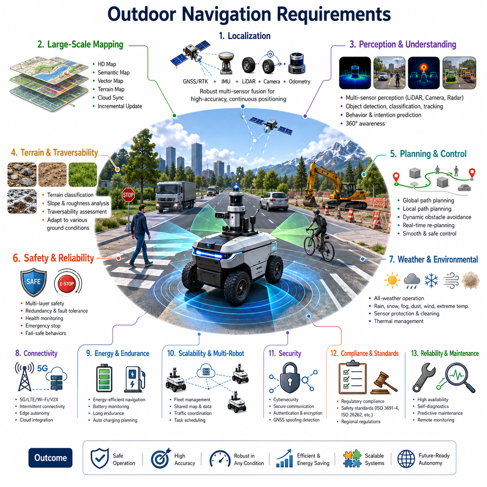
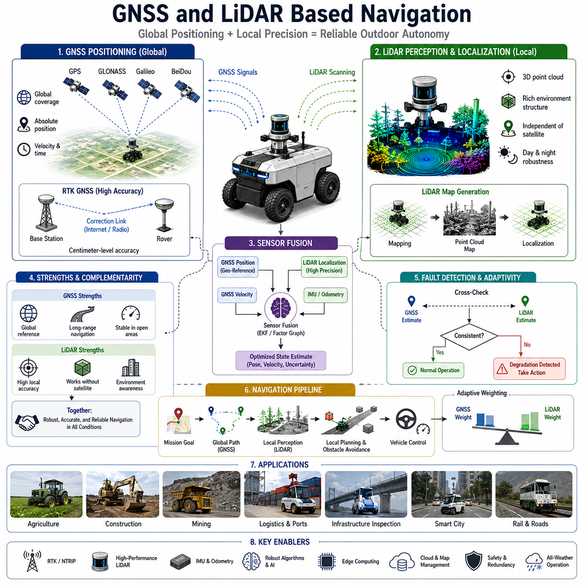
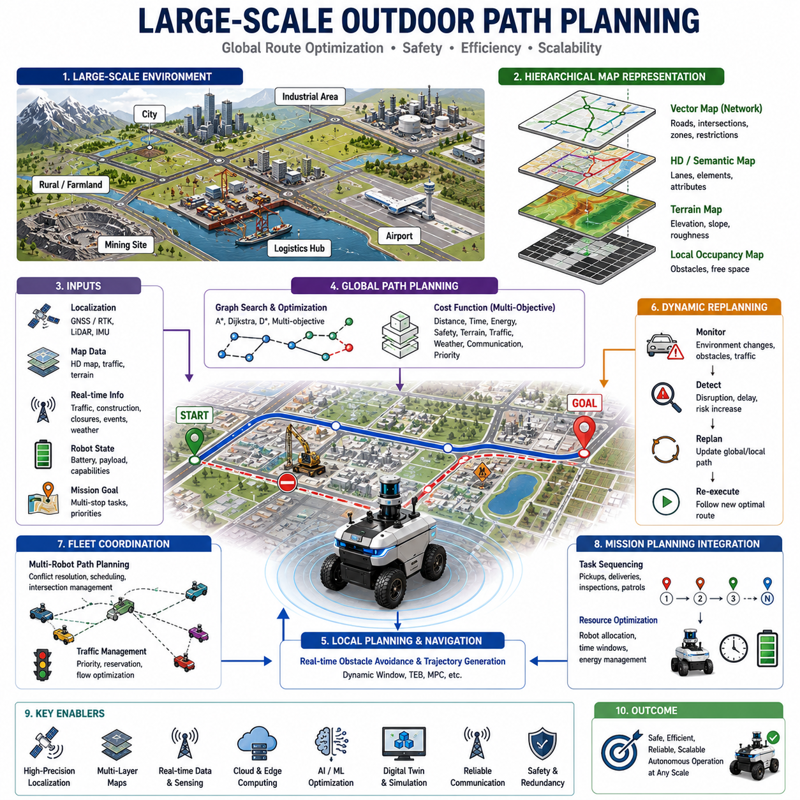
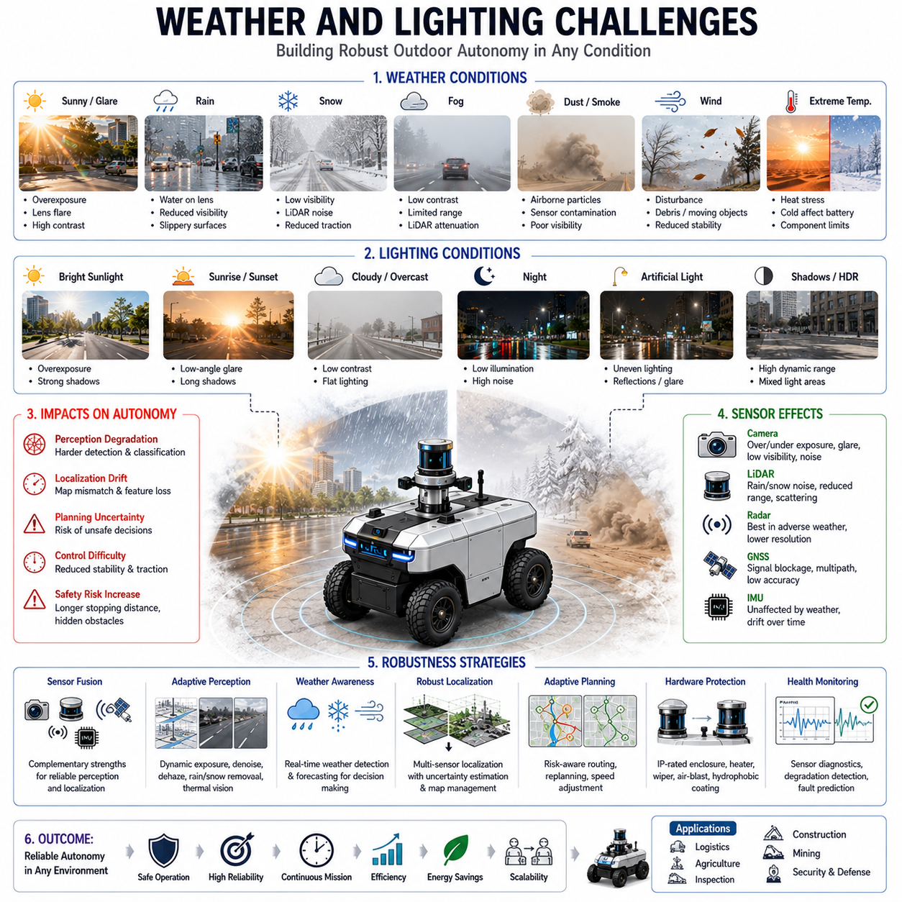
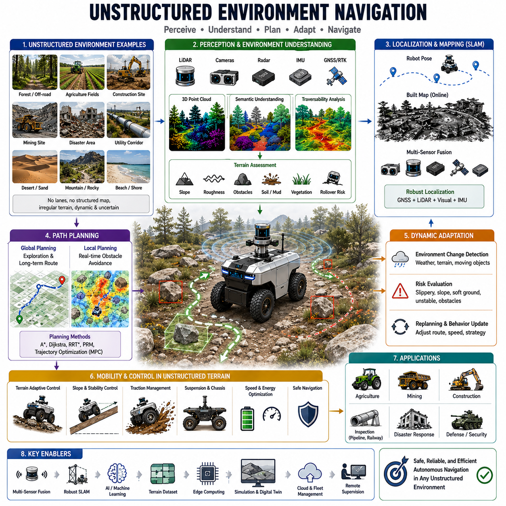
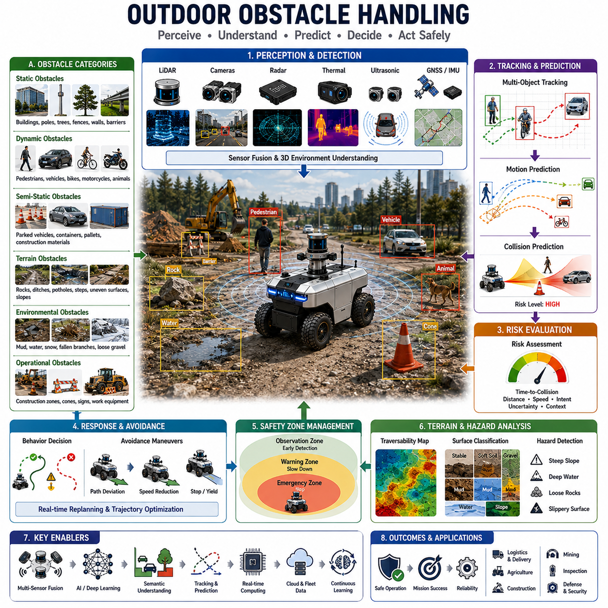
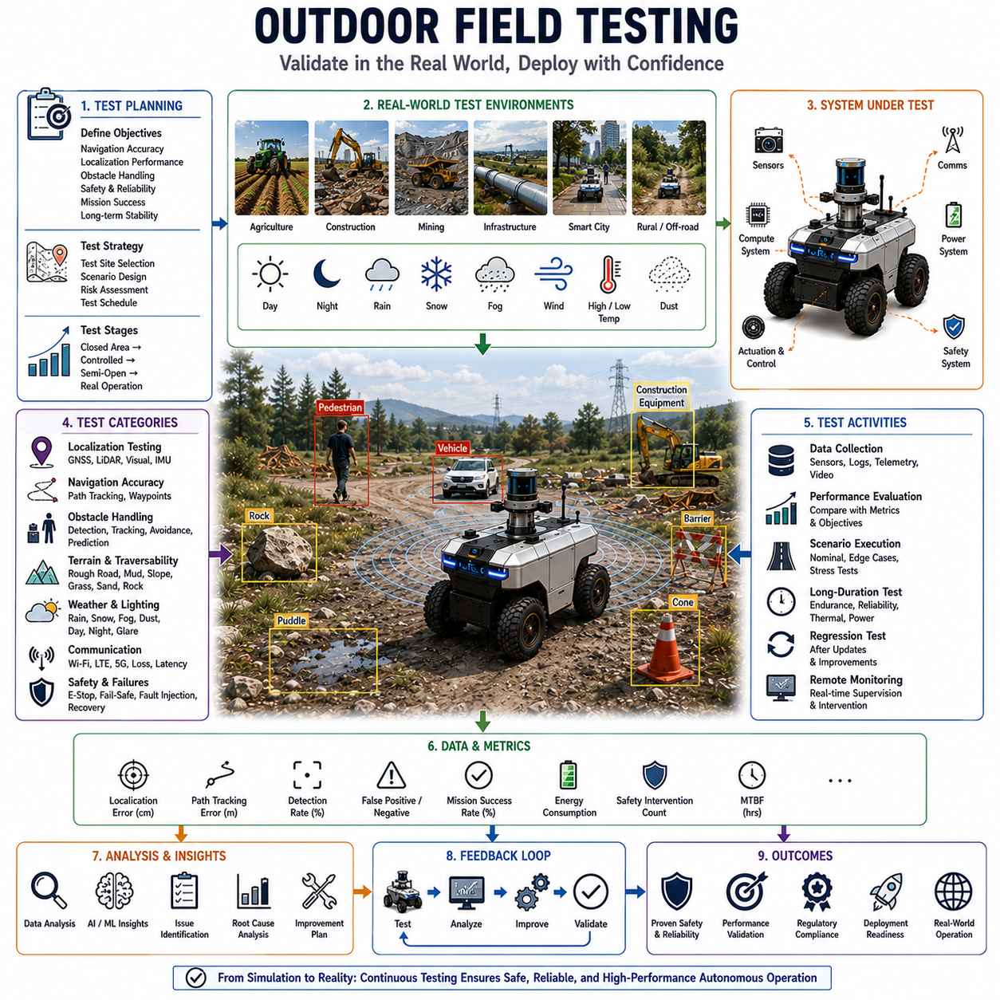
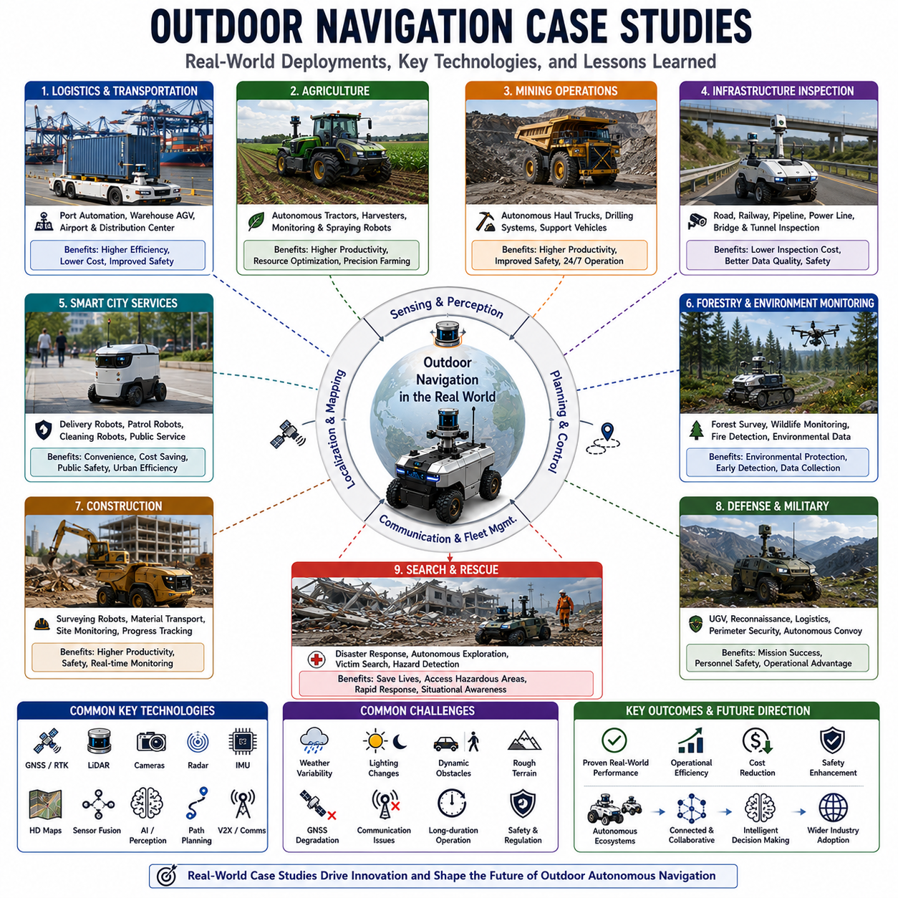

**Volume 05. Path Planning and Autonomous Navigation**

# Chapter 15. Outdoor Navigation

## 15.1 Outdoor Navigation Requirements

{width="7.268055555555556in" height="7.268055555555556in"}

실외 자율주행은 현대 자율이동로봇(AMR), 자율주행 차량, 실외 서비스 로봇, 물류 로봇, 순찰 및 점검 로봇, 농업 로봇, 광산 로봇, 스마트시티 로봇 플랫폼에서 가장 중요하면서도 가장 어려운 기술 중 하나이다. 실내 환경이 비교적 구조화되고 예측 가능한 반면, 실외 환경은 대규모 공간, 지속적으로 변화하는 환경, 다양한 기상 조건, 이동체, 보행자, 동물, 공사 구간, 통신 제한 등 수많은 변수를 포함한다. 따라서 실외 자율주행 로봇은 이러한 복잡한 환경 속에서도 안전하고 효율적으로 동작해야 한다. 이를 위해서는 인지, 위치추정, 지도 생성, 경로 계획, 제어, 안전, 운영 아키텍처 전반에 걸쳐 명확한 요구사항이 정의되어야 한다. 실외 주행 요구사항은 이후에 다루게 될 모든 실외 주행 기술의 기반이 되며 시스템 설계의 출발점이 된다.

실외 주행에서 가장 중요한 요구사항 중 하나는 신뢰성 높은 위치추정(Localization)이다. 로봇은 자신의 위치, 자세, 속도 및 운동 상태를 항상 정확하게 파악해야 한다. 실내 환경과 달리 실외 환경은 넓고 특징점이 부족한 경우가 많기 때문에 GNSS, RTK GNSS, IMU, 휠 오도메트리, LiDAR, 카메라, 레이더, 디지털 지도 등 다양한 센서를 활용한 센서 융합이 필수적이다. 단일 센서에 의존하는 것은 매우 위험하다. GNSS는 도심 협곡 현상이나 전파 차단, 간섭으로 인해 정확도가 저하될 수 있으며, LiDAR는 특징점이 거의 없는 넓은 공간에서 성능이 떨어질 수 있다. 카메라는 야간이나 악천후에서 인식 성능이 감소할 수 있다. 따라서 실외 주행 시스템은 개별 센서가 부분적으로 실패하더라도 지속적으로 위치를 추정할 수 있는 강인한 센서 융합 구조를 갖추어야 한다.

두 번째 핵심 요구사항은 대규모 환경 표현 능력이다. 실외 로봇은 수백 미터에서 수십 킬로미터에 이르는 넓은 공간에서 운용될 수 있다. 따라서 실내 로봇에서 사용하는 단순한 점유격자 지도만으로는 충분하지 않다. 실외 환경에서는 HD Map, Semantic Map, Vector Map, 도로 네트워크 지도, 지형 지도, 클라우드 기반 지도 서버 등 확장 가능한 지도 구조가 필요하다. 또한 지도는 저장, 검색, 업데이트 및 동기화가 효율적으로 수행되어야 하며, 환경 변화에 따라 지속적으로 수정될 수 있어야 한다. 공사 구간, 도로 변경, 임시 장애물, 계절 변화와 같은 요소들은 지도에 반영되어야 한다.

실외 환경은 매우 가변적이라는 특징을 가진다. 하루 동안에도 조명 조건은 지속적으로 변하며, 계절 변화에 따라 환경의 외형도 크게 달라진다. 강한 햇빛, 야간 환경, 비, 눈, 안개, 먼지, 강풍, 극한 온도 등은 모두 센서 성능과 주행 성능에 영향을 미친다. 또한 나무와 식생의 성장, 그림자의 이동, 물웅덩이 형성 등도 주행 환경을 변화시킨다. 따라서 실외 주행 시스템은 이러한 다양한 환경 변화 속에서도 안정적인 성능을 유지할 수 있도록 설계되어야 한다. 센서 구성, 인공지능 모델, 인지 알고리즘, 경로 계획 기법 모두 이러한 불확실성을 고려해야 한다.

장애물 탐지와 회피 역시 실외 환경에서 매우 중요한 요구사항이다. 실내 로봇은 주로 벽, 가구, 사람과 같은 제한된 장애물을 상대하지만, 실외 로봇은 보행자, 자전거, 오토바이, 승용차, 트럭, 버스, 동물, 공사 장비, 도로 시설물, 식생, 쓰레기 등 매우 다양한 객체를 인식해야 한다. 단순히 장애물을 탐지하는 것만으로는 충분하지 않으며, 객체의 이동 경로와 향후 행동을 예측해야 한다. 특히 사람과 차량이 함께 존재하는 혼합 교통 환경에서는 충돌 위험을 실시간으로 예측하고 지속적으로 경로를 수정할 수 있어야 한다.

실외 환경에서는 지형 인식과 주행 가능성 평가도 필수적이다. 실외 지면은 평탄하지 않은 경우가 대부분이며, 자갈길, 흙길, 잔디밭, 경사로, 움푹 패인 도로, 진흙, 모래, 암석 지형 등이 존재한다. 로봇은 이러한 지형의 특성을 분석하여 통과 가능한 영역과 위험한 영역을 구분해야 한다. LiDAR 포인트클라우드, 스테레오 비전, 깊이 카메라, 레이더 및 AI 기반 지형 분류 기술을 활용하여 표면 상태를 분석할 수 있다. 또한 경사도, 노면 거칠기, 바퀴의 접지력, 적재 하중, 전복 가능성 등을 종합적으로 고려하여 주행 가능 여부를 판단해야 한다.

안전성은 실외 자율주행에서 가장 우선시되는 요구사항이다. 실외 로봇은 사람, 차량, 중요 시설, 고가의 장비 주변에서 운용되는 경우가 많다. 따라서 다중 센서 기반의 안전 구조, 센서 상태 감시, 비상 정지 기능, 안전 구역 제어, 속도 제한, 원격 개입 기능, 장애 복구 절차 등이 반드시 포함되어야 한다. 또한 시스템은 일부 구성 요소가 실패하더라도 안전한 상태를 유지할 수 있도록 설계되어야 한다. 주행 신뢰도가 일정 수준 이하로 떨어질 경우에는 자동으로 감속하거나 정지하는 안전 메커니즘이 필요하다.

기상 환경에 대한 대응 능력 역시 중요한 요구사항이다. 비는 LiDAR 성능과 카메라 시야를 저하시킬 수 있으며, 눈은 랜드마크를 가리거나 지형의 형태를 변화시킬 수 있다. 안개는 가시거리를 감소시키고, 먼지는 센서를 오염시킬 수 있다. 고온은 전자 장치와 배터리에 영향을 미치며, 저온은 배터리 용량 감소와 기계 성능 저하를 유발한다. 따라서 실외 로봇은 방수·방진 구조, 센서 세척 장치, 열 관리 시스템, 환경 적응형 인지 알고리즘 등을 갖추어야 한다.

통신 요구사항도 실외 환경에서 매우 중요하다. 실내에서는 안정적인 Wi-Fi 환경을 활용할 수 있지만, 실외에서는 셀룰러 네트워크, 사설 LTE, 5G, 위성 통신 등 다양한 통신 수단을 사용해야 한다. 통신 품질은 지역에 따라 크게 달라질 수 있으며 일시적으로 연결이 끊어질 수도 있다. 따라서 실외 로봇은 통신이 끊기더라도 안전하게 자율 운행을 지속할 수 있어야 한다. 클라우드 연결은 지도 업데이트, 원격 모니터링, 관제 시스템 연동, Fleet Management에 유용하지만 통신이 없어도 기본 기능은 유지되어야 한다.

에너지 효율성 또한 중요한 설계 요구사항이다. 실외 로봇은 실내 로봇보다 훨씬 긴 거리를 이동하며 더 오랜 시간 동안 임무를 수행해야 한다. 따라서 경로 계획, 속도 제어, 가속 및 감속 전략, 충전 계획 등을 최적화하여 에너지 소비를 최소화해야 한다. 배터리 상태를 고려한 경로 계획과 자동 충전 전략도 전체 주행 시스템에 통합되어야 한다.

대규모 운영 환경에서는 확장성 요구사항이 중요해진다. 스마트시티, 공항, 항만, 물류센터, 병원 캠퍼스, 농장과 같은 환경에서는 다수의 로봇이 동시에 운용될 수 있다. 따라서 공유 지도, Fleet Management, 교통 제어, 작업 스케줄링, 충돌 방지 및 협업 기능이 필요하다. 이러한 기능은 단일 로봇 수준을 넘어 로봇 군집 전체를 최적화하는 방향으로 발전해야 한다.

실외 응용 분야에서는 높은 위치 정확도도 요구된다. 자동 도킹, 자동 충전, 물류 이송, 정밀 농업, 인프라 점검 등의 작업에서는 수 센티미터 수준의 위치 정확도가 필요하다. 이를 위해 RTK GNSS, LiDAR Localization, Visual Localization, 센서 융합 기술이 함께 사용된다. 또한 환경에 따라 다양한 위치추정 방식을 자동으로 전환할 수 있어야 한다.

사이버 보안 역시 현대 실외 로봇 시스템에서 필수적인 요구사항이다. GNSS 스푸핑, 통신 해킹, 소프트웨어 변조, 데이터 탈취 등 다양한 위협으로부터 시스템을 보호해야 한다. 암호화 통신, 사용자 인증, 보안 업데이트, 접근 제어 시스템은 실외 자율주행 플랫폼의 필수 구성 요소가 되고 있다.

규제 및 인증 요구사항도 설계 단계에서 고려되어야 한다. 국가별로 자율주행 차량, 산업용 로봇, 서비스 로봇에 대한 안전 규정과 인증 체계가 다르다. 따라서 실외 주행 시스템은 다양한 지역의 법규와 산업 표준을 만족할 수 있도록 설계되어야 한다.

산업 현장에서 요구되는 신뢰성은 연구용 시스템보다 훨씬 높은 수준이다. 실외 로봇은 연간 수천 시간 이상 운영될 수 있으며 최소한의 인력 개입만으로 안정적으로 동작해야 한다. 이를 위해 센서 상태 모니터링, 위치추정 품질 평가, 인지 성능 분석, 자가 진단 기능, 예지 정비 기능 등이 필요하다.

미래의 실외 주행 시스템은 인공지능 기반의 의미 이해(Semantic Understanding)와 환경 추론 능력을 더욱 적극적으로 활용하게 될 것이다. 단순히 좌표를 따라 이동하는 수준을 넘어 도로, 보행로, 교차로, 주차장, 공사 구역, 위험 구역 등을 이해하고 상황에 맞게 행동하는 지능형 자율주행이 요구된다. AI 기반 시스템은 경험을 통해 지속적으로 학습하고 새로운 환경에 적응하며 점차 인간 수준에 가까운 상황 판단 능력을 갖추게 될 것이다.

결론적으로 실외 주행 요구사항은 위치추정, 지도 생성, 환경 인지, 경로 계획, 차량 제어, 안전성, 통신, 에너지 관리, 운영 확장성, 사이버 보안, 규제 대응 및 장기 신뢰성을 포함하는 종합적인 시스템 엔지니어링 문제이다. 성공적인 실외 자율주행 로봇은 이러한 요구사항들을 균형 있게 충족해야 하며, 이를 기반으로 산업 현장, 스마트시티, 물류, 농업, 국방, 인프라 점검, 의료 서비스 등 다양한 분야에서 안전하고 효율적인 자율 운영을 실현할 수 있다. 미래의 실외 자율주행 기술은 더욱 높은 수준의 지능과 적응성을 갖춘 로봇 생태계로 발전할 것이며, 이러한 발전의 출발점은 명확하고 체계적인 실외 주행 요구사항 정의에 있다.

## 15.2 GNSS and LiDAR-Based Navigation

{width="7.268055555555556in" height="7.268055555555556in"}

GNSS와 LiDAR 기반 자율주행은 실외 자율이동로봇(AMR), 자율주행 차량, 인프라 점검 로봇, 농업 로봇, 물류 로봇, 광산 장비, 건설 로봇, 스마트시티 로봇 등에서 가장 널리 사용되는 고신뢰성 주행 방식 중 하나이다. 실외 환경은 넓은 공간, 지속적인 환경 변화, 다양한 기상 조건, 조명 변화, 동적 장애물, 복잡한 지형 등을 포함하기 때문에 안정적인 자율주행을 구현하기가 쉽지 않다. 이러한 환경에서 로봇이 안전하고 정확하게 이동하기 위해서는 정밀한 위치추정과 강인한 주행 기술이 필요하다. GNSS는 광범위한 지역에서 절대 위치 정보를 제공하며, LiDAR는 주변 환경에 대한 정밀한 인식과 국부 위치추정을 가능하게 한다. 두 기술을 센서 융합으로 결합하면 전역 위치 정보와 지역 정밀도를 동시에 확보할 수 있으며, 이는 현대 실외 자율주행 시스템의 핵심 기반 기술로 자리 잡고 있다.

GNSS(Global Navigation Satellite System)는 지구 궤도를 도는 위성 신호를 이용하여 위치를 계산하는 기술이다. 현재 사용되는 대표적인 GNSS 시스템으로는 미국의 GPS, 러시아의 GLONASS, 유럽의 Galileo, 중국의 BeiDou 등이 있다. GNSS 수신기는 여러 위성으로부터 신호를 수신하여 위치, 속도 및 시간 정보를 계산한다. 대규모 산업 단지, 농장, 항만, 공항, 철도 구간, 스마트시티와 같은 넓은 공간에서 운용되는 자율 로봇에게 GNSS는 전역 좌표계 기반의 위치 정보를 제공하는 중요한 수단이다.

일반적인 GNSS 수신기의 위치 정확도는 수 미터 수준에서 서브미터 수준 정도이다. 하지만 산업용 자율주행 로봇은 이보다 훨씬 높은 정밀도를 요구하는 경우가 많다. 자동 도킹, 정밀 농업, 인프라 점검, 건설 자동화, 자율 물류 운송 등의 응용에서는 수 센티미터 수준의 위치 정확도가 필요하다. 이러한 요구를 충족하기 위해 RTK(Real-Time Kinematic) GNSS 기술이 널리 사용된다.

RTK GNSS는 고정 기준국(Base Station)에서 생성한 보정 데이터를 이동 로봇에 제공함으로써 위치 오차를 크게 줄인다. 기준국은 위성 신호의 오차를 지속적으로 측정하여 보정 정보를 생성하고 이를 이동체에 전송한다. 이동 로봇은 해당 보정 정보를 적용하여 센티미터 수준의 위치 정확도를 달성할 수 있다. 현재 정밀 농업용 로봇, 자율 건설 장비, 인프라 점검 로봇, 무인 운반 차량 등 다양한 시스템에서 RTK GNSS가 표준 기술로 활용되고 있다.

그러나 GNSS만으로는 완전한 자율주행을 구현하기 어렵다. 위성 신호는 고층 건물 사이의 도심 환경, 터널, 교량 하부, 숲 지역, 전파 간섭 지역 등에서 성능이 저하될 수 있다. 또한 다중 경로(Multipath) 현상이나 통신 장애로 인해 RTK 보정 정보가 끊어질 수도 있다. 따라서 GNSS를 보완할 수 있는 독립적인 위치추정 기술이 반드시 필요하다.

LiDAR는 이러한 문제를 해결하는 가장 대표적인 기술이다. LiDAR는 레이저를 발사하고 반사되어 돌아오는 시간을 측정하여 주변 환경의 3차원 형상을 생성한다. 이를 통해 건물, 도로, 나무, 차량, 울타리, 전봇대, 구조물 등 다양한 환경 정보를 고해상도 포인트클라우드 형태로 획득할 수 있다.

LiDAR의 가장 큰 장점은 위성 신호에 의존하지 않는다는 점이다. GNSS가 외부 위성 시스템을 이용하는 반면, LiDAR는 주변 환경 자체를 이용하여 위치를 추정한다. 따라서 GNSS 신호가 약하거나 끊긴 상황에서도 높은 정확도의 위치추정을 유지할 수 있다.

LiDAR 기반 위치추정은 일반적으로 사전 제작된 지도를 활용한다. 먼저 로봇이 주행 구역을 이동하면서 LiDAR 데이터를 수집하고 SLAM 기술을 이용하여 정밀 지도를 생성한다. 이후 실제 운용 시에는 실시간 LiDAR 스캔 데이터를 기존 지도와 비교하여 현재 위치를 계산한다. 지도 속 특징과 현재 관측된 특징을 매칭함으로써 매우 높은 정확도의 위치추정이 가능해진다.

최신 LiDAR Localization 시스템은 수 센티미터 수준의 정확도를 제공할 수 있다. 건물 모서리, 도로 경계선, 전봇대, 울타리, 가로수, 구조물 등 환경 속의 고정된 특징들이 위치추정 기준점으로 사용된다. LiDAR는 빛의 밝기가 아니라 기하학적 형상을 측정하기 때문에 카메라 기반 시스템보다 조명 변화에 훨씬 강하다. 낮과 밤, 그림자 변화, 역광 환경에서도 비교적 안정적인 성능을 유지할 수 있다.

GNSS와 LiDAR를 통합하면 두 기술의 장점을 모두 활용할 수 있다. GNSS는 전역 위치 정보를 제공하고 장거리 이동을 지원한다. LiDAR는 국부적인 정밀 위치추정과 환경 인식을 제공한다. 센서 융합 기술은 이 두 정보를 결합하여 더욱 정확하고 안정적인 위치 정보를 생성한다.

센서 융합에는 Extended Kalman Filter(EKF), Unscented Kalman Filter(UKF), Particle Filter, Factor Graph Optimization, Graph-based Localization 등의 알고리즘이 사용된다. 이러한 알고리즘은 GNSS, LiDAR, IMU, 휠 엔코더 등의 데이터를 동시에 분석하여 최적의 위치와 자세를 계산한다.

위성 신호가 좋은 개방된 환경에서는 GNSS가 주요 위치추정 수단으로 사용되고 LiDAR가 이를 보정한다. 반대로 도심 지역이나 건물 밀집 지역에서는 LiDAR 기반 위치추정이 더욱 중요한 역할을 수행한다. GNSS가 완전히 끊어지는 경우에도 LiDAR Localization만으로 일정 시간 동안 안정적인 주행을 유지할 수 있다. 이러한 적응형 구조는 실외 자율주행 시스템의 신뢰성을 크게 향상시킨다.

GNSS와 LiDAR를 동시에 사용하는 또 다른 장점은 이상 감지(Fault Detection) 기능이다. 자율주행 시스템은 항상 자신의 위치추정 결과가 올바른지 검증해야 한다. GNSS와 LiDAR가 각각 독립적으로 위치를 계산하기 때문에 두 결과를 비교하여 이상 여부를 판단할 수 있다. 만약 두 센서의 위치 결과가 크게 차이 난다면 GNSS 오류, LiDAR 지도 불일치, 센서 고장 또는 환경 변화 가능성을 판단할 수 있다. 시스템은 이를 기반으로 감속, 재위치추정, 안전 정지 등의 대응을 수행할 수 있다.

대규모 실외 환경에서는 단순한 위치추정뿐 아니라 경로 계획 기능도 중요하다. GNSS는 넓은 지역에서 목적지까지의 전역 경로 계획을 지원하며, LiDAR는 주변 환경을 실시간으로 분석하여 장애물 회피와 국부 경로 생성을 담당한다. 두 기술의 결합은 전략적 이동과 정밀한 주행을 동시에 가능하게 만든다.

항만, 공항, 물류센터, 광산, 농장, 스마트시티와 같은 대규모 산업 환경에서는 수 제곱킬로미터 이상의 영역을 이동해야 하는 경우가 많다. GNSS는 이러한 장거리 이동을 지원하고, LiDAR는 장비나 구조물 근처에서의 정밀 주행을 담당한다. 따라서 로봇은 넓은 지역을 효율적으로 이동하면서도 최종 목적지에서는 높은 정밀도를 유지할 수 있다.

인프라 점검 로봇은 GNSS와 LiDAR 통합 기술의 대표적인 응용 사례이다. 철도 점검, 도로 점검, 파이프라인 점검, 전력 설비 점검, GPR 기반 지중 인프라 점검 등의 작업에서는 수집된 데이터를 정확한 위치와 연결해야 한다. GNSS는 절대 좌표를 제공하고 LiDAR는 정밀한 국부 위치를 제공함으로써 데이터의 신뢰성을 높인다. 이를 통해 디지털 트윈 구축, 유지보수 계획, 변화 감지 분석 등이 가능해진다.

농업 로봇 역시 GNSS와 LiDAR 기술을 적극 활용한다. RTK GNSS는 밭과 농장의 전역 경로를 제공하고, LiDAR는 작물 줄(Row) 인식, 장애물 회피, 지형 분석, 정밀 주행을 지원한다. 자율 트랙터, 방제 로봇, 수확 로봇, 농작물 모니터링 시스템은 이러한 기술을 통해 생산성을 향상시키고 운영 비용을 절감한다.

건설 현장과 광산은 환경 변화가 매우 심한 대표적인 실외 환경이다. 굴착 작업, 토목 공사, 임시 구조물 설치 등으로 인해 지형이 지속적으로 변한다. GNSS는 안정적인 전역 좌표를 제공하고 LiDAR는 변화된 환경을 실시간으로 반영한다. 이를 통해 자율 건설 장비와 광산 장비는 변화하는 환경에서도 정확한 위치를 유지할 수 있다.

기상 조건은 GNSS와 LiDAR 성능에 영향을 줄 수 있다. 폭우, 안개, 눈, 먼지 환경에서는 LiDAR 성능이 일부 감소할 수 있으며, 대기 상태에 따라 GNSS 신호 품질도 변할 수 있다. 따라서 산업용 자율주행 시스템은 센서 상태를 지속적으로 모니터링하고 각 센서의 신뢰도를 평가하여 융합 가중치를 동적으로 조정한다. 또한 레이더, 카메라, IMU 등의 추가 센서를 활용하여 악조건에서도 강인한 성능을 유지한다.

최근에는 인공지능과 머신러닝 기술이 GNSS-LiDAR 통합 시스템에 적용되고 있다. AI는 지도 매칭 정확도 향상, 특징 추출, 위치 이상 탐지, 환경 변화 적응, 지형 분류, 센서 신뢰도 평가 등에 활용된다. 이러한 기술은 더욱 높은 수준의 자율성과 안정성을 제공한다.

클라우드 기술 역시 GNSS와 LiDAR 기반 자율주행을 강화하고 있다. 클라우드는 지도 관리, Fleet Management, 원격 모니터링, 데이터 분석, 운영 최적화를 지원한다. 여러 대의 로봇이 동일한 지도를 공유하고 경험을 학습함으로써 전체 시스템의 효율성을 높일 수 있다. 실시간 제어는 Edge Computer에서 수행하고, 장기 데이터 분석과 최적화는 클라우드에서 수행하는 Edge-Cloud 협업 구조가 일반화되고 있다.

안전성은 GNSS와 LiDAR 기반 자율주행 시스템 설계의 최우선 목표이다. 위치추정 오차는 곧 주행 안전성과 직결되기 때문이다. 따라서 산업용 시스템은 위치 신뢰도 평가, 센서 상태 감시, 환경 위험도 분석, 비상 정지 기능, 원격 개입 기능, Fail-safe 동작 등을 포함해야 한다.

앞으로 물류, 농업, 건설, 광산, 국방, 스마트시티, 철도 및 지중 인프라 점검 분야가 확대됨에 따라 GNSS와 LiDAR 기반 자율주행 기술의 중요성은 더욱 커질 것이다. 전역 위치 정보를 제공하는 GNSS와 정밀 환경 인식 및 위치추정을 제공하는 LiDAR의 결합은 실외 자율주행 로봇의 핵심 기술로 자리 잡고 있으며, 향후 AI 기반 위치추정, 실시간 디지털 트윈, 클라우드 기반 협업 주행, 자율 의사결정 기술과 결합하여 더욱 지능적이고 안전한 실외 자율주행 플랫폼으로 발전하게 될 것이다. 이는 미래 실외 자율로봇 생태계를 구성하는 가장 중요한 기술적 기반 중 하나가 될 것이다.

## 15.3 Large Scale Outdoor Path Planning

{width="7.268055555555556in" height="7.268055555555556in"}

대규모 실외 경로 계획(Large-Scale Outdoor Path Planning)은 스마트시티, 물류센터, 공항, 항만, 산업단지, 농업 지역, 광산, 군사 기지, 철도망, 유틸리티 인프라, 대규모 공공시설 등 광범위한 환경에서 운영되는 자율이동로봇(AMR)의 핵심 기술 중 하나이다. 실내 자율주행이 주로 건물이나 제한된 공간 내에서 이루어지는 반면, 실외 자율주행은 수백 미터에서 수십 킬로미터에 이르는 넓은 영역을 대상으로 한다. 운영 범위가 커질수록 경로 계획 문제는 더욱 복잡해지며, 다양한 지형 조건, 교통 상황, 환경 변화, 통신 제약, 에너지 소비, 안전 요구사항 등을 동시에 고려해야 한다. 따라서 대규모 실외 경로 계획은 단순한 길 찾기 알고리즘이 아니라 위치추정, 지도 생성, 경로 최적화, 환경 이해, 교통 관리, 플릿 운영 및 임무 계획을 통합하는 종합적인 의사결정 시스템이라 할 수 있다.

대규모 실외 경로 계획의 기본 목표는 시작 위치에서 목적지까지 안전하고 효율적이며 신뢰성 있는 경로를 생성하는 것이다. 단거리 이동에서는 장애물 회피와 국부 경로 생성이 중요하지만, 대규모 실외 환경에서는 장거리 이동을 위한 전략적 경로 선택이 더욱 중요하다. 자율주행 시스템은 최적의 이동 경로를 찾고, 대체 경로를 평가하며, 이동 시간과 에너지 소비를 최소화하고, 위험 지역을 회피하면서도 임무 목표를 달성해야 한다. 이러한 이유로 대규모 경로 계획은 전역 경로 계획(Global Planning)과 국부 주행(Local Navigation)을 결합한 계층적 구조(Hierarchical Architecture)로 구현되는 경우가 많다.

대규모 환경에서 가장 먼저 직면하는 문제는 지도 표현 방식이다. 실내에서 널리 사용되는 Occupancy Grid Map은 넓은 실외 공간에서는 비효율적이다. 도시 규모의 공간을 센티미터 단위 해상도로 표현하면 수십억 개 이상의 셀이 필요하며, 저장 공간과 계산 비용이 급격히 증가한다. 따라서 대규모 실외 주행에서는 계층적 지도 구조가 활용된다.

상위 계층에서는 벡터 지도(Vector Map)와 도로 네트워크 지도가 사용된다. 이러한 지도에는 도로, 교차로, 보행로, 서비스 도로, 제한 구역, 운영 구역 등이 그래프 형태로 표현된다. 노드는 특정 위치를 나타내고 엣지는 이동 가능한 경로를 나타낸다. 이러한 표현 방식은 계산량을 크게 줄이면서도 경로 계획에 필요한 정보를 효율적으로 제공한다. 하위 계층에서는 HD Map, Semantic Map, Terrain Map, Occupancy Map 등을 이용하여 정밀 주행에 필요한 상세 정보를 제공한다.

그래프 기반 경로 계획(Graph-Based Planning)은 대규모 실외 경로 계획의 핵심 기술이다. 도로망은 자연스럽게 그래프 구조로 표현될 수 있기 때문에 다양한 그래프 탐색 알고리즘이 활용된다. Dijkstra 알고리즘, A-Star, Weighted A-Star, Lifelong Planning A-Star, D-Star Lite 등은 대표적인 대규모 경로 계획 알고리즘이다. 이러한 알고리즘은 각 경로의 비용을 계산하고 가장 효율적인 경로를 탐색한다.

비용 함수(Cost Function)는 대규모 경로 계획에서 매우 중요한 요소이다. 단순히 가장 짧은 거리만을 선택하는 것이 아니라 다양한 요소를 동시에 고려해야 한다. 이동 거리, 예상 이동 시간, 에너지 소비량, 지형 상태, 교통 혼잡도, 기상 조건, 통신 품질, 안전 위험도, 배터리 상태, 적재 하중, 임무 우선순위 등이 모두 비용 계산에 반영될 수 있다. 현대의 경로 계획 시스템은 이러한 요소들을 통합한 다중 목적 최적화(Multi-Objective Optimization)를 수행한다.

에너지 효율성은 장거리 이동 환경에서 매우 중요한 요소이다. 실외 로봇은 수 킬로미터 이상을 이동하거나 장시간 연속 운행하는 경우가 많다. 따라서 경로 계획 시스템은 배터리 소비량을 고려해야 한다. 가장 짧은 경로가 항상 가장 효율적인 경로는 아니다. 가파른 경사, 울퉁불퉁한 노면, 잦은 정지와 출발, 혼잡한 교통 환경은 에너지 소비를 증가시킨다. 따라서 에너지 기반 경로 계획은 예상 전력 소비를 계산하여 가장 효율적인 경로를 선택한다.

지형 특성 역시 중요한 고려 요소이다. 실외 환경은 포장도로뿐만 아니라 자갈길, 흙길, 잔디, 모래, 진흙, 암석 지형, 경사면 등 다양한 노면 상태를 포함한다. 경로 계획 시스템은 Traversability Assessment를 수행하여 특정 지형의 통과 가능성을 평가한다. 경사도, 표면 거칠기, 접지력, 장애물 밀도 등을 분석하여 위험한 지역은 회피하고 안전한 경로를 선택한다.

도심이나 산업 환경에서는 도로 네트워크에 대한 이해도 필수적이다. 자율주행 로봇은 도로 종류, 속도 제한, 일방통행, 보행자 구역, 적재 구역, 서비스 도로, 비상 통로 등을 이해해야 한다. Semantic Map은 이러한 의미 정보를 제공하며, 이를 기반으로 더욱 안전하고 효율적인 경로를 생성할 수 있다.

실외 환경은 지속적으로 변화하기 때문에 동적 재계획(Dynamic Replanning) 기능이 필요하다. 교통 상황 변화, 공사 구간, 도로 폐쇄, 임시 장애물, 기상 변화 등으로 인해 초기 경로가 더 이상 최적이 아닐 수 있다. 따라서 자율주행 시스템은 환경 변화를 지속적으로 감시하고 필요 시 새로운 경로를 생성해야 한다.

D-Star 및 Lifelong Planning A-Star와 같은 알고리즘은 기존 계산 결과를 재활용하면서 빠르게 새로운 경로를 생성할 수 있다. 이러한 방식은 전체 경로를 처음부터 다시 계산하는 것보다 훨씬 효율적이며 실시간 자율주행에 적합하다.

기상 조건은 대규모 경로 계획에 직접적인 영향을 미친다. 비, 눈, 안개, 강풍, 홍수, 결빙 등의 환경은 도로 안전성과 차량 이동성을 변화시킨다. 최신 경로 계획 시스템은 기상 정보를 실시간으로 수집하여 특정 경로의 위험도를 평가한다. 위험 지역을 우회하거나 안전한 대체 경로를 선택함으로써 운영 안정성을 높일 수 있다.

정확한 위치추정(Localization)은 대규모 경로 계획의 기본 전제 조건이다. GNSS, RTK GNSS, LiDAR Localization, Visual Localization, IMU 기반 위치추정 시스템은 로봇이 계획된 경로를 정확히 따라갈 수 있도록 지원한다. 특히 GNSS 신호가 약한 도심 협곡이나 산업 시설 내부에서는 위치 오차를 고려한 경로 계획이 필요하다.

통신 인프라도 중요한 요소이다. 대규모 실외 환경에서는 LTE, 5G, 사설 무선망, 위성 통신 등이 사용된다. 일부 경로는 통신 품질이 우수하지만 다른 지역은 통신이 불안정할 수 있다. 따라서 통신 기반 경로 계획은 네트워크 품질 정보를 고려하여 원격 관제와 클라우드 연동이 필요한 작업에 적합한 경로를 선택할 수 있다.

플릿(Fleet) 운영 환경에서는 경로 계획이 더욱 복잡해진다. 수십 대 또는 수백 대의 로봇이 동시에 운영될 경우 각 로봇이 독립적으로 경로를 생성하면 혼잡, 교착 상태, 충돌 위험이 증가한다. 따라서 Fleet Management System은 전체 로봇의 이동 경로를 통합적으로 관리한다.

다중 로봇 경로 계획(Multi-Robot Path Planning)은 교차로 예약, 우선순위 관리, 통행 스케줄링, 교통 흐름 최적화 등을 수행한다. 중앙 집중형 방식에서는 중앙 서버가 전체 경로를 최적화하며, 분산형 방식에서는 로봇들이 서로 정보를 공유하며 협력한다. 실제 산업 현장에서는 두 방식을 결합한 하이브리드 구조가 많이 사용된다.

대규모 경로 계획은 단순한 이동 경로 생성보다 상위 개념인 임무 계획(Mission Planning)과 밀접하게 연결된다. 물류 로봇은 여러 개의 픽업 및 배송 지점을 방문해야 하며, 점검 로봇은 수많은 검사 포인트를 순차적으로 방문해야 한다. 따라서 경로 최적화는 작업 순서 최적화와 함께 수행되어야 한다.

최근에는 클라우드 기반 경로 계획이 널리 활용되고 있다. 클라우드는 지도 관리, 플릿 최적화, 교통 분석, 디지털 트윈, 운영 데이터 분석 등을 수행한다. 로봇은 클라우드가 생성한 전역 경로를 활용하면서도 실시간 장애물 회피와 제어는 Edge Computer에서 수행한다. 이러한 Edge-Cloud 협업 구조는 대규모 운영 환경에서 매우 효과적이다.

디지털 트윈 기술은 대규모 경로 계획을 더욱 발전시키고 있다. 디지털 트윈은 실제 환경을 가상 공간에 실시간으로 재현하는 기술이다. 교통 상황, 날씨, 공사 정보, 인프라 상태 등을 실시간으로 반영하여 보다 정확한 경로 계획을 지원한다. 또한 시뮬레이션 기반 검증과 미래 상황 예측도 가능하게 한다.

인공지능 기술 역시 대규모 경로 계획에 적극적으로 적용되고 있다. 머신러닝 모델은 교통 혼잡 예측, 에너지 소비 예측, 지형 통과 가능성 분석, 환경 변화 예측 등을 수행할 수 있다. 강화학습 기반 경로 계획은 반복적인 운영 경험을 통해 더욱 효율적인 경로 전략을 학습할 수 있다.

안전성은 모든 경로 계획 과정에서 최우선 요소이다. 차량 충돌 위험, 보행자 밀집 지역, 위험 시설, 제한 구역, 악천후 지역 등 다양한 위험 요소가 경로 계획에 반영되어야 한다. 안전 제약 조건을 포함한 Risk-Aware Planning은 로봇이 위험을 최소화하면서 임무를 수행할 수 있도록 지원한다.

실제 산업 현장에서는 대규모 경로 계획 기술이 다양한 분야에서 활용된다. 물류 로봇은 항만과 물류센터에서 장거리 물품 운송을 수행하며, 농업 로봇은 넓은 농경지를 효율적으로 커버한다. 광산 자율 차량은 수 킬로미터 규모의 채굴 현장에서 이동하며, GPR 점검 로봇과 철도 점검 로봇은 긴 인프라 구간을 따라 이동한다. 스마트시티 로봇은 도시 전역에서 다양한 서비스를 제공한다. 응용 분야는 다르지만 모두 대규모 경로 계획 기술에 의존한다.

미래의 대규모 실외 경로 계획은 실시간 디지털 트윈, AI 기반 최적화, 클라우드 네이티브 플릿 운영, 환경 예측 모델링, 의미 기반 환경 이해, 자율 임무 생성 기술과 결합하여 더욱 지능화될 것이다. 단순히 길을 찾는 수준을 넘어 도시 전체, 산업 단지 전체, 국가 인프라 전체를 대상으로 운영되는 거대한 로봇 생태계를 관리하는 수준으로 발전하게 될 것이다.

결국 대규모 실외 경로 계획은 자율주행 시스템의 전략적 두뇌 역할을 수행한다. 지도 정보, 환경 정보, 운영 목표, 시스템 제약 조건을 종합적으로 분석하여 실행 가능한 주행 계획을 생성한다. 물류, 농업, 광산, 건설, 국방, 철도, 인프라 점검, 스마트시티 분야가 지속적으로 성장함에 따라 대규모 실외 경로 계획 기술은 미래 자율주행 로봇의 핵심 기반 기술로서 더욱 중요한 역할을 수행하게 될 것이다.

## 15.4 Weather and Lighting Challenges

{width="7.268055555555556in" height="7.268055555555556in"}

기상 조건과 조명 조건은 실외 자율주행에서 가장 큰 기술적 도전 과제 중 하나이다. 실내 환경은 조명, 온도, 습도 및 환경 조건이 비교적 일정하게 유지되지만, 실외 환경은 날씨 변화, 계절 변화, 대기 상태, 태양의 위치 변화 등에 의해 지속적으로 영향을 받는다. 실외 자율이동로봇은 이러한 환경 속에서도 안정적으로 위치를 추정하고, 주변 환경을 인식하며, 경로를 계획하고, 장애물을 회피하며, 안전하게 주행해야 한다. 비, 눈, 안개, 먼지, 강한 햇빛, 그림자, 야간 환경, 눈부심(Glare), 급격한 조도 변화 등은 센서 성능과 자율주행 정확도에 직접적인 영향을 미친다. 따라서 기상 및 조명 환경에 대한 강인성(Robustness)은 현대 실외 자율주행 시스템 설계의 핵심 요소가 되었다.

실외 환경의 가장 큰 특징은 환경 변화가 매우 크다는 점이다. 로봇은 오전에는 강한 햇빛 아래에서 주행하다가 오후에는 폭우를 만나고, 저녁에는 어두운 환경에서 작업을 계속해야 할 수 있다. 실내와 달리 환경 자체를 통제할 수 없기 때문에 자율주행 시스템은 변화하는 조건에 적응할 수 있어야 한다. 이러한 요구사항은 인지 센서, 위치추정 알고리즘, 지도 생성 시스템, 경로 계획 모듈, 통신 장치, 전력 시스템, 안전 제어 시스템 등 로봇의 거의 모든 구성 요소에 영향을 준다.

조명 환경은 자율주행 성능에 가장 직접적인 영향을 주는 요소 중 하나이다. 카메라 기반 인식 시스템은 주변 빛에 의존하기 때문에 조도 변화에 매우 민감하다. 밝은 낮에는 과도한 햇빛으로 인해 영상이 과노출될 수 있으며, 렌즈 플레어(Lens Flare)와 높은 명암비(High Dynamic Range) 문제가 발생할 수 있다. 반면 야간에는 빛이 부족하여 영상 품질이 저하되고 노이즈가 증가하며 객체 인식이 어려워진다. 따라서 실외 자율주행 시스템은 강한 태양광 환경부터 완전한 어둠에 이르기까지 다양한 조명 조건에서 안정적으로 동작해야 한다.

직사광선은 다양한 문제를 유발한다. 특히 일출과 일몰 시간대의 낮은 태양 고도는 강한 눈부심을 발생시켜 도로와 장애물 인식을 어렵게 만든다. 유리창, 금속 표면, 물웅덩이, 차량 창문 등에 반사된 빛은 허위 객체(False Object)를 생성하거나 인식 정확도를 저하시킬 수 있다. 또한 건물과 나무가 만드는 그림자는 실제 장애물처럼 보일 수 있어 인공지능 인식 시스템에 혼란을 줄 수 있다.

고명암비(HDR) 환경 역시 중요한 문제이다. 실외에서는 매우 밝은 영역과 매우 어두운 영역이 동시에 존재하는 경우가 많다. 예를 들어 한쪽은 직사광선에 노출되고 다른 한쪽은 건물 그림자 아래에 있는 경우가 있다. 일반 카메라는 이러한 밝기 차이를 모두 표현하기 어렵다. 따라서 HDR 카메라, 자동 노출 조절, 이미지 향상 알고리즘, AI 기반 영상 보정 기술이 활용된다.

야간 환경은 또 다른 형태의 도전 과제를 제공한다. 자연광이 부족해지면 카메라의 성능이 크게 감소한다. 객체 탐지, 차선 인식, 지형 분석, 의미 기반 환경 이해가 모두 어려워진다. 가로등, 차량 헤드라이트, 산업 시설 조명 등이 일부 도움을 줄 수 있지만, 오히려 불균일한 조명과 반사 현상을 만들어 새로운 문제를 발생시키기도 한다. 따라서 야간 자율주행은 카메라뿐 아니라 LiDAR, Radar, Thermal Camera, IMU 등을 결합한 다중 센서 융합 구조가 필수적이다.

열화상 카메라(Thermal Camera)는 야간 환경에서 매우 중요한 역할을 한다. 일반 카메라가 가시광선을 이용하는 반면, 열화상 카메라는 물체가 방출하는 적외선을 측정한다. 따라서 완전한 어둠 속에서도 사람, 동물, 차량, 장비 등을 탐지할 수 있다. 보안 순찰 로봇, 국방 로봇, 구조 로봇, 야간 점검 로봇 등에 특히 유용하다.

기상 조건은 조명 문제보다 더 복합적인 영향을 미친다. 비는 가장 흔하게 발생하는 환경 요인 중 하나이다. 비가 내리면 카메라 렌즈와 LiDAR 보호창에 물방울이 맺혀 센서 성능이 저하된다. 또한 노면이 미끄러워져 제동 거리가 증가하고 바퀴의 접지력이 감소한다. 따라서 자율주행 시스템은 강우 상황을 인식하고 속도 제한, 제동 거리 증가, 경로 변경 등의 대응을 수행해야 한다.

LiDAR는 강수 환경에서 영향을 받는다. 빗방울은 레이저를 반사하여 포인트클라우드에 노이즈를 생성할 수 있다. 최신 LiDAR 필터링 알고리즘은 대부분의 강우 노이즈를 제거할 수 있지만, 폭우 환경에서는 측정 거리와 정확도가 감소할 수 있다. 눈이 내리는 환경에서도 비슷한 문제가 발생한다. 눈송이는 LiDAR에 노이즈를 생성하고 주변 환경을 가려버릴 수 있다.

적설 환경은 단순한 센서 문제를 넘어 환경 자체를 변화시킨다. 눈이 쌓이면 도로 경계선, 차선, 랜드마크, 표지판 등이 가려질 수 있다. 또한 노면 마찰력이 크게 감소하여 차량의 제동 성능과 주행 안정성이 저하된다. 깊은 눈은 새로운 장애물이 되거나 특정 구역의 이동을 불가능하게 만들 수 있다. 따라서 자율주행 시스템은 지형 분석, 노면 상태 분석, 차량 제어를 통합적으로 수행해야 한다.

안개는 자율주행에서 가장 어려운 환경 중 하나이다. 안개는 가시거리를 크게 감소시키고 카메라의 명암 대비를 낮춘다. LiDAR 역시 물방울에 의해 산란 현상이 발생하여 측정 성능이 저하될 수 있다. 반면 Radar는 전파를 사용하기 때문에 안개에 상대적으로 강하다. 따라서 악천후 환경에서는 Radar의 중요성이 더욱 커진다.

먼지와 연기 또한 실외 자율주행에 영향을 준다. 광산, 농업, 건설 현장에서는 차량 이동과 작업 과정에서 대량의 먼지가 발생한다. 이러한 먼지는 카메라와 LiDAR의 시야를 방해하고 환경 인식 정확도를 감소시킨다. 따라서 산업용 로봇은 센서 보호 장치, 자동 세척 장치, 적응형 필터링 기술을 필요로 한다.

강풍은 차량의 주행 안정성을 저하시킬 수 있다. 특히 경량 플랫폼은 횡풍에 의해 궤적이 흔들릴 수 있다. 또한 바람은 먼지, 낙엽, 쓰레기 등을 이동시켜 새로운 장애물을 생성한다. 강풍과 비, 눈이 결합될 경우 환경의 복잡성은 더욱 증가한다.

계절 변화 역시 장기적인 문제를 야기한다. 나무와 식생은 계절에 따라 크게 변화한다. 여름에는 울창한 나무가 존재하지만 겨울에는 잎이 떨어져 전혀 다른 환경처럼 보일 수 있다. 위치추정 시스템은 이러한 변화에도 적응해야 한다. 특정 계절에 생성된 지도가 다른 계절에는 정확하지 않을 수 있기 때문에 장기 자율주행(Long-Term Autonomy)에서는 적응형 지도 관리 기술이 필요하다.

극한 온도 역시 중요한 변수이다. 고온 환경은 전자 장치와 배터리의 성능을 저하시킬 수 있으며, 저온 환경은 배터리 용량 감소와 기계적 저항 증가를 유발한다. 따라서 실외 로봇은 열 관리 시스템과 환경 보호 설계를 갖추어야 한다.

위치추정(Localization)은 기상 및 조명 조건에 매우 민감하다. 카메라 기반 위치추정은 조명 변화와 그림자에 의해 영향을 받는다. LiDAR 기반 위치추정은 상대적으로 강인하지만 폭설, 짙은 안개, 식생 변화 등에 의해 영향을 받을 수 있다. 따라서 GNSS, RTK GNSS, LiDAR, Camera, IMU, Radar를 결합한 다중 센서 기반 위치추정이 가장 신뢰성이 높다.

최근에는 기상 정보를 경로 계획에 직접 활용하는 Weather-Aware Navigation 기술이 발전하고 있다. 자율주행 시스템은 단순히 장애물을 피하는 것이 아니라, 홍수 위험 지역, 결빙 구간, 진흙 지역, 강풍 지역 등을 회피하는 경로를 선택할 수 있다. 또한 실시간 기상 예보를 활용하여 미래 위험을 예측하고 경로를 사전에 수정할 수 있다.

인공지능은 이러한 문제 해결에 중요한 역할을 한다. 딥러닝 모델은 악천후 환경에서도 객체를 인식할 수 있도록 학습될 수 있다. AI 기반 영상 복원 기술은 저조도 영상 품질을 향상시키고, 센서 신뢰도를 평가하며, 환경 위험도를 분석할 수 있다. 또한 머신러닝 기반 이상 탐지 시스템은 센서 고장과 환경 변화를 조기에 발견할 수 있다.

센서 융합(Sensor Fusion)은 기상 및 조명 문제를 해결하는 가장 효과적인 방법이다. 카메라는 풍부한 시각 정보를 제공하지만 조명 변화에 취약하다. LiDAR는 정밀한 거리 정보를 제공하지만 비와 눈의 영향을 받는다. Radar는 악천후에 강하지만 공간 해상도가 낮다. Thermal Camera는 야간에 강하지만 세부 정보가 부족하다. 이러한 센서들을 결합함으로써 각 센서의 약점을 보완할 수 있다.

하드웨어 측면에서도 다양한 보호 기술이 적용된다. 산업용 실외 로봇은 일반적으로 IP 등급의 방수·방진 설계, 센서 히터, 자동 와이퍼, 에어 블로우 세척 시스템, 발수 코팅, 열 관리 시스템 등을 갖춘다. 이러한 설계는 센서의 성능을 유지하고 장기적인 신뢰성을 확보하는 데 중요한 역할을 한다.

기상 및 조명 환경에 대한 시험과 검증 역시 매우 중요하다. 시뮬레이션만으로는 실제 환경의 모든 복잡성을 재현할 수 없기 때문에 다양한 계절, 시간대, 기상 조건에서의 실증 시험이 필수적이다. 실외 자율주행 로봇은 낮과 밤, 여름과 겨울, 맑은 날과 악천후 상황에서 모두 안정적으로 동작해야 한다.

향후 실외 자율주행 기술은 더욱 발전된 센서 기술, AI 기반 환경 이해, 기상 예측 연동, 디지털 트윈 기반 시뮬레이션, 위험 예측 기술 등을 활용하게 될 것이다. 이를 통해 자율주행 로봇은 실제 세계의 다양한 기상 및 조명 조건 속에서도 더욱 안전하고 효율적으로 운영될 수 있게 될 것이며, 물류, 농업, 광산, 인프라 점검, 국방, 스마트시티 등 다양한 분야에서 안정적인 실외 자율주행 서비스를 제공하게 될 것이다.

## 15.5 Unstructured Environment Navigation

{width="7.268055555555556in" height="7.268055555555556in"}

비정형 환경 주행(Unstructured Environment Navigation)은 자율로봇 분야에서 가장 어렵고도 진보된 기술 영역 중 하나이다. 창고, 공장, 병원, 사무실, 도로와 같은 정형 환경은 미리 정의된 지도, 차선, 도로 경계, 주행 규칙이 존재하지만, 비정형 환경은 불확실성, 불규칙성, 불완전한 정보, 지속적인 환경 변화가 특징이다. 이러한 환경에서 운용되는 자율로봇은 명확한 경로, 예측 가능한 랜드마크, 안정적인 인프라 없이도 안전하게 이동해야 한다. 농업, 광산, 건설, 산림, 국방, 재난 대응, 인프라 점검, 원격 탐사 분야로 실외 자율로봇의 활용 범위가 확대됨에 따라 비정형 환경 주행 능력은 차세대 자율주행 시스템의 핵심 역량으로 자리 잡고 있다.

비정형 환경은 일반적으로 주행 가능한 경로가 명확하게 정의되어 있지 않고 환경 상태가 예고 없이 변화하는 공간을 의미한다. 도로나 복도처럼 정해진 이동 통로가 존재하지 않으며, 불규칙한 지형, 자연 장애물, 모호한 경계, 다양한 노면 상태, 불완전한 환경 정보가 특징이다. 대표적인 예로 숲, 농경지, 산악 지형, 사막, 해안 지역, 광산, 건설 현장, 재난 지역, 파이프라인 구간, 전력선 점검 구역, 해양 시설, 군사 작전 지역 등이 있다. 이러한 환경에서는 로봇이 미리 정의된 경로를 따라가는 것이 아니라 주변 환경을 실시간으로 해석하고 스스로 이동 경로를 결정해야 한다.

비정형 환경에서 가장 큰 문제 중 하나는 신뢰할 수 있는 사전 지도의 부재이다. 정형 환경에서는 HD Map, Semantic Map, Occupancy Map, 도로 네트워크 지도 등을 사용할 수 있지만, 비정형 환경에서는 정확한 지도가 존재하지 않거나 매우 빠르게 변화한다. 건설 현장은 장비와 자재 이동으로 매일 변화하며, 산림 환경은 식생 성장과 계절 변화에 따라 지속적으로 달라진다. 지진이나 홍수와 같은 재난 지역은 구조물이 계속 변화할 수 있다. 따라서 자율로봇은 이동하면서 동시에 환경을 인식하고 지도를 생성하며 이를 지속적으로 업데이트해야 한다.

이러한 이유로 SLAM(Simultaneous Localization and Mapping)은 비정형 환경 주행의 핵심 기술이 된다. SLAM은 로봇이 자신의 위치를 추정하면서 동시에 지도를 생성하는 기술이다. 그러나 자연환경에서는 건물이나 도로 표지판과 같은 명확한 특징점이 부족하다. 바위, 나무, 풀, 흙길은 반복적이고 모호한 특징을 가지는 경우가 많다. 따라서 최신 SLAM 시스템은 LiDAR, 카메라, 레이더, GNSS, IMU, 휠 오도메트리 및 의미 기반 정보(Semantic Information)를 통합하여 강인한 위치추정을 수행한다.

환경 인식 또한 훨씬 어려워진다. 정형 환경에서는 벽, 문, 차량, 사람 등 비교적 명확한 객체가 존재하지만, 비정형 환경에서는 나무, 덤불, 바위, 진흙, 물웅덩이, 잡목, 잔해물, 경사면 등 형태와 크기가 불규칙한 요소들이 존재한다. 따라서 인식 시스템은 이러한 복잡한 환경 요소를 이해하고 이동 가능한 영역과 위험 지역을 구분해야 한다.

비정형 환경에서 가장 중요한 능력 중 하나는 지형 이해(Terrain Understanding)이다. 실내 바닥이나 포장도로와 달리 자연 지형은 높낮이, 거칠기, 경사도, 접지력, 안정성이 크게 달라진다. 로봇은 특정 지형이 안전하게 통과 가능한지 여부를 판단해야 한다. 이를 위해 표면 형상, 경사각, 장애물 밀도, 토양 상태, 식생 분포, 바퀴 침하 가능성, 전복 위험도 등을 분석한다. 이러한 분석을 기반으로 이동 가능 영역과 위험 영역을 구분한다.

주행 가능성 평가(Traversability Analysis)는 단순한 장애물 탐지보다 훨씬 복잡하다. 비정형 환경에서는 장애물과 지형의 경계가 명확하지 않은 경우가 많다. 얕은 도랑은 통과 가능해 보이지만 실제로는 위험할 수 있으며, 부드러운 흙은 평평해 보이지만 차량이 빠질 수 있다. 젖은 잔디는 예상보다 접지력이 낮을 수 있다. 따라서 로봇은 환경의 기하학적 구조뿐 아니라 물리적 특성까지 추정해야 한다.

3차원 환경 인식은 비정형 환경 주행에서 매우 중요하다. LiDAR는 상세한 포인트클라우드를 생성하여 지형 형상과 장애물 구조를 측정한다. 스테레오 카메라와 Depth Camera는 깊이 정보를 제공하며, 레이더는 악천후에서도 환경 정보를 획득할 수 있다. 이러한 센서들을 통합함으로써 로봇은 보다 풍부한 환경 모델을 생성할 수 있다.

GNSS 기반 위치추정은 개방된 실외 환경에서 여전히 중요한 역할을 한다. 농업 로봇, 광산 차량, 인프라 점검 로봇은 RTK GNSS를 이용하여 센티미터 수준의 위치 정확도를 유지할 수 있다. 그러나 숲, 산악 지형, 구조물이 많은 지역에서는 GNSS 신호가 약해질 수 있다. 따라서 GNSS와 LiDAR Localization, Visual Localization, IMU 기반 위치추정을 결합한 다중 센서 구조가 필요하다.

비정형 환경의 경로 계획은 일반적인 도로 기반 주행과 근본적으로 다르다. 정형 환경에서는 그래프 기반 도로망을 따라 경로를 생성하지만, 비정형 환경에는 이러한 도로망이 존재하지 않는다. 따라서 경로 계획기는 실시간으로 관측되는 지형 정보와 주행 가능성 평가 결과를 이용하여 이동 경로를 생성해야 한다.

RRT(Rapidly Exploring Random Tree), PRM(Probabilistic Roadmap)과 같은 샘플링 기반 경로 계획 기법은 비정형 환경에서 널리 사용된다. 이러한 알고리즘은 복잡한 지형에서도 다양한 경로 후보를 탐색할 수 있으며 차량의 운동학적 제약을 고려한 경로를 생성할 수 있다. 이후 최적화 알고리즘을 통해 경로를 부드럽게 만들고 안전성과 효율성을 향상시킨다.

비정형 환경은 지속적으로 변화하기 때문에 동적 환경 적응 능력도 중요하다. 건설 현장에서는 장비가 이동하고, 농경지에서는 작물이 성장하며, 재난 현장에서는 구조물이 추가로 붕괴될 수 있다. 따라서 로봇은 환경을 지속적으로 재평가하고 주행 전략을 수정해야 한다.

기상 조건 역시 비정형 환경 주행에 큰 영향을 준다. 비, 눈, 안개, 먼지, 강풍은 센서 성능뿐 아니라 지형 특성 자체를 변화시킨다. 건조한 흙길은 비가 내리면 진흙길이 되어 통과가 어려워질 수 있다. 눈은 장애물을 가릴 수 있으며, 먼지는 카메라와 LiDAR 성능을 저하시킨다. 따라서 기상 인식과 적응형 주행 전략이 필요하다.

차량의 이동성(Mobility) 모델링 역시 중요하다. 바퀴형 로봇, 궤도형 차량, 다관절 플랫폼, 보행 로봇은 각각 서로 다른 이동 특성을 가진다. 동일한 경로라도 특정 플랫폼에는 적합하지만 다른 플랫폼에는 위험할 수 있다. 따라서 경로 계획은 차량의 물리적 특성과 밀접하게 연계되어야 한다.

경사면 주행은 비정형 환경에서 가장 위험한 요소 중 하나이다. 급경사는 바퀴 미끄러짐, 접지력 상실, 전복 위험을 증가시킨다. 따라서 자율주행 시스템은 경사각, 무게중심 위치, 접지력, 안정성 한계를 실시간으로 계산하여 안전한 경로를 선택해야 한다.

장애물 처리 역시 훨씬 복잡하다. 나무, 바위, 도랑, 철조망, 식생, 건설 자재, 물웅덩이 등은 각각 다른 위험도를 가진다. 단순히 장애물을 탐지하는 것이 아니라 장애물의 종류를 분류하고 회피, 통과, 극복 여부를 판단해야 한다.

최근에는 의미 기반 주행(Semantic Navigation)이 비정형 환경에서도 활용되고 있다. 로봇은 단순히 장애물과 빈 공간을 구분하는 것이 아니라, 도로, 산책로, 배수로, 농작물 줄, 작업 구역, 위험 지역 등을 이해한다. 이러한 의미 정보는 보다 지능적인 경로 계획과 임무 수행을 가능하게 한다.

인공지능은 비정형 환경 주행의 핵심 기술로 자리 잡고 있다. 머신러닝은 지형 분류, 장애물 인식, 주행 가능성 예측, 환경 이해에 활용된다. 딥러닝 기반 모델은 기존 규칙 기반 접근법으로는 파악하기 어려운 복잡한 지형 특성을 학습할 수 있다. 강화학습은 로봇이 경험을 통해 새로운 환경에 적응하도록 지원한다.

다중 센서 융합은 비정형 환경 주행의 필수 요소이다. 카메라는 풍부한 시각 정보를 제공하지만 조명 변화에 민감하다. LiDAR는 정확한 거리 정보를 제공하지만 비와 눈의 영향을 받는다. Radar는 악천후에 강하지만 해상도가 낮다. GNSS는 전역 위치 정보를 제공하지만 신호 차단이 발생할 수 있다. 따라서 여러 센서를 결합하여 각 센서의 약점을 보완해야 한다.

매우 복잡한 환경에서는 인간과 로봇의 협업도 필요하다. 대부분의 상황은 자율주행이 가능하지만, 환경 불확실성이 지나치게 높은 경우 원격 운영자가 개입할 수 있다. Shared Autonomy 구조는 인간의 판단력과 로봇의 자동화를 결합하여 운영 효율성을 높인다.

비정형 환경 주행 기술은 다양한 산업 분야에서 활용되고 있다. 농업 로봇은 넓은 농경지와 과수원을 이동하고, 광산 차량은 끊임없이 변화하는 채굴 현장을 주행한다. 건설 로봇은 장비와 자재가 혼재된 작업 구역을 이동하며, GPR 점검 로봇은 도로 가장자리, 철도 주변, 지중 인프라 구간을 따라 이동한다. 국방 및 보안 로봇은 예측하기 어려운 환경에서 임무를 수행한다. 이러한 응용 분야는 모두 고도화된 비정형 환경 주행 기술을 요구한다.

비정형 환경 주행 시스템의 검증 역시 쉽지 않다. 환경 변화가 매우 크기 때문에 동일한 시험 조건을 반복하기 어렵다. 따라서 다양한 지형, 기상 조건, 장애물 구성, 운영 시나리오를 포함한 광범위한 검증이 필요하다. 시뮬레이션은 초기 검증에 유용하지만 실제 환경 시험은 반드시 수행되어야 한다.

미래의 비정형 환경 주행은 인공지능, 월드 모델(World Model), 의미 기반 추론, 디지털 트윈, 클라우드 로보틱스, Embodied AI와 더욱 긴밀하게 결합될 것이다. 자율주행 시스템은 단순한 경로 생성 수준을 넘어 환경을 이해하고 스스로 판단하며 경험을 학습하는 방향으로 발전하게 된다.

결국 비정형 환경 주행은 자율주행 기술의 최고 수준이라 할 수 있다. 환경 인식, 위치추정, 지도 생성, 지형 이해, 경로 계획, 차량 제어, 안전 관리, 인공지능을 하나의 통합 시스템으로 결합해야 한다. 앞으로 농업, 건설, 광산, 인프라 점검, 국방, 환경 모니터링, 재난 대응 분야가 확대됨에 따라 비정형 환경 주행 능력은 진정한 자율로봇과 단순 자동화 기계를 구분하는 핵심 역량이 될 것이다.

## 15.6 Outdoor Obstacle Handling

{width="7.268055555555556in" height="7.268055555555556in"}

실외 장애물 처리(Outdoor Obstacle Handling)는 실제 환경에서 운영되는 자율주행 시스템의 가장 중요한 핵심 기술 중 하나이다. 위치추정(Localization), 지도 생성(Mapping), 경로 계획(Path Planning)이 로봇이 어디로 가야 하는지를 결정한다면, 장애물 처리는 로봇이 목적지까지 안전하게 도달할 수 있는지를 결정한다. 실외 환경은 본질적으로 동적이고 예측이 어려우며 매우 다양한 환경 요소를 포함한다. 실내 환경에서는 장애물이 비교적 정형화되고 고정되어 있는 경우가 많지만, 실외 환경에서는 다양한 물체, 지형 요소, 이동체, 환경 위험 요소 및 예기치 못한 상황이 지속적으로 발생한다. 물류, 농업, 건설, 광산, 인프라 점검, 국방, 스마트시티, 공공 서비스 분야에서 자율로봇의 활용이 증가함에 따라 강인한 실외 장애물 처리 기술은 안전하고 신뢰성 있는 자율주행을 위한 필수 요소가 되었다.

실외 장애물은 크게 고정 장애물(Static Obstacle), 동적 장애물(Dynamic Obstacle), 반고정 장애물(Semi-Static Obstacle), 지형 기반 장애물(Terrain Obstacle), 환경 장애물(Environmental Obstacle), 임시 작업 장애물(Temporary Operational Obstacle)로 구분할 수 있다. 고정 장애물에는 건물, 전신주, 울타리, 벽, 가드레일, 나무, 배수 구조물, 표지판 등이 포함된다. 동적 장애물에는 사람, 차량, 자전거, 오토바이, 동물, 건설 장비 등이 포함된다. 반고정 장애물은 주차된 차량, 컨테이너, 팔레트, 공사 자재, 임시 바리케이드 등 일정 시간 동안 위치가 유지되지만 이후 이동될 수 있는 물체를 의미한다. 환경 장애물에는 진흙, 물웅덩이, 눈더미, 낙하한 나뭇가지, 돌, 식생 등이 포함된다. 효과적인 장애물 처리 시스템은 이러한 모든 장애물을 탐지하고 분류하며 추적하고 예측한 뒤 적절하게 대응해야 한다.

장애물 처리의 첫 번째 단계는 장애물 인식(Obstacle Perception)이다. 자율로봇은 주변 환경을 지속적으로 관찰하고 위험 요소를 조기에 발견해야 한다. 이를 위해 LiDAR, 카메라, 레이더, 초음파 센서, 열화상 카메라, 깊이 카메라, GNSS, IMU 등이 사용된다. LiDAR는 정밀한 3차원 형상 정보를 제공하고, 카메라는 객체의 의미 정보를 제공한다. 레이더는 비, 눈, 안개, 먼지 환경에서도 안정적인 탐지가 가능하다. 열화상 카메라는 야간에 사람과 동물을 탐지하는 데 유리하다. 이러한 센서들의 데이터를 통합하는 센서 융합(Sensor Fusion)은 강인한 장애물 인식의 핵심이다.

장애물 탐지는 로봇 주변 공간을 차지하고 있는 객체를 식별하는 과정이다. LiDAR 포인트클라우드는 지면 위에 존재하는 구조물을 검출하고, 카메라 기반 객체 탐지 모델은 사람, 차량, 장비, 동물, 인프라 구조물을 인식한다. Semantic Segmentation은 환경의 각 픽셀 또는 포인트에 의미 정보를 부여한다. 이를 통해 로봇은 단순히 물체를 보는 것을 넘어 환경을 이해할 수 있게 된다.

장애물 분류는 매우 중요하다. 모든 장애물에 동일한 방식으로 대응하는 것은 비효율적이다. 예를 들어 전신주는 단순 회피 대상이지만, 보행자는 움직임을 예측하고 양보 행동을 수행해야 한다. 건설 장비는 더 넓은 안전 거리를 유지해야 하며, 동물은 예측 불가능한 행동을 할 수 있기 때문에 더욱 보수적인 대응이 필요하다. 따라서 장애물 처리 시스템은 단순 탐지를 넘어 의미 기반 환경 이해 능력을 갖추어야 한다.

동적 환경에서는 장애물 추적(Obstacle Tracking)이 중요하다. 장애물이 탐지되면 로봇은 해당 객체의 위치, 속도, 가속도, 이동 방향을 지속적으로 추정해야 한다. 이를 위해 Kalman Filter, Particle Filter, Multi-Hypothesis Tracking, 딥러닝 기반 추적 기술 등이 사용된다. 장애물의 이동 궤적을 추적함으로써 향후 충돌 가능성을 예측할 수 있다.

이동 예측(Motion Prediction)은 추적된 객체가 미래에 어디로 이동할지를 추정하는 기술이다. 사람과 차량이 함께 존재하는 환경에서는 미래 궤적 예측이 필수적이다. 보행자는 갑자기 방향을 바꾸거나 멈출 수 있으며, 차량은 차선을 변경하거나 회전할 수 있다. 최신 시스템은 행동 모델, 사회적 상호작용 모델, 머신러닝 기반 예측 기술을 활용하여 객체의 미래 행동을 추정한다.

충돌 예측(Collision Prediction)은 장애물 처리의 핵심 기능이다. 로봇은 자신의 예상 경로와 장애물의 예상 경로를 비교하여 충돌 가능성을 계산한다. 시간 기반 충돌 예측(Time-to-Collision), 점유 공간 분석(Occupancy Prediction), 위험도 계산(Risk Assessment) 등을 수행하며, 위험도가 허용 수준을 초과하면 회피 동작이나 긴급 정지를 실행한다.

안전 구역 관리(Safety Zone Management)는 실외 장애물 처리의 중요한 구성 요소이다. 대부분의 자율로봇은 여러 단계의 안전 구역을 설정한다. 긴급 구역(Emergency Zone)은 즉시 정지를 수행하는 영역이며, 경고 구역(Warning Zone)은 감속 및 주의 모드로 전환하는 영역이다. 관찰 구역(Observation Zone)은 잠재적인 위험을 조기에 탐지하기 위한 영역이다. 이러한 안전 구역은 차량 속도, 적재 하중, 지형 상태, 환경 복잡도에 따라 동적으로 조정된다.

실외 환경은 장애물의 종류가 매우 다양하다는 특징을 가진다. 실내에서는 벽, 사람, 가구 정도가 주요 장애물이지만, 실외에서는 나무, 덤불, 바위, 배수로, 전신주, 건설 자재, 도로 파손, 쓰레기 등 매우 다양한 장애물이 존재한다. 따라서 실외 장애물 처리는 단순한 객체 인식이 아니라 환경 전체를 이해하는 수준으로 발전해야 한다.

지형 기반 장애물 처리는 특히 중요하다. 모든 장애물이 물체 형태로 존재하는 것은 아니다. 급경사, 부드러운 토양, 자갈, 진흙, 깊은 모래, 물웅덩이, 싱크홀, 침식 지역과 같은 위험 요소는 지형 자체에 포함되어 있다. 이러한 요소들은 차량의 이동성을 크게 저하시킬 수 있으며 전복이나 고립 위험을 초래할 수 있다. 따라서 Traversability Analysis는 이러한 위험 요소를 평가하고 회피 경로를 생성한다.

식생(Vegetation) 처리도 중요한 문제이다. 농업 로봇과 산림 로봇은 풀, 작물, 덤불, 나뭇가지 등을 지속적으로 만나게 된다. 일부 식생은 통과 가능하지만, 일부는 장비 손상을 유발하거나 위험 요소를 숨길 수 있다. Semantic Perception은 식생의 종류를 구분하고 적절한 주행 전략을 수립하는 데 도움을 준다.

물(Water)은 실외 장애물 처리에서 별도의 고려 대상이다. 얕은 물웅덩이는 통과 가능할 수 있지만, 깊은 물은 장비 손상과 차량 고립을 유발할 수 있다. 따라서 수심 추정(Water Depth Estimation)이 필요하며, 카메라, LiDAR, 레이더 및 지형 모델을 결합하여 위험도를 평가한다.

건설 현장은 가장 복잡한 장애물 처리 환경 중 하나이다. 중장비, 자재 적재 구역, 임시 구조물, 굴착 구역 등이 지속적으로 변화한다. 따라서 건설 로봇은 실시간 환경 업데이트와 동적 경로 재계획 기능을 반드시 갖추어야 한다.

농업 환경은 또 다른 특수 사례이다. 작물은 성장하면서 환경 형상을 변화시키고, 농기계는 예측하기 어려운 방식으로 이동한다. 토양 상태도 날씨와 관개 조건에 따라 변화한다. 따라서 농업 로봇은 작물 손상을 최소화하면서도 효율적인 주행을 수행해야 한다.

광산 환경에서는 대형 중장비와의 상호작용이 중요한 문제이다. 덤프트럭, 굴삭기, 로더 등은 매우 큰 질량을 가지기 때문에 충돌 시 치명적인 결과를 초래할 수 있다. 따라서 광산용 자율주행 시스템은 매우 넓은 안전 거리를 유지하고 중장비의 움직임을 예측해야 한다.

기상 조건은 장애물 처리 성능에 직접적인 영향을 미친다. 비, 눈, 안개, 먼지, 야간 환경은 센서 성능을 저하시킨다. LiDAR는 강우와 강설에 의해 노이즈가 증가할 수 있으며, 카메라는 시야가 제한될 수 있다. 레이더는 이러한 환경에서 상대적으로 안정적인 성능을 제공하므로 중요성이 더욱 높아진다. 따라서 최신 시스템은 환경 상태에 따라 센서 융합 비율을 동적으로 조정한다.

인공지능은 실외 장애물 처리 기술을 크게 향상시키고 있다. 딥러닝은 객체 탐지, 분류, 분할, 추적, 행동 예측에 활용된다. AI는 복잡한 환경 패턴을 학습하고 새로운 유형의 장애물도 인식할 수 있다. 강화학습은 다양한 환경에서 효과적인 회피 전략을 학습하는 데 사용된다.

사람 중심 장애물 처리(Human-Aware Navigation)는 최근 중요한 연구 분야로 발전하고 있다. 사람 주변에서 운영되는 로봇은 단순히 충돌을 피하는 것을 넘어 사회적으로 수용 가능한 행동을 수행해야 한다. 사람의 개인 공간을 존중하고, 적절히 양보하며, 불쾌감을 주지 않는 경로를 선택해야 한다.

다중 로봇 환경에서는 다른 로봇도 동적 장애물이 된다. Fleet Management System은 로봇 간 정보를 공유하고 협력적 장애물 회피를 수행한다. 이를 통해 전체 운영 효율성과 안전성을 향상시킬 수 있다.

경로 계획과 장애물 처리는 긴밀하게 연결되어 있다. 장애물 정보는 실시간으로 경로 생성과 궤적 최적화에 반영된다. Local Planner는 안전 거리를 유지하면서도 효율적인 경로를 생성하며, 예상치 못한 장애물이 나타날 경우 즉시 재계획(Replanning)을 수행한다.

비상 대응(Emergency Response)은 장애물 처리의 마지막 안전 계층이다. 충돌 위험이 매우 높아지거나 센서 신뢰도가 급격히 떨어질 경우 로봇은 안전 상태로 전환해야 한다. 긴급 정지, 안전 정차, 후진 회피, 원격 운영자 개입, Fail-Safe 동작 등이 이에 해당한다.

실외 장애물 처리 시스템의 검증은 매우 광범위하게 수행되어야 한다. 고정 장애물, 이동 장애물, 혼합 교통 환경, 악천후, 야간 환경, 지형 위험 요소, 센서 고장 상황 등을 포함한 다양한 시나리오가 시험되어야 한다. 시뮬레이션은 대규모 검증에 유용하며, 실제 현장 시험은 최종 신뢰성을 확인하는 필수 단계이다.

미래의 실외 장애물 처리 기술은 Foundation Model, World Model, Semantic Reasoning, Digital Twin, Embodied AI, Collaborative Perception과 더욱 긴밀하게 결합될 것이다. 로봇은 단순히 장애물을 회피하는 수준을 넘어 환경의 의미를 이해하고 미래 상황을 예측하며 다른 로봇과 협력하여 의사결정을 수행하게 될 것이다.

결국 실외 장애물 처리는 자율주행 시스템의 안전 지능(Safety Intelligence)이라 할 수 있다. 센서 데이터를 실제 행동으로 변환하여 복잡하고 예측 불가능한 환경에서도 안전한 주행을 가능하게 한다. 앞으로 물류, 농업, 광산, 건설, 인프라 점검, 국방, 스마트시티 분야가 지속적으로 성장함에 따라 고도화된 장애물 처리 기술은 신뢰할 수 있는 자율주행 시스템을 구현하는 가장 중요한 기반 기술 중 하나가 될 것이다.

## 15.7 Outdoor Field Testing

{width="7.268055555555556in" height="7.268055555555556in"}

실외 필드 테스트(Outdoor Field Testing)는 자율주행 시스템 개발 및 검증 과정에서 가장 중요한 단계 중 하나이다. 시뮬레이션, 실험실 환경, 통제된 시험 환경은 알고리즘 개발과 초기 검증에 매우 유용하지만, 실제 실외 환경의 복잡성, 불확실성, 그리고 다양한 변수들을 완벽하게 재현할 수는 없다. 물류, 농업, 광산, 인프라 점검, 건설, 국방, 스마트시티, 공공 서비스 분야에 적용되는 자율로봇은 궁극적으로 실제 운영 환경에서 안정적인 성능을 입증해야 한다. 실외 필드 테스트는 연구개발 단계와 상용화 단계 사이를 연결하는 핵심 과정으로서 자율주행 시스템이 실제 환경에서 안전하고 신뢰성 있게 동작하는지를 검증하는 역할을 수행한다.

실외 필드 테스트의 가장 중요한 목적은 실제 환경에서의 시스템 성능을 평가하는 것이다. 실험실 환경에서는 다양한 변수를 통제할 수 있지만, 실제 환경에서는 기상 변화, 조명 변화, 이동 장애물, 통신 장애, 지형 변화, 환경 노이즈, 사람과의 상호작용 등 수많은 예측 불가능한 요소가 존재한다. 이러한 조건에서 테스트를 수행함으로써 시스템의 강인성(Robustness)을 평가하고 시뮬레이션 단계에서는 발견하기 어려운 문제점을 찾아낼 수 있다.

효율적인 필드 테스트를 위해서는 명확한 시험 목표가 설정되어야 한다. 일반적으로 시험 목표에는 주행 정확도 검증, 위치추정 성능 평가, 장애물 탐지 검증, 경로 계획 성능 평가, 차량 제어 분석, 통신 신뢰성 검증, 안전 시스템 평가, 임무 수행률 측정, 장기 운영 안정성 분석 등이 포함된다. 명확한 목표 설정은 측정 가능한 결과를 도출하고 시스템 개선 방향을 결정하는 데 중요한 역할을 한다.

시험 장소 선정 역시 매우 중요하다. 적용 분야에 따라 필요한 시험 환경이 달라진다. 농업 로봇은 농경지, 과수원, 비닐하우스, 포도원 등에서 시험해야 하며, 광산 로봇은 실제 채굴 현장에서 검증되어야 한다. 인프라 점검 로봇은 도로, 철도, 파이프라인, 전력선 구간에서 시험이 필요하며, 스마트시티 서비스 로봇은 캠퍼스, 산업단지, 보행자 구역, 도시 환경 등에서 검증이 이루어진다. 실제 운영 환경과 유사한 시험 장소를 선정하는 것은 매우 중요하다.

실외 필드 테스트는 일반적으로 단계적으로 진행된다. 초기 단계에서는 위험을 최소화하기 위해 통제된 환경에서 시험이 이루어진다. 이러한 환경은 전용 시험장, 폐쇄형 테스트 트랙, 제한된 운영 구역 등이 될 수 있다. 이후 시스템의 기본 기능이 검증되면 점차 실제 운영 환경과 유사한 복잡한 환경으로 시험 범위를 확대한다. 이러한 단계적 접근 방식은 위험을 줄이면서도 점진적으로 시스템의 성능을 검증할 수 있게 한다.

위치추정(Localization) 검증은 필드 테스트의 핵심 요소 중 하나이다. 자율주행 로봇은 자신의 위치를 정확히 알아야 안전하게 이동할 수 있다. 필드 테스트에서는 GNSS 성능, RTK 보정 신뢰성, LiDAR 기반 위치추정 정확도, Visual Localization 강인성, 관성항법 시스템 성능, 센서 융합 효과 등을 평가한다. 개방된 환경, 도심 협곡(Urban Canyon), GNSS 부분 차폐 환경, 숲 지역, 산업 시설 밀집 지역 등 다양한 조건에서 위치 정확도를 측정한다.

주행 정확도 평가는 계획된 경로와 실제 주행 경로 간의 차이를 분석하는 과정이다. 경로 추종 오차(Path Tracking Error), 헤딩 오차(Heading Error), 웨이포인트 도달 정확도, 경로 완주율, 임무 성공률 등이 주요 성능 지표로 사용된다. 이러한 측정 결과는 위치추정 품질, 차량 제어 성능, 환경 영향 등을 평가하는 데 활용된다.

장애물 처리 성능 검증 역시 매우 중요하다. 자율로봇은 사람, 차량, 자전거, 동물, 건설 장비, 임시 장애물, 환경 위험 요소 등을 정확하게 탐지하고 안전하게 회피해야 한다. 실제 필드 테스트에서는 다양한 장애물 시나리오를 구성하여 인식 시스템과 충돌 회피 알고리즘의 성능을 검증한다.

특히 동적 장애물 테스트는 필수적이다. 사람, 차량, 동물과 같은 이동체는 예측하기 어려운 행동을 보인다. 시뮬레이션에서는 이러한 행동을 완벽하게 재현하기 어렵기 때문에 실제 환경에서의 검증이 필요하다. 이를 통해 객체 추적, 행동 예측, 의사결정 알고리즘의 성능을 평가할 수 있다.

비포장도로 및 비정형 환경에서 운용되는 로봇의 경우 지형 평가가 중요한 시험 항목이 된다. 자갈길, 흙길, 잔디, 진흙, 모래, 암석 지형, 경사면, 울퉁불퉁한 노면 등을 포함한 다양한 환경에서 시험이 수행된다. 이를 통해 차량의 이동성, 주행 가능성 분석(Traversability Analysis), 접지력 제어, 서스펜션 성능, 안정성 제어 성능을 검증할 수 있다.

기상 환경 테스트는 환경 적응성을 평가하는 핵심 요소이다. 실외 로봇은 비, 눈, 안개, 강풍, 먼지, 고온, 저온, 습도 변화 등 다양한 조건에서 운용될 수 있다. 필드 테스트를 통해 센서 성능, 위치추정 정확도, 장애물 탐지 능력, 통신 안정성, 차량 동역학 특성 등을 분석한다. 실제 기상 환경에서의 시험은 이상적인 조건에서는 나타나지 않는 문제점을 발견하는 데 매우 효과적이다.

조명 조건 변화에 대한 시험도 중요하다. 자율로봇은 낮, 밤, 새벽, 황혼, 인공조명 환경 등 다양한 조명 조건에서 동작해야 한다. 카메라 기반 인식 시스템은 조도 변화에 민감하기 때문에 직사광선, 그림자, 눈부심, 저조도 환경 등에서 성능 검증이 필요하다. 이를 통해 인식 알고리즘과 센서 융합 시스템의 강인성을 평가할 수 있다.

통신 성능 테스트는 실제 운영 환경에서 매우 중요하다. 실외 로봇은 Wi-Fi, LTE, Private LTE, 5G, 위성통신, 산업용 무선망 등을 사용할 수 있다. 필드 테스트에서는 네트워크 커버리지, 지연시간(Latency), 대역폭(Bandwidth), 패킷 손실(Packet Loss), 연결 안정성 등을 측정한다. 또한 통신이 끊겼을 때 시스템이 안전하게 동작하는지도 검증한다.

다중 로봇 운영이 증가함에 따라 플릿(Fleet) 테스트의 중요성도 커지고 있다. 플릿 테스트는 여러 대의 로봇이 동시에 운용될 때의 교통 관리, 임무 스케줄링, 경로 최적화, 통신 관리, 충돌 방지 기능을 검증한다. 이를 통해 Fleet Management System의 성능을 평가하고 다수의 로봇이 안전하게 협력할 수 있는지를 확인한다.

안전성 검증은 모든 시험 과정에서 최우선 요소이다. 자율주행 시스템은 정상 상황뿐 아니라 비정상 상황에서도 안전하게 동작해야 한다. 긴급 정지(Emergency Stop), 장애물 회피, Fail-Safe 동작, 장애 복구(Fault Recovery), 원격 개입(Remote Intervention), 안전 구역 관리(Safety Zone Management) 등이 주요 시험 항목이다.

고장 주입(Failure Injection) 시험도 매우 중요하다. 센서 고장, GNSS 신호 손실, 통신 두절, 전원 이상, 위치추정 오류, 인식 시스템 오류, 소프트웨어 장애 등을 의도적으로 발생시켜 시스템의 복구 능력을 평가한다. 이러한 시험은 시스템이 비정상 상황을 인지하고 안전 모드로 전환할 수 있는지를 확인하는 데 사용된다.

장시간 내구성 시험(Long-Duration Endurance Testing)은 시스템 신뢰성을 평가하는 중요한 방법이다. 실제 산업용 로봇은 수 시간에서 수일, 심지어 수개월 동안 지속적으로 운영될 수 있다. 장시간 시험을 통해 열 관리 성능, 배터리 수명, 센서 안정성, 소프트웨어 신뢰성, 유지보수 요구사항 등을 평가할 수 있다.

필드 테스트 과정에서 수집되는 데이터는 매우 중요한 자산이다. 센서 데이터, 위치 정보, 차량 상태 정보, 인식 결과, 제어 명령, 운영 로그 등은 향후 알고리즘 개선과 인공지능 학습에 활용된다. 고품질의 필드 데이터셋은 자율주행 기술 경쟁력의 핵심 요소로 간주된다.

성능 평가지표(Metrics)는 시스템 성능을 객관적으로 측정하는 기준이 된다. 대표적인 지표로는 위치추정 정확도, 장애물 탐지율, 오탐률(False Positive), 미탐률(False Negative), 경로 추종 오차, 임무 성공률, 에너지 소비량, 통신 가용성(Uptime), 안전 개입 횟수, 평균 고장 간격(MTBF) 등이 있다. 이러한 수치는 시스템의 개선 정도를 정량적으로 평가할 수 있게 한다.

필드 테스트는 인증 및 규제 대응에도 중요한 역할을 한다. 자율주행 시스템은 다양한 안전 규격, 산업 표준, 운영 가이드라인을 만족해야 한다. 필드 테스트 결과는 인증 문서의 근거 자료로 활용되며, 특히 공공 환경이나 산업 시설에서 운영되는 로봇의 경우 필수적인 검증 자료가 된다.

최근에는 디지털 트윈(Digital Twin) 기술이 필드 테스트와 결합되고 있다. 디지털 트윈은 실제 환경을 가상 공간에 실시간으로 재현하는 기술이다. 필드 테스트 데이터는 디지털 트윈 모델을 개선하는 데 활용되며, 디지털 트윈은 새로운 시험 시나리오를 생성하고 성능을 예측하는 데 사용된다. 이를 통해 시뮬레이션과 실제 시험 간의 연계성이 강화된다.

인공지능은 시험 결과 분석에도 적극적으로 활용된다. 머신러닝은 성능 패턴 분석, 이상 상황 탐지, 고장 유형 분류, 위험도 예측, 개선 방향 제안 등을 수행할 수 있다. 이를 통해 대규모 시험 데이터로부터 의미 있는 통찰을 도출할 수 있다.

고객, 운영자, 규제 기관이 참여하는 협업 테스트도 점점 중요해지고 있다. 실제 운영자의 경험과 요구사항은 시스템 개발자에게 중요한 피드백을 제공하며, 기술적 요구사항뿐 아니라 실제 사용성(Usability)까지 평가할 수 있게 한다.

미래의 실외 필드 테스트는 자동화된 시험 생성, 클라우드 기반 데이터 분석, 디지털 트윈 연동, AI 기반 검증, 지속적 배포(Continuous Deployment), 대규모 플릿 평가 기술과 결합될 것이다. 시험 환경은 더욱 정교해지겠지만, 실제 환경 검증의 중요성은 계속 유지될 것이다.

결국 실외 필드 테스트는 자율주행 시스템의 최종 관문이라 할 수 있다. 시뮬레이션과 실험실에서 개발된 기술을 실제 운영 능력으로 검증하는 과정이며, 다양한 환경과 시나리오에서 시스템의 성능과 안전성을 입증하는 핵심 활동이다. 앞으로 물류, 농업, 건설, 광산, 인프라 점검, 국방, 스마트시티 분야에서 자율로봇의 활용이 확대될수록 체계적이고 포괄적인 실외 필드 테스트의 중요성은 더욱 커질 것이다. 이는 성공적인 상용화와 장기적인 운영 신뢰성을 보장하는 가장 중요한 단계 중 하나가 될 것이다.

## 15.8 Outdoor Navigation Case Studies

{width="7.268055555555556in" height="7.268055555555556in"}

실외 자율주행은 연구 중심의 기술 분야에서 벗어나 현재는 산업, 물류, 농업, 공공 서비스, 국방, 인프라 관리 등 다양한 분야를 지원하는 핵심 기술로 발전하였다. 경로 계획 알고리즘, 위치추정 기술, 시뮬레이션 환경, 실험실 검증은 자율주행 기술 개발에 필수적이지만, 궁극적으로 기술의 가치는 실제 환경에서의 운용을 통해 입증된다. 실외 자율주행 사례 연구(Case Study)는 자율로봇이 실제 환경에서 어떻게 운영되는지, 다양한 주행 기술이 어떤 성능을 보이는지, 그리고 실제 운용 과정에서 발생하는 문제를 어떻게 해결하는지를 보여준다. 이러한 사례들은 향후 자율주행 기술의 발전 방향을 이해하는 데 매우 중요한 참고 자료가 된다.

실외 자율주행의 대표적인 사례 중 하나는 물류 및 운송 분야이다. 대형 물류센터, 항만, 공항, 유통 허브 등에서는 자율주행 차량을 활용하여 물품을 이동시키고 있다. 이러한 환경은 수백 헥타르 규모의 넓은 공간으로 구성되며, 다양한 차량과 사람, 장비가 동시에 운영된다. 자율 물류 차량은 GNSS 기반 위치추정, LiDAR 기반 위치인식, HD Map, 장애물 회피 시스템, Fleet Management System을 활용하여 효율적으로 물품을 운반한다. 실제 운영 사례에서는 작업 효율 향상, 인건비 절감, 안전성 향상 등의 효과가 입증되고 있다.

항만 자동화는 대규모 실외 자율주행의 가장 성공적인 사례 중 하나이다. 현대의 컨테이너 터미널은 하루에도 수천 개 이상의 컨테이너를 처리한다. 자율 컨테이너 운반 차량은 선박 하역 구역과 야드(Yard), 적재 구역 사이를 이동하면서 크레인, 트럭, 작업자 및 다른 자율 차량과 함께 운영된다. 이러한 시스템은 RTK GNSS 기반의 센티미터급 위치추정, 다중 센서 인식, 중앙 집중형 플릿 관리, 실시간 경로 최적화 기술을 활용한다. 실제 항만 운영 사례는 대규모 자율주행 시스템의 상용화 가능성을 입증한 대표적인 예로 평가된다.

농업 로봇 역시 실외 자율주행의 대표적인 성공 사례이다. 현대 농업은 자율 트랙터, 수확 로봇, 농작물 모니터링 로봇, 방제 로봇, 정밀 농업 플랫폼 등을 적극적으로 활용하고 있다. 농업 환경은 넓은 운영 범위, 다양한 지형, 계절 변화, 작물 성장, 기상 변화 등의 특성을 가진다. 자율 농업 로봇은 RTK GNSS, 머신비전, 지형 분석, 자동 경로 생성 기술을 활용하여 농작업을 수행한다. 실제 운영 결과는 생산성 향상, 농약 사용량 감소, 자원 활용 최적화, 운영 효율 향상 등의 효과를 보여주고 있다.

특히 자율 트랙터는 정밀 실외 자율주행 기술의 대표적인 사례이다. 넓은 농경지에서 센티미터 단위의 정확도로 이동해야 하며, 작업 구간 간 중복을 최소화해야 한다. RTK GNSS는 고정밀 위치 정보를 제공하고, 카메라와 LiDAR는 장애물을 탐지한다. 경로 계획 시스템은 연료 소비를 최소화하면서 작업 효율을 극대화하는 주행 경로를 생성한다. 현재 다양한 국가에서 상용화가 진행되고 있으며 최소한의 인력만으로 농작업을 수행할 수 있는 수준에 도달하고 있다.

광산 분야 역시 자율주행 기술이 활발하게 적용되는 영역이다. 대형 노천 광산은 넓은 면적, 거친 지형, 급경사, 먼지, 중장비, 지속적으로 변화하는 작업 환경이라는 특징을 가진다. 자율 덤프트럭, 드릴링 장비, 지원 차량은 GNSS, LiDAR, Radar, 차량 간 통신(V2V), 지형 모델링, 중앙 운영 관리 시스템을 활용하여 운영된다. 실제 광산 사례에서는 생산성 향상, 작업자 안전 확보, 장비 가동률 증가 등의 성과가 보고되고 있다.

광산 사례는 환경 강인성(Environmental Robustness)의 중요성을 잘 보여준다. 먼지, 진동, 고온, 저온, 지속적인 지형 변화는 일반적인 자율주행 환경에서는 경험하기 어려운 조건이다. 성공적인 광산 자율주행 시스템은 다중 센서 이중화, 적응형 위치추정, 장애 허용 아키텍처(Fault-Tolerant Architecture), 지속적인 안전 모니터링 기능을 갖추고 있다.

인프라 점검 로봇은 최근 빠르게 성장하고 있는 응용 분야이다. 도로, 철도, 파이프라인, 송전선, 교량, 터널, 지중 인프라는 정기적인 점검이 필요하다. 기존 방식은 많은 인력과 장비를 필요로 하며 작업 중 교통 통제가 발생할 수 있다. 자율 점검 로봇은 이러한 문제를 해결할 수 있는 대안으로 주목받고 있다.

도로 점검 로봇은 카메라, LiDAR, 열화상 카메라, GPR(Ground Penetrating Radar)을 탑재하고 도로를 따라 자율주행하면서 포장 균열, 공동(空洞), 지중 시설 이상, 열 이상 현상 등을 탐지한다. 점검 구간은 수십 킬로미터에 이를 수 있으며 다양한 교통 및 기상 환경에서 운영된다. 실제 사례에서는 점검 비용 절감과 데이터 수집 빈도 증가 효과가 확인되었다.

철도 점검 로봇도 중요한 사례이다. 철도는 매우 넓은 지역에 걸쳐 구축되어 있으며 접근이 어려운 지역도 포함된다. 자율 철도 점검 시스템은 GNSS, LiDAR, 비전 시스템, 선로 추종 알고리즘을 이용하여 레일, 침목, 전차선, 주변 시설을 검사한다. 이를 통해 유지보수 계획을 최적화하고 사고를 예방할 수 있다.

파이프라인 점검은 장거리 자율주행의 대표적인 사례이다. 석유, 가스, 상수도 및 각종 유틸리티 파이프라인은 수백에서 수천 킬로미터에 걸쳐 설치되어 있다. 점검 로봇은 숲, 사막, 산악지대, 농경지, 도시 지역을 통과하면서 파이프라인 상태를 점검해야 한다. 이를 위해 GNSS 기반 위치추정, 지형 인식, 장애물 처리, 통신 관리 기술이 활용된다. 실제 운영 결과는 비용 절감과 점검 품질 향상을 보여주고 있다.

스마트시티는 가장 복잡한 실외 자율주행 환경 중 하나이다. 도시 환경은 차량, 보행자, 자전거, 대중교통, 복잡한 교통 흐름, 다양한 장애물, 지속적인 환경 변화를 포함한다. 배송 로봇, 순찰 로봇, 청소 로봇, 공공 서비스 로봇 등이 이러한 환경에서 운영되고 있다.

도심 배송 로봇은 자율주행 기술의 대표적인 응용 사례이다. 이 로봇들은 보도, 횡단보도, 공원, 캠퍼스 등을 이동하면서 사람 및 차량과 안전하게 상호작용해야 한다. 실제 운영 사례에서는 의미 기반 환경 이해(Semantic Understanding), 사람 중심 주행(Human-Aware Navigation), 사회적 행동 모델링(Social Behavior Modeling)의 중요성이 확인되었다.

보안 및 순찰 로봇도 중요한 사례이다. 이러한 로봇은 캠퍼스, 산업단지, 공항, 공공시설 등에서 24시간 운영된다. 야간 주행, 악천후 환경, 이동 장애물 회피, 장시간 운영이 요구된다. 실제 사례에서는 열화상 카메라, AI 기반 위협 탐지, GNSS, 플릿 관리 시스템의 통합 효과가 입증되었다.

건설 현장은 매우 동적인 환경을 제공한다. 장비, 자재, 구조물이 지속적으로 이동하기 때문에 환경이 매일 변화한다. 자율 측량 로봇, 자재 운반 차량, 건설 모니터링 로봇은 실시간 지도 생성, 동적 경로 계획, 강인한 장애물 처리 기술을 활용한다. 이러한 사례는 환경 변화에 적응하는 자율주행 기술의 중요성을 보여준다.

산림 및 환경 모니터링 분야도 중요한 사례이다. 숲은 울창한 식생, 불규칙한 지형, 제한된 GNSS 가시성, 계절 변화 등의 특성을 가진다. 산불 감시 로봇, 산림 조사 로봇, 환경 모니터링 시스템은 LiDAR 기반 위치추정, 비전 인식, 지형 분석, 적응형 경로 계획 기술을 활용한다. 이러한 사례는 전통적인 도로 기반 자율주행으로는 해결하기 어려운 문제를 보여준다.

국방 및 군사 분야는 가장 고도화된 자율주행 사례 중 하나이다. 무인지상차량(UGV), 정찰 로봇, 군수 지원 로봇, 경계 로봇은 예측 불가능한 지형, 통신 제약, 위협 요소가 존재하는 환경에서 운영된다. 이러한 시스템은 강인성, 이중화, 적응성, 임무 지속성(Mission Resilience)을 최우선으로 설계한다. 군사 분야에서 개발된 기술은 이후 민간 자율주행 기술 발전에도 큰 영향을 미치고 있다.

재난 대응은 극도의 불확실성이 존재하는 환경이다. 지진, 홍수, 산사태, 산업 재해 발생 시 기존 지도는 무용지물이 될 수 있으며 환경은 급격히 변화한다. 자율로봇은 새로운 지도를 생성하고 위험 지형을 통과하며 생존자를 탐색해야 한다. 실제 사례에서는 자율 탐색, 지형 이해, 장애물 처리, 인간-로봇 협업 기술의 중요성이 입증되었다.

다양한 실외 자율주행 사례를 분석하면 공통적인 성공 요인을 발견할 수 있다. 첫 번째는 다중 센서 융합이다. 단일 센서만으로는 모든 환경에 대응할 수 없기 때문에 GNSS, LiDAR, 카메라, Radar, IMU를 결합해야 한다. 두 번째는 이중화된 위치추정 구조이다. GNSS와 LiDAR, Visual Localization을 동시에 활용하면 높은 신뢰성을 확보할 수 있다. 세 번째는 환경 변화에 적응할 수 있는 동적 경로 계획과 실시간 재계획 기능이다. 네 번째는 충분한 실외 필드 테스트를 통한 검증이다.

반면 공통적인 기술적 과제도 존재한다. 기상 변화, 조명 변화, 계절 변화, 지형 변화, 예기치 않은 장애물은 여전히 자율주행 시스템의 주요 도전 과제로 남아 있다. 또한 통신 안정성, 장시간 운영, 유지보수, 안전 인증 역시 지속적으로 해결해야 할 문제이다.

최근에는 인공지능이 실외 자율주행 성능을 크게 향상시키고 있다. 머신러닝은 인식, 위치추정, 경로 계획, 장애물 예측, 지형 분류, 의사결정을 지원한다. 디지털 트윈은 가상 환경 검증을 가능하게 하며, 클라우드 로보틱스는 대규모 플릿 운영을 지원한다. 이러한 기술들은 자율주행 시스템의 능력을 지속적으로 확장시키고 있다.

미래의 실외 자율주행은 더욱 지능적이고 연결된 로봇 생태계로 발전할 것이다. 다양한 종류의 로봇들이 동일한 환경에서 협력하고, 실시간으로 정보를 공유하며, 공동으로 임무를 수행하게 될 것이다. 자율주행은 단순한 이동 기술을 넘어 환경 이해, 미래 예측, 자율 의사결정을 수행하는 종합 지능 시스템으로 발전하게 된다.

결국 실외 자율주행 사례 연구는 자율주행이 더 이상 연구실 수준의 기술이 아니라 실제 산업과 사회를 변화시키는 핵심 기술임을 보여준다. 물류, 농업, 광산, 인프라 점검, 스마트시티, 건설, 환경 모니터링, 국방, 재난 대응 분야에서의 성공적인 운영 사례는 자율주행 기술의 실용성을 입증하고 있으며, 이러한 경험들은 차세대 자율주행 기술 개발의 중요한 기반이 되고 있다. 앞으로도 실외 자율주행은 더욱 다양한 산업 분야로 확장되며 미래 로봇 산업의 핵심 기술로 자리 잡게 될 것이다.
