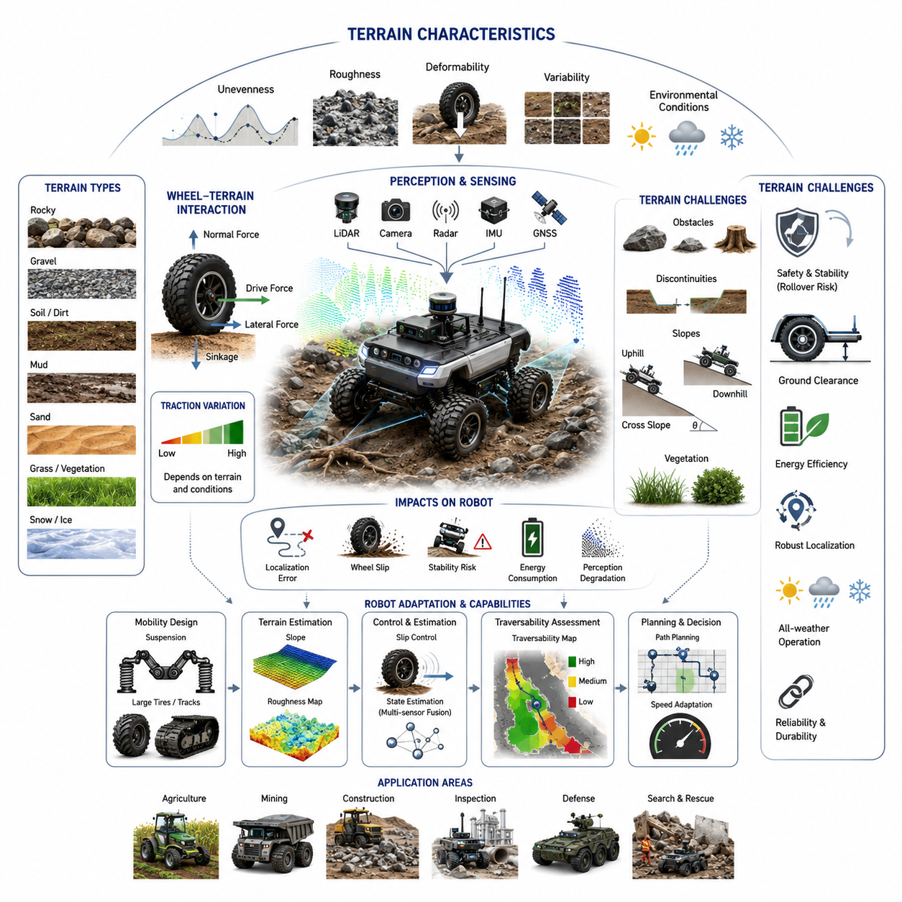
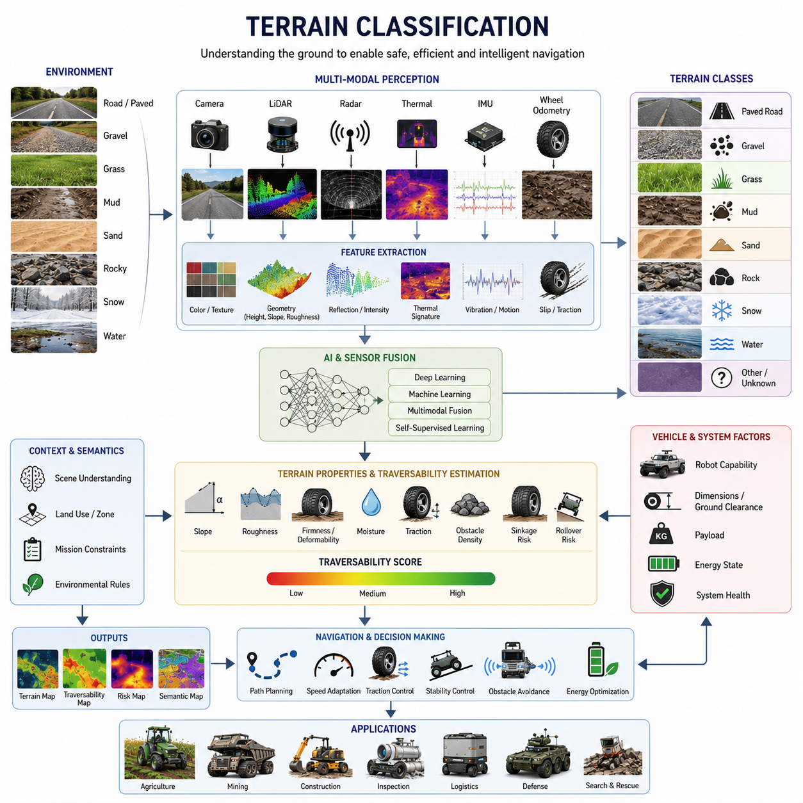
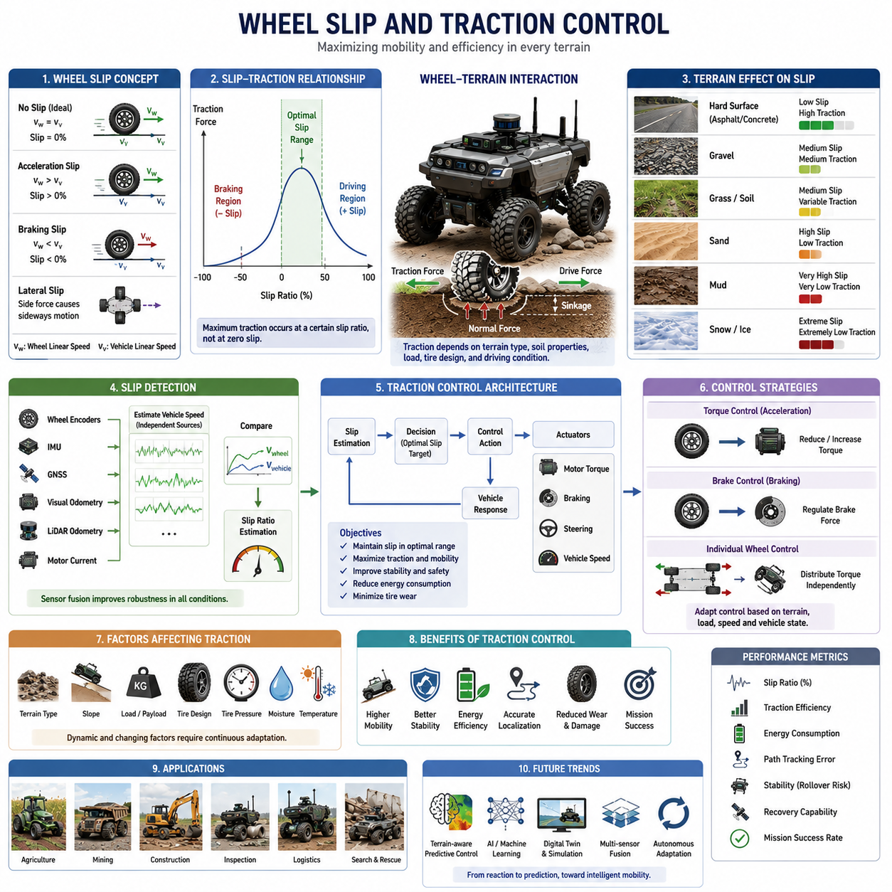
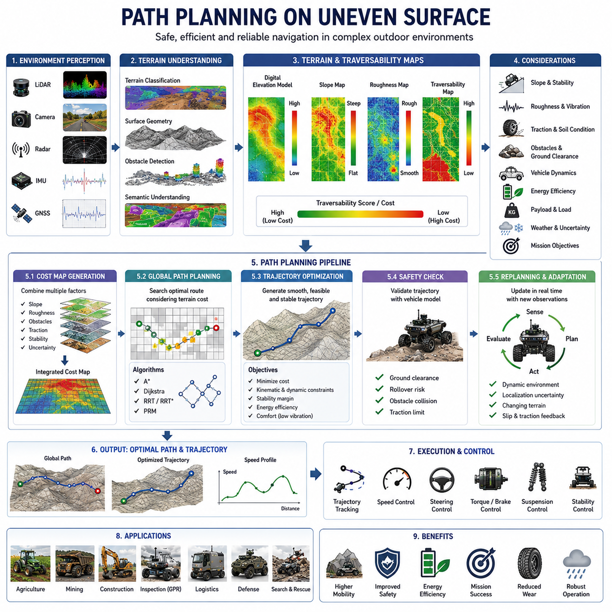
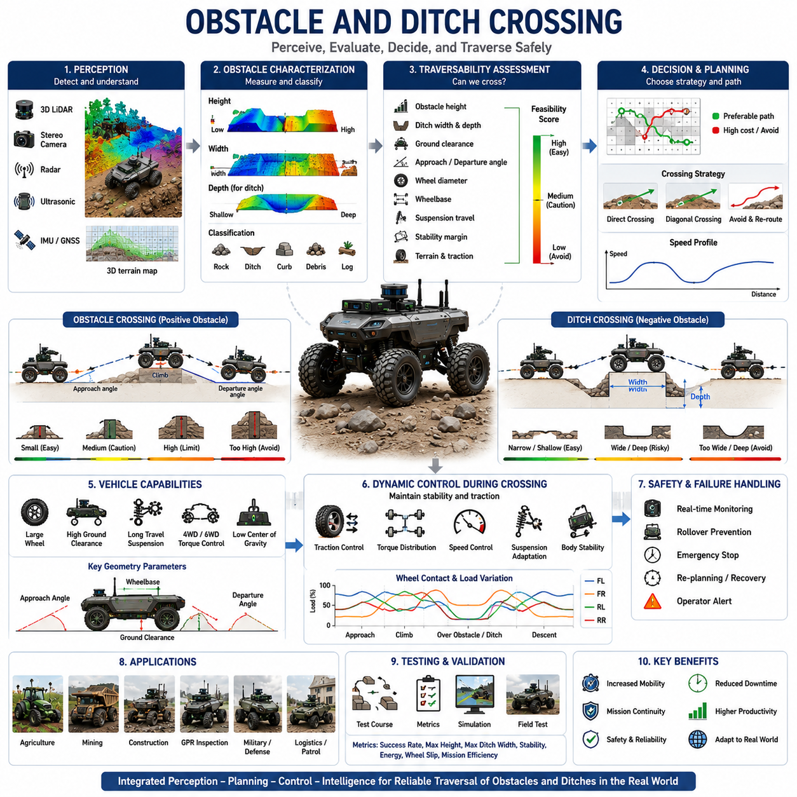
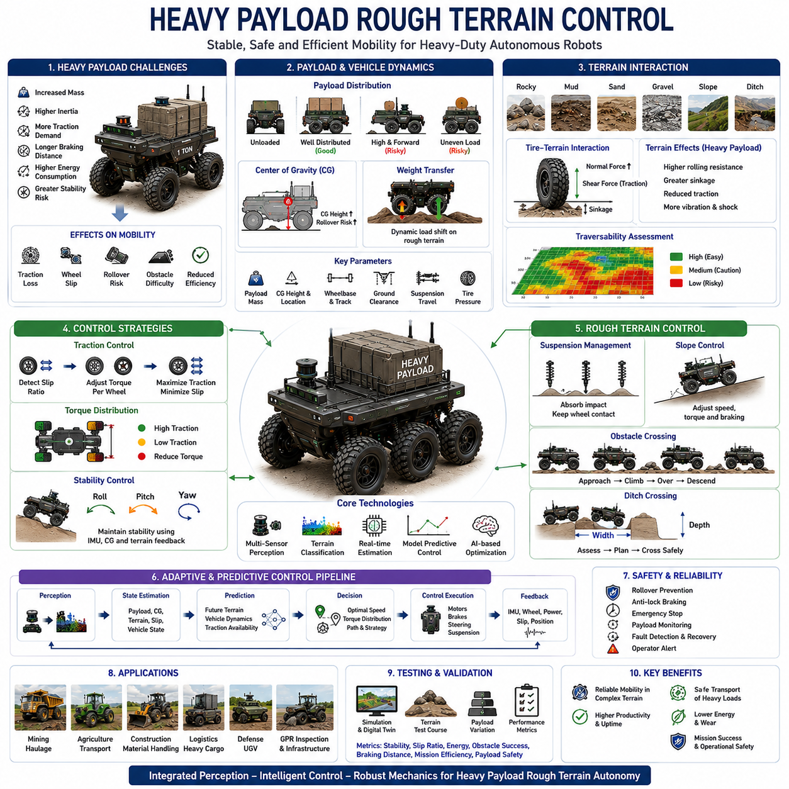
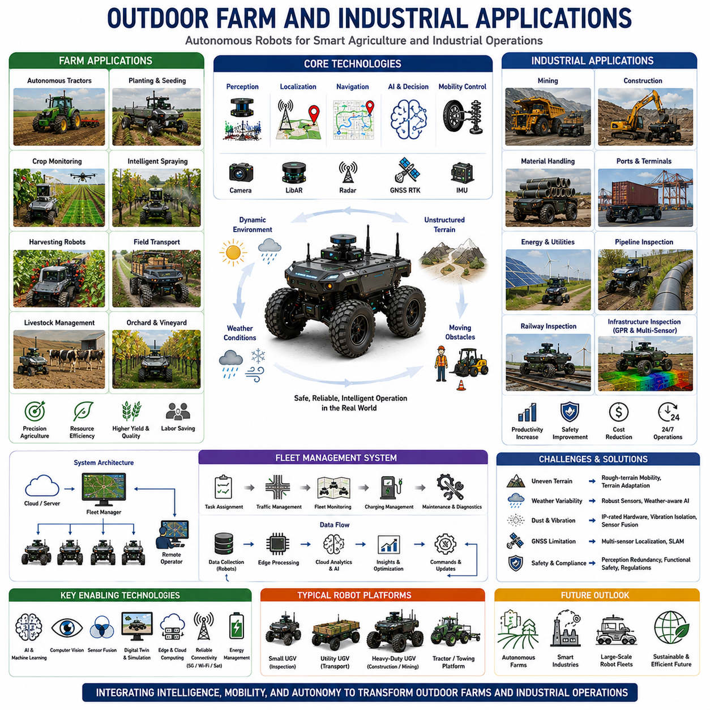
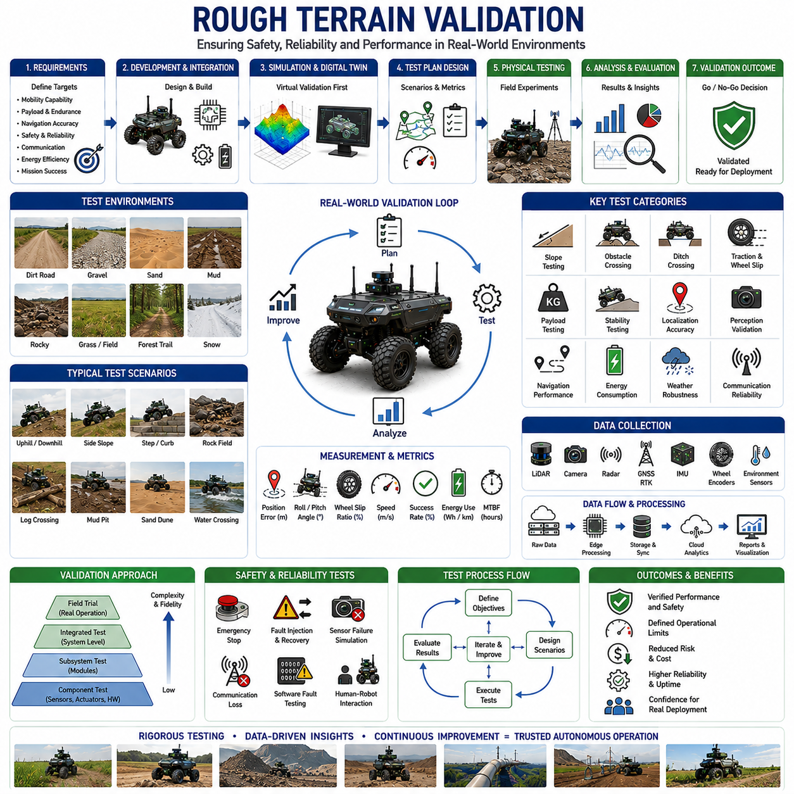

**Volume 05. Path Planning and Autonomous Navigation**

# Chapter 16. Rough Terrain Driving

## 16.1 Rough Terrain Characteristics

{width="7.268055555555556in" height="7.268055555555556in"}

Rough terrain driving represents one of the most challenging areas in autonomous mobile robotics because the environment is often unstructured, unpredictable, and continuously changing. Unlike indoor environments where floors are generally flat, stable, and highly predictable, outdoor environments expose robots to a wide variety of terrain conditions that directly influence mobility, safety, localization accuracy, perception performance, energy consumption, and mission success. Understanding the characteristics of rough terrain is therefore a fundamental prerequisite for developing autonomous navigation systems capable of operating reliably in real-world outdoor environments. This topic serves as the foundation for terrain classification, traction control, slope management, obstacle negotiation, stability control, and autonomous decision-making systems used in outdoor AMRs, agricultural robots, mining vehicles, construction robots, military unmanned ground vehicles, and autonomous inspection platforms.

A rough terrain environment can be defined as any operating surface that deviates significantly from a flat and uniform driving surface. Such environments contain irregularities that influence vehicle motion, wheel-ground interaction, and overall system stability. These irregularities may include uneven ground elevations, rocks, gravel, sand, mud, grass, roots, slopes, ditches, ruts, loose soil, debris, snow, ice, and other naturally occurring or man-made obstacles. Unlike structured roads where navigation systems can rely on well-defined lanes and predictable surface conditions, rough terrain environments require continuous adaptation to changing terrain properties. Autonomous robots operating in such environments must perceive, analyze, and react to terrain characteristics in real time.

One of the most important characteristics of rough terrain is surface unevenness. Uneven terrain causes continuous changes in wheel contact conditions and vehicle body orientation. As a robot traverses an uneven surface, each wheel may encounter different elevations, resulting in pitch, roll, and yaw disturbances. These disturbances influence vehicle dynamics and can reduce localization accuracy when sensor fusion systems rely heavily on inertial measurements and wheel odometry. Continuous terrain variation also generates vibration that propagates through the chassis and affects sensors such as LiDARs, cameras, radars, and GNSS receivers. Excessive vibration can reduce perception quality and increase uncertainty in localization algorithms.

Terrain roughness is commonly described using statistical metrics such as elevation variance, root mean square surface deviation, roughness index, and terrain frequency spectrum. These measurements provide quantitative descriptions of how much a surface deviates from an ideal plane. High roughness values indicate significant elevation changes over short distances, while low roughness values indicate relatively smooth surfaces. For autonomous robots, roughness metrics help determine traversability, allowable speed limits, suspension requirements, and motion planning constraints.

Another important characteristic of rough terrain is terrain deformability. Unlike rigid concrete or asphalt surfaces, many outdoor surfaces deform under load. Sand, mud, loose gravel, agricultural soil, and snow exhibit significant deformation when subjected to wheel pressure. The degree of deformation depends on terrain composition, moisture content, compaction level, temperature, and vehicle weight. Deformable terrain creates complex wheel-soil interactions that affect traction, sinkage, rolling resistance, and vehicle stability. In extreme cases, excessive sinkage can immobilize a vehicle and lead to mission failure.

Wheel-terrain interaction is one of the most critical aspects of rough terrain mobility. When a wheel contacts the ground, forces are generated through friction and soil mechanics. These forces determine traction capability, braking performance, and steering effectiveness. The interaction depends on wheel geometry, tire material, tread pattern, inflation pressure, vehicle load, and terrain properties. On rigid surfaces, wheel dynamics can often be modeled using classical friction equations. However, on deformable terrain, more advanced terramechanics models are required to accurately predict wheel behavior.

Traction availability varies significantly across different terrain types. Hard-packed soil may provide excellent traction, while wet mud or loose sand may drastically reduce friction. Variations in traction directly affect acceleration, braking distance, turning radius, and climbing capability. Autonomous navigation systems must continuously estimate available traction and adapt driving behavior accordingly. Failure to account for changing traction conditions can result in wheel slip, loss of control, or vehicle immobilization.

Wheel slip is a common phenomenon in rough terrain environments. Slip occurs when wheel rotation does not correspond to actual vehicle movement. Excessive slip can occur during acceleration, braking, turning, or climbing operations. In soft terrain, wheels may spin without generating sufficient forward motion. Wheel slip reduces energy efficiency, increases component wear, and degrades localization performance because wheel odometry becomes unreliable. Advanced robots therefore incorporate wheel slip estimation algorithms that combine wheel encoder data, inertial measurements, visual odometry, and GNSS information to improve motion estimation.

Slope characteristics represent another major challenge in rough terrain operation. Natural environments often contain ascending and descending slopes with varying gradients. Slope traversal introduces additional gravitational forces that affect vehicle dynamics. Uphill driving increases power consumption and may reduce available traction. Downhill driving requires effective braking systems and stability control mechanisms to prevent uncontrolled acceleration. Lateral slopes introduce rollover risk because the vehicle center of gravity shifts relative to the support polygon created by wheel contact points.

The relationship between slope angle and vehicle stability is particularly important for autonomous robots carrying heavy payloads. As slope angles increase, the stability margin decreases. Payload distribution, vehicle geometry, suspension design, and wheel placement all influence rollover resistance. Autonomous navigation systems must continuously estimate terrain slope and determine whether traversal is safe based on predefined stability criteria. High-grade industrial robots often integrate IMUs, tilt sensors, and dynamic stability models to monitor rollover risk in real time.

Obstacle density is another defining characteristic of rough terrain. Natural environments frequently contain rocks, tree roots, debris, vegetation, trenches, and other obstacles that are not present in structured environments. These obstacles vary in size, shape, and distribution. Some obstacles can be driven over safely, while others require avoidance maneuvers. Autonomous robots must accurately detect obstacles, estimate their geometry, evaluate traversability, and determine appropriate navigation strategies.

Terrain discontinuities such as ditches, steps, holes, and embankments represent especially challenging obstacles. Unlike simple protrusions, these features may significantly alter wheel contact conditions and vehicle stability. Crossing a ditch requires sufficient wheelbase length and obstacle negotiation capability. Navigating a step obstacle requires adequate ground clearance and wheel diameter. Failure to properly assess terrain discontinuities may result in chassis grounding, loss of traction, or vehicle entrapment.

Ground clearance is closely related to terrain characteristics. Rough terrain environments often require larger ground clearance to avoid underbody collisions. Ground clearance determines the maximum obstacle height that can be negotiated without contacting the chassis. However, increasing ground clearance may also raise the center of gravity, potentially reducing stability. Therefore, robot designers must balance obstacle negotiation capability against rollover resistance.

Vegetation presents a unique challenge in rough terrain environments. Grass, bushes, crops, and other vegetation can obscure terrain features and interfere with perception systems. Dense vegetation may conceal obstacles such as rocks, holes, or debris. Some vegetation can be traversed directly, while other forms may impede mobility or damage sensors. Autonomous systems must distinguish between traversable vegetation and hazardous obstacles through advanced perception and semantic understanding algorithms.

Environmental conditions significantly influence rough terrain characteristics. Rain can transform stable soil into slippery mud. Snow can conceal obstacles and reduce traction. Ice can create extremely hazardous driving conditions. Temperature variations can alter soil stiffness and surface friction properties. Seasonal changes may completely transform terrain characteristics within the same operating area. Consequently, outdoor autonomous robots must continuously adapt to changing environmental conditions rather than relying on static terrain assumptions.

Terrain variability is another distinguishing feature of rough terrain environments. Unlike structured roads where conditions remain relatively consistent, rough terrain may change dramatically over short distances. A robot may transition from gravel to mud, grass to sand, or flat ground to steep slopes within a few meters. Such variability requires adaptive control systems capable of continuously updating motion planning, traction control, and speed regulation strategies.

Localization challenges increase significantly in rough terrain environments. Wheel slip, vibration, sensor occlusion, and changing environmental conditions introduce uncertainty into localization systems. GNSS signals may be degraded by trees, cliffs, buildings, or atmospheric conditions. Visual landmarks may change over time due to vegetation growth or seasonal variations. LiDAR scans may be affected by dust, rain, snow, or moving vegetation. Robust localization therefore requires multi-sensor fusion approaches that integrate GNSS, IMU, LiDAR, cameras, wheel encoders, and radar sensors.

Perception complexity is also substantially higher in rough terrain environments. Autonomous robots must not only detect obstacles but also understand terrain properties. Perception systems must estimate terrain slope, roughness, deformability, traction potential, vegetation density, obstacle geometry, and traversability. This requires sophisticated machine learning models, semantic segmentation networks, terrain classification algorithms, and sensor fusion architectures.

Energy consumption is strongly influenced by terrain characteristics. Rough terrain operation typically requires more energy than operation on flat surfaces because of increased rolling resistance, obstacle negotiation, frequent acceleration changes, and traction losses. Soft terrain such as sand or mud may dramatically increase power requirements. For battery-powered robots, terrain-aware energy management becomes critical for mission planning and operational efficiency.

Vehicle suspension systems play a crucial role in rough terrain mobility. Suspensions help maintain wheel contact with the ground, absorb shocks, reduce vibration, and improve stability. Different suspension architectures provide varying levels of terrain adaptability. Independent suspension systems, rocker-bogie mechanisms, articulated frames, and active suspension technologies are commonly used in rough terrain robots. The selection of suspension architecture depends on expected terrain conditions, payload requirements, and operational objectives.

Heavy-duty outdoor AMRs, agricultural robots, mining vehicles, and autonomous inspection platforms often employ specialized wheel and tire designs optimized for rough terrain operation. Large-diameter tires improve obstacle negotiation capability. Aggressive tread patterns increase traction on loose surfaces. Low-pressure tires reduce ground pressure and improve mobility on soft terrain. Some systems employ tracks instead of wheels to distribute vehicle weight and increase traction. The choice of locomotion mechanism significantly affects overall terrain performance.

From an autonomous navigation perspective, terrain traversability assessment is one of the most important capabilities required for rough terrain driving. Traversability refers to the ability of a vehicle to safely and efficiently move through a particular terrain region. Traversability estimation incorporates terrain geometry, vehicle dynamics, traction conditions, obstacle characteristics, stability margins, and mission objectives. Modern autonomous systems increasingly rely on AI-based traversability prediction models trained using large datasets collected from real-world field operations.

In practical industrial applications, rough terrain characteristics vary significantly depending on the operating domain. Agricultural robots encounter soil, crops, irrigation channels, and uneven farmland. Mining robots operate on loose rock, steep grades, and harsh environmental conditions. Construction robots navigate debris-filled sites with constantly changing terrain. GPR inspection robots may traverse roadsides, utility corridors, grassy areas, and unpaved surfaces. Military unmanned ground vehicles must operate across highly diverse environments including forests, deserts, mountains, and urban rubble fields. Each application imposes unique mobility requirements and challenges.

Ultimately, understanding rough terrain characteristics forms the foundation of outdoor autonomous navigation. Every subsequent capability---including terrain classification, traction estimation, wheel slip control, obstacle negotiation, slope management, stability monitoring, path planning, and autonomous decision-making---depends on an accurate understanding of the physical environment. As autonomous robots continue expanding into agriculture, construction, mining, infrastructure inspection, defense, logistics, and smart city applications, the ability to perceive, analyze, and adapt to rough terrain conditions will remain one of the most critical technologies enabling reliable and safe autonomous mobility.

## 16.2 Terrain Classification

{width="7.268055555555556in" height="7.268055555555556in"}

Terrain classification is one of the most important technologies in autonomous navigation for outdoor robots operating in rough and unstructured environments. Before an autonomous mobile robot can determine how to move safely and efficiently through an environment, it must first understand the characteristics of the terrain beneath and around it. Terrain classification provides the foundation for traversability analysis, path planning, traction control, stability management, obstacle avoidance, energy optimization, and mission planning. In many ways, terrain classification serves as the perception layer that transforms raw sensor observations into meaningful environmental understanding, enabling robots to make intelligent navigation decisions.

Unlike indoor environments where floor conditions are generally uniform and predictable, outdoor environments present an enormous variety of terrain types. A robot may encounter asphalt roads, concrete surfaces, gravel paths, grass fields, muddy tracks, sandy areas, rocky terrain, agricultural fields, forest trails, snow-covered surfaces, and construction sites within a single mission. Each terrain type exhibits unique physical characteristics that influence mobility performance. Consequently, autonomous robots must identify terrain conditions continuously and adapt their navigation strategies accordingly.

Terrain classification refers to the process of identifying and categorizing the physical properties of a surface based on sensor observations and environmental analysis. The objective is not merely to recognize what the terrain looks like but to understand how the terrain will affect vehicle mobility. Two visually similar surfaces may possess dramatically different mechanical properties. For example, dry soil and wet mud may appear similar in camera imagery, yet their traction characteristics, sinkage behavior, and traversability can differ significantly. Effective terrain classification therefore requires a combination of geometric, visual, semantic, and physical analysis.

The concept of terrain classification originated from planetary exploration, military unmanned ground vehicles, agricultural machinery, and off-road vehicle research. Early systems relied on manually defined rules and simple geometric measurements to distinguish between traversable and non-traversable surfaces. Modern autonomous robots increasingly utilize machine learning, deep learning, multimodal perception, and sensor fusion techniques to achieve robust terrain understanding across diverse environmental conditions.

Terrain classification systems typically operate at multiple levels of abstraction. The simplest level categorizes terrain into broad classes such as road, grass, gravel, sand, mud, snow, rock, and water. A more advanced level evaluates terrain properties including roughness, slope, firmness, deformability, moisture content, traction potential, and obstacle density. The highest level incorporates traversability assessment, estimating how safely and efficiently a specific robot can move through a particular terrain region.

Visual appearance is one of the most commonly used indicators for terrain classification. RGB cameras provide rich texture, color, and contextual information that can be analyzed using computer vision algorithms. Grass fields exhibit characteristic green textures, while gravel surfaces display distinct patterns of small stones. Sand often appears as relatively smooth surfaces with specific color distributions. Deep learning models can learn these visual characteristics from large datasets and perform highly accurate classification under favorable conditions.

However, visual information alone is often insufficient for reliable terrain classification. Lighting conditions, shadows, weather effects, seasonal changes, and sensor limitations can significantly alter appearance. A muddy road may appear similar to dry soil under certain lighting conditions. Snow-covered surfaces may conceal underlying terrain structures. Vegetation growth can completely change visual appearance throughout the year. Consequently, modern systems combine visual information with additional sensing modalities.

LiDAR-based terrain classification has become increasingly important in autonomous navigation systems. LiDAR sensors provide accurate three-dimensional representations of terrain geometry. By analyzing elevation changes, surface roughness, obstacle distribution, and local slope characteristics, robots can classify terrain based on geometric properties. Rough rocky terrain typically exhibits high elevation variance, while paved roads appear relatively smooth. LiDAR-based approaches are particularly valuable because they remain effective under varying lighting conditions and can operate during nighttime missions.

Three-dimensional point cloud analysis enables robots to extract numerous terrain features. Surface normal distributions, height variance, curvature, roughness metrics, point density variations, and obstacle frequency can all be derived from LiDAR data. These features provide valuable information about terrain structure and traversability. Machine learning algorithms can then utilize these geometric descriptors to classify terrain categories and estimate mobility risks.

Radar sensors provide another important source of information for terrain classification. Radar signals interact differently with various surface materials and environmental structures. Unlike cameras and LiDAR systems, radar performance is relatively unaffected by fog, dust, rain, snow, or darkness. This makes radar particularly useful in adverse weather conditions. Radar-based terrain classification can help identify surface roughness, moisture conditions, vegetation density, and obstacle characteristics that may not be apparent through optical sensing.

Thermal imaging can also contribute to terrain classification. Different materials exhibit distinct thermal properties and heat retention characteristics. Soil, asphalt, vegetation, water, and rocks often display unique thermal signatures. Thermal information becomes especially useful during nighttime operations when visual appearance is limited. Furthermore, thermal imagery can help identify hidden hazards such as water accumulation, unstable ground conditions, or recently disturbed soil.

Inertial sensing provides indirect but highly valuable information about terrain conditions. Vehicle vibrations, accelerations, roll motions, pitch changes, and wheel dynamics contain important clues regarding underlying terrain properties. Rough terrain generates characteristic vibration patterns that can be detected by IMUs and accelerometers. Machine learning algorithms can analyze these signals to infer terrain categories and estimate terrain severity even when direct visual observation is unavailable.

Wheel-terrain interaction provides another critical source of information. Wheel slip, traction performance, sinkage behavior, rolling resistance, and steering response all reflect terrain conditions. By monitoring vehicle dynamics during operation, autonomous systems can classify terrain based on actual mobility performance rather than solely relying on external observations. This approach is often referred to as proprioceptive terrain classification because it uses internal vehicle measurements rather than environmental sensing.

Terrain classification can be broadly divided into appearance-based classification and traversability-based classification. Appearance-based methods focus on identifying terrain categories from sensor observations. Traversability-based methods focus on evaluating whether a terrain can be safely traversed by a specific robot. These two approaches are closely related but serve different purposes. A rocky terrain may be traversable for a large off-road vehicle but non-traversable for a small delivery robot. Therefore, traversability assessment must consider both terrain characteristics and vehicle capabilities.

The concept of traversability lies at the heart of practical terrain classification systems. Traversability represents the degree to which a terrain supports safe and efficient vehicle movement. Factors influencing traversability include slope angle, roughness, obstacle density, soil strength, traction availability, sinkage risk, rollover risk, and energy consumption. Traversability maps generated from terrain classification systems provide critical inputs to path planning and navigation algorithms.

Modern autonomous robots often employ semantic terrain classification techniques. Semantic classification extends beyond physical appearance and incorporates contextual understanding. For example, a robot may classify terrain not only as grass but specifically as maintained lawn, agricultural crop field, roadside vegetation, or protected ecological area. Such semantic information enables more intelligent navigation decisions aligned with operational objectives and environmental constraints.

Deep learning has revolutionized terrain classification over the past decade. Convolutional Neural Networks, Vision Transformers, semantic segmentation networks, multimodal fusion architectures, and self-supervised learning approaches have significantly improved classification accuracy. These models can learn complex relationships between sensor observations and terrain properties from large datasets collected during real-world operations.

Semantic segmentation is particularly important for terrain classification. Instead of assigning a single label to an entire image, semantic segmentation assigns terrain categories to individual pixels. This enables detailed understanding of terrain distribution within the environment. A single scene may contain roads, grass, rocks, mud, and obstacles simultaneously. Pixel-level classification provides the spatial information necessary for precise path planning and traversability analysis.

Multimodal terrain classification combines information from multiple sensor types to improve robustness and reliability. Camera images provide appearance information, LiDAR supplies geometric measurements, radar contributes environmental resilience, thermal cameras add material signatures, and IMUs provide dynamic feedback. Sensor fusion algorithms integrate these diverse information sources to create comprehensive terrain understanding. Multimodal systems generally outperform single-sensor approaches, especially in challenging environmental conditions.

Terrain classification becomes significantly more challenging in dynamic environments. Weather conditions continuously modify terrain properties. Rain may transform a firm dirt road into a slippery mud surface. Snow may conceal obstacles and alter traction characteristics. Seasonal vegetation growth changes terrain appearance and traversability. Construction activities may create entirely new terrain structures. Consequently, terrain classification systems must continuously update environmental models rather than relying on static assumptions.

Agricultural robotics represents an important application domain for terrain classification. Agricultural robots must distinguish between crop rows, soil types, vegetation, irrigation channels, muddy regions, and harvesting zones. Terrain understanding directly affects route planning, crop protection, and operational efficiency. In agricultural environments, terrain classification often integrates both navigation objectives and crop management considerations.

Mining and construction applications impose additional challenges. These environments contain highly variable terrain conditions, loose materials, steep grades, heavy machinery, and constantly changing surface structures. Autonomous mining trucks, inspection robots, and construction vehicles require highly reliable terrain classification systems capable of operating under harsh environmental conditions while maintaining safety and productivity.

Military unmanned ground vehicles represent some of the most demanding terrain classification applications. These systems must operate across deserts, forests, mountains, urban rubble, snow-covered landscapes, and mixed-terrain environments. Mission success often depends on accurately identifying traversable routes while avoiding mobility hazards. Advanced military systems increasingly employ AI-driven terrain classification combined with predictive mobility modeling.

Infrastructure inspection robots, including GPR-based underground utility inspection systems, also benefit significantly from terrain classification technologies. These robots frequently traverse roadsides, grassy corridors, utility easements, construction zones, and unstructured outdoor environments. Accurate terrain classification enables safer navigation, improved localization performance, enhanced sensor operation, and more efficient mission execution.

As autonomous robotics continues to evolve, terrain classification is moving beyond simple recognition toward predictive environmental understanding. Future systems will not only identify current terrain conditions but also predict how terrain properties may change over time. AI-based world models, foundation models for robotics, and embodied intelligence architectures are expected to provide increasingly sophisticated terrain reasoning capabilities. These systems will integrate perception, prediction, planning, and control into unified frameworks capable of operating reliably across highly diverse environments.

Ultimately, terrain classification serves as the bridge between environmental perception and autonomous decision-making. It transforms raw sensor data into actionable knowledge about mobility conditions, enabling robots to understand where they can travel, how they should travel, and what risks they may encounter along the way. As outdoor autonomous robots expand into agriculture, mining, construction, infrastructure inspection, logistics, defense, and smart city applications, terrain classification will remain one of the most fundamental enabling technologies for safe, efficient, and intelligent autonomous mobility.

## 16.3 Wheel Slip and Traction Control

{width="7.268055555555556in" height="7.268055555555556in"}

Wheel slip and traction control are among the most critical technologies in rough-terrain autonomous navigation. While localization, perception, and path planning determine where a robot should go, wheel slip and traction control determine whether the robot can physically reach its destination. In structured indoor environments with smooth and predictable floors, wheel-ground interaction is relatively stable and easy to model. In contrast, outdoor environments introduce highly variable terrain conditions that continuously affect wheel traction, vehicle dynamics, mobility efficiency, energy consumption, and overall mission success. As autonomous robots increasingly operate in agriculture, mining, construction, infrastructure inspection, defense, and outdoor logistics applications, the ability to accurately detect wheel slip and actively manage traction has become a fundamental requirement for reliable autonomous mobility.

Wheel slip occurs when the rotational motion of a wheel does not correspond to the actual movement of the vehicle. In an ideal driving condition, wheel rotation translates directly into vehicle displacement. However, when traction is insufficient, the wheel may rotate faster than the vehicle moves forward, causing longitudinal slip. Similarly, during braking operations, the wheel may decelerate more rapidly than the vehicle, resulting in braking slip. Lateral slip can also occur when a vehicle turns on low-friction surfaces, causing the wheel to slide sideways rather than following its intended path.

Slip is a natural phenomenon in off-road mobility and cannot be completely eliminated. In fact, a certain amount of slip is necessary for generating traction forces. The objective of traction control is not to eliminate slip entirely but to maintain slip within an optimal operating range that maximizes traction while minimizing mobility losses. Excessive slip reduces efficiency, increases energy consumption, accelerates tire wear, degrades localization accuracy, and may ultimately immobilize the robot.

The relationship between wheel slip and traction is governed by complex wheel-terrain interactions. On rigid surfaces such as asphalt or concrete, traction forces are primarily determined by friction coefficients. On deformable terrain such as sand, mud, gravel, or agricultural soil, traction generation depends on soil deformation, wheel sinkage, shear stress distribution, and terrain compaction characteristics. These interactions are significantly more complex and often require advanced terramechanics models to predict accurately.

One of the most important concepts in traction control is the slip ratio. Slip ratio describes the difference between wheel rotational velocity and actual vehicle velocity. During acceleration, positive slip occurs when wheels rotate faster than the vehicle moves. During braking, negative slip occurs when wheels rotate slower than the vehicle\'s forward motion. Experimental studies across various vehicle platforms have shown that maximum traction typically occurs within a specific slip range rather than at zero slip. Therefore, maintaining wheel operation near this optimal slip region is a primary objective of modern traction control systems.

Terrain characteristics strongly influence slip behavior. Hard-packed soil generally provides stable traction and predictable slip characteristics. Loose gravel introduces variable traction conditions due to particle movement. Sand often causes significant wheel sinkage and reduced traction. Mud presents one of the most challenging conditions because moisture reduces soil strength while simultaneously increasing wheel resistance. Snow and ice create extremely low-friction conditions where even small control errors can result in substantial slip.

The influence of wheel slip extends far beyond mobility performance. Localization systems frequently rely on wheel encoders to estimate vehicle displacement. When wheel slip occurs, encoder measurements no longer represent true vehicle movement. As a result, odometry errors accumulate rapidly. In severe cases, localization drift may become large enough to compromise navigation accuracy. For this reason, wheel slip estimation is often integrated directly into localization and sensor fusion architectures.

Wheel slip also affects energy efficiency. When wheels spin excessively without generating useful forward motion, electrical energy is converted into heat and terrain deformation rather than productive movement. For battery-powered autonomous robots, prolonged slip can significantly reduce operational endurance. In large outdoor AMRs operating for many hours between charging cycles, efficient traction management directly contributes to mission productivity and operational economics.

Detecting wheel slip accurately is one of the primary challenges in autonomous mobility systems. Traditional slip detection methods compare wheel encoder measurements with independently estimated vehicle velocity. If wheel rotational velocity exceeds expected vehicle motion, slip is assumed to be present. However, obtaining reliable ground-truth vehicle velocity in rough terrain environments is not always straightforward.

Modern autonomous robots therefore utilize multiple sensing modalities for slip detection. Wheel encoders provide rotational measurements. Inertial Measurement Units provide acceleration and angular velocity information. GNSS receivers provide global velocity estimates in outdoor environments. Visual odometry systems estimate motion using camera observations. LiDAR odometry calculates movement based on environmental geometry. By comparing these independent motion estimates, robots can identify discrepancies indicative of wheel slip.

Sensor fusion plays a crucial role in robust slip estimation. Individual sensors may become unreliable under certain conditions. GNSS signals may be degraded near buildings, forests, or cliffs. Visual odometry may struggle in low-light environments or feature-poor terrain. LiDAR performance may be affected by dust, rain, or snow. Sensor fusion algorithms combine complementary information sources to produce reliable slip estimates under diverse operating conditions.

Machine learning techniques are increasingly being applied to wheel slip detection. Deep learning models can analyze sensor streams, vibration signatures, motor currents, wheel velocities, suspension movements, and vehicle dynamics to predict slip conditions. Unlike traditional rule-based approaches, learning-based systems can identify complex patterns associated with specific terrain conditions and vehicle behaviors. These models often provide earlier and more accurate slip detection than conventional methods.

Traction control systems utilize slip information to regulate vehicle motion. Once excessive slip is detected, the control system adjusts wheel torque, motor commands, braking forces, steering inputs, or vehicle speed to restore traction. In electric-drive autonomous robots, traction control can be implemented directly through motor controllers that regulate torque output at each wheel independently.

Independent wheel control offers significant advantages for rough-terrain mobility. When each wheel can be controlled separately, torque distribution can be optimized according to local terrain conditions. Wheels encountering low-traction surfaces receive reduced torque, while wheels with better ground contact receive increased torque. This approach maximizes overall vehicle mobility and reduces the likelihood of becoming stuck.

Four-wheel-drive and six-wheel-drive robotic platforms provide additional opportunities for advanced traction management. In these systems, torque can be distributed dynamically among multiple drive wheels. Differential torque allocation enables the vehicle to maintain mobility even when some wheels experience reduced traction. This capability is particularly important for heavy-duty outdoor AMRs operating in challenging environments.

Heavy payloads introduce additional complexities into traction control. Payload weight influences wheel loading, ground pressure, tire deformation, and stability characteristics. Uneven load distribution may cause certain wheels to experience higher slip rates than others. Autonomous systems must therefore consider payload conditions when calculating optimal traction strategies. Load-aware traction control algorithms continuously adapt control parameters based on vehicle mass and weight distribution.

Agricultural robots frequently encounter highly variable soil conditions within a single field. Soil moisture, compaction levels, crop residues, and terrain geometry can change significantly over short distances. Advanced agricultural robots use terrain-aware traction control systems that continuously adjust wheel torque and speed according to local soil conditions. This improves mobility while minimizing soil damage and crop disturbance.

Mining and construction robots operate in some of the most demanding traction environments. Loose rocks, steep grades, unstable surfaces, and heavy payloads create complex mobility challenges. Traction control systems in these applications must prioritize both mobility and safety. Excessive slip on steep slopes can lead to loss of control or vehicle instability. Consequently, mining vehicles often incorporate sophisticated slip monitoring and stability management systems.

Defense and military unmanned ground vehicles place even greater emphasis on traction performance. Mission success may depend on traversing highly challenging terrain under unpredictable environmental conditions. Military platforms frequently integrate advanced terrain classification systems with adaptive traction control algorithms capable of responding dynamically to changing mobility conditions. These systems often operate across deserts, forests, mountains, mud, snow, and urban rubble environments.

Tire design plays a significant role in traction performance. Tire diameter, tread pattern, rubber composition, inflation pressure, and structural stiffness all influence wheel-ground interaction. Large-diameter tires generally improve obstacle negotiation capability. Aggressive tread patterns enhance traction on loose surfaces. Adjustable tire pressure systems can optimize ground contact characteristics for specific terrain conditions. Some advanced vehicles employ central tire inflation systems that automatically modify tire pressure during operation.

Tracked locomotion systems provide an alternative approach to improving traction. By distributing vehicle weight over a larger contact area, tracks reduce ground pressure and increase traction on soft terrain. However, tracked systems introduce additional mechanical complexity, energy consumption, and maintenance requirements. The choice between wheels and tracks depends on mission requirements, terrain characteristics, and operational constraints.

Terrain-aware traction control represents one of the most promising developments in autonomous mobility. Rather than responding only after slip occurs, predictive systems utilize terrain classification, traversability analysis, and environmental perception to anticipate traction challenges before they are encountered. By integrating terrain maps, semantic understanding, and vehicle dynamics models, autonomous robots can proactively adjust driving strategies to reduce slip risk.

Artificial intelligence is accelerating the development of predictive traction control systems. Deep neural networks can learn relationships between terrain appearance, vehicle behavior, and traction performance from large-scale operational datasets. Reinforcement learning approaches enable robots to discover optimal traction strategies through experience. Foundation models and embodied AI systems may eventually provide generalized mobility intelligence capable of adapting to previously unseen terrain conditions.

Simulation environments have become important tools for traction control development. High-fidelity physics simulators allow engineers to evaluate wheel-terrain interactions across thousands of terrain scenarios without requiring extensive field testing. Digital twins enable rapid experimentation with control algorithms, vehicle configurations, and environmental conditions. These simulation capabilities significantly accelerate development cycles while reducing testing costs.

Validation of wheel slip and traction control systems requires comprehensive testing across diverse terrain conditions. Test programs typically include gravel roads, mud fields, sandy areas, rocky surfaces, wet grass, snow-covered paths, and artificial obstacle courses. Performance metrics include slip ratio, traction efficiency, energy consumption, path-tracking accuracy, vehicle stability, recovery capability, and mission completion rates. Robust validation ensures reliable operation under real-world conditions.

Future traction control systems will increasingly combine perception, prediction, learning, and control within unified autonomy architectures. Rather than treating slip detection and traction control as isolated functions, next-generation systems will integrate terrain understanding, traversability prediction, localization, path planning, and mobility control into a coordinated decision-making framework. Such systems will continuously adapt to changing environments while optimizing safety, efficiency, and mission performance.

Ultimately, wheel slip and traction control form the physical foundation of autonomous mobility in rough terrain environments. Regardless of how advanced a robot\'s perception or planning systems may be, successful mission execution ultimately depends on the robot\'s ability to convert motor torque into controlled movement across challenging terrain. By accurately detecting slip, understanding terrain conditions, and actively managing traction, autonomous robots can achieve reliable, efficient, and safe mobility in the complex outdoor environments that define the future of autonomous robotics.

## 16.4 Path Planning on Uneven Surface

{width="7.268055555555556in" height="7.268055555555556in"}

Path planning on uneven surfaces is one of the most challenging problems in outdoor autonomous navigation. While traditional path planning algorithms are often designed for flat and structured environments, real-world outdoor environments contain slopes, rocks, ditches, loose soil, vegetation, mud, gravel, sand, and other terrain irregularities that significantly affect vehicle mobility. In such environments, a path that appears geometrically feasible may not be physically traversable due to stability limitations, traction constraints, obstacle interactions, or vehicle dynamics. Consequently, path planning on uneven surfaces requires a much deeper understanding of terrain properties, vehicle capabilities, environmental uncertainty, and mobility constraints than conventional navigation systems.

The primary objective of path planning on uneven terrain is not merely to find the shortest route between two locations. Instead, the planner must identify a route that balances safety, stability, energy efficiency, mobility performance, mission objectives, and environmental constraints. In many cases, the safest path may be longer than the shortest path, while the most energy-efficient route may differ from both. Therefore, uneven-surface path planning becomes a multi-objective optimization problem where numerous factors must be considered simultaneously.

Unlike indoor navigation, outdoor navigation involves continuous interaction between the vehicle and the terrain. Every movement decision influences traction availability, wheel slip behavior, suspension response, power consumption, and localization accuracy. A robot traversing a rocky slope experiences different mobility conditions than the same robot traveling across compacted soil. Consequently, path planning systems must account for terrain-dependent mobility characteristics rather than relying solely on geometric obstacle avoidance.

Terrain geometry plays a fundamental role in uneven-surface path planning. Surface elevation, slope angle, terrain roughness, curvature, obstacle distribution, ditch locations, and local terrain gradients all influence traversability. Modern autonomous robots construct digital elevation models and three-dimensional terrain representations to capture these characteristics. These representations provide critical information for determining which areas are safe, risky, or inaccessible.

One of the most important considerations in uneven-terrain path planning is slope management. Uphill and downhill travel affect vehicle dynamics, power requirements, and traction conditions. Steep slopes may exceed the robot\'s climbing capability, while lateral slopes may increase rollover risk. Therefore, path planners typically incorporate slope constraints that prevent routes from entering regions exceeding predefined stability limits. Advanced systems continuously evaluate terrain gradients and dynamically adjust route selection based on current vehicle conditions.

Terrain roughness is another major factor affecting path planning decisions. Rough surfaces generate vibrations that influence sensor performance, payload stability, and component durability. Excessive roughness can degrade localization accuracy and reduce mission effectiveness. Consequently, path planning systems often assign higher traversal costs to rough terrain regions, encouraging route selection through smoother areas whenever possible.

Obstacle negotiation presents additional challenges. Uneven environments contain rocks, roots, debris, trenches, and natural formations that may not be represented adequately in traditional two-dimensional maps. Three-dimensional obstacle analysis becomes essential for determining whether obstacles should be crossed, avoided, or used as navigational landmarks. The planner must consider obstacle height, shape, spacing, and potential impact on vehicle mobility.

Ground clearance constraints are particularly important for outdoor robots. A route that appears collision-free in a top-down map may still cause chassis contact if terrain features exceed clearance limitations. Therefore, advanced path planning algorithms incorporate vehicle geometry models to evaluate underbody collision risks throughout the planned route.

Wheel-terrain interaction significantly influences path planning quality. Different terrain types provide different levels of traction. Hard-packed soil may support efficient movement, while loose sand or mud may increase slip probability and energy consumption. Modern path planners increasingly incorporate traction estimation and terrain classification information into route optimization. Areas with low traction are assigned higher traversal costs, encouraging the planner to select more stable routes.

The concept of traversability forms the foundation of uneven-surface path planning. Traversability describes how easily and safely a vehicle can move through a particular terrain region. Traversability depends on terrain geometry, soil properties, vehicle characteristics, environmental conditions, and mission requirements. By generating traversability maps, autonomous robots can transform complex environmental information into actionable navigation data.

Traversability maps typically integrate multiple terrain attributes. Slope, roughness, obstacle density, traction potential, sinkage risk, rollover probability, and environmental uncertainty may all contribute to traversability scores. These scores are then used as cost values within path planning algorithms. Regions with favorable mobility characteristics receive low costs, while hazardous areas receive high costs.

Digital elevation models are widely used for uneven-terrain navigation. These models represent terrain height as a continuous surface and provide essential information about elevation changes. By analyzing local terrain gradients and surface features, planners can identify safe corridors for vehicle movement. High-resolution elevation maps are particularly valuable in applications involving steep slopes, rocky terrain, and complex natural environments.

Three-dimensional occupancy maps extend traditional navigation maps by incorporating volumetric environmental information. Instead of representing obstacles as two-dimensional regions, occupancy maps model the three-dimensional structure of terrain and objects. This enables more accurate assessment of clearance constraints, obstacle interactions, and vehicle-terrain relationships.

Path planning algorithms used in uneven terrain often extend traditional methods such as A\*, Dijkstra, RRT, and PRM. While these algorithms remain effective for searching navigation spaces, their cost functions must be adapted to account for terrain properties. Rather than minimizing distance alone, modern planners optimize metrics such as energy consumption, stability margin, traction utilization, traversability, and mission risk.

A\* remains one of the most widely used planning algorithms because of its computational efficiency and flexibility. In uneven terrain applications, terrain-dependent costs are incorporated directly into the heuristic and cost evaluation functions. This allows the algorithm to favor safer and more traversable routes rather than simply selecting the shortest path.

Sampling-based methods such as Rapidly-exploring Random Trees and Probabilistic Roadmaps are particularly useful for large-scale outdoor environments. These approaches can efficiently explore complex terrain spaces and identify feasible routes through challenging environments. Terrain-aware sampling strategies further improve performance by concentrating exploration efforts within highly traversable regions.

Trajectory optimization plays an increasingly important role in uneven-surface navigation. Once a path is identified, trajectory planners generate dynamically feasible vehicle motions that respect kinematic and dynamic constraints. Smooth trajectories reduce wheel slip, minimize energy consumption, improve passenger or payload comfort, and enhance overall stability.

Vehicle stability is a central concern throughout the planning process. Autonomous robots operating on uneven surfaces continuously monitor stability margins. Center-of-gravity location, vehicle orientation, suspension articulation, payload distribution, and terrain geometry all influence stability. Path planners must avoid routes that create excessive rollover risk or compromise vehicle control.

Heavy-payload robots face additional planning challenges. Payload mass affects traction requirements, braking performance, suspension behavior, and energy consumption. Large outdoor AMRs, agricultural vehicles, mining equipment, and logistics robots often employ payload-aware planning systems that adapt routes according to current loading conditions.

Weather conditions further complicate uneven-terrain navigation. Rain may transform stable soil into slippery mud. Snow may conceal obstacles and alter traversability characteristics. Ice significantly reduces available traction. Consequently, advanced planning systems incorporate environmental perception and weather-aware terrain models that update navigation costs in real time.

Localization uncertainty also influences path planning decisions. In rough terrain environments, wheel slip, sensor degradation, and environmental variability increase uncertainty in vehicle position estimates. Robust planners account for this uncertainty by selecting routes that maintain sufficient safety margins and reduce navigation risk.

Artificial intelligence has introduced new capabilities into uneven-surface path planning. Deep learning models can estimate traversability directly from sensor observations, predict terrain characteristics beyond immediate sensing range, and identify mobility hazards that may be difficult to model explicitly. AI-driven planners increasingly complement traditional optimization algorithms by providing richer environmental understanding.

Semantic terrain understanding further enhances planning quality. Rather than viewing the environment solely as geometric structures, semantic systems recognize terrain categories such as road, grass, gravel, mud, crop field, construction zone, or protected area. This contextual information enables navigation decisions aligned with operational goals and environmental policies.

Reinforcement learning has emerged as a promising approach for terrain-aware navigation. Instead of relying exclusively on handcrafted cost functions, reinforcement learning agents can discover optimal navigation strategies through experience. By interacting with simulated and real-world environments, these systems learn how terrain characteristics influence long-term mobility outcomes.

Multi-sensor fusion is essential for reliable path planning in uneven environments. Cameras provide visual context, LiDAR supplies geometric measurements, radar contributes robustness under adverse weather conditions, thermal cameras reveal material properties, and IMUs provide dynamic feedback. Integrating these diverse information sources creates comprehensive environmental awareness that supports more effective route planning.

Simulation environments and digital twins play a crucial role in developing uneven-terrain path planning systems. High-fidelity simulation enables engineers to evaluate navigation strategies across thousands of terrain scenarios before field deployment. Digital twins provide realistic representations of operational environments and support algorithm validation, performance benchmarking, and safety analysis.

Agricultural robots represent a major application area for uneven-surface path planning. These robots must navigate crop rows, irrigation systems, soft soil, and changing terrain conditions while minimizing crop damage. Efficient path planning directly influences productivity, fuel consumption, and operational effectiveness.

Mining and construction applications require navigation through highly dynamic environments characterized by loose materials, steep grades, heavy equipment, and continuously changing terrain structures. Path planners in these industries must prioritize safety, reliability, and operational continuity while adapting to rapidly evolving site conditions.

Infrastructure inspection robots, including GPR-based underground utility inspection platforms, frequently operate on roadsides, grassy corridors, utility easements, and unstructured outdoor environments. Uneven-surface path planning enables these robots to maintain stable sensor operation while maximizing inspection coverage and minimizing mobility risks.

Military unmanned ground vehicles face some of the most demanding navigation requirements. They must traverse forests, deserts, mountains, rubble fields, and mixed-terrain environments while maintaining mission effectiveness under uncertain conditions. Advanced military navigation systems integrate terrain classification, traversability prediction, stability assessment, and adaptive path planning within unified autonomy frameworks.

Future developments in uneven-surface path planning are expected to leverage foundation models, embodied AI, world models, and predictive mobility intelligence. These systems will not merely react to observed terrain conditions but will anticipate future environmental changes and proactively adapt navigation strategies. By combining perception, prediction, planning, and control into integrated architectures, next-generation robots will achieve unprecedented levels of mobility in challenging outdoor environments.

Ultimately, path planning on uneven surfaces represents far more than route generation. It is a comprehensive decision-making process that integrates terrain understanding, vehicle dynamics, environmental perception, stability analysis, mobility prediction, and mission optimization. As autonomous robots continue expanding into agriculture, mining, construction, infrastructure inspection, defense, logistics, and smart city applications, uneven-surface path planning will remain a foundational technology enabling safe, efficient, and intelligent autonomous mobility across the complex terrains of the real world.

## 16.5 Obstacle and Ditch Crossing

{width="7.268055555555556in" height="7.268055555555556in"}

Obstacle and ditch crossing represents one of the most critical capabilities required for autonomous mobile robots operating in rough terrain environments. While localization, perception, path planning, and traction control determine where and how a robot should travel, obstacle crossing determines whether the robot can physically continue its mission when confronted with terrain discontinuities. In outdoor environments, natural and man-made obstacles are unavoidable. Rocks, tree roots, curbs, debris, construction materials, trenches, drainage channels, ditches, embankments, fallen branches, utility crossings, and uneven terrain features continuously challenge vehicle mobility. The ability to safely detect, analyze, and traverse such obstacles is therefore a fundamental requirement for agricultural robots, mining vehicles, construction robots, military unmanned ground vehicles, outdoor logistics robots, GPR inspection platforms, and autonomous patrol systems.

Unlike flat-surface navigation, obstacle and ditch crossing introduces highly complex interactions between vehicle geometry, wheel-ground contact, suspension dynamics, stability margins, traction availability, and environmental uncertainty. A path that appears navigable from a global planning perspective may become impassable when a robot encounters a trench, large rock, or abrupt elevation change. Consequently, obstacle crossing cannot be treated as an isolated mobility function. Instead, it must be integrated into perception, terrain understanding, traversability analysis, path planning, motion control, and safety management systems.

Obstacle crossing begins with obstacle perception. Before a robot can determine whether an obstacle can be traversed, it must first detect and characterize the object accurately. Modern outdoor robots utilize multiple sensors including 3D LiDAR, stereo cameras, depth cameras, radar systems, ultrasonic sensors, thermal cameras, and GNSS-supported mapping systems. These sensors provide complementary information regarding obstacle location, size, shape, height, width, surface characteristics, and surrounding terrain conditions.

Three-dimensional perception plays a particularly important role because obstacle crossing is fundamentally a three-dimensional mobility problem. Two-dimensional obstacle maps may indicate the presence of an object, but they cannot fully describe its geometric structure. A low curb may be safely traversable, while a similarly shaped but taller obstacle may exceed vehicle capabilities. Therefore, autonomous robots generate detailed three-dimensional representations of the environment that enable accurate obstacle characterization.

Obstacle classification is closely linked to obstacle crossing decisions. Not all obstacles require avoidance. Some obstacles can be crossed directly, others can be partially traversed, and some must be completely avoided. Classification systems typically categorize obstacles according to size, mobility impact, structural properties, and safety risks. Examples include rocks, vegetation, debris, curbs, trenches, ramps, steps, roots, pipes, construction materials, and artificial barriers. Understanding obstacle categories helps navigation systems select appropriate crossing strategies.

One of the most important parameters in obstacle crossing is obstacle height. Obstacle height directly influences wheel climbing capability and underbody clearance requirements. For wheeled robots, maximum obstacle height is typically expressed as a percentage of wheel diameter. Larger wheels generally provide superior obstacle negotiation capability because they can generate more favorable contact angles during climbing operations. Small wheels may become blocked by obstacles that larger wheels can easily overcome.

Approach angle and departure angle are also critical considerations. These parameters describe the maximum terrain angles that a vehicle can encounter without chassis contact. A vehicle may possess sufficient wheel diameter to climb an obstacle but still experience underbody collision if approach and departure angles are inadequate. Consequently, obstacle crossing performance depends not only on wheel size but also on chassis geometry and overall vehicle architecture.

Ground clearance significantly influences obstacle traversability. Ground clearance defines the minimum distance between the vehicle underbody and the terrain surface. Higher ground clearance generally improves obstacle negotiation capability by reducing the likelihood of chassis contact. However, increasing ground clearance often raises the center of gravity, potentially reducing stability. Engineers must therefore balance obstacle-crossing performance against rollover resistance and vehicle safety.

Wheelbase length introduces another important constraint. Long-wheelbase vehicles may experience high-centering when traversing large obstacles or crossing trenches. High-centering occurs when the vehicle underbody becomes supported by an obstacle while wheels lose effective ground contact. This condition can immobilize the vehicle even when wheel traction remains available. Therefore, wheelbase geometry must be carefully considered during both vehicle design and path planning.

Suspension systems play a central role in obstacle crossing. Advanced suspension architectures maintain wheel-ground contact while absorbing terrain-induced disturbances. Independent suspension systems allow individual wheels to adapt to terrain variations independently. Rocker-bogie mechanisms, commonly used in planetary rovers, enable vehicles to traverse obstacles significantly larger than conventional suspension systems can accommodate. Articulated frames and active suspension technologies further improve mobility in highly challenging environments.

Traction management becomes particularly important during obstacle crossing maneuvers. As wheels climb over obstacles, contact conditions change continuously. Wheel loading may shift dramatically between axles and sides of the vehicle. Some wheels may temporarily lose ground contact while others bear increased loads. Advanced traction control systems dynamically adjust wheel torque distribution to maximize available traction throughout the crossing process.

Wheel slip frequently occurs during obstacle negotiation. Excessive torque application may cause wheels to spin without generating forward movement. Insufficient torque may prevent successful obstacle climbing. Consequently, obstacle crossing systems must continuously monitor slip conditions and adapt control strategies accordingly. Modern autonomous robots often integrate traction control and obstacle negotiation within unified mobility control architectures.

Ditch crossing introduces additional challenges beyond those encountered during obstacle climbing. A ditch represents a negative obstacle rather than a positive obstacle. Instead of climbing over an elevated object, the vehicle must bridge a gap while maintaining stability and traction. Ditch crossing performance depends primarily on wheelbase length, track width, suspension articulation, ground clearance, and vehicle geometry.

One of the primary risks associated with ditch crossing is vehicle entrapment. If the ditch width exceeds vehicle bridging capability, wheels may lose contact with stable ground surfaces. This can result in immobilization, excessive chassis loading, or rollover events. Autonomous systems must therefore estimate ditch dimensions accurately before attempting traversal.

Perception of negative obstacles is inherently more difficult than perception of positive obstacles. Rocks and barriers typically generate strong sensor returns. Ditches, holes, trenches, and drop-offs may generate limited sensor information depending on viewing angle and environmental conditions. Consequently, specialized perception algorithms are often required to detect and characterize negative terrain features reliably.

Three-dimensional terrain mapping is essential for ditch detection. LiDAR-based elevation mapping allows robots to identify sudden terrain depressions and estimate ditch geometry. Stereo vision systems provide additional depth information that improves negative obstacle recognition. Sensor fusion approaches combine multiple data sources to increase reliability under varying environmental conditions.

Ditch width represents the most important parameter for crossing feasibility assessment. The vehicle must maintain sufficient wheel support during traversal. If ditch width exceeds the distance that can be bridged safely by the vehicle, crossing becomes impossible. Advanced mobility planners calculate crossing feasibility based on vehicle dimensions, suspension travel, wheel diameter, and stability constraints.

Ditch depth also affects crossing safety. Deep trenches increase the consequences of crossing failure and may introduce additional stability risks. Even when ditch width is within vehicle capability limits, excessive depth may necessitate avoidance strategies. Therefore, both width and depth must be evaluated simultaneously during traversability assessment.

Crossing strategy selection depends on obstacle geometry and vehicle capabilities. Small obstacles may be crossed directly at normal operating speeds. Larger obstacles often require reduced-speed approaches, optimized wheel alignment, and specialized control strategies. Extremely challenging obstacles may require diagonal crossing approaches that improve wheel contact conditions and reduce stability risks.

Path planning systems increasingly incorporate obstacle-crossing capability into route generation processes. Rather than treating all obstacles as binary pass-or-fail entities, modern planners estimate traversal costs based on obstacle characteristics. Traversable obstacles may remain within the navigation graph but receive higher costs than unobstructed terrain. This enables planners to balance route efficiency against mobility risk.

Artificial intelligence is playing an increasingly important role in obstacle and ditch crossing. Deep learning models can classify obstacle types, estimate traversability, predict crossing outcomes, and recommend mobility strategies based on sensor observations. Reinforcement learning approaches allow robots to learn obstacle negotiation behaviors through repeated interaction with simulated and real-world environments.

Terrain classification systems provide valuable contextual information for obstacle-crossing decisions. A rock located on firm soil may be safely traversable, while an identical rock embedded within loose sand may present significantly greater risk. By combining obstacle perception with terrain classification, autonomous robots can make more informed mobility decisions.

Vehicle dynamics modeling further enhances crossing performance. Dynamic simulations predict wheel loads, suspension behavior, body motion, and stability margins during obstacle traversal. These predictions enable proactive control adjustments that improve crossing success rates and reduce mechanical stress.

Heavy-payload robots face additional challenges during obstacle crossing. Payload mass increases wheel loads, affects suspension dynamics, alters center-of-gravity location, and influences stability margins. Large industrial AMRs, agricultural machines, mining vehicles, and GPR inspection platforms often require payload-aware obstacle negotiation algorithms that account for varying load conditions.

Military unmanned ground vehicles represent some of the most advanced applications of obstacle-crossing technology. These systems must traverse highly challenging terrain under uncertain environmental conditions while maintaining mission effectiveness. Advanced military platforms integrate perception, traversability analysis, mobility prediction, traction management, and autonomous decision-making into comprehensive mobility architectures.

Agricultural robots frequently encounter irrigation channels, crop rows, soil ridges, drainage ditches, and field obstacles. Effective obstacle-crossing capability directly influences operational coverage and productivity. Similarly, construction and mining robots must navigate highly dynamic environments containing debris piles, trenches, excavation zones, and temporary structures.

GPR-based infrastructure inspection robots often operate along roadsides, utility corridors, railways, and construction areas where obstacles and drainage features are common. Reliable obstacle and ditch crossing allows inspection missions to proceed without interruption while maintaining sensor stability and measurement accuracy.

Simulation and digital twin technologies have become essential tools for obstacle-crossing development. High-fidelity simulation environments allow engineers to evaluate thousands of crossing scenarios without exposing physical robots to unnecessary risks. These simulations provide valuable insights into vehicle dynamics, control performance, and failure mechanisms.

Validation of obstacle and ditch crossing systems requires extensive field testing. Test environments typically include artificial obstacles, step structures, trenches, ditches, rocks, logs, ramps, and mixed-terrain scenarios. Performance metrics include crossing success rate, maximum obstacle height, maximum ditch width, vehicle stability, energy consumption, wheel slip, suspension utilization, and mission completion efficiency.

Future developments in obstacle and ditch crossing will increasingly leverage embodied AI, foundation models, predictive mobility intelligence, and real-time world models. Rather than simply reacting to observed obstacles, next-generation robots will anticipate mobility challenges, evaluate multiple crossing strategies, and adapt behavior proactively according to mission objectives and environmental conditions.

Ultimately, obstacle and ditch crossing represents a critical intersection between perception, mobility, control, and intelligence. Successful autonomous navigation in rough terrain depends not only on knowing where to go but also on possessing the physical and computational capabilities required to overcome environmental barriers. As outdoor autonomous robots continue expanding into agriculture, mining, construction, defense, infrastructure inspection, and logistics applications, obstacle and ditch crossing will remain one of the most important technologies enabling reliable and intelligent autonomous mobility in the real world.

## 16.6 Heavy Payload Rough Terrain Control

{width="7.268055555555556in" height="7.268055555555556in"}

Heavy payload rough terrain control is one of the most demanding areas in autonomous mobile robotics because it combines two major mobility challenges: carrying substantial loads and operating in highly irregular outdoor environments. While a robot may perform effectively on rough terrain when unloaded, its mobility characteristics can change dramatically when transporting heavy payloads. Increased mass influences traction requirements, braking performance, suspension behavior, power consumption, stability margins, wheel-ground interaction, and overall vehicle dynamics. Consequently, autonomous navigation systems designed for heavy-duty outdoor robots must incorporate specialized control strategies that continuously account for payload conditions while maintaining safe and reliable operation across complex terrain.

The importance of heavy payload rough terrain control continues to grow as autonomous robots expand into industrial applications such as mining, agriculture, construction, logistics, defense, infrastructure inspection, and material transportation. Modern outdoor autonomous mobile robots are increasingly expected to transport hundreds or even thousands of kilograms while navigating uneven surfaces, slopes, obstacles, mud, gravel, sand, and unstructured environments. In these applications, maintaining mobility is not merely a matter of navigation efficiency but often a critical requirement for operational safety and mission success.

The fundamental challenge of heavy payload operation originates from vehicle mass. As payload weight increases, the total vehicle mass increases correspondingly. According to Newtonian mechanics, larger masses require greater forces for acceleration, deceleration, steering, and obstacle negotiation. This increased force demand affects nearly every subsystem within the robotic platform. Drive motors must generate higher torque, braking systems must dissipate greater kinetic energy, suspension systems must absorb larger loads, and tires must maintain sufficient traction despite increased ground pressure.

Payload distribution is often as important as payload magnitude. A vehicle carrying a heavy but evenly distributed load may remain relatively stable, while an identical vehicle carrying the same mass concentrated in one area may experience severe stability challenges. Uneven payload distribution shifts the center of gravity and alters wheel loading characteristics. As a result, some wheels may become overloaded while others lose effective ground contact. This imbalance can increase wheel slip, reduce steering effectiveness, and elevate rollover risk during rough terrain traversal.

Center-of-gravity management is therefore one of the primary concerns in heavy payload control. The center of gravity determines how weight is distributed throughout the vehicle and directly influences stability. When heavy payloads are placed at elevated positions, the center of gravity rises, reducing rollover resistance. This effect becomes particularly significant during slope traversal, obstacle crossing, sharp turning maneuvers, and emergency braking situations. Advanced autonomous systems continuously estimate center-of-gravity location and adjust vehicle behavior accordingly.

Vehicle stability becomes increasingly sensitive to terrain conditions as payload weight increases. Small terrain disturbances that might be insignificant for an unloaded robot can generate substantial body motion when heavy payloads are present. Pitch, roll, and yaw motions become more pronounced due to increased inertial effects. Consequently, rough terrain control systems must continuously monitor vehicle orientation and dynamically adjust control parameters to maintain stability.

Suspension systems play a crucial role in heavy payload mobility. The suspension must absorb terrain-induced shocks while maintaining wheel-ground contact under varying load conditions. Inadequate suspension performance can result in excessive vibrations, reduced traction, payload damage, and loss of control. Heavy-duty outdoor robots frequently employ reinforced suspension architectures, long-travel suspension systems, articulated frames, active suspension technologies, or hydraulic suspension mechanisms to accommodate substantial payload variations.

Wheel-ground interaction changes significantly under heavy loads. Increased vehicle mass generates higher normal forces at wheel contact points. While higher normal force can improve traction under certain conditions, it can also increase terrain deformation, wheel sinkage, and rolling resistance. On soft surfaces such as mud, sand, agricultural soil, or loose gravel, excessive ground pressure may cause wheels to sink deeply into the terrain, dramatically reducing mobility.

Terrain-dependent mobility effects become especially important in heavy payload applications. Hard-packed surfaces generally support increased vehicle weight with minimal performance degradation. However, deformable terrain often exhibits nonlinear behavior under heavy loading. Soil strength, moisture content, compaction level, and terrain composition all influence vehicle performance. Consequently, mobility control systems must continuously evaluate terrain conditions and adapt accordingly.

Traction control becomes increasingly critical as payload weight increases. Heavy vehicles require greater traction forces to accelerate, climb slopes, cross obstacles, and maintain steering authority. At the same time, excessive torque application may induce wheel slip, particularly on low-friction surfaces. Modern traction control systems monitor wheel behavior continuously and dynamically regulate torque distribution to maximize mobility while minimizing slip.

Wheel slip is particularly problematic for heavy payload robots. Increased vehicle mass creates greater resistance to motion, which often encourages control systems to command higher motor torques. If available traction is insufficient, wheels may spin without producing useful movement. Prolonged wheel slip increases energy consumption, accelerates tire wear, degrades localization accuracy, and may ultimately immobilize the vehicle. Advanced mobility systems therefore integrate slip estimation directly into navigation and control architectures.

Torque distribution strategies are essential for maintaining mobility in heavy-duty robotic platforms. Four-wheel-drive and six-wheel-drive systems provide multiple traction points that can be controlled independently. By distributing torque dynamically among wheels, autonomous systems can compensate for local variations in terrain conditions and wheel loading. Wheels experiencing poor traction receive reduced torque, while wheels with better ground contact contribute more effectively to propulsion.

Differential control techniques further improve heavy payload mobility. Electronic differentials, torque vectoring systems, and intelligent drive controllers allow robotic platforms to adapt propulsion forces according to terrain conditions and vehicle state. These technologies help maintain stability during turning, obstacle crossing, and uneven-terrain traversal.

Heavy payload operation significantly influences braking dynamics. Greater vehicle mass increases kinetic energy, requiring longer stopping distances and more effective braking systems. On slopes and low-friction surfaces, braking performance becomes particularly critical. Excessive braking forces may induce wheel lockup and loss of steering control. Therefore, autonomous robots frequently employ anti-lock braking principles, regenerative braking systems, and predictive speed management strategies.

Slope traversal represents one of the most challenging aspects of heavy payload rough terrain control. Uphill movement requires increased power output and traction capability. Downhill movement demands precise braking control and stability management. Cross-slope operation introduces additional rollover risks due to lateral load transfer. Autonomous systems continuously evaluate slope conditions and adjust speed, torque distribution, steering behavior, and path planning decisions accordingly.

Energy management becomes increasingly important in heavy-duty outdoor robots. Increased payload weight directly increases energy consumption. Climbing slopes, crossing obstacles, traversing soft terrain, and accelerating large masses require substantial power. Battery-powered systems must therefore optimize mobility strategies to maximize operational endurance. Energy-aware navigation algorithms increasingly incorporate payload and terrain information into route planning decisions.

Obstacle negotiation becomes more complex under heavy load conditions. Increased vehicle mass alters suspension response, wheel loading, and dynamic stability characteristics. Obstacles that are easily traversed when unloaded may become challenging when carrying substantial payloads. Consequently, obstacle-crossing algorithms must account for vehicle loading conditions and adjust traversal strategies accordingly.

Heavy payload transport also affects localization and perception performance. Increased vibrations generated during rough terrain operation may influence sensor measurements. Camera images may experience motion blur, LiDAR systems may encounter vibration-induced noise, and inertial sensors may exhibit larger dynamic responses. Robust sensor mounting, vibration isolation systems, and advanced sensor fusion algorithms are therefore essential components of heavy payload autonomous platforms.

Agricultural robots frequently encounter highly variable payload conditions. Harvesting robots, autonomous tractors, crop transportation vehicles, and field logistics systems may experience continuously changing loads during operation. As payload increases throughout the work cycle, vehicle dynamics evolve accordingly. Adaptive control systems continuously update mobility models to reflect changing operational conditions.

Mining applications represent some of the most demanding heavy payload environments. Autonomous haul trucks transport extremely large loads across rough, dusty, and continuously changing terrain. These vehicles require sophisticated traction control, stability management, energy optimization, and predictive maintenance systems. Mobility control in such environments must prioritize both productivity and operational safety.

Construction robots face similar challenges. Transporting building materials, excavation debris, tools, and equipment across construction sites requires robust rough terrain mobility capabilities. Construction environments often contain unstable surfaces, temporary obstacles, steep grades, and rapidly changing terrain conditions. Heavy payload control systems must adapt continuously to these dynamic conditions.

Defense and military unmanned ground vehicles frequently operate with mission-specific payloads including sensors, communication systems, supplies, weapons, and support equipment. Payload configurations may change significantly between missions. Military mobility systems therefore emphasize adaptability and robustness across diverse operational scenarios.

Infrastructure inspection robots, including GPR-based underground utility inspection platforms, increasingly carry sophisticated sensing equipment, onboard computing resources, communication systems, batteries, and auxiliary instrumentation. These payloads contribute significantly to vehicle mass and influence mobility performance. Maintaining stable sensor operation while traversing rough terrain requires careful integration of mobility control and payload management technologies.

Artificial intelligence is becoming increasingly important in heavy payload rough terrain control. Machine learning models can predict mobility performance, estimate traction availability, identify terrain hazards, and optimize control strategies based on operational experience. AI-based mobility systems can learn complex relationships between terrain characteristics, payload conditions, vehicle dynamics, and control effectiveness.

Predictive mobility control represents a major advancement in autonomous heavy-duty robotics. Rather than reacting only after mobility challenges occur, predictive systems anticipate future terrain conditions and adjust control parameters proactively. By integrating terrain classification, traversability analysis, vehicle dynamics models, and mission objectives, predictive control systems improve efficiency, safety, and reliability.

Digital twins and high-fidelity simulation environments are essential tools for developing heavy payload mobility systems. Simulations enable engineers to evaluate thousands of payload, terrain, and environmental combinations without requiring extensive field testing. These virtual environments support algorithm validation, performance optimization, and failure analysis while significantly reducing development costs.

Validation of heavy payload rough terrain control systems requires comprehensive testing across diverse operating conditions. Test programs typically evaluate performance on slopes, rough terrain, soft soil, gravel roads, obstacle courses, ditch crossings, and mixed-terrain environments. Performance metrics include stability margin, wheel slip ratio, energy consumption, path-tracking accuracy, obstacle-crossing capability, braking distance, payload safety, and mission completion efficiency.

Future developments in heavy payload rough terrain control are expected to combine advanced perception, AI-driven decision-making, predictive mobility intelligence, active suspension systems, adaptive traction control, and real-time world models within unified autonomy architectures. These systems will continuously adapt to changing terrain, payload conditions, environmental factors, and mission objectives while maximizing safety and operational performance.

Ultimately, heavy payload rough terrain control represents the integration of vehicle dynamics, terrain interaction, traction management, stability control, energy optimization, and intelligent decision-making. It transforms a robotic platform from a simple mobile machine into a capable autonomous system able to transport substantial loads across complex outdoor environments. As industrial automation expands into increasingly demanding real-world applications, heavy payload rough terrain control will remain one of the key enabling technologies for the next generation of autonomous mobile robots.

## 16.7 Outdoor Farm and Industrial Applications

{width="7.268055555555556in" height="7.268055555555556in"}

Outdoor autonomous mobile robots have rapidly evolved from experimental research platforms into practical industrial systems capable of performing complex operations in real-world environments. Among the most important deployment sectors are agriculture and industrial operations, where labor shortages, productivity demands, safety requirements, and operational efficiency continue to drive automation adoption. Unlike controlled indoor environments, outdoor farms and industrial facilities present highly dynamic and unstructured conditions characterized by uneven terrain, changing weather, variable lighting, moving obstacles, and diverse operational requirements. Consequently, autonomous robots designed for these environments must integrate advanced perception, navigation, mobility control, artificial intelligence, and fleet management technologies to achieve reliable performance.

The importance of outdoor autonomous robotics is increasing globally due to demographic changes and workforce challenges. Many agricultural and industrial sectors face significant labor shortages as experienced workers retire and fewer younger workers enter physically demanding occupations. Autonomous systems provide a scalable solution capable of maintaining productivity while reducing dependence on manual labor. At the same time, increasing operational costs and growing demands for efficiency encourage organizations to adopt intelligent robotic platforms capable of operating continuously with minimal supervision.

Agricultural applications represent one of the largest opportunities for outdoor autonomous robotics. Modern farms cover vast areas and require continuous monitoring, transportation, planting, cultivation, irrigation, harvesting, and inspection activities. Traditional farming methods rely heavily on manual labor and large machinery operated by skilled personnel. Autonomous robots introduce new possibilities by enabling precise, data-driven agricultural operations that improve productivity while reducing resource consumption.

Autonomous tractors are among the earliest examples of agricultural automation. These systems perform field preparation, plowing, seeding, fertilization, spraying, and towing operations without direct human control. Equipped with GNSS RTK positioning, LiDAR sensors, cameras, radar systems, and advanced navigation software, autonomous tractors can follow predefined routes with centimeter-level accuracy. This precision improves field coverage, reduces overlap, minimizes fuel consumption, and enhances overall operational efficiency.

Planting operations benefit significantly from autonomous navigation technologies. Precise seed placement directly influences crop yield and resource utilization. Autonomous planting robots can maintain consistent row spacing, planting depth, and seed distribution even in large-scale agricultural environments. By integrating terrain awareness and soil condition monitoring, these systems optimize planting strategies according to local environmental conditions.

Crop monitoring has become one of the fastest-growing areas of agricultural robotics. Autonomous ground vehicles equipped with RGB cameras, multispectral sensors, hyperspectral imaging systems, thermal cameras, and AI-based analytics platforms continuously inspect crop health throughout the growing season. These systems identify nutrient deficiencies, disease outbreaks, pest infestations, irrigation problems, and growth abnormalities long before they become visible through conventional observation methods.

Precision agriculture relies heavily on data collection and analysis. Autonomous robots function as mobile sensing platforms capable of collecting large volumes of environmental information. Soil moisture levels, nutrient concentrations, plant growth rates, crop density, temperature distributions, and weather conditions can be measured continuously. Artificial intelligence algorithms transform this data into actionable recommendations that support informed agricultural decision-making.

Autonomous spraying systems represent another important agricultural application. Traditional pesticide and fertilizer application methods often result in excessive chemical usage and environmental impact. AI-enabled robotic sprayers utilize computer vision and machine learning to identify target plants and apply chemicals only where needed. This targeted approach reduces chemical consumption, lowers operational costs, minimizes environmental impact, and improves crop quality.

Harvesting operations present unique challenges for autonomous systems. Agricultural harvesting requires accurate crop detection, gentle handling, dynamic motion planning, and efficient logistics coordination. Modern harvesting robots employ advanced vision systems and AI algorithms to identify mature crops, estimate picking locations, and perform harvesting operations with high precision. These technologies are particularly valuable in labor-intensive sectors such as fruit, vegetable, and specialty crop production.

Agricultural transportation and logistics also benefit from autonomous mobility. Field transport vehicles move harvested crops, tools, fertilizers, and supplies throughout large farming operations. Autonomous transport robots reduce labor requirements while improving operational efficiency. By integrating fleet management systems, multiple vehicles can coordinate activities across extensive agricultural environments.

Livestock management represents another emerging application area. Autonomous robots assist with feeding operations, health monitoring, pasture inspection, fence inspection, and environmental assessment. Thermal imaging and computer vision technologies enable early detection of animal health issues, improving livestock welfare and reducing economic losses.

Orchards and vineyards present specialized operational requirements. Narrow rows, dense vegetation, uneven terrain, and delicate crops require highly precise navigation capabilities. Autonomous orchard robots perform pruning, spraying, monitoring, harvesting support, and crop analysis tasks while navigating complex agricultural environments with minimal crop disturbance.

Agricultural environments often contain significant terrain variability. Soft soil, mud, slopes, irrigation channels, crop rows, and uneven ground create mobility challenges that differ substantially from conventional road navigation. Consequently, agricultural robots frequently incorporate rough-terrain mobility systems, adaptive traction control, terrain classification, and advanced path planning technologies capable of operating under continuously changing conditions.

Industrial applications extend autonomous robotics far beyond agriculture. Mining, construction, energy production, infrastructure maintenance, logistics, and manufacturing support operations increasingly rely on outdoor autonomous systems. These environments often involve hazardous conditions where robotic automation improves both productivity and worker safety.

Mining operations represent one of the most advanced implementations of outdoor autonomous technology. Autonomous haul trucks transport large quantities of material across extensive mining sites while operating continuously under challenging environmental conditions. These vehicles utilize sophisticated perception systems, high-precision positioning technologies, obstacle detection algorithms, and fleet management platforms to maximize productivity and minimize operational risk.

Mining environments present unique challenges including dust, vibration, steep grades, loose surfaces, dynamic obstacles, and changing terrain conditions. Autonomous mining systems must continuously adapt to these factors while maintaining safety and efficiency. Advanced mobility control systems integrate terrain awareness, traction management, predictive maintenance, and energy optimization technologies.

Construction sites are highly dynamic environments characterized by constantly changing layouts, temporary structures, heavy machinery, and diverse operational activities. Autonomous construction robots support material transportation, site inspection, earthmoving operations, mapping, progress monitoring, and equipment coordination. Their ability to operate in hazardous or difficult-to-access areas improves safety while increasing project efficiency.

Material handling is a particularly important industrial application. Outdoor autonomous transport vehicles move raw materials, finished products, tools, and equipment between facilities, storage yards, loading zones, and operational work areas. These systems bridge the gap between indoor logistics automation and outdoor transportation requirements.

Ports and container terminals increasingly utilize autonomous transport technologies. Container movement, yard management, cargo handling, and fleet coordination operations benefit from autonomous vehicles capable of operating continuously across large outdoor facilities. Integration with terminal operating systems enables highly optimized logistics workflows that improve throughput and reduce operational costs.

Energy infrastructure operations represent another growing application area. Autonomous robots inspect solar farms, wind turbine facilities, power transmission corridors, substations, pipelines, and utility networks. These systems reduce the need for manual inspections while increasing inspection frequency and data quality.

Pipeline inspection is particularly well suited for autonomous robotic systems. Pipelines often extend across remote and difficult terrain. Autonomous inspection vehicles equipped with cameras, thermal sensors, LiDAR systems, ultrasonic instruments, and AI-based defect detection algorithms can monitor infrastructure conditions continuously and identify maintenance requirements before failures occur.

Railway inspection and maintenance operations also benefit from autonomous robotics. Inspection robots monitor track conditions, signaling equipment, overhead infrastructure, vegetation encroachment, and structural components. Automated inspection improves maintenance planning and enhances transportation safety.

Infrastructure inspection applications are especially relevant for GPR-based robotic platforms. Underground utility inspection robots equipped with Ground Penetrating Radar, LiDAR, cameras, thermal sensors, and AI analytics can inspect buried infrastructure while autonomously navigating roadsides, utility corridors, industrial facilities, and urban environments. These systems improve inspection efficiency while reducing operational costs and safety risks.

Outdoor logistics represents another rapidly expanding sector. Large industrial campuses, manufacturing facilities, distribution centers, airports, and smart cities increasingly require autonomous transportation systems capable of moving goods between locations without human intervention. Outdoor AMRs and autonomous utility vehicles support these operations through reliable and efficient transportation services.

Fleet management becomes increasingly important as the number of autonomous robots grows. Modern industrial environments often deploy dozens or even hundreds of autonomous vehicles simultaneously. Fleet Management Systems coordinate vehicle scheduling, traffic control, mission assignment, charging operations, maintenance planning, and operational optimization. These systems maximize overall productivity while preventing conflicts and congestion.

Artificial intelligence plays a central role in both agricultural and industrial applications. AI systems process sensor data, identify environmental patterns, predict operational risks, optimize routes, schedule tasks, and support autonomous decision-making. Machine learning models continuously improve performance through operational experience, enabling increasingly intelligent behavior over time.

Computer vision technologies provide environmental understanding capabilities essential for outdoor autonomy. Object detection, semantic segmentation, crop classification, obstacle recognition, equipment monitoring, infrastructure assessment, and activity analysis all depend heavily on advanced vision systems. These capabilities enable robots to interpret complex outdoor environments and respond appropriately.

Multi-sensor fusion significantly improves operational reliability. Cameras provide visual information, LiDAR supplies geometric measurements, radar enhances performance under adverse weather conditions, GNSS provides global positioning, and IMUs support motion estimation. Combining these information sources creates robust perception systems capable of operating across diverse environmental conditions.

Weather remains one of the most significant challenges for outdoor robotics. Rain, snow, fog, dust, wind, extreme temperatures, and seasonal changes affect sensor performance, terrain conditions, and vehicle mobility. Advanced autonomous systems incorporate weather-aware planning algorithms and adaptive operational strategies that maintain performance under changing environmental conditions.

Communication infrastructure is equally important. Agricultural fields, mining sites, industrial facilities, and utility corridors often cover large geographic areas. Reliable connectivity supports remote monitoring, fleet coordination, cloud-based analytics, software updates, and operational supervision. Technologies such as private 5G networks, industrial Wi-Fi, mesh networks, satellite communications, and edge computing platforms increasingly support autonomous outdoor operations.

Safety remains the highest priority across all applications. Autonomous systems must detect humans, vehicles, animals, obstacles, and hazardous conditions while maintaining safe operational behavior. Functional safety architectures, redundant sensing systems, emergency stop mechanisms, risk assessment algorithms, and regulatory compliance frameworks are essential components of deployment-ready robotic systems.

Future developments in outdoor farm and industrial robotics are expected to leverage foundation models, embodied AI, world models, predictive autonomy, digital twins, and large-scale fleet intelligence. These technologies will enable robots to understand complex environments more deeply, anticipate future events, coordinate large groups of vehicles, and adapt autonomously to changing operational conditions.

Ultimately, outdoor farm and industrial applications represent one of the most significant growth opportunities for autonomous robotics. By combining advanced mobility, intelligent perception, artificial intelligence, fleet coordination, and industrial integration, autonomous robots are transforming how agricultural and industrial operations are performed. As technology continues to mature, these systems will become increasingly capable of operating safely, efficiently, and autonomously across the diverse outdoor environments that define modern industry and agriculture.

## 16.8 Rough Terrain Validation

{width="7.268055555555556in" height="7.268055555555556in"}

Rough terrain validation is the final and most critical stage in the development of autonomous mobile robots designed for outdoor environments. Regardless of how sophisticated a robot\'s perception system, navigation algorithm, artificial intelligence model, mobility controller, or mechanical design may be, the ultimate measure of success is performance under real-world operating conditions. Validation provides objective evidence that a robotic system can safely, reliably, and efficiently perform its intended mission across the diverse and unpredictable environments that characterize rough terrain operations. Without comprehensive validation, theoretical performance claims remain unproven, and deployment risks remain unacceptably high.

The importance of rough terrain validation has increased significantly as autonomous robots expand beyond research laboratories into agriculture, mining, construction, defense, infrastructure inspection, logistics, and public service applications. These industries require systems capable of operating continuously in environments that contain uneven surfaces, steep slopes, loose soil, mud, sand, gravel, rocks, vegetation, water crossings, ditches, obstacles, and changing weather conditions. Validation ensures that autonomous systems can withstand these challenges while maintaining acceptable levels of safety, productivity, reliability, and operational effectiveness.

Unlike indoor validation, which typically occurs in highly controlled environments, rough terrain validation must address substantial environmental uncertainty. Outdoor environments are inherently dynamic. Weather conditions change continuously. Soil properties vary from location to location. Obstacle distributions are unpredictable. Terrain conditions evolve over time due to natural and human influences. Consequently, validation methodologies must evaluate robot performance across a broad spectrum of operating conditions rather than relying on a limited set of predefined scenarios.

The primary objective of rough terrain validation is to quantify system capability. Capability assessment involves determining the limits of vehicle performance under various conditions. Engineers seek to identify maximum traversable slopes, maximum obstacle heights, maximum ditch widths, acceptable wheel slip levels, allowable payload capacities, operational speed ranges, localization accuracy limits, and mission endurance capabilities. These measurements provide clear performance boundaries that guide deployment decisions and operational planning.

Validation begins with requirements verification. Every autonomous robot is designed according to specific functional and performance requirements. These requirements may include terrain traversal capability, obstacle-crossing performance, payload transport capacity, navigation accuracy, safety performance, communication reliability, energy efficiency, and mission completion objectives. Validation activities are structured to verify that each requirement has been satisfied under representative operating conditions.

A systematic validation process typically progresses from component-level testing to subsystem testing and finally to integrated system testing. Component-level validation focuses on individual technologies such as sensors, actuators, controllers, and computing platforms. Subsystem validation evaluates perception systems, localization modules, navigation algorithms, and mobility controllers independently. Integrated validation assesses complete robotic system performance under realistic operational conditions.

Simulation-based validation represents the first stage of most rough terrain development programs. High-fidelity simulation environments allow engineers to evaluate vehicle behavior across thousands of terrain scenarios without exposing physical hardware to risk. Physics-based simulation models incorporate vehicle dynamics, tire-terrain interaction, suspension behavior, sensor characteristics, environmental conditions, and control algorithms. Simulation enables rapid iteration and early identification of design weaknesses before physical testing begins.

Digital twin technology further enhances simulation-based validation. A digital twin provides a virtual representation of a physical robotic system and its operating environment. By synchronizing simulation models with real-world data, engineers can evaluate system behavior under realistic conditions while maintaining the flexibility of virtual testing. Digital twins support design optimization, predictive analysis, maintenance planning, and operational risk assessment.

Although simulation is valuable, physical field testing remains indispensable. Real-world terrain contains complexities that are difficult to model accurately. Soil deformation, vegetation interaction, sensor noise, weather effects, mechanical wear, and environmental variability often introduce behaviors that differ from simulation predictions. Consequently, comprehensive rough terrain validation always includes extensive physical testing under representative operating conditions.

Terrain diversity is a key consideration in validation planning. A robot intended for outdoor deployment must demonstrate performance across multiple terrain categories. Typical validation environments include compacted dirt roads, gravel surfaces, sandy areas, muddy terrain, rocky landscapes, grassy fields, agricultural soil, construction sites, forest trails, snow-covered terrain, and mixed-terrain environments. Each terrain type presents unique mobility challenges that influence vehicle performance.

Slope testing is one of the most important elements of rough terrain validation. Uphill, downhill, and cross-slope performance must be evaluated systematically. Slope testing assesses traction availability, stability margins, braking effectiveness, steering control, energy consumption, and rollover resistance. Engineers gradually increase slope severity until performance limitations are reached. These tests establish safe operational boundaries and identify conditions that require additional mitigation strategies.

Obstacle-crossing validation evaluates the robot\'s ability to negotiate physical barriers. Test obstacles may include rocks, curbs, logs, roots, artificial steps, debris fields, and construction materials. Validation metrics include maximum obstacle height, crossing success rate, wheel slip behavior, suspension utilization, vehicle stability, and energy consumption. These tests determine how effectively the robot can maintain mobility in cluttered environments.

Ditch-crossing validation addresses negative obstacle traversal. Unlike positive obstacles that protrude above the ground, ditches create gaps that challenge vehicle stability and wheel support. Engineers evaluate maximum traversable ditch width and depth under varying payload conditions and approach angles. These tests help establish operational guidelines for safe navigation across terrain discontinuities.

Traction validation focuses on wheel-terrain interaction under diverse surface conditions. Testing is conducted on dry soil, wet soil, gravel, mud, sand, grass, snow, and mixed surfaces. Engineers measure traction coefficients, wheel slip ratios, drawbar pull, acceleration performance, braking effectiveness, and steering responsiveness. These results inform traction control system design and mobility optimization strategies.

Wheel slip validation is particularly important because slip directly affects localization accuracy, energy efficiency, and mobility performance. Validation procedures compare wheel encoder measurements with independent motion estimation systems such as GNSS, LiDAR odometry, visual odometry, and inertial navigation. Slip behavior is analyzed under varying terrain conditions, vehicle speeds, payloads, and control strategies.

Payload validation evaluates how vehicle performance changes as payload mass increases. Heavy payloads influence traction, stability, suspension dynamics, braking performance, and energy consumption. Validation programs often include multiple loading configurations ranging from unloaded conditions to maximum rated payload capacity. Performance degradation is quantified to ensure operational requirements remain satisfied under all intended loading scenarios.

Stability validation represents a critical safety activity. Stability testing evaluates vehicle response to slopes, obstacles, turns, acceleration, braking, and dynamic terrain disturbances. Engineers measure roll angles, pitch angles, lateral load transfer, center-of-gravity effects, and rollover margins. Stability analysis identifies hazardous operating conditions and supports the development of safety constraints within autonomous control systems.

Localization validation examines the accuracy and robustness of positioning systems in rough terrain environments. Outdoor localization typically relies on sensor fusion involving GNSS, IMUs, wheel encoders, LiDAR, cameras, radar, and terrain maps. Validation measures position accuracy, orientation accuracy, drift rates, recovery behavior, and performance under degraded signal conditions. Particular attention is given to environments where GNSS coverage is limited or intermittent.

Perception validation focuses on environmental understanding capabilities. Obstacle detection, terrain classification, semantic segmentation, object recognition, traversability assessment, and hazard identification algorithms are evaluated under varying environmental conditions. Testing includes different lighting conditions, weather scenarios, vegetation densities, dust levels, and terrain complexities to ensure robust perception performance.

Navigation validation measures the effectiveness of path planning and autonomous decision-making systems. Metrics include path-following accuracy, obstacle avoidance success rate, mission completion rate, route efficiency, recovery performance, and computational efficiency. Navigation systems must demonstrate reliable operation across both structured and unstructured environments.

Energy consumption validation is increasingly important for battery-powered autonomous robots. Rough terrain operation often requires significantly more energy than operation on smooth surfaces. Engineers measure energy consumption under different terrain conditions, payload configurations, driving speeds, and mission profiles. These measurements support battery sizing decisions and operational planning.

Weather validation evaluates system robustness under adverse environmental conditions. Rain, snow, fog, dust, wind, extreme temperatures, and changing illumination can affect sensors, mobility systems, communication networks, and power systems. Weather testing ensures that autonomous robots maintain acceptable performance across expected environmental conditions.

Communication validation examines network reliability in operational environments. Many outdoor robots depend on wireless communication for fleet coordination, remote supervision, cloud analytics, and data transfer. Validation measures communication range, bandwidth, latency, packet loss, handoff performance, and network resilience under realistic deployment conditions.

Safety validation is often the most heavily regulated aspect of rough terrain testing. Autonomous robots must demonstrate the ability to detect hazards, avoid collisions, execute emergency stops, recover from failures, and maintain safe behavior under abnormal conditions. Safety validation includes fault injection testing, sensor failure simulations, communication loss scenarios, software fault testing, and human-robot interaction assessments.

Reliability testing evaluates long-term operational performance. Short-duration tests may not reveal issues related to component wear, thermal behavior, environmental exposure, vibration fatigue, or software stability. Reliability validation therefore includes extended operational testing conducted over days, weeks, or months. Mean Time Between Failures, mission availability, maintenance requirements, and operational uptime are commonly measured metrics.

Field trials represent the final stage of rough terrain validation. Unlike controlled test environments, field trials occur in actual operational settings. Agricultural robots operate in working farms. Mining vehicles operate in active mines. Infrastructure inspection robots perform real inspections. These trials provide the most realistic assessment of system capability and often reveal challenges that were not encountered during controlled testing.

Artificial intelligence introduces new validation challenges. Machine learning models may perform differently when exposed to previously unseen environments. Validation therefore requires extensive dataset diversity and scenario coverage. Performance must be evaluated across different geographic regions, seasons, weather conditions, terrain types, and operational contexts to ensure adequate generalization capability.

Statistical validation methods are increasingly important as autonomous systems become more complex. Single test runs provide limited confidence. Modern validation programs often involve hundreds or thousands of repeated trials to quantify reliability, uncertainty, and performance variability. Statistical analysis enables objective assessment of system robustness and deployment readiness.

Industry-specific validation standards continue to evolve. Agricultural robots, mining vehicles, construction equipment, military platforms, and infrastructure inspection systems each operate under different regulatory and operational requirements. Validation methodologies must align with applicable standards, safety regulations, certification requirements, and customer expectations.

Future rough terrain validation will increasingly leverage autonomous testing platforms, AI-assisted scenario generation, large-scale simulation environments, digital twins, cloud analytics, and predictive validation frameworks. These technologies will accelerate development cycles while improving confidence in system performance. Validation processes will become more automated, data-driven, and scalable as autonomous robotics continues to mature.

Ultimately, rough terrain validation serves as the bridge between engineering development and real-world deployment. It transforms theoretical capabilities into verified operational performance. Through comprehensive testing of mobility, perception, localization, navigation, safety, reliability, and mission effectiveness, validation provides the confidence required to deploy autonomous robots in demanding outdoor environments. As outdoor autonomous systems continue expanding into agriculture, mining, construction, defense, logistics, and infrastructure inspection, rigorous rough terrain validation will remain essential for ensuring safe, reliable, and successful autonomous operation.
