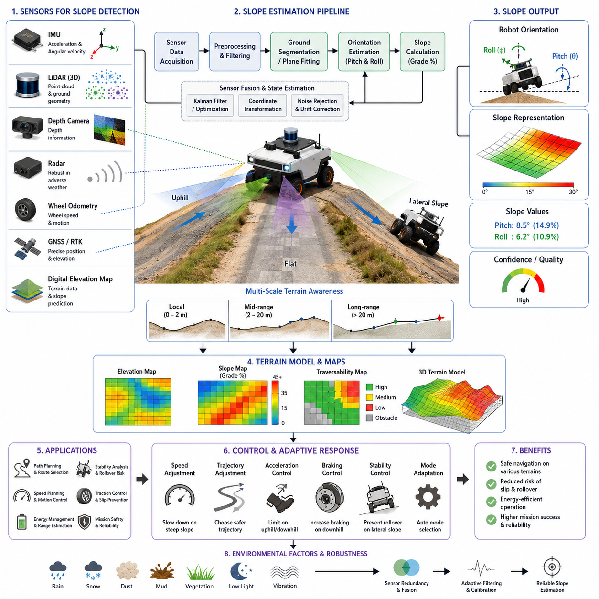
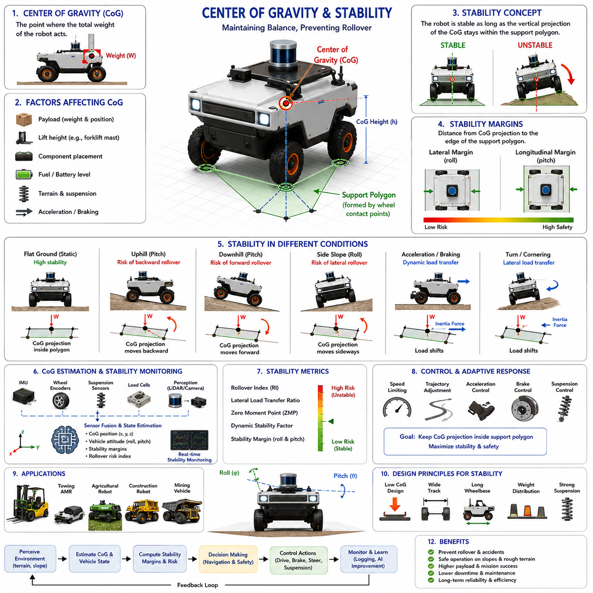
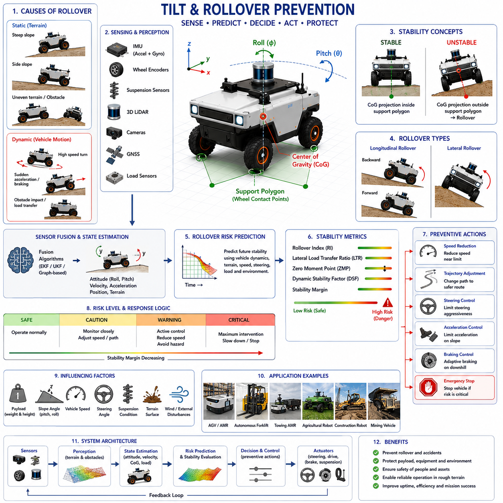
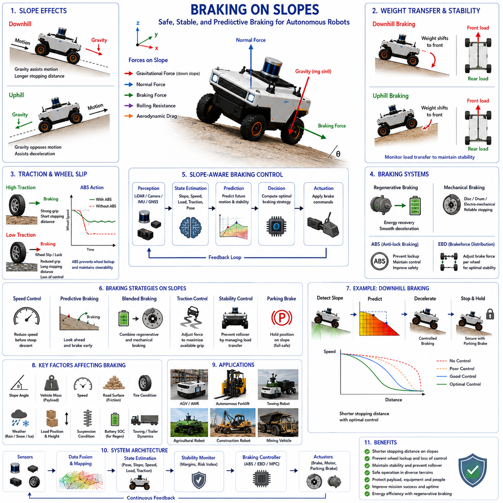
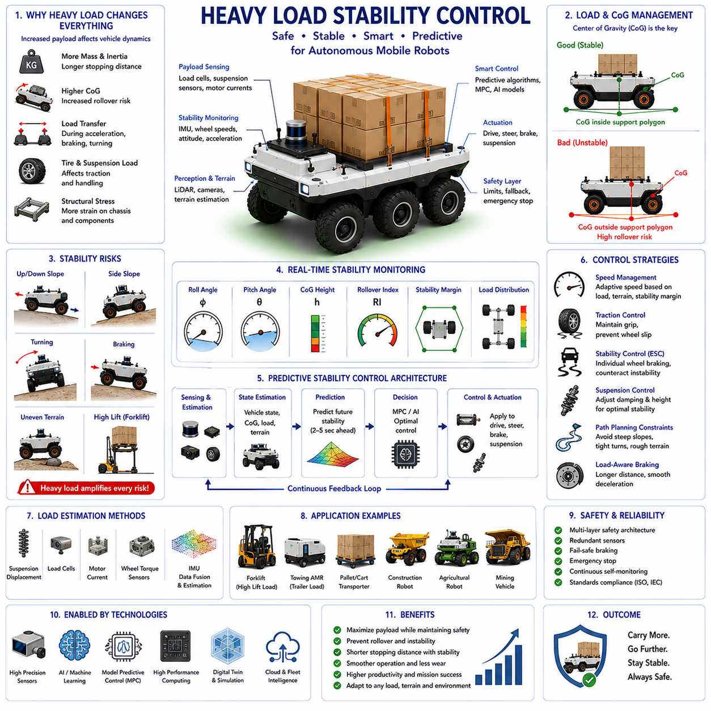
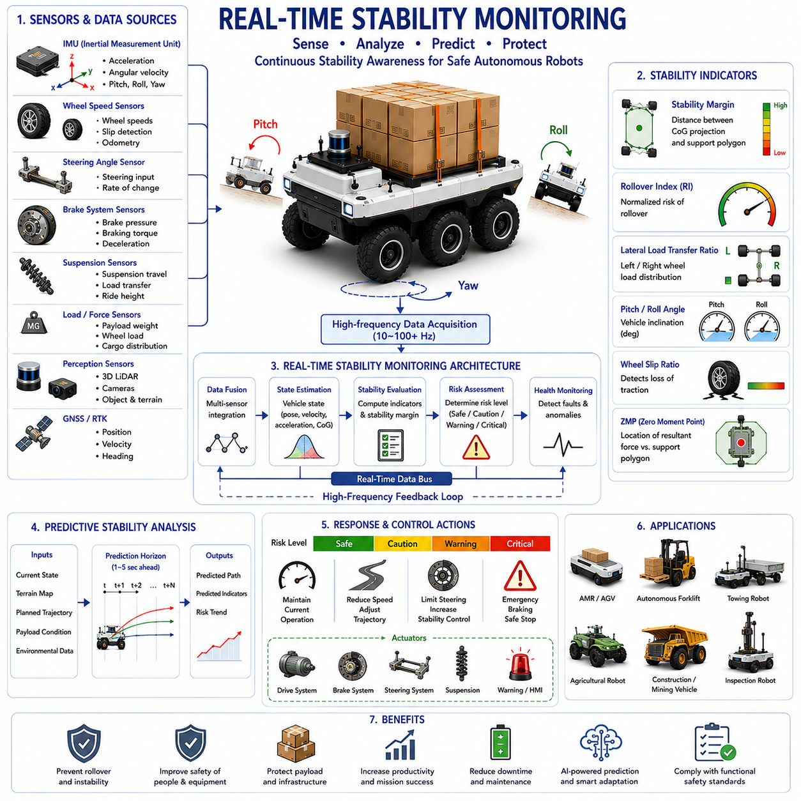
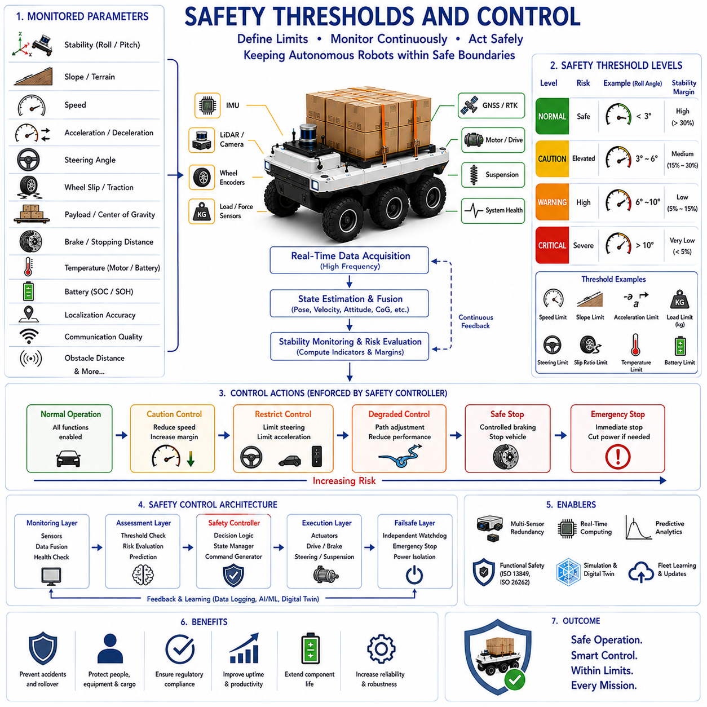
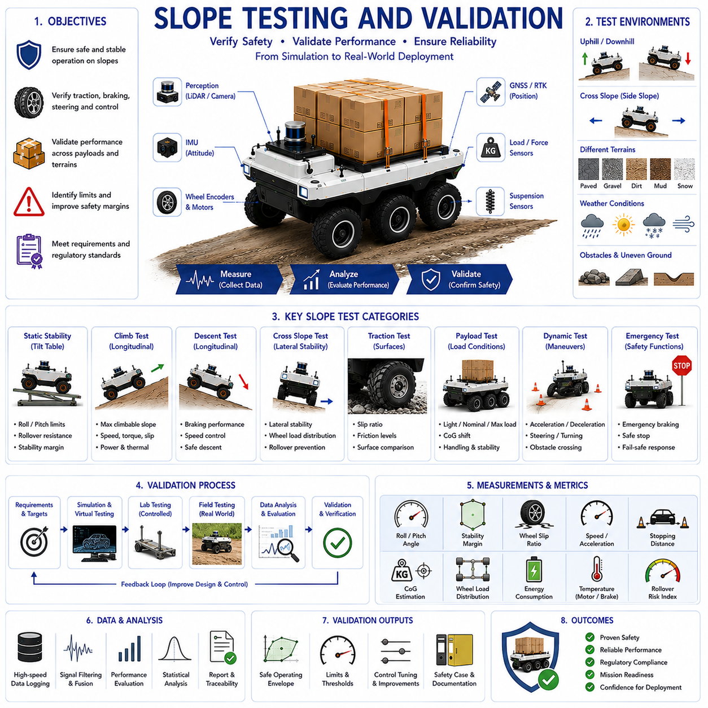

**Volume 05. Path Planning and Autonomous Navigation**

# Chapter 17. Slope and Stability Control

## 17.1 Slope Detection and Estimation

{width="7.268055555555556in" height="7.268055555555556in"}

Slope detection and estimation represent fundamental capabilities for autonomous mobile robots operating in outdoor environments, industrial facilities, construction sites, mining areas, agricultural fields, logistics yards, and other locations where terrain elevation continuously changes. While many indoor robots operate on relatively flat surfaces, outdoor autonomous robots frequently encounter ramps, hills, embankments, loading docks, uneven roads, drainage channels, and natural terrain features that introduce significant variations in inclination. Accurate detection and estimation of slope characteristics are essential not only for navigation performance but also for vehicle stability, safety, energy management, motion control, and mission success. Within a modern autonomous navigation architecture, slope estimation serves as a core component that provides environmental awareness and enables the robot to adapt its behavior according to changing terrain conditions. The topic is positioned as the first chapter of Slope and Stability Control because every subsequent stability, rollover prevention, braking, and safety control function relies on accurate knowledge of the terrain inclination.

A slope can be defined as the inclination of the terrain surface relative to a horizontal reference frame. In robotics, slope information is commonly represented using pitch angle, roll angle, gradient percentage, elevation change, or three-dimensional surface normals. Pitch describes longitudinal inclination along the direction of travel, while roll represents lateral inclination across the vehicle width. Both parameters influence vehicle dynamics in different ways. Longitudinal slopes primarily affect traction, acceleration, braking, and power consumption. Lateral slopes significantly impact stability margins and rollover risk. Understanding both dimensions simultaneously is necessary for safe autonomous operation.

The need for slope detection becomes increasingly important as robot size, payload, speed, and operational complexity increase. Small indoor delivery robots may tolerate modest terrain variations without substantial performance degradation. In contrast, heavy-duty outdoor autonomous robots carrying hundreds of kilograms of payload experience significant shifts in weight distribution when operating on slopes. For large autonomous platforms, even relatively small changes in inclination can influence wheel loading, tire traction, braking distance, steering response, and stability margins. Accurate slope estimation therefore becomes a prerequisite for advanced navigation and control.

Modern autonomous robots utilize multiple sensing technologies to estimate slope conditions. Inertial Measurement Units provide direct measurements of acceleration and angular velocity. These measurements enable estimation of pitch and roll angles through sensor fusion algorithms. IMUs are widely used because they offer high update rates, compact size, and relatively low cost. However, raw IMU measurements often contain noise, drift, vibration effects, and transient disturbances caused by vehicle motion. Consequently, IMU data must be filtered and integrated with other sensor sources to achieve reliable terrain estimation.

Accelerometers inside the IMU can measure the gravitational vector acting on the robot. When the robot is stationary or moving at constant velocity, the gravity vector provides valuable information about orientation relative to the earth. By analyzing the projection of gravity onto the sensor axes, pitch and roll angles can be estimated. However, during acceleration, deceleration, or turning maneuvers, dynamic forces become mixed with gravitational forces, reducing estimation accuracy. Advanced filtering techniques are therefore required to separate vehicle motion effects from terrain-induced inclination.

Gyroscopes provide angular velocity measurements that capture rapid changes in orientation. These measurements enable responsive estimation of slope transitions and sudden terrain variations. Nevertheless, gyroscope integration accumulates drift over time, causing orientation estimates to gradually diverge from reality. To overcome this limitation, modern navigation systems employ sensor fusion methods such as complementary filtering, Extended Kalman Filtering, Unscented Kalman Filtering, or factor graph optimization. These techniques combine accelerometer and gyroscope data to produce stable and accurate orientation estimates.

Wheel odometry can contribute additional information for slope estimation. Changes in wheel rotation, vehicle velocity, and acceleration may indicate transitions between flat and inclined surfaces. Odometry data alone is insufficient for direct slope estimation because wheel slip and terrain variability introduce uncertainty. However, when combined with inertial measurements, odometry enhances robustness and helps reduce estimation errors.

Three-dimensional LiDAR systems provide another powerful approach for slope detection. By generating dense point clouds of the surrounding environment, LiDAR sensors can reconstruct terrain geometry and estimate surface orientation. Ground segmentation algorithms identify terrain points, while plane fitting techniques determine local slope characteristics. Unlike purely inertial methods, LiDAR-based estimation directly observes environmental structure rather than inferring terrain from vehicle motion. This capability enables detection of upcoming slopes before the robot physically encounters them.

Ground plane estimation is a common technique in LiDAR-based navigation. The robot continuously identifies the local ground surface and calculates the orientation of the best-fit plane. Surface normals derived from this plane provide estimates of pitch and roll angles. Such information can be incorporated into navigation cost maps, allowing path planners to avoid steep regions and prioritize safer routes.

Depth cameras offer similar functionality for short-range terrain perception. Stereo cameras, structured-light sensors, and time-of-flight cameras generate depth information that can be transformed into three-dimensional terrain models. Surface reconstruction algorithms identify elevation changes and estimate slope gradients. Depth cameras are particularly useful in environments where LiDAR deployment is limited by cost, size, or power constraints. However, their performance may be affected by lighting conditions, reflective surfaces, weather effects, and sensing range limitations.

Radar systems provide complementary terrain perception capabilities. Although radar generally produces lower-resolution environmental models compared with LiDAR, it performs effectively under adverse weather conditions such as rain, fog, dust, and snow. Ground reflection analysis and elevation estimation techniques allow radar systems to contribute to slope detection, particularly in harsh outdoor environments where optical sensors may experience degraded performance.

GNSS and RTK positioning systems also play a role in slope estimation for large-scale outdoor operations. By combining precise position measurements with digital elevation maps, robots can estimate terrain gradients over long distances. Elevation profiles extracted from geographic information systems provide advance knowledge of upcoming slopes, enabling proactive route planning and energy management. This approach is particularly valuable for agricultural robots, mining vehicles, construction equipment, and autonomous logistics platforms operating across expansive outdoor environments.

Digital elevation models represent another important source of terrain information. High-resolution terrain maps generated through surveying, drone mapping, or previous robot missions can be integrated into navigation systems. These maps provide detailed elevation data that support offline route planning and online terrain prediction. The robot can compare real-time sensor measurements with map-based predictions to improve slope estimation accuracy and detect environmental changes.

Terrain modeling forms a critical part of the slope estimation process. Rather than simply measuring instantaneous pitch and roll values, advanced navigation systems construct continuous representations of the terrain. Elevation grids, height maps, traversability maps, and three-dimensional mesh models enable comprehensive understanding of terrain structure. These representations support not only slope detection but also obstacle avoidance, path planning, stability analysis, and mission optimization.

Slope estimation must operate across multiple spatial scales. Local estimation focuses on terrain immediately beneath and around the robot. This information is essential for motion control, traction management, and stability monitoring. Mid-range estimation evaluates terrain several meters ahead, allowing the navigation system to prepare for upcoming changes. Long-range estimation supports strategic route planning and mission-level decision making. Effective autonomous navigation integrates information across all three scales.

The distinction between geometric slope and traversability slope is important. A terrain surface may exhibit a measurable inclination yet remain completely traversable for a particular robot. Conversely, a slope within nominal geometric limits may become hazardous due to loose soil, mud, gravel, ice, or payload conditions. Modern slope estimation systems therefore combine geometric measurements with terrain classification and traction analysis. This integrated approach provides a more realistic assessment of operational risk.

Machine learning techniques are increasingly being applied to slope detection and terrain understanding. Deep neural networks trained on LiDAR point clouds, camera images, radar data, and multisensor fusion inputs can classify terrain types and estimate slope characteristics. These systems learn complex relationships between sensor observations and terrain conditions that may be difficult to model analytically. AI-based approaches are particularly useful in unstructured environments where traditional geometric methods encounter limitations.

Semantic terrain understanding further enhances slope estimation capabilities. Instead of merely identifying numerical slope values, the robot can recognize contextual information about the environment. For example, a detected slope may correspond to a loading dock ramp, parking garage entrance, construction embankment, agricultural terrace, or natural hillside. Such semantic understanding enables more intelligent navigation decisions and improved mission execution.

Slope estimation accuracy depends heavily on sensor calibration and coordinate frame alignment. Misalignment between sensors and vehicle reference frames can introduce systematic errors that significantly affect terrain assessment. Calibration procedures must ensure accurate orientation relationships among IMUs, LiDAR sensors, cameras, GNSS receivers, and vehicle coordinate systems. Regular calibration verification is particularly important for robots operating in high-vibration environments.

Environmental factors can significantly influence slope estimation performance. Rain, snow, mud, dust, vegetation, loose gravel, shadows, and changing lighting conditions may affect sensor measurements and terrain interpretation. Robust slope detection systems incorporate sensor redundancy, adaptive filtering, and environmental compensation techniques to maintain reliable performance under diverse operational conditions.

Real-time operation imposes additional challenges. Autonomous robots must continuously estimate terrain conditions while simultaneously performing localization, perception, path planning, obstacle avoidance, fleet communication, and mission execution. Computational efficiency therefore becomes a critical design consideration. Efficient algorithms, edge computing architectures, GPU acceleration, and hierarchical processing pipelines are often employed to achieve real-time performance without compromising estimation quality.

The relationship between slope estimation and vehicle dynamics is particularly important for outdoor autonomous robots. As inclination increases, gravitational forces alter traction distribution among wheels. Uphill driving requires increased propulsion effort and affects energy consumption. Downhill driving increases braking demands and may introduce stability risks. Lateral slopes shift the center of gravity toward one side of the vehicle, reducing rollover margins. Accurate slope estimation provides the information necessary for dynamic control systems to compensate for these effects.

Energy management systems also benefit from slope awareness. Navigation planners can estimate energy consumption based on terrain gradients and vehicle characteristics. Route optimization algorithms may select paths that minimize energy usage while satisfying mission requirements. Battery-powered robots operating in large outdoor environments particularly benefit from terrain-aware energy planning.

Heavy-payload autonomous robots require even greater emphasis on slope estimation. Payload weight and placement influence the effective center of gravity, altering stability characteristics across different terrain conditions. Dynamic payload variations further complicate the problem. Real-time estimation of both terrain inclination and vehicle loading conditions enables safer operation and more effective stability control.

Industrial applications demonstrate the practical importance of slope detection. Warehouse robots navigate loading ramps connecting different facility levels. Hospital delivery robots encounter access ramps and building transitions. Agricultural robots operate across rolling terrain and terraced fields. Mining vehicles traverse steep haul roads and excavation sites. Construction robots work on partially completed surfaces with significant elevation variation. GPR inspection robots, outdoor patrol robots, and autonomous logistics platforms frequently encounter complex terrain conditions that require accurate slope awareness.

Safety considerations remain the primary motivation for advanced slope estimation. Undetected terrain inclinations can lead to traction loss, navigation failure, excessive wheel slip, reduced braking effectiveness, payload instability, or vehicle rollover. By continuously monitoring terrain conditions, autonomous systems can proactively adjust speed, steering, acceleration, braking, and route selection. These adaptive behaviors significantly improve operational safety and reliability.

Future developments in slope detection and estimation will likely involve tighter integration between perception, localization, navigation, and AI systems. Advanced world models will enable robots to predict terrain characteristics beyond sensor visibility. Multimodal foundation models may combine visual, geometric, semantic, and physical reasoning to generate comprehensive terrain understanding. Cloud-connected navigation systems may share terrain knowledge across fleets, creating continuously evolving maps of slope conditions and traversability characteristics.

As autonomous robots expand into increasingly challenging outdoor environments, slope detection and estimation will remain a foundational capability supporting safe navigation, stability control, mission planning, and intelligent decision making. Accurate understanding of terrain inclination enables robots to move confidently through complex environments while maintaining operational safety, maximizing efficiency, and ensuring reliable mission execution across diverse industrial, commercial, agricultural, and infrastructure applications.

## 17.2 Center of Gravity and Stability

{width="7.268055555555556in" height="7.268055555555556in"}

The center of gravity and stability are among the most critical considerations in the design, operation, and safety management of autonomous mobile robots operating in both indoor and outdoor environments. As autonomous robots become larger, heavier, faster, and more capable of carrying significant payloads, understanding the relationship between the center of gravity and vehicle stability becomes essential for ensuring safe and reliable operation. In outdoor autonomous robots, towing AMRs, autonomous forklifts, agricultural robots, construction robots, mining vehicles, and infrastructure inspection platforms, stability management directly affects mission success, operational efficiency, and safety. Within the broader framework of slope and stability control, center of gravity analysis serves as the foundation upon which rollover prevention, tilt monitoring, braking control, and safety decision-making systems are built. The robot\'s ability to maintain balance under varying terrain, payload, and dynamic operating conditions depends largely on the accurate estimation and management of its center of gravity.

The center of gravity, commonly abbreviated as CoG, represents the theoretical point at which the entire weight of a robot can be considered to act. Regardless of how complex the mechanical structure may be, all gravitational forces acting on the vehicle can be represented by a single resultant force passing through the center of gravity. In a perfectly symmetrical robot operating on flat ground with evenly distributed components, the center of gravity is typically located near the geometric center of the chassis. However, real-world autonomous robots rarely operate under such ideal conditions. Sensors, batteries, computing units, payloads, tools, manipulators, trailers, and cargo introduce asymmetries that continuously influence the location of the center of gravity.

The position of the center of gravity directly affects vehicle stability. A robot with a low center of gravity generally exhibits greater resistance to tipping and rollover because the gravitational force remains well within the support polygon formed by the wheel contact points. Conversely, a robot with a high center of gravity becomes increasingly susceptible to instability, especially when operating on slopes, uneven terrain, or during aggressive acceleration and turning maneuvers. For this reason, mechanical designers often prioritize low-mounted batteries, distributed component placement, and optimized chassis geometry during robot development.

Vehicle stability can be defined as the ability of a robot to maintain equilibrium and avoid overturning under static and dynamic conditions. Stability is influenced by numerous factors including vehicle dimensions, wheelbase, track width, center of gravity location, payload characteristics, terrain conditions, vehicle speed, acceleration, and environmental disturbances. A stable robot maintains its center of gravity projection within the support polygon. Once the projected center of gravity moves beyond this support area, tipping becomes inevitable unless corrective actions are taken.

Static stability refers to the robot\'s ability to remain upright when stationary. Under static conditions, gravitational forces dominate the stability analysis. Engineers often evaluate static stability by calculating the maximum allowable pitch and roll angles before the center of gravity projection reaches the boundary of the support polygon. This analysis provides a fundamental measure of the robot\'s resistance to tipping on slopes.

Dynamic stability is considerably more complex because vehicle motion introduces additional forces and moments. During acceleration, braking, steering, obstacle crossing, and terrain transitions, inertial forces shift the effective center of gravity and alter load distribution among the wheels. Dynamic stability analysis therefore considers both gravitational and inertial effects. A robot that appears stable while stationary may become unstable during rapid maneuvering if dynamic forces significantly alter its stability margins.

Longitudinal stability concerns vehicle behavior in the forward and backward directions. When climbing a slope, the center of gravity shifts relative to the rear axle, increasing the risk of backward rollover. As slope angles increase, gravitational moments opposing forward motion become larger. If the center of gravity moves beyond the rear support boundary, the vehicle may overturn backward. Similarly, during steep downhill operation, excessive forward weight transfer may increase the risk of forward tipping, particularly during sudden braking events.

Lateral stability focuses on side-to-side balance. Lateral rollover is often considered more dangerous because many outdoor robots encounter side slopes, uneven terrain, and asymmetric obstacles. As the vehicle traverses a lateral incline, the center of gravity projection moves toward the downhill wheels. If the projected center of gravity crosses the outer wheel contact boundary, rollover occurs. The risk increases significantly for tall vehicles carrying elevated payloads.

The concept of the support polygon plays a central role in stability analysis. The support polygon is formed by connecting the contact points between the wheels and the ground. For a four-wheel robot, the support polygon typically forms a rectangle. For six-wheel or articulated platforms, the shape may be more complex. As long as the projected center of gravity remains within this polygon, the robot maintains static stability. The distance between the projected center of gravity and the polygon boundary provides a useful measure known as the stability margin.

Stability margin quantifies how close the robot is to a tipping condition. Larger stability margins indicate safer operation, while smaller margins suggest increased rollover risk. Modern autonomous robots continuously calculate stability margins during operation and adjust their behavior accordingly. This capability allows the vehicle to proactively reduce speed, modify trajectories, or avoid hazardous terrain before critical conditions develop.

The height of the center of gravity is one of the most influential design parameters affecting stability. Increasing the center of gravity height amplifies the overturning moments generated by gravitational and inertial forces. Consequently, robots designed for rough terrain, outdoor navigation, and heavy-load applications typically place batteries, power systems, and structural components as low as possible within the chassis. Even modest reductions in center of gravity height can significantly improve rollover resistance.

Payloads introduce additional complexity into center of gravity management. Many autonomous robots operate under varying load conditions. A logistics robot may carry different cargo weights throughout the day. An autonomous forklift continuously changes load positions and elevations. A towing robot may pull trailers with shifting cargo distributions. Each payload configuration alters the center of gravity location and consequently affects vehicle stability. Real-time payload estimation therefore becomes an important component of advanced stability control systems.

In autonomous forklifts, the center of gravity changes dramatically as loads are lifted to different heights. Raising a pallet several meters above the ground significantly increases the overall center of gravity height, reducing stability margins and increasing rollover risk. As a result, forklift control systems often impose speed limits and acceleration restrictions when loads are elevated. Similar principles apply to robots equipped with manipulators, telescopic mechanisms, inspection booms, or sensor masts.

Terrain conditions strongly influence stability behavior. Flat surfaces generally provide predictable load distribution and maximum stability margins. Uneven terrain introduces wheel articulation, suspension compression, and ground contact variations that can significantly alter vehicle posture. Outdoor robots operating on agricultural fields, mining roads, construction sites, and natural landscapes must continuously estimate terrain geometry and evaluate its impact on stability.

Suspension systems play an important role in stability management. Proper suspension design helps maintain wheel contact with the ground, distributes loads more evenly, and reduces sudden load transfers caused by terrain irregularities. Active suspension systems can further enhance stability by dynamically adjusting ride height and chassis orientation based on real-time terrain conditions.

Wheelbase and track width also contribute significantly to stability characteristics. Increasing wheelbase generally improves longitudinal stability, while increasing track width enhances lateral stability. Heavy-duty outdoor robots often employ wide-track configurations specifically to improve rollover resistance on side slopes and rough terrain. However, larger dimensions may introduce tradeoffs related to maneuverability, transportation, and operational flexibility.

Center of gravity estimation is a key capability in modern autonomous robots. While the nominal center of gravity can be calculated during design, real-world operating conditions require continuous estimation. Sensor systems including IMUs, wheel encoders, suspension sensors, force sensors, load cells, GNSS systems, and perception sensors provide information that can be used to estimate center of gravity location and vehicle stability state. Advanced algorithms combine these measurements to create dynamic stability models that evolve throughout the mission.

Inertial Measurement Units are particularly valuable for stability monitoring. IMUs provide measurements of acceleration, angular velocity, pitch angle, roll angle, and vehicle motion dynamics. These measurements allow control systems to detect potentially dangerous conditions before rollover occurs. By monitoring changes in vehicle attitude and motion, the robot can implement corrective actions in real time.

Three-dimensional LiDAR and vision systems contribute indirectly to stability management by providing terrain awareness. The robot can identify slopes, ditches, obstacles, berms, and uneven surfaces before encountering them. This predictive capability enables proactive stability management rather than purely reactive responses.

Mathematical stability models are commonly used to quantify rollover risk. These models evaluate the relationship between gravitational forces, inertial forces, terrain geometry, and vehicle configuration. Metrics such as rollover index, lateral load transfer ratio, zero moment point, and dynamic stability factor provide quantitative measures of stability. Such indicators can be continuously monitored during operation and incorporated into navigation decision-making processes.

Artificial intelligence is increasingly being applied to stability prediction and management. Machine learning models trained on large datasets of vehicle behavior can identify subtle patterns associated with instability. AI systems may predict rollover risks before traditional threshold-based methods detect problems. These capabilities are particularly valuable in highly dynamic environments where conventional analytical models may struggle to capture all relevant variables.

Autonomous navigation systems increasingly integrate stability considerations directly into path planning algorithms. Rather than selecting routes solely based on distance or travel time, modern planners evaluate terrain inclination, surface conditions, stability margins, and rollover risk. Routes with lower stability risk may be preferred even if they are slightly longer. This approach improves operational safety and mission reliability.

Energy efficiency and stability are often interconnected. Aggressive acceleration, sharp turns, and high-speed maneuvers not only consume more energy but also reduce stability margins. Stability-aware navigation therefore contributes to both safety and energy optimization. Smooth trajectories, controlled acceleration profiles, and terrain-adaptive speed planning improve overall system performance.

Heavy-duty industrial robots require particularly sophisticated stability management. Large towing AMRs carrying several tons of payload experience significant dynamic load transfers during acceleration and braking. Construction robots operating on uneven terrain encounter continuously changing stability conditions. Mining vehicles traverse steep haul roads while carrying heavy loads. These applications demand real-time stability monitoring integrated with vehicle control systems.

Safety standards increasingly emphasize stability verification and validation. Comprehensive testing procedures evaluate robot performance under various payload conditions, slope angles, acceleration profiles, and environmental scenarios. Stability testing often includes static tilt tests, dynamic maneuver tests, obstacle-crossing evaluations, and emergency braking assessments. The results establish operational limits and safety thresholds that guide autonomous behavior.

Digital twins and simulation environments have become important tools for stability analysis. High-fidelity physics simulations allow engineers to evaluate thousands of operating scenarios without exposing physical robots to risk. Digital models can assess the effects of different payload configurations, terrain conditions, suspension designs, and control strategies. These simulations accelerate development while improving safety and reliability.

Future autonomous robots will likely employ increasingly sophisticated stability management systems. Real-time terrain prediction, AI-driven risk assessment, adaptive suspension control, active center of gravity management, and predictive navigation strategies will work together to maximize stability under challenging operating conditions. Cloud-connected fleets may share terrain and stability information, enabling collective learning across multiple vehicles.

As autonomous robots continue expanding into outdoor, industrial, agricultural, construction, logistics, and infrastructure inspection applications, center of gravity management and stability control will remain fundamental engineering disciplines. A comprehensive understanding of how weight distribution, terrain interaction, vehicle dynamics, and control systems influence stability is essential for building safe, reliable, and high-performance autonomous platforms. Effective center of gravity estimation and stability management not only prevent accidents and rollovers but also enable robots to operate confidently in increasingly complex and demanding environments, supporting higher productivity, greater autonomy, and long-term operational success.

## 17.3 Tilt and Rollover Prevention

{width="7.268055555555556in" height="7.268055555555556in"}

Tilt and rollover prevention represent one of the most critical safety functions in autonomous mobile robots operating in industrial, commercial, agricultural, mining, construction, logistics, and infrastructure inspection environments. As autonomous robots become larger, faster, and capable of carrying heavier payloads, the consequences of vehicle instability become increasingly severe. A rollover incident can result in equipment damage, mission failure, cargo loss, environmental hazards, operational downtime, and potential injury to nearby personnel. Consequently, modern autonomous navigation systems must continuously monitor vehicle attitude, predict instability risks, and implement preventive control actions before dangerous conditions develop. Within the framework of slope and stability control, tilt and rollover prevention form the active safety layer that transforms terrain awareness and stability analysis into real-time operational protection. This capability bridges the gap between sensing and control, ensuring that autonomous robots can operate safely under challenging environmental and dynamic conditions.

Tilt refers to the angular deviation of a vehicle from its nominal upright orientation. In mobile robotics, tilt is typically described using pitch and roll angles. Pitch represents forward and backward inclination, while roll represents side-to-side inclination. Small tilt angles are normal and unavoidable during vehicle operation. However, excessive tilt may indicate dangerous operating conditions that could ultimately lead to rollover. The objective of tilt management is not merely to measure vehicle orientation but to understand the relationship between vehicle posture, terrain conditions, vehicle dynamics, and stability margins.

Rollover occurs when the resultant forces acting on a vehicle cause the projection of the center of gravity to move outside the support polygon formed by the wheel-ground contact points. Once this condition is reached, the restoring moment generated by gravity is no longer sufficient to maintain equilibrium, and the vehicle begins to overturn. In many cases, rollover develops rapidly, leaving little opportunity for corrective action unless predictive monitoring systems are already in place. Therefore, modern rollover prevention systems emphasize early detection and proactive intervention rather than reactive recovery.

The causes of rollover can be broadly classified into static and dynamic factors. Static rollover is primarily associated with terrain geometry. Steep slopes, side inclines, embankments, uneven surfaces, and obstacle interactions may gradually shift the vehicle\'s center of gravity toward the limits of the support polygon. Dynamic rollover results from vehicle motion and is often associated with acceleration, braking, cornering, sudden steering inputs, obstacle impacts, or rapid load transfers. In practical operations, rollover events often involve a combination of both static and dynamic influences.

Longitudinal rollover occurs when a vehicle overturns forward or backward. This type of instability is particularly relevant during steep uphill or downhill operation. When climbing a slope, the center of gravity shifts toward the rear axle. If the slope becomes sufficiently steep, the center of gravity projection may move beyond the rear support boundary, causing backward rollover. Similarly, aggressive acceleration on an incline can further increase rollover risk. During downhill travel, excessive braking or steep descent angles may shift the center of gravity forward, increasing the possibility of forward overturning.

Lateral rollover is generally considered the most common and dangerous form of instability in outdoor autonomous robots. Side slopes, uneven terrain, berms, curbs, ditches, and asymmetric obstacles create conditions where the center of gravity shifts toward the downhill side of the vehicle. If the lateral stability margin becomes insufficient, rollover may occur. Tall vehicles carrying elevated payloads are especially vulnerable because the higher center of gravity amplifies overturning moments.

The probability of rollover is heavily influenced by vehicle design. Center of gravity height is one of the most important factors affecting stability. A low center of gravity reduces overturning moments and increases stability margins. A high center of gravity increases sensitivity to terrain irregularities and dynamic load transfers. Consequently, autonomous robot designers typically position batteries, power electronics, and heavy mechanical components as low as possible within the chassis.

Track width and wheelbase also play significant roles in rollover resistance. Wider track widths improve lateral stability by enlarging the support polygon. Longer wheelbases improve longitudinal stability by increasing resistance to forward and backward overturning. However, increasing vehicle dimensions may reduce maneuverability and operational flexibility. Engineers therefore seek an optimal balance between stability and mobility.

Payload characteristics introduce additional complexity into rollover prevention. Payload weight, location, height, and movement all influence stability. A robot carrying a heavy load positioned high above the chassis experiences a significant increase in center of gravity height. Similarly, shifting cargo or moving manipulators can dynamically alter stability margins during operation. Modern autonomous systems must therefore account for payload conditions when evaluating rollover risk.

Tilt sensing forms the foundation of rollover prevention systems. Inertial Measurement Units are the most commonly used sensors for monitoring vehicle orientation. Accelerometers measure gravitational components along multiple axes, while gyroscopes provide angular velocity information. Through sensor fusion algorithms, the robot continuously estimates pitch and roll angles with high accuracy. These measurements provide real-time awareness of vehicle attitude and serve as primary inputs for stability monitoring systems.

Sensor fusion significantly improves tilt estimation performance. Individual sensors are subject to noise, drift, vibration, and environmental disturbances. By combining data from accelerometers, gyroscopes, wheel encoders, GNSS receivers, suspension sensors, and perception systems, the robot can generate a more reliable estimate of its orientation and stability state. Extended Kalman Filters, Unscented Kalman Filters, complementary filters, and graph-based estimation techniques are commonly employed to achieve robust performance.

Three-dimensional LiDAR systems contribute valuable information for rollover prevention by detecting terrain geometry before the vehicle encounters hazardous conditions. Ground plane estimation algorithms identify slopes, embankments, ditches, and uneven surfaces. This predictive capability allows the navigation system to anticipate future stability challenges rather than merely reacting to current vehicle posture.

Vision systems provide complementary environmental awareness. Stereo cameras, depth cameras, and AI-based perception models can recognize hazardous terrain features, steep slopes, unstable ground surfaces, and obstacles that may compromise vehicle stability. Semantic understanding of the environment enables more intelligent decision-making and proactive risk mitigation.

Suspension monitoring provides another important source of stability information. Changes in suspension compression often indicate load transfers associated with tilt and instability. Advanced suspension systems may incorporate position sensors, force sensors, and hydraulic pressure sensors to measure vehicle posture and dynamic load distribution. These measurements enhance stability estimation and improve rollover prediction accuracy.

Rollover prediction is a central objective of modern stability management systems. Rather than waiting for dangerous conditions to occur, advanced algorithms estimate future vehicle states and evaluate potential risks. Predictive models incorporate terrain geometry, vehicle speed, steering angle, acceleration, payload characteristics, and environmental conditions to forecast stability margins several seconds into the future.

Several mathematical metrics are commonly used to evaluate rollover risk. The rollover index provides a normalized measure of vehicle stability relative to tipping thresholds. The lateral load transfer ratio quantifies how vehicle weight is distributed between left and right wheels. The zero moment point represents the effective location of resultant forces acting on the vehicle. Dynamic stability factors combine multiple parameters into a single indicator that can be monitored continuously during operation. These metrics enable quantitative assessment of stability and support automated decision-making.

Real-time stability monitoring systems continuously calculate these indicators and compare them against predefined safety thresholds. When stability margins decrease below acceptable limits, corrective actions are initiated automatically. Such actions may include speed reduction, trajectory modification, steering adjustments, acceleration limiting, braking intervention, or complete mission interruption.

Speed control is among the most effective rollover prevention strategies. High speeds amplify dynamic forces and increase the likelihood of instability. Modern autonomous robots dynamically adjust speed according to terrain conditions, slope angles, stability margins, and environmental risk factors. Terrain-aware speed planning ensures that vehicle velocity remains within safe operating limits.

Steering control also plays a significant role in stability management. Sharp turns generate lateral acceleration that shifts vehicle loads and increases rollover risk. Stability-aware navigation systems therefore limit steering aggressiveness under hazardous conditions. Smooth trajectory generation and curvature-constrained path planning help minimize dynamic load transfers and improve vehicle stability.

Acceleration and braking control are equally important. Sudden acceleration may induce rearward weight transfer and increase longitudinal instability. Aggressive braking can shift loads forward and potentially trigger overturning on steep slopes. Adaptive control systems therefore regulate acceleration and braking forces based on terrain conditions and real-time stability assessments.

Path planning algorithms increasingly incorporate stability considerations directly into route selection. Traditional planners often prioritize shortest-distance or minimum-time solutions. Modern autonomous systems evaluate traversability, slope gradients, rollover risk, and stability margins as part of the optimization process. Safer routes may be selected even if they require longer travel distances.

Artificial intelligence is transforming rollover prevention capabilities. Machine learning models trained on large datasets of vehicle behavior can recognize subtle patterns associated with instability. AI systems may identify hazardous operating conditions earlier than conventional threshold-based methods. Deep learning approaches can integrate terrain perception, vehicle dynamics, and historical operating data to generate highly accurate rollover risk predictions.

Autonomous agricultural robots provide a compelling example of rollover prevention challenges. These vehicles frequently operate on uneven terrain, hillsides, and soft soil. Variable traction conditions and unpredictable ground surfaces require continuous stability monitoring. Similar challenges exist in mining, construction, and forestry applications where robots operate in highly unstructured environments.

Towing AMRs present unique rollover prevention requirements because trailer dynamics influence overall vehicle stability. The interaction between tractor and trailer introduces additional forces and load transfers that must be considered during acceleration, braking, turning, and slope traversal. Stability management systems must therefore model the combined dynamics of the entire vehicle-trailer system.

Autonomous forklifts face another specialized challenge. As loads are lifted to greater heights, the center of gravity rises significantly, reducing stability margins. Forklift control systems often impose dynamic restrictions on speed, acceleration, and turning radius based on lift height and payload characteristics. These measures are essential for preventing rollover during material handling operations.

Heavy-duty outdoor robots operating in rough terrain environments require particularly sophisticated stability management. Obstacle crossing, ditch traversal, rock negotiation, and side-slope operation create highly dynamic conditions. Advanced suspension systems, active chassis control, and predictive stability algorithms work together to maintain safe operation under these challenging circumstances.

Safety standards and regulations increasingly require formal validation of rollover prevention systems. Testing procedures evaluate vehicle behavior under various slope conditions, payload configurations, acceleration profiles, and environmental scenarios. Static tilt testing establishes fundamental stability limits, while dynamic testing verifies system performance under realistic operating conditions. Simulation environments and digital twins further support validation by enabling large-scale scenario evaluation without exposing physical equipment to unnecessary risk.

Future developments in tilt and rollover prevention will likely involve deeper integration between perception, AI, control systems, and cloud-based intelligence. Real-time digital twins may continuously evaluate vehicle stability under evolving conditions. Advanced world models may predict terrain hazards beyond current sensor visibility. Active suspension systems could automatically reposition vehicle mass to maximize stability margins. Collaborative fleet intelligence may enable robots to share terrain risk information and collectively improve operational safety.

As autonomous robots continue expanding into increasingly demanding applications, tilt and rollover prevention will remain a cornerstone of safe autonomous operation. Effective management of vehicle attitude, stability margins, terrain interaction, and dynamic forces ensures that robots can perform complex missions with confidence and reliability. By combining advanced sensing, predictive analytics, intelligent control, and proactive decision-making, modern rollover prevention systems enable autonomous platforms to operate safely in environments that would otherwise present unacceptable levels of risk.

## 17.4 Braking on Slopes

{width="7.268055555555556in" height="7.268055555555556in"}

Braking on slopes is one of the most critical safety functions in autonomous mobile robots operating in outdoor, industrial, agricultural, mining, construction, logistics, and infrastructure inspection environments. While braking on flat terrain is primarily concerned with reducing vehicle speed and stopping at a desired location, braking on inclined surfaces introduces additional challenges associated with gravity, vehicle dynamics, traction limitations, load transfer, and stability management. Autonomous robots must not only stop safely on uphill and downhill slopes but also maintain stability, prevent unintended vehicle movement, avoid wheel lockup, and ensure safe operation under varying terrain and payload conditions. As autonomous robots become larger, heavier, and capable of operating in increasingly challenging environments, slope-aware braking systems become essential components of overall vehicle safety architecture. Within the framework of slope and stability control, braking on slopes serves as a critical mechanism that directly influences vehicle stability, rollover prevention, mission reliability, and operational safety.

Gravity fundamentally alters braking behavior when a robot operates on an incline. On level ground, braking forces primarily oppose the vehicle's momentum. On a slope, gravitational forces either assist or oppose vehicle motion depending on the direction of travel. When descending a slope, gravity accelerates the vehicle and increases stopping distance. When ascending a slope, gravity acts against forward motion and assists deceleration. Consequently, braking strategies that are effective on flat surfaces may become inadequate or even unsafe on inclined terrain.

The physics of braking on slopes begins with force analysis. Several forces simultaneously act on a robot during braking operations. These include gravitational force, normal force, tire-ground friction, braking force, rolling resistance, aerodynamic drag, and inertial forces. The interaction of these forces determines braking effectiveness and vehicle stability. Understanding these relationships is essential for designing safe autonomous braking systems.

When a robot travels downhill, gravitational force can be decomposed into two components. One component acts perpendicular to the slope and influences wheel loading, while the other acts parallel to the slope and continuously pulls the vehicle downhill. As slope angle increases, the downhill gravitational component becomes larger. This additional force must be overcome by the braking system. Consequently, stopping distances increase significantly on steep descents.

The opposite situation occurs during uphill travel. Gravity opposes vehicle motion and naturally assists deceleration. While this may appear beneficial from a braking perspective, excessive braking on steep uphill slopes can still create instability through load transfer effects. Therefore, braking control must remain carefully managed regardless of travel direction.

Weight transfer plays a central role in slope braking dynamics. During deceleration, vehicle inertia causes weight to shift toward the front axle. On downhill slopes, this forward load transfer combines with gravitational effects, creating substantial increases in front wheel loading. Excessive front loading may overload suspension components, reduce rear wheel traction, and increase the risk of instability. In severe cases, forward rollover risk may emerge.

On uphill slopes, braking forces also induce load transfer, although the resulting distribution differs due to terrain geometry. Depending on vehicle configuration and slope angle, braking may reduce traction on specific wheels and create control challenges. Advanced braking systems continuously monitor load distribution to maintain optimal braking performance.

Traction management is another essential consideration. Braking effectiveness depends directly on the available friction between tires and the ground. On dry pavement, relatively high friction coefficients allow strong braking forces. However, loose gravel, mud, sand, wet surfaces, snow, and ice dramatically reduce available traction. When operating on slopes, reduced friction conditions become particularly hazardous because gravity continuously acts to accelerate the vehicle downhill.

Wheel slip represents one of the primary risks during slope braking. If braking force exceeds available tire-road friction, the wheels begin to lock and slide. Locked wheels lose lateral control authority, reducing steering effectiveness and increasing stopping distance. For autonomous robots, wheel slip can compromise localization accuracy, path tracking performance, and overall vehicle stability.

Anti-lock Braking Systems have become increasingly important in advanced autonomous robots. ABS continuously monitors wheel speeds and detects impending wheel lockup. When excessive slip is detected, braking pressure is rapidly modulated to maintain optimal tire-road contact. By preventing wheel lockup, ABS preserves steering control and improves braking efficiency, particularly on low-traction surfaces.

Electronic Brakeforce Distribution further enhances braking performance by dynamically adjusting braking force among individual wheels. Since wheel loading changes continuously during slope operation, uniform brake force distribution may not be optimal. Electronic brakeforce control systems allocate braking effort according to current load conditions, maximizing stability and stopping effectiveness.

Regenerative braking has become a valuable feature in electric autonomous robots. During deceleration, electric drive motors operate as generators and convert kinetic energy into electrical energy stored within the battery system. Regenerative braking provides controlled deceleration while improving energy efficiency. On moderate slopes, regenerative braking may provide sufficient braking force without requiring extensive mechanical brake engagement.

However, regenerative braking alone cannot guarantee safe stopping under all conditions. Battery state of charge, motor limitations, thermal constraints, and steep terrain conditions may reduce regenerative braking capability. Therefore, autonomous robots typically employ blended braking systems that combine regenerative and mechanical braking to ensure reliable performance.

Mechanical braking systems remain essential for emergency stopping, parking, and fail-safe operation. Disc brakes, drum brakes, hydraulic brakes, electromechanical brakes, and electromagnetic braking systems are commonly used in autonomous mobile robots. These systems provide reliable braking force regardless of battery conditions or motor operating states.

Parking brakes play a particularly important role on slopes. When a robot stops on an incline, the braking system must prevent unintended vehicle movement caused by gravity. Automatic parking brake engagement ensures that the vehicle remains stationary even if power is lost or communication failures occur. Fail-safe brake architectures are especially important for industrial and outdoor autonomous systems.

Slope-aware braking requires accurate estimation of terrain inclination. Inertial Measurement Units provide measurements of pitch angle and vehicle orientation. These measurements enable braking controllers to account for gravitational effects when calculating required braking force. Without accurate slope estimation, braking performance may become inconsistent across varying terrain conditions.

Sensor fusion enhances slope estimation reliability by combining IMU data with wheel encoders, GNSS measurements, LiDAR terrain mapping, and visual perception systems. This integrated approach provides more robust estimates of vehicle orientation and terrain geometry, improving braking control performance under diverse operating conditions.

LiDAR-based terrain perception contributes significantly to predictive braking strategies. By detecting upcoming slopes, ramps, embankments, and terrain transitions, the robot can prepare braking actions before entering hazardous regions. This predictive capability allows smoother deceleration and improved safety compared with purely reactive braking approaches.

Vision-based perception systems offer additional environmental awareness. Cameras and AI perception models can identify road conditions, surface materials, obstacles, water accumulation, snow coverage, and other factors affecting braking performance. Integrating visual information into braking decisions improves situational awareness and enhances safety.

Predictive braking represents a major advancement in autonomous vehicle safety. Traditional braking systems respond only after conditions change. Predictive systems estimate future vehicle states based on terrain geometry, vehicle speed, payload conditions, and environmental factors. The braking controller then adjusts deceleration strategies proactively to maintain stability and safety.

Model Predictive Control is increasingly applied to slope braking applications. MPC algorithms use mathematical models of vehicle dynamics to predict future behavior over a specified time horizon. By continuously optimizing braking commands, MPC systems can simultaneously achieve multiple objectives such as minimizing stopping distance, preserving stability, reducing energy consumption, and maintaining passenger or cargo comfort.

Heavy payloads significantly affect braking behavior. Increased vehicle mass requires greater braking force and increases stopping distance. Furthermore, payload location influences load transfer characteristics and stability margins. Autonomous robots carrying variable payloads must continuously adjust braking parameters according to current loading conditions.

Towing robots introduce additional braking challenges because trailer dynamics influence overall vehicle behavior. During downhill operation, trailer inertia may push the towing vehicle forward, increasing stopping distances and reducing stability. Coordinated braking strategies that control both tractor and trailer braking forces are essential for safe operation.

Autonomous forklifts represent another unique application. Elevated loads raise the center of gravity and reduce stability margins. During braking operations on slopes, excessive deceleration may induce dangerous load shifts and increase rollover risk. Therefore, forklift control systems often limit braking aggressiveness according to load height and weight.

Braking performance is closely linked to rollover prevention. Excessive braking on steep slopes can generate large load transfers that destabilize the vehicle. Stability control systems continuously monitor pitch, roll, acceleration, wheel loads, and center of gravity projections. If instability risks are detected, braking commands may be modified to preserve vehicle balance.

Electronic Stability Control systems integrate braking, steering, and traction management into a unified safety architecture. By selectively applying braking forces to individual wheels, ESC systems can counteract instability and improve vehicle control during challenging maneuvers. These capabilities are particularly valuable during emergency braking on uneven terrain.

Functional safety requirements demand that braking systems remain operational under fault conditions. Redundant sensors, backup controllers, independent power supplies, and fail-safe brake mechanisms are commonly employed to ensure reliability. Safety standards increasingly require comprehensive validation of braking performance across a wide range of operating scenarios.

Simulation environments and digital twins provide valuable tools for braking system development. Engineers can evaluate braking performance across thousands of terrain conditions, payload configurations, weather scenarios, and fault conditions without exposing physical equipment to risk. These simulations accelerate development while improving safety and robustness.

Field testing remains essential for validating braking performance. Controlled experiments on ramps, hills, rough terrain, gravel surfaces, wet roads, and mixed-friction environments provide critical insights into real-world behavior. Data collected during testing supports model refinement and safety certification activities.

Machine learning is beginning to influence braking control strategies. AI models trained on operational data can identify subtle relationships between terrain conditions, vehicle dynamics, and braking performance. Adaptive braking systems may continuously improve their behavior through experience, providing enhanced safety and efficiency over time.

Future braking systems for autonomous robots will likely integrate advanced perception, predictive analytics, digital twins, and cloud-based intelligence. Vehicles may anticipate terrain conditions far beyond immediate sensor range and optimize braking strategies using fleet-wide operational knowledge. Active suspension systems, predictive stability management, and AI-driven control architectures will further improve safety during slope operations.

As autonomous robots expand into increasingly demanding environments, braking on slopes will remain a cornerstone of safe mobility. Effective braking systems must balance stopping performance, traction management, stability preservation, energy efficiency, and functional safety. By integrating advanced sensing, predictive control, intelligent decision-making, and robust mechanical design, modern autonomous robots can safely navigate challenging terrain while maintaining operational reliability and protecting both equipment and personnel.

## 17.5 Heavy Load Stability Control

{width="7.268055555555556in" height="7.268055555555556in"}

Heavy load stability control is a fundamental capability for autonomous mobile robots operating in industrial logistics, smart factories, warehouses, ports, airports, construction sites, mining environments, agricultural operations, and infrastructure inspection applications. As autonomous robots increasingly transport larger payloads and operate in more challenging environments, maintaining vehicle stability under heavy load conditions becomes a critical requirement for safety, reliability, operational efficiency, and mission success. Heavy payloads significantly influence vehicle dynamics, center of gravity location, braking performance, steering response, rollover resistance, suspension behavior, energy consumption, and overall controllability. Consequently, modern autonomous robots must incorporate sophisticated stability control systems capable of continuously monitoring vehicle conditions, predicting instability risks, and adapting vehicle behavior in real time. Within the framework of slope and stability control, heavy load stability control serves as a specialized discipline focused on ensuring safe operation when payload mass becomes a dominant factor in vehicle behavior.

The fundamental challenge associated with heavy payload operation arises from the fact that vehicle dynamics change substantially as payload mass increases. A robot designed to operate safely without cargo may behave very differently when carrying several hundred kilograms or even several tons of payload. Increased mass affects inertia, acceleration capability, braking distance, turning characteristics, tire loading, suspension compression, and structural stress. Stability control systems must therefore continuously adapt to changing payload conditions rather than relying solely on nominal vehicle parameters.

Mass distribution plays an equally important role in stability management. Two payloads of identical weight may have entirely different effects on vehicle stability depending on how the load is positioned. A payload located low within the chassis generally improves stability by lowering the overall center of gravity. In contrast, a payload mounted at an elevated position may significantly increase rollover risk. Similarly, asymmetric load placement may create uneven weight distribution across the vehicle, reducing stability margins during turning, braking, and slope traversal.

The center of gravity remains the most influential parameter in heavy load stability analysis. As payloads are added, removed, raised, lowered, shifted, or redistributed, the center of gravity continuously changes. Stability control systems must estimate both the location and movement of the center of gravity throughout the mission. Accurate center of gravity estimation enables predictive stability assessment and supports intelligent control decisions that prevent dangerous operating conditions before they occur.

Vehicle stability is fundamentally determined by the relationship between the center of gravity projection and the support polygon formed by wheel-ground contact points. Heavy payloads increase the consequences of center of gravity movement because the gravitational forces involved become substantially larger. Even small shifts in payload position may create significant changes in stability margins. Therefore, heavy-load autonomous robots require more sophisticated monitoring and control systems than lightly loaded platforms.

Longitudinal stability becomes particularly important when transporting heavy loads on slopes. During uphill travel, gravitational forces shift the effective center of gravity toward the rear of the vehicle. If a heavy payload is already positioned near the rear section of the chassis, the risk of backward rollover increases substantially. Similarly, during downhill operation, heavy payloads increase forward load transfer, potentially creating excessive loading on front wheels and increasing forward overturning risk.

Lateral stability presents additional challenges. Side slopes, uneven terrain, obstacle crossings, and aggressive steering maneuvers may cause the center of gravity projection to move toward the edge of the support polygon. Heavy loads amplify rollover moments because larger masses generate larger gravitational forces. As a result, lateral stability control becomes one of the most critical functions for outdoor autonomous robots carrying substantial payloads.

Dynamic load transfer represents another major consideration. During acceleration, braking, and turning, inertia causes loads to shift within the vehicle structure. Heavy payloads magnify these dynamic effects. Rapid acceleration may transfer significant weight toward the rear axle, while aggressive braking shifts loads forward. Sharp turns generate lateral load transfers that increase rollover risk. Stability control systems must continuously evaluate these dynamic conditions and adjust vehicle behavior accordingly.

Suspension systems play a critical role in heavy load stability management. Increased payload mass causes suspension compression, changes vehicle ride height, alters wheel loading, and affects vehicle attitude. Advanced suspension systems monitor compression levels and compensate for load-induced changes. Active and semi-active suspension systems may dynamically adjust damping characteristics and ride height to maintain stability under varying payload conditions.

Tire behavior also changes significantly under heavy loading. Increased wheel loads influence tire deformation, contact patch characteristics, rolling resistance, traction performance, and heat generation. Excessive loading may reduce tire lifespan and compromise vehicle handling. Heavy load stability control systems therefore consider tire load conditions when calculating safe operating limits.

Steering dynamics are strongly affected by payload conditions. As vehicle mass increases, greater forces are required to initiate directional changes. Heavy loads increase turning inertia and reduce steering responsiveness. Consequently, autonomous navigation systems often reduce maximum steering rates and turning aggressiveness when carrying substantial payloads. These adjustments help preserve stability and minimize rollover risk.

Braking performance undergoes significant changes under heavy load conditions. Increased vehicle mass requires greater braking force and results in longer stopping distances. On slopes, gravitational effects further complicate braking behavior. Heavy payloads increase momentum, making emergency stopping more challenging. Stability-aware braking systems continuously adjust braking strategies according to payload conditions, terrain geometry, and stability margins.

Load estimation is therefore a key component of modern stability control architectures. Autonomous robots must estimate payload mass and distribution in real time. Various sensing technologies contribute to load estimation, including suspension displacement sensors, load cells, force sensors, motor current measurements, wheel torque sensors, and inertial measurements. By integrating these data sources, the robot can construct an accurate model of current loading conditions.

Inertial Measurement Units provide essential information for heavy load stability control. IMUs continuously measure acceleration, angular velocity, pitch angle, roll angle, and dynamic vehicle motion. These measurements allow control systems to identify potentially dangerous situations such as excessive tilt, rapid load transfer, or impending rollover. Real-time attitude monitoring is particularly important when operating on slopes or rough terrain.

Three-dimensional LiDAR contributes indirectly to stability management by providing terrain awareness. Ground surface estimation algorithms identify slopes, ditches, obstacles, uneven terrain, and hazardous operating regions. By understanding the terrain ahead, the robot can proactively adjust speed and trajectory before instability develops.

Vision-based perception systems provide additional environmental understanding. Cameras and AI perception models can recognize ramps, loading docks, potholes, loose surfaces, construction zones, agricultural fields, and other environmental features that may affect heavy load stability. Semantic interpretation of terrain conditions enables more intelligent operational decisions.

Heavy-load autonomous forklifts represent one of the most demanding stability-control applications. As pallets are lifted to higher elevations, the combined center of gravity moves upward, significantly reducing stability margins. Forklift stability systems continuously monitor load weight, lift height, mast angle, vehicle speed, and steering commands. Dynamic restrictions may be imposed automatically when stability limits are approached.

Towing autonomous mobile robots present another specialized stability challenge. The interaction between tractor and trailer introduces complex dynamic behavior. Trailer loads generate additional inertial forces during acceleration, braking, and turning. On slopes, trailer dynamics may significantly influence overall vehicle stability. Advanced towing control systems therefore model the complete vehicle-trailer system rather than treating the towing robot as an isolated platform.

Agricultural robots frequently transport heavy equipment, harvested crops, liquid tanks, fertilizer systems, and spraying modules. These payloads often shift during operation, creating continuously changing stability conditions. Uneven terrain and side-slope operation further increase risk. Heavy load stability control systems must therefore account for both terrain geometry and payload dynamics simultaneously.

Mining and construction robots operate under some of the most challenging heavy-load conditions. Large payload masses, steep grades, rough terrain, and harsh environmental conditions create substantial stability risks. These vehicles often rely on advanced suspension systems, redundant sensors, predictive control algorithms, and comprehensive stability monitoring architectures to maintain safe operation.

Predictive stability analysis has become increasingly important in modern autonomous systems. Rather than evaluating only current vehicle conditions, predictive algorithms estimate future stability states several seconds ahead. These predictions incorporate vehicle speed, steering angle, payload characteristics, terrain geometry, acceleration profiles, and environmental conditions. By anticipating instability before it occurs, the robot can implement corrective actions proactively.

Model Predictive Control is particularly effective for heavy load stability management. MPC continuously predicts future vehicle behavior and optimizes control actions over a rolling time horizon. Stability objectives may include minimizing rollover risk, preserving traction, reducing load transfer, maintaining ride comfort, and maximizing operational efficiency. MPC enables coordinated control of steering, braking, acceleration, suspension systems, and stability actuators.

Artificial intelligence is increasingly enhancing stability management capabilities. Machine learning models trained on large operational datasets can identify subtle patterns associated with instability. AI-based systems may detect emerging risks earlier than traditional rule-based approaches and adapt to complex operating conditions that are difficult to model analytically. These capabilities are particularly valuable in highly dynamic outdoor environments.

Real-time stability monitoring serves as the operational backbone of heavy load stability control. Stability management systems continuously calculate metrics such as rollover index, stability margin, lateral load transfer ratio, center of gravity position, wheel loading distribution, and suspension utilization. These indicators provide quantitative assessments of vehicle safety and guide autonomous decision making.

Speed management remains one of the most effective stability-control strategies. Excessive speed amplifies dynamic forces and reduces available response time. Heavy load stability systems therefore dynamically adjust allowable speed limits according to payload conditions, terrain complexity, slope gradients, weather conditions, and stability margins. Adaptive speed control significantly reduces rollover risk while maintaining productivity.

Path planning algorithms increasingly incorporate heavy-load stability constraints. Traditional shortest-path approaches may not be appropriate for heavily loaded vehicles. Modern navigation systems evaluate slope angles, terrain roughness, obstacle locations, turning radii, surface conditions, and stability margins when selecting routes. Safer trajectories may be preferred even if they increase travel distance or mission duration.

Functional safety considerations are particularly important for heavy-load applications. A stability-related failure involving several tons of payload may have severe consequences. Therefore, heavy-load stability systems often employ redundant sensors, independent safety controllers, fail-safe braking systems, emergency stop functions, and multiple layers of fault detection. These architectures ensure safe operation even when individual components fail.

Simulation environments and digital twins provide valuable tools for heavy-load stability development and validation. Engineers can evaluate thousands of payload configurations, terrain scenarios, weather conditions, and failure modes without exposing physical equipment to risk. High-fidelity simulations support controller development, safety validation, and operational optimization.

Field testing remains an essential component of stability validation. Controlled experiments involving varying payload masses, slope angles, terrain conditions, braking maneuvers, steering inputs, and environmental factors provide critical insights into real-world performance. Data collected during field testing support model refinement and regulatory certification processes.

Future heavy-load stability control systems will likely integrate advanced perception, AI-driven prediction, active suspension technologies, cloud-based fleet intelligence, and real-time digital twins. Vehicles may continuously adapt their behavior using collective fleet experience and predictive world models. Active center-of-gravity management systems may even reposition payloads automatically to optimize stability margins during operation.

As autonomous robots continue expanding into logistics, manufacturing, agriculture, mining, construction, smart city, and infrastructure applications, heavy load stability control will remain a cornerstone of safe and reliable autonomy. Effective stability management enables robots to transport larger payloads, operate in more challenging environments, and achieve higher levels of productivity while maintaining the safety of equipment, cargo, infrastructure, and personnel. Through the integration of advanced sensing, predictive analytics, intelligent control, and robust engineering design, heavy-load autonomous systems can achieve stable, efficient, and trustworthy operation across a broad range of industrial applications.

## 17.6 Real-Time Stability Monitoring

{width="7.268055555555556in" height="7.268055555555556in"}

Real-time stability monitoring is one of the most important functional safety technologies in modern autonomous mobile robots. As autonomous robots become larger, heavier, faster, and increasingly capable of operating in complex environments, the ability to continuously assess vehicle stability in real time becomes essential for ensuring safe operation. Stability monitoring acts as the central nervous system of the vehicle safety architecture, continuously collecting information from multiple sensors, evaluating vehicle dynamics, predicting potential instability, and initiating corrective actions when necessary. In industrial AMRs, outdoor autonomous robots, towing vehicles, autonomous forklifts, agricultural machines, construction robots, mining vehicles, and infrastructure inspection platforms, real-time stability monitoring provides the situational awareness necessary to prevent accidents, protect equipment, preserve cargo integrity, and ensure mission success. Within the broader framework of slope and stability control, real-time stability monitoring serves as the operational layer that transforms sensor measurements into actionable safety intelligence.

The fundamental objective of stability monitoring is to continuously determine whether a vehicle is operating within safe stability margins. Stability is not a static condition but rather a dynamic state influenced by terrain geometry, vehicle speed, acceleration, payload distribution, steering inputs, braking forces, environmental conditions, and mechanical system behavior. Because these variables change continuously during operation, stability assessment must also occur continuously. Modern autonomous robots therefore perform stability calculations at frequencies ranging from tens to hundreds of times per second, enabling rapid detection of potentially hazardous conditions.

Vehicle stability can be understood as the ability of a robot to maintain equilibrium while resisting rollover, excessive tilt, wheel lift, loss of traction, uncontrolled sliding, and other forms of dynamic instability. In practical applications, stability is determined by the relationship between external forces acting on the vehicle and the vehicle's ability to generate restoring forces that maintain balance. Real-time monitoring systems continuously evaluate this relationship to determine how close the robot is to instability.

One of the primary functions of stability monitoring is attitude estimation. Vehicle attitude describes the orientation of the robot relative to the earth and is typically represented by pitch, roll, and yaw angles. Pitch describes forward and backward inclination, roll describes side-to-side inclination, and yaw represents heading direction. While yaw is primarily associated with navigation, pitch and roll are directly related to stability assessment. Excessive pitch may indicate a risk of forward or backward rollover, while excessive roll often signals lateral rollover danger.

Inertial Measurement Units serve as the core sensing components for real-time stability monitoring. IMUs combine accelerometers and gyroscopes to measure linear acceleration and angular velocity along multiple axes. These measurements provide direct information regarding vehicle motion and orientation. Through sensor fusion algorithms, the robot continuously estimates its current attitude with high accuracy and low latency.

Accelerometers measure the combined effects of gravity and vehicle acceleration. By analyzing the gravitational component, the robot can estimate pitch and roll angles. However, acceleration caused by vehicle motion introduces additional forces that may distort measurements. Therefore, accelerometer data alone is insufficient for reliable stability monitoring in dynamic environments.

Gyroscopes provide angular velocity measurements that capture rapid attitude changes. These sensors are highly responsive and enable detection of sudden tilting events. However, gyroscopes suffer from drift when integrated over long periods. To overcome these limitations, modern systems combine accelerometer and gyroscope measurements using advanced filtering techniques.

Sensor fusion algorithms play a central role in stability monitoring. Extended Kalman Filters, Unscented Kalman Filters, complementary filters, particle filters, and factor graph optimization methods integrate information from multiple sensors to produce robust state estimates. By combining complementary sensor characteristics, these algorithms provide stable and accurate measurements under diverse operating conditions.

Wheel speed sensors contribute valuable information regarding vehicle dynamics. Differences in wheel speeds may indicate wheel slip, traction loss, uneven load distribution, or impending instability. Monitoring wheel behavior helps identify conditions that cannot be observed directly through inertial measurements alone.

Steering angle sensors provide information about driver commands or autonomous control actions. Sharp steering inputs often generate lateral acceleration and increase rollover risk. By monitoring steering behavior, stability systems can anticipate future dynamic responses and proactively evaluate stability margins.

Brake system monitoring is equally important. Braking forces significantly influence load transfer and vehicle stability. Real-time monitoring systems continuously evaluate brake pressure, braking torque, deceleration rates, and wheel slip conditions. These measurements enable accurate assessment of dynamic load transfer and rollover risk during braking maneuvers.

Suspension monitoring provides additional insights into vehicle stability. Suspension displacement sensors measure compression and extension at each wheel. Uneven suspension behavior often indicates load transfer, terrain irregularities, or excessive tilt. By observing suspension states, the robot gains a more complete understanding of vehicle posture and load distribution.

Load sensors and force sensors are particularly valuable for heavy-load applications. These sensors measure payload weight, wheel loading, structural stress, and cargo distribution. Since payload conditions directly affect stability, real-time knowledge of loading conditions significantly improves monitoring accuracy.

Three-dimensional LiDAR systems contribute indirectly to stability monitoring by providing terrain awareness. LiDAR-based perception systems identify slopes, obstacles, ditches, berms, ramps, and uneven surfaces before the vehicle encounters them. This predictive information enables stability systems to anticipate future challenges rather than merely reacting to current conditions.

Vision-based perception systems offer complementary environmental understanding. Cameras, stereo vision systems, depth sensors, and AI-based perception models recognize terrain features, road conditions, environmental hazards, and operational obstacles. Semantic understanding of the environment enhances stability assessment by providing contextual information about potential risks.

GNSS and RTK positioning systems support stability monitoring in large-scale outdoor environments. Accurate positioning information allows the robot to reference terrain maps, digital elevation models, and known hazard locations. This integration enables predictive stability analysis over longer planning horizons.

The concept of stability margin is central to real-time monitoring. Stability margin represents the distance between the projected center of gravity and the boundary of the support polygon formed by wheel-ground contact points. Larger stability margins indicate safer operating conditions, while smaller margins suggest increasing rollover risk. Monitoring systems continuously calculate stability margins and track their evolution over time.

Center of gravity estimation is another essential component of stability monitoring. Vehicle payloads, articulated mechanisms, movable equipment, and changing operating conditions continuously alter center of gravity location. Real-time estimation algorithms combine sensor measurements and vehicle models to determine current center of gravity position. Accurate center of gravity estimation significantly improves rollover prediction accuracy.

Rollover prediction is one of the most important functions performed by stability monitoring systems. Rather than waiting for instability to occur, modern algorithms estimate future vehicle states and evaluate potential risks. Predictive stability analysis considers current speed, steering angle, terrain geometry, payload conditions, acceleration profiles, and environmental factors to forecast vehicle behavior several seconds into the future.

Several mathematical indicators are commonly used to quantify stability. The rollover index provides a normalized measure of rollover risk. The lateral load transfer ratio evaluates load distribution between left and right wheels. The dynamic stability factor combines multiple vehicle parameters into a single stability metric. Zero Moment Point analysis identifies the effective location of resultant forces acting on the vehicle. These indicators provide quantitative measures that can be monitored continuously.

Dynamic load transfer monitoring is particularly important in heavy-duty autonomous robots. During acceleration, braking, and turning, loads shift among vehicle wheels. Excessive load transfer can reduce traction, increase tire stress, and elevate rollover risk. Stability monitoring systems continuously estimate load distribution and identify potentially dangerous conditions.

Real-time traction monitoring enhances overall vehicle safety. Wheel slip, excessive tire deformation, low-friction surfaces, and terrain variability may compromise vehicle control. By continuously evaluating traction conditions, stability systems can adjust speed, steering, and braking strategies to maintain safe operation.

Environmental monitoring also contributes to stability assessment. Rain, snow, ice, mud, gravel, dust, and loose terrain materials affect traction and vehicle behavior. Modern autonomous systems incorporate environmental awareness into stability calculations, allowing adaptation to changing operating conditions.

Artificial intelligence is increasingly being integrated into stability monitoring architectures. Machine learning models trained on large operational datasets can identify subtle patterns associated with instability. AI systems may recognize emerging hazards before conventional threshold-based methods detect them. This predictive capability enhances safety and improves operational robustness.

Anomaly detection represents another emerging application of artificial intelligence. Stability monitoring systems continuously compare observed vehicle behavior with expected behavior. Significant deviations may indicate sensor failures, mechanical faults, payload shifts, tire damage, suspension degradation, or other abnormalities. Early detection enables preventive maintenance and reduces operational risk.

Real-time monitoring systems must operate under strict computational constraints. Stability assessments must be performed rapidly enough to support immediate corrective action. Therefore, efficient algorithms, optimized software architectures, edge computing platforms, and hardware acceleration technologies are commonly employed to ensure low-latency operation.

Modern stability monitoring systems are tightly integrated with vehicle control systems. Monitoring alone is insufficient unless corrective actions can be executed quickly. When instability risks are detected, the system may automatically reduce speed, limit steering commands, modify trajectories, adjust suspension settings, activate stability control algorithms, or initiate emergency braking procedures.

Electronic Stability Control systems represent a practical example of monitoring and control integration. These systems continuously monitor vehicle behavior and selectively apply braking forces to individual wheels to counteract instability. Similar approaches are increasingly being adopted in autonomous mobile robots.

Heavy-load applications require particularly sophisticated monitoring capabilities. Autonomous forklifts, towing robots, cargo transport vehicles, and mining equipment experience substantial variations in payload conditions. Stability monitoring systems must continuously account for these changes and adapt control strategies accordingly.

Outdoor autonomous robots operating on rough terrain present additional challenges. Uneven surfaces, obstacle crossings, side slopes, and rapidly changing environmental conditions create highly dynamic operating scenarios. High-frequency monitoring and predictive analysis become essential for maintaining safety under these conditions.

Functional safety standards increasingly require comprehensive stability monitoring capabilities. Safety certification processes often evaluate sensor redundancy, fault detection mechanisms, monitoring accuracy, response times, and system reliability. Compliance with industrial safety standards ensures that stability monitoring systems perform reliably even under adverse conditions.

Digital twins and simulation environments have become valuable tools for developing and validating stability monitoring systems. High-fidelity simulations enable engineers to evaluate thousands of operating scenarios, sensor failures, environmental conditions, and vehicle configurations without exposing physical equipment to risk. These virtual environments accelerate development while improving safety and robustness.

Field testing remains a critical component of stability monitoring validation. Real-world experiments involving slopes, rough terrain, payload variations, emergency maneuvers, obstacle crossings, and environmental challenges provide essential performance data. These tests verify that monitoring systems function correctly under realistic operational conditions.

Future real-time stability monitoring systems will likely integrate advanced AI models, cloud-connected fleet intelligence, predictive world models, active suspension systems, and digital twins operating in parallel with physical robots. Vehicles may continuously learn from fleet-wide operational experience and improve their stability assessment capabilities over time.

As autonomous robots continue expanding into increasingly complex applications, real-time stability monitoring will remain one of the foundational technologies enabling safe and reliable autonomy. By continuously evaluating vehicle behavior, predicting future risks, and supporting intelligent control actions, stability monitoring systems provide the situational awareness necessary for autonomous robots to operate confidently in dynamic, uncertain, and demanding environments while maintaining the highest levels of safety and operational performance.

## 17.7 Safety Thresholds and Control

{width="7.268055555555556in" height="7.268055555555556in"}

Safety thresholds and control mechanisms form the foundation of safe autonomous robot operation in dynamic and potentially hazardous environments. Regardless of how advanced perception, navigation, localization, planning, or artificial intelligence systems become, autonomous robots must ultimately operate within predefined safety limits that prevent unsafe behavior and protect personnel, equipment, infrastructure, payloads, and the environment. Safety thresholds define the acceptable boundaries of operation, while safety control systems continuously monitor vehicle conditions and enforce appropriate actions whenever these boundaries are approached or exceeded. Within the framework of slope and stability control, safety thresholds and control mechanisms serve as the final protective layer that transforms stability analysis, risk assessment, and environmental awareness into concrete operational decisions. These systems ensure that autonomous robots remain within safe operating conditions even when unexpected events, sensor uncertainties, environmental disturbances, or mechanical failures occur.

The concept of a safety threshold can be understood as a predefined limit beyond which operational risk becomes unacceptable. Safety thresholds may be associated with vehicle speed, acceleration, slope angle, roll angle, pitch angle, stability margin, wheel slip, braking distance, payload weight, steering angle, motor temperature, battery conditions, communication quality, localization accuracy, or numerous other operational parameters. When monitored variables remain within acceptable limits, the robot may continue operating normally. As values approach threshold boundaries, the system may initiate precautionary actions. If thresholds are exceeded, more aggressive interventions become necessary to prevent accidents or system failures.

Modern autonomous robots typically employ multiple layers of safety thresholds rather than relying on a single binary limit. This layered approach enables gradual responses proportional to risk severity. For example, a stability monitoring system may define a normal operating zone, a caution zone, a warning zone, and a critical zone. Each zone corresponds to different control actions and levels of intervention. Such hierarchical safety architectures improve operational efficiency while maintaining robust protection against dangerous situations.

The design of safety thresholds begins with risk assessment. Engineers must analyze potential hazards associated with vehicle operation, identify failure modes, estimate probabilities of occurrence, and evaluate potential consequences. Risk assessment methodologies such as Failure Mode and Effects Analysis, Fault Tree Analysis, Hazard and Operability Studies, and Functional Hazard Assessments are commonly used to establish appropriate threshold values. The resulting thresholds represent carefully selected compromises between operational performance and safety requirements.

Vehicle stability represents one of the most important areas where safety thresholds are applied. Roll angle thresholds provide a straightforward example. During normal operation, small roll angles may be entirely acceptable. As roll angles increase, rollover risk also increases. A stability control system may define several threshold levels corresponding to different risk categories. When roll angles enter a caution zone, vehicle speed may be reduced. In a warning zone, steering aggressiveness may be limited. In a critical zone, emergency stopping procedures may be initiated automatically.

Pitch angle thresholds serve a similar purpose during uphill and downhill operation. Excessive pitch may indicate a risk of forward or backward rollover, particularly when carrying heavy payloads. By continuously monitoring pitch conditions and comparing them against predefined safety limits, autonomous robots can prevent dangerous situations before they develop into accidents.

Slope thresholds are particularly important for outdoor autonomous robots. Every vehicle possesses a maximum safe operating slope determined by its center of gravity, wheelbase, track width, payload characteristics, suspension design, and stability margins. Autonomous navigation systems continuously estimate terrain inclination and compare measured values against allowable limits. Routes exceeding safe slope thresholds may be avoided entirely, while approaching hazardous inclines may trigger speed reductions or alternative route selection.

Speed thresholds constitute another fundamental component of safety management. Excessive speed amplifies dynamic forces, increases stopping distances, reduces available reaction time, and elevates rollover risk. However, safe speed limits depend heavily on operating conditions. A speed that is entirely safe on flat pavement may be unacceptable on steep slopes, rough terrain, or slippery surfaces. Consequently, modern autonomous robots employ dynamic speed thresholds that adapt continuously to environmental and operational conditions.

Dynamic speed control systems calculate allowable vehicle speeds based on multiple factors including terrain geometry, payload conditions, stability margins, obstacle density, traction availability, weather conditions, and mission requirements. By continuously adjusting speed limits, these systems maintain safe operation while maximizing productivity.

Acceleration thresholds are equally important. Excessive acceleration generates load transfer effects that influence vehicle stability. Sudden acceleration may shift weight toward rear wheels, while aggressive braking shifts weight forward. Both situations may reduce stability margins and increase rollover risk. Safety control systems therefore limit acceleration and deceleration rates according to vehicle conditions and operational constraints.

Steering thresholds help prevent instability during directional changes. Sharp steering inputs generate lateral acceleration that increases rollover risk, particularly for vehicles with high centers of gravity or heavy payloads. Steering control systems monitor steering angles, steering rates, and lateral acceleration levels. If safety thresholds are approached, steering commands may be modified to maintain vehicle stability.

Wheel slip thresholds play a central role in traction management. Excessive wheel slip indicates that available tire-ground friction is being exceeded. Wheel slip may occur during acceleration, braking, cornering, or operation on low-friction surfaces. Stability control systems continuously monitor wheel speeds and estimate slip ratios. When slip exceeds predefined thresholds, corrective actions such as torque reduction, brake modulation, or speed limitation may be applied automatically.

Braking performance introduces additional threshold considerations. Safe stopping distances depend on vehicle speed, payload mass, terrain slope, surface conditions, and available traction. Modern autonomous robots continuously estimate stopping distances and compare them against available clearance. If stopping margins become insufficient, the robot may reduce speed, adjust trajectories, or increase following distances.

Payload-related thresholds are especially important in industrial applications. Maximum allowable payload weights are typically determined by structural limits, stability considerations, motor capabilities, braking performance, and safety certification requirements. Exceeding payload thresholds may compromise vehicle safety and increase mechanical stress. Autonomous systems therefore continuously monitor payload conditions and restrict operation when limits are approached.

Center of gravity thresholds provide a more advanced approach to stability management. Rather than monitoring only payload weight, modern systems estimate the actual center of gravity location. Elevated loads, shifting cargo, manipulators, and articulated structures may alter stability margins significantly. By monitoring center of gravity movement, control systems can detect emerging risks even when payload weights remain within nominal limits.

Temperature thresholds protect critical vehicle components from thermal damage. Motors, power electronics, batteries, braking systems, sensors, and computing hardware all generate heat during operation. Excessive temperatures may reduce performance, accelerate degradation, or cause component failures. Thermal management systems continuously monitor temperatures and adjust vehicle behavior to prevent overheating.

Battery-related thresholds are particularly important in electric autonomous robots. Safety monitoring systems evaluate battery voltage, current, temperature, state of charge, state of health, charging conditions, and cell balance. If battery conditions become unsafe, operational restrictions may be imposed automatically. Critical thresholds may trigger mission termination and safe return procedures.

Communication thresholds support safe operation in connected robotic systems. Autonomous robots frequently rely on communication links for fleet management, cloud connectivity, remote supervision, and cooperative operations. Loss of communication may increase operational uncertainty. Therefore, communication quality indicators such as signal strength, latency, packet loss, and network availability are continuously monitored. Safety actions may be triggered when communication quality falls below acceptable levels.

Localization accuracy thresholds are equally important. Autonomous navigation depends heavily on accurate position estimates. GNSS degradation, sensor failures, environmental interference, or map inconsistencies may reduce localization confidence. When position uncertainty exceeds predefined thresholds, navigation systems may reduce speed, increase safety margins, request additional sensor verification, or transition to degraded operational modes.

Obstacle detection systems also rely on safety thresholds. Perception systems continuously evaluate distances to obstacles, relative velocities, predicted trajectories, and collision probabilities. Multiple threshold layers often define warning distances, intervention distances, and emergency stopping distances. These thresholds adapt dynamically according to vehicle speed and operating conditions.

Functional safety architectures frequently employ hierarchical control strategies. At the lowest level, local controllers manage vehicle actuators and maintain stable operation. At higher levels, supervisory safety systems monitor overall vehicle conditions and enforce operational limits. Independent safety controllers often provide an additional layer of protection capable of overriding normal control functions when necessary.

The concept of safety states is central to modern control architectures. Rather than simply operating or stopping, autonomous robots may transition among multiple safety states depending on current risk levels. Common states include normal operation, caution mode, restricted operation, degraded operation, safe stop, emergency stop, and recovery mode. Each state defines specific operational constraints and control behaviors.

Real-time stability monitoring systems play a critical role in threshold enforcement. Sensors continuously collect information regarding vehicle motion, terrain conditions, payload status, environmental factors, and system health. Monitoring algorithms compare measured values against predefined thresholds and determine appropriate control actions. This continuous feedback loop enables rapid responses to emerging hazards.

Artificial intelligence is increasingly being integrated into safety threshold management. Traditional systems rely primarily on fixed threshold values determined during system design. AI-based approaches can adapt thresholds dynamically according to environmental conditions, operational context, vehicle behavior, and historical experience. Such adaptive systems may improve both safety and operational efficiency.

Machine learning models can also support predictive threshold management. Rather than reacting after thresholds are exceeded, predictive systems estimate future states and identify situations where thresholds may soon be violated. This predictive capability enables earlier interventions and smoother control actions.

Digital twins and simulation environments provide valuable tools for threshold development and validation. Engineers can evaluate thousands of scenarios involving different terrains, payloads, environmental conditions, and failure modes. Simulation results help identify appropriate threshold values while minimizing risks associated with physical testing.

Field testing remains essential for validating threshold performance. Controlled experiments evaluate vehicle behavior near operational limits and verify that safety systems respond appropriately. Testing typically includes slope operation, obstacle avoidance, emergency braking, payload variations, communication disruptions, sensor failures, and environmental challenges.

Regulatory standards and functional safety frameworks strongly influence threshold design. Standards related to industrial vehicles, autonomous machines, mobile robots, agricultural equipment, construction machinery, and automotive systems provide guidance regarding acceptable risk levels and required safety mechanisms. Compliance with these standards is often necessary for certification and commercial deployment.

Future safety threshold systems will likely become increasingly adaptive, predictive, and intelligent. Advanced AI models may continuously learn from fleet-wide operational data and refine threshold values based on observed performance. Real-time digital twins may evaluate vehicle behavior under evolving conditions and recommend optimal control actions. Cloud-connected fleets may share safety information, enabling collective learning and continuous improvement.

As autonomous robots expand into more complex, dynamic, and high-consequence environments, safety thresholds and control mechanisms will remain fundamental components of safe autonomy. By defining acceptable operating boundaries, continuously monitoring vehicle conditions, predicting emerging risks, and enforcing appropriate control actions, these systems provide the final layer of protection that enables autonomous robots to operate safely, reliably, and efficiently in real-world applications.

## 17.8 Slope Testing and Validation

{width="7.268055555555556in" height="7.268055555555556in"}

Slope testing and validation represent the final stage in the development, certification, and deployment of autonomous mobile robots designed to operate in environments where terrain inclination significantly influences vehicle behavior. Regardless of the sophistication of simulation models, stability algorithms, perception systems, and control architectures, real-world validation remains essential for demonstrating that a robotic platform can safely and reliably operate on inclined surfaces under diverse environmental and operational conditions. Slope testing provides objective evidence that the robot can maintain stability, preserve traction, execute navigation tasks, avoid rollover, perform safe braking, manage payloads, and respond appropriately to abnormal situations while operating on uphill, downhill, and cross-slope terrain. Within the broader framework of slope and stability control, testing and validation serve as the bridge between theoretical design and practical deployment, ensuring that safety requirements, performance objectives, and regulatory expectations are fully satisfied before operational use.

The primary objective of slope testing is to determine whether a robotic system can operate safely within its intended terrain envelope. Every autonomous vehicle has operational limits defined by factors such as center of gravity location, wheelbase, track width, suspension design, tire characteristics, payload configuration, braking performance, actuator capability, and environmental constraints. Slope testing systematically evaluates these limits and identifies the boundaries beyond which safe operation can no longer be guaranteed.

Validation differs from testing in its overall purpose. Testing focuses on measuring performance and collecting data under specific conditions, while validation seeks to demonstrate that the system satisfies operational requirements and fulfills its intended mission objectives. Together, testing and validation provide confidence that the robot will perform safely and effectively under real-world conditions.

Slope testing begins during the system engineering phase. Vehicle designers establish performance requirements related to maximum climbable slope, maximum descent angle, allowable cross-slope operation, rollover resistance, braking capability, payload stability, and traction performance. These requirements become the foundation for subsequent verification and validation activities. Well-defined requirements ensure that testing procedures remain objective and measurable throughout development.

Simulation-based validation typically serves as the first stage of slope performance assessment. High-fidelity vehicle dynamics models are used to evaluate thousands of scenarios involving different slope angles, payload conditions, terrain surfaces, weather environments, and vehicle configurations. Simulation allows engineers to identify potential weaknesses before physical prototypes are exposed to risk. Digital twins, physics-based terrain models, and multibody dynamic simulations have become increasingly important tools for early-stage validation.

Virtual testing provides several advantages. Extreme scenarios can be evaluated without risking equipment damage. Rare events can be reproduced repeatedly. Environmental variables can be controlled precisely. Large parameter sweeps can be performed efficiently. However, simulation results always depend on model accuracy. Therefore, virtual testing must ultimately be complemented by physical testing to verify real-world performance.

Laboratory testing provides a controlled environment for initial physical validation. Tilt tables, adjustable ramps, roller platforms, suspension test rigs, and traction testing facilities allow engineers to evaluate specific aspects of slope performance under repeatable conditions. Laboratory environments enable precise measurement of vehicle behavior while minimizing external variability.

Tilt-table testing is one of the most widely used methods for evaluating static stability. The vehicle is placed on a platform that gradually increases slope angle until a predefined stability threshold is reached. Engineers monitor roll angle, pitch angle, wheel loading, center of gravity projection, and stability margins throughout the test. Tilt-table experiments provide valuable insights into rollover resistance and maximum static slope capability.

Longitudinal slope testing evaluates uphill and downhill performance. During uphill testing, the robot is required to climb slopes of increasing steepness while maintaining traction, stability, and control authority. Vehicle speed, motor torque, wheel slip, power consumption, and thermal behavior are recorded. Downhill testing focuses on braking performance, speed regulation, stability maintenance, and safe descent control.

Cross-slope testing examines lateral stability under side-slope conditions. Side slopes often present greater rollover risks than uphill or downhill operation because gravitational forces continuously shift the center of gravity toward the downhill side of the vehicle. Cross-slope tests evaluate vehicle stability margins, suspension behavior, wheel loading distribution, and rollover prevention systems under progressively increasing lateral inclinations.

Traction testing is another critical component of slope validation. Vehicle performance depends heavily on tire-ground interaction. Different surface materials including asphalt, concrete, gravel, dirt, mud, sand, grass, snow, and ice produce significantly different traction characteristics. Testing across diverse surfaces ensures that stability and control systems function correctly under varying friction conditions.

Wheel slip measurement plays a central role in traction evaluation. Excessive slip reduces mobility, increases energy consumption, degrades control performance, and may compromise stability. Test procedures typically evaluate wheel slip behavior during climbing, descending, turning, acceleration, and braking operations on inclined surfaces.

Payload testing introduces additional complexity into slope validation programs. Autonomous robots often operate under varying load conditions. Payload mass, placement, height, and distribution directly influence center of gravity location and vehicle stability. Testing must therefore be conducted across the full range of expected payload configurations. Light-load, nominal-load, and maximum-load conditions are typically evaluated separately.

Heavy-load slope testing is particularly important for logistics robots, autonomous forklifts, towing vehicles, agricultural machines, and construction equipment. Increased payload mass amplifies dynamic forces and alters vehicle handling characteristics. Testing verifies that stability control systems continue functioning correctly under worst-case loading conditions.

Dynamic stability testing evaluates vehicle behavior during motion. Static stability alone does not guarantee safe operation because acceleration, braking, steering inputs, and terrain disturbances introduce additional forces. Dynamic tests examine vehicle performance during climbing, descending, obstacle crossing, cornering, emergency maneuvers, and abrupt control inputs. These experiments provide a more realistic assessment of operational safety.

Braking tests are among the most important slope validation activities. Safe stopping capability must be demonstrated under various slope angles, payload conditions, and surface types. Engineers measure stopping distances, deceleration rates, wheel slip levels, brake temperatures, stability margins, and control system responses. Emergency braking scenarios are also evaluated to ensure safe operation under unexpected conditions.

Acceleration testing complements braking validation. Vehicles must demonstrate the ability to accelerate smoothly on slopes without excessive wheel slip, loss of traction, or instability. These tests evaluate powertrain performance, torque management systems, traction control algorithms, and energy efficiency under challenging terrain conditions.

Steering validation examines vehicle controllability on inclined surfaces. Steering inputs generate lateral forces that may significantly affect stability, particularly when operating on side slopes or carrying elevated payloads. Testing procedures evaluate steering response, path tracking accuracy, rollover resistance, and stability-control effectiveness during turning maneuvers.

Obstacle-crossing tests represent another important category of validation. Real-world terrain rarely consists of smooth, uniform slopes. Rocks, curbs, ditches, roots, debris, and uneven ground introduce additional challenges. Obstacle-crossing experiments evaluate suspension performance, load transfer behavior, wheel articulation, and stability maintenance under realistic conditions.

Environmental testing ensures robust operation across varying weather and terrain conditions. Rain, snow, ice, dust, mud, high temperatures, low temperatures, and strong winds may all influence slope performance. Environmental testing identifies performance degradation mechanisms and validates protective control strategies.

Sensor validation plays a crucial role in slope testing programs. Stability control systems rely heavily on accurate sensor data. IMUs, wheel encoders, GNSS receivers, RTK systems, LiDAR units, cameras, suspension sensors, load cells, and force sensors must be validated under operational conditions. Sensor accuracy, latency, noise characteristics, failure modes, and environmental sensitivity are evaluated systematically.

Real-time stability monitoring systems must also undergo comprehensive validation. Engineers verify that stability indicators such as rollover index, stability margin, load transfer ratio, center of gravity estimation, wheel loading distribution, and traction metrics accurately reflect actual vehicle behavior. Validation ensures that monitoring systems provide reliable inputs for autonomous decision-making.

Safety threshold verification forms an essential part of slope validation. Modern autonomous robots employ multiple threshold levels governing speed limits, slope limits, roll limits, pitch limits, wheel slip limits, payload restrictions, and emergency intervention criteria. Testing verifies that threshold logic functions correctly and that appropriate control actions are initiated when limits are approached or exceeded.

Artificial intelligence systems increasingly require dedicated validation procedures. AI-based stability prediction, terrain classification, risk assessment, and adaptive control algorithms must demonstrate reliability across diverse operating scenarios. Validation datasets must include representative environmental conditions, payload configurations, terrain types, and operational situations to ensure robust performance.

Failure testing provides valuable information regarding system resilience. Sensors may fail, communication links may be interrupted, actuators may degrade, and environmental disturbances may occur unexpectedly. Fault injection testing evaluates system behavior under abnormal conditions and verifies that fail-safe mechanisms operate correctly.

Functional safety validation focuses on ensuring that the robot transitions to safe states when hazards are detected. Safety-related functions including emergency stopping, safe-speed control, degraded operation modes, watchdog monitoring, and fault recovery mechanisms are evaluated extensively. Compliance with applicable functional safety standards is often required for commercial deployment.

Field testing represents the most realistic form of validation. Controlled test sites containing natural and artificial slopes allow engineers to evaluate vehicle performance under authentic operating conditions. Test environments often include varying terrain materials, slope gradients, weather conditions, obstacles, and operational challenges. Field testing reveals interactions and uncertainties that may not be fully captured in simulation or laboratory environments.

Long-duration testing provides additional confidence regarding reliability and durability. Repeated slope operation over extended periods exposes wear mechanisms, thermal effects, sensor drift, suspension fatigue, tire degradation, and performance variations that may not appear during short-duration experiments. Reliability testing ensures sustained performance throughout the vehicle lifecycle.

Data collection and analysis are central to all validation activities. Modern autonomous robots generate large volumes of operational data including sensor measurements, vehicle states, actuator commands, environmental information, and safety indicators. Engineers analyze these datasets to identify trends, validate models, refine control algorithms, and support certification activities.

Statistical validation techniques help quantify system performance objectively. Metrics such as success rate, failure rate, intervention frequency, stability margin utilization, stopping distance accuracy, wheel slip occurrence, and rollover risk indicators provide measurable evidence of system capability. Statistical methods also support confidence estimation and uncertainty analysis.

Regulatory compliance and certification frequently require comprehensive slope testing documentation. Industrial standards, mobile robot regulations, agricultural machinery requirements, construction equipment guidelines, and functional safety standards may specify validation procedures and acceptance criteria. Thorough documentation supports certification and commercial deployment.

Future slope testing methodologies will increasingly incorporate digital twins, AI-assisted validation, automated testing platforms, cloud-based analytics, and fleet-level learning systems. Autonomous robots may continuously contribute operational data to centralized validation frameworks, enabling ongoing refinement of stability models and safety thresholds. Such approaches will support faster development cycles while improving safety and reliability.

As autonomous robots continue expanding into demanding outdoor and industrial applications, slope testing and validation will remain indispensable components of system development. Comprehensive testing programs provide the evidence necessary to demonstrate safety, reliability, stability, and operational readiness. Through rigorous validation of vehicle dynamics, stability control systems, perception architectures, safety mechanisms, and environmental robustness, autonomous robots can achieve the trustworthiness required for widespread deployment in real-world environments.
