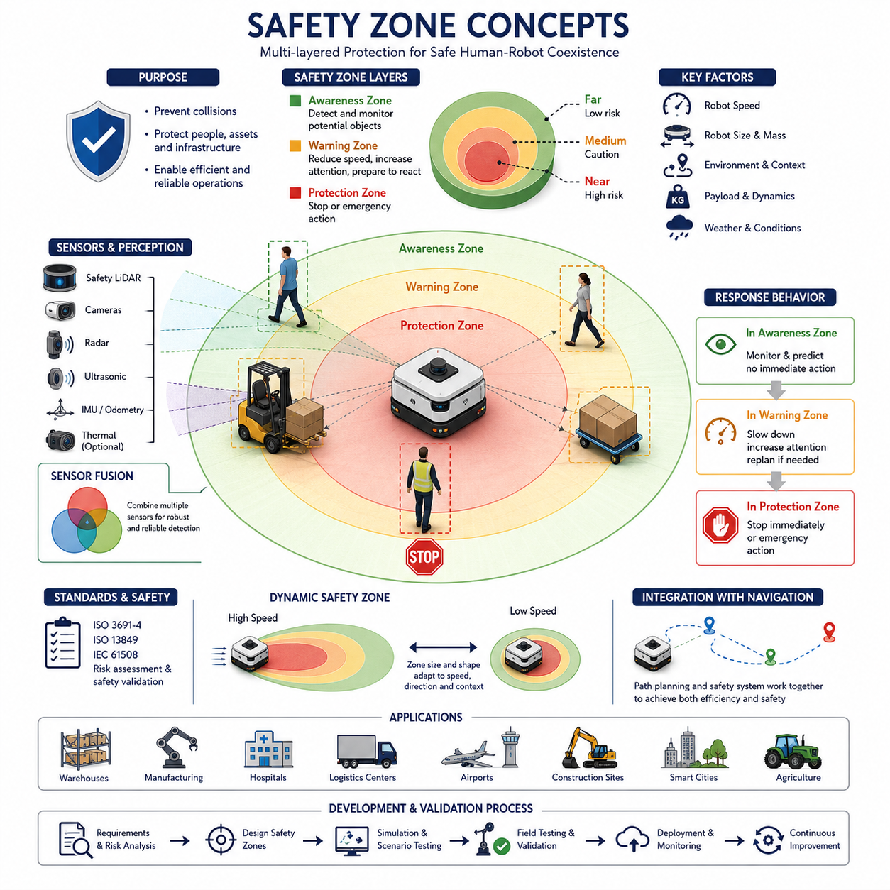
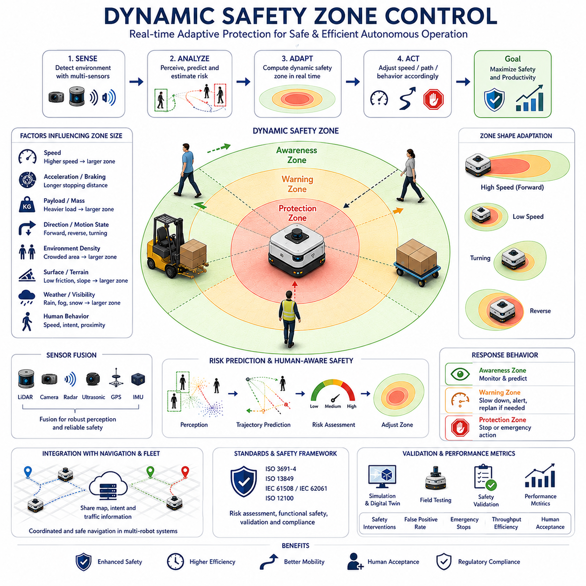
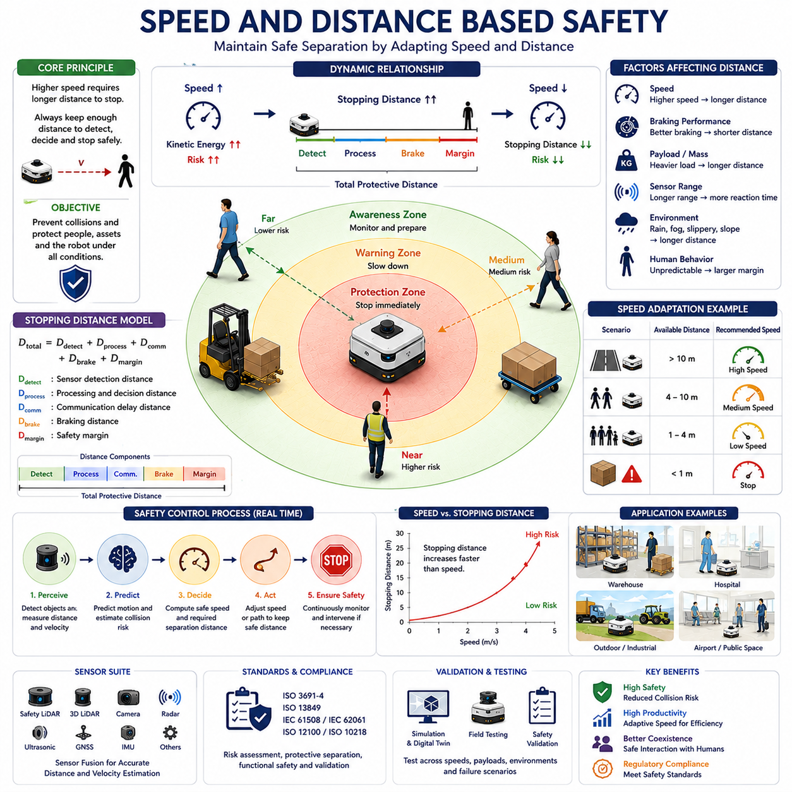
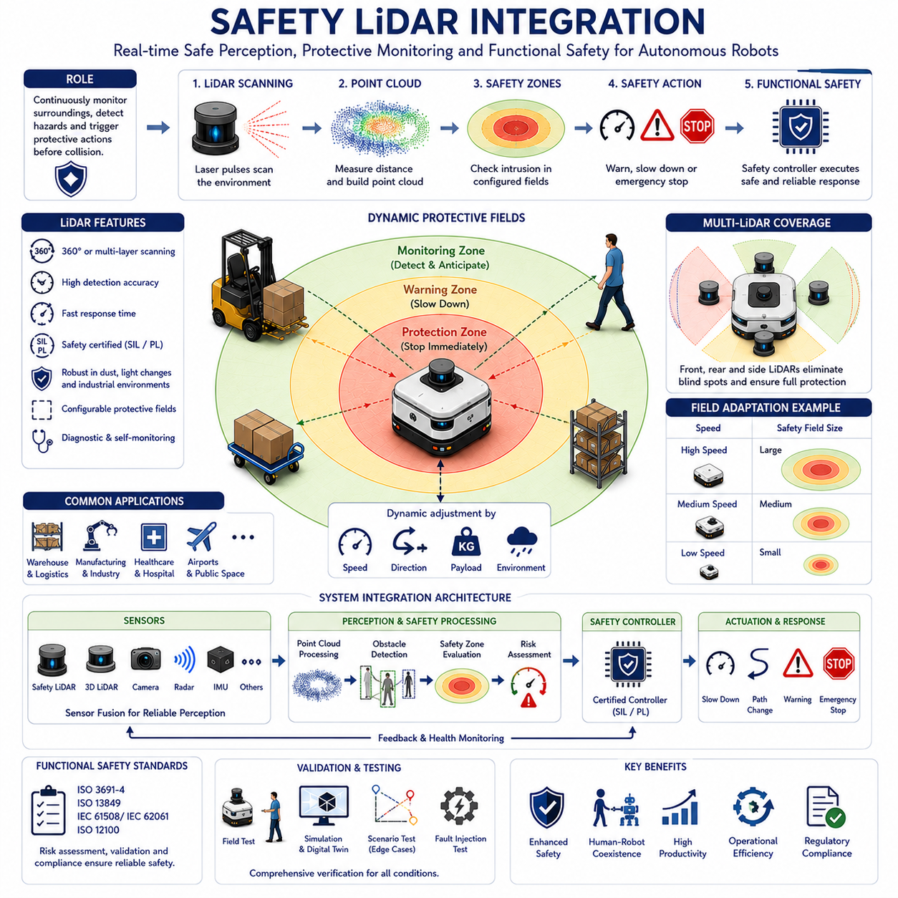
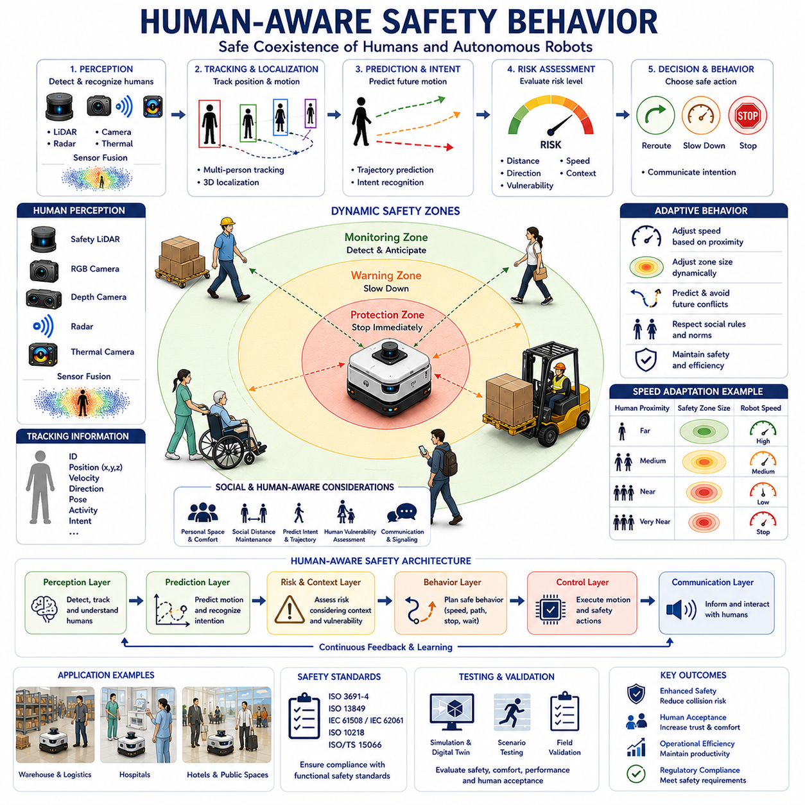
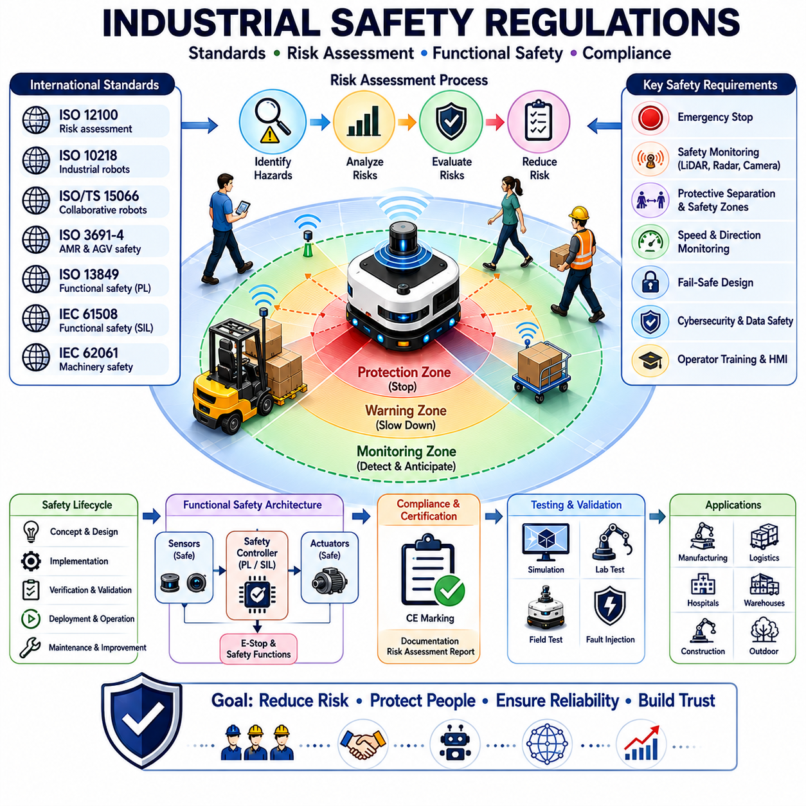
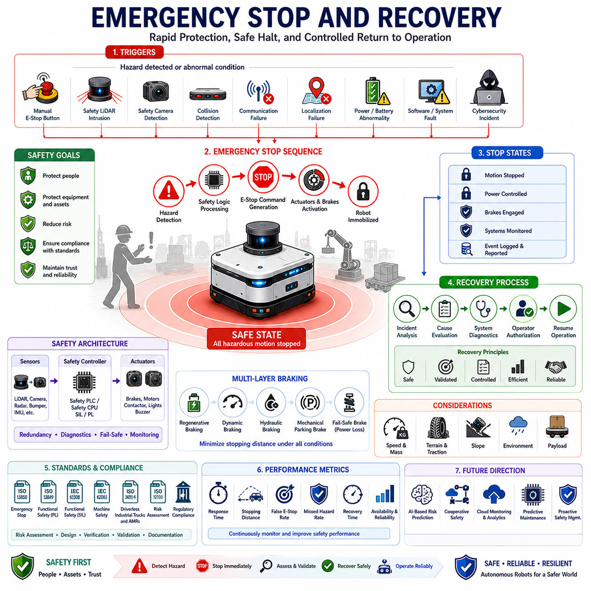
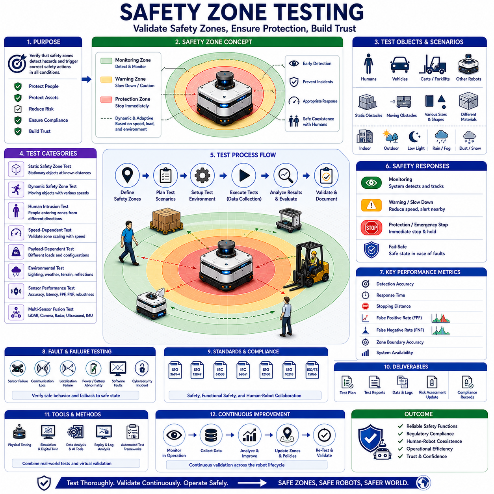

**Volume 05. Path Planning and Autonomous Navigation**

# Chapter 18. Safety Zone Control

## 18.1 Safety Zone Concepts

{width="7.268055555555556in" height="7.268055555555556in"}

안전 구역(Safety Zone) 개념은 자율주행 로봇과 자율이동로봇(AMR)의 내비게이션 및 운용 안전성을 구성하는 가장 중요한 기반 기술 중 하나이다. 자율 로봇이 공장, 물류창고, 병원, 공항, 건설 현장, 스마트 시티, 야외 산업 환경 등 다양한 공간에서 활용되면서 로봇 주변의 안전 공간을 정의하고 지속적으로 감시하며 제어하는 능력이 필수 요소가 되었다. 안전 구역은 로봇 주변에 보이지 않는 보호 경계를 형성하여 사람, 차량, 시설물, 장애물과의 관계를 실시간으로 분석하고 위험 상황을 예방하는 역할을 수행한다. 이를 통해 로봇은 생산성과 운영 효율성을 유지하면서도 높은 수준의 안전성을 확보할 수 있다.

안전 구역은 로봇 주변에 설정되는 공간적 보호 영역으로 정의할 수 있다. 이 영역 안으로 특정 객체가 진입하면 로봇은 사전에 정의된 안전 정책에 따라 행동한다. 이러한 행동에는 속도 감소, 경로 변경, 감시 수준 향상, 경고 신호 발생, 정지 동작 또는 비상 대응 절차 수행 등이 포함될 수 있다. 개념 자체는 단순해 보이지만 실제 산업 현장에서는 매우 복잡하고 정교한 시스템으로 구현된다.

과거의 산업 자동화 환경에서는 안전 펜스, 보호 울타리, 출입 게이트와 같은 물리적 장벽을 이용하여 작업자와 기계를 분리하였다. 전통적인 산업용 로봇은 고정된 작업 공간에서 동작하였기 때문에 사람과 직접 상호작용하는 경우가 거의 없었다. 그러나 현대의 AMR과 자율주행 로봇은 사람과 동일한 공간을 공유하며 움직이기 때문에 안전 확보 방식도 크게 변화하였다. 오늘날의 안전 시스템은 단순한 물리적 분리가 아니라 지능형 센서, 실시간 환경 인식, 상황 기반 제어를 통해 구현된다.

안전 구역의 가장 중요한 목적은 충돌 방지이다. 로봇은 이동 중 주변 환경을 지속적으로 감시하면서 잠재적인 위험 요소를 평가해야 한다. 사람은 갑자기 로봇의 이동 경로로 들어올 수 있고, 지게차는 교차로에서 예기치 않게 나타날 수 있으며, 문이 갑자기 열리거나 통로에 장애물이 임시로 배치될 수도 있다. 안전 구역은 이러한 위험 요소를 조기에 감지하고 사고 발생 전에 적절한 대응을 수행할 수 있도록 한다.

현대적인 안전 시스템은 일반적으로 여러 단계의 안전 구역을 사용한다. 가장 바깥 영역은 감시 구역(Awareness Zone)으로 구성되며, 이 영역에 진입한 객체는 지속적으로 추적된다. 아직 즉각적인 제어가 필요하지는 않지만 향후 충돌 가능성을 평가하기 시작한다. 중간 영역은 경고 구역(Warning Zone)으로 정의되며, 객체가 진입하면 로봇은 속도를 줄이거나 센서 처리 주기를 높이고 대체 경로를 준비할 수 있다. 가장 안쪽 영역은 보호 구역(Protection Zone)으로 구성되며, 이 영역에 객체가 들어오면 즉시 정지하거나 비상 안전 동작을 수행한다.

안전 구역의 크기와 형태는 다양한 요소에 의해 결정된다. 가장 중요한 변수 중 하나는 로봇의 속도이다. 고속으로 이동하는 로봇은 더 긴 제동거리가 필요하므로 더 넓은 안전 구역을 확보해야 한다. 반대로 저속으로 이동하는 로봇은 상대적으로 작은 안전 구역을 사용할 수 있다. 이러한 속도 기반 안전 거리 계산은 동적 안전 구역 제어의 핵심 원리가 된다.

로봇의 크기 또한 안전 구역 설계에 직접적인 영향을 미친다. 병원에서 운행하는 소형 배송 로봇과 수백 킬로그램 이상의 화물을 운반하는 대형 산업용 로봇은 전혀 다른 안전 특성을 가진다. 대형 로봇은 더 큰 관성, 더 긴 정지 거리, 더 높은 충돌 에너지를 가지므로 보다 넓은 안전 영역이 필요하다.

운영 환경 역시 안전 구역 설계에 중요한 영향을 준다. 물류창고나 스마트 팩토리와 같은 구조화된 환경에서는 사람과 차량의 이동 패턴이 비교적 예측 가능하므로 안전 구역을 효율적으로 최적화할 수 있다. 반면 병원, 쇼핑몰, 캠퍼스, 스마트 시티와 같은 공공 환경에서는 사람의 행동이 매우 예측하기 어렵기 때문에 보다 보수적이고 적응적인 안전 전략이 요구된다.

현대의 안전 구역 개념은 단순히 거리만 고려하지 않는다. 최신 자율주행 시스템은 상황 인식(Context Awareness)을 기반으로 위험도를 평가한다. 예를 들어 사람이 로봇과 같은 방향으로 이동하는 경우 위험도는 낮지만, 로봇을 향해 빠르게 접근하는 경우에는 위험도가 크게 증가한다. 따라서 위치 정보뿐만 아니라 속도, 가속도, 이동 방향, 예상 경로, 행동 의도까지 함께 고려하는 것이 중요하다.

센서 기술은 안전 구역 구현의 핵심 요소이다. 안전 LiDAR는 가장 널리 사용되는 안전 센서 중 하나이며, 로봇 주변의 보호 영역을 지속적으로 스캔한다. 여러 단계의 보호 필드를 설정하여 객체의 접근 정도에 따라 단계별 대응을 수행할 수 있다. 또한 RGB 카메라, 깊이 카메라, 레이더, 초음파 센서, 열화상 카메라, 3D LiDAR 등이 함께 사용되어 보다 높은 수준의 환경 인식을 제공한다.

센서 융합은 안전성 향상에 매우 중요한 역할을 한다. 단일 센서는 특정 환경에서 한계를 가질 수 있다. 카메라는 조명 조건에 영향을 받고, LiDAR는 비나 먼지 환경에서 성능이 저하될 수 있으며, 레이더는 공간 해상도가 낮을 수 있다. 여러 센서의 정보를 결합하면 개별 센서의 약점을 보완하여 보다 안정적이고 신뢰성 높은 안전 감시가 가능해진다.

인간 중심 안전(Human-Centered Safety)은 특히 중요한 분야이다. 사람은 매우 예측하기 어려운 존재이며 나이, 경험, 집중도, 건강 상태에 따라 행동이 달라질 수 있다. 병원에서는 휠체어 사용자나 보행 보조기를 사용하는 환자를 만날 수 있고, 물류창고에서는 큰 상자를 들고 시야가 제한된 작업자를 만날 수 있다. 따라서 안전 시스템은 이러한 다양한 상황을 고려하여 설계되어야 한다.

협업 로봇 환경에서는 보호 분리 거리(Protective Separation Distance) 개념이 매우 중요하다. 이는 사람과 로봇 사이에 반드시 유지되어야 하는 최소 안전 거리로 정의된다. 해당 거리는 로봇 속도, 사람의 이동 속도, 센서 지연 시간, 통신 지연 시간, 제동 성능, 안전 여유 계수 등을 고려하여 계산된다. 국제 안전 표준은 이러한 거리 산정 방법에 대한 지침을 제공하고 있다.

기능 안전(Functional Safety) 표준은 안전 구역 설계에서 중요한 역할을 수행한다. AMR과 산업용 로봇은 다양한 안전 규정을 만족해야 하며, 이러한 규정은 허용 가능한 위험 수준과 필요한 안전 성능을 정의한다. ISO 3691-4, ISO 13849, IEC 61508과 같은 국제 표준은 안전 감시 시스템, 비상 정지 기능, 보호 필드 설계, 위험 저감 방법에 대한 요구사항을 제공한다. 이러한 표준 준수는 산업 현장에서 신뢰할 수 있는 안전 시스템 구축을 가능하게 한다.

동적인 환경에서는 동적 안전 구역(Dynamic Safety Zone)이 필수적이다. 정적인 안전 필드와 달리 동적 안전 구역은 환경 변화에 따라 지속적으로 크기와 형태를 변경한다. 로봇 속도, 조향 각도, 적재 하중, 노면 상태, 장애물 밀도, 환경 복잡도 등이 모두 안전 구역 형성에 영향을 준다. 예를 들어 고속 주행 시에는 전방 안전 구역이 길어지고, 저속 정밀 작업 시에는 안전 구역이 축소되어 협소한 공간에서도 효율적으로 이동할 수 있다.

야외 자율주행 로봇은 추가적인 안전 문제를 가진다. 비포장 도로, 경사면, 식생, 악천후, 혼합 교통 환경 등은 실내 환경보다 훨씬 큰 불확실성을 제공한다. 따라서 야외 안전 구역은 위치 추정 오차, 센서 성능 저하, 제동 성능 변화 등을 고려하여 일반적으로 더 큰 안전 여유를 적용한다.

중량 화물을 운반하는 산업용 AMR은 더욱 엄격한 안전 설계가 필요하다. 수백 킬로그램의 화물 또는 수 톤 규모의 트레일러를 견인하는 로봇은 가벼운 서비스 로봇과 비교할 수 없는 운동 에너지를 가진다. 따라서 제동 거리, 회전 반경, 적재물 안정성, 트레일러 거동 등을 고려한 확대된 안전 구역이 필요하다.

내비게이션 시스템과 안전 시스템은 긴밀하게 협력해야 한다. 내비게이션은 최단 경로와 최대 효율을 추구하는 반면, 안전 시스템은 위험 최소화를 목표로 한다. 지나치게 보수적인 안전 구역은 불필요한 정지와 속도 저하를 발생시켜 생산성을 떨어뜨릴 수 있으며, 반대로 과도하게 공격적인 설정은 사고 위험을 증가시킬 수 있다. 따라서 효율성과 안전성 사이의 균형을 유지하는 것이 중요하다.

최근에는 인공지능 기술이 안전 구역 관리에 적극 활용되고 있다. 딥러닝과 머신러닝 기반 시스템은 객체를 분류하고 사람의 이동 경로를 예측하며 위험 상황을 조기에 감지할 수 있다. AI 기반 안전 시스템은 작업자, 방문객, 지게차, 카트, 차량, 동물 등을 구분하여 보다 지능적인 안전 대응을 수행할 수 있다.

시뮬레이션 환경은 안전 구역 설계와 검증 과정에서 매우 유용하다. 엔지니어는 실제 배포 전에 수천 개 이상의 시나리오를 가상 환경에서 시험할 수 있으며, 희귀한 사고 상황이나 센서 고장, 통신 장애, 비정상적인 사람 행동 등을 분석할 수 있다. 이를 통해 개발 기간을 단축하고 현장 시험의 위험성을 줄일 수 있다.

그러나 최종적으로는 실제 환경에서의 검증이 반드시 필요하다. 현실 환경은 시뮬레이션으로 완전히 재현하기 어려운 복잡성을 가지고 있기 때문이다. 실제 검증 과정에서는 보행자 상호작용, 차량 교차, 복도 주행, 교차로 통과, 비상 정지, 장애물 회피, 센서 이상 상황 등을 종합적으로 평가한다.

미래의 안전 구역 시스템은 더욱 지능적이고 예측 중심적인 방향으로 발전할 것이다. 파운데이션 모델, 임바디드 AI, 디지털 트윈, 클라우드 로보틱스, 협력 인지(Cooperative Perception) 기술이 발전하면서 로봇은 단순히 장애물을 감지하는 수준을 넘어 사람의 의도를 예측하고 환경 변화를 사전에 파악하며 위험 발생 이전에 선제적으로 대응할 수 있게 될 것이다.

자율이동로봇이 산업, 물류, 의료, 교통, 농업, 스마트 시티 등 다양한 분야로 확산됨에 따라 안전 구역 개념은 앞으로도 자율주행 기술의 핵심 요소로 남을 것이다. 효과적인 안전 구역 설계는 센서 기술, 제어 기술, 기능 안전, 인간공학, 규제 준수, 인공지능 기반 의사결정을 하나의 통합 프레임워크로 결합하여 사람과 장비, 시설, 운영 목표를 동시에 보호한다. 이러한 지속적인 발전을 통해 자율 로봇은 높은 생산성과 최고의 안전성을 동시에 달성할 수 있게 될 것이다.

## 18.2 Dynamic Safety Zone Control

{width="7.268055555555556in" height="7.268055555555556in"}

동적 안전 구역 제어(Dynamic Safety Zone Control)는 현대 자율이동로봇(AMR)의 핵심 안전 기술 중 하나로, 로봇이 변화하는 운용 환경에 따라 보호 영역을 실시간으로 조정할 수 있도록 해준다. 기존의 정적 안전 구역이 환경 변화와 관계없이 항상 동일한 크기를 유지하는 반면, 동적 안전 구역은 상황에 따라 확장, 축소, 재형성 및 재배치가 이루어진다. 이러한 적응형 제어를 통해 자율 로봇은 사람, 차량, 다른 로봇과 공간을 공유하면서도 높은 안전성과 생산성을 동시에 확보할 수 있다.

AMR은 공장, 물류창고, 병원, 공항, 물류센터, 건설 현장, 농업 환경 및 스마트 시티와 같은 다양한 공간에서 운용된다. 이러한 환경에서는 로봇의 속도가 변화하고 적재 하중이 달라지며 주변 환경의 복잡도 또한 지속적으로 변한다. 사람의 행동 역시 예측하기 어렵다. 이러한 상황에서 최악의 경우를 기준으로 설정된 고정 안전 구역은 지나치게 보수적이 되어 작업 효율을 저하시킨다. 동적 안전 구역 제어는 로봇과 환경의 현재 상태를 실시간으로 분석하여 최적의 보호 영역을 계산함으로써 이러한 문제를 해결한다.

동적 안전 구역 제어의 기본 원리는 위험 수준이 항상 동일하지 않다는 점에 있다. 병원 복도에서 초속 0.3m로 이동하는 로봇과 야외 산업 현장에서 초속 3m로 이동하는 로봇은 전혀 다른 위험 수준을 가진다. 또한 빈 상태의 플랫폼과 수 톤의 화물을 견인하는 로봇 역시 동일한 안전 조건을 적용할 수 없다. 위험이 변화함에 따라 보호 메커니즘 역시 실시간으로 변화해야 한다.

동적 안전 구역은 로봇을 둘러싸고 있는 지능형 가상 안전 버블(Intelligent Virtual Safety Bubble)로 생각할 수 있다. 이 보호 영역은 로봇의 현재 상태에 따라 크기와 형태를 변화시킨다. 위험이 증가하면 보호 영역은 확대되고, 위험이 감소하면 축소된다. 이러한 방식은 안전성과 작업 효율성 사이의 최적 균형을 유지하는 것을 목표로 한다.

로봇 속도는 동적 안전 구역 형성에 가장 큰 영향을 주는 요소 중 하나이다. 속도가 증가할수록 정지 거리와 반응 시간이 길어지므로 전방 안전 구역은 크게 확대된다. 로봇은 위험을 감지하고 충돌 가능성을 평가하며 제동 명령을 수행하고 완전히 정지할 수 있는 충분한 공간을 확보해야 한다. 반대로 속도가 낮아지면 필요한 정지 거리가 줄어들어 안전 구역 역시 축소될 수 있다.

가속도와 감속도 특성 또한 중요한 요소이다. 강력한 제동 성능을 가진 로봇은 상대적으로 작은 안전 구역을 사용할 수 있지만, 실제 제동 성능은 환경 조건에 따라 달라질 수 있다. 젖은 노면, 미끄러운 바닥, 자갈길, 진흙, 눈, 얼음 또는 불균일한 지형은 제동력을 감소시키고 정지 거리를 증가시킨다. 동적 안전 시스템은 이러한 변화를 지속적으로 반영하여 보호 영역을 조정한다.

적재 하중 역시 중요한 고려 사항이다. 로봇의 질량은 운동 에너지와 직접적으로 연결된다. 무거운 화물을 적재한 로봇은 더 큰 운동량을 가지므로 더 넓은 안전 구역이 필요하다. 예를 들어 6톤 규모의 트레일러를 견인하는 AMR은 빈 상태의 플랫폼과 완전히 다른 특성을 보인다. 따라서 동적 안전 제어 알고리즘은 현재 적재 상태를 지속적으로 평가하고 이에 맞추어 안전 거리를 조정한다.

로봇의 이동 방향과 주행 상태 또한 안전 구역 형상에 영향을 준다. 전진 주행 시에는 충돌 위험이 주로 전방에 존재하므로 전방 안전 구역이 길게 형성된다. 후진 시에는 후방 보호 영역이 확대된다. 회전 중에는 차량의 운동학 특성과 예상 궤적을 고려하여 회전 내측 또는 외측 방향에 추가적인 안전 여유가 적용될 수 있다.

현대의 동적 안전 구역은 단순한 원형 구조를 사용하지 않는다. 대신 차량의 움직임과 환경 상황에 따라 형태가 변하는 적응형 기하학 구조를 사용한다. 안전 구역은 타원형, 사각형, 사다리꼴 또는 다각형 형태로 구성될 수 있으며, 필요에 따라 불규칙한 형태로도 변형될 수 있다. 이러한 유연한 형상은 안전성을 유지하면서도 이동 효율을 극대화한다.

환경 인식 능력은 동적 안전 구역 성능 향상에 중요한 역할을 한다. 사람이 많이 밀집된 공간은 한산한 산업 통로보다 더 넓고 보수적인 안전 영역이 필요하다. 병원에서는 환자와 의료진이 존재하며, 물류창고에서는 지게차와 카트가 이동한다. 동적 안전 시스템은 이러한 환경적 요소를 분석하여 보호 구역을 지속적으로 수정한다.

인간 중심 안전 제어(Human-Aware Safety Control)는 동적 안전 구역 기술의 가장 발전된 형태 중 하나이다. 사람의 행동은 매우 불확실하기 때문에 단순 거리 기반 제어만으로는 충분하지 않다. 정지해 있는 사람은 위험도가 낮지만 로봇을 향해 달려오는 사람은 즉각적인 대응이 필요하다. 첨단 인식 시스템은 사람의 위치, 속도, 가속도, 방향, 자세 및 예상 이동 경로를 분석하여 위험도를 평가한다.

예측 기반 안전 모델(Predictive Safety Modeling)은 현재 위치뿐 아니라 미래 충돌 가능성까지 고려한다. 최신 시스템은 사람, 차량, 로봇, 장애물의 예상 이동 경로를 수 초 앞까지 예측하고 잠재적인 충돌 가능성이 감지되면 사전에 안전 구역을 확대한다. 이를 통해 위험 상황 발생 이전에 예방적 대응이 가능해진다.

동적 안전 구역 제어의 기반은 다양한 센서 기술이다. 안전 인증 LiDAR는 가장 널리 사용되는 기술이며, 주변 환경을 지속적으로 스캔하여 보호 구역 침입 여부를 감시한다. 최근에는 3D LiDAR, RGB 카메라, 스테레오 카메라, 깊이 카메라, 레이더, 초음파 센서, GNSS, IMU, 열화상 카메라 등이 함께 활용되고 있다.

센서 융합 기술은 신뢰성과 강건성을 크게 향상시킨다. 카메라는 역광이나 야간 환경에서 성능이 저하될 수 있고, LiDAR는 안개나 비, 눈 환경에서 영향을 받을 수 있으며, 레이더는 공간 해상도가 낮을 수 있다. 여러 센서의 데이터를 결합하면 개별 센서의 약점을 보완하고 보다 정확한 환경 인식이 가능해진다.

최근에는 인공지능이 동적 안전 구역 제어에 적극적으로 활용되고 있다. 머신러닝과 딥러닝 모델은 객체를 분류하고 사람의 의도를 예측하며 충돌 위험도를 계산할 수 있다. 작업자, 방문객, 지게차, 운반 카트, 자율주행 로봇, 차량, 동물 등을 구분함으로써 상황에 맞는 안전 전략을 적용할 수 있다.

예를 들어 사람 주변에는 더 넓은 안전 거리를 유지하고, 고정된 시설물 주변에서는 보다 작은 안전 영역을 사용할 수 있다. 움직이는 지게차는 정지된 팔레트보다 더 높은 위험도로 평가된다. 어린이, 노약자, 휠체어 사용자와 같은 취약 계층에 대해서는 추가적인 안전 여유를 적용할 수도 있다.

동적 안전 구역 제어는 내비게이션 시스템과 밀접하게 연계된다. 경로 계획 시스템은 목적지까지 최적의 경로를 생성하지만, 안전 시스템은 해당 경로가 허용 가능한 위험 수준 내에 있는지를 지속적으로 평가한다. 만약 경로 계획과 안전 요구사항이 충돌할 경우 안전 기능이 항상 우선권을 가진다. 이는 생산성보다 안전을 우선하는 기본 원칙이다.

다중 로봇 환경에서는 더욱 복잡한 문제가 발생한다. 현대의 물류창고나 병원에서는 수십 대 또는 수백 대의 로봇이 동시에 운용될 수 있다. 이 경우 동적 안전 시스템은 사람과 장애물뿐 아니라 다른 로봇까지 고려해야 한다. 플릿 관리 시스템은 전체 로봇의 움직임을 조율하며, 각 로봇은 독립적인 안전 구역을 유지한다.

클라우드 기반 플릿 관리 시스템은 동적 안전 최적화를 더욱 향상시킨다. 중앙 관제 시스템은 혼잡 구역, 임시 위험 지역, 공사 구역, 통행 제한 구역 등의 정보를 수집하여 각 로봇에 제공한다. 로봇은 이러한 정보를 활용하여 보다 지능적인 안전 구역을 생성할 수 있다.

야외 자율주행 로봇은 더욱 어려운 안전 문제를 가진다. 날씨, 조명, 지형, 식생, 공사 활동 및 교통 상황은 지속적으로 변화한다. 야외 로봇은 일반적으로 실내 로봇보다 높은 속도로 이동하며 위치 추정 오차도 크다. 따라서 동적 안전 구역은 이러한 불확실성을 고려하여 더욱 적극적으로 조정되어야 한다.

험지 환경에서는 추가적인 고려가 필요하다. 바퀴 미끄러짐, 울퉁불퉁한 노면, 경사면, 자갈, 진흙과 같은 요소는 차량 제어 성능을 변화시킨다. 따라서 동적 안전 시스템은 지형 분류 결과, 접지력 추정 결과, 차량 안정성 정보를 활용하여 적절한 안전 여유를 유지한다. 급경사 구간에서는 제동 거리 증가와 전복 위험을 고려하여 안전 구역이 더욱 확대될 수 있다.

대형 산업용 로봇은 특히 정교한 안전 구역 계산이 필요하다. 자율 지게차, 대형 견인 로봇, 인프라 점검 로봇 등은 상당한 질량과 운동 에너지를 가진다. 수백 킬로그램 이상의 화물을 적재한 플랫폼은 소형 서비스 로봇보다 훨씬 넓은 안전 구역이 필요하다. 따라서 동적 제어 알고리즘은 무게 중심, 하중 분포, 적재 안정성, 운동 에너지 등을 지속적으로 고려한다.

기능 안전 표준은 동적 안전 구역 제어의 규제 기반을 제공한다. ISO 3691-4, ISO 13849, IEC 61508, IEC 62061, ISO 12100 등의 국제 표준은 안전 감시 시스템, 위험 분석, 보호 필드 검증 및 비상 대응 메커니즘에 대한 요구사항을 정의한다. 이러한 표준 준수는 신뢰성 있는 안전 시스템 구축을 보장한다.

동적 안전 시스템 개발에서는 검증과 확인이 필수적이다. 정상 상황뿐 아니라 센서 고장, 통신 장애, 비상 상황, 예기치 못한 사람의 행동 등 수천 개 이상의 시나리오를 평가해야 한다. 이를 위해 시뮬레이션과 실제 환경 검증이 함께 수행된다.

디지털 트윈 기술은 동적 안전 구역 개발에 매우 유용한 도구로 자리 잡고 있다. 고정밀 가상 환경에서 다양한 운영 조건을 재현함으로써 실제 현장 배치 이전에 안전 알고리즘을 검증할 수 있다. 드물게 발생하는 위험 상황까지도 반복적으로 시험할 수 있다는 장점이 있다.

동적 안전 구역의 성능 평가는 단순히 충돌 방지 여부만으로 이루어지지 않는다. 안전 개입 빈도, 오탐률, 미탐률, 비상 정지 발생 횟수, 작업 효율, 평균 이동 시간, 처리량, 사용자 수용성, 규제 준수 수준 등이 종합적으로 평가된다. 우수한 시스템은 높은 안전성을 유지하면서도 생산성 저하를 최소화한다.

미래의 동적 안전 구역 제어는 더욱 지능적이고 예측 중심적인 방향으로 발전할 것이다. 인공지능, 파운데이션 모델, 임바디드 AI, 협력 인지, 클라우드 로보틱스, 엣지 컴퓨팅 기술이 발전하면서 로봇은 단순히 장애물을 감지하는 수준을 넘어 사람의 의도를 이해하고 환경 변화를 예측하며 시설 전체 차원의 위험을 선제적으로 관리할 수 있게 될 것이다.

자율주행 로봇이 제조, 물류, 의료, 농업, 스마트 시티, 교통 및 인프라 관리 분야로 확산됨에 따라 동적 안전 구역 제어는 앞으로도 핵심 안전 기술로 자리할 것이다. 실시간으로 변화하는 환경에 맞추어 보호 영역을 지속적으로 조정함으로써 로봇은 사람과 안전하게 공간을 공유하면서도 높은 자율성과 생산성을 유지할 수 있다. 이는 차세대 지능형 로봇 시스템의 안전성과 신뢰성을 보장하는 핵심 기술이 될 것이다.

## 18.3 Speed and Distance-Based Safety

{width="7.268055555555556in" height="7.268055555555556in"}

속도 및 거리 기반 안전(Speed and Distance Based Safety)은 자율이동로봇(AMR) 안전공학의 가장 기본적이고 중요한 원칙 중 하나이다. 이 개념은 로봇의 이동 속도, 정지 거리, 반응 능력, 보호 분리 거리 사이의 관계를 정의한다. 핵심 목표는 로봇이 사람, 차량, 장애물 및 시설물과 항상 충분한 거리를 유지하여 어떠한 운용 상황에서도 충돌을 방지할 수 있도록 하는 것이다. AMR이 공장, 물류창고, 병원, 공항, 건설 현장, 농업 시설 및 스마트 시티와 같은 다양한 환경에 적용되면서 속도 및 거리 기반 안전은 현대 로봇 안전 시스템의 핵심 요소로 자리 잡고 있다.

이 개념은 매우 단순한 물리 법칙에서 출발한다. 움직이는 모든 물체는 운동량과 운동 에너지를 가진다. 속도가 증가할수록 운동량과 운동 에너지는 함께 증가한다. 따라서 이동 중인 로봇의 위험도 역시 속도 증가에 따라 커지게 된다. 천천히 이동하는 로봇은 비교적 짧은 거리 내에서 정지할 수 있지만, 고속으로 이동하는 로봇은 완전히 정지하기 위해 훨씬 더 많은 거리와 시간이 필요하다. 안전 시스템은 이러한 관계를 지속적으로 고려하여 적절한 보호 거리를 유지해야 한다.

자율주행 로봇에서 안전은 단순히 장애물을 감지하는 것만으로 확보되지 않는다. 로봇은 위험 요소를 인식하는 것뿐만 아니라 적절하게 대응할 수 있는 충분한 공간도 확보해야 한다. 속도 및 거리 기반 안전은 잠재적인 위험을 감지하고 분석하며 제동을 수행하여 완전히 정지하기까지 필요한 최소 보호 거리를 계산하는 체계를 제공한다.

속도와 정지 거리의 관계는 운동 법칙에 의해 결정된다. 속도가 증가하면 정지 거리는 단순 비례가 아니라 훨씬 더 빠르게 증가한다. 운동 에너지가 속도의 제곱에 비례하기 때문이다. 따라서 속도가 두 배 증가하면 정지 거리는 두 배 이상 증가할 수 있다. 이러한 이유로 안전 시스템은 로봇 속도가 변화할 때마다 보호 거리를 실시간으로 조정해야 한다.

정지 거리는 여러 요소로 구성된다. 먼저 센서가 위험을 감지하는 데 필요한 감지 거리(Detection Distance)가 있다. 이후 센서 데이터를 처리하고 위험을 판단하는 데 필요한 처리 거리(Processing Distance)가 존재한다. 통신 과정에서 발생하는 지연 시간을 반영한 통신 거리(Communication Distance)도 포함된다. 마지막으로 실제로 로봇이 감속하여 정지하는 데 필요한 제동 거리(Braking Distance)가 있다. 여기에 예기치 못한 상황에 대비한 안전 여유 거리(Safety Margin)가 추가된다. 결과적으로 전체 보호 거리는 다양한 요소가 합쳐진 값으로 결정된다.

센서 성능은 속도 및 거리 계산에 직접적인 영향을 미친다. 고성능 안전 LiDAR를 장착한 로봇은 더 먼 거리에서 위험 요소를 감지할 수 있으므로 동일한 안전 수준을 유지하면서도 더 높은 속도로 운행할 수 있다. 반대로 감지 거리가 짧은 센서를 사용하는 경우에는 안전 확보를 위해 속도를 낮춰야 한다.

환경 조건 역시 중요한 변수이다. 실내 물류창고는 평탄한 바닥, 안정적인 조명, 예측 가능한 교통 흐름을 제공하므로 안전 거리를 효율적으로 최적화할 수 있다. 반면 야외 환경은 비, 눈, 안개, 먼지, 진흙, 식생 및 조명 변화와 같은 다양한 불확실성을 포함한다. 이러한 요소들은 센서 성능과 차량 제어 성능에 영향을 주기 때문에 안전 시스템은 보호 거리를 더욱 확대해야 한다.

로봇의 제동 성능 또한 중요한 요소이다. 로봇의 질량, 모터 성능, 브레이크 설계, 타이어 특성 및 노면 상태에 따라 감속 능력은 달라진다. 가벼운 병원 배송 로봇은 짧은 거리 내에서 정지할 수 있지만, 수 톤의 화물을 견인하는 산업용 로봇은 훨씬 긴 정지 거리가 필요하다. 따라서 안전 시스템은 플랫폼 특성을 반영하여 적절한 보호 거리를 계산해야 한다.

적재 하중은 정지 거리 계산을 더욱 복잡하게 만든다. 적재 중량이 증가하면 로봇의 관성이 증가하며 제동에 더 큰 힘이 필요하게 된다. 자율 지게차, 견인 AMR, 물류 운반 로봇 및 야외 산업용 플랫폼은 운용 중 적재 상태가 지속적으로 변하기 때문에 안전 시스템은 실시간 하중 정보를 기반으로 보호 거리를 조정해야 한다.

사람의 안전은 속도 및 거리 기반 안전 시스템의 가장 중요한 목적이다. 사람은 예측하기 어려운 행동을 보이며 갑자기 로봇의 이동 경로에 진입할 수 있다. 작업자는 작업에 집중하거나 휴대전화를 사용하거나 큰 물건을 들고 이동할 수 있으며, 병원에서는 환자나 방문객이 예상치 못한 행동을 할 수도 있다. 따라서 안전 시스템은 항상 최악의 상황을 가정하고 사람 주변의 보호 거리를 계산해야 한다.

협업 로봇과 AMR 안전 시스템에서는 보호 분리 거리(Protective Separation Distance) 개념이 널리 사용된다. 이는 사람과 로봇 사이에 유지되어야 하는 최소 안전 거리로 정의된다. 계산 과정에서는 로봇 속도, 사람의 접근 속도, 센서 반응 시간, 제어기 지연 시간, 제동 성능 및 안전 계수를 모두 고려한다.

동적 속도 제어(Dynamic Speed Adaptation)는 속도 및 거리 기반 안전의 자연스러운 확장 개념이다. 현대 로봇은 항상 동일한 속도로 이동하지 않는다. 대신 가용 공간과 위험 수준에 따라 속도를 조절한다. 시야가 확보되고 장애물이 적은 개방 공간에서는 더 높은 속도를 사용할 수 있다. 반대로 좁은 통로나 사람이 많은 공간에서는 속도를 자동으로 낮춘다.

이러한 적응형 속도 제어는 운영 효율성을 크게 향상시킨다. 넓은 산업용 통로에서는 빠르게 이동하고, 병원 복도와 같이 혼잡한 공간에서는 안전을 위해 감속한다. 이를 통해 생산성과 안전성을 동시에 확보할 수 있다.

안전 구역 제어와 속도 기반 안전은 매우 밀접한 관계를 가진다. 동적 안전 구역은 로봇 속도에 따라 크기가 변한다. 고속 주행 시에는 안전 구역이 확대되어 충분한 보호 거리를 확보하고, 저속 주행 시에는 안전 구역이 축소되어 좁은 공간에서도 효율적인 운용이 가능해진다.

첨단 인식 시스템은 속도 및 거리 기반 안전의 성능을 크게 향상시킨다. 최신 AMR은 안전 LiDAR, 3D LiDAR, RGB 카메라, 깊이 카메라, 레이더, 초음파 센서, GNSS, IMU 및 열화상 카메라를 통합하여 사용한다. 이러한 센서들은 주변 환경에 대한 종합적인 정보를 제공하며 객체의 위치, 속도 및 이동 경로를 정확하게 추정할 수 있도록 지원한다.

센서 융합은 안전성을 더욱 향상시킨다. 카메라는 야간이나 역광 환경에서 성능이 저하될 수 있으며, LiDAR는 비나 먼지 환경에서 영향을 받을 수 있다. 레이더는 악천후에서도 안정적으로 동작하지만 공간 해상도가 낮다. 여러 센서 정보를 결합하면 보다 신뢰성 높은 환경 인식이 가능해진다.

최근에는 인공지능 기술이 속도 및 거리 기반 안전 시스템에 적극적으로 적용되고 있다. AI 모델은 객체를 분류하고 이동 경로를 예측하며 행동 의도를 추정할 수 있다. 이를 통해 사람, 지게차, 카트, 차량, 로봇 및 시설물을 구분하여 각각 다른 안전 전략을 적용할 수 있다.

예를 들어 고정된 벽은 예측 가능한 장애물이므로 비교적 단순한 회피 동작이 가능하다. 반면 움직이는 지게차는 높은 불확실성을 가지므로 더 넓은 안전 거리가 필요하다. 사람은 예측 불가능성이 가장 크기 때문에 일반적으로 가장 높은 수준의 보호가 적용된다.

예측 기반 안전 모델(Predictive Safety Modeling)은 현재 위치뿐 아니라 미래 위험까지 고려한다. 최신 시스템은 주변 객체의 이동 경로를 예측하여 향후 충돌 가능성을 계산한다. 만약 충돌 가능성이 높다고 판단되면 로봇은 위험 상황이 실제로 발생하기 전에 미리 감속하거나 경로를 변경할 수 있다.

야외 자율주행 로봇에서는 속도 및 거리 기반 안전의 중요성이 더욱 커진다. 야외 플랫폼은 실내 로봇보다 더 높은 속도로 이동하며 사람, 자전거, 차량, 중장비, 동물 등이 혼재된 환경에서 운용된다. 긴 정지 거리와 다양한 환경 변수 때문에 더욱 정교한 안전 계산이 필요하다.

대형 산업용 로봇 역시 대표적인 적용 사례이다. 자율 지게차, 견인 로봇, 광산 차량, 농업용 기계 및 인프라 점검 플랫폼은 큰 질량과 높은 운동 에너지를 가진다. 이러한 시스템은 더욱 넓은 보호 거리와 보수적인 속도 관리 전략을 필요로 한다. 동적 안전 시스템은 차량 질량, 적재 하중, 노면 상태 및 환경 복잡도를 지속적으로 반영하여 안전 거리를 계산한다.

다중 로봇 환경에서는 추가적인 고려가 필요하다. 수십 대 또는 수백 대의 AMR이 동시에 운용되는 시설에서는 사람과 장애물뿐 아니라 다른 로봇과의 안전 거리도 유지해야 한다. 플릿 관리 시스템은 전체 교통 흐름을 관리하며, 각 로봇은 독립적인 안전 제어를 수행한다.

국제 안전 표준은 속도 및 거리 기반 안전 구현을 위한 기준을 제공한다. ISO 3691-4, ISO 13849, IEC 61508, IEC 62061, ISO 12100, ISO 10218 등은 위험 평가, 보호 분리 거리, 제동 성능, 안전 감시 기능 및 비상 정지 메커니즘에 대한 요구사항을 정의하고 있다. 상용 로봇 시스템은 이러한 표준을 준수해야 한다.

안전 시스템의 효과를 보장하기 위해서는 철저한 검증과 시험이 필요하다. 엔지니어는 다양한 속도 조건, 적재 상태, 환경 변화, 센서 고장, 통신 장애 및 예기치 못한 사람의 행동을 포함한 수많은 시나리오를 평가한다. 시뮬레이션과 실제 현장 시험이 함께 수행되어야 한다.

최근에는 디지털 트윈 기술이 안전 검증에 널리 활용되고 있다. 고정밀 가상 환경을 통해 수천 개의 시나리오를 반복적으로 시험할 수 있으며, 위험한 상황도 안전하게 분석할 수 있다. 이러한 시뮬레이션 결과는 실제 시험과 결합되어 시스템 개발을 가속화한다.

성능 평가는 단순한 충돌 방지 여부만으로 이루어지지 않는다. 안전 개입 빈도, 비상 정지 횟수, 오탐률, 미탐률, 평균 이동 시간, 처리량, 제동 성능, 사용자 수용성 및 규제 준수 수준 등이 함께 평가된다. 우수한 시스템은 높은 안전성을 유지하면서도 생산성 저하를 최소화한다.

미래에는 파운데이션 모델, 임바디드 AI, 협력 인지(Cooperative Perception), 클라우드 로보틱스, 엣지 컴퓨팅, 세계 모델(World Model) 기술이 통합되면서 속도 및 거리 기반 안전도 더욱 발전할 것이다. 로봇은 단순히 현재 상황에 반응하는 것이 아니라 미래 위험을 예측하고 사람의 의도를 이해하며 전체 플릿 차원의 안전 의사결정을 수행하게 될 것이다.

자율 로봇이 제조, 물류, 의료, 교통, 농업 및 스마트 시티 분야로 확대됨에 따라 속도 및 거리 기반 안전은 앞으로도 가장 중요한 안전 원칙 중 하나로 남을 것이다. 로봇은 이동 속도, 정지 능력, 환경 인식 및 보호 거리 사이의 균형을 지속적으로 유지함으로써 사람과 안전하게 공존하면서도 높은 생산성과 신뢰성을 제공할 수 있다. 이러한 균형이야말로 미래 자율주행 로봇 생태계의 핵심 기반이 될 것이다.

## 18.4 Safety LiDAR Integration

{width="7.268055555555556in" height="7.268055555555556in"}

안전 LiDAR 통합(Safety LiDAR Integration)은 현대 자율이동로봇(AMR) 시스템에서 가장 중요한 기술 중 하나로, 실시간 장애물 감지, 충돌 방지, 보호 영역 감시 및 기능 안전(Functional Safety) 구현의 핵심 기반이 된다. 자율 로봇이 사람, 차량, 장비 및 시설물과 동일한 공간에서 운영되는 환경이 증가함에 따라 신뢰성과 인증을 갖춘 안전 센서의 중요성은 더욱 커지고 있다. 안전 LiDAR는 주변 환경을 지속적으로 감시하고 잠재적인 위험 요소를 식별하며 위험 상황이 발생하기 전에 보호 동작을 수행할 수 있도록 지원한다. 안전 인증을 받은 레이저 스캐닝 기술을 내비게이션, 인식, 제어 및 기능 안전 시스템과 통합함으로써 자율 로봇은 높은 안전성과 운영 효율성을 동시에 달성할 수 있다.

일반적인 인식 센서가 주로 내비게이션과 환경 이해를 목적으로 사용되는 것과 달리, 안전 LiDAR는 안전 관련 기능을 위해 특별히 설계되고 인증된 장치이다. 이 센서의 목적은 단순히 장애물을 감지하는 것이 아니라 정의된 수준의 위험 감소를 보장하는 것이다. 안전 LiDAR는 엄격한 기능 안전 표준에 따라 개발되며, 안전 제어기와 비상 정지 시스템이 신뢰할 수 있는 결정론적이고 검증된 안전 신호를 제공한다.

안전 LiDAR의 기본 동작 원리는 레이저 거리 측정 기술에 기반한다. 센서는 일정한 각도로 레이저 펄스를 방출하고 물체에 반사되어 돌아오는 시간을 측정한다. 이를 통해 주변 환경의 거리 정보를 생성하고, 실시간으로 장애물의 위치를 파악한다. 이러한 거리 측정 결과를 이용하여 물체가 사전에 정의된 안전 영역에 진입했는지 판단하고 필요한 보호 동작을 수행한다.

안전 LiDAR 기술의 가장 큰 장점 중 하나는 로봇 주변에 다양한 보호 필드(Protective Field)를 구성할 수 있다는 점이다. 기존의 물리적 펜스 대신 가상의 안전 경계를 설정하고 이를 지속적으로 감시할 수 있다. 보호 필드는 일반적으로 여러 단계로 구성된다. 가장 바깥 영역은 감시 영역으로 활용되며, 중간 영역은 감속이나 경로 변경을 유도하고, 가장 안쪽 영역은 비상 정지를 수행하는 보호 영역으로 사용된다. 이러한 다단계 구조는 안전성과 생산성을 동시에 확보하는 데 매우 효과적이다.

현대의 자율주행 로봇은 여러 개의 안전 필드를 동시에 사용한다. 감시 필드는 접근하는 객체를 조기에 인식하여 위험을 예측하게 해준다. 경고 필드는 속도 감소나 회피 동작을 유도한다. 보호 필드는 충돌을 방지하기 위한 최종 방어선 역할을 수행하며, 객체가 침입할 경우 즉시 비상 정지 기능을 활성화한다. 이러한 다중 보호 구조는 운영 효율성과 안전 요구사항 간의 균형을 유지하는 데 중요한 역할을 한다.

안전 LiDAR 통합의 첫 단계는 센서 배치와 기구 설계이다. 센서 위치는 시야 확보와 사각지대 최소화에 직접적인 영향을 미친다. 대부분의 AMR에서는 로봇 외곽에 센서를 설치하여 최대한 넓은 영역을 감시한다. 설치 높이는 사람, 장비, 팔레트, 차량 및 기타 장애물을 안정적으로 감지할 수 있도록 신중하게 선정되어야 한다. 잘못된 위치에 설치된 경우 위험 요소를 감지하지 못하는 사각 영역이 발생할 수 있다.

대형 산업용 로봇은 일반적으로 여러 개의 안전 LiDAR를 사용한다. 단일 센서만으로도 기본적인 실내 환경에서는 충분할 수 있지만, 대형 플랫폼은 전방, 후방, 측면을 모두 보호하기 위해 복수의 센서를 배치한다. 전방 센서는 전진 주행을 감시하고, 후방 센서는 후진 시 안전을 확보하며, 측면 센서는 회전 동작 중 측면 충돌을 방지한다. 이러한 다중 센서 구조는 사각지대를 줄이고 전체적인 안전성을 크게 향상시킨다.

안전 LiDAR는 특히 사람과 로봇이 함께 작업하는 환경에서 중요한 역할을 한다. 과거 산업 현장은 물리적 펜스와 접근 제한 구역을 이용하여 안전을 확보하였다. 그러나 현대 AMR은 작업자와 동일한 공간에서 이동하며 업무를 수행한다. 이러한 협업 환경에서 안전 LiDAR는 사람의 위치를 지속적으로 감시하고 보호 분리 거리(Protective Separation Distance)가 유지되도록 보장한다.

안전 LiDAR와 동적 안전 구역 제어(Dynamic Safety Zone Control)의 통합은 시스템 성능을 크게 향상시킨다. 고정된 보호 필드 대신 로봇의 속도, 이동 방향, 적재 상태, 환경 조건 및 운용 상황에 따라 안전 영역을 실시간으로 조정할 수 있다. 속도가 증가하면 정지 거리가 길어지므로 보호 필드가 확대되고, 저속 작업 시에는 보호 필드가 축소되어 좁은 공간에서도 효율적인 작업이 가능해진다. 안전 LiDAR는 이러한 적응형 안전 전략을 구현하기 위한 실시간 환경 정보를 제공한다.

속도 기반 필드 전환(Speed-Dependent Field Switching)은 안전 LiDAR 활용의 대표적인 사례이다. 로봇은 현재 속도를 지속적으로 측정하고 이에 적합한 보호 필드를 자동으로 선택한다. 고속 주행 시에는 넓은 보호 필드를 사용하며, 도킹이나 주차와 같은 정밀 작업에서는 작은 보호 필드를 사용하여 작업 효율을 높인다.

안전 LiDAR는 기능 안전 아키텍처와도 긴밀하게 연결된다. 안전 인증을 받은 제어기는 LiDAR로부터 수신한 정보를 기반으로 위험 상황을 판단하고 적절한 보호 동작을 수행한다. 센서와 안전 제어기 간의 통신은 매우 높은 신뢰성을 요구하며, 통신 오류나 시스템 장애가 발생하더라도 안전 기능이 유지될 수 있도록 Fail-Safe 구조를 적용한다.

기능 안전 표준은 안전 LiDAR 적용의 핵심 기준을 제공한다. ISO 3691-4, ISO 13849, IEC 61508, IEC 62061, ISO 12100 등의 국제 표준은 안전 센서 성능, 위험 분석, 보호 필드 검증 및 비상 정지 기능에 대한 요구사항을 정의한다. 안전 LiDAR는 일반적으로 SIL(Safety Integrity Level) 또는 PL(Performance Level) 인증을 획득하여 신뢰성과 안전성을 보장한다.

안전 LiDAR와 내비게이션 시스템의 통합은 더욱 지능적인 안전 동작을 가능하게 한다. 내비게이션 시스템은 목표 지점까지의 경로를 계획하고, 안전 LiDAR는 해당 경로 상의 위험 요소를 지속적으로 감시한다. 장애물이 감지되면 내비게이션 시스템은 새로운 경로를 생성할 수 있으며, 위험 수준이 허용 범위를 초과하면 안전 시스템이 우선적으로 개입하여 로봇을 정지시킨다. 이러한 계층 구조는 생산성보다 안전을 우선시하도록 설계되어 있다.

장애물 감지 성능은 안전 LiDAR의 가장 중요한 특성 중 하나이다. 산업 환경에는 사람, 지게차, 팔레트, 카트, 기계 설비, 벽, 문, 컨테이너 및 임시 장애물 등 다양한 객체가 존재한다. 안전 LiDAR는 이러한 모든 객체를 신뢰성 있게 감지해야 하며, 객체 크기, 반사율, 거리, 각도 및 환경 조건에 따라 감지 성능이 달라질 수 있다.

환경 강건성(Environmental Robustness)도 매우 중요하다. 산업 현장은 먼지, 연기, 습기, 진동, 온도 변화 및 전자기 간섭이 존재한다. 야외 환경에서는 비, 눈, 안개, 강한 태양광, 식생 및 험지 조건까지 추가된다. 안전 LiDAR는 이러한 조건에서도 안정적으로 동작해야 하며, 광학 필터링, 신호 처리 기술 및 자가 진단 기능을 통해 성능을 유지한다.

최근에는 센서 융합이 안전 LiDAR 통합 아키텍처의 핵심 요소로 자리 잡고 있다. 안전 LiDAR는 매우 신뢰성 높은 거리 측정 정보를 제공하지만 모든 환경에서 완벽하지는 않다. 카메라는 풍부한 시각 정보를 제공하고, 레이더는 악천후 환경에서 강점을 가지며, 초음파 센서는 근거리 감지에 적합하다. 또한 3D LiDAR는 상세한 환경 모델을 생성할 수 있다. 이러한 센서들을 통합하면 더욱 강력한 상황 인식 능력을 확보할 수 있다.

인공지능 기술 역시 안전 LiDAR 통합 분야에서 점점 중요한 역할을 하고 있다. 기존의 안전 LiDAR는 단순히 물체의 존재 여부를 판단하는 수준이었다. 그러나 AI 기반 시스템은 객체를 분류하고 이동 의도를 예측하며 위험 수준을 평가할 수 있다. 예를 들어 정지된 팔레트와 이동 중인 지게차, 작업자, 병원 환자를 구분하여 각각 다른 안전 전략을 적용할 수 있다.

인간 중심 안전(Human-Aware Safety)은 특히 중요한 응용 분야이다. 사람은 매우 예측하기 어려운 행동을 보이며, 작업 상황이나 건강 상태, 시야 확보 여부에 따라 움직임이 달라질 수 있다. 안전 LiDAR는 사람의 위치와 이동을 지속적으로 감시하며 로봇 속도 조절, 보호 거리 확대, 비상 정지 등의 안전 기능을 지원한다.

예측 기반 충돌 회피(Predictive Collision Avoidance)는 안전 LiDAR의 활용 범위를 더욱 확장시킨다. 단순히 현재 위치를 기준으로 판단하는 것이 아니라 객체의 이동 궤적을 분석하여 미래 충돌 가능성을 예측한다. 이를 통해 갑작스러운 비상 정지 대신 부드러운 감속이나 경로 변경이 가능해지며, 보다 자연스럽고 효율적인 안전 동작을 구현할 수 있다.

대규모 산업 현장에서는 안전 LiDAR와 플릿 관리 시스템의 통합이 이루어진다. 수십 대 또는 수백 대의 로봇이 운영되는 환경에서는 중앙 교통 관제 시스템이 혼잡 지역과 위험 정보를 공유하고, 개별 로봇은 자신의 안전 LiDAR를 통해 독립적인 보호 기능을 유지한다. 이를 통해 전체 시스템의 안전성과 운영 효율을 동시에 향상시킬 수 있다.

야외 자율주행 로봇은 안전 LiDAR 통합 측면에서 더욱 복잡한 과제를 가진다. 농업 로봇, 건설 장비, 인프라 점검 로봇 및 야외 물류 플랫폼은 복잡한 환경에서 운용되므로 레이더, GNSS, 카메라, IMU와 함께 안전 LiDAR를 활용하여 종합적인 보호 체계를 구축한다.

대형 산업용 로봇과 견인형 AMR은 특히 강력한 안전 시스템이 요구된다. 수백 킬로그램의 적재물을 운반하거나 수 톤의 트레일러를 견인하는 차량은 매우 큰 운동 에너지를 가지므로, 보호 필드 설계 시 차량 질량, 적재 상태, 제동 성능 및 주행 속도를 모두 고려해야 한다. 이러한 환경에서는 동적 보호 필드 조정 기능이 필수적이다.

안전 LiDAR 통합에서는 검증과 시험이 매우 중요하다. 장애물 감지 성능, 보호 필드 정확도, 비상 정지 응답 시간, 오류 주입 시험, 환경 내구성 평가 및 현장 시험 등을 통해 시스템이 모든 조건에서 정상적으로 동작함을 입증해야 한다. 최근에는 시뮬레이션과 디지털 트윈을 활용하여 대규모 시나리오 검증도 수행되고 있다.

운영 중에는 지속적인 성능 모니터링이 이루어진다. 진단 시스템은 센서 상태, 통신 상태, 환경 조건 및 안전 기능의 성능을 실시간으로 평가한다. 예지 정비(Predictive Maintenance) 기술은 잠재적인 고장을 사전에 발견하여 시스템 신뢰성을 향상시킨다.

미래의 안전 LiDAR 시스템은 더욱 지능적이고 적응적이며 상호 연결된 형태로 발전할 것이다. 반도체 기술, AI 기반 인식, 엣지 컴퓨팅, 클라우드 로보틱스, 협력 인지(Cooperative Perception) 및 디지털 트윈 기술의 발전으로 로봇은 주변 로봇, 차량, 인프라 및 클라우드 시스템과 안전 정보를 공유할 수 있게 될 것이다. 안전 LiDAR는 단순한 센서를 넘어 분산형 안전 생태계의 핵심 구성 요소로 발전하게 될 것이다.

자율 로봇이 제조, 물류, 의료, 교통, 농업, 스마트 시티 및 인프라 점검 분야로 확대됨에 따라 안전 LiDAR 통합은 앞으로도 가장 중요한 핵심 기술 중 하나로 남을 것이다. 안전 인증 센서, 실시간 환경 감시, 지능형 의사결정, 기능 안전 원칙을 결합한 안전 LiDAR는 사람과 로봇의 안전한 공존을 가능하게 하는 핵심 기반 기술이며, 미래 자율주행 로봇 시스템의 생산성과 안전성을 동시에 실현하는 중심 요소가 될 것이다.

## 18.5 Human-Aware Safety Behavior

{width="7.268055555555556in" height="7.268055555555556in"}

인간 인식 안전 행동(Human-Aware Safety Behavior)은 현대 자율이동로봇(AMR) 시스템의 핵심 기술 중 하나로, 로봇이 사람과 안전하게 공존하고 협력하며 상호작용할 수 있도록 지원한다. 과거의 산업 자동화 시스템은 펜스와 안전 울타리로 둘러싸인 독립된 공간에서 동작하였지만, 현대의 AMR은 공장, 물류창고, 병원, 공항, 호텔, 쇼핑몰, 물류센터, 사무실, 캠퍼스, 스마트 시티 등 사람과 로봇이 함께 활동하는 공간에서 운용된다. 이러한 환경에서는 단순한 물리적 차단이나 장애물 회피만으로는 충분한 안전을 확보할 수 없다. 로봇은 사람의 존재를 인식하고 행동을 이해하며 이동 의도를 예측하고 그에 맞추어 자신의 행동을 조정해야 한다. 인간 인식 안전 행동은 이러한 목표를 실현하기 위한 핵심 프레임워크이며, 안전성과 운영 효율성을 동시에 확보할 수 있도록 지원한다.

인간 인식 안전 행동의 가장 기본적인 원리는 사람이 일반적인 장애물과 근본적으로 다르다는 점에 있다. 벽, 기계, 팔레트, 시설물과 같은 정적 장애물은 위치가 고정되어 있거나 비교적 예측 가능한 방식으로 움직인다. 그러나 사람은 지능적이고 동적인 존재이며 행동 패턴이 매우 다양하다. 사람은 갑자기 방향을 바꾸거나 멈출 수 있고, 뒤를 돌아보지 않은 채 후진하거나, 큰 물건을 들고 이동하며 시야를 가릴 수도 있다. 또한 다른 사람과 상호작용하면서 예상치 못한 움직임을 보일 수도 있다. 따라서 자율주행 로봇은 단순한 장애물 회피가 아닌 사람 중심의 안전 전략을 사용해야 한다.

인간 중심 로봇 기술의 발전은 산업 자동화의 변화와 함께 이루어졌다. 초기 산업용 로봇은 안전 펜스 안에서만 동작하였으며, 로봇이 동작하는 동안 사람의 접근이 금지되었다. 그러나 자동화 기술이 발전하면서 사람과 로봇이 동일한 공간에서 협력할 수 있는 시스템에 대한 요구가 증가하였다. 협동 로봇, 서비스 로봇, 의료 로봇, 물류 로봇 및 자율이동로봇이 등장하면서 인간 인식 안전 행동은 사람과 로봇이 함께 작업할 수 있도록 하는 핵심 기술로 자리 잡았다.

인간 인식 안전 행동의 첫 번째 단계는 사람의 존재를 감지하고 인식하는 것이다. 로봇은 먼저 주변 환경에 사람이 있는지를 정확하게 파악해야 한다. 이를 위해 안전 LiDAR, RGB 카메라, 깊이 카메라, 레이더, 열화상 카메라 등 다양한 센서를 활용한다. 안전 LiDAR는 거리 정보를 정확하게 측정하며, RGB 카메라는 사람의 형태를 인식한다. 깊이 카메라는 3차원 위치 정보를 제공하고, 레이더는 악천후 환경에서도 안정적인 감지를 가능하게 한다. 열화상 카메라는 저조도 환경에서도 사람의 체온을 감지할 수 있다. 이러한 센서들을 융합함으로써 다양한 환경에서 신뢰성 높은 사람 인식이 가능해진다.

사람을 단순히 감지하는 것만으로는 충분하지 않다. 로봇은 사람의 정확한 위치를 파악해야 하며, 자신의 위치와 이동 경로에 대해 상대적인 관계를 이해해야 한다. 인간 위치 추정(Human Localization) 기술은 주변 사람들의 위치를 지속적으로 계산하며, 다수의 사람을 동시에 추적할 수 있도록 지원한다. 병원, 공항, 쇼핑몰과 같은 복잡한 환경에서는 수십 명의 사람이 동시에 존재할 수 있기 때문에 안정적인 다중 객체 추적 능력이 필수적이다.

인간 추적(Human Tracking)은 단순한 위치 인식을 넘어 사람의 움직임을 시간에 따라 지속적으로 분석하는 기술이다. 로봇은 사람의 속도, 가속도, 이동 방향, 자세 및 행동 패턴을 분석한다. 이를 통해 정지 상태인지, 걷고 있는지, 뛰고 있는지, 로봇에게 접근하는지, 멀어지는지 또는 이동 경로를 가로지르는지 등을 판단할 수 있다. 이러한 추적 정보는 향후 위험 상황을 예측하는 기반이 된다.

인간 움직임 예측(Human Motion Prediction)은 인간 인식 안전 행동의 핵심 기술 중 하나이다. 사람은 완전히 무작위로 움직이지 않으며 일정한 패턴을 가진다. 현재 위치, 속도, 몸의 방향, 시선 방향, 주변 환경 및 과거 이동 경로를 분석하면 향후 이동 경로를 예측할 수 있다. 이러한 예측 기능을 통해 로봇은 위험이 발생한 후 대응하는 것이 아니라 위험이 발생하기 전에 선제적으로 대응할 수 있다.

의도 인식(Intent Recognition)은 더욱 발전된 기술이다. 사람의 행동은 특정 목적과 의도를 반영한다. 예를 들어 물류센터에서 화물을 들고 이동하는 작업자는 특정 작업 목적을 가지고 있으며, 병원 복도를 이동하는 간호사는 환자 관리와 관련된 동선을 가진다. 최신 AI 기반 시스템은 이러한 의도를 추정하여 보다 정확한 행동 예측을 수행한다. 이를 통해 로봇은 단순히 사람의 위치를 이해하는 수준을 넘어 사람의 행동 목적까지 고려한 안전 결정을 내릴 수 있다.

개인 공간(Personal Space)에 대한 이해도 매우 중요하다. 사람은 사회적 상호작용 과정에서 일정한 개인 공간을 유지하려는 경향이 있다. 로봇이 이 공간을 침범하면 물리적 위험이 없더라도 불편함과 불안감을 유발할 수 있다. 따라서 인간 인식 내비게이션은 문화적 특성, 환경 조건, 개인 행동 패턴 등을 고려하여 적절한 사회적 거리를 유지하도록 설계된다.

사회적 내비게이션(Social Navigation)은 이러한 개인 공간 개념을 더욱 확장한 것이다. 사람은 로봇이 자연스럽고 예측 가능한 방식으로 움직이기를 기대한다. 갑작스러운 정지, 급격한 방향 전환, 과도한 접근, 불규칙한 움직임은 사용자 신뢰도를 낮출 수 있다. 인간 인식 로봇은 속도, 경로, 가속도 및 위치를 조정하여 사람에게 자연스럽고 편안한 경험을 제공한다.

동적 안전 구역(Dynamic Safety Zone)은 인간 인식 안전 행동의 핵심 요소이다. 사람의 존재와 행동에 따라 로봇 주변의 보호 영역이 실시간으로 조정된다. 사람이 가까이 접근하면 보호 구역이 확대되며, 혼잡한 환경에서는 자동으로 속도를 감소시킨다. 사람이 위험 구역에 진입하면 감속, 정지 또는 경로 변경이 수행된다. 이러한 적응형 안전 제어는 생산성과 안전성을 동시에 확보할 수 있게 한다.

속도 제어 역시 중요한 요소이다. 사람이 없는 넓은 산업 통로에서는 비교적 높은 속도로 이동할 수 있지만, 사람이 많은 환경에서는 속도를 줄여야 한다. 인간 인식 안전 시스템은 사람과의 거리, 군중 밀도, 예상 이동 경로 및 환경 복잡도를 분석하여 적절한 속도를 실시간으로 결정한다.

인간 취약성 평가(Human Vulnerability Assessment)는 더욱 세밀한 안전 보호를 가능하게 한다. 모든 사람이 동일한 신체 능력과 행동 특성을 가지는 것은 아니다. 어린이, 노약자, 환자, 휠체어 사용자, 시각 장애인, 무거운 물건을 운반하는 작업자는 더 높은 수준의 보호가 필요할 수 있다. 인간 인식 안전 시스템은 이러한 특성을 고려하여 보호 거리를 확대하거나 보다 보수적인 안전 정책을 적용할 수 있다.

병원은 인간 인식 안전 행동이 특히 중요한 대표적인 환경이다. 병원에는 환자, 간호사, 의사, 보호자 및 다양한 의료 장비가 동시에 이동한다. 환자는 이동 능력이 제한되거나 예측하기 어려운 행동을 보일 수 있다. 따라서 병원용 AMR은 환자 안전을 최우선으로 고려하면서도 효율적인 물류 서비스를 제공해야 한다. 이를 위해 적응형 속도 제어, 확대된 보호 구역, 예측 기반 충돌 회피 및 상황 인식 내비게이션이 활용된다.

물류창고와 제조 현장에서는 또 다른 형태의 인간 인식 안전 행동이 요구된다. 작업자는 지게차를 운전하거나 카트를 밀고, 화물을 운반하며 다양한 작업을 수행한다. 로봇은 이러한 작업 상황을 이해하고 적절하게 대응해야 한다. 예를 들어 작업자가 큰 상자를 들고 이동하여 시야가 제한된 경우 로봇은 더 넓은 보호 거리를 유지하거나 우회 경로를 선택할 수 있다.

인공지능 기술은 인간 인식 안전 행동을 크게 향상시키고 있다. 딥러닝 기반 객체 인식, 자세 추정, 행동 인식, 이동 경로 예측 및 의도 추정 기술은 로봇이 사람을 더욱 깊이 이해할 수 있도록 한다. 최근에는 비전-언어 모델(VLM)과 멀티모달 AI 기술이 적용되면서 상황 이해 능력이 더욱 향상되고 있다.

인간 자세 추정(Human Pose Estimation)은 특히 중요한 기술이다. 단순히 사람의 위치만 파악하는 것이 아니라 신체 각 부위의 위치와 자세를 분석한다. 이를 통해 사람이 물건을 집으려는지, 방향을 전환하려는지, 이동을 시작하려는지 등을 파악할 수 있다. 자세 기반 분석은 보다 정교한 안전 행동을 가능하게 한다.

예측 기반 충돌 회피(Predictive Collision Avoidance)는 사람과 로봇의 미래 이동 경로를 동시에 예측한다. 현재 위치뿐 아니라 향후 몇 초 동안의 이동 가능성을 계산하여 충돌 위험을 사전에 평가한다. 이를 통해 갑작스러운 비상 정지 대신 부드러운 감속이나 경로 변경을 수행할 수 있으며, 전체 시스템의 안전성과 사용자 경험을 동시에 향상시킨다.

의사소통과 신호 전달 또한 중요한 역할을 한다. 사람은 로봇의 행동 의도를 이해할 수 있을 때 더 큰 신뢰를 가진다. 표시등, 디스플레이, 음성 안내, 경고음, 이동 방향 표시 등은 로봇의 의도를 사람에게 전달하는 수단이 된다. 이러한 정보 제공은 불확실성을 줄이고 사람과 로봇 간의 협력을 향상시킨다.

인간 인식 안전 행동은 국제 안전 규격과도 밀접한 관련이 있다. ISO 3691-4, ISO 13849, IEC 61508, ISO 10218, ISO/TS 15066 등의 표준은 인간-로봇 상호작용, 보호 분리 거리, 기능 안전 요구사항 및 협업 운용에 대한 지침을 제공한다. 이러한 표준을 준수하는 것은 상용 로봇 시스템의 필수 조건이다.

인간 인식 안전 행동의 검증은 매우 중요하다. 시뮬레이션, 디지털 트윈, 실험실 시험 및 실제 현장 검증을 통해 시스템 성능을 평가한다. 사람 감지 정확도, 추적 성능, 이동 경로 예측 정확도, 안전 개입 효과, 사용자 수용성 및 오경보 발생률 등을 종합적으로 분석하여 시스템의 신뢰성을 입증한다.

미래의 인간 인식 안전 행동 시스템은 더욱 발전할 것이다. 인공지능, 임바디드 AI, 파운데이션 모델, 협력 인지, 클라우드 로보틱스 기술이 발전하면서 로봇은 사람의 감정 상태를 이해하고 스트레스 수준을 분석하며 집단 행동까지 예측할 수 있게 될 것이다. 단순히 충돌을 피하는 수준을 넘어 사람과 로봇이 자연스럽게 공존하는 환경을 구축하게 될 것이다.

자율주행 로봇이 병원, 공장, 물류센터, 교통 허브, 스마트 시티 및 공공 공간으로 확산됨에 따라 인간 인식 안전 행동은 가장 중요한 핵심 기술 중 하나로 남게 될 것이다. 고도화된 인식 기술, 행동 이해, 예측 모델링, 적응형 안전 제어 및 인간 중심 설계 원칙을 결합함으로써 로봇은 사람과 안전하게 공간을 공유하면서도 높은 생산성과 효율성을 유지할 수 있다. 이는 미래 지능형 로봇이 인간 사회에 자연스럽게 통합되기 위한 필수 기반 기술이 될 것이다.

## 18.6 Industrial Safety Regulations

{width="7.268055555555556in" height="7.268055555555556in"}

산업 안전 규정(Industrial Safety Regulations)은 자율이동로봇(AMR), AGV, 협동로봇, 산업용 로봇, 자율 지게차, 견인 로봇, 서비스 로봇 및 야외 자율주행 시스템의 안전한 설계, 개발, 배치, 운영 및 유지보수를 위한 법적·기술적·운영적 기반을 제공한다. 로봇 기술이 제조, 물류, 의료, 운송, 농업, 건설, 광산 및 스마트 시티 분야로 빠르게 확산되면서 안전 규정 준수는 성공적인 상용화와 현장 적용을 위한 필수 조건이 되었다. 산업 안전 규정은 로봇 시스템이 사람의 생명을 보호하고 장비와 시설을 안전하게 유지하며 신뢰성 있는 운영을 보장할 수 있도록 지원한다. 또한 운영자, 시설 관리자, 고객 및 규제 기관이 로봇 시스템을 신뢰할 수 있도록 하는 중요한 역할을 수행한다.

산업 안전 규정의 가장 기본적인 목적은 위험을 감소시키는 것이다. 모든 로봇 시스템은 이동, 에너지 전달, 기계적 상호작용, 전기 시스템, 소프트웨어 동작 및 환경 불확실성으로 인해 다양한 위험 요소를 내포하고 있다. 안전 규정은 위험 요소를 식별하고 위험도를 평가하며 적절한 보호 대책을 수립하고 검증하는 체계적인 방법을 제공한다. 모든 위험을 완전히 제거하는 것은 현실적으로 불가능하지만, 산업 안전 규정은 위험을 사회적으로 수용 가능한 수준까지 낮추는 것을 목표로 한다.

산업 안전 규정의 발전은 자동화 기술의 발전과 함께 이루어졌다. 초기 산업 기계는 물리적 보호 장치, 안전 커버, 인터록 장치, 비상 정지 버튼 등을 통해 안전을 확보하였다. 이후 전자 제어 시스템이 보편화되면서 전기 안전, 프로그래머블 제어 시스템, 자동화 설비에 대한 규정이 추가되었다. 산업용 로봇의 등장으로 자율적인 움직임과 복잡한 환경 상호작용이 가능해지면서 새로운 안전 기준이 필요하게 되었다. 특히 현대의 AMR은 사람과 공간을 공유하면서 이동하기 때문에 기존보다 훨씬 복잡한 안전 체계가 요구된다. 이에 따라 산업 안전 규정은 하드웨어, 소프트웨어, 센서, 통신 시스템, 인공지능 및 운영 절차까지 포괄하는 종합적인 체계로 발전하였다.

위험성 평가(Risk Assessment)는 대부분의 산업 안전 규정에서 가장 핵심적인 요소이다. 로봇 시스템을 현장에 배치하기 전에 엔지니어는 잠재적 위험 요소를 체계적으로 식별하고 발생 가능성과 심각도를 평가해야 한다. 위험 요소에는 충돌, 끼임, 말림, 감전, 화재, 제어 상실, 통신 장애, 센서 오류, 사이버 공격 및 예기치 않은 시스템 동작 등이 포함될 수 있다. 위험성 평가는 어떤 위험을 줄여야 하는지, 그리고 어떤 보호 대책이 필요한지를 결정하는 기준이 된다.

국제적으로 가장 널리 인정받는 안전 표준 중 하나는 ISO(국제표준화기구)에서 개발한 표준 체계이다. ISO 표준은 기계 안전, 로봇 안전, 기능 안전 및 위험 관리에 대한 국제적으로 통용되는 기준을 제공한다. 많은 국가와 산업 분야에서 ISO 표준 준수는 시장 진입과 인증 획득을 위한 필수 조건으로 간주된다.

ISO 12100은 기계 안전의 기본 표준 중 하나이다. 이 표준은 위험성 평가와 위험 저감을 위한 일반 원칙을 제공하며, 다양한 산업 장비에 적용될 수 있다. 많은 로봇 관련 안전 표준은 ISO 12100의 개념을 기반으로 구축되어 있다.

산업용 로봇은 일반적으로 ISO 10218의 적용을 받는다. 이 표준은 산업용 로봇 시스템과 로봇 통합에 대한 안전 요구사항을 정의한다. 여기에는 로봇 설계, 보호 장치, 비상 정지 기능, 운전 모드 및 위험성 평가 절차가 포함된다. 비록 원래는 고정형 산업용 로봇을 대상으로 개발되었지만, 많은 개념이 현대 AMR에도 적용되고 있다.

협동 로봇(Collaborative Robot)의 등장으로 사람과 로봇이 동일한 작업 공간을 공유하는 환경이 증가하였다. 이를 위해 ISO/TS 15066이 개발되었으며, 사람과 로봇의 협업 시 허용 가능한 힘과 압력, 접촉 조건 및 보호 분리 거리 등에 대한 지침을 제공한다.

AMR과 AGV 분야에서는 ISO 3691-4가 가장 중요한 표준 중 하나로 자리 잡고 있다. 이 표준은 무인 산업용 차량과 자율이동로봇의 안전 요구사항을 정의한다. 장애물 감지, 안전 모니터링, 비상 정지, 속도 제어, 내비게이션 시스템, 보호 필드 감시 및 위험 저감 대책 등이 포함되며, 현재 전 세계 AMR 산업에서 가장 널리 활용되는 기준 중 하나이다.

기능 안전(Functional Safety)은 현대 산업 안전 규정의 핵심 요소이다. 기능 안전은 안전 관련 제어 시스템이 정상 상황뿐 아니라 고장 상황에서도 올바르게 동작하도록 보장하는 개념이다. 이는 단순한 물리적 보호를 넘어 전자 장치, 프로그래머블 시스템 및 소프트웨어가 안전 확보에 기여하도록 설계하는 것을 의미한다.

IEC 61508은 전기·전자·프로그램 가능 전자 시스템을 위한 대표적인 기능 안전 표준이다. 이 표준은 SIL(Safety Integrity Level) 개념을 도입하고 시스템 생명주기 관리, 검증 절차 및 안전 분석 방법을 제공한다. 이후 다양한 산업 분야의 기능 안전 표준은 IEC 61508을 기반으로 발전하였다.

로봇 및 기계 분야에서는 ISO 13849가 가장 널리 사용되는 기능 안전 표준 중 하나이다. 이 표준은 제어 시스템의 안전 관련 부품을 다루며, PL(Performance Level) 개념을 정의한다. 비상 정지, 안전 인터록, 보호 필드 감시 및 안전 속도 제어와 같은 기능을 설계하고 검증할 때 사용된다.

IEC 62061은 기계류의 기능 안전에 초점을 맞춘 또 다른 표준이다. 많은 산업용 로봇 프로젝트에서는 ISO 13849와 IEC 62061을 상황에 따라 함께 적용한다.

비상 정지 시스템(Emergency Stop System)은 모든 산업 안전 규정에서 요구하는 필수 기능이다. 모든 자율주행 로봇은 위험한 동작을 즉시 중단할 수 있는 비상 정지 장치를 제공해야 한다. 비상 정지 버튼은 쉽게 식별할 수 있어야 하며 접근이 용이해야 하고, 정상 운전 명령보다 항상 우선적으로 동작해야 한다.

안전 모니터링 기능 또한 중요한 규제 요구사항이다. 현대 AMR은 안전 LiDAR, 안전 카메라, 레이더 및 보호 필드 모니터링 기술을 활용한다. 산업 안전 규정은 이러한 시스템이 어떤 방식으로 통합되고 검증되어야 하는지를 정의한다. 안전 센서는 높은 신뢰성, 자가 진단 기능 및 Fail-Safe 특성을 갖추어야 한다.

속도 및 분리 거리 모니터링(Speed and Separation Monitoring)은 사람과 로봇이 함께 작업하는 환경에서 매우 중요하다. 현대의 안전 시스템은 물리적 분리 대신 동적 안전 구역과 보호 분리 거리를 활용한다. 안전 규정은 로봇 속도, 사람 접근 속도, 센서 성능, 제동 능력 및 시스템 반응 시간을 기반으로 안전 거리를 계산하는 방법을 제공한다.

사이버보안(Cybersecurity)은 최근 산업 안전 규정에서 중요성이 급격히 증가하고 있는 분야이다. AMR은 무선 통신, 클라우드 연결, 원격 모니터링, OTA 업데이트 및 분산 제어 구조를 사용한다. 이러한 연결성은 사이버 공격에 노출될 가능성을 증가시킨다. 안전 관련 파라미터가 변경되거나 통신이 방해받을 경우 실제 안전 사고로 이어질 수 있기 때문에 현대 규제 체계는 안전과 보안을 함께 고려하고 있다.

인공지능은 산업 안전 규정에 새로운 과제를 제시하고 있다. 기존 안전 표준은 주로 결정론적 제어 시스템을 대상으로 개발되었다. 그러나 AI 기반 시스템은 확률적 모델과 학습 기반 알고리즘을 사용하기 때문에 동작을 완전히 예측하기 어렵다. 이에 따라 규제 기관과 표준화 기구는 AI 안전성 평가, 설명 가능성, 검증 절차 및 위험 관리 프레임워크를 새롭게 개발하고 있다.

인간공학(Human Factors Engineering)도 산업 안전 규정의 중요한 부분이다. 안전은 기술만으로 확보되는 것이 아니라 운영자 교육, 작업 절차, 유지보수 활동 및 조직 문화와도 밀접한 관련이 있다. 따라서 안전 규정은 교육 프로그램, 운영 매뉴얼, 경고 표시, 유지보수 절차, 사고 보고 체계 및 지속적인 개선 활동을 요구한다.

국가와 지역에 따라 산업 안전 규정은 차이가 있다. 미국에서는 산업안전보건청(OSHA)이 작업장 안전 규정을 관리하며, 유럽에서는 CE 인증 체계와 기계류 규정이 중요한 역할을 수행한다. 아시아를 포함한 다른 국가들도 자체 규정을 운영하고 있지만, 대부분 국제 표준을 기반으로 하고 있다.

CE 인증은 글로벌 시장 진출을 위한 중요한 요구사항 중 하나이다. 제조사는 관련 지침과 표준을 준수하고 있음을 입증해야 하며, 이를 위해 위험성 평가 보고서, 안전 분석 문서, 검증 결과 및 적합성 선언서를 준비해야 한다.

안전 검증과 확인은 규정 준수 과정에서 필수적인 단계이다. 엔지니어는 안전 기능이 정상 조건뿐 아니라 고장 상황에서도 의도한 대로 동작함을 입증해야 한다. 이를 위해 시뮬레이션 시험, 실험실 시험, 현장 시험, 환경 시험 및 오류 주입 시험 등이 수행된다.

산업 안전 규정은 로봇의 전체 생명주기를 대상으로 한다. 안전 활동은 개념 설계 단계에서 시작하여 개발, 시험, 배치, 운영, 유지보수, 개조 및 폐기 단계까지 지속된다. 이를 통해 시스템 변화에도 안전성이 유지될 수 있다.

안전 문서는 규정 준수의 중요한 구성 요소이다. 위험 분석 보고서, 위험성 평가서, 안전 요구사항 명세서, 안전 아키텍처 문서, 검증 결과, 유지보수 절차, 운영 매뉴얼 및 교육 자료는 시스템 운영 기간 동안 지속적으로 관리되어야 한다.

자율주행 로봇 산업의 급속한 성장으로 인해 안전 규정도 계속 발전하고 있다. 자율 의사결정, 머신러닝, 클라우드 로보틱스, 협력 인지(Cooperative Perception), 다중 로봇 시스템 및 인간 중심 AI와 관련된 새로운 표준이 지속적으로 개발되고 있다.

최근에는 디지털 트윈과 시뮬레이션 기술이 안전 인증 과정에도 활용되고 있다. 고정밀 가상 환경에서 수천 개의 시나리오를 검증함으로써 실제 배치 전에 위험성을 평가하고 안전 기능을 검증할 수 있다.

미래의 산업 안전 규정은 더욱 통합적이고 적응적이며 데이터 중심적인 방향으로 발전할 것이다. 실시간 안전 모니터링, 예측 기반 위험 평가, 지속적 인증, AI 기반 규정 준수 검증 및 클라우드 기반 안전 관리 체계가 일반화될 가능성이 높다.

자율이동로봇이 제조, 물류, 의료, 운송, 농업, 광산, 건설, 인프라 점검 및 스마트 시티 분야로 확대됨에 따라 산업 안전 규정은 앞으로도 안전하고 신뢰성 있는 로봇 시스템 구축의 핵심 기반으로 남을 것이다. 위험성 평가, 기능 안전, 인간 보호, 시스템 검증 및 생명주기 관리를 위한 체계적인 방법론을 제공함으로써 산업 안전 규정은 단순한 법적 요구사항을 넘어 지속 가능하고 신뢰할 수 있는 로봇 혁신을 가능하게 하는 핵심 요소가 될 것이다.

## 18.7 Emergency Stop and Recovery

{width="7.268055555555556in" height="7.268055555555556in"}

비상 정지 및 복구(Emergency Stop and Recovery)는 자율이동로봇(AMR) 시스템에서 가장 중요한 안전 메커니즘 중 하나로, 위험한 상황이나 예기치 않은 고장, 잠재적으로 위험한 조건이 발생했을 때 최종적인 보호 수단을 제공한다. 로봇의 인식, 내비게이션, 경로 계획 및 제어 기술이 아무리 발전하더라도 즉각적으로 로봇의 움직임을 중단해야 하는 상황은 언제든지 발생할 수 있다. 비상 정지 및 복구 기능은 이러한 상황에서 로봇이 운영 상태에서 안전 상태(Safe State)로 신속하게 전환하고, 이후 위험이 제거된 후 안전하게 정상 운용 상태로 복귀할 수 있도록 설계된다.

비상 정지 시스템의 가장 중요한 목적은 사람, 장비, 시설물, 운반 물품 그리고 로봇 자체를 보호하는 것이다. 산업 환경에서 로봇은 작업자, 생산 설비, 물류 시스템, 운반 차량 및 다양한 자산과 가까운 거리에서 운영된다. 예상치 못한 장애물, 센서 고장, 소프트웨어 오류, 통신 장애, 환경적 위험 요소 또는 사람의 행동으로 인해 로봇이 계속 움직이는 것이 위험한 상황이 발생할 수 있다. 비상 정지 시스템은 이러한 위험을 최소화하기 위해 가능한 한 빠르고 신뢰성 있게 로봇의 움직임을 중단시킨다.

비상 정지 개념은 수십 년 전부터 산업 기계에 적용되어 왔다. 초기 산업 설비는 대형 적색 비상 정지 버튼을 사용하여 작업자가 위험 상황을 발견했을 때 즉시 기계를 정지시킬 수 있도록 하였다. 자동화 기술이 발전하면서 비상 정지 기능은 단순한 수동 버튼을 넘어 자동으로 위험을 감지하고 정지를 수행하는 안전 시스템으로 확장되었다. 현대의 자율주행 로봇은 수동 비상 정지와 자동 비상 정지 기능을 모두 포함하고 있으며, 이는 전체 기능 안전 아키텍처의 핵심 구성 요소가 된다.

비상 정지는 일반적인 정지 기능과 근본적으로 다르다. 일반 정지는 목적지 도착, 교차로 대기, 다른 차량에 대한 양보 또는 작업 수행을 위한 일시 정지와 같이 계획된 동작이다. 반면 비상 정지는 안전이 위협받는 상황에서 수행되는 즉각적인 대응이다. 이 경우 가장 중요한 목표는 운영 효율성이 아니라 위험 제거이다.

비상 정지 시스템의 성능은 응답 시간에 크게 좌우된다. 위험이 감지된 순간부터 로봇이 완전히 정지할 때까지의 시간을 최소화해야 한다. 이 과정에는 위험 인식, 안전 로직 처리, 정지 명령 생성, 구동기 응답, 제동 장치 작동 및 실제 감속 과정이 포함된다. 특히 고속 주행 로봇이나 대형 산업용 로봇에서는 수 밀리초의 차이도 전체 안전성에 큰 영향을 미칠 수 있다.

정지 거리(Stopping Distance)는 비상 정지 설계에서 가장 중요한 요소 중 하나이다. 비상 정지 명령이 발생하더라도 로봇은 즉시 멈추지 않으며 일정한 거리를 이동한 후 정지하게 된다. 정지 거리는 속도, 적재 중량, 제동 성능, 노면 상태, 지형 특성 및 환경 조건에 의해 결정된다. 따라서 안전 엔지니어는 모든 운용 조건에서 충분한 정지 성능을 확보해야 한다.

현대의 AMR은 여러 가지 방식으로 비상 정지를 수행한다. 가장 대표적인 것은 수동 비상 정지 버튼이다. 이러한 장치는 로봇 본체와 작업 환경의 여러 위치에 설치되며, 사람이 위험 상황을 발견했을 때 즉시 정지를 수행할 수 있도록 한다. 비상 정지 버튼은 눈에 잘 띄어야 하며 쉽게 접근할 수 있어야 한다. 또한 작동 후에는 의도적인 리셋 절차를 거쳐야만 재가동이 가능하도록 설계된다.

안전 LiDAR는 자동 비상 정지 기능의 핵심 센서이다. 안전 LiDAR는 로봇 주변의 보호 구역을 지속적으로 감시하며, 사람이나 장애물이 위험 영역에 진입하면 즉시 안전 제어기에 신호를 전달하여 비상 정지를 수행한다. 이를 통해 사람의 개입 없이도 실시간 위험 대응이 가능하다.

안전 카메라 역시 중요한 역할을 수행한다. 고급 영상 인식 시스템은 사람, 차량, 기계 설비, 위험 물체 및 비정상 상황을 인식할 수 있으며, 위험 상황이 감지되면 독립적으로 비상 정지 명령을 생성할 수 있다.

충돌 감지 시스템도 추가적인 보호 계층을 제공한다. 아무리 우수한 인식 기술을 사용하더라도 물리적 접촉이 발생할 가능성은 존재한다. 범퍼 센서, 힘 센서, 토크 센서, 가속도 센서 및 진동 감지 시스템은 예상치 못한 충돌을 감지하여 즉시 비상 정지를 수행한다. 이를 통해 2차 피해를 최소화하고 위험 상황의 확대를 방지할 수 있다.

통신 장애는 비상 정지의 또 다른 주요 원인이다. 현대 AMR은 무선 네트워크, 플릿 관리 시스템, 클라우드 서비스 및 원격 관제 시스템에 의존한다. 중요한 통신 채널이 끊어질 경우 로봇은 현재 상태나 주변 환경에 대한 신뢰성 있는 정보를 확보할 수 없게 된다. 따라서 많은 안전 시스템은 통신 장애가 발생하면 자동으로 비상 정지를 수행하도록 설계되어 있다.

위치 인식(Localization) 실패도 비상 정지가 필요한 상황이다. 자율주행은 정확한 위치 정보를 기반으로 이루어진다. 위치 오차가 크게 증가하면 충돌 위험이 급격히 증가하기 때문에 시스템은 위치 추정 신뢰도를 지속적으로 모니터링하고 허용 범위를 벗어나면 안전 정지 상태로 전환한다.

전원 계통 이상도 중요한 안전 문제이다. 배터리 고장, 전압 불안정, 전력 분배 오류, 과열 현상 및 전기적 이상은 로봇의 정상 동작을 방해할 수 있다. 이러한 상황에서는 제어 불능 상태를 방지하기 위해 자동 비상 정지가 수행된다.

소프트웨어 오류는 자율주행 로봇에서 매우 중요한 위험 요소이다. 내비게이션 오류, 메모리 손상, 프로세서 과부하, 예외 상황 발생, 알고리즘 불안정성 및 인공지능 오류는 모두 위험한 상황을 유발할 수 있다. 이를 위해 감시 프로세스(Watchdog), 이중화 시스템, 상태 진단 기능 및 안전 관리자(Safety Supervisor)가 비정상 상태를 감지하면 즉시 비상 정지를 수행한다.

최근에는 사이버보안 문제도 비상 정지 시스템과 밀접하게 연결되고 있다. 해킹, 악성 명령, 통신 방해, 데이터 변조 및 사이버 공격은 로봇의 안전을 위협할 수 있다. 따라서 현대 안전 시스템은 사이버보안 감시 기능과 비상 대응 기능을 통합하여 운영한다.

비상 정지 시스템은 다양한 국제 안전 표준을 준수해야 한다. ISO 13850, ISO 13849, IEC 61508, IEC 62061, ISO 3691-4 및 ISO 12100 등은 비상 정지 기능, 안전 무결성 수준, 성능 수준, 신뢰성 및 검증 절차에 대한 요구사항을 정의한다. 이러한 표준 준수는 비상 정지 기능이 충분한 안전 성능을 제공하도록 보장한다.

기능 안전(Functional Safety)은 비상 정지 구현의 핵심 원리이다. 안전 관련 하드웨어와 소프트웨어는 특정 신뢰성 목표를 충족하도록 설계되어야 한다. 이를 위해 이중화 구조, 오류 검출 기능, Fail-Safe 설계 및 진단 기능이 적용된다.

대형 산업용 로봇에서는 비상 정지의 중요성이 더욱 커진다. 자율 지게차, 견인 로봇, 건설 로봇, 광산 차량, 농업용 플랫폼 및 대형 야외 로봇은 매우 큰 운동 에너지를 가지고 있기 때문에 더욱 정교한 제동 시스템과 안전 전략이 필요하다.

제동 시스템은 여러 계층으로 구성될 수 있다. 회생 제동, 동적 제동, 유압 제동, 전자기 제동, 기계식 주차 브레이크 및 Fail-Safe 브레이크가 함께 사용된다. 많은 시스템에서는 전원이 차단되면 자동으로 기계식 브레이크가 작동하여 안전한 정지를 보장한다.

환경 조건도 비상 정지 성능에 큰 영향을 준다. 젖은 바닥, 눈길, 자갈길, 진흙, 울퉁불퉁한 노면, 급경사 및 낮은 접지력 환경은 정지 거리와 차량 안정성을 변화시킨다. 따라서 설계 단계에서 이러한 요소를 충분히 고려해야 한다.

비상 정지 이후의 복구(Recovery) 과정 역시 매우 중요하다. 로봇을 안전하게 정지시키는 것은 문제 해결의 시작일 뿐이다. 운전을 재개하기 전에 비상 정지의 원인을 분석하고, 위험 요소가 제거되었는지 확인하며, 모든 안전 기능이 정상 상태인지 검증해야 한다.

복구 절차는 일반적으로 사고 분석 단계부터 시작된다. 운영자 또는 자동 진단 시스템은 비상 정지의 원인을 파악하고 적절한 조치를 결정한다. 단순히 사람이 안전 구역에 진입한 경우에는 짧은 확인 절차만 필요할 수 있지만, 하드웨어 고장이나 소프트웨어 오류인 경우에는 보다 복잡한 복구 과정이 요구된다.

안전 검증은 복구 과정의 필수 요소이다. 재가동 전에 센서, 제어기, 액추에이터, 통신 시스템, 위치 추정 시스템, 브레이크 및 전원 시스템이 정상적으로 동작하는지 확인해야 한다. 이를 위해 자동 진단 기능이 활용된다.

많은 산업 현장에서는 복구 과정에 사람의 승인(Human Authorization)을 요구한다. 이는 로봇이 자동으로 재시작되어 주변 작업자를 놀라게 하거나 새로운 위험을 초래하는 것을 방지하기 위함이다.

플릿 기반 환경에서는 복구 계획이 더욱 중요하다. 한 대의 로봇이 비상 정지되면 주변 로봇들이 우회 경로를 선택해야 할 수 있다. 플릿 관리 시스템과 중앙 관제 시스템은 전체 물류 흐름을 유지하면서도 안전한 복구를 지원한다.

상황 인식 기반 복구(Context-Aware Recovery)는 최신 AMR에서 점점 중요해지고 있다. 단순히 정지 이전 상태로 복귀하는 것이 아니라 현재 환경, 교통 상황, 사람의 위치 및 작업 우선순위를 고려하여 가장 안전한 방식으로 운전을 재개한다.

인공지능은 비상 정지 및 복구 기능을 더욱 향상시키고 있다. 머신러닝은 과거 사고 데이터를 분석하여 반복적으로 발생하는 문제를 식별하고 잠재적 위험을 예측할 수 있다. 또한 AI 기반 진단 시스템은 원인 분석 시간을 단축하고 복구 효율성을 향상시킨다.

디지털 트윈 기술은 비상 정지 시스템 검증에 강력한 도구가 되고 있다. 가상 환경에서 위험 상황을 반복적으로 재현하여 정지 성능과 복구 절차를 분석할 수 있으며, 실제 장비나 사람에게 위험을 주지 않고 다양한 시나리오를 시험할 수 있다.

비상 정지 및 복구 시스템의 성능 평가는 단순히 정지 여부만으로 이루어지지 않는다. 응답 시간, 정지 거리, 오작동 발생률, 위험 미검출률, 진단 정확도, 복구 시간, 시스템 가동률, 안전 규정 준수 여부 및 사고 재발률 등이 종합적으로 평가된다.

미래의 비상 정지 및 복구 시스템은 더욱 지능적이고 예측 중심적으로 발전할 것이다. 인공지능, 엣지 컴퓨팅, 협력 인지, 클라우드 로보틱스, 예지 정비 및 디지털 안전 관리 기술이 결합되면서 위험을 더 조기에 인식하고 더 효율적으로 대응할 수 있게 될 것이다. 미래에는 단순한 반응형 비상 정지를 넘어 위험이 발생하기 전에 문제를 예방하는 능동적 안전 관리 플랫폼으로 발전할 것으로 예상된다.

자율주행 로봇이 제조, 물류, 의료, 운송, 농업, 광산, 건설, 인프라 점검 및 스마트 시티 분야로 확대됨에 따라 비상 정지 및 복구 기능은 앞으로도 로봇 안전 아키텍처의 핵심 요소로 남을 것이다. 위험 완화, 고장 관리, 운영 복구 및 위험 제어 기능을 제공함으로써 비상 정지 및 복구 시스템은 자율 로봇이 실제 환경에서 안전하고 신뢰성 있게 운영될 수 있도록 하는 핵심 기반 기술이 될 것이다. 이는 단순한 안전 기능을 넘어 자율주행 로봇에 대한 신뢰와 사회적 수용성을 확보하는 필수 요소라고 할 수 있다.

## 18.8 Safety Zone Testing

{width="7.268055555555556in" height="7.268055555555556in"}

안전 구역 시험(Safety Zone Testing)은 자율이동로봇 개발 과정에서 수행되는 매우 중요한 검증 절차로서, 안전 구역이 모든 예상 운용 조건에서 정확하게 동작하는지를 확인하는 과정이다. 안전 구역은 로봇 주변에 설정되는 가상의 보호 영역으로, 감시, 경고, 감속, 충돌 회피, 비상 정지 및 보호 개입과 같은 안전 기능이 작동하는 범위를 정의한다. 이러한 안전 구역은 사람의 안전과 직접적으로 연결되며 각종 안전 규정 준수에도 영향을 미치기 때문에 실제 현장 배치 전에 반드시 철저한 시험과 검증이 이루어져야 한다. 안전 구역 시험은 안전 기능이 의도한 대로 동작하는지, 센서 시스템이 침입을 정확하게 감지하는지, 그리고 위험 상황에서 로봇이 일관되고 예측 가능한 방식으로 대응하는지를 확인한다.

안전 구역 시험의 가장 중요한 목적은 사람, 차량, 장애물 및 기타 객체가 정의된 안전 구역에 진입했을 때 로봇이 이를 신뢰성 있게 감지하고 요구되는 시간 내에 적절한 보호 동작을 수행하는지를 확인하는 것이다. 안전 구역이 효과적으로 동작하기 위해서는 보호 영역이 정확하게 설정되어야 하며, 센서가 지속적으로 이를 감시하고, 감지 결과가 안전 제어 시스템과 올바르게 연동되어야 한다. 따라서 시험은 단순한 감지 성능만이 아니라 센서, 데이터 처리, 의사결정, 통신, 제동 및 복구까지 포함하는 전체 안전 체인을 대상으로 수행된다.

현대의 자율주행 로봇은 사람과 공간을 공유하는 환경에서 운영되는 경우가 많다. 물류창고, 제조 공장, 병원, 공항, 쇼핑몰, 물류센터 및 스마트 시티와 같은 환경에서는 로봇이 사람 주변에서 안전하게 움직여야 한다. 안전 구역은 이러한 공존을 가능하게 하는 핵심 기술이며, 시험 과정은 환경의 복잡성, 교통량, 작업 조건과 관계없이 보호 기능이 정상적으로 유지되는지를 검증한다.

안전 구역의 개념은 위험성 평가와 보호 분리 거리(Protective Separation Distance) 개념에서 출발한다. 엔지니어는 먼저 로봇 운용 중 발생 가능한 위험 요소를 식별하고, 이를 줄이기 위해 여러 단계의 보호 영역을 설계한다. 일반적으로 감시 영역은 위험 요소를 조기에 인식하는 역할을 하며, 경고 영역은 감속이나 회피 동작을 수행하게 한다. 가장 안쪽의 보호 영역은 즉각적인 비상 정지를 수행하는 역할을 한다. 시험은 각 영역이 설계 목적에 맞게 동작하는지를 확인한다.

정적 안전 구역 시험(Static Safety Zone Testing)은 가장 기본적인 검증 단계이다. 이 시험에서는 고정된 물체를 로봇 주변의 특정 위치에 배치하고 센서가 이를 정확하게 감지하는지를 확인한다. 또한 물체가 특정 안전 구역에 진입했을 때 예상된 안전 동작이 수행되는지를 검증한다. 여러 번 반복 시험을 수행하여 측정값의 정확성과 재현성을 확인한다.

동적 안전 구역 시험(Dynamic Safety Zone Testing)은 움직이는 객체를 대상으로 수행된다. 사람, 차량, 카트, 지게차, 다른 로봇 또는 이동 장애물이 안전 구역을 통과하도록 하면서 시스템의 반응을 평가한다. 실제 환경은 대부분 동적인 요소로 구성되어 있기 때문에 이러한 시험은 실질적인 안전 성능을 검증하는 데 매우 중요하다.

인간 침입 시험(Human Intrusion Testing)은 안전 구역 시험에서 가장 중요한 항목 중 하나이다. 시험자는 통제된 조건에서 안전 구역 안으로 진입하며, 로봇이 사람을 감지하고 경고를 발생시키거나 감속 및 비상 정지를 수행하는지를 확인한다. 이러한 시험을 통해 로봇이 사람과 함께 작업하는 환경에서도 안전하게 운용될 수 있음을 입증할 수 있다.

최근의 인간 중심 안전 시스템은 단순한 침입 감지를 넘어 행동 예측, 의도 인식 및 사회적 내비게이션 기능까지 포함한다. 따라서 시험 과정에서는 사람이 걷거나 뛰는 경우, 방향을 바꾸는 경우, 물건을 운반하는 경우, 갑자기 멈추는 경우, 로봇의 경로를 가로지르는 경우 등 다양한 행동 패턴에 대한 대응 능력을 평가한다.

속도 기반 안전 구역 시험(Speed-Dependent Safety Zone Testing)은 AMR에서 매우 중요하다. 안전 구역은 일반적으로 로봇 속도에 따라 크기가 달라진다. 속도가 높을수록 정지 거리가 길어지기 때문에 더 넓은 보호 영역이 필요하다. 반대로 저속에서는 작은 보호 영역을 사용할 수 있다. 시험은 속도 변화에 따라 보호 구역이 올바르게 전환되는지 확인한다.

적재 하중 기반 시험(Payload-Dependent Testing)도 중요하다. 적재 중량이 증가하면 정지 거리도 증가하기 때문에 동일한 안전 구역을 사용할 수 없다. 자율 지게차, 견인 로봇, 물류 플랫폼과 같은 시스템은 적재 상태가 크게 달라질 수 있으므로 다양한 하중 조건에서 시험을 수행해야 한다.

환경 시험(Environmental Testing)은 실제 환경 조건이 센서 성능과 안전 시스템에 미치는 영향을 평가한다. 실내에서는 조명 변화, 반사면, 먼지, 연기 및 움직이는 설비가 영향을 줄 수 있다. 야외 환경에서는 비, 안개, 눈, 직사광선, 식생 및 불규칙한 지형이 추가적인 영향을 준다. 시험은 이러한 조건에서도 안전 기능이 정상적으로 동작하는지를 검증한다.

안전 LiDAR는 안전 구역 감시에 가장 널리 사용되는 센서이므로 LiDAR 중심 시험이 매우 중요하다. 엔지니어는 감지 정확도, 필드 설정 정확성, 응답 시간, 오탐률, 미탐률 및 환경 강건성을 평가한다. 다양한 크기와 재질의 물체를 사용하여 감지 성능을 측정한다.

안전 카메라 시험은 LiDAR 검증을 보완한다. 영상 기반 안전 시스템은 다양한 조명 환경에서 사람과 장애물을 정확하게 인식해야 한다. 낮, 야간, 그림자 환경, 역광 환경 및 부분 가림 상황에서 성능을 평가한다. AI 기반 시스템의 경우 객체 분류 및 행동 인식 성능도 함께 검증한다.

레이더 기반 안전 시스템은 별도의 시험 절차를 필요로 한다. 레이더는 비, 안개, 눈과 같은 악조건에서 강점을 가진다. 따라서 이러한 환경에서 감지 성능을 평가하며, 이후 센서 융합 시스템의 성능도 검증한다.

센서 융합 시험(Sensor Fusion Testing)은 점점 더 중요해지고 있다. 최신 로봇은 안전 LiDAR, 카메라, 레이더, 초음파 센서, GNSS 및 IMU를 함께 사용한다. 시험은 여러 센서의 정보가 올바르게 결합되고 안전 제어기에 의해 적절하게 활용되는지를 평가한다.

비상 정지 검증(Emergency Stop Validation)은 안전 구역 시험의 핵심 부분이다. 객체가 보호 구역에 진입했을 때 로봇이 규정된 시간 내에 정지하는지를 측정한다. 감지 지연 시간, 처리 시간, 통신 지연, 제동 응답 시간 및 전체 정지 거리를 측정하여 설계 요구사항과 비교한다.

제동 성능 시험은 비상 정지 검증과 밀접하게 연관된다. 보호 영역은 정지 거리를 기준으로 설계되기 때문에 실제 제동 성능이 설계 값과 일치하는지를 확인해야 한다. 다양한 속도, 적재 상태, 지형 조건 및 환경 조건에서 시험을 수행한다.

기능 안전 검증(Functional Safety Verification)은 정상 상황뿐 아니라 고장 상황까지 포함한다. 센서 고장, 통신 단절, 제어기 오류, 전원 이상 및 위치 추정 실패와 같은 상황을 인위적으로 발생시켜 시스템이 안전 상태로 전환되는지를 확인한다.

Fail-Safe 시험은 고장이 발생하더라도 시스템이 안전한 결과를 보장하는지를 검증한다. 예를 들어 안전 LiDAR와 안전 제어기 간 통신이 끊어질 경우 로봇은 계속 운행해서는 안 되며 즉시 보호 동작을 수행해야 한다.

위치 인식 기반 안전 시험(Localization-Aware Safety Testing)은 위치 추정 정확도와 안전 구역의 관계를 평가한다. 위치 오차가 증가하면 안전 구역의 효과가 감소할 수 있으므로 시스템이 이를 감지하고 적절하게 대응하는지를 확인한다.

사이버보안 관련 안전 시험도 중요성이 증가하고 있다. 네트워크 기반 로봇은 통신 방해, 무단 접근, 데이터 변조 등의 위험에 노출될 수 있다. 시험은 이러한 상황에서도 안전 기능이 유지되는지를 검증한다.

플릿 수준 안전 시험(Fleet-Level Safety Testing)은 다수의 로봇이 함께 운영되는 환경을 대상으로 한다. 여러 대의 로봇이 동시에 이동할 때 충돌 방지, 교통 관리, 혼잡 제어 및 협력 안전 기능이 정상적으로 동작하는지를 평가한다.

사용자 수용성 시험(Human Acceptance Testing)은 기술적 안전성뿐 아니라 실제 작업자의 심리적 수용성을 평가한다. 사람들은 로봇이 안전하다고 느껴야 하며, 과도한 정지나 불필요한 경고는 작업 효율을 저하시킬 수 있다. 따라서 작업자 관찰, 설문 조사 및 행동 분석을 통해 최적의 안전 구역 설정을 도출한다.

국제 안전 표준은 안전 구역 시험 방법의 중요한 기준이 된다. ISO 3691-4, ISO 13849, IEC 61508, IEC 62061, ISO 12100, ISO 10218 및 ISO/TS 15066 등은 보호 분리 거리, 비상 정지 성능, 기능 안전 검증 및 협업 운용에 대한 요구사항을 정의하고 있다.

시험 결과 문서화는 매우 중요한 산출물이다. 시험 계획서, 검증 보고서, 위험성 평가서, 성능 측정 결과, 사고 분석 보고서 및 규정 준수 문서는 인증 획득과 고객 승인 과정에서 중요한 역할을 한다.

최근에는 디지털 트윈과 시뮬레이션 기반 시험이 널리 활용되고 있다. 가상 환경에서 수천 개의 시나리오를 검증함으로써 실제 시험 이전에 문제를 발견할 수 있으며, 위험한 상황도 안전하게 반복 시험할 수 있다.

인공지능은 안전 구역 시험 자체를 혁신하고 있다. 머신러닝은 방대한 시험 데이터를 분석하여 숨겨진 문제를 발견하고 성능 추세를 분석하며 안전 구역 설정을 최적화할 수 있다.

미래의 안전 구역 시험은 더욱 자동화되고 데이터 중심적으로 발전할 것이다. 배치 이전 시험뿐 아니라 운영 중에도 지속적으로 안전 성능을 모니터링하는 방식이 확대될 것으로 예상된다. 실시간 진단, 예측 분석, 클라우드 기반 안전 감시 및 디지털 인증 체계가 미래의 핵심 요소가 될 것이다.

자율주행 로봇이 제조, 물류, 의료, 운송, 농업, 인프라 점검 및 스마트 시티 분야로 확대됨에 따라 안전 구역 시험은 개발 과정에서 가장 중요한 검증 활동 중 하나로 남을 것이다. 보호 영역, 센서 성능, 기능 안전, 비상 대응 및 인간-로봇 상호작용을 체계적으로 검증함으로써 안전 구역 시험은 자율 로봇이 실제 환경에서 안전하고 신뢰성 있게 운영될 수 있음을 입증하는 핵심 수단이 될 것이다. 이는 규정 준수, 사용자 신뢰 확보 및 자율주행 로봇의 대규모 보급을 가능하게 하는 중요한 기반 기술이다.
