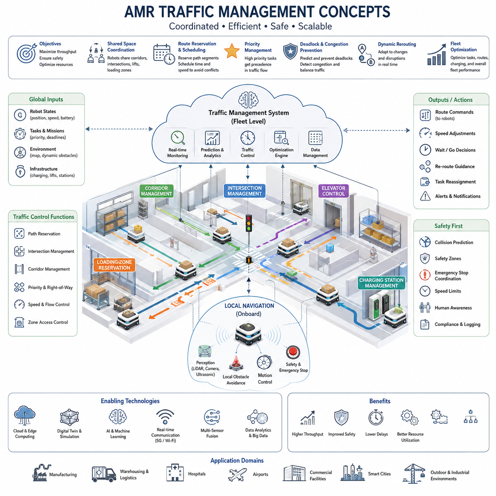
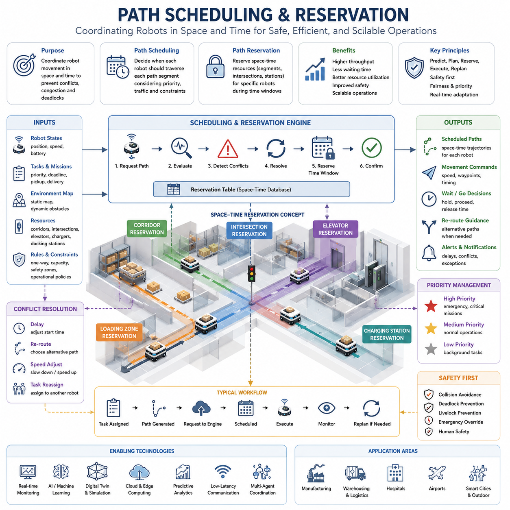
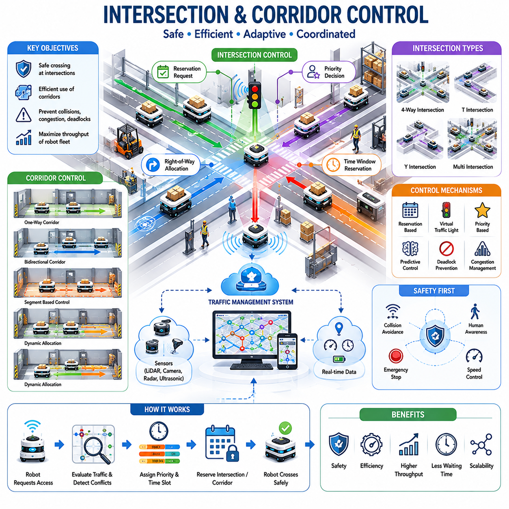
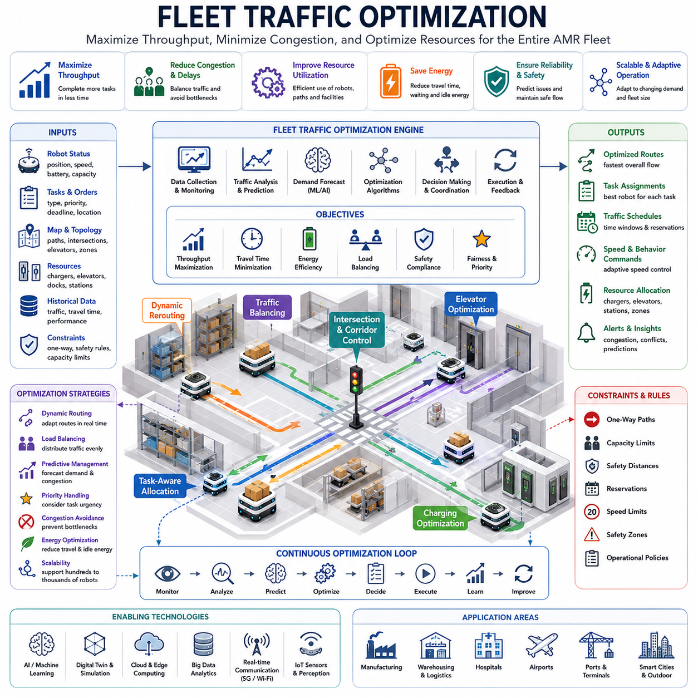
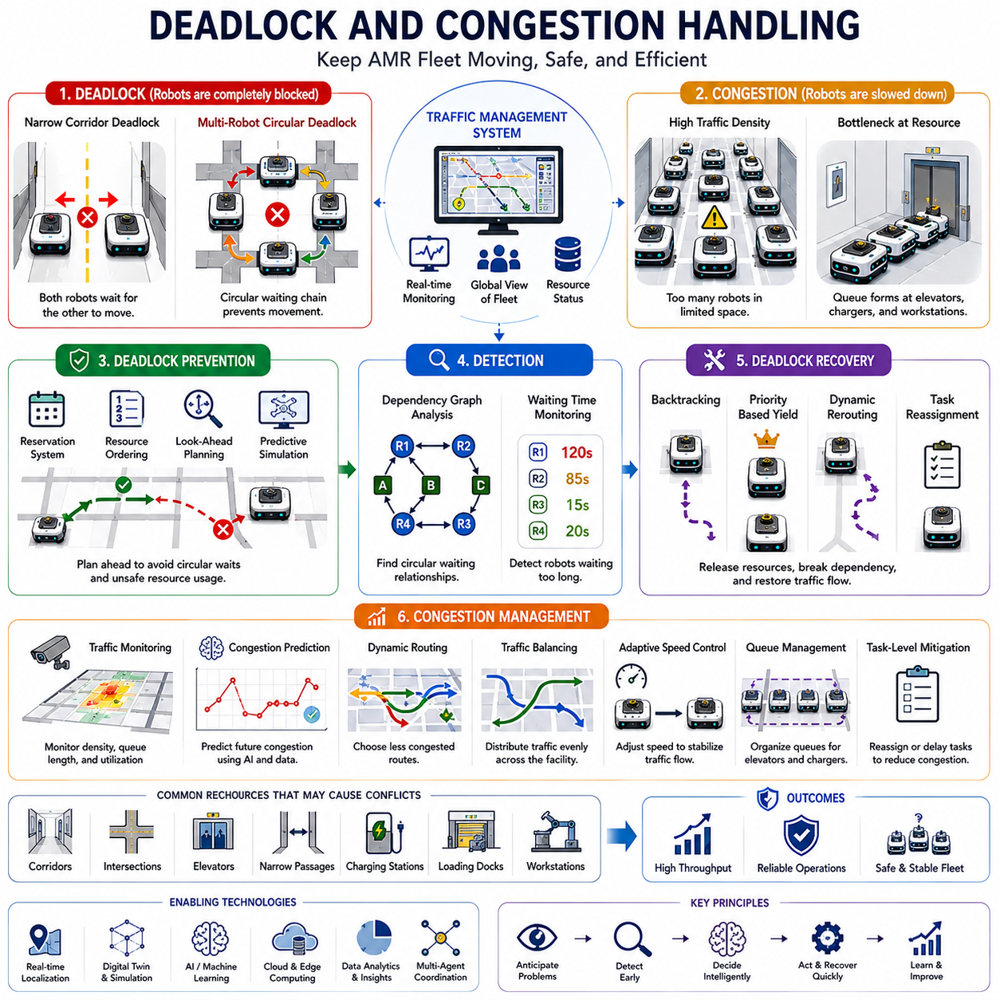
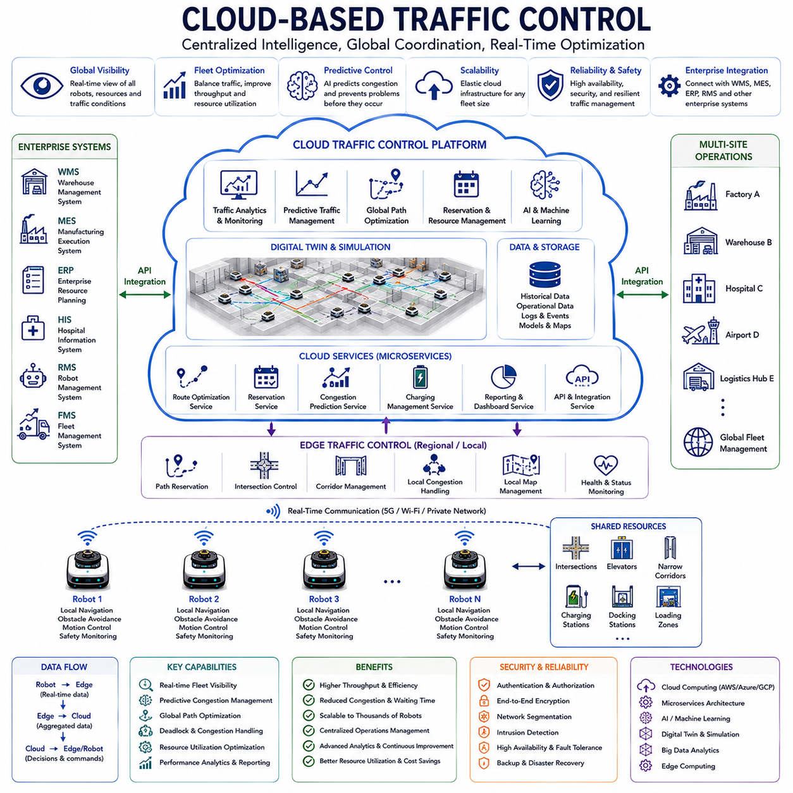
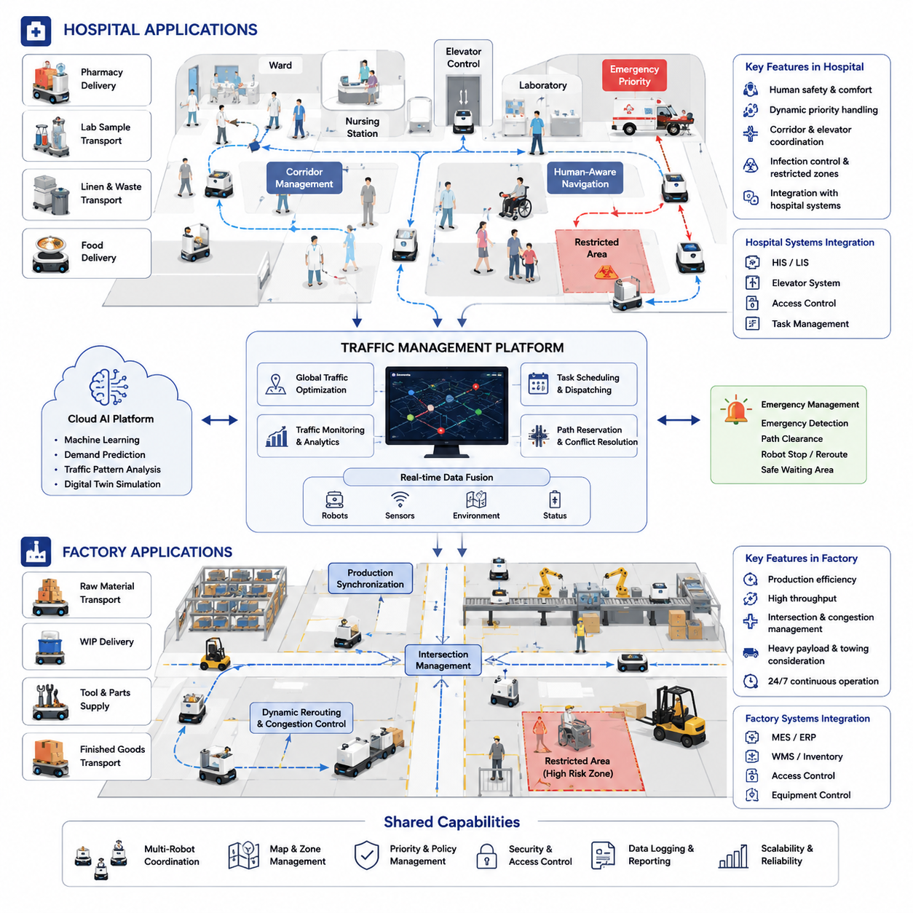
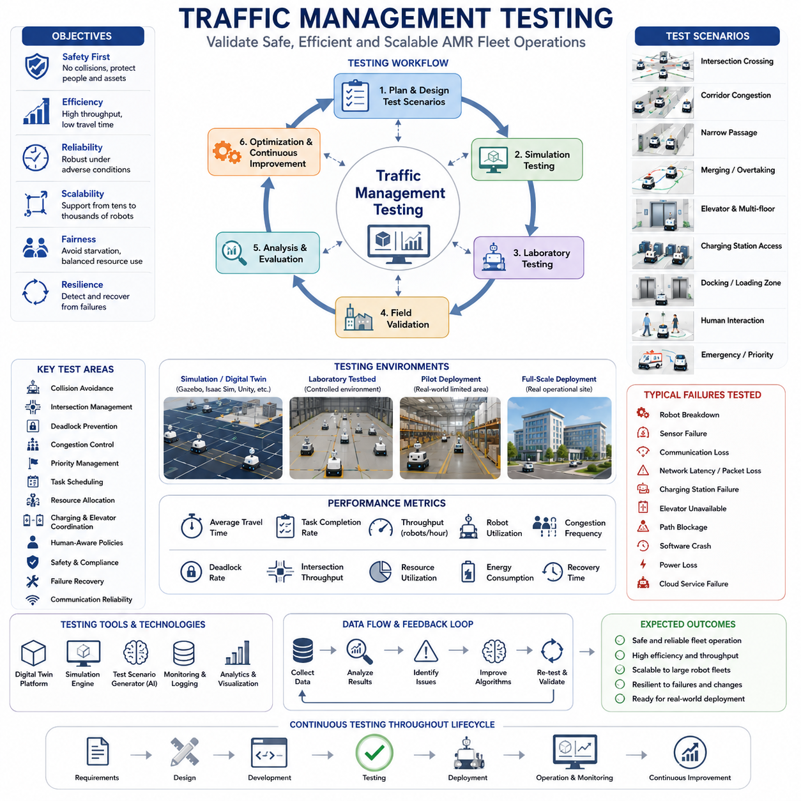

**Volume 05. Path Planning and Autonomous Navigation**


# Chapter 19. Traffic Management

##  

## 19.1 AMR Traffic Management Concepts

{width="7.268055555555556in" height="7.268055555555556in"}

Autonomous Mobile Robot (AMR) traffic management is a fundamental capability that enables multiple robots to operate safely, efficiently, and predictably within a shared environment. As the number of robots deployed in factories, hospitals, warehouses, airports, logistics centers, smart cities, and outdoor industrial facilities continues to increase, the complexity of coordinating robot movement also grows significantly. A single robot navigating independently can rely primarily on local obstacle avoidance and path planning algorithms. However, when dozens, hundreds, or even thousands of robots simultaneously share the same infrastructure, traffic management becomes an essential system-level function that determines overall operational performance, safety, scalability, and economic value. The concepts of AMR traffic management therefore extend beyond individual robot navigation and encompass fleet-wide coordination, resource allocation, congestion control, route optimization, and real-time operational decision-making. These concepts form the foundation for modern fleet management systems and large-scale autonomous robot deployments.

Traffic management in AMR systems can be viewed as the robotic equivalent of traffic control in human transportation networks. Just as road systems require traffic signals, lane management, intersection control, priority rules, and congestion mitigation strategies, AMR deployments require mechanisms that regulate robot movement through shared operational spaces. Without traffic management, robots may block each other, create deadlocks, increase travel times, reduce productivity, and potentially compromise safety. Effective traffic management ensures that every robot can accomplish its assigned task while minimizing interference with other robots and maintaining system-wide efficiency.

The primary objective of AMR traffic management is to maximize throughput while maintaining safety and operational stability. Throughput refers to the total amount of work completed by the robot fleet over a given period of time. In a warehouse, throughput may represent the number of pallets transported per hour. In a hospital, it may represent the number of deliveries completed between departments. In a manufacturing environment, throughput may correspond to material transport cycles supporting production lines. Traffic management systems continuously monitor robot movements, task assignments, environmental conditions, and infrastructure utilization to optimize this throughput while preventing unsafe interactions.

One of the most important concepts in AMR traffic management is shared-space coordination. Multiple robots often operate within the same corridors, intersections, loading zones, charging stations, and production areas. Shared spaces become critical resources that must be allocated carefully to avoid conflicts. Traffic management systems maintain awareness of robot locations, trajectories, speeds, and destinations to coordinate access to these resources. By predicting future movements, the system can proactively prevent collisions and reduce waiting times.

Traffic management operates at multiple levels of abstraction. At the lowest level, individual robots perform local collision avoidance using onboard sensors such as LiDAR, cameras, radar, ultrasonic sensors, and depth cameras. These local systems react to nearby obstacles and immediate hazards. At a higher level, fleet traffic management systems coordinate robot movements across larger operational areas. Fleet-level coordination considers global traffic patterns, resource utilization, route reservations, and long-term optimization objectives. The combination of local autonomy and centralized coordination creates a hierarchical architecture capable of supporting large-scale deployments.

A critical concept in traffic management is route reservation. Similar to air traffic control reserving airspace or railway systems reserving track segments, AMR traffic systems can reserve specific path segments for robot traversal. Before entering a corridor, intersection, or constrained area, a robot may request access from the traffic management system. If the segment is available, the reservation is granted. If another robot already occupies or has reserved the segment, the requesting robot may wait or receive an alternative route. This approach significantly reduces collision risks and prevents traffic conflicts before they occur.

Path scheduling is another essential element of traffic management. Rather than allowing all robots to independently select the shortest route, traffic management systems consider the collective behavior of the fleet. Two robots traveling on intersecting paths may create congestion if they arrive simultaneously at a shared location. By adjusting departure times, travel speeds, or route selections, the system can smooth traffic flow and reduce bottlenecks. Path scheduling transforms navigation from a purely spatial problem into a spatiotemporal optimization problem where both location and timing must be coordinated.

Intersection management represents one of the most challenging areas of AMR traffic control. Intersections create natural conflict points where robot paths converge. Traffic management systems must determine which robot receives priority and how crossing movements are coordinated. Various approaches can be used, including stop-and-go control, reservation-based intersection access, virtual traffic lights, dynamic priority assignment, and predictive scheduling. Advanced systems evaluate robot urgency, task importance, waiting time, destination constraints, and overall fleet efficiency when determining intersection access priorities.

Corridor management is equally important in environments with narrow pathways. In factories and hospitals, corridors often support bidirectional robot movement while providing limited maneuvering space. Traffic management systems must regulate entry into these corridors to avoid blockages. Some systems implement one-way traffic policies, while others dynamically allocate corridor direction based on current demand. Predictive traffic control allows robots to negotiate corridor access before entering constrained areas, improving overall efficiency.

Priority management plays a significant role in many industrial applications. Not all robot missions have equal importance. In hospitals, emergency medication deliveries may receive higher priority than routine supply transport. In manufacturing environments, robots supporting critical production lines may take precedence over less urgent logistics tasks. Traffic management systems assign priority levels to tasks and adjust routing decisions accordingly. Priority-aware traffic control ensures that critical operations receive timely support while maintaining fairness across the fleet.

Deadlock prevention is a central objective of traffic management systems. A deadlock occurs when multiple robots block each other in a circular dependency, preventing any robot from proceeding. Deadlocks commonly arise in narrow corridors, intersections, loading areas, and densely populated operational zones. Traffic management systems continuously analyze robot trajectories and resource dependencies to identify potential deadlock scenarios before they occur. Preventive strategies include resource reservation, movement sequencing, alternative route generation, temporary holding zones, and dynamic traffic rule adjustments.

Congestion management addresses situations where excessive robot density reduces operational efficiency. Similar to traffic jams in urban transportation systems, robot congestion can significantly increase task completion times. Traffic management systems monitor traffic density, travel delays, queue lengths, and infrastructure utilization. When congestion is detected, robots may be rerouted, speeds adjusted, tasks redistributed, or operational zones temporarily restricted. Advanced traffic management platforms employ predictive analytics to anticipate congestion before it impacts performance.

Dynamic rerouting is a key capability within traffic management architectures. Operational environments continuously change due to human activity, equipment movement, temporary obstacles, maintenance operations, and emergency situations. Traffic management systems must adapt to these changes in real time. When disruptions occur, affected robots receive updated routes that avoid problematic areas while minimizing overall impact on fleet productivity. Dynamic rerouting ensures resilient operation even in highly dynamic environments.

Another important concept is traffic-aware path planning. Traditional path planning algorithms focus on minimizing distance or travel time for individual robots. Traffic-aware planning incorporates fleet-level information into route selection. A slightly longer route may be preferable if it avoids congested areas and reduces overall system delays. Traffic-aware planning considers expected traffic density, reservation availability, predicted waiting times, and historical operational data when generating routes.

Fleet-wide optimization represents the highest level of traffic management intelligence. Rather than optimizing individual robot behavior, fleet optimization seeks to maximize the performance of the entire robotic ecosystem. This may involve balancing workload distribution, minimizing empty travel, reducing charging station congestion, coordinating task assignments, and optimizing resource utilization. Fleet optimization algorithms often combine operations research techniques, artificial intelligence methods, and real-time analytics to achieve global performance objectives.

Cloud-based traffic management has become increasingly important as AMR deployments scale. Cloud platforms provide centralized visibility across large robot fleets and geographically distributed facilities. Traffic management services running in the cloud can aggregate operational data, perform large-scale optimization, and coordinate multiple fleets simultaneously. Cloud architectures enable continuous learning, predictive maintenance integration, and cross-site performance analysis. At the same time, edge computing resources ensure that critical traffic control functions remain operational even during network disruptions.

Digital twins are emerging as valuable tools for traffic management development and operation. A digital twin provides a virtual representation of the physical robot fleet and operational environment. Traffic scenarios can be simulated, analyzed, and optimized before deployment. Engineers can evaluate intersection designs, corridor configurations, traffic rules, and fleet expansion strategies within the digital environment. Digital twins support continuous improvement and reduce operational risk by enabling data-driven decision-making.

Human-aware traffic management is particularly important in environments where robots and people share the same workspace. Hospitals, airports, offices, shopping centers, and industrial facilities often require mixed human-robot traffic. Traffic management systems must account for human behavior, pedestrian flow patterns, safety regulations, and social navigation requirements. Robots may reduce speed near people, yield at crossings, avoid crowded areas, and maintain appropriate separation distances. Human-aware traffic management enhances safety while improving user acceptance of robotic systems.

Safety remains the highest priority in all traffic management systems. Traffic control policies must comply with applicable safety standards, industrial regulations, and operational requirements. Safety mechanisms include speed restrictions, exclusion zones, emergency stop coordination, collision prediction, risk assessment, and fail-safe behaviors. Traffic management systems continuously evaluate operational conditions to ensure that safety objectives are maintained even under abnormal circumstances.

Scalability is another defining characteristic of modern AMR traffic management. Small deployments may involve only a handful of robots, while large industrial facilities may operate hundreds or thousands of autonomous systems simultaneously. Traffic management architectures must scale efficiently without excessive computational overhead. Distributed coordination methods, hierarchical control architectures, cloud-native platforms, and edge-based optimization techniques contribute to scalable fleet operation.

Artificial intelligence is increasingly influencing AMR traffic management. Machine learning models can predict congestion, estimate travel times, forecast demand patterns, and optimize routing strategies. Reinforcement learning approaches can discover efficient traffic control policies through simulation and real-world experience. Large-scale operational datasets enable continuous improvement of traffic management algorithms, allowing robotic fleets to become more efficient over time.

The future of AMR traffic management will likely resemble intelligent transportation systems developed for autonomous vehicles and smart cities. Traffic management platforms will integrate real-time perception, predictive analytics, cloud intelligence, digital twins, multi-agent coordination, and AI-driven optimization into unified operational ecosystems. Robots will not only avoid collisions but actively cooperate to maximize collective productivity. Traffic management will evolve from simple conflict avoidance toward fully autonomous fleet orchestration, enabling large-scale deployments across factories, hospitals, logistics networks, industrial campuses, smart cities, and outdoor autonomous robot ecosystems. As AMR adoption continues to accelerate, traffic management concepts will become one of the most critical technological foundations supporting the next generation of intelligent robotic infrastructure.

자율이동로봇(AMR)의 교통 관리는 여러 대의 로봇이 동일한 환경에서 안전하고 효율적이며 예측 가능하게 운영될 수 있도록 지원하는 핵심 기술이다. 공장, 병원, 물류창고, 공항, 물류센터, 스마트시티, 야외 산업 현장 등에서 AMR의 활용이 확대되면서 다수의 로봇을 동시에 운영해야 하는 상황이 증가하고 있다. 단일 로봇은 자체 경로 계획과 장애물 회피 기능만으로도 이동할 수 있지만, 수십 대에서 수백 대, 나아가 수천 대의 로봇이 동시에 동일한 공간을 공유하는 경우에는 체계적인 교통 관리가 필수적이다. 교통 관리는 단순히 개별 로봇의 이동을 제어하는 것이 아니라 전체 플릿(Fleet)의 이동을 조정하고 자원을 배분하며 혼잡을 완화하고 경로를 최적화하는 시스템 수준의 기술이다.

AMR 교통 관리의 가장 중요한 목표는 안전성을 유지하면서 전체 시스템의 처리량(Throughput)을 극대화하는 것이다. 처리량은 일정 시간 동안 로봇 플릿이 수행한 작업량을 의미한다. 물류창고에서는 시간당 운반된 팔레트 수가 될 수 있으며, 병원에서는 완료된 배송 건수, 제조공장에서는 생산라인에 공급된 물류 이동 횟수가 될 수 있다. 교통 관리 시스템은 로봇의 위치, 이동 경로, 작업 상태, 환경 조건을 지속적으로 분석하여 전체 운영 효율을 향상시킨다.

AMR 교통 관리의 핵심 개념 중 하나는 공유 공간(Shared Space)의 관리이다. 여러 대의 로봇은 복도, 교차로, 엘리베이터, 적재 구역, 충전 스테이션과 같은 제한된 공간을 함께 사용한다. 이러한 공간은 중요한 자원으로 간주되며, 효율적인 운영을 위해 적절하게 할당되어야 한다. 교통 관리 시스템은 각 로봇의 현재 위치와 미래 이동 경로를 예측하여 충돌 가능성을 최소화하고 자원의 활용도를 극대화한다.

교통 관리는 여러 계층으로 구성된다. 가장 낮은 계층에서는 LiDAR, 카메라, 레이더, 초음파 센서 등을 활용하여 개별 로봇이 주변 장애물을 회피한다. 상위 계층에서는 플릿 관리 시스템이 전체 로봇의 이동을 조정한다. 상위 시스템은 전체 경로 계획, 구간 예약, 혼잡 관리, 자원 최적화 등을 수행하며, 하위 로봇 제어 시스템과 협력하여 효율적인 운영을 실현한다.

경로 예약(Route Reservation)은 AMR 교통 관리의 대표적인 기술이다. 철도 시스템에서 선로를 예약하거나 항공 교통 시스템에서 공역을 예약하는 것과 유사하게, AMR은 특정 구간에 진입하기 전에 사용 권한을 요청할 수 있다. 이미 다른 로봇이 해당 구간을 사용 중이거나 예약한 경우에는 대기하거나 우회 경로를 선택한다. 이러한 방식은 충돌을 사전에 방지하고 교통 흐름을 안정적으로 유지하는 데 매우 효과적이다.

경로 스케줄링(Path Scheduling) 또한 중요한 요소이다. 모든 로봇이 단순히 최단 경로만 선택한다면 특정 구간에 로봇이 집중되어 혼잡이 발생할 수 있다. 따라서 교통 관리 시스템은 로봇의 출발 시간, 이동 속도, 경로 선택을 조정하여 전체 흐름을 최적화한다. 이는 공간적인 경로 계획뿐 아니라 시간적인 요소까지 고려하는 시공간 최적화 문제로 확장된다.

교차로(Intersection) 관리는 교통 관리에서 가장 어려운 문제 중 하나이다. 여러 경로가 만나는 교차점에서는 충돌 가능성이 높아진다. 교통 관리 시스템은 어느 로봇이 우선 통행권을 가지는지 결정하고 교차 순서를 조정한다. 이를 위해 가상 신호등, 예약 기반 통과, 우선순위 정책, 예측 기반 스케줄링 등의 다양한 기법이 사용된다. 고도화된 시스템은 작업의 긴급성, 대기 시간, 목적지 중요도 등을 종합적으로 고려하여 우선순위를 결정한다.

복도(Corridor) 관리는 병원과 공장에서 특히 중요하다. 좁은 복도는 양방향 통행이 제한되기 때문에 교통 체증이 쉽게 발생한다. 일부 시스템은 일방통행 정책을 적용하고, 일부는 실시간 수요에 따라 방향을 동적으로 변경한다. 또한 로봇이 복도에 진입하기 전에 접근 권한을 협상함으로써 병목 현상을 줄일 수 있다.

우선순위 관리(Priority Management)는 산업 현장에서 매우 중요하다. 모든 작업이 동일한 중요도를 가지는 것은 아니다. 병원에서는 응급 약품 배송이 일반 물품 배송보다 우선되어야 한다. 제조공장에서는 생산라인을 지원하는 물류 작업이 상대적으로 높은 우선순위를 가진다. 교통 관리 시스템은 작업별 우선순위를 고려하여 경로를 조정하고 교차로 통행 순서를 결정한다.

교착 상태(Deadlock) 방지는 교통 관리의 핵심 목표 중 하나이다. 교착 상태는 여러 대의 로봇이 서로의 이동을 막아 아무도 움직일 수 없는 상황을 의미한다. 이러한 문제는 좁은 통로, 교차로, 적재 공간 등에서 자주 발생한다. 교통 관리 시스템은 자원 의존성을 분석하여 교착 상태를 사전에 예측하고 예방한다. 이를 위해 구간 예약, 이동 순서 조정, 대기 공간 활용, 우회 경로 생성 등의 전략이 활용된다.

혼잡 관리(Congestion Management)는 로봇 밀도가 증가할 때 발생하는 문제를 해결하기 위한 기술이다. 자동차 교통 체증과 마찬가지로 AMR도 특정 구간에 집중되면 이동 시간이 급격히 증가한다. 교통 관리 시스템은 교통 밀도, 대기 시간, 이동 지연을 지속적으로 모니터링한다. 혼잡이 발생하면 일부 로봇은 우회 경로를 사용하거나 작업이 재배정될 수 있다. 최신 시스템은 AI를 활용하여 혼잡을 사전에 예측하고 예방하는 기능도 제공한다.

동적 재경로 계획(Dynamic Rerouting)은 운영 환경 변화에 대응하기 위한 필수 기능이다. 작업자 이동, 임시 장애물, 장비 고장, 공사 구역, 비상 상황 등 다양한 이유로 경로가 변경될 수 있다. 교통 관리 시스템은 이러한 상황을 실시간으로 인식하고 영향을 받는 로봇에게 새로운 경로를 제공한다. 이를 통해 운영 중단 없이 안정적인 서비스를 유지할 수 있다.

교통 인지 경로 계획(Traffic-Aware Path Planning)은 단순 최단 거리 기반 경로 계획과 차별화된다. 가장 짧은 경로가 항상 가장 빠른 경로는 아니다. 특정 구간에 많은 로봇이 몰려 있다면 조금 더 긴 우회 경로가 전체적으로 더 효율적일 수 있다. 따라서 교통 관리 시스템은 예상 대기 시간, 혼잡도, 예약 상태 등을 고려하여 최적 경로를 결정한다.

플릿 최적화(Fleet Optimization)는 교통 관리의 최상위 목표이다. 개별 로봇의 효율이 아니라 전체 로봇 시스템의 생산성을 최대화하는 것이 목적이다. 이를 위해 작업 배분, 충전 스케줄링, 빈차 이동 최소화, 경로 조정, 자원 활용 최적화 등이 수행된다. 최신 시스템은 운영 연구(Operations Research), 인공지능, 실시간 분석 기술을 결합하여 전체 시스템의 성능을 향상시킨다.

클라우드 기반 교통 관리(Cloud-Based Traffic Management)는 대규모 AMR 운영에서 점점 중요해지고 있다. 클라우드 플랫폼은 여러 시설과 수많은 로봇을 중앙에서 관리할 수 있도록 지원한다. 클라우드 시스템은 대규모 데이터 분석, 글로벌 최적화, 다중 플릿 협조 제어를 수행하며, 엣지 컴퓨팅 시스템은 네트워크 장애 상황에서도 핵심 교통 제어 기능을 유지한다.

디지털 트윈(Digital Twin)은 교통 관리 개발과 운영에 매우 유용한 도구로 활용된다. 디지털 트윈은 실제 로봇 시스템을 가상 공간에 재현한 모델이다. 엔지니어는 이를 활용하여 교차로 설계, 복도 배치, 교통 규칙, 플릿 확장 전략 등을 사전에 검증할 수 있다. 이를 통해 운영 리스크를 줄이고 시스템 효율을 향상시킬 수 있다.

사람과 로봇이 함께 작업하는 환경에서는 인간 중심 교통 관리(Human-Aware Traffic Management)가 중요하다. 병원, 공항, 사무실, 쇼핑몰 등에서는 보행자와 로봇이 동일한 공간을 공유한다. 교통 관리 시스템은 사람의 이동 패턴을 분석하여 혼잡 구역을 회피하고, 사람 근처에서는 속도를 줄이며, 적절한 안전 거리를 유지하도록 로봇을 제어한다. 이는 안전성과 사용자 수용성을 동시에 향상시킨다.

안전성은 모든 교통 관리 시스템의 최우선 목표이다. 속도 제한, 안전 구역 설정, 비상 정지, 충돌 예측, 위험도 평가, 장애 대응 기능 등이 반드시 포함되어야 한다. 교통 관리 시스템은 정상 상황뿐 아니라 비정상 상황에서도 안전성을 유지할 수 있도록 설계되어야 한다.

확장성(Scalability) 또한 현대 AMR 교통 관리의 중요한 특성이다. 소규모 시설에서는 수 대의 로봇만 운영될 수 있지만, 대규모 산업 현장에서는 수백 대 이상의 로봇이 동시에 움직인다. 따라서 교통 관리 시스템은 로봇 수가 증가해도 성능 저하 없이 운영될 수 있어야 한다. 이를 위해 계층형 제어 구조, 분산 제어 아키텍처, 클라우드 네이티브 플랫폼 등이 활용된다.

최근에는 인공지능이 교통 관리 분야에도 적극적으로 적용되고 있다. 머신러닝 모델은 혼잡을 예측하고 이동 시간을 추정하며 작업 수요를 분석할 수 있다. 강화학습 기반 알고리즘은 시뮬레이션을 통해 최적의 교통 제어 정책을 학습할 수 있다. 장기간 축적된 운영 데이터는 교통 관리 성능을 지속적으로 개선하는 데 활용된다.

미래의 AMR 교통 관리는 자율주행 자동차와 스마트시티 교통 시스템과 유사한 방향으로 발전할 것으로 예상된다. 실시간 인지, 예측 분석, 디지털 트윈, 클라우드 최적화, AI 기반 의사결정이 통합된 지능형 교통 관리 플랫폼이 등장할 것이다. 로봇들은 단순히 충돌을 피하는 수준을 넘어 서로 협력하며 전체 시스템의 생산성을 극대화하게 될 것이다. 결국 교통 관리는 공장, 병원, 물류센터, 스마트시티, 야외 자율주행 로봇 생태계 전반을 연결하는 핵심 인프라로 자리 잡게 될 것이며, 대규모 AMR 운영을 가능하게 하는 가장 중요한 기반 기술 중 하나가 될 것이다.

##  

## 19.2 Path Scheduling and Reservation

{width="7.268055555555556in" height="7.268055555555556in"}

Path scheduling and reservation are among the most important technologies in modern Autonomous Mobile Robot (AMR) traffic management systems. As robot fleets grow from a few robots to dozens, hundreds, or even thousands of autonomous units operating within the same facility, simple path planning is no longer sufficient to guarantee efficient operation. While a single robot can independently calculate a collision-free path from its current position to a destination, multiple robots sharing corridors, intersections, loading stations, elevators, charging stations, and narrow passages introduce a far more complex coordination problem. Path scheduling and reservation provide the mechanisms required to organize robot movement in both space and time, ensuring that resources are used efficiently while preventing conflicts, congestion, deadlocks, and unsafe situations.

The fundamental purpose of path scheduling is to coordinate robot movement before conflicts occur. Traditional navigation systems focus primarily on determining a feasible route through an environment. However, in multi-robot environments, a path that is geometrically feasible may still be operationally problematic if multiple robots attempt to occupy the same area simultaneously. Path scheduling extends navigation planning by incorporating temporal considerations into route generation. Instead of asking only where a robot should travel, the system also determines when the robot should travel through each segment of the environment.

Path reservation complements scheduling by providing a mechanism for allocating access to shared infrastructure resources. Similar to railway systems that reserve track segments for trains or air traffic management systems that reserve airspace corridors for aircraft, AMR traffic management systems reserve navigation segments, intersections, corridors, and operational zones for specific robots during designated time intervals. Reservation systems transform robot navigation from a reactive process into a predictive and coordinated operation that significantly improves safety and efficiency.

A key concept in path scheduling is the transformation of a physical map into a spatiotemporal planning model. In conventional navigation systems, maps represent static geometry, obstacles, and free-space regions. In path scheduling systems, maps also incorporate time as an additional dimension. Each path segment becomes associated not only with a location but also with availability windows during which robots may traverse that segment. This approach allows the traffic management system to coordinate multiple robots without requiring continuous intervention.

When a robot receives a task assignment, it first generates a candidate route toward its destination. Rather than immediately executing the route, the robot or fleet management system submits the proposed path to the traffic scheduling engine. The scheduling engine evaluates the path against existing reservations, predicted traffic conditions, priority policies, and operational constraints. If conflicts are identified, the system may adjust timing, reroute the robot, or temporarily delay execution until the required resources become available.

Time-window reservation is one of the most widely used scheduling mechanisms. Each navigation segment is associated with reserved occupancy periods. A robot entering a corridor may reserve that corridor for a specific time interval based on predicted travel duration. Other robots requesting access during the same interval may be delayed, rerouted, or assigned alternative routes. By controlling access through reservation windows, the system prevents multiple robots from simultaneously occupying constrained spaces.

The concept of exclusive reservation is particularly important in narrow corridors, elevators, docking stations, charging stations, and loading zones. In such environments, only one robot can safely occupy the resource at a time. Exclusive reservation guarantees that a robot has uncontested access to the resource during its assigned time slot. This approach eliminates uncertainty and significantly reduces the risk of operational conflicts.

Shared reservation models can also be applied in larger open environments where multiple robots can safely coexist within the same region. Instead of completely excluding other robots, the system limits occupancy levels based on predefined capacity thresholds. For example, a warehouse aisle may support three simultaneous robots without congestion. The reservation system monitors occupancy and restricts additional entries when capacity limits are reached.

One of the most challenging aspects of path scheduling involves intersection management. Intersections represent high-conflict areas where robot trajectories converge. Without coordination, robots approaching an intersection may create delays, collisions, or deadlocks. Reservation-based intersection control treats the intersection as a shared resource. Robots request access before entering the intersection, and the scheduling engine assigns crossing times based on priority, arrival predictions, and overall traffic efficiency. This mechanism functions similarly to a virtual traffic signal system while maintaining greater flexibility.

Priority-aware scheduling enables traffic management systems to differentiate between mission criticality levels. Not all robot tasks have equal operational importance. Emergency deliveries in hospitals, production-critical material transport in factories, or urgent logistics operations may require expedited access to transportation resources. Scheduling algorithms incorporate priority weights that influence reservation allocation and conflict resolution decisions. Higher-priority robots may receive preferred reservation windows while lower-priority robots experience controlled delays.

Dynamic scheduling is essential because operational environments are rarely static. Human workers, forklifts, manually operated vehicles, temporary obstacles, maintenance activities, and changing task demands continuously alter traffic conditions. Dynamic scheduling systems continuously monitor fleet activity and update reservations in real time. If a robot encounters unexpected delays, reservation schedules may be recalculated to prevent cascading conflicts throughout the fleet.

Predictive scheduling represents a more advanced approach in which the system forecasts future traffic conditions before conflicts emerge. Using historical operational data, current fleet status, and predictive analytics, the scheduler estimates congestion levels, resource utilization, and expected travel times. Robots can then receive routes and schedules optimized not only for current conditions but also for anticipated future conditions. Predictive scheduling significantly improves throughput in large-scale deployments.

Reservation systems often operate on graph-based representations of navigation networks. Nodes represent intersections, stations, charging areas, or key operational locations. Edges represent navigable path segments connecting these locations. Reservation requests are applied to nodes, edges, or both. The scheduling engine maintains a reservation table containing occupancy information for each resource. This table serves as the central database used to coordinate robot movement across the facility.

Conflict detection is a critical function within reservation systems. Every new reservation request must be evaluated against existing reservations. The system analyzes temporal overlaps, spatial conflicts, resource capacities, and operational constraints. When conflicts are identified, resolution mechanisms determine the most appropriate response. Solutions may include delaying one robot, modifying route selection, adjusting travel speeds, or reassigning tasks to alternative robots.

Deadlock prevention is one of the primary motivations for path reservation. Deadlocks occur when robots wait indefinitely for resources occupied by each other. In complex environments with multiple intersections and narrow passages, deadlocks can significantly reduce productivity. Reservation systems prevent deadlocks by ensuring that robots only enter resource sequences that can be completed successfully. Some systems employ look-ahead planning to verify that future reservations remain feasible before granting access.

Livelock prevention is another important consideration. Unlike deadlocks, where robots stop moving entirely, livelocks occur when robots continuously adjust their behavior without making meaningful progress toward their destinations. Reservation-based scheduling minimizes livelock scenarios by establishing deterministic movement plans and reducing unnecessary path modifications.

Traffic flow optimization is closely connected to scheduling and reservation mechanisms. Efficient traffic flow requires balancing resource utilization across the entire facility. Overutilized corridors create bottlenecks while underutilized routes represent wasted capacity. Scheduling algorithms continuously analyze traffic density and distribute robot movement across available infrastructure. This balancing process improves throughput while reducing travel times.

Large-scale facilities often employ hierarchical scheduling architectures. At the highest level, fleet management systems allocate tasks and optimize global traffic flow. Mid-level schedulers coordinate regional traffic within specific operational zones. Local controllers manage immediate robot interactions and safety behaviors. This hierarchical approach enables scalable operation across facilities containing hundreds or thousands of robots.

Cloud-based scheduling platforms have become increasingly common in enterprise AMR deployments. Cloud infrastructure provides centralized visibility across multiple facilities and enables large-scale optimization algorithms. Reservation databases, traffic analytics, predictive models, and operational dashboards can be shared across distributed robot fleets. Cloud systems also support continuous software updates and integration with enterprise resource planning systems.

Edge computing remains important despite the benefits of cloud-based management. Time-critical scheduling decisions often require low-latency execution. Local edge servers can maintain reservation databases and execute scheduling algorithms even during temporary network disruptions. Hybrid cloud-edge architectures combine centralized optimization with resilient local control.

Artificial intelligence is increasingly integrated into scheduling systems. Machine learning algorithms can predict travel times more accurately than static models. Reinforcement learning techniques can optimize reservation strategies through continuous operational experience. Deep learning models can forecast congestion patterns and recommend traffic control policies. AI-driven scheduling systems improve efficiency as they accumulate operational knowledge.

Digital twin technology provides a powerful environment for developing and validating scheduling strategies. A digital twin replicates the physical robot fleet, infrastructure, and traffic conditions within a virtual environment. Engineers can evaluate scheduling algorithms, test reservation policies, simulate congestion scenarios, and optimize facility layouts without disrupting real-world operations. Digital twins support continuous improvement throughout the lifecycle of an AMR deployment.

Path scheduling and reservation play particularly important roles in hospitals. Delivery robots transporting medications, laboratory samples, medical equipment, meals, and linens frequently share elevators, corridors, and service areas. Scheduling systems coordinate access to these resources while prioritizing urgent medical deliveries. Similar benefits are observed in manufacturing facilities, where material transport robots support production operations that depend on predictable and reliable logistics performance.

In warehouse environments, reservation systems improve order fulfillment efficiency by coordinating robot movement within storage aisles, picking zones, packing stations, and shipping areas. By reducing congestion and minimizing waiting times, scheduling systems contribute directly to higher throughput and lower operational costs. The same principles apply to airports, logistics hubs, industrial campuses, and outdoor autonomous robot deployments.

Safety remains a fundamental consideration in all scheduling and reservation systems. While scheduling optimizes operational efficiency, safety constraints always take precedence. Emergency vehicles, human workers, unexpected obstacles, and safety-critical events can override reservation schedules when necessary. Traffic management systems must be capable of immediately adapting to changing conditions while maintaining safe operation.

The future of path scheduling and reservation will be increasingly driven by intelligent automation. Next-generation systems will combine real-time perception, predictive analytics, digital twins, cloud-native architectures, multi-agent coordination, and artificial intelligence into unified traffic management platforms. Robots will negotiate resource access autonomously, coordinate movement collaboratively, and continuously optimize fleet performance based on operational objectives. Path scheduling will evolve beyond simple reservation tables into intelligent traffic orchestration systems capable of managing massive robot populations across factories, hospitals, warehouses, smart cities, ports, airports, and outdoor industrial environments. As AMR deployments continue to expand in scale and complexity, path scheduling and reservation will remain one of the most critical technologies enabling safe, efficient, and scalable autonomous robot operations.

경로 스케줄링(Path Scheduling)과 경로 예약(Path Reservation)은 현대 자율이동로봇(AMR) 교통 관리 시스템의 핵심 기술이다. 로봇 운영 규모가 몇 대 수준에서 수십 대, 수백 대, 나아가 수천 대 규모로 확대되면서 단순한 경로 계획만으로는 효율적인 운영을 보장할 수 없게 되었다. 단일 로봇은 현재 위치에서 목적지까지 충돌 없는 경로를 계산하면 충분할 수 있지만, 여러 대의 로봇이 동일한 복도, 교차로, 적재 구역, 엘리베이터, 충전 스테이션, 협소한 통로를 동시에 사용하는 환경에서는 훨씬 복잡한 조정 문제가 발생한다. 경로 스케줄링과 예약 기술은 이러한 문제를 해결하기 위해 공간과 시간을 동시에 고려하여 로봇의 이동을 조정하고 충돌, 혼잡, 교착 상태, 비효율적인 대기 현상을 방지한다.

경로 스케줄링의 가장 기본적인 목적은 충돌이 발생하기 전에 로봇들의 이동을 사전에 조정하는 것이다. 기존의 내비게이션 시스템은 주로 이동 가능한 경로를 찾는 데 초점을 맞춘다. 그러나 다수의 로봇이 동일한 공간을 공유하는 경우에는 기하학적으로 이동 가능한 경로라 하더라도 동일 시간대에 여러 로봇이 같은 공간을 점유하려 하면 운영상 문제가 발생한다. 경로 스케줄링은 이러한 문제를 해결하기 위해 시간 정보를 경로 계획에 추가한다. 즉, 로봇이 어디를 지나갈 것인가뿐만 아니라 언제 그 구간을 통과할 것인가까지 결정한다.

경로 예약은 이러한 스케줄링을 실제로 구현하는 핵심 메커니즘이다. 철도 시스템이 선로를 예약하고 항공 교통 시스템이 특정 공역을 예약하는 것처럼, AMR 시스템은 특정 통로, 교차로, 엘리베이터, 충전 스테이션, 작업 구역 등을 특정 시간 동안 특정 로봇에게 할당한다. 이를 통해 로봇들은 서로 간섭하지 않고 예측 가능한 방식으로 이동할 수 있다.

경로 스케줄링의 중요한 개념은 기존 지도(Map)를 시공간(Spatio-Temporal) 모델로 확장하는 것이다. 일반적인 지도는 장애물과 자유 공간을 표현하지만, 스케줄링 시스템에서는 시간이라는 차원이 추가된다. 각 경로 구간은 단순한 위치 정보뿐 아니라 언제 사용 가능한지에 대한 시간 정보까지 포함하게 된다. 이를 통해 교통 관리 시스템은 다수의 로봇을 효율적으로 조정할 수 있다.

로봇이 새로운 작업을 할당받으면 먼저 목적지까지의 후보 경로를 계산한다. 그러나 즉시 이동을 시작하지는 않는다. 계산된 경로는 플릿 관리 시스템 또는 교통 관리 시스템으로 전달되며, 스케줄링 엔진은 현재 예약 상태, 예상 교통량, 우선순위 정책, 운영 제약 조건 등을 고려하여 경로를 검토한다. 충돌 가능성이 발견되면 출발 시간을 조정하거나 우회 경로를 생성하거나 일정 시간 대기하도록 지시한다.

시간 기반 예약(Time Window Reservation)은 가장 널리 사용되는 예약 방식 중 하나이다. 특정 복도나 경로 구간은 일정 시간 동안 특정 로봇에게 할당된다. 예를 들어 어떤 로봇이 복도를 통과하는 데 10초가 필요하다면 해당 구간은 그 시간 동안 예약된다. 다른 로봇은 동일 시간대에 해당 구간에 진입할 수 없으며 대기하거나 다른 경로를 선택해야 한다. 이러한 방식은 충돌을 원천적으로 차단한다.

협소한 공간에서는 독점 예약(Exclusive Reservation)이 매우 중요하다. 좁은 복도, 엘리베이터, 도킹 스테이션, 충전 스테이션과 같은 공간은 동시에 하나의 로봇만 사용할 수 있다. 독점 예약은 특정 시간 동안 해당 자원을 한 대의 로봇에게만 할당함으로써 간섭을 완전히 제거한다.

반면 넓은 공간에서는 공유 예약(Shared Reservation)이 가능하다. 대형 물류창고의 넓은 통로와 같이 여러 로봇이 동시에 안전하게 이동할 수 있는 환경에서는 일정 수 이상의 로봇이 진입하지 못하도록 제한하면서도 다수의 로봇이 공간을 함께 사용할 수 있도록 한다. 이를 통해 공간 활용도를 높일 수 있다.

교차로 관리 역시 경로 예약의 대표적인 적용 사례이다. 교차로는 여러 로봇의 이동 경로가 만나는 지점이기 때문에 충돌 가능성이 높다. 예약 기반 교차로 제어에서는 교차로 자체를 하나의 자원으로 간주하고 로봇들이 진입 전에 통행 허가를 요청한다. 시스템은 예상 도착 시간과 우선순위를 고려하여 통과 순서를 결정한다. 이는 물리적인 신호등 없이도 가상 신호 체계를 구현하는 것과 유사하다.

우선순위 기반 스케줄링(Priority-Aware Scheduling)은 모든 작업이 동일하지 않다는 점을 고려한다. 병원의 응급 약품 배송, 생산라인을 지원하는 긴급 물류 작업, 중요한 고객 주문 처리 등은 일반 작업보다 높은 우선순위를 가진다. 스케줄링 시스템은 이러한 우선순위를 반영하여 예약 자원을 배분하며, 중요한 작업이 지연되지 않도록 한다.

실제 운영 환경은 끊임없이 변화하기 때문에 동적 스케줄링(Dynamic Scheduling)이 필요하다. 사람의 이동, 지게차 운행, 임시 장애물, 유지보수 작업, 긴급 상황 등은 로봇의 이동 계획에 영향을 미친다. 동적 스케줄링 시스템은 이러한 변화를 실시간으로 감지하고 예약 정보를 지속적으로 갱신하여 전체 플릿이 안정적으로 운영될 수 있도록 한다.

예측 기반 스케줄링(Predictive Scheduling)은 더욱 발전된 형태의 기술이다. 현재 상태뿐 아니라 미래의 교통 상황까지 예측하여 경로를 계획한다. 과거 운영 데이터, 현재 플릿 상태, 작업 패턴 등을 분석하여 향후 발생할 혼잡과 병목 현상을 예측하고 미리 최적화된 스케줄을 생성한다. 이를 통해 대규모 플릿 환경에서도 높은 처리량을 유지할 수 있다.

예약 시스템은 일반적으로 그래프 기반의 내비게이션 네트워크를 활용한다. 노드는 교차로, 충전소, 작업장 등을 의미하며, 엣지(Edge)는 이들을 연결하는 이동 경로를 의미한다. 예약 정보는 노드와 엣지 단위로 관리되며, 중앙 예약 데이터베이스에 저장된다. 교통 관리 시스템은 이 정보를 기반으로 모든 로봇의 이동을 조정한다.

충돌 감지(Conflict Detection)는 예약 시스템의 핵심 기능이다. 새로운 예약 요청이 들어오면 기존 예약과 비교하여 시간적 중복과 공간적 충돌 여부를 검사한다. 충돌이 발견되면 지연, 재경로 계획, 속도 조정, 작업 재배치 등의 방법으로 문제를 해결한다.

경로 예약의 가장 중요한 목적 중 하나는 교착 상태(Deadlock)를 방지하는 것이다. 교착 상태는 여러 대의 로봇이 서로가 점유한 자원을 기다리며 영구적으로 멈춰 있는 상태를 의미한다. 예약 시스템은 로봇이 특정 구간에 진입하기 전에 이후 이동 경로까지 확인하여 전체 경로를 완주할 수 있을 때만 진입을 허용한다. 이를 통해 교착 상태를 사전에 방지할 수 있다.

라이브락(Livelock) 방지 또한 중요하다. 라이브락은 로봇들이 계속 움직이고는 있지만 실제 목적지로는 전혀 진전하지 못하는 상황을 의미한다. 예약 기반 스케줄링은 이동 계획을 명확하게 정의함으로써 불필요한 경로 변경과 반복적인 회피 행동을 줄여 라이브락 발생 가능성을 낮춘다.

교통 흐름 최적화(Traffic Flow Optimization)는 스케줄링 시스템의 중요한 목표이다. 특정 통로에만 로봇이 집중되면 병목 현상이 발생한다. 반대로 일부 경로는 거의 사용되지 않아 시설 활용도가 낮아질 수 있다. 스케줄링 시스템은 전체 시설의 교통 밀도를 분석하여 로봇을 여러 경로로 분산시키고 인프라 활용도를 최적화한다.

대규모 시설에서는 계층형 스케줄링(Hierarchical Scheduling) 구조가 활용된다. 최상위 계층은 플릿 전체의 작업 배정과 글로벌 최적화를 담당한다. 중간 계층은 특정 구역의 교통 흐름을 관리한다. 최하위 계층은 개별 로봇의 즉각적인 충돌 회피와 안전 제어를 수행한다. 이러한 계층 구조는 수백 대 이상의 로봇이 운영되는 환경에서도 확장성을 제공한다.

최근에는 클라우드 기반 스케줄링 플랫폼이 널리 사용되고 있다. 클라우드는 다수의 시설과 대규모 플릿을 통합 관리할 수 있는 중앙 제어 기능을 제공한다. 예약 데이터베이스, 교통 분석, 예측 모델, 운영 대시보드 등을 중앙에서 관리할 수 있으며 ERP, MES, WMS와 같은 기업 시스템과의 연동도 용이하다.

그러나 실시간성이 중요한 환경에서는 엣지 컴퓨팅도 필수적이다. 네트워크 장애가 발생하더라도 로컬 서버에서 예약 데이터와 스케줄링 기능을 유지해야 하기 때문이다. 따라서 최근에는 클라우드와 엣지를 결합한 하이브리드 구조가 일반적으로 사용된다.

인공지능 기술은 경로 스케줄링과 예약 시스템을 더욱 고도화하고 있다. 머신러닝 모델은 이동 시간을 보다 정확하게 예측하고, 강화학습 알고리즘은 최적의 예약 정책을 학습할 수 있다. 딥러닝 모델은 혼잡 발생 가능성을 사전에 예측하여 교통 흐름을 능동적으로 제어할 수 있다.

디지털 트윈 기술 역시 중요한 역할을 수행한다. 디지털 트윈은 실제 로봇 플릿과 운영 환경을 가상 공간에 재현한다. 엔지니어는 새로운 예약 정책과 스케줄링 알고리즘을 실제 운영에 적용하기 전에 시뮬레이션 환경에서 검증할 수 있다. 이를 통해 위험을 줄이고 운영 효율을 향상시킬 수 있다.

병원에서는 약품, 검체, 식사, 의료 장비를 운반하는 로봇들이 엘리베이터와 복도를 공유하기 때문에 경로 스케줄링과 예약이 매우 중요하다. 제조공장에서는 생산라인 공급을 위한 물류 로봇이 예측 가능한 이동을 수행해야 하므로 예약 시스템이 생산성 향상에 직접적으로 기여한다. 물류창고에서는 피킹 구역, 적재 구역, 출하 구역의 혼잡을 줄이고 처리량을 높이는 데 중요한 역할을 한다.

안전성은 모든 스케줄링 시스템의 최우선 원칙이다. 비상 상황이나 사람의 개입이 필요한 경우에는 예약 규칙보다 안전 규칙이 우선 적용된다. 따라서 교통 관리 시스템은 효율성과 안전성을 동시에 만족해야 한다.

미래의 경로 스케줄링과 예약 기술은 실시간 인지, 디지털 트윈, 예측 분석, 클라우드 네이티브 플랫폼, 다중 에이전트 협업, 인공지능 기반 최적화 기술과 결합되어 더욱 지능적으로 발전할 것이다. 로봇들은 단순히 예약된 경로를 따르는 수준을 넘어 스스로 자원을 협상하고 이동 계획을 조정하며 전체 플릿의 생산성을 극대화하게 될 것이다. 결국 경로 스케줄링과 예약은 공장, 병원, 물류센터, 항만, 공항, 스마트시티, 야외 자율주행 로봇 시스템에 이르기까지 대규모 AMR 운영을 가능하게 하는 핵심 기반 기술로 자리 잡게 될 것이다.

##  

## 19.3 Intersection and Corridor Control

{width="7.268055555555556in" height="7.268055555555556in"}

Intersection and corridor control are among the most critical components of Autonomous Mobile Robot (AMR) traffic management systems. As robot fleets scale from a few units to hundreds of robots operating simultaneously in factories, hospitals, warehouses, airports, logistics centers, and smart city environments, the efficient management of shared navigation spaces becomes essential. While path planning determines where robots should travel and path scheduling determines when they should move, intersection and corridor control govern how robots interact when their routes converge within constrained operational areas. These control mechanisms ensure safe movement, prevent congestion, minimize delays, maximize throughput, and maintain predictable fleet behavior under both normal and abnormal operating conditions.

In any multi-robot environment, intersections represent points where multiple navigation paths cross. Corridors represent shared transportation channels that connect different operational zones. Both are limited resources that cannot always accommodate unrestricted robot movement. Without proper control strategies, robots may compete for access to these areas, resulting in collisions, deadlocks, congestion, reduced efficiency, and operational instability. Intersection and corridor control systems therefore function as the robotic equivalent of road traffic signals, railway signaling systems, and air traffic management procedures.

The fundamental objective of intersection control is to regulate access to crossing points where multiple robots may arrive simultaneously. Unlike conventional road traffic systems that operate according to fixed signal schedules, AMR traffic control systems are dynamic and adaptive. Robot traffic patterns vary continuously based on mission assignments, fleet size, environmental conditions, and operational priorities. Consequently, intersection control must evaluate traffic conditions in real time and make intelligent decisions regarding right-of-way allocation, crossing order, waiting policies, and alternative routing strategies.

A typical intersection within an AMR environment may involve multiple corridors converging at a single crossing point. Robots approaching from different directions may have conflicting trajectories that cannot be executed simultaneously. The traffic management system continuously monitors robot positions, velocities, destinations, priorities, and predicted arrival times. Based on this information, the system determines which robot should proceed first and which robots should temporarily wait. This process ensures orderly traffic flow while minimizing overall delays.

One of the most common approaches to intersection control is reservation-based management. In this model, the intersection is treated as a shared resource. Before entering the intersection, a robot submits a reservation request to the traffic management system. The system evaluates current reservations, predicted conflicts, and traffic priorities before granting access. Only robots with active reservations may enter the intersection. This approach eliminates uncertainty and significantly reduces collision risk.

Time-based reservation systems extend this concept further by assigning specific time windows to each robot. Rather than simply granting access, the system determines the exact time interval during which the robot may occupy the intersection. Multiple robots can therefore share the same physical space at different times without conflict. This temporal coordination improves utilization while maintaining safety.

Virtual traffic lights provide another mechanism for intersection control. Instead of physical signals installed in the environment, the traffic management software generates digital traffic signals for approaching robots. Robots receive commands indicating whether they should proceed, slow down, stop, or wait. Virtual traffic lights can dynamically adapt to changing traffic conditions and operational priorities, providing greater flexibility than conventional fixed-timing systems.

Priority-based intersection control is particularly important in environments where certain tasks are more critical than others. In hospitals, robots transporting emergency medications or laboratory samples may require immediate access to intersections. In manufacturing facilities, robots supporting production bottlenecks may receive elevated priority. The traffic management system incorporates priority levels into its decision-making process, ensuring that critical missions experience minimal delays while maintaining overall fairness across the fleet.

Predictive intersection control represents an advanced traffic management strategy. Rather than reacting to robots as they arrive, predictive systems forecast future arrivals based on current trajectories and velocities. The system constructs a temporal model of expected traffic flow and allocates crossing opportunities before conflicts occur. This proactive approach reduces waiting times and increases intersection throughput.

Multi-robot coordination becomes increasingly complex as fleet size grows. In large-scale facilities, multiple intersections may interact with one another. Delays at one intersection can propagate throughout the navigation network, creating cascading traffic disruptions. Advanced traffic management systems therefore coordinate intersections collectively rather than independently. Network-level optimization ensures that traffic decisions made at one location contribute positively to overall fleet performance.

Corridor control addresses a different but equally important set of challenges. Corridors are frequently encountered in warehouses, hospitals, manufacturing plants, office buildings, and logistics centers. These pathways often have limited width and may not support unrestricted bidirectional traffic. When multiple robots attempt to enter the same corridor simultaneously, congestion and deadlocks can occur. Corridor control systems regulate access and movement within these constrained transportation channels.

One-way corridor policies provide a simple and effective solution for many environments. Under this approach, robots may travel only in a designated direction within a specific corridor. By eliminating opposing traffic, the risk of congestion and deadlock is significantly reduced. One-way corridors are particularly effective in high-density warehouse environments where throughput is more important than route flexibility.

Bidirectional corridors require more sophisticated control mechanisms. In such environments, robots traveling in opposite directions must coordinate their movements to avoid blocking one another. Corridor reservation systems allocate access to specific robots for designated time intervals. A robot entering the corridor reserves sufficient space and time to complete its traversal safely. Other robots must wait until the reservation expires before entering from the opposite direction.

Segment-based corridor management divides long corridors into smaller controlled sections. Each segment functions as an independently managed resource with its own reservation rules. This approach increases corridor utilization by allowing multiple robots to occupy different segments simultaneously while maintaining safe separation distances. Segment-based control is particularly beneficial in large industrial facilities where long transportation routes connect multiple operational zones.

Dynamic corridor allocation introduces additional flexibility. Rather than permanently assigning directional rules, the traffic management system continuously evaluates traffic demand and adjusts corridor usage accordingly. During periods of heavy traffic in one direction, the system may temporarily allocate additional corridor capacity to support that flow. Dynamic allocation improves throughput while adapting to changing operational conditions.

Human-aware corridor control is essential in environments where robots share space with people. Hospitals, airports, office buildings, and public facilities often involve mixed traffic scenarios. The traffic management system must account for pedestrian movement patterns, crowd density, and human behavior when controlling corridor access. Robots may reduce speed, increase separation distances, yield to pedestrians, or temporarily suspend movement when necessary.

Safety remains the highest priority in all intersection and corridor control operations. Even when reservations and schedules have been established, robots must continuously monitor their surroundings using onboard perception systems. LiDAR, cameras, radar, ultrasonic sensors, and depth sensors provide real-time situational awareness. If unexpected obstacles or safety hazards are detected, local collision avoidance systems may override traffic management instructions to prevent accidents.

Deadlock prevention is a central objective of corridor control. Deadlocks commonly occur when multiple robots enter narrow passages from opposite directions and become trapped. Advanced traffic management systems use reservation mechanisms, predictive planning, and resource allocation strategies to prevent such situations from developing. Before granting access to a corridor, the system verifies that sufficient downstream resources remain available for the robot to complete its traversal successfully.

Congestion management is another critical responsibility. High-density traffic conditions can significantly reduce operational efficiency if not managed properly. Traffic management systems continuously monitor corridor occupancy, queue lengths, waiting times, and traffic density. When congestion levels exceed predefined thresholds, corrective actions such as rerouting, speed adjustment, task redistribution, or temporary access restrictions may be implemented.

Artificial intelligence is increasingly influencing intersection and corridor control strategies. Machine learning models can predict traffic demand, estimate congestion risk, and optimize resource allocation policies. Reinforcement learning algorithms can discover efficient traffic control strategies through simulation and operational experience. AI-driven traffic management systems continuously improve their performance as they accumulate operational data.

Digital twin technology provides a powerful environment for designing and validating intersection and corridor control policies. Engineers can simulate various traffic scenarios, evaluate alternative control strategies, and identify potential bottlenecks before deploying changes in real-world facilities. Digital twins enable continuous optimization while reducing operational risk and downtime.

Cloud-based traffic management platforms provide centralized visibility across large robot fleets and multiple facilities. Intersection and corridor control algorithms can leverage cloud computing resources to perform large-scale optimization and predictive analytics. At the same time, edge computing systems ensure low-latency execution of time-critical control decisions. Hybrid cloud-edge architectures combine the strengths of both approaches to achieve scalability and resilience.

Hospital environments provide an excellent example of the importance of intersection and corridor control. Service robots transporting medications, laboratory specimens, meals, linens, and medical equipment frequently traverse narrow corridors and shared intersections. Effective traffic control ensures timely delivery while minimizing disruption to patients, healthcare staff, and visitors. Similar requirements exist in manufacturing facilities, where material transport robots support production operations that depend on predictable logistics performance.

Warehouse environments present a different set of challenges. High robot densities, narrow storage aisles, dynamic inventory movement, and aggressive throughput requirements place significant demands on traffic management systems. Corridor and intersection control mechanisms help maintain efficient flow while preventing congestion and operational bottlenecks. These systems directly contribute to improved productivity and reduced operational costs.

Outdoor autonomous robot deployments introduce additional complexity. Intersections may involve interactions with service vehicles, pedestrians, bicycles, and other autonomous systems. Weather conditions, visibility limitations, and dynamic environmental changes further complicate traffic management. Advanced control systems must integrate perception, prediction, and planning capabilities to ensure safe and efficient operation under these conditions.

Future intersection and corridor control systems will become increasingly intelligent and autonomous. Real-time perception, predictive analytics, multi-agent coordination, digital twins, cloud-native architectures, and artificial intelligence will combine to create highly adaptive traffic management ecosystems. Robots will negotiate access to shared resources, coordinate movement collaboratively, and optimize traffic flow continuously based on fleet-wide objectives. Rather than relying on predefined rules alone, future systems will dynamically adapt to changing conditions and learn from operational experience.

As AMR deployments continue to expand across industrial, commercial, healthcare, logistics, and smart city environments, intersection and corridor control will remain foundational technologies supporting safe, efficient, and scalable autonomous operations. These systems transform individual robots into coordinated fleet ecosystems capable of operating harmoniously within complex shared environments, ultimately enabling the next generation of intelligent autonomous infrastructure.

교차로 제어(Intersection Control)와 복도 제어(Corridor Control)는 자율이동로봇(AMR) 교통 관리 시스템의 가장 중요한 구성 요소 중 하나이다. 공장, 병원, 물류창고, 공항, 물류센터, 스마트시티 등에서 수십 대에서 수백 대의 로봇이 동시에 운영되면서 공유 이동 공간을 효율적으로 관리하는 것이 필수적인 과제가 되었다. 경로 계획(Path Planning)이 로봇이 어디로 이동할지를 결정하고, 경로 스케줄링(Path Scheduling)이 언제 이동할지를 결정한다면, 교차로 및 복도 제어는 여러 로봇의 경로가 만나는 지점에서 어떻게 상호작용할지를 결정한다. 이러한 제어 기술은 안전성을 확보하고 혼잡을 줄이며 지연 시간을 최소화하고 전체 시스템의 처리량을 향상시키는 역할을 수행한다.

다수의 로봇이 운영되는 환경에서 교차로는 여러 경로가 만나는 충돌 가능성이 높은 지점이다. 복도는 서로 다른 작업 구역을 연결하는 이동 통로로서 제한된 자원으로 간주된다. 이러한 공간을 적절히 제어하지 않으면 로봇 간 충돌, 교착 상태, 심각한 혼잡, 운영 효율 저하가 발생할 수 있다. 따라서 교차로 및 복도 제어 시스템은 자동차 도로의 신호등, 철도 신호 시스템, 항공 교통 관제와 유사한 역할을 수행한다.

교차로 제어의 기본 목적은 여러 대의 로봇이 동시에 접근하는 지점에서 통행 순서를 결정하는 것이다. 일반적인 자동차 신호등처럼 고정된 주기로 동작하는 것이 아니라, AMR 교통 관리 시스템은 실시간으로 변화하는 로봇의 위치, 속도, 목적지, 작업 우선순위 등을 분석하여 동적으로 의사결정을 수행한다. 이를 통해 전체 플릿의 효율을 유지하면서 안전한 이동을 보장한다.

일반적인 AMR 교차로에서는 여러 방향에서 로봇들이 동시에 접근할 수 있다. 교통 관리 시스템은 각 로봇의 현재 위치와 예상 도착 시간을 분석하여 어느 로봇이 먼저 통과해야 하는지 결정한다. 다른 로봇들은 일정 시간 동안 대기하거나 속도를 조정함으로써 충돌 없이 교차로를 통과할 수 있다. 이러한 방식은 전체 이동 흐름을 안정적으로 유지하는 데 중요한 역할을 한다.

가장 널리 사용되는 교차로 제어 방식 중 하나는 예약 기반 제어(Reservation-Based Control)이다. 이 방식에서는 교차로를 하나의 공유 자원으로 간주한다. 로봇은 교차로에 진입하기 전에 사용 허가를 요청하며, 교통 관리 시스템은 현재 예약 상태와 충돌 가능성을 분석한 후 진입 여부를 결정한다. 예약이 승인된 로봇만 교차로에 진입할 수 있으므로 충돌 가능성을 크게 줄일 수 있다.

시간 기반 예약(Time-Based Reservation)은 이러한 개념을 더욱 발전시킨 방식이다. 단순히 진입 허가를 부여하는 것이 아니라 특정 시간 구간을 예약한다. 동일한 교차로를 여러 로봇이 사용할 수 있지만, 각 로봇은 서로 다른 시간 슬롯을 할당받기 때문에 충돌 없이 안전하게 통과할 수 있다. 이러한 시공간 기반 제어는 교차로 활용도를 크게 향상시킨다.

가상 신호등(Virtual Traffic Light) 방식도 널리 활용된다. 물리적인 신호등 대신 교통 관리 소프트웨어가 각 로봇에게 디지털 형태의 신호를 제공한다. 로봇은 이동, 감속, 정지, 대기 등의 명령을 수신하고 이에 따라 행동한다. 가상 신호등은 실시간 상황에 따라 동적으로 동작하기 때문에 고정 신호 체계보다 훨씬 유연하다.

우선순위 기반 교차로 제어(Priority-Based Control)는 특정 작업이 다른 작업보다 중요할 때 적용된다. 병원에서는 응급 약품이나 긴급 검체를 운반하는 로봇이 우선 통행권을 가져야 할 수 있다. 제조 공장에서는 생산라인 정지를 방지하기 위한 물류 로봇이 높은 우선순위를 가질 수 있다. 교통 관리 시스템은 이러한 우선순위를 고려하여 교차로 통과 순서를 결정한다.

예측 기반 교차로 제어(Predictive Intersection Control)는 더욱 발전된 기술이다. 시스템은 현재 위치와 속도를 기반으로 각 로봇의 미래 도착 시간을 예측한다. 이를 통해 충돌이 발생하기 전에 통과 순서를 미리 결정할 수 있으며, 결과적으로 대기 시간을 줄이고 교차로 처리량을 증가시킬 수 있다.

플릿 규모가 커질수록 교차로 제어의 복잡성도 증가한다. 하나의 교차로에서 발생한 지연은 다른 교차로와 복도에 연쇄적으로 영향을 미칠 수 있다. 따라서 최신 교통 관리 시스템은 개별 교차로를 독립적으로 제어하지 않고 전체 네트워크 차원에서 최적화를 수행한다. 이를 통해 전체 플릿의 효율을 극대화할 수 있다.

복도 제어는 또 다른 중요한 문제를 해결한다. 병원, 물류창고, 제조공장, 사무실 건물 등에서는 폭이 제한된 복도가 주요 이동 경로가 된다. 이러한 공간에서는 양방향 통행이 어려울 수 있으며, 여러 로봇이 동시에 진입하면 심각한 혼잡이나 교착 상태가 발생할 수 있다. 복도 제어 시스템은 이러한 문제를 예방하기 위해 접근 권한과 이동 순서를 관리한다.

일방통행 복도(One-Way Corridor)는 가장 단순하면서도 효과적인 방법이다. 특정 복도에 대해 이동 방향을 지정함으로써 맞은편에서 접근하는 로봇과의 충돌 가능성을 제거한다. 특히 로봇 밀도가 높은 물류창고 환경에서는 매우 효과적인 방식이다.

양방향 복도(Bidirectional Corridor)는 보다 복잡한 제어가 필요하다. 서로 반대 방향으로 이동하는 로봇들이 충돌하지 않도록 예약 기반 접근 제어가 적용된다. 한 로봇이 복도를 사용하기 위해 일정 시간 동안 해당 복도를 예약하면, 다른 방향에서 접근하는 로봇은 예약이 종료될 때까지 대기해야 한다.

구간 기반 복도 관리(Segment-Based Corridor Management)는 긴 복도를 여러 개의 작은 구간으로 나누어 관리하는 방식이다. 각 구간은 독립적으로 예약될 수 있으며, 서로 다른 구간에는 여러 로봇이 동시에 존재할 수 있다. 이를 통해 복도 활용률을 크게 향상시킬 수 있다.

동적 복도 할당(Dynamic Corridor Allocation)은 교통량에 따라 복도 운영 정책을 실시간으로 변경하는 기술이다. 특정 방향의 교통량이 급증하면 해당 방향에 더 많은 통행 자원을 할당할 수 있다. 이는 변화하는 운영 환경에 효과적으로 대응할 수 있는 방법이다.

사람과 로봇이 함께 사용하는 환경에서는 인간 중심 복도 제어(Human-Aware Corridor Control)가 필수적이다. 병원, 공항, 쇼핑몰, 오피스 건물 등에서는 보행자의 안전이 최우선이다. 교통 관리 시스템은 사람의 이동 패턴과 밀집도를 분석하여 로봇 속도를 조절하고 안전 거리를 유지하며 필요 시 정지하도록 제어한다.

안전성은 교차로 및 복도 제어의 최우선 원칙이다. 예약과 스케줄링이 존재하더라도 로봇은 항상 자체 센서를 통해 주변 환경을 감시해야 한다. LiDAR, 카메라, 레이더, 초음파 센서, 깊이 카메라 등을 활용하여 예상치 못한 장애물이나 위험 요소를 감지하면 로컬 충돌 회피 시스템이 즉시 개입하여 사고를 방지한다.

교착 상태(Deadlock) 방지는 복도 제어의 핵심 목표 중 하나이다. 좁은 복도에서 양방향으로 진입한 로봇들이 서로를 막아 움직일 수 없는 상황이 발생할 수 있다. 이를 방지하기 위해 교통 관리 시스템은 복도 진입 전에 이후 이동 경로까지 확인하여 안전하게 통과할 수 있는 경우에만 진입을 허용한다.

혼잡 관리(Congestion Management) 역시 중요한 기능이다. 교통 밀도가 증가하면 대기 시간이 길어지고 생산성이 저하된다. 시스템은 복도 점유율, 대기열 길이, 평균 지연 시간 등을 지속적으로 모니터링한다. 혼잡이 발생하면 우회 경로를 생성하거나 속도를 조정하거나 작업을 재배치하여 문제를 해결한다.

최근에는 인공지능 기술이 교차로 및 복도 제어에 적극적으로 적용되고 있다. 머신러닝 모델은 교통량과 혼잡 발생 가능성을 예측할 수 있으며, 강화학습은 최적의 교통 제어 정책을 학습할 수 있다. 이러한 AI 기반 시스템은 운영 데이터가 축적될수록 더욱 높은 성능을 발휘한다.

디지털 트윈 기술은 교차로 및 복도 제어 정책을 설계하고 검증하는 데 매우 유용하다. 엔지니어는 실제 환경을 가상 공간에 재현하여 다양한 교통 시나리오를 시뮬레이션할 수 있다. 이를 통해 새로운 제어 정책을 실제 현장에 적용하기 전에 검증할 수 있으며 운영 리스크를 줄일 수 있다.

클라우드 기반 교통 관리 플랫폼은 여러 시설과 대규모 플릿을 중앙에서 관리할 수 있도록 지원한다. 교차로 및 복도 제어 알고리즘은 클라우드의 대규모 연산 자원을 활용하여 최적화를 수행한다. 동시에 엣지 컴퓨팅 시스템은 실시간성이 요구되는 제어 기능을 담당하여 안정성을 확보한다.

병원 환경은 교차로 및 복도 제어의 중요성을 잘 보여주는 대표적인 사례이다. 약품, 검체, 식사, 린넨, 의료 장비를 운반하는 로봇들이 좁은 복도와 엘리베이터를 공유한다. 효과적인 교통 제어는 의료진과 환자의 이동을 방해하지 않으면서 적시에 물품을 전달할 수 있도록 지원한다.

물류창고에서는 높은 로봇 밀도와 좁은 통로, 빈번한 물류 이동이 존재한다. 교차로 및 복도 제어는 병목 현상을 줄이고 작업 처리량을 증가시키며 운영 비용을 절감하는 데 직접적으로 기여한다.

야외 자율주행 로봇 환경에서는 더욱 복잡한 문제가 발생한다. 보행자, 차량, 자전거, 다른 자율주행 시스템과의 상호작용이 필요하며 날씨와 조명 조건도 영향을 미친다. 따라서 고도화된 교통 관리 시스템은 인지, 예측, 계획 기능을 통합적으로 활용해야 한다.

미래의 교차로 및 복도 제어 시스템은 더욱 지능화될 것이다. 실시간 인지, 예측 분석, 다중 에이전트 협업, 디지털 트윈, 클라우드 네이티브 플랫폼, 인공지능 기술이 결합되어 고도로 적응적인 교통 관리 생태계를 형성하게 될 것이다. 로봇들은 단순히 중앙 시스템의 명령을 따르는 것이 아니라 서로 협상하고 협력하며 전체 플릿의 효율을 극대화하는 방향으로 발전할 것이다.

결국 교차로 및 복도 제어는 개별 로봇을 단순한 이동 장치에서 대규모 협업 시스템의 구성원으로 발전시키는 핵심 기술이다. 앞으로 공장, 병원, 물류센터, 공항, 항만, 스마트시티 등 다양한 환경에서 안전하고 효율적이며 확장 가능한 자율주행 운영을 가능하게 하는 필수 기반 기술로 자리매김하게 될 것이다.

##  

## 19.4 Fleet Traffic Optimization

{width="7.268055555555556in" height="7.268055555555556in"}

Fleet Traffic Optimization is one of the most advanced and strategically important capabilities in modern Autonomous Mobile Robot (AMR) systems. As organizations deploy increasing numbers of robots across factories, warehouses, hospitals, airports, logistics hubs, industrial campuses, and smart city infrastructures, the challenge shifts from simply controlling individual robots to optimizing the movement and coordination of the entire fleet. While path planning, scheduling, reservation, and intersection control focus on local or regional navigation efficiency, fleet traffic optimization addresses the behavior of the complete robotic ecosystem. Its primary objective is to maximize overall operational performance while minimizing congestion, delays, energy consumption, resource conflicts, and infrastructure bottlenecks.

The concept of fleet traffic optimization originates from large-scale transportation management systems. Similar to how airlines coordinate aircraft movements, ports manage container flows, and urban traffic control systems regulate vehicles across entire cities, AMR fleet optimization seeks to coordinate hundreds or thousands of robots operating simultaneously within a shared environment. The optimization process involves continuously analyzing fleet-wide conditions and making decisions that improve collective performance rather than focusing solely on individual robot efficiency.

One of the most important principles of fleet traffic optimization is the distinction between local optimization and global optimization. A route that appears optimal for a single robot may create congestion that negatively affects dozens of other robots. Similarly, the shortest path is not always the fastest or most efficient route when fleet-level traffic conditions are considered. Fleet traffic optimization therefore evaluates decisions from a system-wide perspective, seeking solutions that maximize overall throughput and operational efficiency across the entire fleet.

Throughput maximization is often considered the primary performance objective. Throughput represents the total amount of productive work completed by the robot fleet within a given period. In warehouses, throughput may correspond to completed picking tasks, pallet movements, or order fulfillment operations. In hospitals, throughput may represent successful deliveries of medications, laboratory samples, meals, linens, and medical supplies. In manufacturing environments, throughput may reflect the continuous delivery of materials supporting production operations. Fleet optimization continuously adjusts traffic flow to maximize this overall output.

A key element of fleet traffic optimization is traffic visibility. The traffic management system maintains real-time awareness of every robot\'s location, speed, task status, destination, battery level, operational mode, and projected trajectory. This global visibility allows optimization algorithms to understand traffic conditions throughout the entire facility. Rather than reacting only to local events, the system can anticipate future conflicts and proactively coordinate fleet movement.

Traffic density analysis plays a central role in optimization. Certain corridors, intersections, elevators, loading zones, charging stations, and transfer points naturally experience higher traffic volumes than others. The fleet management system continuously monitors occupancy levels, waiting times, queue lengths, and utilization rates across these resources. Areas experiencing excessive traffic density can be identified as emerging bottlenecks, allowing corrective actions to be implemented before performance degradation occurs.

Dynamic route optimization is one of the most frequently applied fleet-level control mechanisms. Traditional navigation systems calculate routes based primarily on distance or travel time. Fleet optimization systems incorporate additional variables including congestion levels, resource availability, expected waiting times, priority assignments, and predicted future traffic conditions. As a result, robots may be assigned routes that are not geometrically shortest but are operationally more efficient from a fleet perspective.

Load balancing represents another critical optimization strategy. In many facilities, robot traffic tends to concentrate around specific operational areas. Picking stations, production lines, loading docks, elevators, and charging stations often become hotspots that generate localized congestion. Fleet optimization algorithms distribute traffic more evenly across available infrastructure resources. By balancing robot movement throughout the environment, overall efficiency improves while bottlenecks are reduced.

Task allocation and traffic optimization are closely interconnected. Every new task assignment influences future traffic patterns. Advanced fleet management systems consider traffic conditions when assigning tasks to robots. Rather than selecting the nearest available robot, the system may assign a task to a robot that can complete it more efficiently within the broader traffic context. This integrated approach improves fleet performance while reducing unnecessary congestion.

Predictive traffic modeling significantly enhances optimization effectiveness. Historical operational data, current fleet status, environmental conditions, and workload forecasts can be used to predict future traffic demand. Machine learning models analyze recurring patterns and estimate congestion probabilities across different facility zones. The traffic management system uses these predictions to proactively adjust routing policies, task assignments, and resource allocations before problems occur.

Congestion avoidance is one of the most valuable outcomes of fleet traffic optimization. Congestion reduces productivity, increases travel time, consumes additional energy, and creates cascading delays throughout the fleet. Optimization systems continuously evaluate traffic conditions and implement corrective actions whenever congestion indicators exceed predefined thresholds. Such actions may include rerouting robots, delaying low-priority tasks, adjusting speed profiles, or redistributing workloads among different operational zones.

Fleet optimization also considers energy efficiency. Battery-powered robots consume energy during movement, acceleration, stopping, and waiting. Traffic congestion increases energy consumption because robots spend additional time operating without completing productive work. Optimization algorithms seek to minimize unnecessary movement, reduce idle waiting, and improve route efficiency. These improvements contribute directly to longer operational durations and reduced charging requirements.

Charging station optimization has become increasingly important as fleet sizes grow. Large robot deployments often share a limited number of charging stations. Without coordination, charging queues may develop, reducing fleet availability and productivity. Fleet traffic optimization systems forecast battery depletion patterns and schedule charging activities strategically. Robots are directed toward charging resources at optimal times while avoiding congestion around charging infrastructure.

Elevator optimization presents another significant challenge in multi-floor environments such as hospitals, hotels, office buildings, and distribution centers. Elevators function as shared transportation resources with limited capacity. Fleet optimization systems coordinate elevator usage across the entire robot population, minimizing waiting times and maximizing transport efficiency. Elevator scheduling becomes particularly important when large numbers of robots must move between floors during peak operational periods.

Resource utilization optimization extends beyond navigation infrastructure. Loading zones, unloading stations, transfer points, automated storage systems, production interfaces, and service areas all represent operational resources that influence traffic patterns. Fleet optimization continuously evaluates resource utilization and adjusts traffic flows to ensure balanced system performance.

Priority management is an essential component of optimization strategies. Different tasks possess varying levels of urgency and importance. Emergency deliveries in hospitals, production-critical material transport in manufacturing, and time-sensitive logistics operations require preferential treatment. Fleet optimization systems incorporate task priorities into routing, scheduling, reservation, and resource allocation decisions while maintaining fairness across the fleet.

Multi-objective optimization is commonly required because fleet management systems must balance multiple competing objectives simultaneously. Throughput maximization, travel time reduction, energy efficiency, safety compliance, resource utilization, and customer service quality may all influence optimization decisions. Advanced algorithms evaluate these objectives collectively and identify solutions that achieve the best overall balance.

Artificial intelligence is increasingly driving fleet traffic optimization. Machine learning algorithms can predict traffic demand, estimate travel times, identify congestion risks, and recommend optimal routing policies. Reinforcement learning systems can learn effective traffic control strategies through simulation and operational experience. AI-driven optimization continuously improves as larger volumes of operational data become available.

Digital twin technology provides a powerful platform for optimization development and validation. A digital twin creates a virtual representation of the robot fleet, facility infrastructure, operational workflows, and traffic conditions. Engineers can simulate thousands of traffic scenarios and evaluate alternative optimization strategies before deployment. This capability reduces risk while accelerating continuous improvement efforts.

Cloud-based fleet optimization platforms provide centralized coordination across multiple facilities and large robot populations. Cloud infrastructure supports advanced analytics, large-scale optimization algorithms, historical data processing, and enterprise integration. Fleet managers gain visibility into system performance while optimization engines continuously refine operational strategies based on evolving conditions.

Edge computing remains essential for time-critical optimization decisions. While cloud platforms provide large-scale analytical capabilities, local edge servers ensure low-latency response to rapidly changing traffic conditions. Hybrid cloud-edge architectures combine global intelligence with real-time responsiveness, providing both scalability and operational resilience.

Simulation-based optimization has become a standard practice in modern AMR deployments. Before implementing changes in live environments, engineers evaluate proposed strategies within high-fidelity simulation environments. Simulation allows safe experimentation with routing policies, reservation systems, scheduling algorithms, traffic rules, and fleet expansion scenarios. Results can then be transferred into operational systems with reduced risk.

Hospital environments illustrate the value of fleet traffic optimization particularly well. Numerous robots transport medications, meals, laboratory samples, linens, waste materials, and medical equipment throughout complex facilities. Corridors, elevators, and service areas must be shared efficiently while maintaining strict service-level requirements. Fleet optimization ensures timely delivery while minimizing interference with healthcare personnel and patients.

Warehouse operations benefit significantly from fleet optimization. High robot densities, dynamic inventory movement, variable order demand, and strict fulfillment targets create challenging traffic management requirements. Optimization algorithms improve picking efficiency, reduce congestion, balance workload distribution, and maximize facility throughput. These improvements directly impact operational profitability and customer satisfaction.

Manufacturing environments require predictable and reliable logistics support for production processes. Delays in material delivery can disrupt production schedules and reduce overall equipment effectiveness. Fleet traffic optimization ensures that logistics resources are aligned with production requirements, maintaining continuous material flow while minimizing transportation inefficiencies.

Outdoor autonomous robot deployments introduce additional optimization challenges. Larger operational areas, variable environmental conditions, vehicle interactions, pedestrian traffic, and communication constraints require more sophisticated traffic management strategies. Fleet optimization systems must coordinate navigation while accounting for weather, terrain conditions, GNSS availability, and dynamic infrastructure usage.

Scalability is a defining characteristic of successful fleet optimization systems. Small deployments may involve only a handful of robots, whereas future smart factories and logistics centers may operate thousands of autonomous machines simultaneously. Optimization architectures must support this growth without excessive computational complexity or performance degradation.

Future fleet traffic optimization systems will evolve toward fully autonomous traffic orchestration platforms. Real-time perception, predictive analytics, artificial intelligence, digital twins, cloud-native architectures, multi-agent collaboration, and self-learning algorithms will operate together as integrated traffic ecosystems. Rather than merely responding to traffic conditions, these systems will continuously predict, optimize, coordinate, and adapt fleet behavior in real time.

As AMR deployments continue to expand across industrial, healthcare, logistics, commercial, and smart city applications, fleet traffic optimization will become one of the most important technologies enabling large-scale autonomous operations. It transforms independent robots into a coordinated transportation network capable of maximizing productivity, ensuring safety, minimizing operational costs, and delivering highly efficient autonomous mobility services throughout complex environments.

플릿 교통 최적화(Fleet Traffic Optimization)는 현대 자율이동로봇(AMR) 시스템에서 가장 고도화되고 전략적으로 중요한 기술 중 하나이다. 공장, 물류창고, 병원, 공항, 물류 허브, 산업 단지, 스마트시티 등에서 수십 대에서 수백 대, 나아가 수천 대의 로봇이 동시에 운영되기 시작하면서 단순히 개별 로봇을 제어하는 수준을 넘어 전체 플릿의 이동과 협업을 최적화하는 것이 중요한 과제가 되었다. 경로 계획(Path Planning), 경로 스케줄링(Path Scheduling), 경로 예약(Path Reservation), 교차로 제어(Intersection Control)가 개별 구역이나 특정 상황의 효율성을 향상시키는 기술이라면, 플릿 교통 최적화는 전체 로봇 생태계의 성능을 극대화하는 것을 목표로 한다. 이를 통해 혼잡, 대기 시간, 에너지 소비, 자원 충돌, 병목 현상을 최소화하면서 전체 생산성을 극대화할 수 있다.

플릿 교통 최적화의 개념은 대규모 교통 시스템 관리에서 유래하였다. 항공 교통 관제 시스템이 수많은 항공기의 이동을 조정하고, 항만 시스템이 컨테이너 물류를 관리하며, 스마트시티가 도시 전체의 차량 흐름을 제어하는 것처럼, 플릿 교통 최적화는 수많은 AMR이 공유 공간에서 효율적으로 이동할 수 있도록 조정하는 역할을 수행한다. 중요한 점은 개별 로봇의 최적화가 아닌 전체 시스템의 최적화를 목표로 한다는 것이다.

플릿 교통 최적화의 핵심 원칙 중 하나는 국소 최적화(Local Optimization)와 전역 최적화(Global Optimization)의 차이이다. 어떤 로봇에게 가장 짧은 경로가 다른 수십 대의 로봇에게는 심각한 혼잡을 유발할 수 있다. 또한 특정 로봇에게 가장 빠른 경로가 전체 플릿 관점에서는 비효율적일 수 있다. 따라서 플릿 교통 최적화는 개별 로봇이 아니라 전체 시스템 관점에서 의사결정을 수행하며, 전체 처리량과 운영 효율을 최대화하는 방향으로 경로와 작업을 조정한다.

처리량(Throughput) 극대화는 플릿 교통 최적화의 가장 중요한 목표이다. 처리량은 일정 시간 동안 플릿 전체가 수행한 생산적인 작업의 양을 의미한다. 물류창고에서는 주문 처리 수량, 피킹 작업 수, 팔레트 이동 횟수 등이 될 수 있다. 병원에서는 약품, 검체, 식사, 의료 장비의 배송 건수가 될 수 있으며, 제조 공장에서는 생산라인에 공급된 자재 운송 횟수가 될 수 있다. 플릿 최적화 시스템은 이러한 처리량을 지속적으로 증가시키는 방향으로 교통 흐름을 조정한다.

이를 위해 가장 먼저 필요한 것이 교통 가시성(Traffic Visibility)이다. 플릿 관리 시스템은 모든 로봇의 위치, 속도, 배터리 상태, 현재 작업, 목적지, 이동 경로를 실시간으로 파악한다. 이러한 전역적인 가시성을 통해 현재의 교통 상황뿐 아니라 미래의 교통 흐름까지 예측할 수 있다. 이는 단순한 반응형 제어를 넘어 예측 기반 제어를 가능하게 한다.

교통 밀도 분석(Traffic Density Analysis)은 플릿 최적화의 핵심 기능 중 하나이다. 특정 복도, 교차로, 엘리베이터, 적재 구역, 충전 스테이션은 자연스럽게 교통량이 집중되는 경향이 있다. 시스템은 이러한 구역의 점유율, 대기 시간, 대기열 길이, 자원 활용도를 지속적으로 모니터링한다. 병목 현상이 발생하기 시작하면 조기에 감지하여 대응함으로써 전체 시스템 성능 저하를 방지할 수 있다.

동적 경로 최적화(Dynamic Route Optimization)는 가장 널리 사용되는 플릿 제어 기법 중 하나이다. 전통적인 내비게이션 시스템은 거리와 이동 시간을 기준으로 경로를 계산한다. 그러나 플릿 최적화 시스템은 혼잡도, 자원 예약 상태, 예상 대기 시간, 우선순위, 미래 교통 예측 정보를 함께 고려한다. 따라서 가장 짧은 경로가 아니라 전체 플릿 관점에서 가장 효율적인 경로를 선택하게 된다.

부하 분산(Load Balancing) 역시 매우 중요한 최적화 전략이다. 물류창고의 특정 피킹 스테이션이나 제조공장의 특정 생산라인 근처에는 로봇이 집중되는 경우가 많다. 이러한 집중 현상은 혼잡과 병목을 유발한다. 플릿 최적화 시스템은 로봇 이동을 여러 경로와 구역으로 분산시켜 특정 지역에 과도한 교통이 집중되지 않도록 한다.

작업 할당(Task Allocation)과 교통 최적화는 서로 밀접하게 연결되어 있다. 새로운 작업이 배정될 때마다 미래의 교통 패턴도 변화한다. 따라서 최신 플릿 관리 시스템은 단순히 가장 가까운 로봇에게 작업을 할당하지 않는다. 현재와 미래의 교통 상황을 고려하여 전체 시스템 효율이 가장 높은 로봇에게 작업을 배정한다. 이를 통해 불필요한 이동과 혼잡을 줄일 수 있다.

예측 기반 교통 모델링(Predictive Traffic Modeling)은 플릿 최적화 수준을 크게 향상시킨다. 과거 운영 데이터, 현재 플릿 상태, 작업 패턴, 시간대별 수요 등을 분석하여 미래의 교통량을 예측한다. 머신러닝 모델은 특정 시간대와 특정 구역에서 혼잡이 발생할 가능성을 계산하며, 시스템은 이를 바탕으로 사전에 대응 전략을 수립한다.

혼잡 회피(Congestion Avoidance)는 플릿 교통 최적화의 가장 큰 효과 중 하나이다. 혼잡은 이동 시간을 증가시키고 에너지 소비를 높이며 전체 생산성을 저하시킨다. 최적화 시스템은 교통 밀도와 대기 시간을 지속적으로 분석하고, 혼잡이 발생하기 전에 경로 변경, 작업 재배치, 속도 조정 등의 조치를 수행한다.

에너지 효율(Energy Efficiency) 역시 중요한 고려 요소이다. 배터리 기반 로봇은 이동, 가속, 정지, 대기 과정에서 지속적으로 에너지를 소비한다. 특히 혼잡 구간에서 장시간 대기하는 것은 상당한 에너지 낭비를 초래한다. 플릿 최적화는 불필요한 이동과 대기를 줄여 배터리 사용 시간을 늘리고 충전 횟수를 감소시킨다.

충전 스테이션 최적화(Charging Station Optimization)는 대규모 플릿에서 매우 중요한 문제이다. 수많은 로봇이 제한된 수의 충전기를 공유하기 때문에 충전 대기열이 발생할 수 있다. 플릿 관리 시스템은 각 로봇의 배터리 상태를 예측하고 최적의 충전 시점을 계산하여 충전 인프라의 활용도를 극대화한다.

다층 건물에서는 엘리베이터 최적화(Elevator Optimization)가 중요한 역할을 수행한다. 병원, 호텔, 오피스 건물, 물류센터 등에서는 엘리베이터가 제한된 공유 자원이다. 플릿 최적화 시스템은 여러 로봇의 이동 계획을 조정하여 엘리베이터 대기 시간을 최소화하고 층간 이동 효율을 높인다.

자원 활용 최적화(Resource Utilization Optimization)는 단순한 이동 경로를 넘어 적재 구역, 하역 구역, 자동 창고 시스템, 생산 인터페이스, 서비스 구역 등 다양한 운영 자원의 효율성을 향상시키는 것을 목표로 한다. 이를 통해 전체 운영 효율을 높일 수 있다.

우선순위 관리(Priority Management)는 플릿 최적화의 필수 요소이다. 모든 작업이 동일한 중요도를 가지는 것은 아니다. 병원의 응급 배송, 생산라인을 위한 긴급 자재 공급, 시간 제한이 있는 물류 작업은 높은 우선순위를 가진다. 시스템은 이러한 우선순위를 경로 계획, 스케줄링, 예약, 자원 할당 과정에 반영한다.

현실의 플릿 최적화는 다목적 최적화(Multi-Objective Optimization) 문제이다. 처리량 극대화, 이동 시간 최소화, 에너지 절감, 안전성 확보, 자원 활용도 향상, 서비스 품질 유지 등 여러 목표가 동시에 존재한다. 최신 최적화 알고리즘은 이러한 목표를 종합적으로 고려하여 최적의 균형점을 찾는다.

인공지능은 플릿 교통 최적화의 핵심 기술로 자리 잡고 있다. 머신러닝은 이동 시간과 교통량을 예측하고, 강화학습은 최적의 교통 제어 정책을 학습한다. AI 기반 시스템은 운영 데이터가 축적될수록 더욱 정교한 의사결정을 수행할 수 있다.

디지털 트윈(Digital Twin)은 플릿 최적화 개발에 매우 중요한 도구이다. 디지털 트윈은 실제 로봇 플릿과 시설 환경을 가상 공간에 재현한다. 엔지니어는 수천 개의 교통 시나리오를 시뮬레이션하여 새로운 최적화 전략을 검증할 수 있으며, 실제 운영에 적용하기 전에 효과를 평가할 수 있다.

클라우드 기반 플릿 최적화 플랫폼은 여러 시설과 대규모 로봇 집단을 중앙에서 관리할 수 있도록 지원한다. 클라우드는 대규모 데이터 분석, 장기적인 최적화, 기업 시스템 연동을 담당한다. 반면 엣지 컴퓨팅은 실시간 의사결정을 담당하여 빠른 응답성을 제공한다. 최근에는 클라우드와 엣지를 결합한 하이브리드 구조가 일반적으로 사용된다.

시뮬레이션 기반 최적화는 현대 AMR 운영의 표준 절차가 되고 있다. 새로운 교통 정책, 예약 규칙, 경로 계획 알고리즘, 플릿 확장 전략 등을 실제 환경에 적용하기 전에 시뮬레이션에서 검증함으로써 위험을 최소화할 수 있다.

병원 환경에서는 수많은 로봇이 약품, 식사, 검체, 린넨, 의료 장비를 운반한다. 복도와 엘리베이터를 효율적으로 공유해야 하며 서비스 수준을 유지해야 한다. 플릿 최적화는 적시 배송을 보장하면서 의료진과 환자의 이동에 미치는 영향을 최소화한다.

물류창고에서는 높은 로봇 밀도와 빠르게 변화하는 주문 수요가 존재한다. 플릿 최적화는 피킹 효율을 향상시키고 혼잡을 줄이며 작업 부하를 균등하게 분산시켜 전체 처리량을 증가시킨다.

제조 환경에서는 자재 공급 지연이 생산라인 정지로 이어질 수 있다. 플릿 교통 최적화는 생산 요구사항에 맞추어 물류 흐름을 조정함으로써 안정적인 생산 운영을 지원한다.

야외 자율주행 로봇 환경에서는 더 넓은 이동 범위와 날씨 변화, 차량 및 보행자와의 상호작용이 존재한다. 따라서 보다 정교한 최적화 기술이 필요하며, GNSS 상태와 환경 조건까지 고려해야 한다.

확장성(Scalability)은 성공적인 플릿 최적화 시스템의 핵심 요소이다. 현재는 수십 대 수준의 로봇이 일반적이지만, 미래의 스마트팩토리와 대규모 물류센터에서는 수천 대의 로봇이 동시에 운영될 것이다. 플릿 최적화 시스템은 이러한 규모 확장을 지원할 수 있어야 한다.

미래의 플릿 교통 최적화는 완전한 자율 교통 오케스트레이션(Traffic Orchestration) 플랫폼으로 발전할 것이다. 실시간 인지, 예측 분석, AI, 디지털 트윈, 클라우드 네이티브 아키텍처, 다중 에이전트 협업 기술이 통합되어 로봇 플릿 전체를 하나의 지능형 교통 시스템처럼 운영하게 될 것이다.

결국 플릿 교통 최적화는 개별 로봇들을 하나의 통합된 물류 네트워크로 연결하는 핵심 기술이다. 이를 통해 생산성은 극대화되고 운영 비용은 최소화되며, 대규모 자율주행 로봇 시스템의 안전성과 효율성이 동시에 확보될 수 있다. 미래의 공장, 병원, 물류센터, 공항, 항만, 스마트시티에서 플릿 교통 최적화는 대규모 자율 이동 시스템을 가능하게 하는 가장 중요한 기반 기술 중 하나가 될 것이다.

##  

## 19.5 Deadlock and Congestion Handling

{width="7.268055555555556in" height="7.268055555555556in"}

Deadlock and congestion handling are among the most critical functions of modern Autonomous Mobile Robot (AMR) traffic management systems. As robot fleets continue to expand across factories, warehouses, hospitals, airports, logistics centers, industrial campuses, and smart city infrastructures, the likelihood of traffic conflicts increases significantly. While path planning, scheduling, reservation, intersection control, and fleet optimization aim to maximize efficiency and safety, no large-scale robot deployment can completely eliminate traffic conflicts. Therefore, deadlock prevention, deadlock recovery, congestion detection, and congestion mitigation become essential capabilities for maintaining continuous and reliable fleet operations. These functions ensure that robot fleets remain productive even under heavy traffic conditions, infrastructure constraints, unexpected disruptions, and dynamic environmental changes.

A deadlock occurs when two or more robots become mutually blocked and are unable to proceed because each robot is waiting for resources currently occupied or reserved by another robot. In a deadlock situation, none of the involved robots can make progress toward their destinations. Deadlocks represent one of the most severe operational failures in multi-robot systems because they can halt traffic flow, reduce throughput, create cascading delays, and potentially affect large portions of the facility. Unlike simple delays that resolve naturally over time, deadlocks often require active intervention from the traffic management system.

The concept of deadlock is similar to resource contention problems found in computer operating systems. In computing environments, processes may become deadlocked when each process waits indefinitely for resources held by another process. AMR systems experience analogous situations when robots compete for shared navigation resources such as corridors, intersections, elevators, loading zones, docking stations, charging stations, and narrow passages. Deadlock handling therefore draws upon principles from both robotics and distributed systems engineering.

A simple example of deadlock occurs when two robots enter a narrow corridor from opposite directions. If neither robot can move backward and there is insufficient space for passing, both robots become blocked. More complex deadlocks may involve multiple robots occupying interconnected corridors and intersections. In large-scale facilities, circular dependency chains involving several robots can emerge, creating large-area traffic paralysis.

Deadlocks are particularly common in environments with constrained infrastructure. Hospitals often contain narrow service corridors and shared elevators. Manufacturing facilities may contain tightly packed production areas and restricted transport routes. Warehouses frequently utilize dense storage layouts with limited navigation space. These conditions increase the probability of resource conflicts and therefore require sophisticated deadlock management mechanisms.

One of the most effective strategies is deadlock prevention. Prevention focuses on avoiding deadlock conditions before they occur. Traffic management systems continuously evaluate robot trajectories, resource reservations, and future navigation plans. Before granting access to a shared resource, the system verifies that downstream resources remain available. If future movement cannot be guaranteed, access may be delayed until a safe path exists.

Reservation-based traffic management is widely used as a deadlock prevention mechanism. Robots reserve path segments, intersections, elevators, and other shared resources before entering them. By ensuring that resources are allocated in a controlled and predictable manner, the system reduces the likelihood of circular waiting conditions. Resource reservation transforms traffic management from a reactive process into a proactive coordination strategy.

Resource ordering is another important prevention technique. Shared resources are assigned predefined priority orders. Robots are required to request resources according to this ordering hierarchy. By enforcing a consistent acquisition sequence, circular dependencies can be eliminated. This approach is commonly used in computer systems and adapts effectively to multi-robot navigation environments.

Look-ahead planning provides additional protection against deadlocks. Rather than evaluating only immediate movements, traffic management systems analyze multiple future navigation steps. The system predicts whether a robot can successfully complete a planned route before authorizing movement. If a potential deadlock scenario is detected, alternative routes or timing adjustments can be generated proactively.

Predictive traffic simulation is increasingly used to support deadlock prevention. Digital twin environments allow traffic management systems to forecast future robot interactions based on current operational conditions. Simulation models can identify emerging deadlock risks before they affect physical operations. The traffic controller can then implement preventive actions such as rerouting, task reassignment, or reservation modifications.

Despite advanced prevention mechanisms, deadlocks may still occur under complex operational conditions. Consequently, deadlock detection becomes a critical capability. Detection systems continuously monitor robot states, resource allocations, waiting times, and dependency relationships. Algorithms analyze resource ownership graphs and identify circular waiting structures that indicate deadlock formation.

Dependency graph analysis is one of the most common deadlock detection methods. Robots and resources are represented as nodes within a graph. Edges represent waiting relationships and resource allocations. If a circular dependency is detected within the graph, the system identifies the corresponding robots as participants in a deadlock condition. This approach provides a mathematically rigorous method for deadlock identification.

Waiting time analysis offers another practical detection strategy. Robots that remain stationary beyond predefined thresholds may indicate traffic problems. While not all delays represent deadlocks, excessive waiting often serves as an early warning signal. Traffic management systems combine waiting time metrics with resource allocation information to improve detection accuracy.

Once a deadlock is detected, recovery mechanisms must be activated. Deadlock recovery aims to restore normal traffic flow while minimizing operational disruption. The simplest recovery strategy involves selecting one or more robots to retreat from their current positions. By releasing occupied resources, dependency chains can be broken and traffic movement restored.

Backtracking-based recovery is commonly employed in structured environments. Selected robots reverse along previously traversed paths until sufficient space becomes available. The traffic management system then recalculates routes and reissues movement commands. Backtracking requires accurate localization and reliable reverse navigation capabilities.

Priority-based recovery strategies determine which robots should yield during deadlock resolution. Task urgency, mission criticality, waiting time, battery status, and operational impact may all influence these decisions. High-priority robots are typically allowed to continue toward their destinations while lower-priority robots perform recovery maneuvers.

Dynamic rerouting represents another effective recovery mechanism. Instead of reversing movement, affected robots may receive alternative routes that bypass the blocked area. Modern traffic management systems continuously maintain updated navigation maps and can rapidly generate new paths when conflicts arise.

Congestion represents a different but equally important traffic management challenge. Unlike deadlocks, congestion does not necessarily prevent robot movement entirely. Instead, congestion occurs when traffic density exceeds the effective capacity of available infrastructure resources. Congestion increases travel times, reduces throughput, increases energy consumption, and decreases overall fleet efficiency.

Congestion commonly develops around intersections, elevators, charging stations, loading docks, picking zones, production interfaces, and high-demand transportation corridors. These locations function as traffic concentration points where robot movement naturally converges. Without appropriate management, localized congestion can propagate throughout the facility.

Traffic density monitoring serves as the foundation of congestion management. Traffic management systems continuously collect data regarding robot occupancy, queue lengths, waiting times, resource utilization, and movement rates. These metrics provide real-time visibility into current traffic conditions and enable early identification of congestion risks.

Congestion prediction represents an increasingly valuable capability. Machine learning models analyze historical traffic patterns, operational schedules, workload forecasts, and environmental conditions to estimate future congestion probabilities. Predictive models allow traffic management systems to implement preventive measures before bottlenecks develop.

Dynamic routing is one of the most effective congestion mitigation techniques. Rather than directing all robots along shortest-distance paths, traffic management systems consider traffic density and expected delays when generating routes. Robots may be redirected toward less congested areas even if those routes are physically longer. The result is often reduced overall travel time and improved fleet performance.

Traffic balancing distributes robot movement more evenly across available infrastructure resources. Instead of allowing certain corridors or intersections to become overloaded, traffic management systems proactively spread traffic across alternative pathways. This approach improves infrastructure utilization and reduces bottleneck formation.

Adaptive speed control provides another congestion management mechanism. Traffic management systems may reduce robot speeds in high-density areas to improve traffic stability and prevent collisions. Conversely, speeds may be increased in underutilized regions to improve throughput. Dynamic speed control enables more efficient utilization of available transportation capacity.

Queue management becomes particularly important around shared resources such as elevators and charging stations. Traffic management systems organize waiting robots into structured queues and coordinate access according to predefined policies. Efficient queue management minimizes waiting times while maintaining fairness across the fleet.

Task-level congestion mitigation addresses traffic problems before movement even begins. Task assignments can be modified to reduce traffic concentration within heavily utilized areas. For example, alternative robots may be selected for specific missions if their involvement results in lower overall traffic impact. This integration between fleet management and traffic optimization significantly improves operational efficiency.

Artificial intelligence is transforming deadlock and congestion handling. Machine learning algorithms can identify patterns associated with traffic problems and recommend preventive actions. Reinforcement learning systems can discover efficient traffic management policies through simulation and operational experience. AI-driven traffic control continuously improves its effectiveness as operational data accumulates.

Digital twin technology provides an ideal platform for evaluating deadlock and congestion handling strategies. Engineers can simulate thousands of traffic scenarios and analyze the effectiveness of different prevention, detection, and recovery mechanisms. Digital twins enable continuous optimization while minimizing operational risk.

Cloud-based traffic management systems provide centralized visibility into fleet-wide traffic conditions. Large-scale analytics platforms aggregate operational data from multiple facilities and identify recurring traffic patterns. Cloud-based optimization engines can generate globally coordinated traffic strategies that improve overall system performance.

Edge computing remains essential for time-critical traffic management functions. Deadlock recovery and congestion response often require immediate action. Local edge servers ensure low-latency execution of critical decisions even during temporary network disruptions. Hybrid cloud-edge architectures combine centralized intelligence with real-time responsiveness.

Hospital environments illustrate the importance of deadlock and congestion handling particularly well. Delivery robots transporting medications, laboratory samples, meals, and medical equipment frequently share narrow corridors and elevators with healthcare personnel. Traffic disruptions can directly affect service quality and operational efficiency. Effective traffic management ensures reliable delivery performance while maintaining safe interactions with people.

Warehouse operations face similar challenges. Large numbers of robots simultaneously perform picking, transport, storage, and replenishment tasks. High traffic density and dynamic workload patterns create significant congestion risks. Advanced traffic management systems maintain efficient flow even during peak operational periods.

Manufacturing facilities require highly predictable material transportation. Traffic disruptions can interrupt production processes and reduce overall equipment effectiveness. Deadlock prevention and congestion mitigation therefore play critical roles in maintaining production continuity and operational reliability.

Future deadlock and congestion handling systems will become increasingly intelligent, autonomous, and predictive. Real-time perception, digital twins, multi-agent coordination, cloud-native architectures, artificial intelligence, and large-scale traffic analytics will work together to create self-optimizing traffic ecosystems. Rather than merely responding to traffic problems, future systems will continuously anticipate, prevent, and resolve conflicts before they affect operations.

As robot fleets continue to grow in size, complexity, and operational importance, deadlock and congestion handling will remain foundational technologies for large-scale autonomous navigation. These capabilities ensure that robot ecosystems remain safe, efficient, scalable, and resilient, enabling the next generation of intelligent industrial, healthcare, logistics, and smart city infrastructures.

교착 상태(Deadlock) 및 혼잡 처리(Congestion Handling)는 현대 자율이동로봇(AMR) 교통 관리 시스템에서 가장 중요한 기능 중 하나이다. 공장, 물류창고, 병원, 공항, 물류센터, 산업 단지, 스마트시티 등에서 운영되는 로봇의 수가 지속적으로 증가함에 따라 교통 충돌과 자원 경쟁의 가능성도 함께 증가하고 있다. 경로 계획, 경로 스케줄링, 예약 시스템, 교차로 제어, 플릿 최적화 기술이 전체 운영 효율과 안전성을 높이기 위해 설계되었지만, 대규모 로봇 운영 환경에서는 교통 문제를 완전히 제거할 수는 없다. 따라서 교착 상태 예방, 교착 상태 탐지, 교착 상태 복구, 혼잡 감지, 혼잡 완화 기술은 안정적이고 지속적인 플릿 운영을 위한 필수 요소가 된다. 이러한 기능은 높은 교통 밀도와 예상치 못한 환경 변화가 발생하더라도 로봇 시스템이 생산성을 유지할 수 있도록 지원한다.

교착 상태는 두 대 이상의 로봇이 서로가 점유하고 있는 자원을 기다리면서 어느 누구도 이동할 수 없는 상태를 의미한다. 이 경우 모든 로봇이 목적지로의 진행을 멈추게 되며 작업 수행이 불가능해진다. 교착 상태는 단순한 지연과 달리 자연스럽게 해결되지 않기 때문에 교통 관리 시스템의 적극적인 개입이 필요하다. 심각한 경우에는 전체 구역의 교통 흐름이 마비되며, 생산성과 서비스 수준이 크게 저하될 수 있다.

교착 상태의 개념은 컴퓨터 운영체제에서 발생하는 자원 경쟁 문제와 매우 유사하다. 컴퓨터 시스템에서는 여러 프로세스가 서로가 보유한 자원을 기다리면서 무한 대기 상태에 빠질 수 있다. AMR 환경에서도 복도, 교차로, 엘리베이터, 적재 구역, 충전 스테이션, 도킹 구역과 같은 공유 자원을 여러 로봇이 동시에 사용하려고 할 때 동일한 문제가 발생한다. 따라서 교착 상태 처리는 로봇공학뿐 아니라 분산 시스템과 운영체제 분야의 개념도 함께 활용한다.

가장 단순한 예는 두 대의 로봇이 좁은 복도의 양쪽 끝에서 동시에 진입하는 경우이다. 서로를 지나칠 공간이 없고 후진도 불가능하다면 두 로봇은 모두 정지하게 된다. 보다 복잡한 경우에는 여러 개의 복도와 교차로에 걸쳐 다수의 로봇이 서로의 이동을 막는 순환 구조가 형성될 수 있다. 이러한 상황은 대규모 시설 전체의 운영에 심각한 영향을 미칠 수 있다.

교착 상태는 특히 인프라가 제한적인 환경에서 자주 발생한다. 병원은 좁은 복도와 공유 엘리베이터를 가지고 있으며, 제조 공장은 밀집된 생산 설비와 제한된 이동 통로를 가진다. 물류창고 또한 높은 저장 밀도와 좁은 통로 구조를 가지기 때문에 교착 상태 위험이 높다. 따라서 이러한 환경에서는 고도화된 교착 상태 관리 기술이 필수적이다.

가장 효과적인 접근 방식은 교착 상태 예방(Deadlock Prevention)이다. 예방은 문제가 발생하기 전에 위험을 제거하는 것을 의미한다. 교통 관리 시스템은 모든 로봇의 이동 계획과 예약 상태를 분석하여 미래의 자원 충돌 가능성을 예측한다. 특정 자원에 대한 접근을 허용하기 전에 이후 구간까지 이동이 가능한지를 확인하며, 안전하게 통과할 수 없는 경우에는 진입을 지연시킨다.

예약 기반 교통 관리(Reservation-Based Traffic Management)는 대표적인 예방 기술이다. 로봇은 복도, 교차로, 엘리베이터, 충전 스테이션과 같은 자원을 사용하기 전에 예약을 수행한다. 시스템은 예약 상태를 기반으로 자원을 체계적으로 할당함으로써 순환 대기 조건이 형성되는 것을 방지한다. 이는 반응형 제어가 아닌 사전 계획 기반 제어를 가능하게 한다.

자원 순서화(Resource Ordering)도 중요한 예방 기법이다. 모든 공유 자원에 대해 고정된 우선순위 체계를 정의하고, 로봇이 항상 동일한 순서로 자원을 요청하도록 강제한다. 이러한 방식은 순환 의존성을 제거할 수 있기 때문에 교착 상태를 원천적으로 차단하는 효과가 있다.

미래 예측 경로 분석(Look-Ahead Planning)은 로봇이 다음 단계뿐 아니라 여러 단계 이후의 이동까지 고려하는 방법이다. 시스템은 특정 경로를 승인하기 전에 전체 경로를 분석하고, 중간에 교착 상태가 발생할 가능성이 있는지를 검토한다. 위험이 발견되면 다른 경로나 다른 시간 슬롯을 할당한다.

최근에는 디지털 트윈과 시뮬레이션 기반 예측 기술도 활용되고 있다. 교통 관리 시스템은 현재 상황을 기반으로 미래 교통 흐름을 시뮬레이션하여 잠재적인 교착 상태를 사전에 발견한다. 이를 통해 실제 문제가 발생하기 전에 우회 경로 생성이나 작업 재배치와 같은 예방 조치를 수행할 수 있다.

예방 기술이 존재하더라도 복잡한 운영 환경에서는 교착 상태가 발생할 수 있다. 따라서 교착 상태 탐지(Deadlock Detection)가 필요하다. 탐지 시스템은 로봇 상태, 자원 점유 상태, 대기 시간, 예약 정보를 지속적으로 모니터링한다. 이를 통해 교착 상태가 발생했는지 여부를 자동으로 판단할 수 있다.

가장 널리 사용되는 방법은 의존성 그래프 분석(Dependency Graph Analysis)이다. 로봇과 자원을 그래프의 노드로 표현하고, 대기 관계를 연결선으로 표현한다. 만약 그래프 내부에 순환 구조가 발견되면 교착 상태가 형성된 것으로 판단할 수 있다. 이는 수학적으로 매우 정확한 방법이다.

대기 시간 분석(Waiting Time Analysis)도 실용적인 탐지 방법이다. 특정 로봇이 비정상적으로 오랜 시간 동안 정지 상태를 유지하는 경우 교통 문제가 발생한 것으로 판단할 수 있다. 단순 지연과 교착 상태를 구분하기 위해 시스템은 대기 시간과 자원 상태를 함께 분석한다.

교착 상태가 발견되면 복구(Recovery) 절차가 시작된다. 복구의 목적은 정상적인 교통 흐름을 최대한 빠르게 회복하는 것이다. 가장 단순한 방법은 특정 로봇을 후진시키거나 현재 위치에서 이동시켜 점유 중인 자원을 해제하는 것이다. 이를 통해 순환 대기 구조를 해소할 수 있다.

후진 기반 복구(Backtracking Recovery)는 구조화된 환경에서 자주 사용된다. 선택된 로봇은 이전에 이동한 경로를 따라 후진하며 공간을 확보한다. 이후 교통 관리 시스템은 새로운 경로를 계산하여 작업을 재개시킨다.

우선순위 기반 복구(Priority-Based Recovery)는 어떤 로봇이 양보해야 하는지를 결정하는 방식이다. 작업의 중요도, 긴급성, 대기 시간, 배터리 상태 등을 고려하여 우선순위가 낮은 로봇이 이동을 양보한다. 이를 통해 중요한 작업의 지연을 최소화할 수 있다.

동적 재경로 계획(Dynamic Rerouting)은 후진 없이 문제를 해결하는 방법이다. 교통 관리 시스템은 실시간으로 새로운 경로를 생성하여 교착 상태 지역을 우회하도록 한다. 최신 시스템은 지도와 예약 정보를 지속적으로 갱신하기 때문에 매우 빠르게 새로운 경로를 생성할 수 있다.

혼잡(Congestion)은 교착 상태와는 다른 문제이다. 교착 상태가 이동 자체가 불가능한 상태라면, 혼잡은 이동은 가능하지만 교통량이 인프라 수용 능력을 초과하여 효율이 크게 저하된 상태를 의미한다. 혼잡은 이동 시간 증가, 에너지 소비 증가, 생산성 저하를 초래한다.

혼잡은 주로 교차로, 엘리베이터, 충전 스테이션, 적재 구역, 피킹 스테이션, 생산 인터페이스, 주요 복도와 같은 장소에서 발생한다. 이러한 위치는 자연스럽게 많은 로봇이 집중되는 구역이기 때문이다.

혼잡 관리는 우선 교통 밀도 모니터링(Traffic Density Monitoring)에서 시작된다. 시스템은 점유율, 대기열 길이, 평균 대기 시간, 자원 활용도 등을 실시간으로 수집하고 분석한다. 이를 통해 혼잡 발생 가능성을 조기에 감지할 수 있다.

최근에는 혼잡 예측(Congestion Prediction)이 중요한 기능으로 발전하고 있다. 머신러닝 모델은 과거 운영 데이터와 현재 작업 패턴을 분석하여 미래의 혼잡 가능성을 예측한다. 이를 기반으로 시스템은 문제가 발생하기 전에 예방 조치를 수행할 수 있다.

동적 경로 변경(Dynamic Routing)은 혼잡 완화의 가장 효과적인 방법 중 하나이다. 단순히 최단 경로를 선택하는 것이 아니라 교통 밀도와 예상 대기 시간을 고려하여 덜 혼잡한 경로를 선택한다. 물리적으로는 더 긴 경로일 수 있지만 전체 이동 시간은 오히려 감소할 수 있다.

교통 분산(Traffic Balancing)은 특정 복도나 교차로에 로봇이 집중되지 않도록 이동 경로를 여러 방향으로 분산시키는 방법이다. 이를 통해 시설 전체의 인프라 활용도를 높이고 병목 현상을 줄일 수 있다.

적응형 속도 제어(Adaptive Speed Control)도 중요한 혼잡 완화 기술이다. 교통 밀도가 높은 구역에서는 속도를 낮추어 안정성을 확보하고, 한산한 구역에서는 속도를 높여 처리량을 증가시킨다. 이는 전체 교통 흐름을 보다 부드럽게 유지하는 데 도움이 된다.

엘리베이터와 충전 스테이션과 같은 공유 자원에서는 대기열 관리(Queue Management)가 중요하다. 시스템은 로봇들을 효율적으로 정렬하고 순서를 관리함으로써 불필요한 대기를 최소화한다.

작업 수준의 혼잡 완화(Task-Level Congestion Mitigation)도 가능하다. 특정 구역에 과도한 작업이 집중될 경우 작업 자체를 다른 로봇이나 다른 시간대로 분산할 수 있다. 이는 플릿 관리와 교통 관리가 통합되어야 가능한 기능이다.

인공지능은 교착 상태 및 혼잡 처리 기술을 크게 발전시키고 있다. 머신러닝은 교통 문제 발생 패턴을 학습하여 예방 조치를 추천할 수 있으며, 강화학습은 최적의 교통 제어 정책을 스스로 학습할 수 있다. 운영 데이터가 증가할수록 AI 기반 시스템의 성능도 지속적으로 향상된다.

디지털 트윈은 다양한 교통 시나리오를 실험하고 검증하는 데 매우 유용하다. 엔지니어는 수천 개의 시뮬레이션을 통해 예방, 탐지, 복구 알고리즘의 성능을 평가할 수 있으며, 실제 운영 환경에 적용하기 전에 최적의 정책을 선택할 수 있다.

클라우드 기반 교통 관리 시스템은 여러 시설의 데이터를 통합하여 분석하고 반복적으로 발생하는 교통 문제를 식별할 수 있다. 반면 엣지 컴퓨팅은 실시간성이 요구되는 교착 상태 복구와 혼잡 대응을 담당한다. 최근에는 클라우드와 엣지를 결합한 하이브리드 구조가 일반적으로 사용된다.

병원에서는 약품, 검체, 식사, 의료 장비를 운반하는 로봇들이 의료진과 함께 좁은 복도와 엘리베이터를 사용한다. 교착 상태와 혼잡은 서비스 품질에 직접적인 영향을 미치기 때문에 매우 중요하게 관리된다.

물류창고에서는 수많은 로봇이 피킹, 운반, 보관, 재고 보충 작업을 동시에 수행한다. 높은 교통 밀도와 빠르게 변화하는 작업량 때문에 혼잡 관리가 생산성에 직접적인 영향을 미친다.

제조 공장에서는 자재 공급 지연이 생산라인 정지로 이어질 수 있다. 따라서 교착 상태 예방과 혼잡 완화는 생산 연속성을 유지하기 위한 핵심 기술이다.

미래의 교착 상태 및 혼잡 처리 시스템은 더욱 지능적이고 예측 중심으로 발전할 것이다. 실시간 인지, 디지털 트윈, 다중 에이전트 협업, 클라우드 네이티브 플랫폼, 인공지능, 대규모 데이터 분석 기술이 결합되어 자율적으로 교통 문제를 예측하고 해결하는 자기 최적화(Self-Optimizing) 교통 시스템이 등장할 것이다.

결국 교착 상태 및 혼잡 처리 기술은 대규모 AMR 운영의 안정성과 확장성을 보장하는 핵심 기반 기술이다. 이러한 기술이 발전함에 따라 공장, 병원, 물류센터, 공항, 스마트시티 등에서 수백 대에서 수천 대 규모의 자율주행 로봇 플릿이 안전하고 효율적으로 운영될 수 있게 될 것이다.

##  

## 19.6 Cloud-Based Traffic Control

{width="7.268055555555556in" height="7.268055555555556in"}

Cloud-Based Traffic Control represents one of the most significant advancements in modern Autonomous Mobile Robot (AMR) fleet management systems. As robot deployments continue to scale from individual facilities to enterprise-wide operations involving hundreds or thousands of robots distributed across factories, warehouses, hospitals, airports, logistics centers, ports, industrial campuses, and smart city infrastructures, traditional localized traffic management approaches become increasingly difficult to maintain. Cloud-based traffic control provides a centralized, scalable, intelligent, and continuously connected framework for managing robot traffic across large and geographically distributed environments. It enables real-time coordination, fleet-wide optimization, predictive traffic management, and enterprise-level visibility while supporting the growing complexity of modern autonomous robotic ecosystems.

Traditional traffic control architectures are typically deployed within a single facility and rely on local servers or edge computing devices to coordinate robot movement. While effective for small and medium-sized deployments, these architectures face limitations when robot populations grow substantially. Increasing numbers of robots generate large volumes of navigation data, reservation requests, traffic events, sensor information, operational logs, and performance metrics. Managing these resources efficiently requires computational capabilities and coordination mechanisms that extend beyond the capacity of local infrastructure. Cloud-based traffic control addresses these challenges by leveraging centralized computing resources and distributed communication architectures.

At its core, cloud-based traffic control transforms robot traffic management from an isolated local operation into a globally connected service. Rather than each facility independently managing robot movement, traffic information is aggregated within cloud infrastructure where advanced optimization algorithms, predictive analytics, digital twins, artificial intelligence models, and enterprise management systems can operate on a unified dataset. This centralized visibility allows traffic decisions to consider the entire operational ecosystem rather than individual robots or isolated facilities.

One of the most important characteristics of cloud-based traffic control is global fleet visibility. Every robot continuously reports its position, velocity, task status, battery level, operational state, destination, route information, and health metrics to the cloud platform. The traffic control system maintains a comprehensive digital representation of all active robots and infrastructure resources. Fleet operators gain real-time awareness of traffic conditions, bottlenecks, resource utilization, congestion levels, and operational performance throughout the entire deployment.

Cloud-based traffic control architectures typically follow a hierarchical design. Individual robots operate local navigation systems responsible for perception, obstacle avoidance, motion control, and immediate safety decisions. Edge servers coordinate regional traffic management functions including path reservation, intersection control, corridor management, and local congestion handling. Cloud platforms provide higher-level optimization functions such as fleet coordination, global traffic balancing, predictive planning, digital twin simulation, and enterprise integration. This hierarchical architecture combines centralized intelligence with local responsiveness.

Real-time communication forms the foundation of cloud traffic control systems. Robots continuously exchange information with cloud services through wireless communication networks such as Wi-Fi, private 5G, LTE, industrial wireless networks, or hybrid communication infrastructures. Reliable communication ensures that traffic control decisions remain synchronized across the fleet. Communication latency, reliability, bandwidth availability, and cybersecurity become critical considerations in system design.

Traffic data aggregation provides significant operational value. Every robot movement generates useful information regarding travel times, waiting times, congestion patterns, resource utilization, route efficiency, battery consumption, and environmental conditions. Cloud platforms collect and store this data within centralized databases where it can be analyzed over extended periods. Historical traffic information becomes a valuable asset for optimizing future operations and improving system performance.

Predictive traffic management represents one of the most powerful capabilities enabled by cloud-based control architectures. Machine learning algorithms analyze historical operational data, current fleet status, environmental factors, workload forecasts, and seasonal demand patterns. Using these inputs, predictive models estimate future traffic conditions before they occur. The system can proactively adjust routing policies, reservation schedules, task assignments, and resource allocations to prevent congestion and improve throughput.

Cloud-based path optimization extends traditional route planning by incorporating fleet-wide intelligence. Rather than selecting routes based solely on local conditions, the cloud platform evaluates global traffic patterns across the entire facility or enterprise. Alternative routes may be generated to balance traffic loads, reduce congestion, minimize waiting times, and improve overall fleet productivity. This optimization process continuously evolves as traffic conditions change.

Centralized reservation management provides another important advantage. Shared resources such as intersections, elevators, corridors, charging stations, docking stations, loading zones, and transfer points can be managed through cloud-hosted reservation systems. The cloud platform maintains a synchronized reservation database that coordinates resource access across all participating robots. This approach reduces conflicts while improving infrastructure utilization.

Multi-site fleet coordination becomes possible when traffic control functions operate in the cloud. Large organizations often deploy robot fleets across multiple facilities located in different cities, countries, or regions. Cloud-based platforms provide unified visibility across all locations. Fleet managers can compare performance metrics, identify operational trends, standardize traffic policies, and coordinate resources at an enterprise scale.

Cloud-based traffic control also supports dynamic workload balancing between facilities. In logistics networks and manufacturing operations, workload demands may fluctuate throughout the day. Cloud systems can monitor operational capacity and distribute tasks more efficiently across available resources. This capability improves utilization while maintaining service quality and operational flexibility.

Artificial intelligence plays a central role in cloud traffic management. AI models continuously analyze operational data and identify patterns that may not be visible through traditional rule-based approaches. Machine learning algorithms can predict congestion, estimate travel times, forecast resource demand, identify potential deadlocks, optimize task allocation, and recommend traffic control strategies. Reinforcement learning systems can further improve traffic management policies through continuous operational experience.

Digital twin integration is particularly powerful within cloud environments. A digital twin creates a virtual representation of the robot fleet, facility infrastructure, traffic flows, and operational processes. Cloud computing resources enable large-scale simulation and scenario analysis. Engineers can evaluate traffic policies, test optimization strategies, simulate peak-demand conditions, and validate infrastructure changes before deployment. Digital twins reduce operational risk while accelerating continuous improvement efforts.

Cloud-based traffic control significantly enhances deadlock and congestion management. The centralized platform possesses visibility into all active robots, reservations, and resource dependencies. Advanced analytics can identify emerging traffic problems before they impact operations. Preventive actions such as rerouting, reservation modification, task reassignment, or speed adjustments can be implemented proactively. This predictive capability improves system stability and operational efficiency.

Scalability represents one of the strongest advantages of cloud-native architectures. Traditional traffic management systems often require infrastructure upgrades as fleet size increases. Cloud platforms can dynamically allocate computational resources based on operational demand. Whether managing ten robots or ten thousand robots, cloud infrastructure can scale accordingly without requiring significant redesign of the traffic management framework.

Cloud-native microservice architectures have become increasingly common in advanced AMR deployments. Rather than implementing traffic management as a monolithic application, individual services handle specific functions such as route optimization, reservation management, congestion prediction, fleet monitoring, charging coordination, analytics, and reporting. Microservices improve scalability, reliability, maintainability, and development agility.

Cybersecurity becomes critically important in cloud-based traffic control environments. Robot fleets rely on continuous communication between cloud services, edge servers, and autonomous vehicles. Unauthorized access, data tampering, denial-of-service attacks, or communication disruptions could significantly impact operations. Consequently, cloud traffic control platforms implement strong authentication, encryption, network segmentation, access control policies, intrusion detection systems, and security monitoring frameworks.

Cloud-based traffic management also supports advanced monitoring and visualization capabilities. Operators can access dashboards displaying real-time fleet status, traffic density maps, congestion heat maps, resource utilization statistics, performance metrics, and operational alerts. Visualization tools improve situational awareness and support informed decision-making.

Operational analytics provide additional value. Traffic control systems continuously generate performance indicators including throughput, travel efficiency, waiting times, resource utilization, charging behavior, congestion frequency, deadlock incidents, and mission completion rates. Cloud analytics platforms transform this data into actionable insights that support long-term optimization and strategic planning.

Integration with enterprise systems further expands the capabilities of cloud-based traffic control. Warehouse Management Systems (WMS), Manufacturing Execution Systems (MES), Enterprise Resource Planning (ERP) systems, Hospital Information Systems (HIS), Fleet Management Systems (FMS), and Robot Management Systems (RMS) can exchange information directly with cloud traffic platforms. This integration enables end-to-end optimization across operational workflows.

Hospitals represent a compelling use case for cloud traffic control. Service robots transporting medications, laboratory samples, meals, linens, and medical equipment operate across multiple departments and floors. Cloud-based coordination enables centralized elevator scheduling, traffic optimization, task prioritization, and performance monitoring while maintaining strict service-level requirements.

Manufacturing facilities also benefit substantially. Material transport robots supporting production lines require highly reliable and predictable traffic management. Cloud systems coordinate robot movement across production areas, warehouses, staging zones, and logistics centers while continuously optimizing traffic flow based on production demands.

Warehouse and logistics operations often involve hundreds or thousands of robots operating simultaneously. Cloud-based traffic control enables large-scale route optimization, congestion prevention, charging coordination, and workload balancing. These capabilities directly improve throughput, reduce operational costs, and enhance customer service performance.

Outdoor autonomous robot deployments introduce additional challenges including larger operating areas, variable communication quality, dynamic environmental conditions, and interactions with external transportation systems. Cloud-based traffic control provides the computational resources and global coordination required to manage these complexities effectively.

Edge computing remains an essential component of cloud traffic architectures despite the benefits of centralized control. Time-critical decisions such as obstacle avoidance, emergency braking, safety zone enforcement, and immediate collision prevention must remain local. Edge servers continue operating even during temporary cloud connectivity interruptions. Hybrid cloud-edge architectures therefore provide the best balance between intelligence, scalability, responsiveness, and resilience.

The future of cloud-based traffic control will be driven by artificial intelligence, digital twins, real-time world models, large-scale simulation, autonomous optimization, and cloud-native robotics platforms. Future systems will move beyond reactive traffic management toward fully predictive and self-optimizing traffic orchestration. Robots will collaborate as intelligent agents within a continuously evolving traffic ecosystem capable of adapting automatically to changing operational conditions.

As AMR deployments continue expanding across industrial, healthcare, logistics, commercial, and smart city environments, cloud-based traffic control will become a foundational technology supporting next-generation autonomous mobility. By combining centralized intelligence, global visibility, predictive analytics, enterprise integration, and scalable computing infrastructure, cloud-based traffic control enables robot fleets to operate safely, efficiently, and autonomously at unprecedented scale.

클라우드 기반 교통 제어(Cloud-Based Traffic Control)는 현대 자율이동로봇(AMR) 플릿 관리 시스템에서 가장 중요한 기술 발전 중 하나이다. 공장, 물류창고, 병원, 공항, 물류센터, 항만, 산업 단지, 스마트시티 등에서 수백 대에서 수천 대 규모의 로봇이 운영되기 시작하면서 기존의 로컬 기반 교통 관리 방식만으로는 효율적인 운영이 어려워지고 있다. 클라우드 기반 교통 제어는 중앙 집중형, 확장 가능형, 지능형 교통 관리 체계를 제공하며, 대규모 로봇 생태계의 실시간 협업과 최적화를 가능하게 한다. 이를 통해 플릿 전체의 이동을 조정하고 미래 교통 상황을 예측하며 기업 차원의 통합 운영 가시성을 제공할 수 있다.

기존의 교통 관리 시스템은 일반적으로 단일 시설 내부에 구축된 서버나 엣지 컴퓨팅 장치를 활용하여 로봇의 이동을 제어한다. 이러한 구조는 소규모 및 중규모 환경에서는 충분히 효과적이지만, 로봇 수가 급격히 증가하면 한계에 직면하게 된다. 로봇 수가 많아질수록 경로 요청, 예약 정보, 센서 데이터, 이벤트 로그, 상태 정보, 성능 데이터가 폭발적으로 증가하기 때문이다. 클라우드 기반 교통 제어는 중앙의 강력한 컴퓨팅 자원과 분산 통신 인프라를 활용하여 이러한 문제를 해결한다.

클라우드 기반 교통 제어의 핵심은 개별 시설 중심의 운영을 전체 네트워크 중심의 운영으로 전환하는 것이다. 각 시설이 독립적으로 로봇을 관리하는 대신, 모든 교통 정보가 클라우드 플랫폼에 집계된다. 클라우드에서는 인공지능, 디지털 트윈, 예측 분석, 대규모 최적화 알고리즘이 통합적으로 동작하며 전체 시스템을 최적화한다. 이를 통해 단일 로봇이나 특정 시설이 아니라 전체 로봇 생태계를 고려한 의사결정이 가능해진다.

가장 중요한 특징 중 하나는 전역 플릿 가시성(Global Fleet Visibility)이다. 모든 로봇은 자신의 위치, 속도, 배터리 상태, 현재 작업, 목적지, 이동 경로, 건강 상태 등을 실시간으로 클라우드에 전송한다. 클라우드 플랫폼은 전체 로봇과 인프라 상태를 하나의 디지털 모델로 유지한다. 운영자는 이를 통해 실시간 교통 상황, 병목 현상, 자원 활용도, 혼잡 수준, 운영 성능을 한눈에 파악할 수 있다.

클라우드 기반 교통 제어는 일반적으로 계층형 구조를 사용한다. 개별 로봇은 로컬 수준에서 장애물 회피, 경로 추종, 안전 제어를 수행한다. 엣지 서버는 지역 단위의 경로 예약, 교차로 제어, 복도 제어, 혼잡 대응을 담당한다. 클라우드는 플릿 전체 최적화, 예측 분석, 디지털 트윈 시뮬레이션, 기업 시스템 연동과 같은 상위 기능을 담당한다. 이러한 계층 구조는 중앙 집중형 지능과 로컬 실시간성을 동시에 제공한다.

실시간 통신은 클라우드 교통 제어의 기반 기술이다. 로봇은 Wi-Fi, 사설 5G, LTE, 산업용 무선 네트워크 등을 통해 지속적으로 클라우드와 데이터를 교환한다. 통신 지연 시간, 신뢰성, 대역폭, 보안성은 시스템 설계에서 매우 중요한 요소이다.

클라우드 기반 시스템의 또 다른 장점은 대규모 데이터 수집과 활용이다. 로봇의 모든 이동은 이동 시간, 대기 시간, 혼잡도, 자원 활용도, 에너지 소비량 등의 데이터를 생성한다. 클라우드는 이러한 데이터를 장기간 저장하고 분석함으로써 미래 운영 최적화에 활용할 수 있다.

예측 기반 교통 관리(Predictive Traffic Management)는 클라우드 환경에서 가장 강력한 기능 중 하나이다. 머신러닝 알고리즘은 과거 데이터, 현재 플릿 상태, 환경 정보, 작업량 예측 데이터를 분석하여 미래 교통 상황을 예측한다. 이를 기반으로 시스템은 혼잡이 발생하기 전에 경로를 변경하거나 예약을 조정하고 작업을 재배치할 수 있다.

클라우드 기반 경로 최적화는 단순한 최단 경로 계산을 넘어선다. 시스템은 시설 전체의 교통 패턴을 분석하고 교통 부하를 균등하게 분산시킨다. 특정 구간에 교통량이 집중되면 우회 경로를 생성하여 혼잡을 줄인다. 결과적으로 전체 플릿의 생산성이 향상된다.

중앙 집중형 예약 관리(Centralized Reservation Management)는 교차로, 복도, 엘리베이터, 충전 스테이션, 도킹 스테이션, 적재 구역 등의 공유 자원을 효율적으로 관리할 수 있도록 한다. 클라우드는 전체 예약 정보를 실시간으로 동기화하며, 이를 통해 자원 충돌을 줄이고 활용도를 높인다.

클라우드 기반 교통 제어는 다중 사이트 플릿 관리(Multi-Site Fleet Coordination)를 가능하게 한다. 대기업은 여러 도시와 국가에 로봇을 배치할 수 있다. 클라우드는 모든 시설을 통합적으로 관리하며, 운영 성능을 비교하고 정책을 표준화하며 글로벌 수준의 최적화를 수행할 수 있다.

작업 부하 분산(Dynamic Workload Balancing)도 중요한 기능이다. 물류 네트워크와 제조 환경에서는 작업량이 시간에 따라 크게 변한다. 클라우드 시스템은 시설별 가용 자원을 분석하여 작업을 효율적으로 분산시키고 운영 효율을 높인다.

인공지능은 클라우드 교통 관리의 핵심 기술이다. AI는 혼잡 예측, 이동 시간 추정, 자원 수요 예측, 교착 상태 감지, 작업 배정 최적화, 교통 정책 추천 등을 수행한다. 강화학습 기반 시스템은 실제 운영 경험을 통해 지속적으로 성능을 향상시킬 수 있다.

디지털 트윈(Digital Twin)은 클라우드 환경에서 매우 강력한 도구이다. 디지털 트윈은 실제 로봇 플릿, 시설 구조, 교통 흐름, 운영 프로세스를 가상 공간에 재현한다. 엔지니어는 새로운 교통 정책과 최적화 알고리즘을 실제 적용 전에 시뮬레이션으로 검증할 수 있다. 이를 통해 운영 위험을 줄이고 지속적인 개선이 가능해진다.

클라우드 기반 교통 제어는 교착 상태와 혼잡 관리에도 큰 장점을 제공한다. 중앙 플랫폼은 모든 로봇과 예약 상태를 파악하고 있기 때문에 교통 문제를 조기에 발견할 수 있다. 시스템은 재경로 계획, 예약 변경, 작업 재배치, 속도 조정 등을 사전에 수행하여 문제를 예방한다.

확장성(Scalability)은 클라우드 아키텍처의 가장 큰 장점 중 하나이다. 기존 시스템은 로봇 수가 증가할 때마다 서버 증설이 필요하지만, 클라우드는 필요에 따라 컴퓨팅 자원을 동적으로 확장할 수 있다. 10대의 로봇부터 10,000대 이상의 로봇까지 동일한 구조로 운영이 가능하다.

최근에는 클라우드 네이티브 마이크로서비스(Microservice) 아키텍처가 널리 활용되고 있다. 경로 최적화, 예약 관리, 혼잡 예측, 플릿 모니터링, 충전 관리, 데이터 분석 등의 기능을 독립적인 서비스로 분리함으로써 확장성과 유지보수성을 높인다.

사이버보안(Cybersecurity)은 클라우드 기반 교통 제어에서 매우 중요하다. 로봇은 클라우드와 지속적으로 연결되기 때문에 인증, 암호화, 접근 제어, 침입 탐지, 네트워크 분리 등의 보안 기술이 필수적으로 적용되어야 한다. 보안 문제가 발생하면 전체 운영에 영향을 줄 수 있기 때문이다.

클라우드는 또한 강력한 모니터링과 시각화 기능을 제공한다. 운영자는 대시보드를 통해 실시간 플릿 상태, 교통 밀도 지도, 혼잡 히트맵, 자원 활용도, 성능 지표, 경고 메시지를 확인할 수 있다. 이러한 시각화 기능은 신속한 의사결정을 지원한다.

운영 분석(Operational Analytics)은 장기적인 가치도 제공한다. 처리량, 이동 효율, 평균 대기 시간, 자원 활용도, 충전 패턴, 혼잡 빈도, 교착 상태 발생 횟수 등의 데이터를 분석함으로써 운영 전략을 지속적으로 개선할 수 있다.

기업 시스템과의 연동도 중요한 특징이다. WMS(Warehouse Management System), MES(Manufacturing Execution System), ERP(Enterprise Resource Planning), HIS(Hospital Information System), RMS(Robot Management System), FMS(Fleet Management System)와 직접 연결될 수 있다. 이를 통해 물류, 생산, 의료 서비스와 로봇 운영을 통합적으로 최적화할 수 있다.

병원은 클라우드 기반 교통 제어의 대표적인 적용 사례이다. 약품, 검체, 식사, 의료 장비를 운반하는 로봇들이 여러 층과 여러 부서를 이동한다. 클라우드는 엘리베이터 예약, 작업 우선순위 관리, 교통 최적화를 수행하여 서비스 수준을 유지한다.

제조 공장에서는 생산라인 지원을 위한 자재 운반 로봇이 안정적으로 이동해야 한다. 클라우드 시스템은 생산 일정에 맞추어 물류 흐름을 최적화하고 생산성을 향상시킨다.

물류창고에서는 수백 대에서 수천 대의 로봇이 동시에 운영된다. 클라우드 기반 교통 제어는 경로 최적화, 충전 관리, 혼잡 방지, 작업 분산을 통해 처리량을 극대화하고 운영 비용을 절감한다.

야외 자율주행 로봇 환경에서는 더욱 복잡한 문제가 발생한다. 넓은 이동 범위, 통신 품질 변화, 날씨 변화, 차량 및 보행자와의 상호작용 등이 존재한다. 클라우드는 이러한 복잡성을 관리하기 위한 강력한 연산 능력과 전역적 가시성을 제공한다.

그러나 클라우드만으로 모든 문제를 해결할 수는 없다. 장애물 회피, 긴급 제동, 안전 구역 제어와 같은 즉각적인 의사결정은 반드시 로컬에서 처리되어야 한다. 따라서 최신 시스템은 클라우드와 엣지를 결합한 하이브리드 아키텍처를 사용한다. 클라우드는 지능과 최적화를 제공하고, 엣지는 실시간성과 안정성을 보장한다.

미래의 클라우드 기반 교통 제어는 인공지능, 디지털 트윈, 실시간 월드 모델(World Model), 대규모 시뮬레이션, 자율 최적화 기술과 결합되어 더욱 발전할 것이다. 미래 시스템은 단순히 교통 문제에 대응하는 수준을 넘어, 문제를 사전에 예측하고 스스로 최적화하는 완전 자율형 교통 오케스트레이션 플랫폼으로 진화할 것이다.

결국 클라우드 기반 교통 제어는 차세대 자율주행 로봇 생태계의 핵심 기반 기술이다. 중앙 집중형 지능, 전역 가시성, 예측 분석, 기업 시스템 연동, 무한에 가까운 확장성을 제공함으로써 공장, 병원, 물류센터, 공항, 항만, 스마트시티 등에서 대규모 AMR 플릿이 안전하고 효율적으로 운영될 수 있도록 지원하는 핵심 인프라가 될 것이다.

##  

## 19.7 Hospital and Factory Applications

{width="7.268055555555556in" height="7.268055555555556in"}

Hospital and factory environments represent two of the most demanding and influential application domains for Autonomous Mobile Robots (AMRs). While both sectors require reliable autonomous navigation, traffic management, and fleet coordination, their operational goals, environmental constraints, safety requirements, and workflow characteristics differ significantly. As AMR deployments continue to expand, traffic management systems have become a critical component that enables large-scale robot operations while maintaining efficiency, safety, predictability, and scalability. Within the broader Traffic Management chapter, Hospital and Factory Applications demonstrate how traffic control principles are translated into real-world operational environments where dozens or even hundreds of robots may operate simultaneously. This section is positioned under Traffic Management because successful deployment in hospitals and factories depends not only on individual robot intelligence but also on coordinated fleet-level navigation, intersection control, congestion mitigation, path reservation, and centralized traffic orchestration.

Hospitals present one of the most dynamic and human-centered environments for autonomous navigation. Unlike structured warehouses where robot traffic is often separated from human traffic, hospitals require robots to coexist continuously with patients, nurses, doctors, visitors, maintenance personnel, and emergency responders. Navigation systems must therefore prioritize safety, comfort, predictability, and human-aware behavior. Hospital corridors frequently experience varying levels of congestion throughout the day. During visiting hours, corridor occupancy may increase dramatically, while emergency situations may require immediate path clearance for medical personnel and equipment. Traffic management systems must recognize these changing operational conditions and dynamically adapt robot routing decisions accordingly.

A hospital AMR fleet typically performs a variety of logistics tasks. Robots transport medications from pharmacies to nursing stations, deliver laboratory samples between departments, move sterile instruments to operating rooms, transport linens and waste materials, replenish inventory in storage rooms, and support food delivery services. Each task carries different levels of urgency and priority. Medication delivery may have a higher operational priority than linen transportation, while emergency blood sample transport may require immediate access through congested corridors. Traffic management systems must therefore incorporate priority-aware scheduling mechanisms that allocate navigation resources according to operational importance.

One of the most important challenges in hospital applications is corridor management. Corridors often act as shared transportation routes connecting wards, laboratories, operating theaters, pharmacies, and service areas. Multiple robots may simultaneously request access to the same corridor segments. Without centralized coordination, traffic congestion and deadlocks can occur. Modern traffic management systems divide corridors into virtual traffic zones, allowing robots to reserve sections before entering. This reservation-based navigation approach reduces collision risks and improves overall traffic flow while ensuring that robots move predictably within human-populated environments.

Hospital elevators introduce another layer of complexity. Many healthcare facilities span multiple floors, requiring robots to coordinate with elevator systems to reach destinations efficiently. Elevator traffic management must consider both human passengers and robot users. A fleet management system may schedule elevator usage, assign robot queues, and coordinate boarding and exiting sequences. During peak periods, robots may temporarily reroute tasks or postpone noncritical deliveries to avoid excessive elevator congestion. Integration between robot fleet software and building management systems becomes essential for efficient multi-floor operations.

Emergency response scenarios create unique requirements for hospital traffic management. During emergency situations, certain corridors or departments may require unrestricted access for medical personnel. Traffic control systems must immediately recognize emergency conditions and alter robot behavior. Robots may be instructed to stop, move to predefined waiting areas, clear corridors, or reroute through secondary pathways. Such emergency traffic policies ensure that robotic operations never interfere with patient care or critical medical activities.

Human-aware navigation plays a particularly important role in hospitals. Traffic management systems must account for vulnerable populations including elderly patients, children, wheelchair users, and individuals with limited mobility. Robot navigation behaviors must emphasize smooth movement, low acceleration, predictable trajectories, and comfortable passing distances. Fleet-level traffic policies often enforce reduced speed limits in patient care zones while allowing higher speeds in service corridors or restricted logistics areas. Dynamic speed control contributes significantly to both safety and patient comfort.

Infection control requirements further influence traffic management design within healthcare facilities. Certain hospital zones may require restricted access due to contamination risks, isolation protocols, or sterile operating procedures. Traffic management software can enforce virtual zoning policies that prevent robots from crossing contamination boundaries without proper sanitization procedures. Route planning algorithms may consider infection-control constraints as additional navigation costs, ensuring compliance with healthcare regulations while maintaining efficient logistics operations.

The rise of digital healthcare infrastructure has accelerated integration between hospital information systems and robot traffic management platforms. Task scheduling can be linked directly to hospital workflows, enabling real-time coordination between medical requests and robot transportation services. For example, laboratory systems may automatically generate delivery tasks when test samples are collected. The traffic management system then determines optimal routing based on current fleet status, corridor congestion levels, elevator availability, and delivery priority. This integration improves operational efficiency while reducing manual coordination efforts.

Large hospitals often deploy dozens of robots simultaneously. In such environments, fleet-level traffic optimization becomes essential. Centralized traffic controllers continuously monitor robot locations, task queues, battery levels, and environmental conditions. Using predictive algorithms, the system can forecast congestion before it occurs and proactively adjust routes. Machine learning models may identify recurring traffic patterns associated with shift changes, visiting hours, meal delivery schedules, or laboratory processing cycles. These predictive capabilities enable traffic systems to optimize resource allocation proactively rather than reactively.

While hospitals emphasize human interaction and service-oriented logistics, factories focus primarily on production efficiency, material flow optimization, and operational throughput. Factory environments are often larger, more structured, and more automation-intensive than hospitals. Nevertheless, traffic management remains equally critical because production processes depend heavily on predictable and uninterrupted material transportation. Factory AMRs transport raw materials, components, work-in-progress inventory, finished products, tooling, packaging materials, and maintenance supplies throughout manufacturing facilities.

Modern smart factories increasingly rely on AMR fleets to replace traditional conveyor systems and fixed transportation infrastructure. This transition introduces greater flexibility but also creates more complex traffic coordination requirements. Unlike conveyor systems with predetermined paths, AMRs navigate dynamically through shared industrial environments. Traffic management systems therefore become responsible for maintaining production flow while preventing congestion and resource conflicts.

Factory traffic management typically revolves around production scheduling integration. Manufacturing execution systems generate transportation requests based on production demands, inventory levels, and assembly schedules. Traffic controllers must ensure that materials arrive at workstations precisely when needed. Delayed deliveries may interrupt production lines, while premature deliveries may create unnecessary inventory accumulation. Traffic management systems therefore optimize routes and task assignments with production objectives in mind.

Industrial intersections represent critical control points within factory environments. Multiple robots may travel between warehouses, assembly lines, inspection stations, and shipping areas. Without coordinated traffic control, intersections can become bottlenecks that reduce throughput. Reservation-based intersection management allows robots to request access before entering shared crossing zones. Advanced systems employ predictive scheduling algorithms that coordinate multiple robot movements simultaneously, maximizing intersection utilization while maintaining safe separation distances.

Factories often operate continuously for extended periods, including 24-hour production schedules. As robot fleet sizes increase, congestion management becomes increasingly important. Traffic monitoring systems continuously evaluate corridor utilization, queue lengths, travel times, and bottleneck formation. When congestion is detected, alternative routes may be generated automatically. Dynamic path planning ensures that transportation efficiency remains high even under varying production loads.

Heavy payload transportation introduces unique navigation challenges within factory applications. Towing AMRs, autonomous forklifts, and heavy-duty logistics robots possess different acceleration characteristics, turning radii, braking distances, and maneuverability limitations compared to smaller service robots. Traffic management systems must account for these differences when scheduling movements and allocating corridor access. Heavy robots may receive priority in certain situations due to limited maneuverability, while lighter robots may be rerouted to maintain overall traffic efficiency.

Safety remains a primary concern within industrial environments. Factories contain human workers, forklifts, machinery, and autonomous robots operating simultaneously. Traffic management systems establish virtual traffic rules similar to those used in urban transportation networks. Speed limits, one-way corridors, stop zones, yield zones, and restricted access areas may be defined digitally. These policies reduce operational risks while enabling predictable interactions between human-operated equipment and autonomous systems.

Production line synchronization is another important application of factory traffic management. In advanced manufacturing facilities, multiple AMRs may serve the same production cell. Traffic coordination systems ensure that transportation activities align with production schedules. Material deliveries, waste removal, and component replenishment can be synchronized with machine cycles, minimizing idle time and maximizing productivity. Such coordination transforms AMRs from simple transportation devices into active participants within manufacturing workflows.

Digital twin technology is increasingly used to enhance traffic management in both hospitals and factories. Digital twins provide real-time virtual representations of facilities, robots, infrastructure, and operational processes. Traffic controllers can simulate navigation decisions before deployment, evaluate congestion scenarios, and optimize routing strategies using predictive modeling. Digital twin environments also support operator training, system validation, and operational planning.

Cloud-based traffic management architectures further improve scalability and coordination capabilities. Centralized cloud platforms aggregate data from multiple robots, sensors, and operational systems. Global optimization algorithms analyze facility-wide traffic patterns and generate fleet-level coordination strategies. Edge computing components handle local decision-making while cloud systems provide long-term planning and optimization functions. This hybrid architecture supports large-scale deployments involving hundreds of robots across extensive hospital campuses or industrial facilities.

Artificial intelligence is increasingly enhancing traffic management capabilities in both domains. Machine learning models can predict traffic demand, identify congestion patterns, forecast task workloads, and optimize route assignments. Reinforcement learning approaches may continuously improve traffic control policies based on operational experience. AI-driven traffic management systems become progressively more efficient as they accumulate data from daily operations.

Future hospital and factory environments are expected to support highly interconnected autonomous ecosystems. Robots, elevators, doors, machinery, inventory systems, digital twins, and cloud platforms will operate as components of a unified intelligent infrastructure. Traffic management will evolve from simple path coordination into comprehensive operational orchestration. Systems will dynamically balance productivity, safety, energy consumption, maintenance requirements, and human experience simultaneously.

In hospitals, this evolution will support more responsive patient care, reduced staff workload, improved logistics efficiency, and enhanced healthcare service quality. In factories, advanced traffic management will contribute to flexible manufacturing, just-in-time production, higher throughput, and resilient industrial operations. As AMR deployments continue to expand, traffic management will remain one of the foundational technologies enabling safe, efficient, and scalable autonomous operations across both healthcare and industrial sectors. The lessons learned from hospital and factory deployments will continue to shape the future development of intelligent fleet management systems and autonomous navigation platforms worldwide.

병원과 공장 환경은 자율주행 이동로봇(AMR)이 적용되는 가장 대표적이면서도 까다로운 분야에 속한다. 두 산업 모두 신뢰성 높은 자율주행, 교통 관리, 그리고 다수 로봇의 협업 운영을 요구하지만, 운영 목적과 환경 특성, 안전 요구사항, 업무 흐름은 상당히 다르다. AMR 도입이 확대되면서 교통 관리 시스템은 대규모 로봇 운영을 가능하게 하는 핵심 요소로 자리 잡고 있다. 병원과 공장 응용 사례는 교통 관리 기술이 실제 환경에서 어떻게 활용되는지를 보여주는 대표적인 사례이며, 수십 대에서 수백 대의 로봇이 동시에 운영되는 상황에서 효율성, 안전성, 예측 가능성, 확장성을 보장하는 역할을 수행한다. 이러한 이유로 병원 및 공장 응용은 개별 로봇의 지능뿐만 아니라 차량 흐름 제어, 교차로 관리, 혼잡 완화, 경로 예약, 중앙집중형 교통 관제와 같은 플릿 수준의 협조 기술이 필수적이다.

병원은 자율주행 로봇이 적용되는 환경 중에서도 가장 인간 중심적이고 역동적인 공간이다. 창고와 같은 산업 환경에서는 사람과 로봇의 이동 경로가 어느 정도 분리될 수 있지만, 병원에서는 환자, 의사, 간호사, 보호자, 방문객, 시설 관리자, 응급 대응 인력과 로봇이 항상 같은 공간을 공유한다. 따라서 병원용 AMR은 안전성뿐만 아니라 사람에게 심리적 안정감을 주는 부드러운 움직임과 예측 가능한 행동을 제공해야 한다.

병원 복도는 시간대에 따라 혼잡도가 크게 달라진다. 면회 시간이 되면 복도 이용자가 급격히 증가하며, 응급 상황에서는 의료진과 응급 장비가 즉시 통행할 수 있어야 한다. 따라서 교통 관리 시스템은 환경 변화를 실시간으로 인식하고 로봇의 경로와 이동 전략을 동적으로 조정해야 한다.

병원 내 AMR은 약품 배송, 검사 샘플 운송, 수술 기구 이동, 린넨 공급, 폐기물 운반, 재고 보충, 식사 배송 등 다양한 물류 업무를 수행한다. 각 업무는 중요도와 긴급성이 다르다. 예를 들어 일반 린넨 운반보다 약품 배송이 우선순위가 높으며, 응급 혈액 샘플 이송은 최우선 작업이 될 수 있다. 따라서 교통 관리 시스템은 단순히 최단 경로를 계산하는 것이 아니라 업무 우선순위를 고려한 스케줄링 기능을 제공해야 한다.

병원 환경에서 가장 중요한 문제 중 하나는 복도 관리이다. 복도는 병동, 검사실, 수술실, 약국, 물류실을 연결하는 주요 이동 통로 역할을 한다. 여러 로봇이 동시에 동일한 구간을 이용하려고 하면 혼잡이나 교착상태가 발생할 수 있다. 이를 방지하기 위해 현대적인 교통 관리 시스템은 복도를 여러 개의 가상 구역으로 나누고, 로봇이 진입 전에 해당 구역을 예약하도록 한다. 이러한 예약 기반 주행 방식은 충돌 위험을 줄이고 전체 교통 흐름을 안정적으로 유지한다.

병원에서는 엘리베이터와의 연동도 중요한 요소이다. 대형 병원은 여러 층으로 구성되어 있기 때문에 로봇은 엘리베이터를 이용해 목적지에 도달해야 한다. 이 과정에서 인간 승객과 로봇 간의 우선순위를 고려해야 하며, 플릿 관리 시스템은 엘리베이터 호출, 대기열 관리, 탑승 및 하차 순서를 조정한다. 혼잡 시간에는 중요도가 낮은 작업을 지연시키거나 대체 경로를 사용하는 전략도 적용될 수 있다.

응급 상황은 병원 교통 관리의 특별한 요구사항을 만든다. 특정 구역에서 응급 환자 이송이 발생하면 해당 복도는 의료진 전용 공간으로 전환되어야 한다. 교통 관리 시스템은 즉시 이를 감지하고 로봇을 정지시키거나 우회 경로로 이동시키며, 필요할 경우 지정된 대기 구역으로 이동시킨다. 이러한 기능은 로봇이 환자 치료를 방해하지 않도록 보장한다.

병원에서는 사람 중심 주행(Human-Aware Navigation)이 매우 중요하다. 노인, 어린이, 휠체어 사용자, 거동이 불편한 환자와 함께 이동해야 하기 때문에 로봇은 낮은 가속도와 부드러운 회전, 충분한 안전 거리를 유지해야 한다. 또한 환자 구역에서는 속도를 제한하고 물류 구역에서는 상대적으로 높은 속도를 허용하는 등 동적 속도 제어가 필요하다.

감염 관리 역시 병원 교통 관리에 큰 영향을 준다. 격리 병동이나 수술실과 같은 특정 구역은 출입 제한이 필요하다. 교통 관리 시스템은 가상 구역 제어 기능을 통해 로봇이 오염 구역과 청정 구역을 무분별하게 이동하지 못하도록 한다. 또한 소독 절차를 완료한 후에만 특정 구역에 진입하도록 정책을 설정할 수 있다.

최근에는 병원 정보 시스템(HIS)과 AMR 교통 관리 시스템의 통합도 활발히 이루어지고 있다. 검사 샘플 채취가 완료되면 자동으로 배송 작업이 생성되고, 교통 관리 시스템은 현재 복도 혼잡도, 엘리베이터 상태, 플릿 운영 상황을 고려하여 최적의 경로를 결정한다. 이러한 통합은 병원 물류 자동화를 크게 향상시키고 의료진의 업무 부담을 줄인다.

대형 병원에서는 수십 대의 로봇이 동시에 운영되기 때문에 플릿 수준의 교통 최적화가 필수적이다. 중앙 관제 시스템은 모든 로봇의 위치, 작업 상태, 배터리 수준, 환경 정보를 지속적으로 모니터링한다. 또한 혼잡이 발생하기 전에 이를 예측하고 경로를 사전에 조정하는 예측형 교통 관리 기능도 활용된다.

반면 공장은 병원과 달리 생산성과 물류 효율성을 최우선 목표로 한다. 공장은 일반적으로 더 넓고 구조화된 환경을 가지고 있으며 자동화 수준도 높다. 하지만 생산 공정이 원활하게 유지되기 위해서는 물류 흐름이 지속적으로 유지되어야 하므로 교통 관리 역시 매우 중요하다.

공장 AMR은 원자재, 반제품, 완제품, 공구, 포장재, 유지보수 자재 등을 운반한다. 최근 스마트 팩토리에서는 고정형 컨베이어 대신 AMR을 사용하는 사례가 증가하고 있다. 이는 생산 유연성을 향상시키지만 동시에 더욱 복잡한 교통 관리 문제를 발생시킨다.

공장의 교통 관리는 생산 계획과 밀접하게 연계된다. 제조 실행 시스템(MES)은 생산 일정에 따라 운송 작업을 생성하며, 교통 관리 시스템은 필요한 자재가 정확한 시간에 생산 라인에 도착하도록 경로와 작업을 최적화한다. 자재 공급이 지연되면 생산 라인이 멈출 수 있고, 반대로 너무 일찍 도착하면 재고가 과도하게 쌓일 수 있기 때문이다.

공장 내 교차로는 중요한 교통 통제 지점이다. 창고, 조립 라인, 검사 구역, 출하 구역을 연결하는 통로에서는 여러 로봇이 동시에 이동한다. 예약 기반 교차로 관리 시스템은 로봇이 진입 전에 통행 권한을 요청하도록 하여 충돌을 방지하고 처리량을 극대화한다.

많은 공장은 24시간 연속 운영되므로 혼잡 관리가 매우 중요하다. 교통 관리 시스템은 복도 사용률, 대기열 길이, 이동 시간, 병목 현상 등을 지속적으로 분석한다. 혼잡이 발생하면 자동으로 우회 경로를 생성하여 전체 물류 흐름을 유지한다.

중량물 운송은 공장 환경에서 특별한 과제를 제공한다. 견인형 AMR, 자율 지게차, 중량물 운송 로봇은 일반 서비스 로봇보다 가속 성능과 회전 반경, 제동 거리에서 큰 차이를 보인다. 교통 관리 시스템은 이러한 특성을 고려하여 경로를 예약하고 우선순위를 조정해야 한다.

산업 현장에서는 안전도 매우 중요하다. 사람, 지게차, 자동화 설비, 로봇이 동일한 공간에서 운영되기 때문에 교통 관리 시스템은 속도 제한, 일방통행 구역, 정지 구역, 양보 구역, 출입 제한 구역 등을 가상으로 정의하여 운영한다. 이러한 규칙은 작업자의 안전을 확보하면서도 높은 생산성을 유지하게 한다.

생산 라인과의 동기화 또한 중요한 응용 분야이다. 여러 AMR이 하나의 생산 셀을 지원하는 경우 교통 관리 시스템은 생산 사이클에 맞추어 자재 공급, 폐기물 회수, 부품 보충을 조정한다. 이를 통해 장비 유휴 시간을 최소화하고 생산 효율을 극대화할 수 있다.

최근에는 디지털 트윈 기술이 병원과 공장 모두에서 교통 관리 최적화에 활용되고 있다. 디지털 트윈은 시설과 로봇, 인프라를 가상 공간에 실시간으로 재현하며, 교통 흐름을 사전에 시뮬레이션하고 병목 현상을 분석할 수 있게 한다. 또한 운영자 교육과 시스템 검증에도 활용된다.

클라우드 기반 교통 관리 아키텍처는 확장성을 더욱 향상시킨다. 중앙 클라우드 플랫폼은 수많은 로봇과 센서 데이터를 수집하고, 플릿 전체를 대상으로 최적화 알고리즘을 수행한다. 엣지 컴퓨팅은 현장 실시간 제어를 담당하고 클라우드는 장기적인 최적화와 계획 기능을 제공하는 하이브리드 구조가 일반적이다.

인공지능 역시 병원과 공장의 교통 관리를 발전시키고 있다. 머신러닝 모델은 작업량을 예측하고, 혼잡 패턴을 분석하며, 경로 할당을 최적화할 수 있다. 강화학습 기반 시스템은 운영 경험을 통해 점진적으로 더 나은 교통 정책을 학습할 수 있다.

미래의 병원과 공장은 로봇, 엘리베이터, 자동문, 생산 설비, 디지털 트윈, 클라우드 플랫폼이 하나의 통합된 지능형 생태계로 연결될 것이다. 교통 관리는 단순한 이동 경로 제어를 넘어 전체 운영을 조율하는 핵심 인프라로 발전할 전망이다.

병원에서는 이러한 발전이 의료 서비스 품질 향상, 물류 효율성 증가, 의료진 업무 부담 감소로 이어질 것이다. 공장에서는 유연 생산, 적시 생산(Just-In-Time), 생산성 향상, 운영 안정성 강화에 크게 기여할 것이다. 따라서 병원과 공장은 AMR 교통 관리 기술이 가장 활발하게 발전하는 대표적인 응용 분야이며, 이들 환경에서 축적된 경험은 미래의 지능형 플릿 관리 시스템과 자율주행 로봇 플랫폼 발전을 이끄는 중요한 기반이 될 것이다.

##  

## 19.8 Traffic Management Testing

{width="7.268055555555556in" height="7.268055555555556in"}

Traffic Management Testing is the final validation stage of an Autonomous Mobile Robot (AMR) traffic management system and serves as the foundation for ensuring safe, reliable, scalable, and efficient fleet operations in real-world environments. While path planning algorithms, obstacle avoidance systems, fleet management software, and cloud-based coordination architectures may perform successfully in isolated laboratory conditions, traffic management systems must ultimately prove their effectiveness under realistic operational workloads involving multiple robots, dynamic environments, human interactions, infrastructure constraints, and unexpected failures. The primary objective of traffic management testing is to verify that the entire transportation ecosystem functions as a coordinated system rather than as a collection of independent robots. The testing process evaluates how robots cooperate, share resources, resolve conflicts, avoid congestion, recover from failures, and maintain operational efficiency under varying conditions. Traffic management testing therefore represents one of the most critical validation activities in large-scale AMR deployments.

The complexity of traffic management testing increases significantly as the number of robots grows. A single robot navigation test may focus on localization accuracy, obstacle avoidance, and path-following performance. However, a fleet-level traffic management test must evaluate interactions among multiple robots competing for the same resources. Corridors, intersections, charging stations, elevators, loading zones, docking stations, and narrow passages become shared assets that require coordinated access. Testing must verify that the traffic management system allocates these resources efficiently while preventing deadlocks, collisions, bottlenecks, and starvation conditions.

The first stage of traffic management testing typically begins in simulation environments. Digital twins of factories, hospitals, warehouses, airports, logistics centers, and outdoor facilities are created using simulation platforms such as Gazebo, Isaac Sim, Webots, Unity, Unreal Engine, or custom simulation frameworks. These environments allow engineers to test hundreds of traffic scenarios without the cost and risk associated with physical deployment. Simulation-based testing enables rapid evaluation of fleet coordination algorithms, congestion control mechanisms, path reservation systems, and task scheduling strategies under controlled conditions.

Digital twin simulations provide several advantages during testing. Engineers can reproduce specific traffic conditions repeatedly, compare algorithm performance objectively, and investigate rare failure scenarios that may be difficult to encounter in real operations. Simulation also enables large-scale stress testing involving hundreds or even thousands of virtual robots operating simultaneously. Such testing helps identify scalability limitations before physical deployment begins.

One of the most fundamental testing objectives is collision avoidance validation. Traffic management systems must demonstrate that robots never collide with each other, regardless of traffic density or environmental complexity. Testing scenarios include head-on encounters, crossing intersections, merging corridors, overtaking situations, narrow passage navigation, and simultaneous resource access requests. Validation procedures verify that safety margins remain within predefined limits while maintaining efficient traffic flow.

Intersection management testing represents a particularly important category of validation. Intersections often serve as critical bottlenecks where multiple robots converge from different directions. Traffic controllers must coordinate access rights, determine movement priorities, and prevent conflicts. Testing evaluates how effectively the system handles increasing traffic volumes while maintaining throughput and avoiding excessive waiting times. Reservation-based intersection management algorithms, token-based coordination methods, and predictive scheduling approaches are commonly evaluated through extensive testing.

Corridor congestion testing examines the ability of the traffic management system to maintain smooth robot flow under heavy operational loads. Large hospitals and manufacturing facilities often contain high-traffic corridors that serve as primary transportation routes. During peak operational periods, congestion can significantly reduce system performance. Testing procedures intentionally create high-density traffic conditions and measure travel times, queue lengths, throughput rates, and congestion recovery behavior. Successful systems demonstrate stable operation even under substantial traffic loads.

Deadlock prevention testing is another critical component of validation. Deadlocks occur when multiple robots block each other while attempting to access shared resources. Such situations may completely halt fleet operations if not resolved properly. Testing scenarios intentionally create conditions that could produce deadlocks, including narrow corridors, bidirectional traffic flows, and simultaneous resource requests. Traffic management systems must demonstrate the ability to prevent deadlocks proactively or resolve them automatically when they occur.

Starvation testing evaluates fairness within the traffic control system. In poorly designed traffic management architectures, low-priority robots may experience excessive delays while higher-priority robots repeatedly receive access to critical resources. Long-term operational testing measures task completion rates, waiting times, and resource allocation fairness to ensure balanced fleet behavior across all robots and operational priorities.

Priority management validation is particularly important in hospitals, airports, and industrial facilities where tasks possess varying levels of urgency. Testing verifies that emergency deliveries, medical transport missions, production-critical material movements, and high-priority service requests receive preferential treatment when necessary. At the same time, the system must avoid excessive disruption to normal operations. Test scenarios evaluate dynamic priority adjustments, emergency overrides, and priority conflict resolution mechanisms.

Traffic management testing must also examine task scheduling performance. Modern fleet management systems continuously assign transportation tasks to available robots. Testing evaluates whether task allocation algorithms optimize travel distance, battery utilization, workload balancing, and overall operational efficiency. Performance metrics include task completion time, robot utilization rate, fleet productivity, and scheduling responsiveness under varying workload conditions.

Charging station coordination testing becomes increasingly important as fleet sizes grow. Multiple robots may require charging simultaneously while charging infrastructure remains limited. Traffic management systems must coordinate charging schedules to prevent bottlenecks and ensure continuous fleet availability. Testing evaluates charging queue management, battery-aware routing strategies, charging priority assignment, and recovery from charging station failures.

Elevator integration testing is essential for multi-floor deployments in hospitals, hotels, office buildings, and industrial facilities. Robots must coordinate elevator usage without disrupting human traffic. Testing evaluates elevator reservation systems, boarding procedures, waiting behavior, priority handling, and recovery mechanisms when elevators become unavailable. Multi-floor traffic simulations help validate overall system efficiency in vertically integrated environments.

Traffic management testing also includes docking and loading zone validation. Loading stations, unloading areas, material transfer points, and docking facilities often serve as shared operational resources. Testing verifies that robots can access these locations efficiently without creating congestion or resource conflicts. Queue management strategies, reservation mechanisms, and dynamic scheduling algorithms are evaluated extensively.

Human-robot interaction testing represents a major component of traffic management validation. Unlike fully automated environments, hospitals, factories, airports, and public facilities require robots to coexist safely with people. Traffic management systems must account for pedestrian movement, unpredictable behavior, crowd dynamics, and human safety requirements. Testing scenarios include crowded corridors, pedestrian crossings, emergency evacuations, group movements, and restricted access zones. Human-aware traffic policies are validated under realistic operating conditions.

Safety testing remains the highest priority throughout the validation process. Traffic management systems must demonstrate compliance with relevant industrial safety standards and regulations. Safety testing includes emergency stop functionality, collision avoidance performance, restricted zone enforcement, speed control verification, fail-safe operation, and recovery procedures. Validation ensures that traffic management decisions never compromise operational safety.

Environmental variability testing evaluates system performance under changing conditions. In factories, equipment movement, temporary obstacles, and layout modifications may affect traffic patterns. In hospitals, visitor traffic, emergency situations, and operational schedule changes can significantly alter environmental dynamics. Testing procedures introduce environmental variability and evaluate the adaptability of traffic management algorithms.

Communication reliability testing examines the resilience of fleet coordination systems under network disruptions. Modern traffic management architectures often rely on wireless communication, cloud services, edge computing platforms, and distributed control systems. Testing scenarios include network latency, packet loss, bandwidth limitations, communication interruptions, and cloud service failures. Traffic management systems must maintain safe operation even when communication quality degrades.

Cloud-based traffic management systems require additional validation. Testing evaluates synchronization between cloud controllers and edge devices, consistency of fleet-wide decision-making, scalability of centralized algorithms, and fault tolerance mechanisms. Large-scale simulations may involve hundreds of robots operating across multiple facilities while coordinated through cloud infrastructure. These tests verify the viability of cloud-native fleet management architectures.

Scalability testing is among the most important aspects of traffic management validation. A system that performs well with ten robots may experience significant challenges when expanded to one hundred or one thousand robots. Scalability testing gradually increases fleet size while monitoring computational load, communication bandwidth, response time, traffic efficiency, and resource utilization. Engineers identify performance bottlenecks and optimize system architecture to support future expansion.

Performance benchmarking provides quantitative measurements of traffic management effectiveness. Common metrics include average travel time, task completion rate, robot utilization, congestion frequency, deadlock occurrence rate, intersection throughput, charging station utilization, scheduling efficiency, and energy consumption. Benchmarking enables objective comparison between different traffic management strategies and provides evidence of operational readiness.

Stress testing intentionally pushes the traffic management system beyond normal operating conditions. Extreme traffic density, large task volumes, network disruptions, hardware failures, and environmental disturbances are introduced simultaneously. The objective is not merely to confirm successful operation but to understand failure modes and recovery behavior. Stress testing provides valuable insights into system robustness and operational limits.

Failure recovery testing evaluates the system\'s ability to respond to unexpected events. Robots may become immobilized, sensors may fail, communication links may disconnect, charging stations may become unavailable, or environmental obstacles may block critical pathways. Traffic management systems must detect failures, isolate affected components, reroute traffic, reassign tasks, and restore normal operations with minimal disruption. Recovery time and operational impact are key performance indicators.

Long-duration endurance testing verifies stability over extended periods. Traffic management systems deployed in factories, hospitals, and logistics centers often operate continuously for weeks, months, or years. Endurance tests may run continuously for hundreds or thousands of hours while monitoring performance degradation, memory usage, computational stability, communication reliability, and operational consistency. These tests help identify issues that may not appear during short-term evaluations.

Field validation represents the final stage of traffic management testing. After successful simulation and laboratory testing, systems are deployed in real operational environments. Engineers collect operational data, observe fleet behavior, measure performance metrics, and evaluate user satisfaction. Field testing provides critical insights into real-world challenges that may not be fully represented in simulation environments.

Digital twins continue to play an important role even after deployment. Operational data collected from the field can be fed back into simulation environments to improve testing accuracy and support continuous optimization. This creates a closed-loop development process in which testing, deployment, monitoring, and improvement occur continuously throughout the system lifecycle.

Artificial intelligence is increasingly enhancing traffic management testing methodologies. Machine learning algorithms can automatically generate challenging traffic scenarios, identify performance anomalies, predict congestion risks, and optimize test coverage. AI-driven validation frameworks significantly improve testing efficiency while increasing confidence in system performance.

Future traffic management testing will likely incorporate large-scale virtual environments, autonomous test generation, cloud-based validation platforms, and real-time digital twin synchronization. As AMR deployments continue to expand into hospitals, factories, airports, smart cities, logistics networks, and outdoor autonomous systems, traffic management testing will become even more important. Comprehensive validation ensures that fleets remain safe, efficient, scalable, and reliable under all operational conditions. Ultimately, traffic management testing serves as the final proof that an AMR ecosystem can successfully transition from a laboratory prototype into a mission-critical operational platform capable of supporting real-world industrial and service applications at scale.

교통 관리 시험(Traffic Management Testing)은 자율주행 이동로봇(AMR) 교통 관리 시스템의 최종 검증 단계이며, 실제 환경에서 안전하고 신뢰성 있으며 확장 가능한 플릿 운영을 보장하기 위한 핵심 과정이다. 경로 계획 알고리즘, 장애물 회피 기능, 플릿 관리 소프트웨어, 클라우드 기반 협업 시스템이 개별적으로는 우수한 성능을 보일 수 있지만, 실제 운영 환경에서는 다수의 로봇이 동시에 움직이고 사람과 상호작용하며 다양한 예외 상황이 발생하기 때문에 전체 시스템 수준의 검증이 필요하다. 교통 관리 시험의 목적은 개별 로봇의 성능을 확인하는 것이 아니라 전체 로봇 생태계가 하나의 통합된 시스템으로 동작하는지를 확인하는 데 있다. 이를 통해 로봇들이 자원을 공유하고, 충돌을 방지하며, 혼잡을 완화하고, 장애 상황에서 복구하며, 높은 운영 효율성을 유지할 수 있는지를 평가한다. 따라서 교통 관리 시험은 대규모 AMR 시스템 상용화 이전에 반드시 수행되어야 하는 가장 중요한 검증 활동 중 하나이다.

교통 관리 시험의 복잡도는 로봇 수가 증가할수록 기하급수적으로 커진다. 단일 로봇 시험에서는 위치 추정 정확도, 장애물 회피, 경로 추종 성능 등이 주요 평가 대상이지만, 플릿 수준에서는 여러 로봇이 동일한 자원을 경쟁적으로 사용하는 상황을 검증해야 한다. 복도, 교차로, 충전소, 엘리베이터, 적재 구역, 도킹 스테이션, 좁은 통로 등은 모두 공유 자원이 되며, 교통 관리 시스템은 이러한 자원을 효율적으로 할당하면서도 교착상태와 충돌, 병목 현상을 방지해야 한다.

교통 관리 시험은 일반적으로 시뮬레이션 환경에서 시작된다. 공장, 병원, 물류센터, 공항, 창고, 야외 시설 등의 디지털 트윈 환경을 구축한 후 Gazebo, Isaac Sim, Unity, Unreal Engine과 같은 플랫폼에서 다양한 시나리오를 검증한다. 시뮬레이션 기반 시험은 실제 장비를 사용하지 않고도 수많은 교통 상황을 재현할 수 있어 비용과 위험을 크게 줄여준다.

디지털 트윈 기반 시험은 동일한 상황을 반복적으로 재현할 수 있다는 장점을 제공한다. 특정 혼잡 상황이나 예외 상황을 반복 실행하여 알고리즘의 성능을 객관적으로 비교할 수 있으며, 실제 현장에서 발생하기 어려운 극단적 시나리오도 손쉽게 검증할 수 있다. 또한 수백 대 또는 수천 대 규모의 가상 로봇을 동시에 운영하여 대규모 플릿의 확장성도 평가할 수 있다.

가장 기본적인 검증 항목 중 하나는 충돌 방지 성능이다. 교통 관리 시스템은 어떤 상황에서도 로봇 간 충돌이 발생하지 않음을 증명해야 한다. 이를 위해 정면 충돌 가능 상황, 교차로 진입 상황, 합류 구간, 추월 상황, 협소 통로 이동, 동시 자원 요청 등의 시나리오를 구성하여 시험한다. 시험 결과는 안전 거리 유지 여부와 교통 흐름 효율성을 함께 평가한다.

교차로 관리 시험은 매우 중요한 검증 분야이다. 교차로는 여러 방향에서 이동하는 로봇들이 만나는 대표적인 병목 지점이다. 교통 관리 시스템은 통행 우선순위를 결정하고 충돌 가능성을 제거해야 한다. 시험에서는 교차로 통과 처리량, 평균 대기시간, 교통량 증가 시 성능 변화 등을 측정하여 알고리즘의 효율성을 평가한다.

복도 혼잡 시험은 높은 교통량에서도 안정적인 운영이 가능한지를 확인한다. 병원과 공장의 주요 복도는 많은 로봇이 동시에 사용하는 핵심 이동 경로이다. 시험 과정에서는 의도적으로 높은 밀도의 교통 상황을 만들어 이동 시간, 대기열 길이, 처리량, 혼잡 회복 능력을 측정한다. 우수한 시스템은 높은 부하에서도 안정적인 성능을 유지해야 한다.

교착상태(Deadlock) 방지 시험 역시 매우 중요하다. 교착상태는 여러 로봇이 서로의 이동을 막아 전체 시스템이 정지하는 상황을 의미한다. 시험에서는 좁은 복도, 양방향 통행 구간, 동시에 자원을 요청하는 상황 등을 구성하여 교착상태를 유발하려고 시도한다. 교통 관리 시스템은 이를 사전에 예방하거나 자동으로 해결할 수 있어야 한다.

기아 상태(Starvation) 시험은 자원 배분의 공정성을 검증한다. 설계가 미흡한 경우 우선순위가 낮은 로봇은 오랜 시간 동안 작업을 수행하지 못할 수 있다. 장기간 운영 시험을 통해 각 로봇의 대기시간과 작업 완료율을 분석하여 모든 로봇이 적절한 기회를 제공받는지 확인한다.

우선순위 관리 검증은 병원, 공항, 산업 현장에서 특히 중요하다. 응급 약품 배송, 긴급 의료 물품 운송, 생산 라인 핵심 자재 공급과 같은 작업은 높은 우선순위를 가져야 한다. 시험에서는 긴급 작업이 일반 작업보다 적절하게 우선 처리되는지 확인하며, 동시에 전체 운영에 과도한 영향을 주지 않는지도 평가한다.

작업 스케줄링 성능도 중요한 시험 항목이다. 현대 플릿 관리 시스템은 실시간으로 작업을 로봇에 할당한다. 시험에서는 이동 거리 최소화, 배터리 사용 최적화, 작업 부하 균형, 전체 생산성 향상 여부를 평가한다. 주요 지표로는 작업 완료 시간, 로봇 활용도, 플릿 생산성, 스케줄링 응답 속도 등이 사용된다.

충전소 관리 시험은 플릿 규모가 커질수록 중요성이 증가한다. 여러 로봇이 동시에 충전을 요구할 수 있지만 충전 시설은 제한적이다. 교통 관리 시스템은 충전 대기열을 효율적으로 관리하고, 배터리 상태를 고려한 충전 스케줄을 생성해야 한다. 시험에서는 충전소 병목 현상과 충전 우선순위 정책을 검증한다.

엘리베이터 통합 시험은 병원, 호텔, 사무실, 다층 공장에서 필수적이다. 로봇은 인간 승객과 함께 엘리베이터를 사용해야 하므로 예약, 탑승, 하차, 대기 절차를 효율적으로 수행해야 한다. 시험에서는 엘리베이터 고장이나 혼잡 상황까지 포함하여 전체 운영 효율성을 검증한다.

도킹 및 적재 구역 시험도 중요하다. 적재 지점과 하역 구역은 여러 로봇이 공유하는 자원이다. 교통 관리 시스템은 이러한 공간에서 혼잡 없이 로봇을 운영할 수 있어야 한다. 시험에서는 예약 시스템, 대기열 관리, 동적 스케줄링 알고리즘을 검증한다.

사람-로봇 상호작용 시험은 실제 환경 검증의 핵심이다. 병원, 공장, 공항, 공공시설에서는 사람이 지속적으로 이동한다. 교통 관리 시스템은 보행자 이동 패턴과 군중 행동을 고려해야 한다. 시험에서는 혼잡한 복도, 보행자 횡단, 단체 이동, 비상 대피 상황 등을 재현하여 인간 친화적 주행 능력을 평가한다.

안전 시험은 모든 시험 항목 중 가장 중요한 부분이다. 교통 관리 시스템은 관련 산업 안전 규격과 규정을 만족해야 한다. 시험에는 비상 정지, 충돌 방지, 제한 구역 통제, 속도 제한, 장애 복구 기능 등이 포함된다. 모든 교통 제어 결정은 안전성을 최우선으로 해야 한다.

환경 변화 대응 시험은 시스템 적응 능력을 평가한다. 공장에서는 설비 이동이나 임시 장애물이 발생할 수 있고, 병원에서는 방문객 증가나 응급 상황이 교통 패턴을 변화시킬 수 있다. 시험에서는 다양한 환경 변화를 인위적으로 발생시켜 시스템의 적응 능력을 검증한다.

통신 신뢰성 시험은 네트워크 장애 상황에서의 안정성을 평가한다. 현대 교통 관리 시스템은 무선 통신, 클라우드 서버, 엣지 컴퓨팅에 의존하는 경우가 많다. 시험에서는 지연, 패킷 손실, 대역폭 제한, 통신 단절 상황을 발생시켜 시스템이 안전하게 운영될 수 있는지 확인한다.

클라우드 기반 교통 관리 시스템은 추가적인 검증이 필요하다. 클라우드와 엣지 장치 간 동기화, 중앙 집중형 의사결정의 일관성, 장애 허용성, 확장성을 평가한다. 대규모 시험에서는 여러 시설에 분산된 수백 대의 로봇을 동시에 운영하며 시스템 성능을 검증한다.

확장성 시험은 교통 관리 검증의 핵심이다. 10대의 로봇에서는 잘 동작하던 시스템도 100대 또는 1000대로 확장되면 심각한 문제가 발생할 수 있다. 따라서 시험에서는 점진적으로 로봇 수를 증가시키면서 CPU 부하, 네트워크 사용량, 응답 시간, 교통 효율성 변화를 측정한다.

성능 벤치마킹은 교통 관리 효율성을 정량적으로 평가한다. 평균 이동 시간, 작업 완료율, 로봇 활용도, 혼잡 발생 빈도, 교착상태 발생률, 교차로 처리량, 충전소 활용률, 에너지 소비량 등이 주요 지표로 사용된다. 이를 통해 서로 다른 알고리즘을 객관적으로 비교할 수 있다.

스트레스 시험은 시스템을 정상 운영 범위를 넘어서는 극한 조건에 노출시킨다. 과도한 교통량, 대량의 작업 요청, 네트워크 장애, 하드웨어 고장, 환경 변화 등을 동시에 발생시켜 시스템의 한계를 분석한다. 이를 통해 실제 운영에서 발생할 수 있는 위험 요소를 사전에 파악할 수 있다.

장애 복구 시험은 예기치 못한 상황에 대한 대응 능력을 평가한다. 로봇 고장, 센서 오류, 통신 단절, 충전소 장애, 경로 차단 등이 발생했을 때 교통 관리 시스템은 문제를 감지하고 작업을 재할당하며 교통 흐름을 복구해야 한다. 복구 시간과 운영 영향도는 중요한 평가 지표가 된다.

장기 내구성 시험은 수백 시간 또는 수천 시간 동안 연속 운영하면서 시스템 안정성을 검증한다. 메모리 누수, 성능 저하, 통신 불안정성, 데이터베이스 문제 등 장기간 운영에서만 나타나는 문제를 발견할 수 있다.

현장 검증은 교통 관리 시험의 최종 단계이다. 시뮬레이션과 실험실 시험을 통과한 후 실제 병원, 공장, 물류센터 등에 시스템을 설치하여 운영 데이터를 수집한다. 이를 통해 실환경에서의 성능과 사용자 만족도를 평가한다.

디지털 트윈은 현장 운영 이후에도 지속적으로 활용된다. 실제 운영 데이터를 시뮬레이션 환경에 반영하여 시험 정확도를 높이고 알고리즘을 지속적으로 개선할 수 있다. 이러한 폐쇄형 개발 구조는 시스템 성능을 꾸준히 향상시키는 기반이 된다.

최근에는 인공지능이 교통 관리 시험에도 활용되고 있다. AI는 자동으로 복잡한 시험 시나리오를 생성하고, 성능 이상을 탐지하며, 혼잡 발생 가능성을 예측할 수 있다. 이를 통해 시험 효율성과 검증 신뢰성을 동시에 향상시킬 수 있다.

미래의 교통 관리 시험은 대규모 가상 환경, 자동 시험 생성 기술, 클라우드 기반 검증 플랫폼, 실시간 디지털 트윈 연계를 중심으로 발전할 것이다. 병원, 공장, 공항, 스마트시티, 물류 네트워크 등에서 AMR 활용이 확대될수록 교통 관리 시험의 중요성은 더욱 커질 것이다. 궁극적으로 교통 관리 시험은 연구실 수준의 기술이 실제 산업 현장에서 안전하고 효율적으로 운영될 수 있음을 증명하는 마지막 단계이며, 대규모 자율주행 로봇 생태계를 성공적으로 구축하기 위한 필수 과정이라고 할 수 있다.
