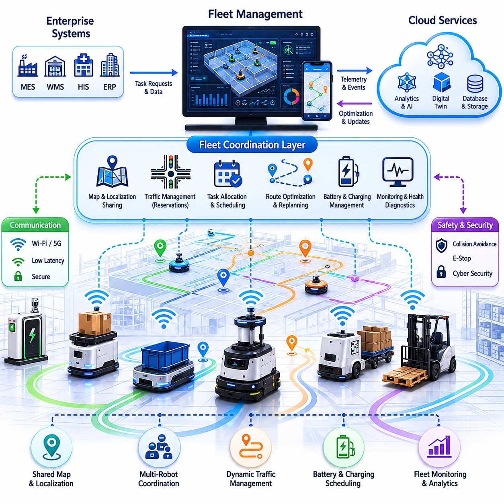
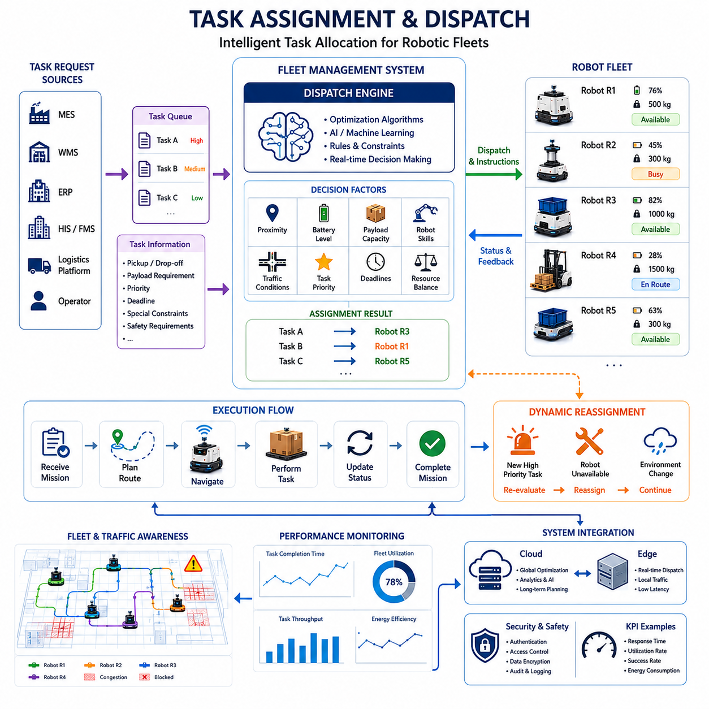
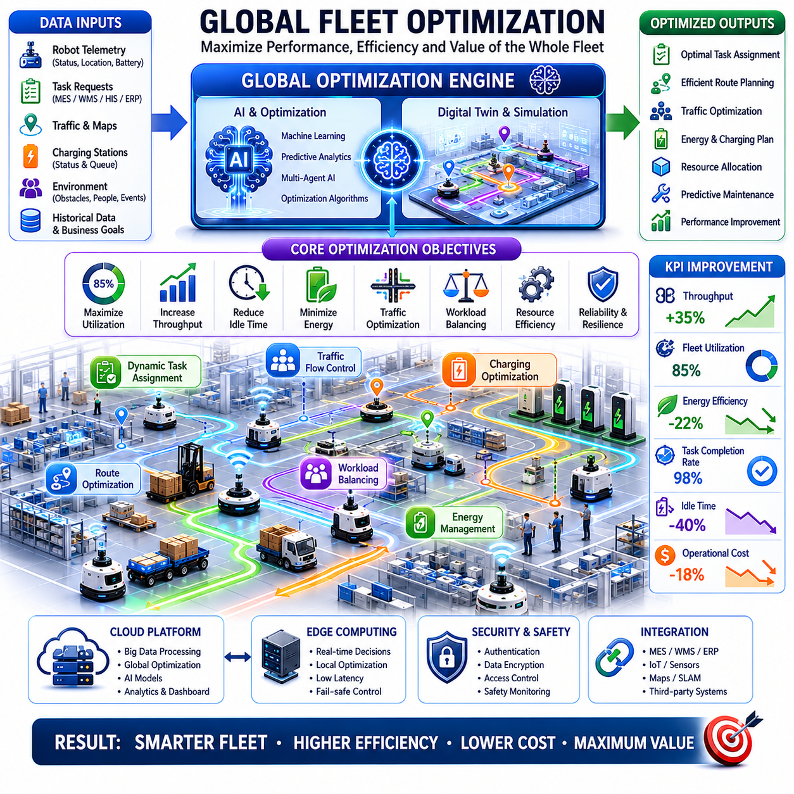
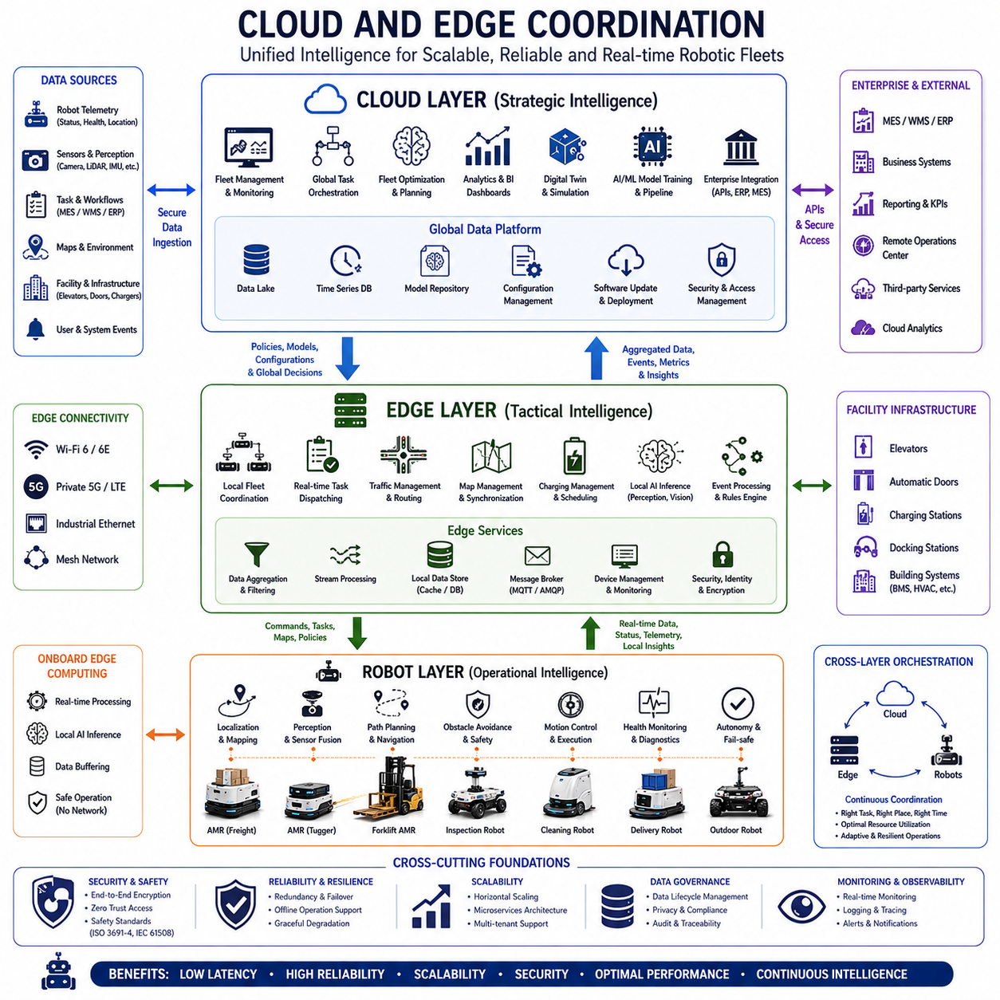
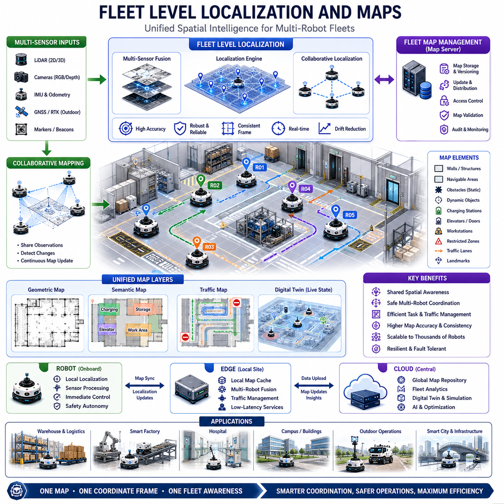
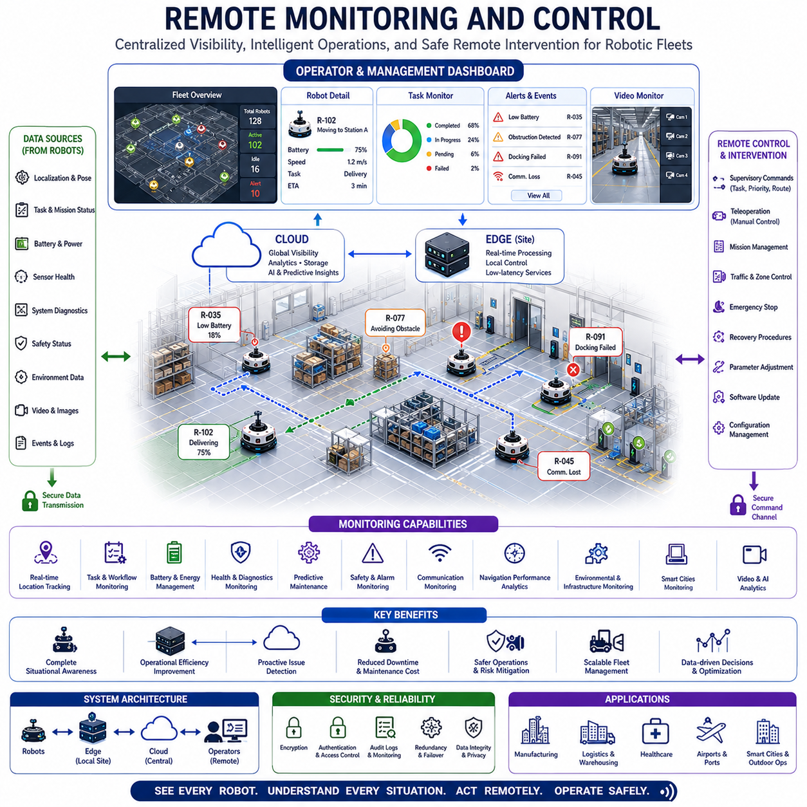
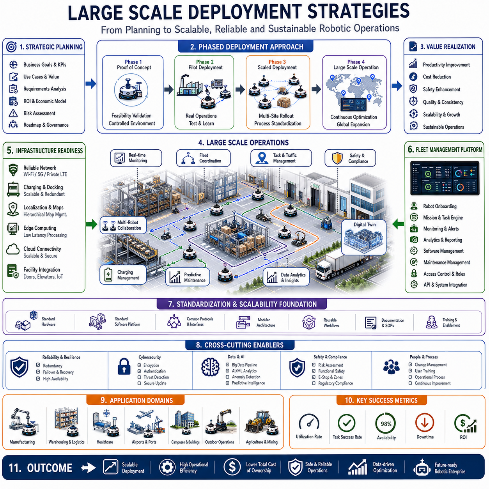
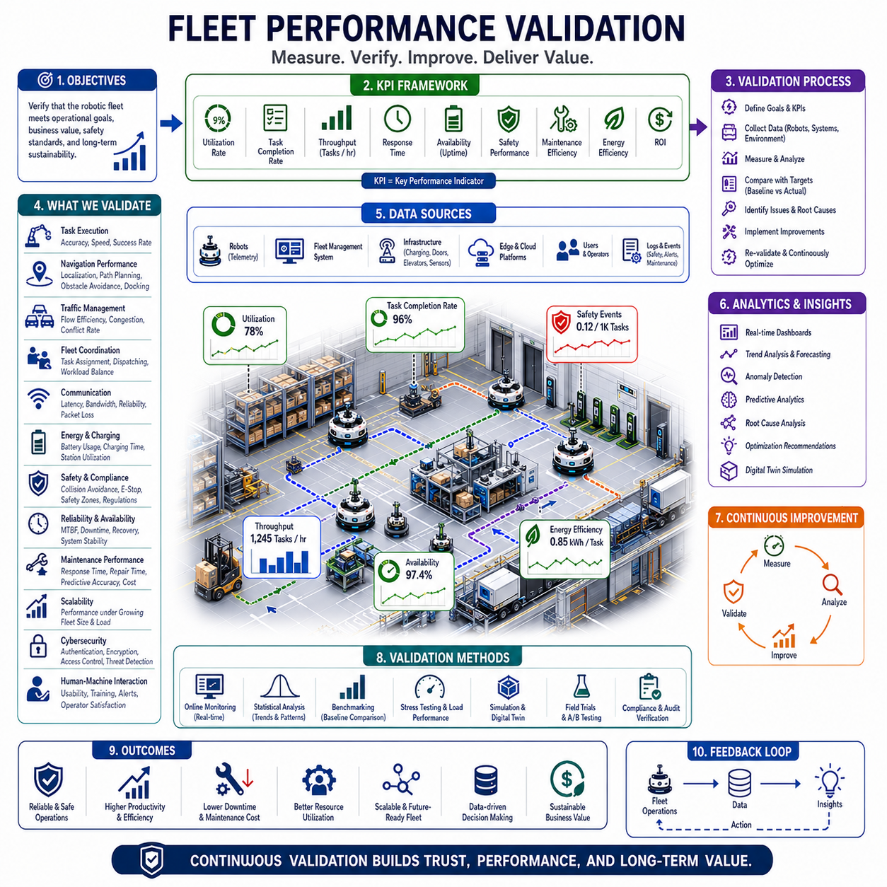

**Volume 05. Path Planning and Autonomous Navigation**

# Chapter 20. Fleet Level Navigation

## 20.1 Fleet Navigation Architecture

{width="7.268055555555556in" height="7.268055555555556in"}

Fleet Navigation Architecture is the foundational framework that enables a large number of Autonomous Mobile Robots (AMRs), outdoor autonomous robots, logistics vehicles, towing robots, hospital service robots, and industrial transport systems to operate as a coordinated and intelligent fleet rather than as isolated autonomous machines. Within modern robotic deployments, the navigation capability of a single robot is only one component of the overall system. As the number of robots increases, challenges such as traffic congestion, task conflicts, resource contention, route optimization, charging coordination, safety management, and operational scalability emerge. Fleet Navigation Architecture provides the software, communication, control, and decision-making infrastructure necessary to manage these complexities while maintaining high levels of safety, efficiency, reliability, and operational productivity. This topic is positioned within Fleet Level Navigation and serves as the architectural foundation for task dispatching, fleet optimization, cloud-edge coordination, localization sharing, monitoring systems, and large-scale deployment strategies.

The primary objective of a fleet navigation architecture is to transform multiple independent robots into a coordinated robotic ecosystem capable of operating within a shared environment. Instead of each robot planning routes independently without awareness of others, fleet-level intelligence enables robots to understand global traffic conditions, fleet priorities, operational constraints, and organizational objectives. The architecture ensures that robot decisions are aligned not only with local navigation goals but also with the broader operational goals of the enterprise. This approach improves throughput, minimizes idle time, reduces collisions, prevents deadlocks, and maximizes utilization of fleet resources. Fleet Navigation Architecture therefore becomes a critical enabler for smart factories, hospitals, airports, logistics centers, warehouses, ports, campuses, and smart city robotic deployments.

A typical fleet navigation system consists of several interconnected layers. At the lowest level, each robot maintains onboard autonomy capabilities including localization, mapping, obstacle detection, path planning, motion control, and safety management. These functions must remain operational even if communication with higher-level systems becomes temporarily unavailable. Above the robot autonomy layer exists the fleet coordination layer responsible for managing interactions among robots. This layer maintains fleet-wide awareness of robot positions, mission states, battery levels, traffic conditions, and environmental constraints. At a higher level, operational management systems provide task scheduling, workflow integration, reporting, analytics, and enterprise connectivity. Together these layers form a hierarchical architecture that balances local autonomy with centralized coordination.

The robot autonomy layer serves as the foundation of the architecture. Each robot continuously performs localization using LiDAR, cameras, GNSS RTK, IMU sensors, wheel odometry, or multi-sensor fusion techniques. The robot generates real-time estimates of its position and orientation while maintaining awareness of surrounding obstacles. Local planners generate collision-free trajectories and adjust movement commands according to dynamic environmental conditions. Emergency stop systems, safety LiDARs, and functional safety mechanisms ensure safe operation even in the presence of unexpected hazards. Because communication interruptions can occur, robots must retain sufficient onboard intelligence to continue safe operation independently whenever necessary.

The fleet coordination layer acts as the intelligence hub of the entire robotic system. This layer collects telemetry data from all robots and maintains a global operational picture. Position updates, task statuses, health indicators, battery conditions, sensor diagnostics, and environmental observations are continuously aggregated into a central fleet database. By maintaining real-time visibility into fleet operations, the coordination system can optimize task allocation, traffic management, charging schedules, and route planning. The fleet coordinator effectively serves as an air traffic control system for robots operating within a shared environment.

Communication infrastructure is a critical component of Fleet Navigation Architecture. Reliable communication enables continuous data exchange between robots and fleet management systems. Wireless technologies such as Wi-Fi, private 5G, LTE, mesh networking, and industrial wireless networks are commonly used depending on deployment requirements. Communication channels must support low-latency control messages, navigation updates, video streams, telemetry information, diagnostic data, and software updates. Redundancy mechanisms are often implemented to ensure communication resilience. When communication degradation occurs, robots must transition gracefully into autonomous fallback modes without compromising safety.

Map management represents another essential architectural element. Fleet-level navigation relies on a shared understanding of the environment. Centralized map servers maintain global maps, semantic information, restricted zones, traffic rules, charging station locations, docking stations, elevators, automatic doors, workstations, and operational landmarks. Robots synchronize local maps with centralized repositories and receive updates whenever environmental changes occur. In large deployments involving multiple buildings, campuses, factories, or city-scale environments, hierarchical map structures are frequently employed to manage complexity efficiently.

Localization sharing significantly improves fleet performance. Instead of treating localization as an isolated function performed independently by each robot, fleet architectures can leverage shared localization services. Robots contribute environmental observations to collective mapping systems, enabling continuous refinement of maps and improved localization accuracy. Multi-robot localization techniques allow robots to benefit from observations collected by other fleet members. This collaborative approach enhances robustness in dynamic environments and reduces localization failures caused by environmental changes.

Fleet navigation architecture must also address traffic management. As robot density increases, route conflicts become unavoidable. Multiple robots may attempt to traverse the same corridor, enter the same intersection, access the same charging station, or occupy the same workspace. Traffic management systems coordinate robot movements through reservation mechanisms, virtual traffic signals, right-of-way rules, priority scheduling, and dynamic route optimization. These mechanisms prevent collisions while maximizing traffic flow efficiency. Advanced systems continuously monitor traffic patterns and proactively adjust routes to minimize congestion.

Path reservation mechanisms are particularly important in dense environments. Before entering critical areas such as intersections, narrow corridors, elevators, or docking stations, robots request permission from the fleet coordinator. The coordinator evaluates current and predicted traffic conditions before granting access. Reservation systems prevent conflicts before they occur rather than relying solely on reactive obstacle avoidance. This proactive coordination significantly improves fleet efficiency and operational predictability.

Task management forms another major component of fleet architecture. Missions originate from manufacturing execution systems, warehouse management systems, hospital information systems, logistics platforms, or human operators. The fleet manager receives task requests and determines which robot should execute each mission. Assignment decisions consider robot location, battery status, current workload, payload capability, availability, traffic conditions, maintenance schedules, and operational priorities. Effective task allocation algorithms maximize resource utilization while minimizing travel distance and completion time.

Battery management and charging coordination are tightly integrated into fleet navigation architecture. Large robot fleets require intelligent charging strategies to avoid operational disruptions. The fleet manager continuously monitors battery levels and predicts energy consumption. Charging tasks are scheduled proactively to prevent robots from becoming unavailable during critical operations. Queue management algorithms coordinate access to charging stations and balance charging demand across available infrastructure. Predictive battery management enables continuous fleet operation without unnecessary downtime.

Cloud-based architectures have become increasingly important in modern fleet deployments. Cloud platforms provide scalable computing resources for fleet coordination, data storage, analytics, simulation, machine learning, and operational monitoring. Fleet data collected from robots can be aggregated into centralized cloud environments where advanced optimization algorithms analyze operational patterns. Cloud-based architectures enable global fleet visibility across multiple facilities and support enterprise-wide operational management.

Despite the advantages of cloud computing, edge computing remains essential for real-time robotic operations. Navigation decisions often require millisecond-level response times that cannot depend entirely on cloud connectivity. Fleet Navigation Architecture therefore commonly employs hybrid cloud-edge architectures. Real-time safety functions, obstacle avoidance, and motion control remain on the robot or local edge servers, while computationally intensive optimization and analytics tasks are performed in the cloud. This hybrid architecture balances responsiveness, scalability, and operational efficiency.

Digital twin integration is becoming an increasingly important aspect of fleet navigation systems. A digital twin maintains a virtual representation of robots, facilities, workflows, and operational conditions. Fleet managers can visualize robot movements, analyze traffic flows, simulate operational changes, and evaluate deployment strategies within the digital twin before implementing modifications in the real world. Digital twins improve operational planning, reduce deployment risks, and accelerate continuous optimization efforts.

Scalability represents one of the most important design requirements for fleet navigation architecture. Systems designed for ten robots may encounter significant challenges when expanded to hundreds or thousands of robots. Architectural decisions must therefore support horizontal scalability, distributed computing, fault tolerance, and efficient communication management. Microservices architectures, distributed databases, event-driven communication frameworks, and containerized deployment models are frequently employed to support large-scale robotic operations.

Reliability and fault tolerance are equally critical. Fleet navigation systems operate in environments where operational continuity directly impacts productivity and safety. Hardware failures, network outages, sensor malfunctions, localization errors, and software defects must be anticipated and managed. Redundant servers, failover mechanisms, distributed processing architectures, and autonomous fallback modes help ensure uninterrupted operations. Robots should continue operating safely even when portions of the fleet management infrastructure experience failures.

Cybersecurity plays an increasingly important role in fleet architecture. Robots connected to enterprise networks and cloud platforms introduce potential attack surfaces that must be protected. Authentication, encryption, secure communication protocols, access control systems, intrusion detection mechanisms, and software integrity verification procedures are integrated into modern fleet architectures. Cybersecurity considerations must be incorporated from the earliest stages of system design rather than added as an afterthought.

Fleet Navigation Architecture also supports operational analytics and continuous improvement. Data generated by robots provides valuable insights into traffic patterns, bottlenecks, battery utilization, task completion times, maintenance requirements, and operational efficiency. Analytics platforms transform raw telemetry into actionable intelligence that can guide optimization efforts. Machine learning algorithms may identify recurring inefficiencies and recommend improvements to routes, workflows, charging schedules, or deployment configurations.

In hospital environments, fleet navigation architecture coordinates service robots transporting medications, laboratory samples, linens, meals, and medical supplies. Robots must interact with elevators, automatic doors, nursing stations, and clinical workflows while maintaining strict safety standards around patients and healthcare staff. Fleet coordination ensures reliable operation across multiple floors and departments while minimizing disruption to hospital activities.

In smart factories, fleet navigation architecture integrates closely with manufacturing execution systems, production planning platforms, and warehouse management systems. Material transportation tasks are synchronized with production schedules, enabling just-in-time delivery of components and reducing inventory handling costs. Real-time fleet visibility improves production efficiency while supporting flexible manufacturing processes.

In outdoor robotic deployments, fleet architecture must address additional challenges including GNSS variability, weather conditions, large operational areas, dynamic traffic environments, and intermittent connectivity. Outdoor fleets often combine local autonomy with cloud-based coordination to manage patrol robots, inspection robots, logistics vehicles, agricultural robots, and infrastructure monitoring platforms. Advanced fleet architectures enable coordinated operation across large geographic regions while maintaining robust performance under changing environmental conditions.

Future Fleet Navigation Architectures will increasingly leverage artificial intelligence, multi-agent coordination, large-scale digital twins, foundation models, and autonomous decision-making systems. Rather than relying solely on predefined rules, future fleets will adapt dynamically to changing environments, operational objectives, and human requirements. Robots will collaborate more effectively through shared world models, semantic understanding, predictive planning, and distributed intelligence. As robotic deployments continue to expand across industries, Fleet Navigation Architecture will evolve from a fleet management tool into a comprehensive autonomous operational platform capable of orchestrating thousands of intelligent machines within complex real-world environments. This evolution will form the technological backbone of next-generation autonomous factories, hospitals, logistics networks, smart cities, and large-scale robotic ecosystems.

## 20.2 Task Assignment and Dispatch

{width="7.268055555555556in" height="7.268055555555556in"}

Task Assignment and Dispatch is one of the most critical functions within Fleet Level Navigation because it determines how work is distributed across a fleet of autonomous mobile robots operating in a shared environment. While navigation enables a robot to move from one location to another, task assignment determines which robot should perform a particular mission, when that mission should begin, how resources should be allocated, and how operational priorities should be balanced across the entire fleet. In modern AMR deployments, the efficiency of task assignment directly influences throughput, robot utilization, operational cost, battery consumption, traffic congestion, and customer satisfaction. As robotic systems scale from a few robots to hundreds or even thousands of autonomous machines, intelligent dispatching becomes a fundamental requirement for achieving reliable and efficient operations.

The primary objective of task assignment is to ensure that every task is executed by the most appropriate robot at the most appropriate time. In a simple deployment involving a small number of robots, tasks can be assigned using basic first-available or nearest-robot strategies. However, large-scale industrial environments present significantly greater complexity. Multiple robots may be capable of performing the same task, while individual robots may possess different payload capacities, battery levels, sensor configurations, navigation capabilities, certifications, or operational restrictions. Furthermore, task priorities may vary according to business objectives, production schedules, customer demands, or safety requirements. The dispatch system must therefore evaluate numerous variables simultaneously before making assignment decisions.

Task Assignment and Dispatch operates as a central intelligence layer within the Fleet Management System. The dispatch engine continuously receives task requests from enterprise systems such as Manufacturing Execution Systems (MES), Warehouse Management Systems (WMS), Enterprise Resource Planning (ERP) systems, Hospital Information Systems (HIS), Facility Management Systems (FMS), logistics management platforms, or human operators. These requests are transformed into executable missions that can be assigned to robots within the fleet. The dispatch system monitors fleet status in real time and dynamically matches available resources with operational demands.

A typical task begins when a request enters the fleet management platform. The request may involve transporting materials between workstations, delivering medical supplies to a hospital department, towing carts between production lines, moving inventory within a warehouse, performing infrastructure inspections, collecting sensor data, or conducting autonomous patrol operations. Each request includes information such as pickup location, delivery destination, required payload capacity, service-level priority, completion deadline, safety requirements, and operational constraints. The dispatch system analyzes these parameters and determines how the task should be executed.

One of the most common dispatching approaches is proximity-based assignment. In this method, the fleet manager selects the robot closest to the task location. This strategy minimizes travel distance and often reduces response time. However, proximity alone may not produce optimal fleet-wide performance. A nearby robot may already be assigned to a high-priority mission, may have insufficient battery capacity, or may be moving toward a more strategically important destination. Consequently, advanced dispatch systems evaluate a broader range of operational factors before making decisions.

Battery status plays an essential role in task assignment. A robot with a low battery may technically be capable of completing a mission, but assigning the task could increase the risk of interruption or emergency charging requirements. Modern dispatch systems continuously estimate future energy consumption and evaluate whether a robot can successfully complete a mission while maintaining operational safety margins. In many cases, robots approaching charging thresholds are excluded from consideration, allowing healthier robots to perform assigned tasks.

Payload capability is another important consideration. Industrial fleets often contain heterogeneous robot types designed for different operational requirements. Some robots may be optimized for lightweight deliveries, while others are capable of transporting heavy loads or towing multi-ton trailers. The dispatch engine must ensure that assigned robots possess the physical capabilities required to complete each mission. Failure to consider payload constraints can result in reduced efficiency, increased wear on equipment, or mission failures.

Traffic conditions significantly influence dispatch decisions. In a large facility, the shortest path may not necessarily represent the fastest route. Congested corridors, busy intersections, elevator queues, and charging station bottlenecks can dramatically impact travel times. Advanced dispatch systems maintain a real-time model of fleet traffic and predict future congestion patterns. By considering traffic conditions during task assignment, the system can distribute workloads more effectively and reduce delays caused by robot clustering.

Task prioritization represents another critical aspect of dispatching. Not all tasks carry the same importance. Emergency deliveries in hospitals, critical production materials in factories, urgent maintenance inspections, or safety-related missions may require immediate execution. Dispatch systems therefore incorporate priority models that ensure high-value tasks receive appropriate resources. Dynamic prioritization mechanisms continuously adjust task importance based on changing operational conditions.

Scheduling becomes increasingly important as fleet size grows. In high-density environments, hundreds of tasks may compete for limited robotic resources. The dispatch system must determine not only which robot performs each task but also when the task should be executed. Scheduling algorithms optimize resource allocation over time while balancing operational objectives such as throughput, response time, energy efficiency, and workload distribution.

Modern dispatch systems frequently employ optimization algorithms to improve assignment quality. Mathematical optimization methods such as linear programming, mixed-integer optimization, heuristic scheduling, and metaheuristic approaches can identify near-optimal assignment solutions across large fleets. These techniques evaluate thousands of potential assignments and select combinations that maximize overall fleet performance while satisfying operational constraints.

Artificial intelligence is increasingly being incorporated into task assignment architectures. Machine learning models can analyze historical fleet operations and identify patterns that improve future decision-making. AI-based dispatch systems can predict task demand, estimate travel times, forecast traffic congestion, anticipate charging requirements, and recommend assignment strategies. Over time, these systems continuously improve their performance by learning from operational experience.

Task Assignment and Dispatch also requires close integration with navigation systems. Once a task is assigned, the robot must receive detailed mission instructions, route information, operational constraints, and priority settings. The dispatch engine communicates with navigation controllers to ensure that assigned missions can be executed safely and efficiently. Real-time feedback from navigation systems allows dispatch algorithms to adapt to changing environmental conditions.

Dynamic reassignment is a key capability in modern fleet architectures. Operational environments are inherently unpredictable. A robot may encounter an obstacle, experience a hardware fault, lose connectivity, or become unavailable due to maintenance requirements. Similarly, new high-priority tasks may emerge unexpectedly. The dispatch system continuously reevaluates fleet status and can reassign missions whenever operational conditions change. This flexibility significantly improves resilience and responsiveness.

Resource balancing is another important objective. Without intelligent coordination, certain robots may become overloaded while others remain idle. Uneven workload distribution can increase maintenance requirements, reduce equipment lifespan, and create operational inefficiencies. Dispatch systems therefore monitor utilization metrics and actively balance workloads across available fleet resources. Balanced utilization contributes to improved reliability and long-term operational sustainability.

Multi-robot collaboration introduces additional complexity into task assignment. Certain operations require multiple robots to cooperate on a shared mission. Examples include transporting oversized loads, coordinating warehouse replenishment operations, executing synchronized inspection activities, or supporting large-scale logistics workflows. In such scenarios, the dispatch system must coordinate multiple robots simultaneously while ensuring synchronization and conflict avoidance.

Hospital environments provide a compelling example of advanced dispatch requirements. Service robots may be responsible for transporting medications, laboratory samples, meals, linens, waste materials, and medical supplies throughout a facility. Some deliveries may be routine while others are time-critical. Dispatch systems must consider infection control requirements, elevator availability, department priorities, and operational urgency when assigning tasks. Effective dispatching directly contributes to improved patient care and operational efficiency.

Manufacturing facilities present a different set of challenges. Production schedules often depend on precise material delivery timing. Delays in transporting components can disrupt entire production lines. Dispatch systems must therefore integrate closely with manufacturing execution systems and production planning software. Real-time visibility into production status allows the fleet manager to prioritize material movements according to manufacturing requirements.

Warehouse operations represent one of the most demanding environments for task assignment. Thousands of inventory movements may occur each day. Dispatch systems must coordinate picking, replenishment, inventory transfers, order fulfillment, and shipping operations while minimizing travel distance and maximizing throughput. Advanced warehouse fleets frequently rely on predictive dispatching algorithms that anticipate demand before tasks are explicitly requested.

Outdoor robotic deployments introduce additional factors into dispatch decisions. Weather conditions, GNSS availability, road accessibility, traffic regulations, and communication coverage can influence robot performance. Dispatch systems operating in outdoor environments must account for these variables while maintaining safe and efficient mission execution. Predictive environmental models can improve assignment decisions by anticipating future operational conditions.

Cloud-based dispatch architectures have become increasingly common because they provide centralized visibility and scalable computing resources. Cloud platforms can coordinate large fleets distributed across multiple facilities while supporting advanced optimization and analytics capabilities. However, real-time responsiveness remains critical. For this reason, many systems employ hybrid cloud-edge architectures in which strategic planning occurs in the cloud while tactical dispatch decisions are performed at local edge servers.

Cybersecurity considerations are essential within task assignment systems. Unauthorized access to dispatch functions could disrupt operations, compromise safety, or create logistical failures. Secure authentication, encrypted communication, access control policies, audit logging, and role-based permissions are therefore integrated into fleet management platforms. Robust cybersecurity measures ensure operational integrity while protecting critical infrastructure.

Performance measurement plays a central role in evaluating dispatch effectiveness. Common metrics include task completion time, fleet utilization rate, average response time, travel efficiency, energy consumption, throughput, mission success rate, and operational cost. Continuous monitoring of these metrics enables organizations to identify optimization opportunities and improve overall fleet performance.

Simulation and digital twin technologies are increasingly used to validate dispatch algorithms before deployment. Virtual environments allow engineers to test assignment strategies under a wide range of operational scenarios without disrupting real-world operations. Simulations help identify bottlenecks, evaluate scalability, and compare alternative dispatch methodologies. Digital twins provide ongoing visibility into fleet performance and support continuous optimization efforts.

As robotic deployments continue to expand, Task Assignment and Dispatch will evolve beyond simple scheduling systems into intelligent operational orchestration platforms. Future dispatch architectures will incorporate multi-agent artificial intelligence, predictive analytics, digital twins, large-scale optimization engines, and autonomous decision-making capabilities. Robots will increasingly collaborate through shared operational awareness, dynamically negotiate task ownership, and adapt collectively to changing mission requirements. The fleet manager of the future will function not merely as a dispatcher but as an intelligent coordination system capable of orchestrating thousands of autonomous machines across factories, hospitals, logistics networks, airports, ports, campuses, and smart cities. Through advanced task assignment and dispatch technologies, robotic fleets will achieve unprecedented levels of efficiency, scalability, adaptability, and operational intelligence, forming a critical foundation for the next generation of autonomous robotic ecosystems.

## 20.3 Global Fleet Optimization

{width="7.268055555555556in" height="7.268055555555556in"}

Global Fleet Optimization is the strategic intelligence layer that maximizes the overall performance, efficiency, scalability, and operational effectiveness of a robotic fleet operating across a shared environment. While local navigation focuses on the movement of individual robots and fleet coordination manages interactions among multiple robots, Global Fleet Optimization considers the entire robotic ecosystem as a unified operational system. Its purpose is not simply to ensure that robots complete their assigned tasks, but to ensure that the collective behavior of all robots contributes to achieving the highest possible operational value. In modern autonomous mobile robot deployments, where hundreds or thousands of robots operate simultaneously across factories, warehouses, hospitals, airports, ports, campuses, and smart cities, global optimization becomes a critical capability for maintaining productivity and minimizing operational costs.

The fundamental objective of Global Fleet Optimization is to continuously improve the utilization of all available robotic resources. Every robot within the fleet represents a valuable operational asset that consumes energy, requires maintenance, occupies network bandwidth, and contributes to organizational workflows. An optimized fleet seeks to maximize throughput, minimize idle time, reduce energy consumption, improve task completion rates, balance workloads, and enhance overall system reliability. Rather than focusing on individual robot efficiency, Global Fleet Optimization evaluates the performance of the entire fleet and seeks solutions that maximize system-wide benefits.

In traditional robotic systems, robots often operate independently with limited awareness of overall fleet conditions. Although each robot may perform its assigned mission efficiently, the collective behavior of the fleet may still produce bottlenecks, congestion, resource conflicts, and inefficient workload distribution. Global Fleet Optimization addresses these challenges by maintaining a centralized understanding of fleet operations and making decisions based on global objectives rather than local objectives. This shift from local optimization to global optimization is one of the defining characteristics of advanced fleet management systems.

A Global Fleet Optimization platform continuously collects information from all robots operating within the environment. Position data, mission status, battery conditions, sensor health, traffic conditions, charging station utilization, network performance, environmental observations, and operational metrics are aggregated into a unified data model. This comprehensive operational awareness allows the optimization engine to identify inefficiencies and implement corrective actions before problems impact productivity.

One of the primary optimization targets is fleet utilization. In many deployments, certain robots become overloaded while others remain underutilized. Such imbalances reduce overall efficiency and increase maintenance requirements for heavily used robots. Global Fleet Optimization continuously monitors robot workloads and redistributes tasks to maintain balanced utilization across the fleet. Balanced workload distribution improves equipment longevity, reduces maintenance costs, and increases operational resilience.

Task execution efficiency is another major focus area. Every task assigned to a robot consumes time, energy, and computational resources. Optimization systems analyze task characteristics and identify opportunities to improve execution efficiency. Similar tasks may be grouped together, delivery routes may be consolidated, and mission sequences may be reorganized to minimize travel distance. By reducing unnecessary movement, the fleet can complete more work using the same resources.

Traffic optimization plays a crucial role in large-scale robotic operations. As robot density increases, congestion becomes a significant operational challenge. Multiple robots competing for access to corridors, intersections, elevators, loading zones, docking stations, and charging stations can create delays that reduce throughput. Global Fleet Optimization continuously analyzes traffic patterns and predicts future congestion. Route recommendations, scheduling adjustments, and traffic control strategies are dynamically generated to maintain smooth traffic flow throughout the environment.

Dynamic route optimization enables the fleet to adapt to changing conditions in real time. Environmental changes, temporary obstacles, maintenance activities, human traffic, and unexpected events can alter operational conditions. The optimization engine continuously evaluates alternative routing strategies and updates navigation plans whenever more efficient paths become available. This adaptive capability improves responsiveness while minimizing disruptions.

Energy optimization has become increasingly important as robotic fleets continue to grow in size. Battery-powered robots must carefully manage energy consumption to maintain operational continuity. Global Fleet Optimization monitors battery levels, charging schedules, mission demands, and charging infrastructure utilization. The system predicts future energy requirements and proactively schedules charging activities. Intelligent charging coordination prevents congestion at charging stations while ensuring that robots remain available when needed.

Charging infrastructure optimization is particularly important in facilities with limited charging resources. If multiple robots attempt to charge simultaneously, operational bottlenecks may occur. Global optimization systems coordinate charging schedules across the fleet and dynamically adjust charging priorities according to operational demands. Robots assigned to high-priority missions may receive charging priority, while less critical robots may defer charging until resources become available.

Resource allocation optimization extends beyond robots themselves. Modern robotic ecosystems include charging stations, elevators, automatic doors, loading docks, docking stations, wireless network infrastructure, edge computing resources, cloud services, and maintenance facilities. These resources must be shared among many robots. Global Fleet Optimization ensures that resource utilization remains balanced and that critical infrastructure does not become a bottleneck.

Task scheduling optimization represents one of the most sophisticated aspects of fleet management. Large deployments often involve thousands of task requests with varying priorities, deadlines, payload requirements, and operational constraints. Optimization algorithms continuously evaluate scheduling decisions and seek task allocations that maximize throughput while satisfying service-level requirements. Advanced scheduling systems can anticipate future demand and allocate resources proactively rather than reacting only to immediate requests.

Predictive optimization introduces a forward-looking dimension to fleet management. Rather than responding solely to current conditions, predictive systems analyze historical data, operational trends, environmental patterns, and business forecasts to anticipate future requirements. Machine learning models can predict traffic congestion, battery depletion, maintenance needs, task demand fluctuations, and infrastructure utilization patterns. These predictions allow optimization engines to make proactive decisions that prevent operational problems before they occur.

Artificial intelligence is increasingly becoming the driving force behind Global Fleet Optimization. Traditional rule-based systems struggle to manage the complexity of large-scale robotic ecosystems. AI-driven optimization platforms can evaluate vast numbers of variables simultaneously and discover relationships that may not be apparent to human operators. Reinforcement learning, machine learning, deep learning, graph optimization, and multi-agent AI systems are being applied to improve decision-making across robotic fleets.

Multi-agent optimization is particularly relevant for future robotic systems. In a multi-agent environment, each robot functions as an intelligent agent capable of cooperating with other agents. Rather than relying entirely on centralized control, optimization decisions may emerge through distributed collaboration among robots. Robots can negotiate task ownership, share operational information, coordinate routes, and collectively optimize fleet performance. This distributed approach improves scalability and resilience while reducing dependence on centralized infrastructure.

Map optimization is another important component of fleet-level intelligence. Large facilities often undergo continuous changes due to equipment relocation, construction activities, operational adjustments, and environmental modifications. Global Fleet Optimization maintains updated maps and evaluates how environmental changes impact fleet efficiency. Route networks, traffic zones, restricted areas, and operational workflows can be adjusted dynamically to improve overall performance.

Localization optimization contributes to improved fleet reliability. Multiple robots operating within the same environment generate large volumes of localization and mapping data. Shared localization services allow robots to contribute observations that improve map accuracy and positioning reliability. Optimization systems analyze localization quality and identify opportunities to improve positioning performance throughout the fleet.

Cloud-based architectures provide significant advantages for Global Fleet Optimization. Cloud platforms offer virtually unlimited computational resources capable of processing large-scale operational datasets. Complex optimization algorithms, predictive models, digital twins, and enterprise analytics platforms can be executed efficiently within cloud environments. Centralized cloud infrastructure also enables coordination across multiple facilities and geographic regions.

However, global optimization must coexist with real-time operational requirements. Safety-critical navigation decisions often require millisecond-level response times that cannot depend entirely on cloud communication. For this reason, modern systems employ cloud-edge hybrid architectures. Strategic optimization functions are performed in the cloud, while tactical decision-making and safety-related functions remain at local edge servers or onboard robots. This architecture balances scalability, responsiveness, and reliability.

Digital twins are increasingly being integrated into Global Fleet Optimization frameworks. A digital twin maintains a virtual representation of robots, facilities, workflows, infrastructure, and environmental conditions. Optimization algorithms can evaluate proposed changes within the digital twin before applying them to real-world operations. This capability significantly reduces deployment risk and supports continuous improvement initiatives.

Operational analytics provide the foundation for optimization efforts. Data collected from robots is transformed into actionable insights through dashboards, reports, and AI-driven analysis tools. Metrics such as throughput, robot utilization, task completion time, travel distance, battery efficiency, congestion frequency, charging station usage, maintenance rates, and operational costs are continuously monitored. Optimization strategies are evaluated using these metrics to ensure measurable performance improvements.

Maintenance optimization is becoming an increasingly important aspect of fleet operations. Predictive maintenance systems analyze robot health data and identify potential failures before they occur. Global Fleet Optimization integrates maintenance planning with operational scheduling to minimize downtime and maximize fleet availability. Maintenance activities can be scheduled during low-demand periods to reduce operational impact.

In hospital environments, Global Fleet Optimization ensures that medical logistics, laboratory sample transportation, medication delivery, waste collection, and patient support services operate efficiently across multiple departments and buildings. Optimization algorithms prioritize urgent medical deliveries while maintaining balanced utilization of available robots. The result is improved service quality and reduced workload for healthcare staff.

In manufacturing environments, optimization systems coordinate material transportation, production support, inventory movement, and workflow synchronization. By aligning robotic operations with production schedules, manufacturers can reduce delays, improve throughput, and support just-in-time manufacturing strategies. Global optimization contributes directly to overall factory productivity and operational profitability.

Warehouse and logistics operations represent some of the most demanding optimization environments. Thousands of inventory movements, order fulfillment tasks, replenishment activities, and shipping operations occur daily. Global Fleet Optimization continuously balances workload distribution, minimizes travel distance, reduces congestion, and maximizes order processing throughput. These improvements translate directly into increased operational efficiency and customer satisfaction.

Outdoor robotic fleets introduce additional optimization challenges. Weather conditions, GNSS variability, road conditions, communication coverage, and regulatory requirements must all be considered. Global optimization systems integrate environmental intelligence with operational planning to ensure safe and efficient execution of outdoor missions across large geographic areas.

Scalability remains one of the most important design considerations. A fleet consisting of ten robots may be manageable using simple scheduling algorithms, but fleets containing hundreds or thousands of robots require sophisticated optimization frameworks. Distributed computing architectures, microservices, event-driven systems, and scalable databases enable optimization platforms to support continuous growth without sacrificing performance.

Cybersecurity is also an essential requirement. Optimization systems often have access to critical operational infrastructure and enterprise data. Unauthorized manipulation of optimization decisions could disrupt operations, compromise safety, or create financial losses. Strong authentication, encryption, access controls, audit logging, and security monitoring systems are therefore integrated into modern optimization architectures.

The future of Global Fleet Optimization will be driven by advances in artificial intelligence, digital twins, foundation models, cloud-native robotics, and multi-agent autonomous systems. Future optimization platforms will possess the ability to understand organizational objectives, predict future operational conditions, simulate alternative strategies, and autonomously implement improvements without human intervention. Robotic fleets will increasingly function as self-optimizing ecosystems capable of adapting continuously to changing demands and environmental conditions.

As autonomous robotics expands into factories, hospitals, logistics centers, transportation hubs, smart cities, and critical infrastructure environments, Global Fleet Optimization will become the central intelligence layer that transforms large collections of individual robots into coordinated, efficient, scalable, and intelligent operational systems. Its role will extend far beyond resource allocation and scheduling, evolving into a comprehensive decision-making platform that continuously maximizes the value generated by every robot, every task, and every operational resource across the entire robotic ecosystem.

## 20.4 Cloud and Edge Coordination

{width="7.268055555555556in" height="7.268055555555556in"}

Cloud and Edge Coordination is one of the most important architectural foundations of modern Fleet Level Navigation systems. As robotic fleets continue to grow in size, complexity, and operational scope, neither cloud computing nor edge computing alone can satisfy all operational requirements. Cloud platforms provide virtually unlimited computational resources, centralized visibility, large-scale data analytics, artificial intelligence training environments, and enterprise-level integration capabilities. Edge systems provide low-latency processing, deterministic control, real-time responsiveness, and local autonomy. Cloud and Edge Coordination is the framework that enables these two computing domains to operate together as a unified intelligent infrastructure supporting large-scale autonomous robot deployments.

The primary objective of Cloud and Edge Coordination is to place the right computational task in the right location. Certain functions require immediate response times measured in milliseconds and must therefore execute on local edge devices or onboard robot computers. Other functions involve large-scale optimization, long-term planning, historical analysis, and machine learning model training, which are better suited to cloud environments. Effective coordination ensures that computational resources are utilized efficiently while maintaining safety, scalability, reliability, and operational performance.

In traditional robotic systems, most intelligence resided directly on the robot. Each robot performed localization, navigation, obstacle avoidance, task execution, and decision-making independently. While this architecture provided high autonomy, it limited collaboration and made large-scale fleet optimization difficult. As robotic deployments expanded, centralized cloud services emerged to provide fleet management, monitoring, analytics, and enterprise integration capabilities. However, relying entirely on cloud infrastructure introduced challenges related to communication latency, network reliability, bandwidth limitations, and safety-critical decision-making. Cloud and Edge Coordination evolved as a balanced architectural solution that combines the strengths of both approaches.

The cloud layer typically serves as the strategic intelligence center of the robotic ecosystem. It provides centralized fleet management, task orchestration, long-term planning, operational analytics, digital twin management, machine learning pipelines, software deployment services, and enterprise system integration. Because cloud platforms offer extensive computational resources, they can process enormous volumes of data collected from thousands of robots operating across multiple facilities and geographic regions.

The edge layer serves as the tactical intelligence center. Edge servers are typically deployed within factories, warehouses, hospitals, campuses, logistics hubs, or industrial facilities. These servers operate close to robots and can provide low-latency processing without requiring communication with remote cloud infrastructure. Edge computing enables real-time traffic management, local task coordination, map synchronization, video analytics, sensor fusion, and operational decision-making while maintaining responsiveness even when cloud connectivity is temporarily degraded.

Onboard robot computers represent the final layer of the architecture. Every robot maintains core autonomous functions including localization, perception, obstacle avoidance, path planning, motion control, safety management, and emergency response. These functions must remain operational regardless of network availability. Robot autonomy serves as the ultimate safety layer, ensuring that robots can continue operating safely even when communication with both edge and cloud systems becomes unavailable.

A fundamental principle of Cloud and Edge Coordination is hierarchical decision-making. Strategic decisions such as fleet optimization, resource allocation, maintenance scheduling, mission forecasting, and enterprise workflow integration are typically performed within cloud environments. Tactical decisions such as route adjustments, local traffic control, charging coordination, and task dispatching are often handled by edge servers. Operational decisions such as obstacle avoidance, trajectory generation, emergency braking, and motion control remain on the robot itself. This hierarchy allows each layer to focus on the tasks most appropriate for its capabilities.

Communication infrastructure plays a critical role in enabling coordination between cloud, edge, and robotic systems. Modern robotic deployments utilize Wi-Fi, private 5G, LTE, industrial Ethernet, mesh networking, and hybrid communication architectures. These communication channels support telemetry transmission, command distribution, map synchronization, software updates, video streaming, sensor sharing, and operational monitoring. Reliable communication is essential for maintaining consistency across all layers of the architecture.

Latency considerations strongly influence workload distribution. Certain robotic operations require response times below one hundred milliseconds. Collision avoidance, emergency stopping, obstacle detection, and motion control cannot tolerate delays introduced by cloud communication. Consequently, these functions remain onboard the robot. Edge systems support intermediate response requirements such as traffic management and local fleet coordination, while cloud platforms support functions that can tolerate longer execution times.

Bandwidth optimization is another important aspect of Cloud and Edge Coordination. Modern robotic fleets generate enormous quantities of data. High-resolution cameras, 3D LiDAR sensors, thermal imaging systems, radar sensors, GNSS receivers, and diagnostic systems continuously produce large data streams. Transmitting all raw sensor data directly to the cloud would consume excessive network bandwidth and increase operational costs. Edge computing addresses this challenge by performing local filtering, aggregation, compression, and event detection before transmitting relevant information to cloud systems.

Data management represents one of the largest responsibilities of the coordination framework. Data generated by robots is processed at multiple levels depending on operational requirements. Immediate navigation data remains onboard the robot. Local operational data may be processed at edge servers. Historical analytics, machine learning datasets, digital twin records, and enterprise reporting information are typically stored in cloud infrastructure. Effective data lifecycle management ensures that information is available where it is needed while minimizing unnecessary data movement.

Fleet management systems rely heavily on coordinated cloud-edge architectures. The cloud platform maintains global visibility across all facilities and operational regions. Edge systems manage local fleet activities within individual sites. This structure allows organizations to scale robotic deployments efficiently while maintaining local responsiveness. A multinational enterprise may operate thousands of robots across numerous facilities, each managed locally by edge systems while remaining connected to a centralized cloud platform.

Task assignment and dispatch functions frequently span both cloud and edge environments. Cloud systems perform strategic workload balancing across facilities and operational regions. Edge systems manage real-time dispatching within local environments. This separation enables large-scale optimization without compromising operational responsiveness. As tasks enter the system, cloud platforms determine global priorities while edge servers coordinate execution details.

Traffic management is another area where cloud-edge collaboration provides significant benefits. Global traffic policies, operational rules, and optimization strategies may be defined in the cloud. Local edge servers enforce these policies while adapting to real-time environmental conditions. Edge-based traffic control enables rapid responses to congestion, temporary obstacles, human activity, and operational disruptions without requiring continuous cloud involvement.

Map management systems benefit significantly from coordinated architectures. Global map repositories typically reside in cloud environments where updates can be distributed across multiple facilities. Edge servers maintain local copies optimized for site-specific operations. Robots synchronize with nearby edge systems to receive the most current map information. This architecture improves scalability while reducing communication latency.

Localization services also leverage cloud-edge collaboration. Robots continuously generate localization observations that contribute to map maintenance and environmental understanding. Edge systems aggregate localization data from local fleets and provide immediate support for positioning services. Cloud systems perform long-term map optimization, large-scale environmental modeling, and cross-site localization analysis.

Artificial intelligence development represents one of the most significant drivers of cloud-edge architectures. Training advanced machine learning models requires substantial computational resources that are typically available only in cloud environments. Large datasets collected from robotic operations are uploaded to cloud platforms where AI models are trained, validated, and optimized. Once trained, these models are deployed to edge servers or directly to robots for real-time inference.

Inference deployment strategies vary according to application requirements. Safety-critical perception models often execute directly on robot computers. Computationally intensive models may run on nearby edge servers. Enterprise analytics models typically execute in cloud environments. Cloud and Edge Coordination ensures that AI workloads are distributed efficiently according to latency, bandwidth, and computational constraints.

Digital twins provide another powerful use case for coordinated architectures. Digital twins maintain virtual representations of robots, facilities, workflows, infrastructure, and operational environments. Cloud platforms typically host large-scale digital twin environments because they require substantial storage and computational resources. Edge systems provide real-time operational updates that continuously synchronize virtual and physical environments. This coordination enables simulation, optimization, predictive maintenance, and operational planning.

Predictive maintenance systems rely heavily on cloud-edge integration. Robots continuously generate diagnostic information related to motors, batteries, sensors, actuators, communication systems, and computing hardware. Edge systems perform local health monitoring and immediate fault detection. Cloud platforms aggregate long-term maintenance data and utilize machine learning models to predict future failures. This combination improves reliability while reducing maintenance costs.

Cybersecurity is a critical consideration throughout the architecture. Communication channels connecting robots, edge servers, and cloud platforms must be protected against unauthorized access and cyber threats. Authentication, encryption, certificate management, intrusion detection, access control, secure boot mechanisms, and software integrity verification are essential components of modern Cloud and Edge Coordination frameworks. Security policies must be consistently enforced across all layers of the system.

Scalability is one of the primary advantages of cloud-edge architectures. As robotic deployments expand, cloud resources can be scaled dynamically to support increasing computational demands. Edge infrastructure can be deployed incrementally as new facilities become operational. This modular approach enables organizations to expand robotic operations without requiring complete architectural redesigns.

Reliability and fault tolerance are equally important. Cloud outages, network interruptions, hardware failures, and software defects are inevitable in large-scale systems. Cloud and Edge Coordination architectures are designed to ensure graceful degradation rather than catastrophic failure. If cloud connectivity is lost, edge systems continue local operations. If edge servers become unavailable, robots maintain onboard autonomy. This layered resilience ensures continuous operation under a wide range of failure scenarios.

Industrial manufacturing environments benefit significantly from coordinated architectures because production operations require both local responsiveness and enterprise-wide visibility. Edge systems support real-time production logistics, while cloud platforms provide production analytics, optimization, and reporting. Hospitals utilize cloud-edge architectures to coordinate medical logistics, facility management, patient support services, and fleet operations across multiple buildings. Warehouses leverage coordinated systems to optimize inventory movement, order fulfillment, and logistics workflows.

Outdoor robotic deployments introduce additional challenges including variable network coverage, weather conditions, geographic scale, and distributed operations. Edge systems deployed within regional hubs provide local operational support while cloud platforms coordinate large-scale activities. This architecture supports inspection robots, patrol robots, agricultural robots, infrastructure monitoring systems, and autonomous logistics vehicles operating across extensive geographic areas.

Future Cloud and Edge Coordination systems will become increasingly intelligent and autonomous. Artificial intelligence will dynamically determine workload placement based on operational conditions, network availability, computational requirements, and business objectives. Edge servers will become more powerful, enabling sophisticated AI inference closer to operational environments. Cloud platforms will support increasingly advanced digital twins, foundation models, world models, and autonomous optimization engines.

The emergence of cloud-native robotics will further transform fleet operations. Robots will increasingly function as distributed intelligent nodes connected to shared computational infrastructure. Knowledge learned by one robot can be propagated across entire fleets through cloud services. Shared world models, collaborative learning systems, and multi-agent intelligence frameworks will enable unprecedented levels of coordination and adaptability.

Ultimately, Cloud and Edge Coordination serves as the computational backbone of modern robotic ecosystems. It enables organizations to combine the scalability of cloud computing with the responsiveness of edge computing and the autonomy of intelligent robots. As robotic fleets continue to expand across factories, hospitals, logistics centers, airports, smart cities, infrastructure inspection networks, and industrial operations, Cloud and Edge Coordination will remain one of the most important architectural principles supporting safe, scalable, efficient, and intelligent autonomous systems.

## 20.5 Fleet Level Localization and Maps

{width="7.268055555555556in" height="7.268055555555556in"}

Fleet Level Localization and Maps is one of the most important enabling technologies in large-scale autonomous mobile robot systems because it provides a common spatial understanding across all robots operating within a fleet. While individual robot localization focuses on determining the position and orientation of a single robot, fleet-level localization expands this concept to include dozens, hundreds, or even thousands of robots operating simultaneously within shared environments. The objective is not only to ensure that each robot knows its own position accurately but also to establish a unified spatial framework that allows every robot, infrastructure component, management platform, and enterprise system to share a consistent understanding of the operational environment. Within Fleet Level Navigation, Fleet Level Localization and Maps serves as the foundation for traffic management, task assignment, fleet optimization, multi-robot coordination, cloud-edge operations, and large-scale deployment strategies.

The importance of localization cannot be overstated in autonomous robotic systems. Every navigation decision depends on accurate knowledge of position. Path planning, obstacle avoidance, docking, charging, task execution, and fleet coordination all rely on precise localization information. Errors in localization can propagate throughout the system, causing navigation failures, route inefficiencies, traffic conflicts, and operational disruptions. As fleet sizes increase, maintaining consistent localization performance across all robots becomes increasingly challenging. Fleet Level Localization addresses this challenge by introducing shared localization services, centralized map management, collaborative mapping, and fleet-wide spatial intelligence.

At the core of Fleet Level Localization is the concept of a common coordinate framework. Every robot operating within the fleet must reference a consistent coordinate system so that positions, routes, tasks, and environmental information can be interpreted correctly. Without a common reference frame, robots would maintain independent and potentially inconsistent representations of the environment. A fleet-wide coordinate system allows robots to share location information, exchange map updates, coordinate movements, and collaborate effectively.

Fleet localization systems often combine multiple positioning technologies. Indoor environments commonly rely on LiDAR-based localization, visual localization, fiducial markers, wheel odometry, inertial measurement units, and sensor fusion algorithms. Outdoor environments frequently incorporate GNSS, RTK-GNSS, visual SLAM, LiDAR SLAM, IMU integration, and high-definition maps. By combining multiple localization sources, the system achieves improved robustness, redundancy, and accuracy. Multi-sensor fusion is particularly important because individual sensors may experience temporary degradation due to environmental conditions, lighting changes, occlusions, or signal loss.

Maps serve as the spatial memory of the fleet. A map contains information about physical structures, navigable areas, obstacles, traffic zones, charging stations, docking locations, elevators, automatic doors, workstations, storage locations, restricted zones, and operational landmarks. Rather than serving solely as a navigation aid, maps become a central operational asset shared across the entire robotic ecosystem. Fleet-level map management ensures that all robots operate using consistent environmental information.

Several types of maps are commonly employed within fleet systems. Geometric maps describe physical structures such as walls, corridors, buildings, and terrain features. Semantic maps enrich geometric information with contextual meaning, identifying objects such as charging stations, loading docks, hospital departments, manufacturing cells, warehouse zones, and operational areas. Traffic maps define navigation rules, priority zones, restricted access regions, and operational policies. Digital twin maps extend these capabilities further by representing dynamic operational states and infrastructure conditions in real time.

Map management becomes significantly more complex as fleet scale increases. In a small deployment, a single map may be sufficient. However, large enterprises often operate across multiple buildings, campuses, factories, warehouses, hospitals, and outdoor facilities. Fleet Level Localization therefore employs hierarchical map architectures that organize spatial information into multiple layers. Global maps provide facility-wide awareness, while local maps support detailed navigation within specific operational zones. This hierarchy improves scalability and simplifies map maintenance.

Centralized map servers play a critical role within fleet architectures. Map servers maintain authoritative versions of fleet maps and distribute updates to robots and edge systems. When environmental changes occur, updated map information can be propagated throughout the fleet automatically. This capability ensures consistency while minimizing manual intervention. Centralized map management also supports version control, rollback mechanisms, validation workflows, and operational auditing.

Collaborative mapping represents one of the most powerful capabilities of fleet-level systems. Every robot continuously observes the environment through its sensors. These observations can be shared and combined to improve map quality. Multiple robots contribute environmental information to a centralized mapping service, enabling continuous map refinement. New obstacles, environmental modifications, construction activities, equipment relocations, and infrastructure changes can be detected automatically and incorporated into shared maps.

Multi-robot SLAM extends traditional SLAM methodologies into fleet environments. Instead of building maps independently, robots cooperate to create and maintain unified representations of the environment. Shared observations improve mapping efficiency and reduce duplication of effort. Large environments can be mapped more quickly because multiple robots contribute simultaneously. Multi-robot SLAM also improves resilience because information from multiple sources can compensate for individual sensor limitations.

Localization accuracy is a major performance metric within fleet operations. Different applications impose different accuracy requirements. Warehouse logistics robots may require positioning accuracy within several centimeters. Hospital delivery robots navigating elevators and automatic doors may require even tighter tolerances. Outdoor inspection robots operating across large geographic regions may rely on decimeter-level RTK positioning. Fleet Level Localization architectures must support varying accuracy requirements while maintaining consistency across operational domains.

Long-term localization presents unique challenges. Environments evolve continuously due to seasonal changes, lighting variations, equipment relocation, construction projects, and human activities. Maps that were accurate during deployment may gradually become outdated. Fleet localization systems therefore employ adaptive localization techniques that accommodate environmental evolution. Continuous map updates, semantic understanding, dynamic feature selection, and AI-based environmental adaptation contribute to long-term localization robustness.

Dynamic environments introduce additional complexity. Factories contain moving forklifts, carts, personnel, and machinery. Hospitals contain patients, staff, visitors, and mobile equipment. Warehouses experience continuous inventory movement. Traditional localization approaches may struggle when large portions of the environment change dynamically. Fleet-level systems address this challenge through dynamic object filtering, semantic scene understanding, and robust sensor fusion techniques that distinguish permanent structures from temporary changes.

Cloud and Edge Coordination plays an important role in fleet localization. Cloud platforms support large-scale map storage, long-term analytics, digital twin integration, and fleet-wide spatial intelligence. Edge servers provide low-latency localization services, local map synchronization, and real-time environmental updates. Robots perform immediate localization computations onboard while benefiting from information provided by edge and cloud infrastructure. This hierarchical architecture balances scalability and responsiveness.

Shared localization services improve fleet efficiency significantly. Rather than treating localization as an isolated function, fleet architectures enable robots to benefit from observations collected by other fleet members. If one robot detects an environmental change, the information can be distributed to the rest of the fleet. This collaborative awareness reduces localization errors and accelerates adaptation to environmental changes.

Traffic management systems rely heavily on accurate fleet localization. The fleet manager must know the precise position of every robot to coordinate traffic flow, prevent collisions, allocate routes, and manage intersections. Inaccurate localization can result in route conflicts, congestion, and reduced operational efficiency. Fleet-level localization therefore serves as the foundation for intelligent traffic coordination and path reservation systems.

Task assignment and dispatch functions also depend on localization accuracy. Dispatch systems evaluate robot positions when assigning missions. If location estimates are inaccurate, task allocation decisions may become suboptimal. Fleet localization ensures that dispatch algorithms operate using reliable spatial information, improving assignment quality and reducing unnecessary travel.

Global Fleet Optimization uses localization data extensively. Optimization engines analyze robot movements, traffic patterns, route efficiency, congestion hotspots, and operational workflows. Spatial analytics derived from localization data enable continuous optimization of fleet performance. Bottlenecks can be identified, workflow inefficiencies can be corrected, and resource utilization can be improved through data-driven decision making.

Digital twins are becoming increasingly important within fleet localization architectures. A digital twin maintains a virtual representation of robots, infrastructure, facilities, and operational processes. Localization data continuously synchronizes physical and virtual environments. Operators can visualize fleet operations in real time, analyze spatial relationships, simulate alternative configurations, and evaluate optimization strategies. Digital twins transform localization from a navigation capability into a strategic operational asset.

Artificial intelligence is playing a growing role in localization and mapping systems. Deep learning models improve place recognition, visual localization, semantic mapping, feature extraction, loop closure detection, and environmental understanding. AI-driven localization systems can adapt more effectively to dynamic environments and changing operational conditions. Machine learning also contributes to anomaly detection, localization confidence estimation, and predictive map maintenance.

Outdoor fleet localization introduces additional considerations. Large-scale deployments spanning campuses, industrial sites, transportation corridors, utility infrastructure, agricultural operations, and smart city environments require integration of GNSS, RTK corrections, visual localization, LiDAR mapping, and geospatial information systems. Hybrid localization architectures combine absolute positioning technologies with local sensor-based localization to achieve both global consistency and local accuracy.

Hospital deployments illustrate the importance of fleet-level localization. Service robots transporting medications, laboratory samples, meals, and medical supplies must navigate across multiple floors, elevators, departments, and buildings. Shared maps and consistent localization enable seamless movement throughout the facility. Infrastructure integrations such as automatic doors and elevators depend on precise positioning information.

Manufacturing facilities require equally sophisticated localization architectures. Material transport robots, autonomous forklifts, towing robots, and inspection robots operate within highly dynamic environments. Fleet localization supports synchronized operations, traffic management, inventory movement, and production logistics while maintaining high levels of reliability.

Warehouse environments represent some of the most demanding localization scenarios. Large facilities may contain thousands of storage locations, dynamic inventory layouts, and high robot densities. Fleet-level map management ensures that all robots maintain consistent awareness of storage locations, aisle structures, traffic patterns, and operational zones. This consistency is essential for efficient order fulfillment and inventory management.

Cybersecurity considerations are increasingly important in localization systems. Maps represent critical operational assets and may contain sensitive facility information. Unauthorized modification of maps or localization data could disrupt operations and compromise safety. Modern fleet architectures therefore incorporate encryption, authentication, access controls, audit logging, and integrity verification mechanisms to protect spatial information.

Scalability remains a key architectural requirement. As fleets grow from dozens to thousands of robots, localization services must accommodate increasing data volumes and computational demands. Distributed map servers, cloud-native architectures, scalable databases, edge processing frameworks, and efficient synchronization mechanisms enable fleet localization systems to scale effectively without sacrificing performance.

Performance validation is an essential component of fleet localization deployment. Localization accuracy, map consistency, synchronization latency, update reliability, scalability, robustness, and recovery performance must be evaluated through simulation, laboratory testing, and field validation. Continuous monitoring ensures that localization systems maintain required performance levels throughout operational lifecycles.

The future of Fleet Level Localization and Maps will be shaped by advances in AI, digital twins, cloud robotics, world models, multi-agent systems, and real-time spatial intelligence. Future robotic fleets will maintain continuously evolving shared world representations that integrate localization, mapping, perception, semantic understanding, operational workflows, and predictive analytics into unified spatial intelligence platforms. Robots will no longer simply localize themselves within static maps. Instead, fleets will collaboratively construct, maintain, understand, and optimize dynamic representations of the world in real time.

As autonomous robotics expands into factories, hospitals, logistics networks, airports, ports, infrastructure inspection systems, agricultural operations, and smart cities, Fleet Level Localization and Maps will become the spatial backbone of robotic ecosystems. It will provide the shared environmental awareness necessary for coordinated autonomy, intelligent decision-making, large-scale optimization, and seamless collaboration among thousands of autonomous machines operating within increasingly complex real-world environments.

## 20.6 Remote Monitoring and Control

{width="7.268055555555556in" height="7.268055555555556in"}

Remote Monitoring and Control is a fundamental capability of modern Fleet Level Navigation systems that enables operators, engineers, administrators, and enterprise management platforms to observe, supervise, analyze, and control robotic fleets from remote locations. As autonomous mobile robot deployments continue to expand across factories, warehouses, hospitals, airports, campuses, ports, logistics centers, industrial facilities, and smart cities, it becomes increasingly impractical to manage robots through direct physical interaction. Remote Monitoring and Control provides the digital infrastructure necessary to maintain situational awareness, operational oversight, safety assurance, and centralized fleet management regardless of the geographic location of robots or operators.

The primary objective of Remote Monitoring and Control is to provide complete visibility into fleet operations while enabling timely intervention when required. Autonomous robots are designed to operate independently, but autonomy does not eliminate the need for supervision. Unexpected situations, operational anomalies, infrastructure failures, environmental changes, mission conflicts, safety events, and maintenance requirements can occur at any time. Remote Monitoring and Control ensures that human operators remain informed and empowered to respond appropriately without being physically present at the operational site.

At its core, Remote Monitoring and Control transforms a collection of individual robots into a connected operational ecosystem. Every robot continuously generates information regarding its location, mission status, battery condition, sensor health, communication quality, navigation performance, safety status, environmental observations, and operational metrics. This information is transmitted to centralized monitoring platforms where it is aggregated, analyzed, visualized, and stored. Operators gain access to a comprehensive view of fleet activities through intuitive dashboards, digital twins, analytics platforms, and command interfaces.

Real-time situational awareness is one of the most important functions of remote monitoring systems. Operators must understand what every robot is doing, where it is located, what task it is performing, and whether any abnormal conditions exist. Fleet visualization interfaces typically display robot positions on facility maps, current mission assignments, traffic conditions, battery levels, charging activities, operational alerts, and infrastructure status. This unified operational picture enables rapid understanding of fleet conditions and supports informed decision-making.

Location monitoring represents a foundational component of remote operations. Every robot continuously reports its position and orientation to fleet management systems. These updates allow operators to observe robot movement in real time and verify that navigation activities are proceeding as expected. Historical position records also support route analysis, incident investigation, performance evaluation, and operational optimization. Accurate location tracking is particularly important in large facilities where hundreds of robots may operate simultaneously.

Task monitoring provides visibility into mission execution. Fleet operators can observe task assignments, progress status, completion times, queue lengths, service-level performance, and operational priorities. This visibility enables managers to evaluate productivity and identify bottlenecks. If tasks become delayed or resources become constrained, operators can intervene proactively before operational performance is affected.

Battery and energy monitoring are essential for maintaining fleet availability. Battery-powered robots depend on effective energy management to sustain continuous operations. Remote monitoring systems track battery state-of-charge, charging schedules, charging station utilization, energy consumption rates, and battery health indicators. Predictive analytics can estimate remaining operating time and identify potential energy-related risks. This information enables proactive charging coordination and reduces the likelihood of unexpected downtime.

Robot health monitoring extends beyond battery management. Modern autonomous robots contain numerous subsystems including sensors, motors, actuators, communication modules, processors, safety systems, cameras, LiDARs, and embedded controllers. Each component generates diagnostic information that contributes to overall health assessment. Remote monitoring platforms collect these diagnostics and provide detailed insights into system performance. Abnormal conditions can be detected early, allowing maintenance teams to address issues before failures occur.

Predictive maintenance is a natural extension of remote monitoring capabilities. Rather than waiting for failures to occur, predictive maintenance systems analyze historical trends and operational patterns to forecast future issues. Motor temperatures, battery degradation rates, sensor performance metrics, communication stability, and navigation anomalies can all serve as indicators of emerging problems. By identifying risks in advance, organizations can reduce downtime, improve reliability, and extend equipment lifespan.

Communication monitoring plays a critical role in distributed robotic systems. Reliable communication is necessary for fleet coordination, cloud connectivity, map synchronization, software updates, and operational control. Remote monitoring systems continuously assess network quality, latency, bandwidth utilization, packet loss, signal strength, and connectivity status. Communication issues can significantly impact fleet performance, making early detection and resolution essential.

Navigation monitoring provides visibility into autonomous driving performance. Metrics such as localization accuracy, path planning quality, obstacle avoidance effectiveness, route efficiency, traffic compliance, docking success rates, and navigation confidence levels are continuously evaluated. Engineers can analyze navigation behavior and identify opportunities for improvement. Detailed navigation logs also support debugging and root-cause analysis when incidents occur.

Safety monitoring is one of the most important responsibilities of remote operations platforms. Autonomous robots operate in environments shared with humans, vehicles, equipment, and infrastructure. Safety systems continuously monitor emergency stop conditions, safety LiDAR zones, collision avoidance performance, human detection systems, speed limitations, and operational boundaries. Any safety-related event generates immediate alerts and may trigger automated protective actions. Remote operators must have the ability to assess situations and respond rapidly when necessary.

Environmental monitoring enhances fleet awareness by incorporating information beyond the robots themselves. Smart facilities often contain connected infrastructure including automatic doors, elevators, traffic control systems, charging stations, environmental sensors, building management systems, and industrial equipment. Remote monitoring platforms integrate these data sources to provide a comprehensive operational perspective. Environmental awareness improves decision-making and enables more intelligent fleet coordination.

Video monitoring significantly expands situational awareness capabilities. Many robotic platforms incorporate RGB cameras, depth cameras, thermal cameras, and panoramic vision systems. Live video streams provide operators with direct visual access to operational environments. Video monitoring supports incident investigation, remote inspections, operator assistance, security operations, and teleoperation activities. Advanced video analytics can automatically detect anomalies and generate alerts.

Digital twins have become increasingly important in remote operations. A digital twin maintains a virtual representation of robots, facilities, workflows, infrastructure, and operational conditions. Real-time data continuously synchronizes physical and virtual environments. Operators can visualize fleet activities, analyze operational performance, simulate changes, evaluate optimization strategies, and investigate incidents within the digital twin environment. This capability transforms monitoring from passive observation into active operational intelligence.

Remote control capabilities complement monitoring functions by enabling operator intervention when necessary. While autonomous robots perform most activities independently, certain situations may require human decision-making. Remote control systems allow operators to issue commands, modify missions, adjust routes, pause operations, initiate recovery procedures, or assume direct control of robots. Human intervention provides an additional layer of operational resilience and safety.

Supervisory control is the most common form of remote intervention. Rather than directly controlling robot movements, operators provide high-level instructions that influence robot behavior. Examples include assigning new tasks, changing priorities, modifying operational parameters, rerouting traffic, approving mission execution, or authorizing recovery actions. Supervisory control preserves autonomy while enabling strategic human oversight.

Teleoperation represents a more direct control approach. In teleoperation mode, operators remotely control robot movements through specialized interfaces. Teleoperation is particularly useful during unusual situations, complex maneuvers, recovery operations, inspection activities, and environments where autonomous behavior may be insufficient. Modern teleoperation systems combine video streams, sensor data, digital maps, and low-latency communication technologies to provide effective remote control capabilities.

Exception handling is a major application of remote control systems. Most robotic missions proceed autonomously, but occasional exceptions require intervention. Examples include blocked pathways, unexpected obstacles, infrastructure failures, localization uncertainties, sensor anomalies, or conflicting mission requirements. Remote operators can evaluate these situations and determine appropriate corrective actions.

Fleet-wide command and control capabilities enable coordinated management of large robotic deployments. Operators can issue commands affecting individual robots, groups of robots, or entire fleets. Emergency stop commands, software update deployments, operational policy changes, maintenance scheduling, and mission reconfiguration activities can all be executed remotely. This centralized control capability improves efficiency and simplifies large-scale fleet administration.

Cloud and Edge Coordination plays a central role in Remote Monitoring and Control architectures. Cloud platforms provide global visibility, historical analytics, long-term data storage, enterprise integration, and cross-site coordination. Edge systems support low-latency monitoring, local operational control, video processing, and site-specific decision-making. Robots continue operating autonomously while exchanging information with both edge and cloud infrastructure. This layered architecture balances scalability, responsiveness, and reliability.

Cybersecurity is a critical requirement for remote operations. Unauthorized access to monitoring or control systems could compromise safety, disrupt operations, or expose sensitive information. Modern remote monitoring platforms implement strong authentication, role-based access control, encryption, audit logging, secure communication channels, intrusion detection systems, and continuous security monitoring. Cybersecurity protections must extend across robots, edge devices, cloud services, operator workstations, and communication networks.

Scalability is essential as robotic fleets continue to grow. Monitoring systems must support increasing numbers of robots, sensors, facilities, users, and data streams. Cloud-native architectures, distributed processing systems, event-driven frameworks, and scalable databases enable remote operations platforms to accommodate growth without sacrificing performance.

Reliability and fault tolerance are equally important. Monitoring platforms must remain operational even when hardware failures, communication disruptions, software defects, or infrastructure outages occur. Redundant servers, failover mechanisms, distributed storage systems, backup communication paths, and autonomous fallback modes contribute to system resilience. Continuous operation is particularly important in critical environments such as hospitals, manufacturing facilities, logistics hubs, and infrastructure inspection networks.

Industrial applications demonstrate the value of Remote Monitoring and Control across diverse sectors. Manufacturing facilities use monitoring platforms to oversee material transport, production support, and logistics operations. Hospitals monitor medical delivery robots, laboratory transport systems, and facility service robots. Warehouses coordinate inventory movement and order fulfillment activities. Outdoor deployments monitor inspection robots, security patrol robots, agricultural systems, utility infrastructure robots, and autonomous logistics vehicles.

Artificial intelligence is increasingly enhancing remote operations capabilities. AI systems analyze operational data, detect anomalies, predict failures, recommend corrective actions, optimize resource allocation, and support decision-making. Intelligent assistants can automatically prioritize alerts, summarize operational conditions, generate maintenance recommendations, and identify emerging risks. These capabilities reduce operator workload while improving operational effectiveness.

The future of Remote Monitoring and Control will be defined by increasing levels of automation, intelligence, and operational integration. Digital twins will become more sophisticated, AI systems will provide deeper insights, predictive analytics will improve decision-making, and human operators will transition from reactive supervision to strategic orchestration roles. Multi-agent systems, foundation models, cloud-native robotics, and real-time world models will further enhance remote operational capabilities.

As autonomous robotic systems continue expanding into factories, hospitals, airports, ports, logistics networks, infrastructure inspection systems, agricultural operations, and smart cities, Remote Monitoring and Control will remain a cornerstone of fleet management. It provides the visibility, control, safety oversight, operational intelligence, and human-machine collaboration necessary to manage large-scale robotic ecosystems effectively. By combining real-time awareness, predictive intelligence, centralized coordination, and flexible intervention capabilities, Remote Monitoring and Control enables organizations to achieve safe, reliable, scalable, and efficient robotic operations across increasingly complex environments.

## 20.7 Large Scale Deployment Strategies

{width="7.268055555555556in" height="7.268055555555556in"}

Large Scale Deployment Strategies represent the methodologies, architectures, operational frameworks, and management approaches required to successfully deploy, operate, maintain, and expand large fleets of autonomous mobile robots across complex real-world environments. While individual robot development focuses on creating reliable autonomous capabilities and fleet management focuses on coordinating multiple robots, large-scale deployment addresses the broader challenge of transforming robotic technology into a sustainable operational infrastructure capable of supporting hundreds, thousands, or even tens of thousands of autonomous systems. As robotic fleets continue expanding into factories, hospitals, warehouses, airports, ports, logistics hubs, utility networks, campuses, agricultural operations, mining facilities, and smart cities, large-scale deployment strategies have become one of the most critical components of successful autonomous robotics programs.

The primary objective of large-scale deployment is to achieve reliable, repeatable, scalable, and economically sustainable robotic operations. Deploying a small number of robots in a controlled environment is fundamentally different from managing thousands of robots across geographically distributed facilities. Challenges related to infrastructure, communications, fleet coordination, maintenance, software management, cybersecurity, organizational integration, workforce adaptation, regulatory compliance, and operational continuity increase dramatically as fleet size grows. Large Scale Deployment Strategies provide structured approaches for addressing these challenges while maximizing operational value and minimizing deployment risk.

A successful large-scale deployment begins long before the first robot enters operation. Strategic planning establishes deployment objectives, operational requirements, performance targets, economic expectations, infrastructure readiness, and organizational responsibilities. Clear alignment between business goals and robotic capabilities is essential. Organizations must identify operational problems that robotics can solve effectively and define measurable success criteria. These objectives often include productivity improvements, labor augmentation, safety enhancement, operational consistency, service quality improvements, cost reductions, and increased scalability.

Deployment planning requires comprehensive analysis of operational environments. Factories, hospitals, warehouses, airports, campuses, and outdoor facilities each present unique challenges and requirements. Environmental assessments evaluate navigation conditions, infrastructure compatibility, traffic patterns, communication coverage, safety requirements, workflow structures, and integration opportunities. Understanding operational conditions enables deployment teams to design solutions that align with real-world constraints rather than theoretical assumptions.

Infrastructure readiness is one of the most important prerequisites for large-scale deployment. Autonomous robotic systems depend on reliable communication networks, charging infrastructure, localization systems, computing resources, fleet management platforms, and operational support facilities. Wi-Fi coverage, private 5G networks, edge computing infrastructure, cloud connectivity, charging stations, docking systems, maintenance areas, and monitoring platforms must be designed to support both current operations and future expansion. Insufficient infrastructure often becomes a major bottleneck during fleet growth.

Phased deployment strategies are commonly used to reduce risk and improve implementation success. Rather than attempting immediate large-scale rollout, organizations typically begin with pilot deployments that validate technology, workflows, operational assumptions, and business value. Pilot projects provide opportunities to identify challenges, collect performance data, refine operational procedures, and gain organizational experience. Successful pilot deployments establish confidence and provide the foundation for broader expansion.

Proof-of-concept deployments represent the first stage of many robotic programs. These deployments focus on validating technical feasibility under controlled conditions. Navigation performance, localization accuracy, fleet coordination, infrastructure integration, safety systems, and operational workflows are evaluated extensively. The primary objective is to determine whether the robotic solution can reliably perform required tasks within the target environment.

Pilot deployments extend validation efforts into operational environments. Unlike proof-of-concept projects, pilot deployments typically involve real tasks, real users, and real operational conditions. Performance metrics are measured against business objectives, and operational procedures are refined. Pilot deployments often reveal practical challenges related to user acceptance, workflow integration, infrastructure limitations, and organizational processes.

Scaling from pilot projects to production deployments introduces additional complexity. Fleet sizes increase, operational hours expand, infrastructure requirements grow, and integration demands become more sophisticated. Deployment strategies must ensure that lessons learned during pilot phases are incorporated into broader rollout plans. Standardized deployment methodologies improve consistency and reduce implementation risk across multiple sites.

Standardization is one of the most important principles of large-scale deployment. Consistent hardware architectures, software platforms, communication protocols, operational procedures, maintenance workflows, training programs, and integration interfaces simplify deployment and support scalability. Standardization reduces complexity, improves interoperability, accelerates troubleshooting, and lowers long-term operational costs.

Modular system architectures provide significant advantages during large-scale deployment. Modular robots, software services, infrastructure components, and operational workflows can be deployed incrementally as requirements evolve. Modular designs enable organizations to customize deployments while maintaining architectural consistency. This flexibility supports diverse operational requirements without requiring complete redesigns.

Fleet management systems serve as the operational backbone of large-scale deployments. As robot populations grow, centralized visibility and coordination become increasingly important. Fleet management platforms provide task assignment, traffic management, monitoring, analytics, maintenance coordination, software deployment, and operational reporting capabilities. Effective fleet management enables organizations to treat large robotic populations as unified operational systems rather than collections of individual machines.

Cloud and Edge Coordination becomes increasingly important during deployment expansion. Cloud platforms provide centralized management, enterprise integration, large-scale analytics, software distribution, and cross-site visibility. Edge systems provide local responsiveness, low-latency control, site-specific coordination, and operational resilience. Large-scale deployments rely heavily on cloud-edge architectures to balance scalability and performance.

Localization and map management strategies require careful planning. Large deployments often span multiple buildings, campuses, factories, warehouses, and outdoor facilities. Hierarchical mapping architectures support scalability by organizing spatial information into global, regional, and local layers. Centralized map management ensures consistency while enabling site-specific customization. Efficient map synchronization becomes increasingly important as fleet size grows.

Communication infrastructure must be designed with scalability in mind. Large fleets generate significant volumes of telemetry, video streams, diagnostic information, software updates, and operational data. Network architectures must support increasing bandwidth requirements while maintaining reliability and security. Private wireless networks, redundant communication paths, edge processing, and bandwidth optimization techniques contribute to scalable operations.

Cybersecurity becomes increasingly critical as robotic deployments expand. Larger fleets present larger attack surfaces and greater operational risks. Comprehensive security strategies include authentication systems, encryption mechanisms, role-based access control, secure software distribution, intrusion detection, vulnerability management, and continuous monitoring. Security considerations must be integrated into deployment planning from the beginning rather than added later.

Software lifecycle management represents a major challenge in large-scale robotic systems. Hundreds or thousands of robots require regular software updates, security patches, configuration changes, AI model deployments, and feature enhancements. Deployment strategies must include mechanisms for version control, staged rollouts, rollback procedures, validation testing, and operational monitoring. Over-the-air update systems enable efficient software management across distributed fleets.

Operational reliability is a key success factor. Large deployments must continue functioning despite hardware failures, software defects, communication disruptions, infrastructure outages, and environmental changes. Redundancy, fault tolerance, failover mechanisms, backup systems, and autonomous recovery capabilities contribute to operational resilience. Reliability engineering becomes increasingly important as operational dependence on robotic systems grows.

Maintenance strategies evolve significantly as fleets scale. Small deployments may rely on reactive maintenance, but large fleets require structured maintenance programs. Predictive maintenance systems analyze robot health data to identify potential failures before they occur. Centralized maintenance planning, spare parts management, technician scheduling, and automated diagnostics improve fleet availability while reducing maintenance costs.

Human factors play a crucial role in deployment success. Robots must integrate effectively into existing organizational workflows and coexist with human workers. Training programs, operational procedures, safety education, change management initiatives, and stakeholder engagement efforts support workforce adaptation. Successful deployments recognize that robotics implementation is both a technical and organizational transformation.

Safety management remains a top priority throughout deployment expansion. Large fleets operate in environments shared with humans, vehicles, machinery, and critical infrastructure. Comprehensive safety strategies include risk assessments, hazard analysis, functional safety systems, operational procedures, emergency response protocols, and regulatory compliance programs. Safety performance must be continuously monitored and improved as deployments grow.

Regulatory compliance becomes increasingly important as robots expand into public and semi-public environments. Industrial regulations, workplace safety standards, medical regulations, transportation requirements, data privacy laws, cybersecurity requirements, and autonomous system guidelines vary across industries and geographic regions. Deployment strategies must incorporate compliance planning to avoid operational disruptions and legal risks.

Performance measurement provides the foundation for continuous improvement. Key performance indicators typically include robot utilization rates, task completion times, throughput, operational availability, energy efficiency, maintenance costs, software reliability, safety metrics, and return on investment. Continuous monitoring enables organizations to identify opportunities for optimization and validate deployment success.

Operational analytics play an increasingly important role as fleets expand. Large-scale deployments generate enormous quantities of data related to robot behavior, infrastructure utilization, task execution, environmental conditions, and operational performance. Advanced analytics platforms transform this data into actionable insights that support decision-making and optimization efforts.

Artificial intelligence is becoming a major driver of deployment scalability. AI systems improve task assignment, traffic management, predictive maintenance, anomaly detection, energy optimization, workflow coordination, and operational planning. Machine learning models continuously improve performance by learning from fleet-wide operational experience. AI-driven optimization reduces management complexity and supports autonomous adaptation.

Digital twins provide powerful deployment planning and operational management capabilities. Virtual representations of robots, facilities, workflows, infrastructure, and operational environments enable simulation, testing, optimization, and scenario analysis. Deployment strategies can be evaluated within digital twins before implementation, reducing risk and accelerating decision-making.

Multi-site deployment introduces additional complexity. Organizations often operate robotic fleets across multiple facilities, cities, countries, or continents. Standardized deployment frameworks, centralized management platforms, cloud-native architectures, and global operational policies support consistent performance across distributed environments. Multi-site strategies enable organizations to scale efficiently while maintaining operational control.

Industrial manufacturing deployments demonstrate many aspects of large-scale deployment strategy. Material transport robots, autonomous forklifts, towing vehicles, inspection robots, and inventory systems must integrate seamlessly with production workflows. Success depends on infrastructure readiness, operational coordination, maintenance planning, and continuous optimization.

Hospital deployments require equally sophisticated strategies. Medical logistics robots, laboratory transport systems, service robots, and facility management platforms must operate safely and reliably within highly regulated environments. Deployment strategies must address patient safety, operational continuity, infection control, staff acceptance, and regulatory compliance requirements.

Warehouse and logistics environments represent some of the most mature large-scale deployment examples. Thousands of robots may operate simultaneously to support inventory movement, order fulfillment, replenishment activities, and shipping operations. Advanced fleet management, traffic optimization, infrastructure planning, and operational analytics enable highly efficient large-scale robotic operations.

Outdoor deployments introduce additional considerations including weather conditions, geographic scale, infrastructure variability, communication coverage, and regulatory requirements. Large-scale outdoor operations often involve inspection robots, agricultural systems, utility infrastructure monitoring platforms, autonomous logistics vehicles, and security patrol fleets. Deployment strategies must account for environmental uncertainty and distributed operational conditions.

The future of Large Scale Deployment Strategies will be shaped by cloud-native robotics, artificial intelligence, digital twins, foundation models, world models, autonomous operations, and multi-agent coordination systems. Deployment frameworks will become increasingly automated, enabling organizations to expand robotic operations with minimal manual effort. Intelligent deployment platforms will continuously optimize infrastructure, workflows, fleet behavior, and resource allocation.

As robotic technology continues expanding into nearly every sector of the global economy, Large Scale Deployment Strategies will become one of the defining disciplines of autonomous systems engineering. Success will depend not only on the capabilities of individual robots but also on the ability to design scalable operational ecosystems that integrate technology, infrastructure, people, processes, and intelligence into cohesive, resilient, and continuously improving robotic enterprises. In this future, large-scale deployment will serve as the bridge that transforms autonomous robots from isolated technological tools into foundational operational infrastructure supporting the next generation of industrial, commercial, healthcare, logistics, and smart city systems.

## 20.8 Fleet Performance Validation

{width="7.268055555555556in" height="7.268055555555556in"}

Fleet Performance Validation is the systematic process of evaluating, measuring, verifying, and continuously improving the operational performance of autonomous robotic fleets operating within real-world environments. While individual robot testing focuses on validating the capabilities of a single autonomous platform, fleet performance validation extends the evaluation process to encompass the collective behavior, efficiency, reliability, scalability, safety, and operational effectiveness of multiple robots functioning as an integrated system. In modern robotic deployments involving dozens, hundreds, or thousands of autonomous mobile robots, fleet-level validation becomes an essential discipline that ensures the robotic ecosystem consistently meets operational objectives, business requirements, regulatory standards, and customer expectations.

The primary objective of Fleet Performance Validation is to determine whether a robotic fleet can achieve its intended operational goals under realistic conditions. A fleet may consist of highly capable robots, sophisticated navigation algorithms, advanced fleet management software, and robust communication infrastructure, yet still fail to deliver expected business value if the overall system does not perform effectively. Fleet validation therefore evaluates the complete operational ecosystem rather than isolated technical components. The focus extends beyond robot functionality to include coordination efficiency, traffic management effectiveness, resource utilization, maintenance performance, operational resilience, and long-term sustainability.

Validation begins with the definition of measurable performance objectives. Organizations deploying robotic fleets must establish clear success criteria that align with operational and business goals. These objectives often include throughput targets, task completion rates, fleet utilization levels, response times, operational availability, safety performance, maintenance efficiency, energy consumption, and return on investment. Without clearly defined metrics, performance evaluation becomes subjective and difficult to manage. Fleet Performance Validation transforms operational expectations into quantifiable measurements that can be monitored and improved over time.

Key Performance Indicators, commonly referred to as KPIs, serve as the foundation of validation activities. Fleet utilization rate measures the percentage of time robots actively perform productive work. Task completion rate evaluates how successfully assigned missions are completed within required timeframes. Throughput measures the volume of work performed during a given period. Response time quantifies how quickly robots react to task requests. Availability measures the proportion of time robots remain operational and ready for service. Together, these metrics provide a comprehensive view of fleet effectiveness and operational health.

Task execution performance is one of the most important validation categories. Every robotic fleet exists to perform operational tasks, whether transporting materials, delivering supplies, towing equipment, conducting inspections, supporting manufacturing operations, or providing logistics services. Validation systems evaluate task completion accuracy, execution speed, mission reliability, scheduling effectiveness, and service-level compliance. Performance data reveals whether operational workflows are functioning as intended and whether optimization opportunities exist.

Navigation performance validation focuses on autonomous mobility capabilities across the fleet. Metrics include localization accuracy, path planning efficiency, obstacle avoidance success rate, route adherence, docking performance, charging alignment accuracy, and navigation recovery effectiveness. Autonomous navigation forms the foundation of robotic operations, making navigation performance one of the most heavily monitored aspects of fleet validation programs.

Localization validation is particularly important because every fleet-level function depends upon accurate positioning information. Position estimation errors can lead to route inefficiencies, traffic conflicts, failed docking operations, and task execution problems. Validation systems continuously monitor localization accuracy across diverse environmental conditions. Long-term localization performance is evaluated to ensure robustness against environmental changes, infrastructure modifications, seasonal variations, and dynamic operational conditions.

Traffic management validation evaluates how effectively the fleet coordinates robot movement throughout operational environments. As robot density increases, traffic congestion becomes a major factor affecting overall performance. Validation activities measure intersection efficiency, route conflict frequency, congestion levels, waiting times, path reservation effectiveness, and traffic control performance. These measurements help identify bottlenecks and guide optimization efforts.

Task assignment and dispatch validation focuses on evaluating the effectiveness of fleet management decisions. The fleet management system must allocate tasks to appropriate robots while balancing workload distribution, minimizing travel distance, respecting operational priorities, and maximizing resource utilization. Validation metrics include assignment efficiency, workload balance, dispatch response time, task prioritization accuracy, and overall operational productivity. Poor dispatch performance can significantly reduce fleet efficiency even when robots themselves perform correctly.

Global fleet optimization performance is another important validation area. Modern fleet management systems continuously optimize routing strategies, charging schedules, resource allocation, maintenance planning, and operational workflows. Validation efforts assess the effectiveness of optimization algorithms by comparing operational outcomes against baseline performance. Improvements in throughput, energy efficiency, task completion speed, and resource utilization provide measurable evidence of optimization success.

Communication performance plays a critical role in distributed robotic systems. Fleet operations depend on reliable data exchange among robots, edge systems, cloud platforms, and operational infrastructure. Validation activities monitor communication latency, bandwidth utilization, packet loss rates, connection stability, synchronization accuracy, and network resilience. Communication failures can propagate throughout the fleet and negatively impact operational performance, making communication validation an essential component of overall system assessment.

Cloud and Edge Coordination introduces additional validation requirements. Modern robotic systems distribute computational workloads across cloud platforms, edge servers, and onboard robot computers. Validation activities evaluate workload distribution efficiency, processing latency, synchronization consistency, failover performance, and system responsiveness. The objective is to ensure that cloud-edge architectures deliver both scalability and real-time operational performance.

Battery and energy performance validation is essential for sustainable fleet operations. Battery-powered robots must maintain adequate energy reserves while maximizing productive work. Validation systems monitor energy consumption patterns, charging efficiency, battery utilization, charging station occupancy, energy forecasting accuracy, and battery degradation trends. Energy optimization contributes directly to operational efficiency and long-term cost reduction.

Charging infrastructure validation examines the effectiveness of charging operations across the fleet. Metrics include charging station utilization rates, charging queue durations, charging success rates, charging cycle efficiency, and energy distribution performance. Large robotic deployments often depend on shared charging infrastructure, making charging performance a significant determinant of overall fleet productivity.

Safety validation remains one of the most important aspects of fleet performance assessment. Autonomous robots operate alongside humans, vehicles, industrial equipment, and critical infrastructure. Safety validation evaluates collision avoidance performance, emergency stop functionality, safety zone enforcement, human detection accuracy, operational compliance, hazard response effectiveness, and incident management procedures. Safety metrics often carry greater importance than productivity metrics because safety failures can have severe consequences.

Reliability validation focuses on the ability of robotic fleets to maintain consistent performance over extended periods. Reliability metrics include mean time between failures, mission success rates, recovery effectiveness, software stability, hardware durability, and operational continuity. Long-term reliability is particularly important in environments where robotic operations support critical business processes.

Availability validation measures the proportion of time robotic resources remain capable of performing useful work. Downtime may result from maintenance activities, hardware failures, software updates, charging requirements, communication issues, or operational disruptions. Validation systems identify causes of reduced availability and support initiatives aimed at maximizing operational uptime.

Maintenance performance validation evaluates the effectiveness of maintenance strategies and support processes. Metrics include maintenance response times, repair durations, spare parts availability, predictive maintenance accuracy, maintenance costs, and fleet recovery performance. Effective maintenance programs contribute significantly to long-term operational success.

Scalability validation examines how fleet performance changes as robot populations increase. A fleet that performs well with ten robots may encounter significant challenges when expanded to one hundred or one thousand robots. Scalability testing evaluates fleet management systems, communication infrastructure, map services, cloud platforms, edge systems, and operational workflows under increasing load conditions. Scalability validation ensures that future growth can be supported without major architectural redesigns.

Cybersecurity validation has become increasingly important in modern robotic ecosystems. Fleet management platforms, cloud services, communication networks, and autonomous robots all represent potential attack surfaces. Validation activities assess authentication systems, encryption mechanisms, access controls, intrusion detection capabilities, vulnerability management processes, and incident response procedures. Cybersecurity performance directly influences operational reliability and organizational trust.

Human-machine interaction validation evaluates how effectively operators, technicians, supervisors, and end users interact with robotic systems. User acceptance, interface usability, alarm management effectiveness, training quality, operational transparency, and decision-support capabilities all influence deployment success. Validation activities identify opportunities to improve human-robot collaboration and operational efficiency.

Digital twins provide powerful capabilities for fleet performance validation. A digital twin maintains a virtual representation of robots, facilities, workflows, infrastructure, and operational conditions. Validation scenarios can be simulated within digital environments before implementation in real-world operations. Digital twins enable performance forecasting, optimization testing, failure analysis, and operational planning while reducing risk and cost.

Artificial intelligence is increasingly integrated into validation frameworks. Machine learning systems analyze operational data to identify patterns, detect anomalies, predict performance degradation, recommend corrective actions, and support continuous improvement. AI-driven validation platforms can process enormous quantities of fleet data and provide insights that would be difficult for human analysts to discover manually.

Operational analytics serves as the foundation for evidence-based validation. Every robot generates large volumes of data related to movement, tasks, communication, energy usage, safety events, maintenance activities, and environmental interactions. Analytics platforms transform these data streams into actionable insights that support performance evaluation and decision-making. Data-driven validation enables objective assessment of fleet capabilities and operational outcomes.

Validation methodologies vary according to deployment environments. Manufacturing facilities emphasize throughput, production support, reliability, and workflow integration. Hospitals prioritize service quality, safety, response time, and regulatory compliance. Warehouses focus on order fulfillment efficiency, inventory movement, and scalability. Outdoor robotic deployments emphasize environmental resilience, communication coverage, navigation robustness, and geographic scalability. Validation frameworks must be tailored to the specific operational context.

Continuous validation is increasingly replacing traditional periodic evaluation approaches. Rather than conducting validation only during deployment phases, modern robotic systems continuously monitor performance throughout operational lifecycles. Real-time dashboards, automated reporting systems, predictive analytics, anomaly detection platforms, and digital twin environments enable ongoing assessment and continuous improvement. This shift supports adaptive optimization and rapid response to changing operational conditions.

Future Fleet Performance Validation systems will become increasingly autonomous and intelligent. Artificial intelligence, digital twins, world models, cloud-native robotics, and multi-agent coordination frameworks will enable continuous self-assessment and self-optimization. Robotic fleets will automatically identify performance limitations, evaluate improvement opportunities, implement optimization strategies, and verify resulting benefits with minimal human intervention.

As robotic deployments continue expanding across factories, hospitals, logistics networks, airports, ports, agricultural operations, utility infrastructure, and smart cities, Fleet Performance Validation will become one of the most important disciplines within autonomous systems engineering. It provides the measurement framework necessary to ensure that robotic fleets operate safely, efficiently, reliably, and economically while continuously improving over time. Ultimately, Fleet Performance Validation transforms robotic operations from technology demonstrations into measurable, accountable, and sustainable operational systems capable of delivering long-term business value across increasingly complex real-world environments.
