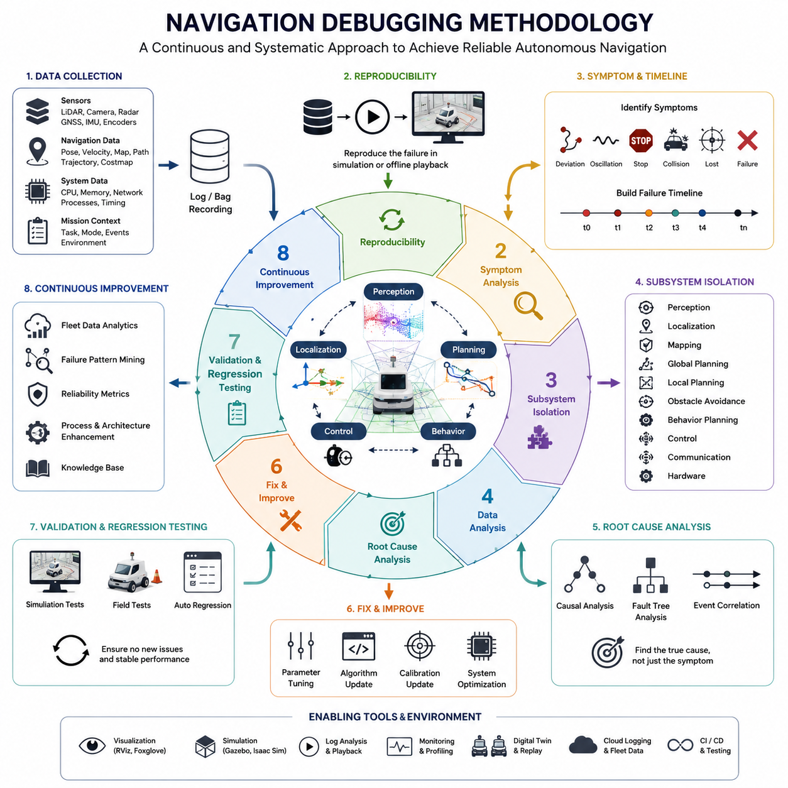
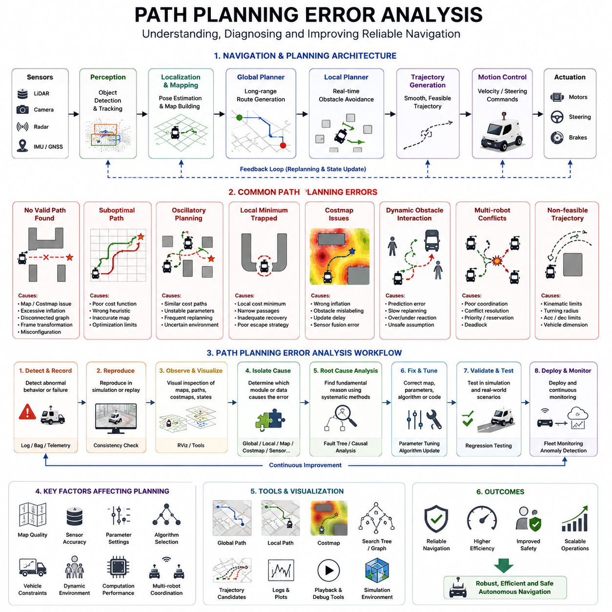
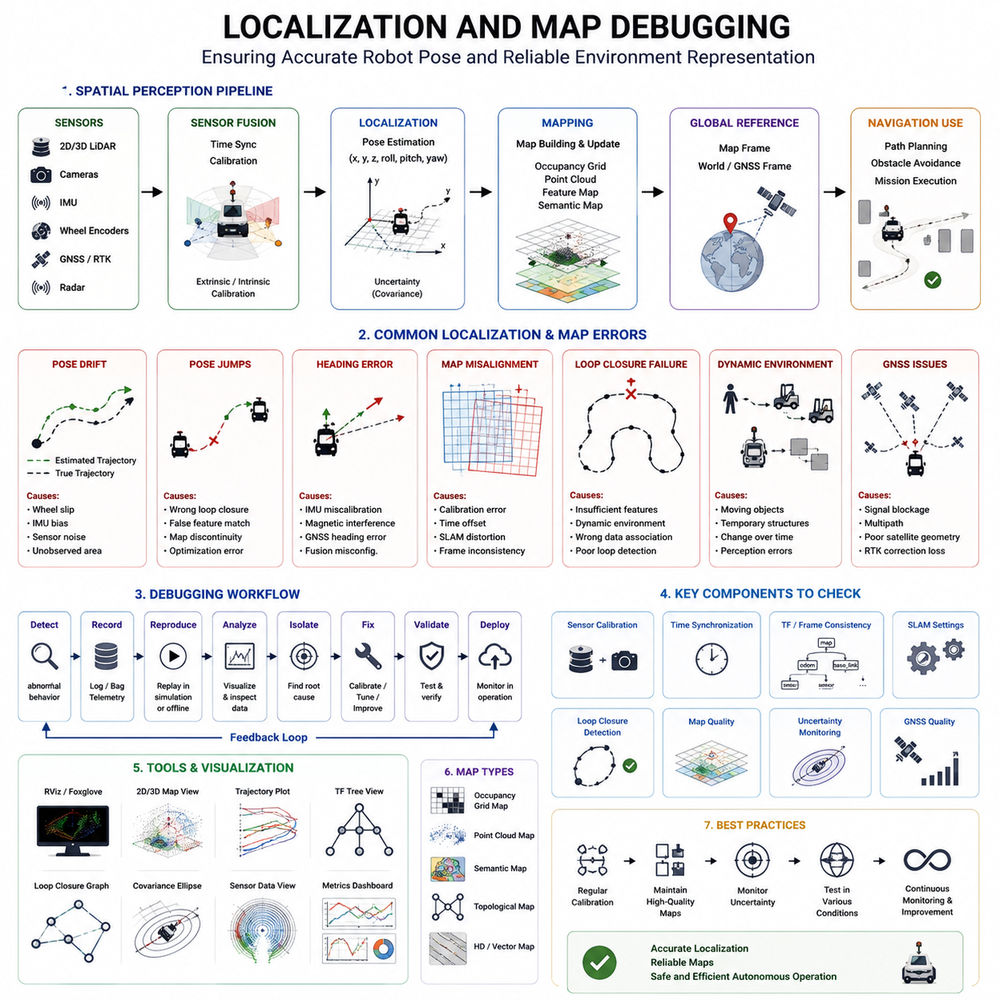
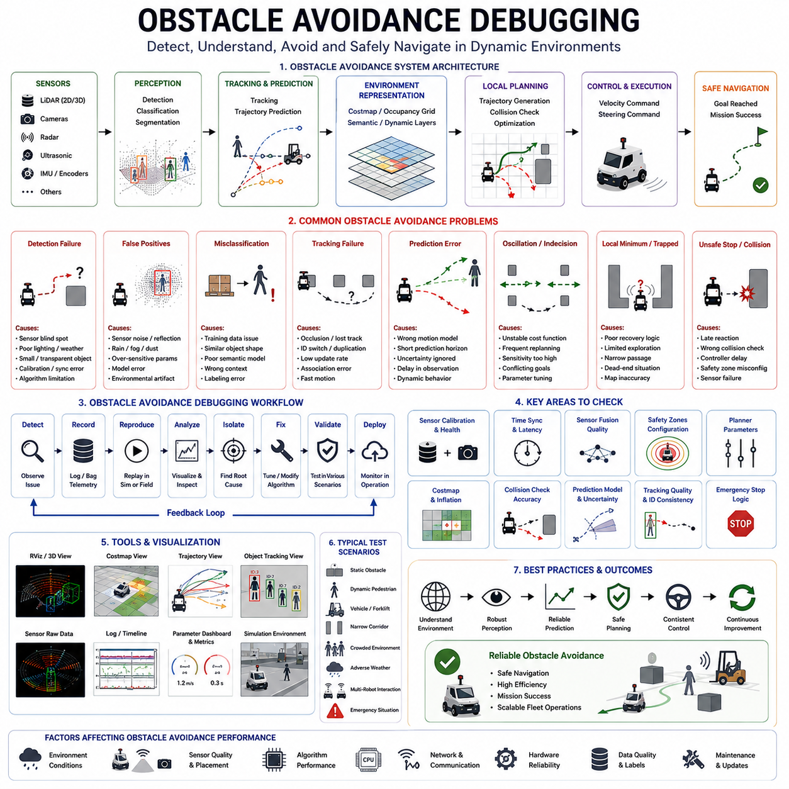
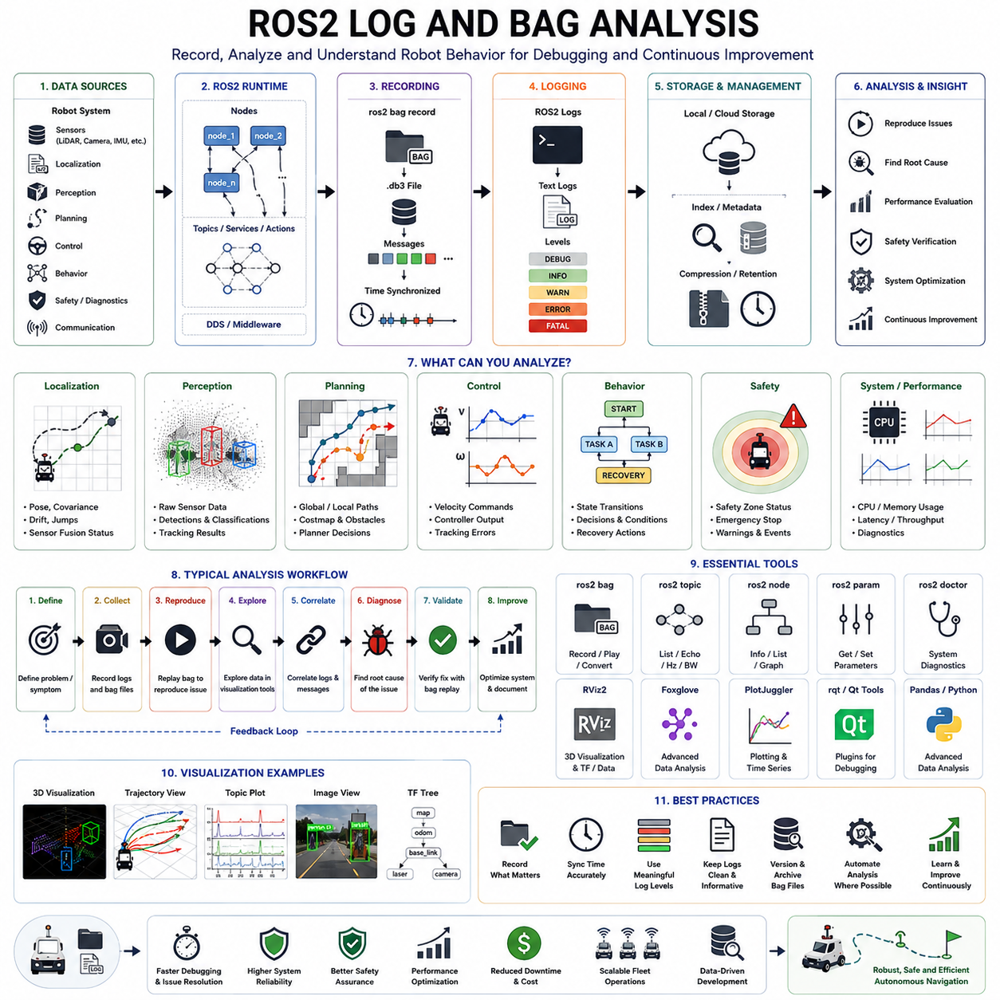
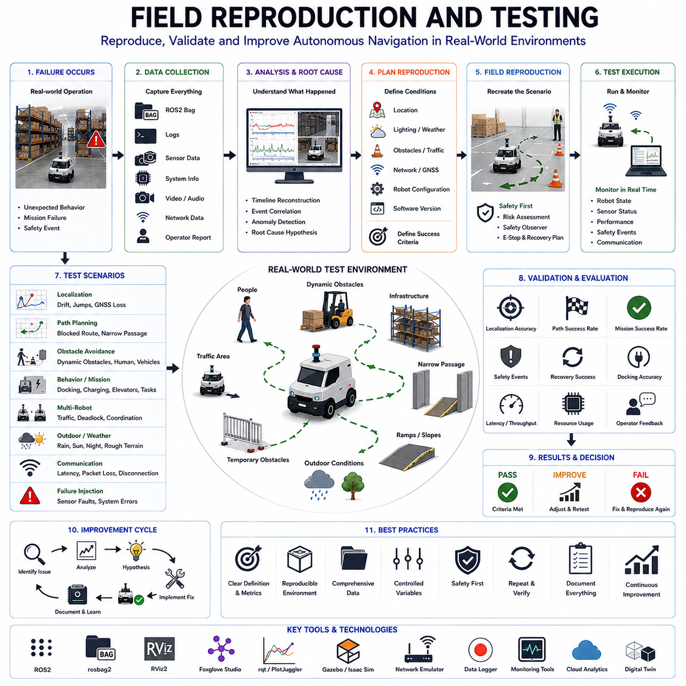
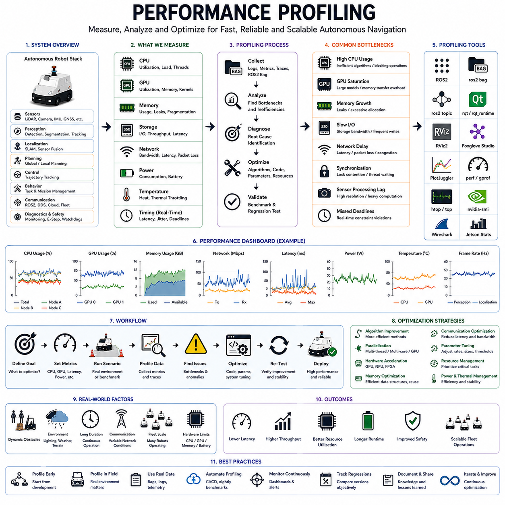
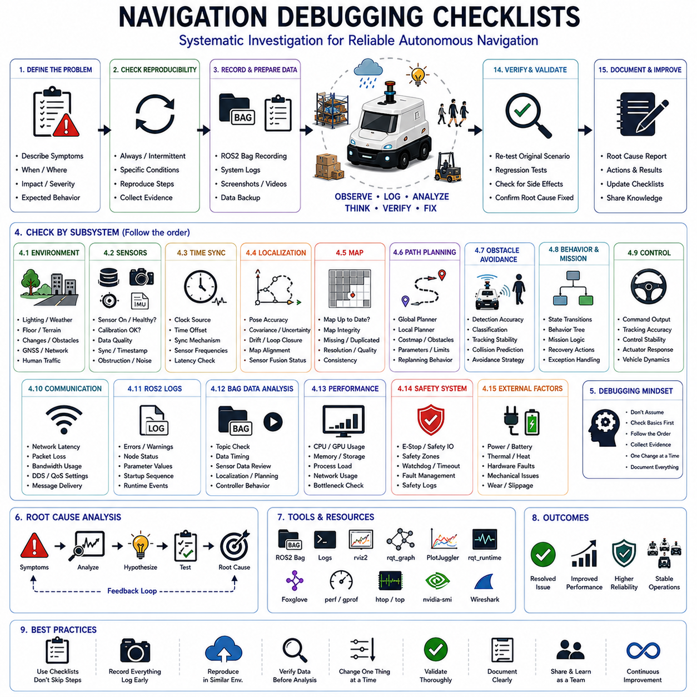

**Volume 05. Path Planning and Autonomous Navigation**

# Chapter 21. Navigation Debugging

## 21.1 Navigation Debugging Methodology

{width="7.268055555555556in" height="7.268055555555556in"}

내비게이션 디버깅은 자율이동로봇(AMR), 실외 자율주행 로봇, 물류 로봇, 견인 로봇, 병원 서비스 로봇, 산업용 검사 로봇 개발 과정에서 가장 중요한 엔지니어링 활동 중 하나이다. 현대의 내비게이션 시스템은 위치추정(Localization), 지도 작성(Mapping), 인지(Perception), 경로 계획(Path Planning), 궤적 생성(Trajectory Generation), 행동 계획(Behavior Planning), 모션 제어(Motion Control)와 같은 다양한 기술을 통합하고 있지만, 실제 환경에서는 여전히 다양한 형태의 장애와 오류가 발생한다. 로봇이 갑자기 정지하거나, 장애물 주변에서 진동하듯 움직이거나, 계획된 경로에서 벗어나거나, 위치를 잃거나, 비정상적인 궤적을 생성하거나, 임무를 완료하지 못하는 문제가 발생할 수 있다. 따라서 체계적인 내비게이션 디버깅 방법론은 문제의 근본 원인을 찾고, 장애를 재현하며, 수정 결과를 검증하고, 안정적인 자율주행 성능을 확보하기 위해 필수적이다. 내비게이션 엔지니어링에서 디버깅은 단순히 문제가 발생한 후 수행하는 사후 조치가 아니라 개발, 시험, 배포, 운영 및 유지보수 전반에 걸쳐 지속적으로 수행되어야 하는 핵심 기술 분야이다. 본 장에서는 자율주행 시스템의 디버깅을 위한 종합적인 방법론과 실제 산업 환경에서 적용 가능한 실무 절차를 설명한다.

일반적인 내비게이션 시스템은 여러 개의 하위 시스템이 동시에 상호작용하며 동작한다. 여기에는 인지 모듈, 위치추정 엔진, 지도 관리 시스템, 전역 경로 계획기, 지역 경로 계획기, 장애물 회피 시스템, 행동 계획기, 차량 제어기, 통신 계층, 그리고 플릿 관리 서비스가 포함된다. 내비게이션 성능은 이러한 구성 요소들의 상호작용 결과로 나타나기 때문에 실제 장애는 단일 원인으로 발생하는 경우가 드물다. 대부분의 문제는 여러 계층에서 발생한 작은 오류들이 연쇄적으로 영향을 미치면서 나타난다. 따라서 효과적인 디버깅을 위해서는 개별 모듈만 분석하는 것이 아니라 전체 내비게이션 스택을 통합적으로 이해해야 한다.

내비게이션 디버깅의 첫 번째 원칙은 재현성(Reproducibility)이다. 재현할 수 없는 문제는 신뢰성 있게 해결할 수 없다. 장애가 발생하면 가능한 한 많은 운영 데이터를 즉시 수집해야 한다. 여기에는 센서 데이터, 로봇 상태 정보, 위치추정 결과, 경로 계획 결과, 궤적 명령, 제어 신호, 네트워크 트래픽, CPU 사용률, GPU 사용률, 환경 조건 및 임무 정보가 포함된다. 특히 ROS2 Bag 데이터는 실제 운행 상황을 오프라인 환경에서 그대로 재생할 수 있도록 해주므로 매우 중요한 디버깅 도구이다. 문제를 재현할 수 있게 되면 예측 불가능한 현장 장애를 체계적으로 분석 가능한 엔지니어링 문제로 전환할 수 있다.

체계적인 디버깅은 증상(Symptom)의 정확한 정의에서 시작된다. 증상은 문제 자체가 아니라 문제의 결과로 나타나는 현상이다. 예를 들어 로봇이 경로에서 벗어나거나, 반복적으로 재계획을 수행하거나, 갑자기 정지하거나, 장애물 회피 과정에서 진동하거나, 장애물과 충돌하거나, 도킹에 실패하거나, 국소 최적점(Local Minimum)에 갇히거나, 위치를 완전히 상실할 수 있다. 이러한 현상은 가능한 한 정량적인 수치로 기록해야 한다. 단순히 "주행 성능이 좋지 않다"라고 기록하기보다는 "복도 구간 진입 후 위치 오차가 2m 이상 증가하여 반복적인 경로 재계획이 발생했고 결국 임무가 실패했다"와 같이 구체적으로 기술하는 것이 효과적이다.

증상이 정의되면 장애 발생 타임라인(Failure Timeline)을 구축해야 한다. 대부분의 내비게이션 장애는 순간적으로 발생하지 않고 여러 단계에 걸쳐 발전한다. 예를 들어 특징점이 부족한 복도에 진입하면서 위치 오차가 증가하고, 그 결과 지역 경로 계획기가 불안정한 경로를 생성하며, 이후 장애물 회피 시스템이 환경을 잘못 해석하여 반복적인 비상 정지를 수행하는 경우가 있다. 타임라인 분석은 최종 증상이 아니라 최초의 이상 현상을 발견하는 데 중요한 역할을 한다.

다음 단계는 서브시스템 분리(Sub-System Isolation)이다. 내비게이션 시스템은 매우 복잡하므로 문제 영역을 좁히는 것이 중요하다. 엔지니어는 문제가 인지, 위치추정, 지도 생성, 경로 계획, 제어, 통신 또는 하드웨어 중 어느 영역에서 시작되었는지 판단해야 한다. 예를 들어 위치추정 결과는 안정적이지만 경로 생성이 불안정하다면 계획 알고리즘을 우선적으로 조사해야 한다. 반대로 위치추정 신뢰도가 급격히 하락한 후 경로 오류가 발생한다면 위치추정 시스템이 주요 원인일 가능성이 높다.

데이터 수집은 효과적인 디버깅의 핵심 기반이다. LiDAR 스캔, 카메라 영상, 레이더 데이터, GNSS 정보, IMU 데이터, 엔코더 데이터, 안전 센서 데이터와 같은 센서 정보를 동기화하여 저장해야 한다. 또한 로봇 자세, 속도 추정값, 전역 경로, 지역 경로, 비용 지도(Costmap), 행동 상태, 제어 출력과 같은 내비게이션 정보도 함께 기록해야 한다. 시스템 수준에서는 CPU 사용량, 메모리 사용량, 네트워크 지연, 저장장치 상태 및 프로세스 스케줄링 정보를 수집해야 한다. 대규모 플릿 환경에서는 클라우드 로그와 교통 관리 시스템 로그 역시 중요한 분석 자료가 된다.

시각화(Visualization)는 내비게이션 디버깅에서 가장 강력한 도구 중 하나이다. 복잡한 문제도 시각적으로 표현하면 원인이 명확해지는 경우가 많다. 엔지니어는 위치추정 결과, 센서 데이터, 지도 오버레이, 전역 경로, 지역 궤적, 장애물 경계, 안전 영역, 로봇 형상(Footprint) 등을 시각화해야 한다. RViz, Foxglove Studio, 디지털 트윈 플랫폼과 같은 도구는 이러한 분석을 지원한다. 많은 경우 숫자 로그만으로는 보이지 않는 지도 불일치, 장애물 팽창 오류, 좌표계 불일치, 경로 진동 현상 등을 시각화를 통해 즉시 발견할 수 있다.

좌표계(Frame) 검증은 내비게이션 디버깅의 기본이다. 많은 문제는 좌표 변환 오류로 인해 발생한다. 일반적으로 로봇은 map, odom, base_link, sensor frame, GNSS frame, world frame 등 여러 좌표계를 사용한다. 작은 변환 오류라도 전체 내비게이션 성능에 큰 영향을 미칠 수 있다. 따라서 좌표계 구조, 변환 정확도, 시간 동기화 상태 및 센서 장착 위치 보정을 반드시 검증해야 한다.

위치추정 디버깅은 자세 추정의 정확성과 안정성을 평가하는 과정이다. 엔지니어는 위치 신뢰도, 공분산(Covariance), 루프 클로저 성능, GNSS 신호 품질, 센서 융합 결과 및 지도 매칭 정확도를 분석해야 한다. 드리프트 누적, 위치 점프, 자세 불연속성, 지연된 업데이트, 방향각 오차 등은 위치추정 문제의 대표적인 징후이다. 실외 환경에서는 GNSS 다중 경로(Multipath) 현상과 신호 차단이 주요 원인이 될 수 있으며, 실내 환경에서는 반복적인 구조물과 동적 환경 변화가 주요 원인이 될 수 있다.

경로 계획 디버깅은 계획 알고리즘이 어떻게 경로를 생성하는지를 분석하는 과정이다. 엔지니어는 지도 품질, 비용 지도 생성 과정, 장애물 표현 방식, 계획기 파라미터, 휴리스틱 함수, 재계획 로직 등을 검증해야 한다. 잘못된 비용 설정이나 오래된 지도 정보는 비효율적인 경로를 생성할 수 있으며, 지나치게 큰 장애물 팽창 값은 실제로 통과 가능한 경로를 차단할 수 있다.

지역 경로 계획과 궤적 생성 디버깅은 실제 주행 품질과 직접적으로 연결된다. 속도 프로파일, 가속도 제한, 궤적의 부드러움, 충돌 회피 동작, 차량 운동학 제약 만족 여부를 분석해야 한다. 흔히 발생하는 문제로는 경로 진동, 불안정한 조향, 과도한 감속, 장애물 회피 실패, 차량 운동학 제약 미충족 등이 있다.

장애물 회피 디버깅은 특히 동적 환경에서 중요하다. 객체 검출 정확도, 객체 추적 안정성, 충돌 예측 성능, 장애물 분류 정확도 및 회피 로직을 검증해야 한다. 오탐(False Positive)은 불필요한 정지를 유발하고, 미탐(False Negative)은 안전사고를 초래할 수 있다. 사람, 차량, 지게차, 다른 로봇과의 상호작용 기록을 분석하여 예측 결과가 실제 움직임과 일치하는지 확인해야 한다.

행동 계획 디버깅은 상위 수준의 의사결정 과정을 분석하는 것이다. 행동 계획기는 일반 주행, 장애물 회피, 도킹, 충전, 후진, 주차, 엘리베이터 이용, 비상 복구 등 다양한 상태를 관리한다. 하위 시스템이 정상 동작하더라도 상태 전환이 잘못되면 전체 내비게이션이 실패할 수 있다. 따라서 상태 머신(State Machine), 행동 트리(Behavior Tree), 복구 전략 및 우선순위 정책을 철저히 검토해야 한다.

성능 프로파일링(Performance Profiling) 또한 중요한 디버깅 요소이다. 최신 로봇은 복잡한 알고리즘을 임베디드 컴퓨팅 플랫폼에서 실행한다. CPU 과부하, GPU 포화, 메모리 누수, 스레드 경쟁, 통신 병목 현상은 내비게이션 성능 저하의 주요 원인이 된다. 실행 시간, 메시지 주기, 센서 처리율, 네트워크 지연 등을 지속적으로 모니터링해야 한다.

시뮬레이션 기반 디버깅은 안전하고 반복 가능한 분석 환경을 제공한다. Gazebo, Isaac Sim, 디지털 트윈 플랫폼은 복잡한 상황을 재현할 수 있도록 지원한다. 보행자 밀집 환경, 악천후, 위치추정 오류, 센서 장애, 통신 장애, 험지 주행과 같은 다양한 시나리오를 반복적으로 시험할 수 있다. 이를 통해 문제 원인을 빠르게 분석하고 수정 사항을 검증할 수 있다.

그러나 실제 현장 재현(Field Reproduction) 역시 필수적이다. 일부 문제는 실제 환경에서만 발생하며 시뮬레이션으로 완벽하게 재현할 수 없다. 조명 변화, 날씨 조건, 전자파 간섭, 인간 행동, 센서 노이즈 특성 등은 실제 환경에서만 나타나는 변수들이다. 따라서 반복 가능한 현장 시험 절차를 구축하여 실제 조건에서 문제를 검증해야 한다.

근본 원인 분석(Root Cause Analysis)은 디버깅의 최종 목표이다. 단순히 증상을 제거하는 것이 아니라 문제가 왜 발생했는지를 이해해야 한다. 이를 위해 Fault Tree Analysis, 인과 관계 분석, 이벤트 상관관계 분석 등의 기법을 활용할 수 있다. 효과적인 근본 원인 분석은 현재 문제뿐만 아니라 미래의 유사 문제를 예방하는 데도 큰 도움이 된다.

수정된 시스템은 반드시 회귀 시험(Regression Testing)을 거쳐야 한다. 내비게이션 시스템은 복잡하게 연결되어 있기 때문에 하나의 문제를 해결하는 과정에서 새로운 문제가 발생할 수 있다. 따라서 기존 시나리오, 경계 조건, 안전 관련 상황, 스트레스 테스트 등을 포함하는 종합적인 시험을 수행해야 한다. 자동화된 시험 환경과 CI/CD 기반 검증 체계는 이러한 과정을 효율적으로 지원한다.

성숙한 내비게이션 디버깅 방법론은 궁극적으로 지속적인 개선 프로세스로 발전한다. 운영 중인 로봇으로부터 수집된 데이터를 활용하여 반복적으로 발생하는 장애 패턴을 분석하고, 신뢰성을 향상시키며, 시험 방법을 개선하고, 시스템 구조를 발전시켜야 한다. 플릿 규모가 커지고 운영 환경이 복잡해질수록 데이터 기반 디버깅은 필수적인 경쟁력이 된다.

미래의 내비게이션 디버깅은 AI 기반 진단, 자동 이상 탐지, 디지털 트윈 검증, 클라우드 로그 분석, 플릿 수준 장애 상관관계 분석, 예측형 신뢰성 모니터링 기술을 적극적으로 활용하게 될 것이다. 인공지능은 장애가 발생하기 전에 비정상적인 내비게이션 패턴을 감지하고 엔지니어에게 경고할 수 있게 될 것이다. 이러한 기술과 대규모 운영 데이터 분석 체계가 결합되면 내비게이션 디버깅은 사후 대응 중심의 활동에서 사전 예방 중심의 엔지니어링 분야로 발전하게 된다. 차세대 AMR, 실외 자율주행 로봇, 견인 로봇, 병원 서비스 로봇, 대규모 플릿 시스템에 있어서 내비게이션 디버깅 방법론은 안전성, 신뢰성, 확장성을 확보하기 위한 가장 중요한 기술적 기반 중 하나로 남게 될 것이다.

## 21.2 Path Planning Error Analysis

{width="7.268055555555556in" height="7.268055555555556in"}

경로 계획(Path Planning)은 자율이동로봇(AMR)의 가장 핵심적인 기능 중 하나이다. 경로 계획은 로봇이 목표 지점까지 이동하기 위해 어떤 경로를 선택할 것인지 결정하는 의사결정 계층으로서, 안전성, 효율성, 차량 운동학적 제약, 환경 조건 및 임무 요구사항을 모두 고려하여 실행 가능한 이동 경로를 생성한다. 창고, 병원, 공장, 물류센터, 스마트시티, 산업시설, 실외 점검 현장 등 어떠한 환경에서 운용되더라도 자율주행 성능의 성공 여부는 경로 계획 시스템의 신뢰성과 안정성에 크게 의존한다. 경로 계획 과정에서 오류가 발생하면 단순한 이동 지연뿐 아니라 임무 실패, 교통 혼잡, 반복 정지, 안전사고, 생산성 저하와 같은 심각한 결과로 이어질 수 있다. 따라서 경로 계획 오류를 체계적으로 분석하고 해결하는 것은 신뢰성 높은 자율주행 로봇 개발의 핵심 요소이다.

경로 계획 오류 분석은 경로 생성 과정에서 발생하는 문제를 식별하고, 분류하며, 재현하고, 원인을 분석하고, 수정하는 엔지니어링 활동이다. 위치추정(Localization) 오류가 로봇의 현재 위치 인식에 영향을 미친다면, 경로 계획 오류는 로봇이 어떤 경로를 선택하고 어떻게 이동할 것인지에 영향을 준다. 이러한 오류는 지도 정보의 부정확성, 환경 모델링 오류, 알고리즘 한계, 파라미터 설정 문제, 센서 오차, 소프트웨어 결함, 계산 자원 부족, 또는 다른 내비게이션 모듈과의 상호작용에서 발생할 수 있다. 경로 계획은 위치추정, 인지, 장애물 회피, 행동 계획, 궤적 생성, 모션 제어와 밀접하게 연결되어 있기 때문에 하나의 오류가 여러 계층으로 확산되는 경우가 많다.

현대의 내비게이션 시스템은 일반적으로 전역 경로 계획기(Global Planner)와 지역 경로 계획기(Local Planner)로 구성된다. 전역 계획기는 지도 기반으로 출발점에서 목적지까지의 최적 경로를 계산하며, 지역 계획기는 실시간 센서 정보를 활용하여 장애물을 회피하고 실제 주행 가능한 경로를 생성한다. 오류는 이 두 계층 중 어느 곳에서든 발생할 수 있으며, 효과적인 분석을 위해서는 두 계층 간의 상호작용을 이해해야 한다.

가장 흔한 경로 계획 오류 중 하나는 유효한 경로를 생성하지 못하는 경우이다. 실제로는 이동 가능한 경로가 존재함에도 불구하고 계획기가 경로를 찾지 못했다고 판단하는 현상이다. 이러한 문제는 과도한 장애물 팽창(Inflation), 손상된 지도 데이터, 연결되지 않은 그래프 구조, 지나치게 큰 안전 여유 거리, 좌표계 변환 오류 또는 계획기 설정 문제에서 발생할 수 있다. 이 경우 엔지니어는 비용 지도(Costmap), 장애물 표현 방식, 경로 생성 알고리즘 및 환경 모델링 과정을 종합적으로 분석해야 한다.

또 다른 대표적인 문제는 비효율적인 경로 생성이다. 경로는 생성되지만 지나치게 길거나 불필요한 우회가 포함될 수 있다. 로봇이 반복적으로 복도를 통과하거나 과도한 회전을 수행하거나, 최단거리 대신 비효율적인 경로를 선택하는 경우가 이에 해당한다. 이러한 현상은 비용 함수 설계 오류, 부정확한 휴리스틱 함수, 환경 정보 부족 또는 최적화 알고리즘의 한계로 인해 발생할 수 있다. 대규모 물류 시스템에서는 작은 비효율성도 수백 대의 로봇 운영 시 큰 비용 증가로 이어질 수 있다.

경로 진동(Oscillation) 현상도 자주 발생하는 문제이다. 로봇이 여러 경로 후보 사이에서 계속 선택을 변경하면서 안정적인 결정을 내리지 못하는 상황이다. 반복적인 재계획이 발생하거나 서로 다른 경로를 오가며 방향을 바꾸는 현상이 나타난다. 이는 비용 차이가 매우 작은 경로들이 존재하거나, 환경 정보가 계속 변화하거나, 계획기 파라미터가 불안정하게 설정된 경우 발생할 수 있다.

국소 최적점(Local Minimum)은 자율주행 분야에서 널리 알려진 문제이다. 로봇이 현재 상태에서 최선의 선택만 반복하다가 전역 목표로 향하지 못하고 특정 영역에 갇히는 현상이다. 장애물 근처에서 앞뒤로 반복 이동하거나, 동일한 회피 동작을 무한히 수행하거나, 좁은 통로에서 빠져나오지 못하는 경우가 이에 해당한다. 특히 복잡한 실내 환경, 도킹 스테이션, 적재 공간, 교차로와 같이 제한된 공간에서 자주 발생한다.

비용 지도 관련 오류는 경로 계획 실패의 가장 흔한 원인 중 하나이다. 비용 지도는 환경 정보를 숫자 형태로 변환하여 계획기가 활용할 수 있도록 만든다. 장애물이 잘못 표현되거나 과도하게 팽창되거나, 업데이트가 제대로 이루어지지 않으면 경로 계획 결과가 크게 왜곡될 수 있다. 따라서 장애물 팽창 반경, 업데이트 주기, 센서 융합 결과, 지도 갱신 방식 등을 철저히 검증해야 한다.

지도 품질 또한 경로 계획 성능에 직접적인 영향을 미친다. 벽 위치가 잘못 기록되거나 장애물이 누락되거나 환경 구조가 중복 저장되면 잘못된 경로가 생성될 수 있다. 실외 환경에서는 GNSS 오차, SLAM 오차, 환경 변화, 오래된 지도 데이터가 문제의 원인이 될 수 있다. 따라서 지도 검증과 지속적인 유지관리는 필수적이다.

좌표계(Frame) 불일치도 중요한 오류 원인이다. 로봇은 map, odom, base_link, sensor frame, world frame 등 여러 좌표계를 사용한다. 작은 좌표 변환 오류라도 경로 생성 결과를 크게 왜곡할 수 있다. 따라서 좌표계 구조와 변환 정확성, 시간 동기화 상태를 반드시 검증해야 한다.

동적 장애물 환경은 경로 계획을 더욱 복잡하게 만든다. 정적 환경에서는 유효한 경로가 사람, 차량, 지게차 또는 다른 로봇의 등장으로 갑자기 사용할 수 없는 경로가 될 수 있다. 계획기는 이러한 변화를 반영하여 지속적으로 경로를 수정해야 한다. 재계획 빈도가 지나치게 높으면 진동 현상이 발생하고, 너무 낮으면 충돌 위험이 증가한다. 따라서 동적 환경에서 계획기의 반응 특성을 분석하는 것이 중요하다.

다중 로봇 환경에서는 추가적인 문제가 발생한다. 여러 로봇이 동일한 통로, 교차로, 엘리베이터, 도킹 공간을 공유하면서 충돌이나 교착 상태(Deadlock)가 발생할 수 있다. 이 경우 문제는 개별 로봇의 계획 알고리즘이 아니라 플릿 관리 시스템, 교통 제어 정책, 경로 예약 시스템 또는 우선순위 정책에서 발생하는 경우가 많다.

A\* 알고리즘과 같은 그래프 기반 경로 계획에서는 휴리스틱 함수 설계가 매우 중요하다. 잘못 설계된 휴리스틱은 탐색 효율을 크게 떨어뜨리거나 비최적 경로를 생성할 수 있다. 지나치게 공격적인 휴리스틱은 경로 품질을 희생하고, 지나치게 보수적인 휴리스틱은 계산량을 증가시킨다. 따라서 휴리스틱 함수의 적합성과 일관성을 검증해야 한다.

RRT, RRT\*, PRM과 같은 샘플링 기반 계획기에서는 다른 유형의 오류가 발생한다. 샘플 수가 부족하면 경로를 찾지 못할 수 있고, 너무 많으면 계산 비용이 증가한다. 좁은 통로, 복잡한 지형, 고차원 공간에서는 이러한 문제가 더욱 심각해진다. 따라서 샘플링 분포와 탐색 효율성을 분석해야 한다.

경로의 실행 가능성(Feasibility) 역시 중요한 요소이다. 수학적으로는 유효한 경로라도 실제 차량이 따라갈 수 없는 경우가 있다. 차량 크기, 조향각 제한, 최소 회전 반경, 가속도 한계, 적재 하중, 지형 조건 및 안정성 요구사항을 모두 고려해야 한다. 특히 대형 실외 로봇, 견인형 AMR, 자율 지게차, 중장비 플랫폼에서는 이러한 문제가 매우 중요하다.

계산 성능 역시 경로 계획의 신뢰성에 영향을 미친다. 실시간 자율주행 시스템은 엄격한 시간 제약 아래에서 동작한다. 경로 계산 시간이 너무 길어지면 생성된 경로가 이미 오래된 정보가 되어버릴 수 있다. CPU 과부하, 메모리 부족, 비효율적인 알고리즘, 과도한 지도 해상도는 이러한 문제를 유발한다. 따라서 계획 시간, 실행 주기, 자원 사용량을 지속적으로 모니터링해야 한다.

재계획(Replanning) 동작도 중요한 분석 대상이다. 재계획은 환경 변화에 적응하기 위한 기능이지만, 지나치게 자주 발생하면 내비게이션이 불안정해질 수 있다. 반대로 너무 적게 수행되면 환경 변화에 대응하지 못한다. 따라서 재계획 조건과 임계값을 적절히 조정해야 한다.

환경 불확실성 또한 경로 계획에 큰 영향을 미친다. 센서 노이즈, 위치 오차, 불완전한 인지 정보, 통신 지연, 일시적인 환경 변화는 모두 경로 계획 결과를 변화시킬 수 있다. 강인한(Robust) 계획 시스템은 이러한 불확실성을 견딜 수 있어야 한다.

시각화 도구는 경로 계획 오류 분석에서 매우 중요하다. 전역 경로, 지역 경로, 비용 지도, 탐색 트리, 그래프 구조 및 궤적 후보를 시각적으로 분석하면 로그만으로는 발견하기 어려운 문제를 쉽게 찾을 수 있다. RViz, Foxglove Studio, 디지털 트윈 플랫폼은 이러한 분석을 지원하는 대표적인 도구이다.

시뮬레이션 환경은 오류를 반복적으로 재현할 수 있는 강력한 수단이다. Gazebo, Isaac Sim, 디지털 트윈 플랫폼을 이용하면 동일한 조건에서 다양한 파라미터를 변경하며 문제를 분석할 수 있다. 이를 통해 원인 분석과 수정 검증을 효율적으로 수행할 수 있다.

그러나 실제 현장 시험 역시 반드시 필요하다. 실제 환경은 조명 변화, 날씨, 노면 상태, 인간 행동, 센서 노화, 통신 장애 등 시뮬레이션으로 완전히 재현하기 어려운 요소들을 포함한다. 따라서 시뮬레이션과 현장 시험을 함께 활용하는 것이 가장 효과적이다.

근본 원인 분석(Root Cause Analysis)은 단순한 증상 해결이 아니라 문제의 본질적인 원인을 찾는 과정이다. Fault Tree Analysis, 인과관계 분석, 통계 분석, 이벤트 상관관계 분석 등을 활용하여 실제 원인을 파악해야 한다. 이를 통해 임시 조치가 아닌 장기적이고 근본적인 해결책을 수립할 수 있다.

수정 작업 이후에는 반드시 회귀 시험(Regression Testing)을 수행해야 한다. 기존 문제는 해결되었지만 새로운 문제가 발생할 수 있기 때문이다. 정상 시나리오, 스트레스 조건, 동적 장애물 환경, 다중 로봇 환경, 센서 성능 저하 환경 등을 포함한 종합적인 시험이 필요하다.

자율주행 기술이 발전함에 따라 경로 계획 오류 분석 역시 데이터 중심의 분야로 발전하고 있다. 대규모 플릿에서 수집되는 방대한 데이터를 활용하면 반복적으로 발생하는 문제 패턴, 알고리즘의 약점, 환경 위험 요소를 자동으로 발견할 수 있다. 미래에는 AI 기반 진단 시스템, 이상 탐지 기술, 예측형 경로 검증, 자율 디버깅 기술이 도입될 것으로 예상된다. 이러한 기술은 문제가 실제 운영에 영향을 주기 전에 자동으로 발견하고 수정하는 방향으로 발전할 것이다.

결국 경로 계획 오류 분석은 단순한 문제 해결 작업이 아니다. 이는 자율주행 시스템의 신뢰성, 효율성, 안전성, 확장성, 그리고 고객 신뢰를 결정하는 핵심 엔지니어링 활동이다. 물류 로봇, 병원 로봇, 견인형 AMR, 자율 지게차, 실외 점검 로봇, 스마트시티 로봇, 대규모 플릿 시스템 등 어떠한 자율주행 플랫폼을 개발하더라도 체계적인 경로 계획 오류 분석 방법론은 성공적인 자율주행 구현을 위한 필수 기반 기술로 자리 잡게 될 것이다.

## 21.3 Localization and Map Debugging

{width="7.268055555555556in" height="7.268055555555556in"}

위치추정(Localization)과 지도 생성(Mapping)은 자율주행 시스템의 가장 중요한 기반 기술 중 하나이다. 아무리 뛰어난 인지(Perception), 경로 계획(Path Planning), 제어(Control), 인공지능(AI) 기술을 보유하고 있더라도 로봇이 자신의 위치를 정확하게 알지 못하거나 주변 환경을 올바르게 이해하지 못한다면 안정적인 자율주행은 불가능하다. 위치추정은 로봇이 현재 어디에 있는지를 지속적으로 계산하는 기능이며, 지도 생성은 주변 환경을 구조적으로 표현하는 기능이다. 이 두 기술은 함께 자율이동로봇(AMR)의 공간 지능(Spatial Intelligence) 계층을 구성하며, 경로 계획, 장애물 회피, 임무 수행, 플릿 운영, 자율 의사결정을 가능하게 한다. 위치추정 또는 지도 생성 과정에서 오류가 발생하면 경로 계획 실패, 충돌 위험 증가, 임무 수행 실패, 비효율적인 이동, 운영 중단과 같은 심각한 문제가 발생할 수 있다. 따라서 위치추정 및 지도 디버깅은 자율주행 로봇 개발과 운영 과정에서 반드시 확보해야 하는 핵심 엔지니어링 분야이다.

위치추정 및 지도 디버깅은 자세 추정(Pose Estimation), 지도 생성, 지도 유지관리, 좌표계 변환, 환경 표현과 관련된 문제를 식별하고 재현하며 분석하고 수정하는 체계적인 과정이다. 일반적인 내비게이션 디버깅이 로봇의 이동 행동이나 경로 생성에 초점을 맞춘다면, 위치추정 및 지도 디버깅은 로봇이 공간을 어떻게 이해하고 있는지를 분석하는 데 중점을 둔다. 이러한 작업은 개발 단계뿐 아니라 실제 운영 기간 전체에 걸쳐 지속적으로 수행되어야 한다. 환경은 지속적으로 변화하며, 위치추정 성능 역시 시간이 지남에 따라 저하될 수 있기 때문이다.

현대의 위치추정 시스템은 다양한 센서를 결합하여 로봇의 위치와 자세를 계산한다. 일반적으로 휠 엔코더, IMU, 2D LiDAR, 3D LiDAR, RGB 카메라, Depth 카메라, 레이더, GNSS 수신기, RTK 시스템, 비전 마커 등이 사용된다. 센서 융합 알고리즘은 이러한 다양한 센서 정보를 통합하여 안정적인 위치를 계산한다. 동시에 지도 생성 시스템은 점유 격자 지도(Occupancy Grid Map), 포인트 클라우드 지도(Point Cloud Map), 특징점 지도(Feature Map), 의미론적 지도(Semantic Map), 위상 지도(Topological Map), HD Map, 디지털 트윈 등 다양한 형태의 환경 정보를 구축하고 유지한다. 위치추정과 지도 생성은 수많은 구성 요소들이 긴밀하게 연결되어 있기 때문에 디버깅 역시 전체 공간 인지 체계를 이해하는 것이 중요하다.

가장 흔한 위치추정 문제 중 하나는 드리프트(Drift)이다. 드리프트는 로봇의 추정 위치가 실제 위치로부터 점진적으로 벗어나는 현상을 의미한다. 휠 슬립, 센서 노이즈, 보정 오차, 환경 모호성, 추정 알고리즘의 누적 오차 등이 주요 원인이다. 실내 환경에서는 도킹 실패, 목표 위치 오차, 장애물 충돌로 이어질 수 있으며, 실외 환경에서는 장거리 이동 중 큰 위치 오차를 유발할 수 있다. 효과적인 디버깅을 위해서는 드리프트의 크기와 발생 패턴을 정량적으로 분석해야 한다.

자세 점프(Pose Jump) 역시 자주 발생하는 문제이다. 이는 실제 로봇은 거의 움직이지 않았음에도 불구하고 위치추정 결과가 갑자기 크게 변경되는 현상이다. 일반적으로 잘못된 지도 매칭, 오류가 있는 루프 클로저(Loop Closure), 특징점 오인식 등이 원인이 된다. 이러한 문제는 경로 계획과 제어 시스템에 심각한 영향을 미치므로 위치 변화가 갑자기 발생한 시점의 센서 데이터와 최적화 과정을 면밀히 분석해야 한다.

방향각(Heading) 오차 또한 매우 중요한 문제이다. 위치는 비교적 정확하지만 로봇의 방향이 잘못 계산되는 경우이다. 작은 방향 오차라도 장거리 이동 시에는 큰 경로 편차로 이어질 수 있다. IMU 보정 오류, 자기장 간섭, GNSS 방향 추정 오차, Visual Odometry 드리프트, 센서 융합 설정 오류 등이 주요 원인이다. 방향 추정 디버깅은 회전 측정 데이터와 센서 융합 결과를 집중적으로 분석해야 한다.

지도 정렬(Map Alignment) 오류는 지도 생성 과정에서 가장 중요한 문제 중 하나이다. 센서 보정 오류, 시간 동기화 문제, SLAM 최적화 오류 또는 환경 특징 부족으로 인해 지도가 왜곡될 수 있다. 벽이 휘어지거나 복도가 비정상적으로 표현되거나 장애물이 잘못된 위치에 표시될 수 있다. 이러한 지도 왜곡은 전체 내비게이션 성능에 직접적인 영향을 미친다.

좌표계(Frame) 불일치는 위치추정과 지도 생성 오류의 대표적인 원인이다. 로봇은 map, odom, base_link, sensor frame, GNSS frame, world frame 등 여러 좌표계를 사용한다. 이들 좌표계 사이의 변환이 정확하지 않으면 위치추정 결과가 불안정해질 수 있다. 따라서 TF Tree 구조, 좌표 변환 정확도, 시간 동기화 상태를 반드시 확인해야 한다.

센서 보정(Calibration)은 신뢰성 있는 위치추정의 기본 전제 조건이다. 외부 보정(Extrinsic Calibration)은 센서와 로봇 본체 사이의 위치 관계를 정의하며, 내부 보정(Intrinsic Calibration)은 센서 자체의 측정 특성을 정의한다. LiDAR나 카메라가 조금만 잘못 장착되어 있어도 지도 품질과 위치추정 정확도가 크게 저하될 수 있다. 따라서 정기적인 보정 검증이 필요하다.

시간 동기화(Time Synchronization) 문제도 흔히 발생한다. 로봇은 서로 다른 속도로 데이터를 생성하는 여러 센서를 사용한다. 만약 센서 간 시간이 정확히 맞지 않으면 서로 다른 시점의 데이터를 결합하게 되어 위치추정 오류가 발생한다. 특히 LiDAR, IMU, 카메라 융합 시스템에서는 시간 동기화가 매우 중요하다.

SLAM 디버깅은 위치추정 및 지도 분석의 핵심 분야이다. SLAM은 로봇이 이동하면서 동시에 자신의 위치를 추정하고 지도를 생성하는 기술이다. SLAM 오류는 지도 왜곡, 드리프트 증가, 루프 클로저 실패, 경로 불일치, 최적화 실패 등의 형태로 나타난다. 따라서 특징점 추출, 스캔 매칭, 그래프 최적화, 루프 클로저 검출 과정을 종합적으로 분석해야 한다.

루프 클로저(Loop Closure)는 장기 위치추정 정확도를 결정하는 중요한 요소이다. 로봇이 이전에 방문했던 장소를 다시 인식하여 누적 오차를 줄이는 기능이다. 성공적인 루프 클로저는 지도 품질을 향상시키지만, 잘못된 루프 클로저는 지도 왜곡과 자세 점프를 유발할 수 있다. 따라서 특징점 매칭 신뢰도와 기하학적 일관성을 검증해야 한다.

동적 환경은 위치추정을 더욱 어렵게 만든다. 병원, 공장, 물류창고, 공항과 같은 환경은 사람, 차량, 이동형 장비, 적재물 등 끊임없이 변화하는 요소들을 포함한다. 이러한 요소들은 위치추정 알고리즘을 혼란스럽게 만들 수 있다. 따라서 고정 구조물과 이동 물체를 구분하는 능력이 중요하다.

GNSS 기반 위치추정은 실외 로봇에서 중요한 역할을 한다. RTK를 사용하면 수 센티미터 수준의 정확도를 얻을 수 있지만, 건물 사이, 터널, 산업시설, 숲 지역에서는 신호 차단과 다중 경로(Multipath) 현상이 발생할 수 있다. GNSS 디버깅에서는 위성 수, 신호 강도, RTK 상태, 위치 신뢰도 지표를 분석해야 한다.

다중 센서 융합(Multi-Sensor Fusion)은 위치추정의 강인성을 높여주지만 디버깅 난이도도 증가시킨다. LiDAR, 카메라, IMU, GNSS, 엔코더, 레이더 등의 데이터가 어떻게 결합되는지 이해해야 한다. 특정 센서가 오작동할 경우 융합 시스템이 어떤 방식으로 반응하는지도 분석 대상이 된다.

지도 품질 평가는 지도 디버깅의 핵심 요소이다. 지도는 환경의 구조, 장애물, 이동 가능 영역, 의미 정보 등을 정확하게 표현해야 한다. 누락된 구조물, 중복된 특징점, 왜곡된 기하학 정보, 오래된 환경 정보가 존재하는지 검토해야 한다.

점유 격자 지도(Occupancy Grid Map)를 사용하는 실내 로봇의 경우 장애물 경계, 빈 공간 표현, 해상도, 갱신 주기, 장애물 팽창 파라미터 등을 확인해야 한다. 이러한 요소들은 경로 계획과 장애물 회피에 직접적인 영향을 미친다.

포인트 클라우드 지도(Point Cloud Map)를 사용하는 실외 로봇의 경우 점 밀도, 정합 품질, 공간 일관성, 센서 정렬 상태, 환경 커버리지 등을 분석해야 한다. 포인트 클라우드 품질이 낮으면 위치추정 성능 역시 크게 저하된다.

최근에는 의미론적 지도(Semantic Map)의 중요성이 증가하고 있다. 의미론적 지도는 단순한 기하학 정보뿐 아니라 물체 종류, 공간 의미, 작업 구역 정보 등을 포함한다. 따라서 객체 분류 정확도, 환경 태깅 정보, 의미 계층과 기하학 계층의 일관성을 검증해야 한다.

시각화 도구는 위치추정 및 지도 디버깅에서 필수적이다. 로봇 이동 경로, 위치추정 결과, 센서 데이터, 포인트 클라우드, 점유 지도, 좌표계 구조, 오차 타원, 루프 클로저 이벤트 등을 시각적으로 분석하면 많은 문제를 쉽게 발견할 수 있다. RViz, Foxglove Studio, 디지털 트윈 플랫폼, 클라우드 기반 대시보드는 대표적인 분석 도구이다.

데이터 기록 및 재생 기능도 매우 중요하다. ROS2 Bag 파일을 이용하면 실제 운행 상황을 그대로 재현할 수 있으며, 알고리즘 변경 전후의 성능을 비교할 수 있다. 이를 통해 반복적인 현장 시험 없이도 문제를 효율적으로 분석할 수 있다.

시뮬레이션 환경은 위치추정 및 지도 생성 성능을 평가하는 강력한 수단이다. Gazebo, Isaac Sim, CARLA, 디지털 트윈 환경에서는 센서 노이즈, 통신 지연, 환경 변화 등을 인위적으로 추가하여 시스템 반응을 분석할 수 있다.

그러나 실제 현장 시험 역시 필수적이다. 실제 환경은 조명 변화, 날씨, 전자기 간섭, 시설 구조 변경, 사람의 이동 등 시뮬레이션으로 완전히 재현하기 어려운 요소를 포함한다. 따라서 현장 검증을 통해 위치추정 시스템의 강인성을 평가해야 한다.

근본 원인 분석(Root Cause Analysis)은 위치추정 디버깅의 핵심이다. 단순히 증상을 제거하는 것이 아니라 왜 문제가 발생했는지를 이해해야 한다. Fault Tree Analysis, 센서 의존성 분석, 시간 상관관계 분석, 그래프 기반 진단 기법 등을 활용하여 원인을 규명해야 한다.

수정 조치는 재보정, 센서 교체, 알고리즘 개선, 파라미터 조정, 지도 재구축, 시간 동기화 개선, 환경 구조 변경, 시스템 아키텍처 수정 등의 형태로 이루어질 수 있다. 이후에는 회귀 시험(Regression Testing)을 통해 새로운 문제가 발생하지 않았는지 검증해야 한다.

자율주행 시스템이 대규모 플릿으로 확장됨에 따라 위치추정 및 지도 디버깅은 데이터 중심 엔지니어링 분야로 발전하고 있다. 대규모 운영 데이터는 반복적인 위치추정 오류, 센서 열화, 환경 위험 요소, 지도 품질 문제를 자동으로 발견하는 데 활용될 수 있다. 앞으로는 AI 기반 진단 시스템, 자동 이상 탐지, 예측형 유지보수, 자가 보정(Self-Calibration), 자동 지도 검증 기술이 적극적으로 적용될 것으로 예상된다.

결국 위치추정 및 지도 디버깅은 단순한 문제 해결 작업이 아니다. 이는 자율주행 시스템의 신뢰성, 안전성, 효율성, 확장성 및 운영 성공을 결정하는 핵심 엔지니어링 활동이다. 물류 AMR, 병원 로봇, 자율 지게차, 견인형 AMR, 실외 점검 로봇, 스마트시티 로봇, 대규모 플릿 시스템 등 어떠한 자율주행 플랫폼을 개발하더라도 체계적이고 철저한 위치추정 및 지도 디버깅 방법론은 안정적인 자율주행 구현을 위한 필수 기술로 자리 잡게 될 것이다.

## 21.4 Obstacle Avoidance Debugging

{width="7.268055555555556in" height="7.268055555555556in"}

장애물 회피(Obstacle Avoidance)는 자율주행 시스템에서 가장 중요한 기능 중 하나이다. 이는 로봇의 안전성, 운영 신뢰성, 주행 효율성, 임무 성공률에 직접적인 영향을 미친다. 자율이동로봇(AMR)이 창고, 공장, 병원, 공항, 물류센터, 스마트시티, 농업 현장, 광산 또는 실외 산업시설에서 운용되더라도 로봇은 주변 환경의 장애물을 지속적으로 탐지하고, 분류하며, 추적하고, 미래 움직임을 예측하고, 안전하게 회피해야 한다. 경로 계획(Path Planning)이 목적지까지의 최적 경로를 생성하는 역할을 한다면, 장애물 회피는 실시간 환경 변화에 대응하여 안전한 이동을 보장하는 역할을 수행한다. 장애물 회피 시스템이 실패할 경우 단순한 성능 저하를 넘어 충돌, 장비 손상, 임무 중단, 안전사고, 플릿 운영 장애 등 심각한 결과로 이어질 수 있다. 따라서 장애물 회피 디버깅은 자율주행 로봇 개발과 운영 과정에서 반드시 수행해야 하는 핵심 엔지니어링 활동이다.

장애물 회피 디버깅은 장애물 인식, 장애물 표현, 충돌 예측, 회피 의사결정, 복구 행동, 안전 대응과 관련된 문제를 식별하고 재현하며 분석하고 수정하는 체계적인 과정이다. 위치추정 디버깅이 로봇의 위치 정확성에 초점을 맞추고, 경로 계획 디버깅이 경로 생성 과정에 초점을 맞춘다면, 장애물 회피 디버깅은 로봇이 실제 환경에서 장애물에 어떻게 반응하는지를 분석하는 데 집중한다. 장애물 회피는 인지 시스템, 센서 융합, 위치추정, 계획 알고리즘, 행동 계획기, 차량 제어기 및 안전 시스템과 밀접하게 연결되어 있기 때문에 전체 내비게이션 아키텍처를 통합적으로 이해해야 한다.

현대의 장애물 회피 시스템은 다양한 센서를 활용한다. 일반적으로 2D LiDAR, 3D LiDAR, RGB 카메라, Depth 카메라, 레이더, 초음파 센서, 열화상 카메라, 스테레오 비전 시스템 등이 사용된다. 센서 융합 알고리즘은 이러한 센서 정보를 결합하여 주변 환경에 대한 통합적인 모델을 생성한다. 충돌 예측과 회피 의사결정은 이러한 환경 모델을 기반으로 수행된다. 따라서 장애물 회피 문제는 단일 모듈의 오류가 아니라 여러 계층의 상호작용 결과로 발생하는 경우가 많다.

가장 흔한 문제 중 하나는 장애물 탐지 실패이다. 로봇이 실제 존재하는 장애물을 인식하지 못하는 경우이다. 센서 사각지대, 센서 배치 부족, 악조건 환경, 검출 알고리즘 성능 부족, 보정 오류, 시간 동기화 문제 등이 주요 원인이다. 특히 작은 물체, 투명한 유리, 반사 표면, 낮은 높이의 장애물, 매달린 구조물 등은 탐지를 어렵게 만든다. 디버깅 과정에서는 먼저 센서가 해당 장애물을 실제로 관측했는지를 확인하는 것이 중요하다.

반대로 존재하지 않는 장애물을 감지하는 오탐(False Positive) 문제도 자주 발생한다. 오탐은 불필요한 정지, 과도한 재계획, 주행 진동, 이동 효율 저하를 유발한다. 센서 노이즈, 빛 반사, 비·눈·안개, 먼지, 전자파 간섭, 잘못 학습된 인공지능 모델, 필터링 파라미터 설정 오류 등이 주요 원인이다. 이 경우 원시 센서 데이터와 인식 결과를 비교하여 실제 원인을 분석해야 한다.

객체 분류 오류(Object Classification Error)도 장애물 회피 성능에 큰 영향을 준다. 장애물을 정확히 탐지했더라도 잘못된 종류로 인식할 수 있다. 예를 들어 정지된 팔레트를 이동 차량으로 인식하거나, 작업자를 고정 구조물로 인식하는 경우가 있다. 이러한 오류는 안전거리 설정, 회피 전략, 이동 우선순위에 직접적인 영향을 준다. 따라서 객체 분류 정확도와 의미론적 인식 결과를 검증해야 한다.

객체 추적(Object Tracking) 실패도 중요한 문제이다. 장애물 탐지만으로는 충분하지 않으며, 로봇은 객체의 속도, 방향, 미래 위치를 지속적으로 추적해야 한다. 추적이 끊어지거나 동일 객체가 여러 개로 인식되거나 객체 ID가 계속 변경되면 충돌 예측이 불안정해질 수 있다. 이 경우 추적 알고리즘, 객체 연관성(Association) 알고리즘, 센서 업데이트 주기 등을 분석해야 한다.

충돌 예측(Collision Prediction) 오류는 동적 환경에서 특히 중요하다. 사람, 차량, 지게차, 다른 로봇과 같은 이동 객체의 미래 위치를 잘못 예측하면 실제 충돌이 발생할 수 있다. 반대로 위험을 과도하게 예측하면 불필요한 정지와 생산성 저하가 발생한다. 따라서 예측 모델, 불확실성 계산, 예측 시간 범위 등을 면밀히 분석해야 한다.

지역 경로 계획기(Local Planner)는 장애물 회피에서 핵심 역할을 수행한다. 대부분의 시스템에서 장애물 회피는 지역 경로 계획 계층에서 처리된다. 지역 계획기는 여러 후보 경로를 생성하고 충돌 가능성을 평가하여 가장 안전한 경로를 선택한다. 그러나 경로 평가 함수나 최적화 파라미터가 잘못 설정되면 안전하지 않은 경로를 선택하거나, 지나치게 보수적인 동작을 수행할 수 있다. 따라서 궤적 생성 과정과 충돌 평가 과정을 분석해야 한다.

장애물 회피 과정에서 진동(Oscillation) 현상도 자주 발생한다. 로봇이 좌측 회피와 우측 회피를 반복하거나, 정지와 출발을 계속 반복하거나, 계속해서 재계획만 수행하는 상황이다. 이러한 현상은 비용 함수의 불안정성, 장애물 표현의 불일치, 환경 변화에 대한 과도한 민감도 때문에 발생할 수 있다. 진동은 효율성을 저하시킬 뿐 아니라 주변 사람들에게 혼란을 줄 수 있다.

국소 최적점(Local Minimum)은 장애물 회피의 대표적인 난제이다. 로봇이 장애물 주변에서 빠져나오지 못하고 동일한 행동을 반복하는 상황이다. 좁은 복도, 물류 적재 공간, 병원 복도, 공장 작업 구역 등에서 자주 발생한다. 효과적인 복구 알고리즘이 없다면 로봇은 영구적으로 정체될 수 있다. 따라서 복구 전략과 탈출 알고리즘의 성능을 평가해야 한다.

동적 장애물 회피는 정적 장애물 회피보다 훨씬 복잡하다. 사람, 차량, 드론, 지게차, 이동형 장비는 예측하기 어려운 행동을 보인다. 특히 인간 중심 환경에서는 단순히 충돌을 피하는 것뿐 아니라 사회적 거리 유지, 자연스러운 움직임, 인간의 기대 행동을 고려해야 한다. 따라서 실제 환경에서의 상호작용 데이터를 분석하는 것이 중요하다.

센서 융합(Sensor Fusion) 디버깅 역시 매우 중요하다. LiDAR는 정확한 거리 측정을 제공하지만 유리나 투명 물체에 취약하다. 카메라는 의미 정보를 제공하지만 조명 변화에 민감하다. 레이더는 악천후에 강하지만 공간 해상도가 낮다. 효과적인 융합은 이러한 장단점을 보완해야 한다. 따라서 각 센서의 기여도와 가중치 설정을 분석해야 한다.

환경 조건은 장애물 회피 성능에 큰 영향을 준다. 비, 눈, 안개, 먼지, 직사광선, 야간 환경, 반사 표면, 유리 벽, 금속 구조물, 물웅덩이, 험지 환경은 모두 인지 성능을 저하시킬 수 있다. 특히 실외 자율주행 로봇은 매우 다양한 환경 조건을 경험하기 때문에 다양한 조건에서 디버깅이 수행되어야 한다.

안전 영역(Safety Zone) 설정은 장애물 회피 행동을 결정하는 중요한 요소이다. 산업용 로봇은 일반적으로 경고 구역, 감속 구역, 보호 정지 구역, 비상 정지 구역을 정의한다. 안전 영역이 지나치게 크면 생산성이 저하되고, 너무 작으면 안전 위험이 증가한다. 따라서 안전 거리, 속도 기반 영역 확장, 센서 커버리지 등을 검증해야 한다.

비상 정지(Emergency Stop)는 장애물 회피 시스템의 최종 안전 계층이다. 비상 정지는 반드시 필요한 경우에만 발생해야 하며, 동시에 높은 신뢰성을 보장해야 한다. 불필요한 비상 정지는 생산성을 떨어뜨리고, 비상 정지 실패는 심각한 안전사고를 초래한다. 따라서 정지 조건, 반응 시간, 안전 제어기의 동작을 분석해야 한다.

다중 로봇 환경에서는 추가적인 장애물 회피 문제가 발생한다. 로봇은 사람과 구조물뿐 아니라 다른 로봇도 회피해야 한다. 서로의 의도를 잘못 해석하거나 협조가 부족하면 충돌이나 교착 상태(Deadlock)가 발생할 수 있다. 따라서 플릿 관리 시스템, 교통 제어 알고리즘, 통신 시스템도 함께 분석해야 한다.

시각화 도구는 장애물 회피 디버깅에서 매우 중요한 역할을 한다. 센서 데이터, 장애물 검출 결과, 객체 추적 결과, 충돌 예측 궤적, 안전 영역, 비용 지도, 후보 경로, 제어 명령 등을 시각화하면 문제 원인을 빠르게 파악할 수 있다. RViz, Foxglove Studio, 디지털 트윈 플랫폼은 이러한 분석에 널리 사용된다.

ROS2 Bag 파일을 활용한 데이터 기록 및 재생은 디버깅 효율을 크게 향상시킨다. 동일한 상황을 반복 재현할 수 있으며, 알고리즘 수정 전후의 성능을 비교할 수 있다. 이는 위험한 상황을 반복적으로 현장에서 재현하지 않고도 문제를 분석할 수 있게 해준다.

시뮬레이션 환경 역시 중요한 디버깅 도구이다. Gazebo, Isaac Sim, CARLA, 디지털 트윈 환경에서는 보행자, 차량, 지게차, 악천후, 센서 고장, 통신 장애 등을 자유롭게 생성할 수 있다. 이를 통해 실제 배포 이전에 다양한 시나리오를 검증할 수 있다.

그러나 실제 현장 시험은 여전히 필수적이다. 사람의 행동, 환경 변화, 장비 노후화, 예상치 못한 이벤트는 시뮬레이션으로 완벽히 재현하기 어렵다. 따라서 체계적인 현장 검증 절차를 통해 실제 운영 환경에서의 안정성을 확인해야 한다.

근본 원인 분석(Root Cause Analysis)은 장애물 회피 디버깅의 핵심 목표이다. 단순히 증상을 제거하는 것이 아니라 왜 문제가 발생했는지를 이해해야 한다. Fault Tree Analysis, 이벤트 상관관계 분석, 인과관계 분석, 통계적 분석 등을 활용하여 원인을 규명해야 한다.

수정 작업은 센서 재보정, AI 모델 재학습, 알고리즘 개선, 파라미터 조정, 안전 영역 재설계, 하드웨어 업그레이드, 통신 구조 개선 등의 형태로 이루어질 수 있다. 이후에는 회귀 시험(Regression Testing)을 통해 새로운 문제가 발생하지 않았는지 검증해야 한다. 검증 항목에는 정상 운행, 동적 장애물 환경, 악천후 환경, 다중 로봇 환경, 센서 성능 저하 환경, 장시간 운행 시나리오 등이 포함되어야 한다.

자율주행 시스템이 발전함에 따라 장애물 회피 디버깅은 데이터 중심 엔지니어링 분야로 발전하고 있다. 대규모 플릿이 생성하는 방대한 운영 데이터는 반복적인 실패 패턴, 환경 위험 요소, 센서 열화 현상, 알고리즘 약점을 자동으로 발견하는 데 활용될 수 있다. 미래에는 AI 기반 진단 시스템, 자동 이상 탐지, 예측형 안전 모니터링, 자가 적응형 회피 알고리즘, 자율 디버깅 기술이 도입될 것으로 예상된다.

결국 장애물 회피 디버깅은 단순한 문제 해결 작업이 아니다. 이는 자율주행 시스템의 안전성, 신뢰성, 효율성, 확장성, 그리고 운영 성공 여부를 결정하는 핵심 엔지니어링 활동이다. 물류 AMR, 병원 로봇, 자율 지게차, 견인형 AMR, 실외 점검 로봇, 농업 로봇, 스마트시티 로봇, 대규모 플릿 시스템 등 어떠한 자율주행 플랫폼에서도 체계적인 장애물 회피 디버깅 방법론은 안정적이고 신뢰성 있는 자율주행 구현을 위한 필수 기술로 자리 잡게 될 것이다.

## 21.5 ROS2 Log and Bag Analysis

{width="7.268055555555556in" height="7.268055555555556in"}

ROS2 Log 및 Bag 분석은 자율주행 로봇 시스템에서 가장 중요한 디버깅 및 검증 활동 중 하나이다. 현대의 자율이동로봇(AMR), 실외 자율주행 로봇, 자율 지게차, 견인 로봇, 검사 로봇, 병원 서비스 로봇, 대규모 플릿 시스템은 운영 중 방대한 양의 데이터를 생성한다. 센서 측정값, 위치추정 결과, 경로 계획 결과, 장애물 탐지 이벤트, 제어 명령, 시스템 경고, 오류 메시지, 통신 데이터 등 거의 모든 정보가 기록될 수 있다. 일반적인 소프트웨어 디버깅과 달리 로봇 시스템은 동적인 물리 환경에서 동작하며, 센서, 알고리즘, 하드웨어, 통신 네트워크, 환경 조건이 복합적으로 상호작용하기 때문에 문제 원인을 찾는 것이 매우 어렵다. 또한 실제 현장에서 발생하는 장애는 동일한 조건으로 재현하기 어려운 경우가 많다. 이러한 이유로 ROS2 Log와 Bag Recording은 시스템 동작을 이해하고, 장애를 재현하며, 수정 결과를 검증하고, 장기적인 신뢰성을 향상시키기 위한 필수 도구가 되었다.

ROS2 Log는 소프트웨어 실행 과정과 시스템 이벤트를 텍스트 형태로 기록하며, ROS2 Bag은 ROS2 노드 간에 교환된 메시지를 시간 동기화 상태로 저장한다. 이 두 가지는 현대 로봇 디버깅 체계의 핵심 기반을 형성한다. 로그는 소프트웨어가 무엇을 판단했는지를 보여주고, Bag 파일은 실제 시스템에서 무슨 일이 발생했는지를 보여준다. 두 정보를 함께 분석함으로써 엔지니어는 운영 상황을 재구성하고, 이상 현상을 발견하며, 장애 발생 과정을 추적하고, 시스템 성능을 정밀하게 검증할 수 있다.

ROS2 기반 로봇 시스템은 일반적으로 수십 개에서 수백 개의 노드(Node)로 구성된다. 위치추정 노드, 인지 파이프라인, 센서 드라이버, 경로 계획기, 행동 관리자, 제어기, 안전 모니터, 플릿 관리 인터페이스, 클라우드 통신 모듈 등이 동시에 동작하며 데이터를 주고받는다. 각 노드는 상태 정보, 경고 메시지, 오류 정보, 파라미터 설정, 초기화 과정 및 실행 결과를 로그로 기록한다. 동시에 다양한 센서 데이터와 제어 메시지가 ROS2 미들웨어를 통해 전송된다. 따라서 시스템 동작을 완전히 이해하기 위해서는 로그와 메시지 데이터를 동시에 분석해야 한다.

ROS2 로그 분석의 주요 목적은 시스템에서 발생한 이벤트의 순서를 이해하는 것이다. 로그는 센서 데이터만으로는 확인하기 어려운 소프트웨어 내부 상태를 보여준다. 예를 들어 내비게이션 장애가 발생했을 때 로그를 분석하면 위치추정 신뢰도가 감소했는지, 경로 계획기가 경로 생성을 실패했는지, 통신 타임아웃이 발생했는지, 센서 드라이버가 오류를 보고했는지, 안전 시스템이 비상 정지를 수행했는지 등을 확인할 수 있다. 시간 정보가 포함된 로그를 분석하면 장애가 발생하기 전의 전체 과정을 재구성할 수 있다.

ROS2 Bag 분석은 텍스트 로그가 아니라 실제 메시지 데이터를 분석하는 과정이다. Bag 파일은 운영 중 발생한 토픽 메시지를 그대로 기록한다. 이를 통해 엔지니어는 동일한 상황을 오프라인에서 반복적으로 재생할 수 있다. 현장에서 동일한 문제를 다시 발생시키지 않아도 동일한 데이터를 여러 번 분석할 수 있으며, 새로운 알고리즘 적용 결과를 비교하거나 수정된 소프트웨어를 검증할 수 있다.

ROS2 Bag 분석의 가장 중요한 개념 중 하나는 재현성(Reproducibility)이다. 현장에서 단 한 번 발생한 문제라도 관련 토픽이 기록되어 있다면 무한히 재생하여 분석할 수 있다. 이를 통해 예측 불가능한 현장 문제를 반복 가능한 엔지니어링 문제로 변환할 수 있다. 이러한 재현성은 근본 원인 분석과 문제 해결 속도를 크게 향상시킨다.

시간 동기화(Time Synchronization)는 로그 및 Bag 분석에서 매우 중요한 요소이다. 로봇은 서로 다른 주기로 동작하는 다양한 센서를 사용한다. 예를 들어 카메라는 30Hz, LiDAR는 10Hz, IMU는 200Hz, 엔코더는 100Hz, GNSS는 20Hz, 제어 루프는 50Hz 이상으로 동작할 수 있다. 만약 시간 정보가 정확하게 동기화되지 않으면 잘못된 분석 결과를 얻을 수 있다. 따라서 Bag 분석의 첫 단계는 타임스탬프와 메시지 순서가 올바른지 확인하는 것이다.

위치추정 디버깅은 ROS2 Bag 분석의 대표적인 활용 사례이다. 엔지니어는 위치 정보, 공분산(Covariance), 오도메트리 결과, GNSS 데이터, IMU 데이터, LiDAR 스캔, SLAM 결과 등을 분석하여 위치추정 성능 저하 원인을 파악할 수 있다. 드리프트, 위치 점프, 방향 오차, 루프 클로저 문제 등은 Bag 데이터를 시각화하면 쉽게 발견할 수 있다.

경로 계획 디버깅 역시 ROS2 Bag 분석의 중요한 활용 분야이다. 전역 경로, 지역 경로, 비용 지도(Costmap), 장애물 정보, 계획기 출력, 차량 제어 명령 등을 분석하여 특정 경로가 왜 선택되었는지 확인할 수 있다. 경로 계획 문제는 위치추정 정확도, 환경 모델, 장애물 정보 및 계획기 설정 간의 복합적인 상호작용에 의해 발생하는 경우가 많기 때문에 Bag 재생이 매우 유용하다.

장애물 회피 디버깅도 Bag 분석에 크게 의존한다. LiDAR 스캔, 카메라 영상, 레이더 데이터, 객체 분류 결과, 객체 추적 정보, 충돌 예측 결과, 회피 경로 생성 결과를 함께 분석함으로써 탐지 실패, 오탐지, 추적 오류, 충돌 예측 실패 등의 원인을 찾을 수 있다. 특히 충돌 사고나 근접 사고(Near Miss)를 분석하는 데 매우 효과적이다.

행동 계획(Behavior Planning) 분석은 상위 수준의 의사결정 과정을 이해하는 데 사용된다. 상태 머신(State Machine), 행동 트리(Behavior Tree), 작업 스케줄러, AI 기반 의사결정 모듈의 로그를 분석하면 왜 특정 행동이 선택되었는지, 복구 동작이 수행되었는지, 임무 진행 과정에서 어떤 결정이 내려졌는지 확인할 수 있다.

통신 분석 역시 ROS2 디버깅의 중요한 부분이다. 분산형 로봇 시스템은 DDS 기반의 ROS2 통신에 의존한다. 메시지 지연, 패킷 손실, 네트워크 혼잡, QoS 설정 오류는 전체 시스템 성능에 영향을 줄 수 있다. 로그와 Bag 데이터를 함께 분석하면 통신 병목 현상과 동기화 문제를 발견할 수 있다.

성능 분석은 로그 데이터를 활용하는 대표적인 사례이다. CPU 사용률, 메모리 사용량, 스레드 스케줄링, 실행 지연, GPU 부하, 메시지 처리량 등을 분석하여 시스템 성능 저하 원인을 찾을 수 있다. 실제로 많은 내비게이션 문제는 알고리즘 자체보다 계산 자원 부족으로 인해 발생하는 경우가 많다.

센서 디버깅은 Bag 분석에 가장 크게 의존하는 분야 중 하나이다. LiDAR 포인트 클라우드, 카메라 영상, 레이더 데이터, IMU 측정값, GNSS 정보, 엔코더 데이터를 분석하여 보정 상태, 노이즈 특성, 환경 영향, 하드웨어 상태를 평가할 수 있다. 원시 데이터를 직접 확인하면 처리 결과만 볼 때는 발견하기 어려운 문제를 찾을 수 있다.

시각화 도구는 ROS2 Log 및 Bag 분석에서 매우 중요한 역할을 한다. RViz, Foxglove Studio, PlotJuggler, rqt 및 다양한 커스텀 대시보드는 기록된 데이터를 직관적으로 분석할 수 있도록 지원한다. 로봇 궤적, 위치추정 결과, 센서 데이터, 장애물 정보, 경로 계획 결과, 제어 명령을 동시에 시각화하면 문제 원인을 쉽게 발견할 수 있다.

대용량 Bag 파일을 분석하기 위해서는 데이터 필터링 및 추출 기술이 필요하다. 산업용 로봇은 장시간 운영 시 수백 GB의 데이터를 생성할 수 있다. 따라서 특정 토픽만 추출하거나, 특정 시간 구간만 선택하거나, 장애 발생 구간만 분석하는 효율적인 워크플로우가 필요하다.

ROS2 Log 및 Bag 분석의 핵심 목표는 근본 원인 분석(Root Cause Analysis)이다. 로그는 소프트웨어의 의사결정을 보여주고, Bag 데이터는 실제 동작 결과를 보여준다. 이 두 관점을 결합하면 단순한 증상 분석을 넘어 진정한 원인을 찾을 수 있다. 이벤트 상관관계 분석, 시간 순서 분석, 의존성 분석, Fault Tree Analysis 등이 자주 활용된다.

ROS2 Bag Replay는 수정 사항 검증에도 매우 유용하다. 소프트웨어 수정 후 동일한 Bag 데이터를 재생하여 이전 버전과 결과를 비교할 수 있다. 이를 통해 현장 시험 없이도 회귀 시험(Regression Testing)을 수행할 수 있다. 시간이 지나면 Bag 데이터는 중요한 벤치마크 데이터셋으로 발전하게 된다.

대규모 플릿 환경에서는 수백 대의 로봇이 동시에 데이터를 생성한다. 이 경우 수 TB 이상의 로그와 Bag 데이터가 생성될 수 있으며, 클라우드 기반 분석 플랫폼이 필요하다. 자동화된 분석 시스템은 반복적인 장애 패턴, 성능 저하, 위치추정 이상, 통신 문제, 안전 이벤트 등을 자동으로 탐지할 수 있다.

인공지능은 ROS2 Log 및 Bag 분석 방식을 변화시키고 있다. 머신러닝 기반 진단 시스템은 이상 현상을 자동으로 탐지하고, 장애 유형을 분류하며, 원인을 추정할 수 있다. 엔지니어가 수천 개의 로그를 직접 분석하는 대신 AI가 중요한 이벤트를 선별하여 제공할 수 있다.

효과적인 ROS2 로그 관리에는 일관된 로그 형식, 적절한 로그 레벨 사용, 충분한 문맥 정보 제공, 정확한 타임스탬프 기록이 필요하다. 또한 Bag Recording 역시 저장 공간과 성능 영향을 고려하면서 핵심 토픽을 효율적으로 기록해야 한다.

장기적인 운영 신뢰성은 효과적인 Log 및 Bag 분석 체계에 크게 의존한다. 운영 데이터를 체계적으로 수집하고 분석하는 조직은 소프트웨어 품질을 향상시키고, 다운타임을 줄이며, 안전성을 강화하고, 개발 속도를 높일 수 있다. 시간이 지날수록 축적된 로그와 Bag 데이터는 매우 가치 있는 지식 자산이 된다.

자율주행 로봇 기술이 발전함에 따라 ROS2 Log 및 Bag 분석은 단순한 사후 디버깅 도구에서 운영 인텔리전스 플랫폼으로 발전하고 있다. 미래에는 자동 데이터 수집, 클라우드 기반 분석, AI 진단, 예측형 장애 탐지, 디지털 트윈 검증, 자가 모니터링 기능이 통합될 것으로 예상된다. 로봇은 데이터를 기록하는 수준을 넘어 스스로 데이터를 해석하고 장애를 예방하는 방향으로 발전하게 될 것이다.

결국 ROS2 Log 및 Bag 분석은 단순한 디버깅 기법이 아니다. 이는 복잡한 로봇 시스템 내부를 들여다볼 수 있게 해주는 핵심 엔지니어링 방법론이며, 근본 원인 분석을 지원하고, 개발 속도를 높이며, 운영 신뢰성을 향상시키고, 안전성을 보장하는 필수 기술이다. 물류 AMR, 병원 로봇, 자율 지게차, 견인 로봇, 실외 점검 로봇, GPR 검사 로봇, 스마트시티 로봇, 대규모 플릿 시스템 등 어떠한 자율주행 플랫폼을 개발하더라도 ROS2 Log 및 Bag 분석 능력은 안정적이고 확장 가능한 자율주행 시스템 구축을 위한 필수 역량으로 자리 잡게 될 것이다.

## 21.6 Field Reproduction and Testing

{width="7.268055555555556in" height="7.268055555555556in"}

현장 재현(Field Reproduction) 및 시험(Field Testing)은 자율주행 엔지니어링에서 가장 중요한 활동 중 하나이다. 많은 내비게이션 문제들은 실제 운영 환경에서만 발생하며, 시뮬레이션 환경이나 실험실 시험만으로는 완전히 재현하기 어렵다. 자율이동로봇(AMR), 실외 자율주행 로봇, 자율 지게차, 견인 로봇, 병원 서비스 로봇, 검사 로봇, 플릿 관리 시스템은 동적 장애물, 변화하는 인프라, 다양한 기상 조건, 통신 장애, 센서 성능 저하, 인간과의 상호작용 등 매우 복잡한 환경에서 동작한다. 따라서 실제 환경에서 문제를 재현하고 수정 사항을 검증하는 능력은 안전하고 신뢰성 높은 자율주행 시스템을 구축하기 위한 필수 요소이다. 현장 재현 및 시험은 단순한 장애 사례를 반복 가능한 엔지니어링 문제로 전환하고, 대규모 배포 이전에 최종 검증을 수행하는 핵심 단계이다.

현장 재현은 실제 운영 중 발생한 문제를 통제된 환경에서 다시 발생시키는 과정이다. 목표는 단순히 동일한 장애를 다시 보는 것이 아니라, 문제 발생 과정과 환경 조건, 시스템 상태, 유발 요인을 정확하게 이해하는 데 있다. 재현에 성공하면 추가 데이터를 수집할 수 있고, 원인 분석 가설을 검증할 수 있으며, 수정된 알고리즘의 효과를 평가할 수 있다. 반대로 문제를 재현할 수 없다면 분석은 추정과 가정에 의존하게 되며 정확한 원인 규명이 어려워진다. 따라서 재현성(Reproducibility)은 자율주행 시스템 디버깅의 가장 중요한 기반이다.

많은 내비게이션 장애는 여러 요인이 동시에 작용하여 발생한다. 예를 들어 위치추정 드리프트는 특정 조명 조건, 센서 노이즈, 바퀴 슬립, 환경 구조가 동시에 존재할 때만 발생할 수 있다. 경로 계획 실패는 특정 장애물 배치와 교통 흐름, 지도 오차가 결합될 때 나타날 수 있다. 통신 장애 역시 네트워크 부하와 특정 임무 시점이 겹칠 때만 발생할 수 있다. 따라서 현장 재현 방법론은 문제에 영향을 준 모든 요인을 식별하고 이를 체계적으로 통제하는 데 중점을 둔다.

현장 재현의 첫 단계는 장애 정의(Failure Characterization)이다. 무엇을 실패로 정의할 것인지를 명확하게 설정해야 한다. 예를 들어 단순히 "로봇이 길을 잃었다"라고 표현하는 대신 "위치 오차가 2m 이상 증가하여 경로 재계획이 반복되었고 결국 임무가 중단되었다"와 같이 정량적으로 정의해야 한다. 명확한 정의는 개발자 간 의사소통을 원활하게 하고 시험 성공 여부를 객관적으로 판단할 수 있게 해준다.

장애가 정의되면 다음 단계는 장애 타임라인(Failure Timeline) 재구성이다. ROS2 Bag 파일, 시스템 로그, 센서 데이터, 진단 정보, 운영자 보고서, 플릿 관리 기록 등을 종합적으로 분석하여 사건의 시간 순서를 재구성해야 한다. 실제 원인은 종종 최종 증상이 나타나기 훨씬 이전에 발생한다. 따라서 초기 이상 징후를 찾아내는 것이 중요하다.

환경 정보 기록(Environment Documentation)도 매우 중요하다. 실제 환경에는 수많은 변수들이 존재한다. 조명 상태, 날씨, 바닥 재질, 지형 특성, 장애물 배치, 작업자 활동량, 차량 통행량, GNSS 신호 품질, 무선 통신 품질 등이 모두 로봇 성능에 영향을 줄 수 있다. 겉보기에 사소한 환경 차이도 재현성에 큰 영향을 미칠 수 있기 때문에 철저한 기록이 필요하다.

시험 장소 준비(Test Site Preparation)는 현장 재현의 중요한 요소이다. 시험 환경은 원래 문제가 발생했던 환경과 최대한 유사해야 한다. 창고에서는 선반 구조, 장애물 배치, 차량 이동 경로를 재현해야 하고, 실외 환경에서는 지형, 장애물, 통신 인프라, 주행 경로를 유사하게 구성해야 한다. 원래 환경과의 차이를 최소화할수록 재현 성공 가능성이 높아진다.

안전 관리(Safety Management)는 모든 재현 시험에서 가장 중요한 요소이다. 내비게이션 장애는 사람이나 시설에 위험을 초래할 수 있기 때문에 위험성 평가, 안전 절차, 비상 정지 체계, 접근 제한 구역, 관찰 위치 및 복구 계획을 미리 수립해야 한다. 시험 중에는 안전 감시자가 지속적으로 로봇을 관찰하며 필요 시 즉시 시험을 중단할 수 있어야 한다.

데이터 수집 체계(Data Collection Infrastructure)는 시험 시작 전에 반드시 준비되어야 한다. ROS2 Bag Recording, 시스템 로그, 네트워크 모니터링, CPU 및 GPU 성능 모니터링, 비디오 녹화, 외부 위치 측정 장비 등을 활용하여 가능한 한 많은 데이터를 수집해야 한다. 특히 모든 데이터의 시간 동기화는 정확한 분석을 위해 매우 중요하다.

제어 변수 시험(Control Variable Testing)은 매우 강력한 재현 방법이다. 모든 조건을 한 번에 변경하기보다 하나의 변수만 변경하면서 나머지 조건은 유지하는 방식이다. 예를 들어 위치추정 문제를 분석할 때 조명 조건, 센서 설정, 차량 속도, 지도 버전 등을 개별적으로 변경하면서 영향을 분석할 수 있다. 이러한 방법은 원인 규명을 훨씬 효율적으로 만들어 준다.

위치추정 관련 현장 시험은 자세 추정의 강인성을 검증하는 데 초점을 맞춘다. 드리프트, 방향 오차, 루프 클로저 성능, GNSS 신뢰도, 센서 융합 품질 등을 다양한 조건에서 평가한다. 장시간 반복 주행, 특징점이 부족한 환경, 동적 장애물이 많은 환경 등은 위치추정 시스템의 한계를 드러내는 대표적인 시험 시나리오이다.

경로 계획 재현 시험은 복잡한 환경에서 계획 알고리즘의 반응을 평가한다. 교차로, 좁은 복도, 혼잡 구역, 교착 상태(Deadlock), 차단된 경로, 동적 장애물 등을 재현하여 경로 생성, 재계획, 장애물 회피, 복구 전략을 검증한다. 이러한 시험을 통해 알고리즘 수정이 실제 문제를 해결했는지 확인할 수 있다.

장애물 회피 시험은 다양한 동적 시나리오를 필요로 한다. 사람, 차량, 지게차, 이동식 장비, 임시 장애물을 계획적으로 움직여 장애물 탐지, 객체 추적, 충돌 예측, 회피 전략, 안전거리 유지 성능을 평가한다. 특히 예측하기 어려운 인간 행동과의 상호작용은 실제 환경에서만 충분히 검증할 수 있다.

행동 계획(Behavior Planning) 검증은 상위 수준의 의사결정 로직을 평가한다. 임무 수행 과정, 복구 행동, 상태 전환, 도킹, 충전, 엘리베이터 이용, 다층 건물 이동, 플릿 협업 등을 시험하여 로봇이 정상 및 비정상 상황 모두에서 올바르게 행동하는지 확인한다.

다중 로봇 시험은 더욱 복잡하다. 여러 로봇이 동시에 운행하면서 교통 혼잡, 통신 지연, 자원 경쟁, 경로 충돌, 교착 상태 등이 발생할 수 있다. 이러한 문제는 단일 로봇 시험으로는 발견하기 어렵기 때문에 실제 플릿 규모에 가까운 환경에서 검증해야 한다.

실외 자율주행 시스템은 추가적인 어려움을 가진다. 날씨, 햇빛 방향, GNSS 수신 상태, 지형 변화, 식생 성장, 환경 구조 변화 등은 모두 성능에 영향을 미친다. 따라서 다양한 시간대와 계절, 기상 조건에서 반복적인 현장 시험이 필요하다.

통신 시험 또한 중요한 요소이다. 무선 네트워크는 지연, 패킷 손실, 간섭, 커버리지 부족 등의 문제를 경험할 수 있다. 특히 클라우드 기반 로봇 시스템은 통신 품질에 크게 의존한다. 따라서 네트워크 품질이 저하된 상황에서도 안전하게 동작하는지 검증해야 한다.

성능 시험은 실제 운영 환경에서의 계산 성능을 평가한다. CPU 사용률, GPU 부하, 메모리 사용량, 저장장치 성능, 메시지 처리량, 지연 시간을 측정하여 계산 자원 부족이 시스템에 영향을 미치는지 확인한다. 실제 환경에서는 실험실에서 나타나지 않던 성능 병목 현상이 발견되는 경우가 많다.

고장 주입(Failure Injection)은 매우 효과적인 검증 방법이다. 센서 장애, 위치추정 오차, 통신 중단, 액추에이터 오류, 지도 손상, 소프트웨어 크래시 등을 인위적으로 발생시켜 복구 시스템과 안전 시스템이 정상적으로 동작하는지 확인한다.

수정 작업 이후에는 회귀 시험(Regression Testing)이 수행되어야 한다. 원래 문제가 재발하지 않는지 확인하는 동시에 새로운 문제가 발생하지 않았는지 검증해야 한다. 이를 위해 원래의 장애 시나리오뿐 아니라 다양한 정상 운용 시나리오도 함께 시험해야 한다.

정량적 성능 지표는 객관적인 평가를 가능하게 한다. 위치 정확도, 임무 성공률, 장애물 회피 성공률, 이동 시간, 에너지 소비량, 도킹 정확도, 복구 횟수, 통신 신뢰도, 안전 이벤트 발생 빈도, 플릿 처리량 등이 대표적인 평가 지표이다. 반복 시험을 통해 통계적으로 의미 있는 개선 여부를 판단할 수 있다.

최근에는 디지털 트윈 기술이 현장 시험과 결합되고 있다. 실제 현장에서 수집된 데이터를 디지털 트윈에 반영하여 시뮬레이션 정확도를 향상시키고, 시뮬레이션 결과와 실제 결과를 비교함으로써 원인 분석 속도를 높일 수 있다.

문서화(Documentation)는 자주 간과되지만 매우 중요하다. 시험 목적, 절차, 환경 조건, 시스템 설정, 소프트웨어 버전, 시험 결과, 수집 데이터, 발견된 문제, 수정 내역 등을 체계적으로 기록해야 한다. 이러한 기록은 향후 분석과 지식 축적에 큰 도움이 된다.

근본 원인 검증(Root Cause Verification)은 현장 재현의 최종 목표이다. 단순히 문제가 사라졌다는 것만으로는 충분하지 않다. 수정된 내용이 실제 원인을 해결했음을 여러 시험을 통해 입증해야 한다. 충분한 검증 없이 결론을 내리면 동일한 문제가 반복될 가능성이 높다.

자율주행 시스템이 복잡해짐에 따라 현장 재현 및 시험은 점점 더 체계적이고 자동화된 엔지니어링 분야로 발전하고 있다. 미래에는 자동 시나리오 생성, AI 기반 이상 탐지, 자동 고장 주입, 예측형 위험 분석, 디지털 트윈 연동, 플릿 전체에 대한 지속적 검증 체계가 도입될 것으로 예상된다.

결국 현장 재현 및 시험은 단순한 검증 절차가 아니다. 이는 실험실 개발과 실제 현장 운영을 연결하는 핵심 엔지니어링 방법론이다. 실제 장애를 체계적으로 재현하고, 데이터를 수집하며, 가설을 검증하고, 수정 결과를 확인함으로써 자율주행 시스템의 안전성, 신뢰성, 개발 효율성을 향상시킬 수 있다. 물류 AMR, 병원 로봇, 견인 차량, 자율 지게차, 실외 점검 로봇, GPR 탐사 로봇, 농업 로봇, 대규모 플릿 시스템 등 어떠한 자율주행 플랫폼에서도 현장 재현 및 시험은 안정적이고 신뢰성 있는 자율 운영을 실현하기 위한 필수 기술로 남게 될 것이다.

## 21.7 Performance Profiling

{width="7.268055555555556in" height="7.268055555555556in"}

성능 프로파일링(Performance Profiling)은 자율주행 시스템에서 매우 중요한 엔지니어링 분야이다. 자율주행 로봇의 신뢰성, 응답성, 안전성 및 확장성은 단순히 알고리즘의 정확성만으로 결정되지 않으며, 계산 자원의 효율적인 활용에도 크게 의존한다. 현대의 자율이동로봇(AMR), 실외 자율주행 로봇, 자율 지게차, 견인 로봇, 병원 서비스 로봇, 검사 로봇, 플릿 관리 시스템은 동시에 수많은 연산 작업을 수행한다. 위치추정, 지도 생성, 인지, 센서 융합, 경로 계획, 궤적 생성, 장애물 회피, 행동 계획, 통신, 진단, 안전 모니터링 등이 모두 제한된 계산 자원을 공유한다. 개별 알고리즘이 정상적으로 동작하더라도 계산 성능이 부족하면 의사결정 지연, 센서 업데이트 누락, 내비게이션 품질 저하, 제어 불안정성, 안전 문제 등이 발생할 수 있다. 따라서 성능 프로파일링은 자율주행 시스템의 개발, 시험, 배포 및 유지보수 전 과정에서 필수적인 활동으로 자리 잡고 있다.

성능 프로파일링은 로봇 시스템의 계산 자원 사용 현황을 측정하고 분석하며 최적화하는 체계적인 과정이다. CPU, GPU, 메모리, 저장장치, 네트워크 대역폭, 전력 소비와 같은 자원이 어떻게 사용되는지를 파악하는 것이 주요 목적이다. 일반적인 디버깅이 기능적 오류를 찾는 데 집중한다면, 성능 프로파일링은 병목 현상, 비효율성, 확장성 문제, 지연 시간 문제를 찾아내는 데 중점을 둔다. 이를 통해 응답성을 향상시키고, 지연 시간을 줄이며, 처리량을 높이고, 자원 활용률을 최적화할 수 있다.

현대 자율주행 시스템은 여러 계층의 소프트웨어가 동시에 동작한다. 센서 드라이버는 LiDAR, 카메라, 레이더, IMU, GNSS, 엔코더, 안전 센서로부터 데이터를 수집한다. 인지 모듈은 이를 기반으로 장애물과 환경을 인식한다. 위치추정 시스템은 센서 융합을 통해 로봇의 위치를 계산하고, 경로 계획기는 이동 경로를 생성한다. 제어기는 모터 명령을 생성하며, 통신 시스템은 플릿 관리 서버 및 클라우드와 데이터를 주고받는다. 각 구성 요소는 전체 시스템 부하에 영향을 미치며, 특정 모듈의 비효율성은 전체 자율주행 성능을 저하시킬 수 있다.

성능 프로파일링의 가장 중요한 목표 중 하나는 병목 현상(Bottleneck)을 찾는 것이다. 병목은 특정 프로세스가 과도한 자원을 소비하거나 전체 시스템의 실행을 지연시키는 상황을 의미한다. 예를 들어 객체 탐지 AI 모델이 GPU 자원을 과도하게 점유하면 위치추정 알고리즘이 제때 실행되지 못할 수 있다. 또는 지도 생성 모듈이 CPU를 과도하게 사용하면 경로 계획 지연이 발생할 수 있다. 프로파일링은 이러한 병목 구간을 식별하고 최적화 우선순위를 결정하는 데 도움을 준다.

CPU 프로파일링은 가장 일반적인 성능 분석 방법 중 하나이다. 자율주행 로봇은 수십 개 이상의 프로세스를 동시에 실행하므로 CPU 자원이 어떻게 분배되는지를 이해하는 것이 중요하다. CPU 사용률이 높다는 것은 비효율적인 알고리즘, 과도한 반복 계산, 불필요한 폴링(Polling), 블로킹 연산 또는 비효율적인 아키텍처를 의미할 수 있다. CPU 프로파일링 도구는 함수 실행 시간, 스레드 활동, 스케줄링 동작, 프로세서 부하 분포를 상세하게 분석할 수 있게 해준다.

멀티스레드(Multi-Threaded) 환경은 추가적인 복잡성을 가진다. 현대 로봇 소프트웨어는 성능 향상을 위해 다중 코어를 활용한다. 위치추정, 인지, 경로 계획, 통신이 서로 다른 스레드에서 동시에 실행된다. 그러나 이러한 병렬성은 동기화 지연, 경쟁 상태(Race Condition), 교착 상태(Deadlock), 자원 충돌을 유발할 수 있다. 따라서 스레드 간 상호작용과 락(Lock) 사용 패턴을 분석하는 것이 중요하다.

GPU 프로파일링은 인공지능 기술이 확대되면서 점점 중요해지고 있다. 객체 탐지, 의미론적 분할, 비전 기반 위치추정, 지형 분류, 이상 탐지와 같은 작업은 대부분 GPU에서 실행된다. GPU는 높은 계산 성능을 제공하지만, 최적화가 부족하면 오히려 병목 현상이 발생할 수 있다. GPU 사용률, 메모리 사용량, 커널 실행 시간, 데이터 전송 지연, 추론(Inference) 지연 등을 분석하여 효율성을 평가해야 한다.

메모리 프로파일링은 메모리 사용 방식과 해제 과정을 분석하는 활동이다. 메모리 누수(Memory Leak), 메모리 단편화(Fragmentation), 과도한 메모리 할당은 장기 운용 시 심각한 문제를 유발할 수 있다. 자율주행 로봇은 수일 또는 수주 동안 연속 운용되는 경우가 많기 때문에 메모리 안정성이 매우 중요하다. 짧은 시험에서는 문제가 없어 보이더라도 장기 운용 시 시스템 장애로 이어질 수 있다.

저장장치(Storage) 성능도 중요한 분석 대상이다. 로봇은 센서 데이터, 로그, 진단 정보, 지도 데이터, ROS2 Bag 파일을 지속적으로 저장한다. 저장장치 성능이 부족하면 데이터 기록 지연이 발생하여 실시간 성능에 영향을 줄 수 있다. 따라서 저장 속도, 입출력 지연 시간, 파일 접근 패턴, 데이터베이스 성능 등을 평가해야 한다. 최근에는 고속 NVMe SSD가 데이터 집약적인 로봇 시스템에 널리 사용되고 있다.

네트워크 프로파일링(Network Profiling)은 연결형 로봇 시스템에서 필수적이다. 현대 로봇은 클라우드, 플릿 관리 시스템, 원격 운영자, 다른 로봇들과 지속적으로 데이터를 교환한다. 네트워크 지연, 대역폭 부족, 패킷 손실, 통신 지터(Jitter)는 내비게이션 성능과 운영 신뢰성에 직접적인 영향을 미친다. 따라서 메시지 전송률, 네트워크 사용량, QoS 설정, 통신 지연을 분석해야 한다.

실시간 성능 분석(Real-Time Performance Analysis)은 자율주행 시스템의 핵심 요소이다. 위치추정은 50Hz, 장애물 탐지는 30Hz, 제어 루프는 100Hz 이상으로 동작해야 하는 경우가 많다. 이러한 주기를 지키지 못하면 내비게이션 성능이 저하되거나 안전 문제가 발생할 수 있다. 따라서 실행 지연(Latency), 스케줄링 지터, 최악 실행 시간(Worst Case Execution Time)을 측정해야 한다.

센서 처리 성능 역시 중요한 프로파일링 영역이다. LiDAR 포인트 클라우드, 카메라 영상, 레이더 데이터, GNSS 측정값은 제한된 시간 내에 처리되어야 한다. 센서 해상도와 주파수가 증가할수록 계산 부하는 급격히 증가한다. 따라서 센서 처리 파이프라인이 실시간 요구사항을 만족하는지 분석해야 한다.

위치추정 프로파일링은 자세 추정 알고리즘의 계산 효율성을 평가한다. SLAM, 센서 융합, Visual Odometry, Scan Matching, GNSS 통합 알고리즘의 처리 시간을 측정하고 최적화한다. 효율적인 위치추정은 정확한 내비게이션을 유지하면서도 다른 모듈을 위한 계산 자원을 확보하는 데 중요하다.

경로 계획 프로파일링은 계획 알고리즘이 얼마나 효율적으로 경로를 생성하는지 평가한다. 전역 경로 계획기, 지역 경로 계획기, 궤적 최적화기, 충돌 검사 모듈은 복잡한 환경에서 상당한 계산 자원을 사용할 수 있다. 따라서 경로 생성 시간, 재계획 빈도, 탐색 공간 크기, 메모리 사용량을 측정해야 한다.

장애물 회피 시스템은 안전성과 직결되기 때문에 더욱 엄격한 성능 분석이 필요하다. 장애물 탐지 지연, 객체 추적 주기, 충돌 예측 시간, 회피 경로 생성 시간, 비상 정지 반응 시간을 측정하여 안전 요구사항을 충족하는지 검증해야 한다.

행동 계획 및 임무 관리 시스템 역시 프로파일링 대상이다. 상태 머신(State Machine), 행동 트리(Behavior Tree), 작업 스케줄러, AI 기반 의사결정 모듈은 전체 시스템 부하에 영향을 준다. 이러한 모듈을 분석하면 의사결정 과정의 비효율성을 발견할 수 있다.

ROS2 미들웨어 성능도 중요한 분석 항목이다. 자율주행 시스템은 ROS2 토픽 기반 통신에 크게 의존한다. 토픽 대역폭, 메시지 빈도, 직렬화 비용, DDS 성능, QoS 설정은 전체 성능에 영향을 미친다. 잘못된 설정은 알고리즘이 정상이어도 시스템 성능을 저하시킬 수 있다.

ROS2 Bag Recording은 추가적인 부하를 유발할 수 있다. 대량의 센서 데이터를 저장하는 과정에서 CPU, 메모리, 저장장치 자원이 사용된다. 따라서 Bag Recording이 실제 운용 성능에 미치는 영향을 분석하고 필요한 경우 압축, 선택적 기록, 분산 저장 기법을 활용해야 한다.

전력 소비(Power Consumption) 프로파일링은 배터리 기반 로봇에서 매우 중요하다. CPU와 GPU 사용률이 높아질수록 전력 소모가 증가하며 운용 시간이 감소한다. 따라서 작업 유형별 전력 사용량을 측정하여 에너지 효율성을 최적화해야 한다. 특히 실외 로봇이나 장시간 운용 플랫폼에서는 매우 중요한 요소이다.

열 특성(Thermal Profiling) 분석도 필요하다. 과도한 발열은 CPU 및 GPU 스로틀링(Throttling)을 유발하여 성능 저하를 일으킬 수 있다. 또한 장기적으로 하드웨어 수명을 단축시킨다. 따라서 최대 부하 조건에서 온도 변화를 측정하고 냉각 시스템이 충분한 성능을 제공하는지 확인해야 한다.

현장 성능 프로파일링(Field Profiling)은 실험실 시험에서는 발견되지 않는 문제를 찾아낼 수 있다. 실제 환경은 더 많은 데이터, 복잡한 장애물, 긴 운용 시간, 다양한 통신 조건을 제공하기 때문이다. 따라서 실제 운영 환경에서의 성능 분석이 반드시 수행되어야 한다.

시각화 도구는 성능 분석 효율을 크게 향상시킨다. 성능 대시보드, 타임라인, 플레임 그래프(Flame Graph), 자원 사용 차트, 실행 추적(Execution Trace) 등을 활용하면 복잡한 상호작용을 쉽게 이해할 수 있다.

성능 벤치마킹(Benchmarking)은 하드웨어 플랫폼, 소프트웨어 버전, 알고리즘 구성 간의 성능을 객관적으로 비교할 수 있게 해준다. 표준화된 벤치마크 시나리오는 최적화 효과를 정량적으로 측정하고 회귀 시험에도 활용될 수 있다.

근본 원인 분석(Root Cause Analysis)은 성능 프로파일링에서도 중요하다. 단순히 CPU 사용률이 높다는 사실을 확인하는 것만으로는 충분하지 않다. 왜 CPU 사용률이 높은지, 어떤 구조적 문제가 존재하는지를 이해해야 지속적인 개선이 가능하다.

최적화 방법은 알고리즘 개선, 코드 리팩토링, 병렬화, GPU 활용, 메모리 관리 개선, 통신 최적화, 파라미터 조정, 시스템 아키텍처 개선 등 다양한 형태로 이루어질 수 있다. 중요한 것은 성능 향상뿐 아니라 유지보수성, 신뢰성, 확장성을 함께 고려하는 것이다.

인공지능은 성능 프로파일링 방식에도 영향을 주고 있다. 머신러닝 기반 분석 도구는 성능 이상을 자동으로 탐지하고, 병목 현상을 예측하며, 최적화 방향을 제안할 수 있다. 미래에는 로봇이 자신의 성능을 스스로 모니터링하고 자원을 동적으로 재분배하는 방향으로 발전할 것으로 예상된다.

자율주행 시스템이 대규모 플릿으로 확장될수록 성능 프로파일링의 중요성은 더욱 커진다. 단일 로봇에서는 작은 비효율로 보이는 문제가 수백 대의 로봇에서는 심각한 운영 비용 증가로 이어질 수 있기 때문이다. 따라서 성능 프로파일링은 개별 로봇 최적화뿐 아니라 플릿 전체의 효율성 향상에도 핵심 역할을 수행한다.

결국 성능 프로파일링은 단순한 소프트웨어 최적화 작업이 아니다. 이는 자율주행 시스템이 실시간성을 확보하고, 자원을 효율적으로 활용하며, 대규모 배포 환경에서도 안정적으로 운영될 수 있도록 지원하는 핵심 엔지니어링 방법론이다. 물류 AMR, 병원 서비스 로봇, 자율 지게차, 견인 로봇, 실외 점검 로봇, GPR 탐사 로봇, 스마트시티 로봇, 대규모 플릿 시스템 등 어떠한 자율주행 플랫폼을 개발하더라도 체계적인 성능 프로파일링은 고성능·고신뢰성 자율주행 시스템 구축을 위한 필수 기술로 자리 잡게 될 것이다.

## 21.8 Navigation Debugging Checklists

{width="7.268055555555556in" height="7.268055555555556in"}

내비게이션 디버깅(Navigation Debugging)은 자율주행 로봇 시스템의 개발과 운영 과정에서 가장 중요한 엔지니어링 활동 중 하나이다. 현대의 자율이동로봇(AMR), 자율 지게차, 견인 로봇, 병원 서비스 로봇, 검사 로봇, 실외 자율주행 플랫폼, 스마트시티 로봇 및 대규모 플릿 관리 시스템은 센서, 인지, 위치추정, 지도 생성, 경로 계획, 제어, 통신, 안전 시스템이 복합적으로 상호작용하는 구조를 가진다. 내비게이션 장애가 발생할 경우 원인은 단일 모듈에 존재하지 않고 여러 계층에 분산되어 있는 경우가 많다. 목적지에 도달하지 못하는 문제는 실제로 위치추정 드리프트, 지도 불일치, 통신 지연, 센서 성능 저하, 계획기 설정 오류 또는 제어기 불안정성에 의해 발생할 수 있다. 따라서 효과적인 내비게이션 디버깅을 위해서는 체계적이고 반복 가능한 접근 방법이 필요하다. 내비게이션 디버깅 체크리스트는 이러한 문제를 구조적으로 분석하고 해결하기 위한 프레임워크를 제공한다. 잘 설계된 체크리스트는 문제 분석 시간을 단축하고, 재현성을 향상시키며, 개발팀 간의 의사소통을 원활하게 하고, 시스템 신뢰성을 높여준다.

내비게이션 디버깅 체크리스트는 단순한 작업 목록이 아니라 체계적인 의사결정 지원 도구이다. 이를 통해 엔지니어는 여러 관점에서 문제를 분석할 수 있으며, 성급한 결론이나 잘못된 가정을 방지할 수 있다. 자율주행 시스템에서는 눈에 보이는 증상이 실제 원인이 아닌 경우가 많다. 예를 들어 반복적인 장애물 회피는 인지 문제처럼 보일 수 있지만 실제 원인은 위치추정 오류일 수 있다. 또한 경로 계획 실패가 알고리즘 문제처럼 보이더라도 실제로는 지도 데이터 손상 때문일 수 있다. 따라서 체크리스트는 상위 계층을 분석하기 전에 기초적인 가정을 검증하도록 유도한다.

디버깅 체크리스트의 첫 번째 단계는 문제 정의(Failure Identification)이다. 분석을 시작하기 전에 발생한 문제를 명확하고 측정 가능한 형태로 정의해야 한다. "내비게이션이 불안정하다" 또는 "로봇이 이상하게 움직인다"와 같은 모호한 표현은 분석에 도움이 되지 않는다. 대신 반복적인 경로 재계획, 위치 오차 증가, 장애물 회피 진동, 경로 생성 실패, 임무 중단, 제어 오차 증가, 비상 정지 발생과 같이 구체적이고 정량적인 표현이 필요하다. 정확한 문제 정의는 이후 모든 분석 과정의 출발점이 된다.

문제가 정의되면 다음으로 재현성(Reproducibility)을 확인해야 한다. 재현 가능한 문제는 체계적인 분석과 수정 결과 검증이 가능하기 때문이다. 만약 문제가 재현되지 않는다면 로그, ROS2 Bag 데이터, 운영 기록 등을 활용해야 한다. 따라서 체크리스트에는 문제가 항상 발생하는지, 간헐적으로 발생하는지, 특정 환경에서만 발생하는지 확인하는 절차가 포함되어야 한다. 이러한 재현성 분석은 원인 규명에 중요한 단서를 제공한다.

환경 검증(Environment Verification)은 내비게이션 디버깅의 중요한 단계이다. 실제 환경은 로봇 동작에 큰 영향을 미친다. 조명 조건, 기상 상태, 바닥 재질, 지형 특성, 시설 구조 변경, 무선 네트워크 상태, GNSS 신호 품질, 사람의 활동량, 장애물 배치 등이 모두 내비게이션 성능에 영향을 줄 수 있다. 따라서 현재 환경 조건을 기록하고, 과거 정상 동작 시점의 환경과 비교해야 한다. 많은 문제는 환경 변화로 인해 발생한다.

센서 상태 검증(Sensor Health Verification)은 모든 디버깅 체크리스트에 포함되어야 한다. 자율주행은 신뢰성 있는 센서 데이터에 의존한다. LiDAR, 카메라, IMU, GNSS, 레이더, 엔코더, 초음파 센서, 안전 스캐너 등이 정상적으로 동작하는지 확인해야 한다. LiDAR는 스캔 누락, 포인트 수 감소, 오염 상태를 점검해야 하며, 카메라는 렌즈 상태, 노출, 초점, 동기화를 확인해야 한다. 센서 상태 점검만으로도 상당수의 문제를 해결할 수 있다.

시간 동기화(Time Synchronization) 검증도 매우 중요하다. 현대 자율주행 시스템은 서로 다른 주기로 동작하는 여러 센서의 데이터를 융합한다. 작은 시간 오차도 위치추정, 센서 융합, 장애물 탐지 및 경로 계획 성능을 크게 저하시킬 수 있다. 따라서 타임스탬프 일관성, 클럭 동기화 방식, 통신 지연, 센서 업데이트 주기를 점검해야 한다.

위치추정(Localization) 검증은 내비게이션 디버깅의 핵심 단계이다. 위치 정보, 공분산(Covariance), 방향 추정, 드리프트, 루프 클로저 성능, 지도 정합 상태, 센서 융합 결과 등을 분석해야 한다. 위치추정 오류는 경로 계획, 장애물 회피, 제어기에 연쇄적으로 영향을 미친다. 따라서 상위 계층을 분석하기 전에 위치추정 정확성을 먼저 확인해야 한다.

지도(Map) 검증 역시 중요하다. 내비게이션 시스템은 환경 지도를 기반으로 동작한다. 지도에 왜곡, 손상, 누락된 구조물, 중복된 특징점, 오래된 정보가 존재하는지 확인해야 한다. 점유 격자 지도, 포인트 클라우드 지도, 의미론적 지도, 위상 지도 등 사용 중인 지도 유형에 따라 검증 절차를 수행해야 한다.

경로 계획(Path Planning) 검증 단계에서는 계획기의 입력 데이터, 생성된 경로, Costmap, 장애물 표현, 탐색 알고리즘, 최적화 파라미터 및 재계획 동작을 확인해야 한다. 전역 계획기(Global Planner)와 지역 계획기(Local Planner)를 모두 분석하여 문제가 어느 계층에서 발생했는지 파악해야 한다.

장애물 회피(Obstacle Avoidance) 검증은 탐지 정확도, 객체 분류 성능, 추적 안정성, 충돌 예측, 안전 영역 설정, 회피 전략 선택 등을 분석하는 과정이다. 특히 동적 장애물 환경에서는 예측 오류가 불안정한 동작으로 이어질 수 있으므로 원시 센서 데이터와 처리 결과를 비교하는 것이 중요하다.

행동 계획(Behavior Planning) 검증은 상위 의사결정 계층을 분석한다. 상태 머신(State Machine), 행동 트리(Behavior Tree), 임무 관리자(Mission Manager), 작업 스케줄러 등이 올바르게 동작하는지 확인해야 한다. 위치추정과 경로 계획이 정상이어도 행동 계획 오류가 발생하면 내비게이션 문제가 발생할 수 있다.

제어기(Control) 검증은 최종 실행 계층을 분석하는 단계이다. 속도 명령, 조향 명령, 액추에이터 응답, 궤적 추종 정확도, 제어 루프 안정성을 확인해야 한다. 제어기 성능이 좋지 않으면 경로를 정확히 따라가지 못하거나 진동 현상이 발생할 수 있다.

통신(Communication) 진단은 현대 자율주행 시스템에서 점점 중요해지고 있다. 분산 시스템, 클라우드 연결, 플릿 협업 기능은 모두 네트워크 품질에 의존한다. 따라서 지연 시간, 패킷 손실, 대역폭 사용량, DDS 성능, QoS 설정을 점검해야 한다. 통신 문제는 종종 간헐적인 장애를 유발한다.

ROS2 로그(Log) 분석은 내비게이션 디버깅의 핵심 도구이다. 로그에는 경고 메시지, 오류 정보, 상태 전이, 파라미터 값, 초기화 과정 등이 기록된다. 로그를 분석하면 센서 데이터만으로는 확인할 수 없는 내부 상태를 파악할 수 있다.

ROS2 Bag 분석은 로그 분석을 보완한다. Bag 파일은 실제 운용 중의 메시지를 그대로 기록한다. 이를 통해 센서 데이터, 위치추정 결과, 경로 계획 결과, 제어 명령 등을 반복적으로 재생하고 분석할 수 있다. 또한 수정 이후 회귀 시험(Regression Testing)에도 활용할 수 있다.

성능 프로파일링(Performance Profiling)도 체크리스트에 포함되어야 한다. CPU 과부하, GPU 포화, 메모리 누수, 저장장치 병목, 네트워크 혼잡은 내비게이션 품질에 영향을 줄 수 있다. 따라서 문제 발생 시 자원 사용률을 함께 분석해야 한다.

안전 시스템(Safety System) 검증도 반드시 수행해야 한다. 비상 정지 장치, 안전 구역, Watchdog Timer, Fault Management System, 복구 절차 등이 정상적으로 동작하는지 확인해야 한다. 안전 계층의 오류는 매우 심각한 결과를 초래할 수 있다.

현장 재현(Field Reproduction)은 디버깅 체크리스트에서 가장 가치 있는 단계 중 하나이다. 시험 환경, 소프트웨어 버전, 환경 조건, 설정 값 등을 기록하여 동일한 문제를 다시 발생시킬 수 있어야 한다. 재현 가능한 문제는 원인 분석과 수정 검증을 훨씬 효율적으로 만들어 준다.

근본 원인 분석(Root Cause Analysis)은 모든 디버깅의 최종 목표이다. 엔지니어는 단순한 증상이 아닌 실제 원인을 규명해야 한다. Fault Tree Analysis, 의존성 분석, 이벤트 상관관계 분석, 통계 분석 등을 활용하여 가설을 검증해야 한다.

수정 작업 이후에는 반드시 검증(Validation)을 수행해야 한다. 원래 문제가 해결되었는지 확인할 뿐 아니라 새로운 문제가 발생하지 않았는지도 검토해야 한다. 이를 위해 원래의 장애 시나리오뿐 아니라 다양한 정상 시나리오에 대해서도 회귀 시험을 수행해야 한다.

표준화된 내비게이션 디버깅 체크리스트는 조직 차원에서도 큰 장점을 제공한다. 개발자 간 분석 방법을 통일할 수 있고, 신규 인력 교육이 쉬워지며, 품질 보증 프로세스를 지원할 수 있다. 또한 운영 경험이 축적될수록 체크리스트도 지속적으로 개선되어 조직의 지식 자산으로 발전한다.

자율주행 시스템이 더욱 복잡해짐에 따라 내비게이션 디버깅 체크리스트는 단순한 문서에서 지능형 진단 프레임워크로 발전하고 있다. 미래에는 AI 기반 진단, 자동 이상 탐지, 예측형 장애 분석, 디지털 트윈 검증, 자동 근본 원인 분석 기능이 통합될 것으로 예상된다.

결국 내비게이션 디버깅 체크리스트는 단순한 관리 문서가 아니다. 이는 체계적인 문제 분석을 지원하고, 진단의 불확실성을 줄이며, 재현성을 향상시키고, 문제 해결 속도를 높이며, 운영 신뢰성을 강화하는 핵심 엔지니어링 방법론이다. 물류 AMR, 병원 로봇, 자율 지게차, 견인 플랫폼, 실외 검사 로봇, GPR 탐사 로봇, 스마트시티 서비스 로봇, 대규모 플릿 시스템 등 어떤 자율주행 플랫폼에서도 종합적인 내비게이션 디버깅 체크리스트는 안전하고 신뢰성 높은 자율주행을 실현하기 위한 필수 도구가 될 것이다.
