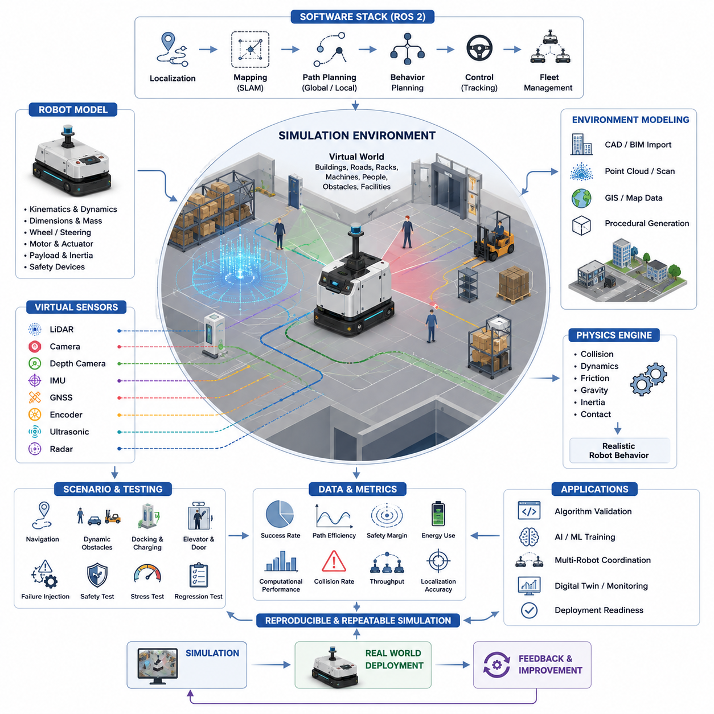
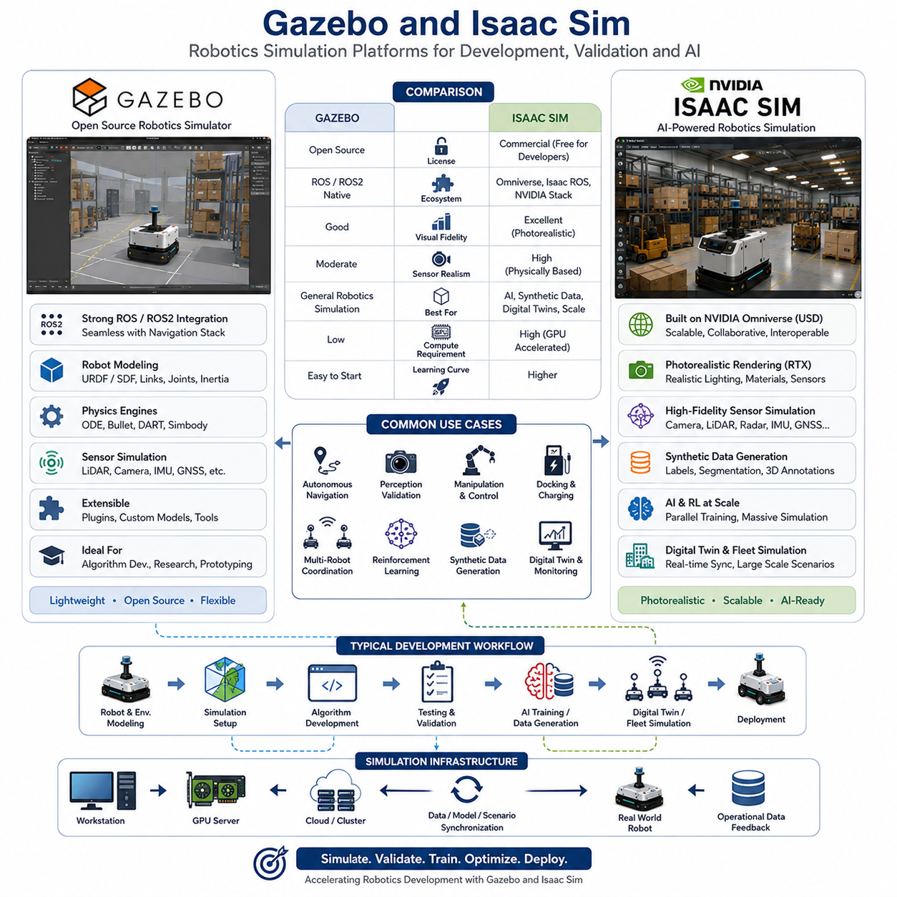
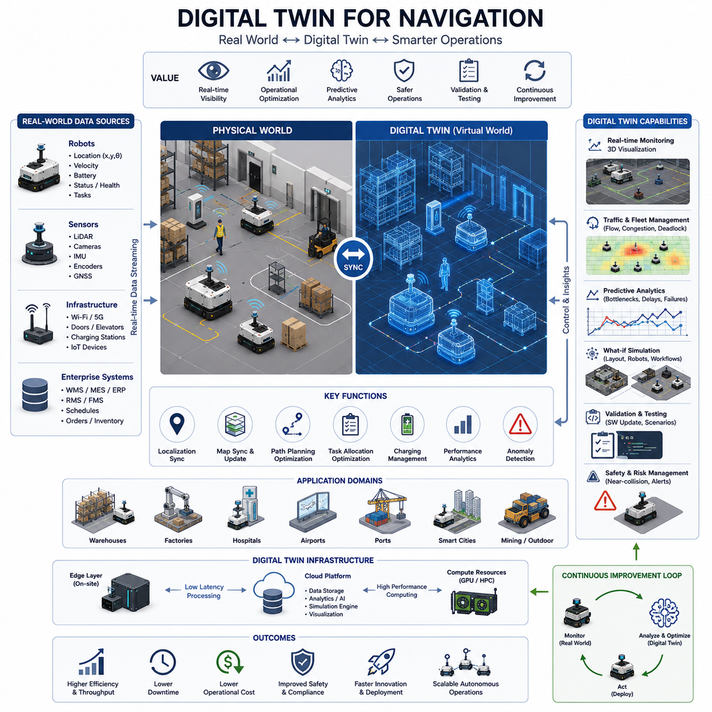
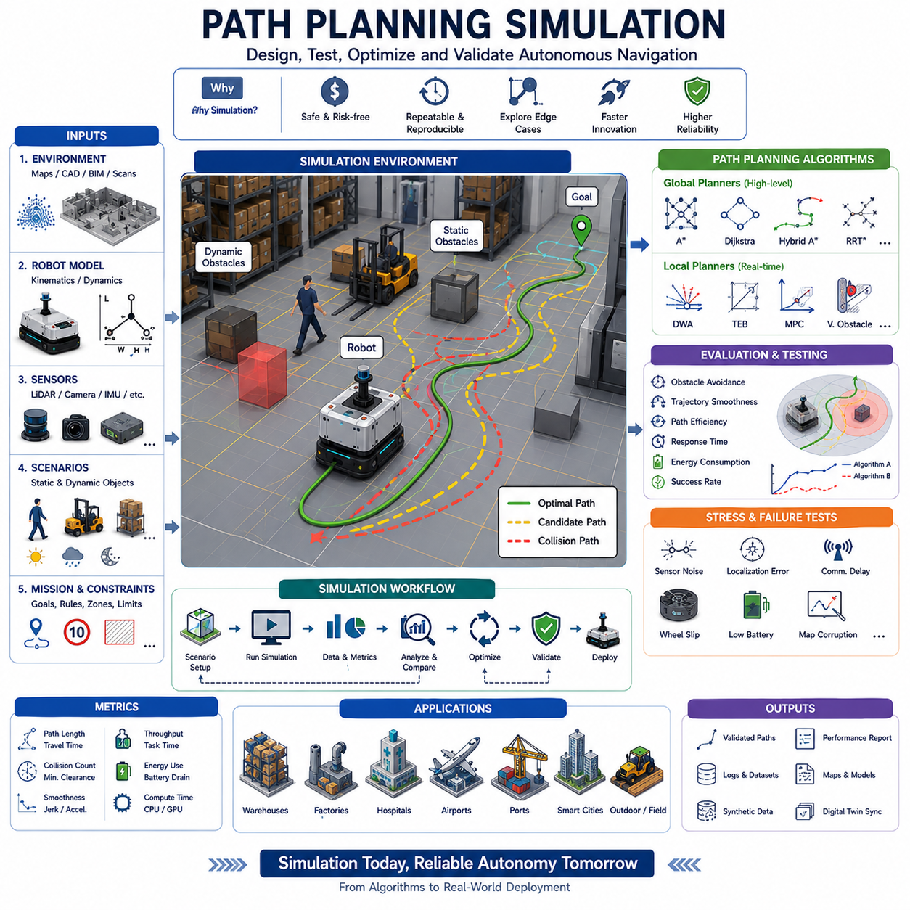
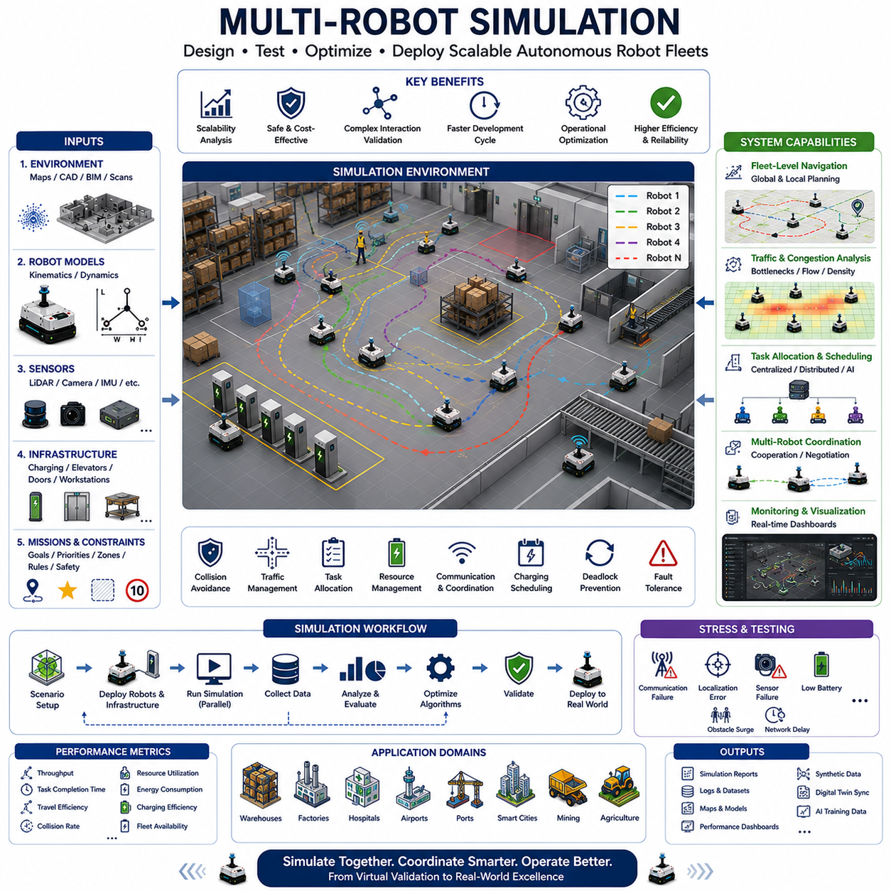
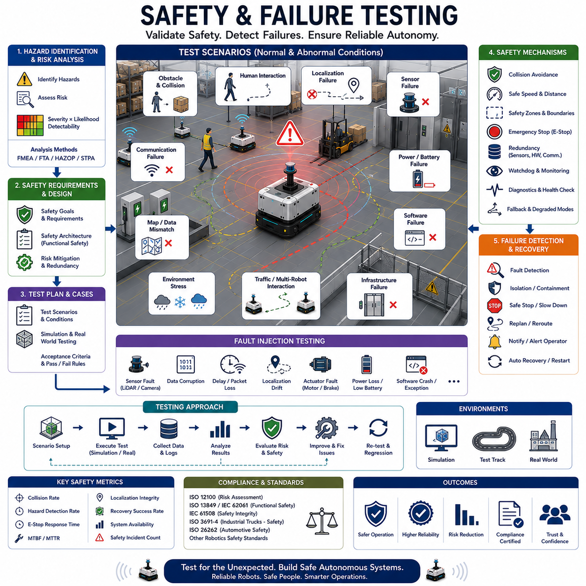
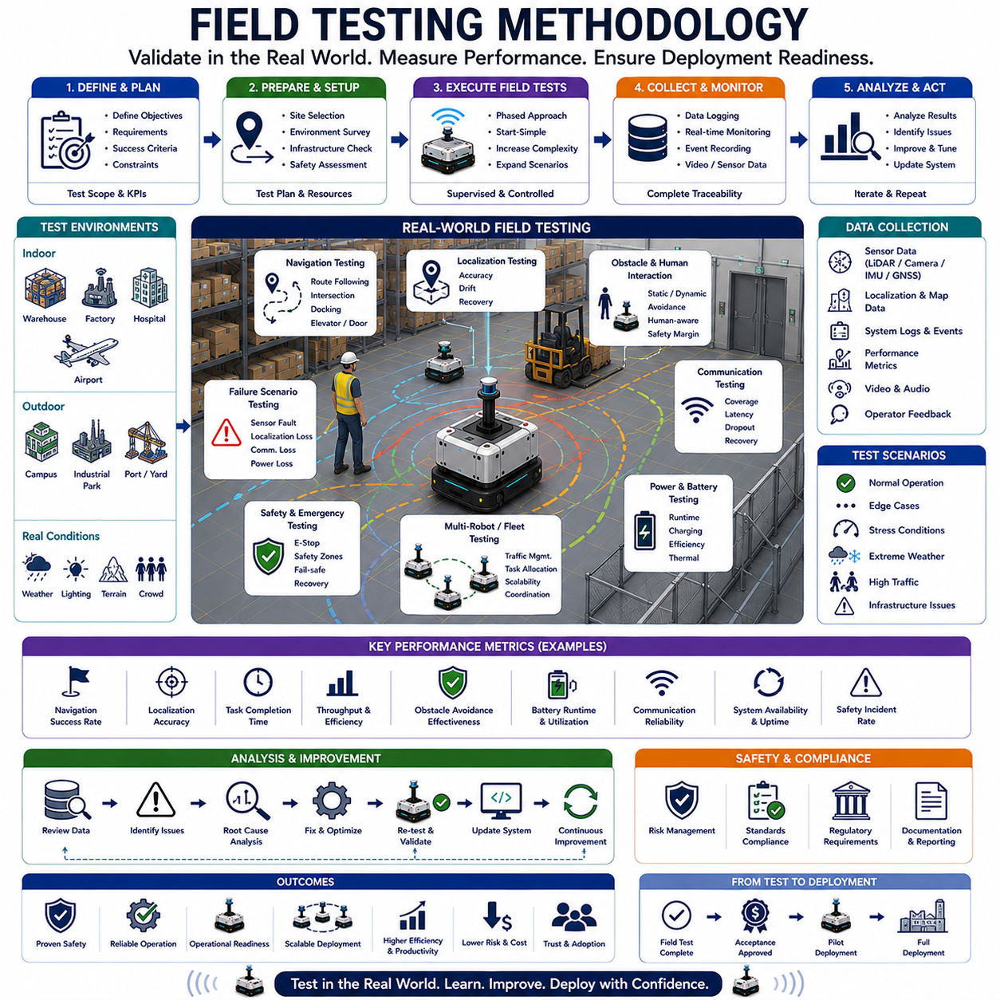
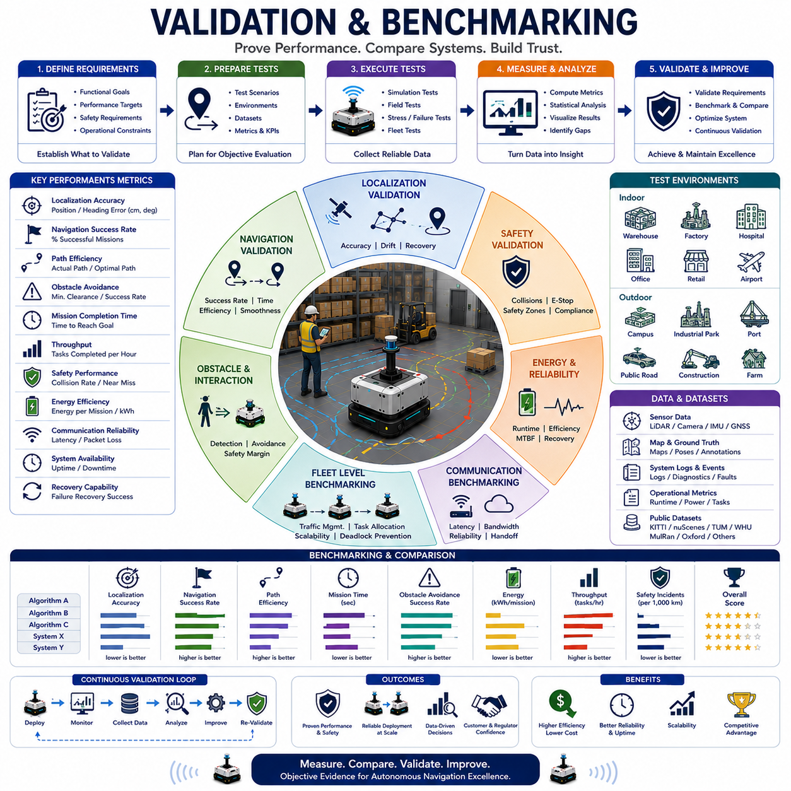

**Volume 05. Path Planning and Autonomous Navigation**

# Chapter 22. Simulation and Testing

## 22.1 Simulation Environment Setup

{width="7.268055555555556in" height="7.268055555555556in"}

Simulation Environment Setup is one of the most critical foundations of modern Autonomous Mobile Robot (AMR) development. Before deploying robots into factories, warehouses, hospitals, logistics centers, campuses, ports, airports, or outdoor industrial environments, engineers must validate navigation algorithms, perception systems, localization methods, obstacle avoidance strategies, fleet coordination logic, and safety mechanisms inside a controlled virtual environment. A well-designed simulation environment dramatically reduces development costs, shortens testing cycles, minimizes safety risks, and enables large-scale experimentation that would be difficult or impossible in real-world deployments. Within the broader domain of autonomous navigation, simulation serves as the bridge between theoretical algorithm development and real-world operational performance. It is therefore the first step in establishing a reliable testing and validation framework for autonomous robotic systems.

The primary objective of a simulation environment is to create a digital representation of the robot, its sensors, the surrounding environment, and the physical laws governing motion and interaction. The simulation must accurately reproduce robot kinematics, dynamics, sensor behavior, environmental geometry, communication delays, and operational constraints. The closer the simulation reflects reality, the more valuable the simulation results become. This concept is often referred to as simulation fidelity. High-fidelity simulation environments allow developers to evaluate system behavior under realistic conditions before physical prototypes are available or before expensive field trials begin.

A typical AMR simulation environment consists of several interconnected layers. The first layer is the virtual world model, which contains maps, buildings, roads, corridors, shelves, machines, walls, doors, elevators, charging stations, work cells, and human traffic zones. The second layer is the robot model, including chassis dimensions, wheel configurations, mass properties, motor characteristics, suspension systems, payload dynamics, and safety components. The third layer includes virtual sensors such as LiDAR, cameras, depth sensors, radar, GNSS receivers, IMUs, wheel encoders, ultrasonic sensors, and safety scanners. The fourth layer contains software systems including localization, mapping, path planning, behavior planning, fleet management, and robot control algorithms. Together, these layers form a complete simulation ecosystem capable of reproducing realistic robot operations.

Simulation environment design begins with defining development objectives. Some teams focus primarily on navigation validation, while others require perception testing, multi-robot coordination, AI model training, safety certification, or digital twin development. Clear objectives determine simulation fidelity requirements, computational resources, sensor modeling complexity, and environment scale. For example, a warehouse AMR may require highly accurate indoor mapping and obstacle avoidance simulation, whereas an outdoor autonomous robot may prioritize GNSS degradation modeling, rough terrain simulation, weather conditions, and large-scale route planning.

Modern AMR development frequently relies on Robot Operating System 2 (ROS2) as the software integration framework. Consequently, simulation environments are often tightly integrated with ROS2 communication architectures. Simulated sensors publish data through ROS2 topics, localization nodes process virtual measurements, path planners generate trajectories, and controllers produce motion commands exactly as they would on physical robots. This software-in-the-loop approach enables developers to test production software without modification. As a result, the transition from simulation to real deployment becomes significantly smoother.

The robot model itself plays a central role in simulation accuracy. A simplified robot representation may be sufficient for high-level navigation experiments, but realistic testing requires detailed mechanical properties. Parameters such as wheelbase dimensions, steering geometry, mass distribution, center of gravity, motor torque curves, acceleration limits, braking characteristics, and tire-ground interactions influence robot behavior significantly. For towing robots, trailer articulation dynamics must also be modeled accurately. For heavy industrial AMRs carrying loads of hundreds or thousands of kilograms, payload-induced dynamic effects become especially important.

Sensor simulation represents another major component of environment setup. LiDAR simulation must generate realistic point clouds, including measurement noise, range limitations, reflection artifacts, and occlusions. Camera simulation should reproduce lighting conditions, shadows, lens distortion, motion blur, and image noise. Depth cameras must simulate measurement uncertainty at varying distances. GNSS simulation should model satellite visibility, multipath effects, signal blockage, atmospheric disturbances, and RTK corrections. IMU simulation should incorporate drift, bias instability, vibration sensitivity, and measurement noise. Accurate sensor simulation enables perception and localization algorithms to be evaluated under realistic operating conditions.

Environmental modeling requires careful attention to detail. Indoor facilities may include narrow corridors, warehouse racks, loading docks, elevators, automatic doors, pedestrian crossings, and dynamic obstacles. Outdoor environments may include roads, sidewalks, slopes, rough terrain, vegetation, parked vehicles, construction zones, and varying weather conditions. Large-scale industrial sites often require kilometer-scale maps and complex traffic flows. The simulation environment must reproduce these characteristics to ensure realistic navigation behavior.

A key requirement in simulation setup is the construction of representative maps. Engineers often import CAD drawings, BIM models, GIS data, point cloud maps, or SLAM-generated maps to create virtual environments. Industrial facilities frequently provide detailed architectural drawings that can be converted into simulation worlds. Advanced workflows automatically generate digital twins from real-world scans, reducing manual modeling effort while increasing environmental realism.

Physics simulation engines are responsible for calculating robot motion and environmental interactions. These engines model forces, torques, collisions, friction, gravity, inertia, and contact dynamics. Accurate physics simulation is particularly important when validating acceleration limits, emergency braking behavior, obstacle collisions, wheel slip, slope climbing, and payload stability. Inadequate physics models can create unrealistic behaviors that mislead developers and reduce simulation value.

Time synchronization is another important aspect of simulation environment design. Real robotic systems often rely on precise timestamps for sensor fusion, localization, and control. Simulation environments must reproduce synchronized sensor outputs and deterministic timing behavior. Many development teams utilize simulated clocks to ensure reproducible experiments. Repeatability is one of the greatest advantages of simulation because identical scenarios can be executed repeatedly under controlled conditions.

Scenario generation forms the basis of systematic testing. Rather than manually driving robots through environments, engineers define structured scenarios representing operational conditions. These may include normal navigation tasks, dynamic obstacle encounters, intersection crossings, docking operations, charging procedures, elevator interactions, emergency stops, route blockages, localization failures, communication losses, and sensor malfunctions. Automated scenario execution enables large-scale testing across hundreds or thousands of conditions.

Path planning validation is one of the primary applications of simulation. Global planners can be evaluated using large facility maps, while local planners can be tested against moving obstacles and dynamic environmental changes. Simulation allows engineers to measure path efficiency, travel time, energy consumption, clearance margins, trajectory smoothness, and computational performance. Alternative algorithms such as A\*, Dijkstra, RRT, RRT\*, Hybrid A\*, TEB, DWA, and MPC can be compared systematically within identical conditions.

Obstacle avoidance testing benefits enormously from simulation. Human workers, forklifts, carts, vehicles, and other robots can be introduced as dynamic agents. Their behavior can be randomized to generate diverse operating conditions. Developers can analyze collision rates, avoidance success rates, recovery times, and safety margins without exposing personnel or equipment to actual risk.

Multi-robot simulation environments support fleet-level validation. Large warehouses may operate dozens or hundreds of robots simultaneously. Simulating such systems in the physical world is expensive and time consuming. Virtual testing enables evaluation of traffic management algorithms, task allocation strategies, deadlock prevention methods, congestion mitigation approaches, and fleet scalability. Engineers can observe how system performance changes as fleet size increases and identify bottlenecks before deployment.

Safety validation represents a major reason for establishing simulation environments. Autonomous robots must demonstrate safe behavior under both expected and unexpected conditions. Simulation enables testing of emergency stop mechanisms, safety zones, speed limitations, collision avoidance systems, sensor failures, communication interruptions, and software faults. Edge cases that rarely occur in real operations can be generated deliberately and repeatedly within simulation. This capability significantly improves safety assurance.

Failure injection is an especially valuable testing methodology. Engineers intentionally introduce faults such as LiDAR failures, camera blackouts, GNSS outages, wheel encoder errors, network delays, corrupted maps, localization drift, or controller instability. By observing system responses, developers can evaluate robustness and identify weaknesses. Recovery behaviors can then be refined before real-world deployment.

Digital twin technologies further extend simulation capabilities. A digital twin maintains synchronization between physical robots and virtual representations. Real operational data can be streamed into simulation environments, enabling predictive analysis, anomaly detection, operational optimization, and continuous improvement. Digital twins also support what-if analysis, allowing engineers to evaluate proposed facility modifications before implementation.

Simulation environments are increasingly used for artificial intelligence development. Machine learning models often require enormous amounts of training data. Synthetic data generation within simulation can produce millions of labeled sensor samples efficiently. Computer vision models, object detection systems, semantic segmentation networks, and reinforcement learning policies can be trained using virtual environments before fine-tuning on real-world data. This approach dramatically reduces data collection costs.

Reinforcement learning applications rely heavily on simulation because agents require extensive trial-and-error exploration. Conducting millions of learning iterations on physical robots would be impractical and potentially unsafe. Simulation environments allow accelerated training, parallel execution, and rapid experimentation. Policies developed in simulation can subsequently be transferred to physical robots through sim-to-real methodologies.

Performance benchmarking is another essential function of simulation environments. Standardized test scenarios provide objective comparisons between algorithms, software versions, hardware configurations, and system architectures. Metrics such as navigation success rate, path optimality, localization accuracy, obstacle avoidance performance, task completion time, throughput, energy efficiency, and computational utilization can be evaluated consistently.

Cloud-based simulation infrastructure has become increasingly common. Large-scale simulations often require significant computational resources. Distributed cloud systems enable parallel scenario execution across hundreds of virtual machines or GPU servers. Development teams can run extensive regression testing campaigns overnight, accelerating software development cycles and improving product reliability.

For industrial organizations, simulation environments support the entire AMR lifecycle. During concept development, simulation helps evaluate feasibility. During engineering development, simulation accelerates software validation. During deployment preparation, simulation supports site-specific customization. During operations, simulation enables optimization and troubleshooting. During future upgrades, simulation reduces implementation risk by validating modifications before deployment.

The ultimate goal of simulation environment setup is not merely to create visually realistic virtual worlds, but to establish a reliable engineering platform that accurately predicts real-world system behavior. Successful simulation environments combine realistic physics, accurate sensor models, representative environments, robust testing frameworks, automated scenario execution, and seamless software integration. When properly implemented, simulation becomes a strategic asset that improves safety, accelerates development, reduces costs, enhances product quality, and enables scalable autonomous robot deployment across diverse industries. As AMR systems continue to evolve toward higher autonomy, larger fleet sizes, cloud-connected architectures, embodied AI capabilities, and digital twin ecosystems, simulation environments will become increasingly central to the development, validation, and continuous improvement of autonomous navigation technologies.

## 22.2 Gazebo and Isaac Sim

{width="7.268055555555556in" height="7.268055555555556in"}

Gazebo and Isaac Sim are two of the most important simulation platforms used in modern Autonomous Mobile Robot (AMR), autonomous vehicle, industrial robotics, and embodied AI development. As autonomous systems become increasingly complex, developers require simulation environments capable of reproducing realistic robot behavior, sensor outputs, environmental interactions, and large-scale operational scenarios. Physical testing alone is no longer sufficient due to cost, safety concerns, limited scalability, and long development cycles. Consequently, simulation has become a core component of robotics engineering workflows, and Gazebo and Isaac Sim have emerged as two of the most widely adopted platforms for robot simulation, validation, and digital twin development.

The fundamental objective of both Gazebo and Isaac Sim is to provide a virtual environment where robots can be developed, tested, trained, and validated before deployment in the real world. Both platforms allow engineers to create digital representations of robots, sensors, facilities, and operating environments while executing the same software that will eventually run on physical machines. This approach significantly reduces development risk and enables rapid iteration throughout the robot lifecycle.

Gazebo has been a cornerstone of robotics simulation for many years, particularly within the Robot Operating System (ROS) ecosystem. Originally developed as an open-source robotics simulator, Gazebo provides a flexible framework for simulating robot dynamics, sensors, and environments. Its widespread adoption is largely due to its seamless integration with ROS and ROS2, making it a natural choice for researchers, universities, startups, and industrial robotics teams.

Gazebo enables developers to create realistic robot models by defining links, joints, inertial properties, collision geometries, and visual representations. Robot models are commonly described using URDF (Unified Robot Description Format) or SDF (Simulation Description Format), allowing physical characteristics such as mass, dimensions, wheel configurations, and sensor placements to be accurately represented. Once loaded into the simulation environment, these robots can interact with virtual worlds using realistic physics calculations.

The physics simulation capabilities of Gazebo are provided through multiple physics engines, including ODE, Bullet, DART, and Simbody. These engines calculate forces, torques, friction, gravity, collisions, and joint dynamics. By accurately modeling physical interactions, Gazebo enables developers to evaluate motion control systems, navigation algorithms, obstacle avoidance behaviors, and mechanical designs under realistic operating conditions.

Sensor simulation is one of Gazebo's most valuable features. Virtual LiDAR sensors can generate realistic point clouds, cameras can produce image streams, IMUs can simulate acceleration and angular velocity measurements, and GNSS sensors can provide virtual positioning information. These sensor outputs are published directly into ROS2 communication channels, allowing perception and navigation software to operate exactly as they would on a physical robot.

For autonomous navigation development, Gazebo is particularly useful because it supports direct integration with the ROS2 Navigation Stack. Developers can validate localization systems, SLAM algorithms, global planners, local planners, obstacle avoidance systems, docking procedures, elevator integration, fleet coordination, and traffic management strategies without requiring access to physical hardware. This significantly accelerates software development and debugging processes.

One of Gazebo's greatest strengths is its openness and extensibility. Developers can create custom plugins, integrate proprietary algorithms, modify simulation behaviors, and extend the platform to support unique robotic applications. This flexibility has led to widespread adoption across academic research, industrial automation, warehouse robotics, hospital delivery robots, agricultural machines, and outdoor autonomous vehicles.

As robotic systems evolved toward AI-driven autonomy and large-scale digital twins, simulation requirements expanded beyond traditional robotics testing. Modern autonomous systems increasingly require photorealistic environments, high-fidelity sensor simulation, synthetic data generation, reinforcement learning support, and large-scale parallel training infrastructure. These requirements contributed to the emergence of Isaac Sim as a next-generation robotics simulation platform.

Isaac Sim, developed by NVIDIA, is built on the NVIDIA Omniverse platform and is specifically designed for AI-powered robotics development. Unlike traditional simulators that primarily focus on robot dynamics and control, Isaac Sim combines robotics simulation, high-performance rendering, digital twins, synthetic data generation, AI training, and large-scale simulation workflows into a unified environment.

One of Isaac Sim's defining features is its use of physically based rendering and RTX ray tracing technologies. These capabilities allow virtual environments to closely resemble real-world scenes, producing highly realistic lighting, reflections, shadows, textures, and sensor outputs. Such realism is particularly important for computer vision systems, where perception models must learn from visual data that closely matches deployment environments.

Isaac Sim employs Universal Scene Description (USD) as its underlying scene representation framework. USD provides a scalable method for describing complex environments, enabling large facilities, factories, warehouses, cities, and industrial sites to be modeled efficiently. The use of USD also facilitates collaboration among multidisciplinary engineering teams, including mechanical engineers, software developers, AI researchers, and simulation specialists.

The platform includes advanced sensor simulation capabilities for cameras, LiDAR, radar, IMUs, GNSS receivers, depth sensors, and ultrasonic sensors. Sensor outputs incorporate realistic noise models, environmental effects, lighting variations, weather conditions, and material properties. This high-fidelity sensor simulation is critical for validating perception systems used in autonomous navigation and robotic decision making.

Isaac Sim has become especially popular for synthetic data generation. Deep learning models often require millions of labeled images, point clouds, and sensor recordings. Collecting and annotating such datasets in the real world is expensive and time consuming. Isaac Sim can automatically generate massive quantities of labeled training data, including object detection annotations, semantic segmentation masks, depth maps, instance labels, bounding boxes, and tracking information. This dramatically accelerates AI development workflows.

Reinforcement learning represents another major application area for Isaac Sim. Autonomous robots frequently require learning-based policies for navigation, manipulation, obstacle avoidance, and decision making. Reinforcement learning algorithms typically require millions of interactions with the environment. Performing these interactions in the real world is impractical, but Isaac Sim enables accelerated simulation and large-scale parallel training. Multiple virtual robots can learn simultaneously across GPU clusters, reducing training times from months to days.

The integration of Isaac Sim with NVIDIA's robotics ecosystem further enhances its capabilities. Isaac ROS provides GPU-accelerated robotics software modules, while NVIDIA GPUs such as Jetson Orin, Jetson Thor, RTX A6000 Ada, H100, and Blackwell platforms can be used to accelerate simulation, perception, and AI workloads. This creates a unified development pipeline from simulation and training to deployment and operation.

Digital twin development is one of Isaac Sim's strongest use cases. A digital twin is a virtual representation of a physical system that remains synchronized with real-world operations. Industrial facilities can create virtual replicas of warehouses, factories, logistics centers, airports, ports, hospitals, or smart cities. Real-time operational data from robots, sensors, and management systems can be streamed into the simulation environment, enabling predictive analysis, performance optimization, anomaly detection, and operational planning.

For large-scale fleet management applications, Isaac Sim enables simulation of hundreds or even thousands of robots operating simultaneously. Engineers can evaluate fleet traffic management, task allocation algorithms, charging strategies, congestion mitigation methods, and infrastructure utilization before deploying physical systems. Such large-scale validation is difficult to achieve using conventional testing methods.

Comparing Gazebo and Isaac Sim reveals that both platforms serve important but somewhat different purposes. Gazebo is highly accessible, open-source, lightweight, and deeply integrated with ROS2. It is ideal for algorithm development, software validation, academic research, rapid prototyping, and standard AMR development workflows. Development teams can quickly create environments, test navigation stacks, and validate robot behaviors without requiring expensive hardware resources.

Isaac Sim, on the other hand, prioritizes realism, scalability, AI development, digital twins, and synthetic data generation. It requires significantly greater computational resources, particularly GPU acceleration, but delivers superior visual fidelity, sensor realism, and large-scale simulation capabilities. For organizations developing advanced autonomous systems, embodied AI platforms, industrial digital twins, and next-generation robot intelligence, Isaac Sim offers substantial advantages.

Many industrial robotics organizations utilize both platforms within their development workflow. Gazebo may be used during early-stage software development because of its simplicity and fast iteration cycles. Isaac Sim may then be introduced during advanced validation phases requiring realistic perception testing, AI model training, synthetic data generation, and digital twin deployment. This hybrid strategy combines the strengths of both ecosystems while minimizing development costs.

The emergence of cloud-based simulation infrastructure further increases the value of both platforms. Engineers can execute large-scale regression tests, reinforcement learning experiments, synthetic data generation pipelines, and fleet simulations across distributed computing resources. GPU clusters equipped with H100, B100, or future Blackwell accelerators enable simulation workloads that were previously impossible on traditional development workstations.

As autonomous robotics continues evolving toward embodied AI, foundation models, multimodal reasoning systems, and cloud-connected robotic ecosystems, the role of simulation will become increasingly important. Robots must be trained, validated, and optimized within virtual environments before operating safely in the real world. Simulation platforms are no longer merely debugging tools; they have become essential components of the robotics development lifecycle.

Looking toward the future, Gazebo will likely continue serving as a foundational open-source simulation platform for ROS-based robotics development, education, and algorithm research. Isaac Sim will continue expanding as a comprehensive industrial simulation ecosystem supporting digital twins, synthetic data generation, large-scale AI training, and embodied intelligence development. Together, these platforms form the backbone of modern robotic simulation infrastructure, enabling faster innovation, safer deployments, higher system reliability, and more scalable autonomous robot solutions across virtually every industry sector.

## 22.3 Digital Twin for Navigation

{width="7.268055555555556in" height="7.268055555555556in"}

Digital Twin for Navigation represents one of the most transformative developments in modern Autonomous Mobile Robot (AMR), autonomous vehicle, and intelligent infrastructure systems. A digital twin is a continuously synchronized virtual representation of a physical environment, robot fleet, navigation system, and operational process. Unlike traditional simulation environments that are primarily used during development and testing phases, a digital twin remains connected to real-world systems throughout their operational lifecycle. It receives live data from robots, sensors, fleet management systems, enterprise software, and infrastructure devices, allowing the virtual environment to accurately reflect real-world conditions in near real time. In navigation systems, digital twins provide a powerful platform for monitoring, optimization, predictive analysis, validation, troubleshooting, and continuous improvement.

The concept of digital twins originated in aerospace and industrial manufacturing industries, where virtual replicas of physical assets were used to predict failures and optimize performance. As robotics technology matured and computing resources became more accessible, the concept evolved into a core technology for autonomous systems. Today, digital twins are increasingly deployed in warehouses, factories, hospitals, airports, logistics hubs, smart cities, ports, rail networks, mining sites, and large industrial campuses where autonomous robots operate continuously.

The primary objective of a navigation digital twin is to establish a virtual environment that mirrors the physical navigation ecosystem. This includes facility maps, robot positions, localization systems, path planning algorithms, traffic management systems, charging stations, elevators, doors, workstations, storage areas, and operational constraints. The digital twin continuously receives information from the physical world and updates its virtual representation accordingly. This synchronization enables operators and engineers to observe, analyze, and optimize robot behavior without disrupting ongoing operations.

A complete navigation digital twin consists of several interconnected layers. The first layer is the physical environment, including buildings, roads, corridors, intersections, loading zones, warehouse racks, machines, and human activity areas. The second layer includes the robot fleet itself, encompassing robot locations, velocities, battery status, sensor outputs, health conditions, assigned tasks, and navigation states. The third layer contains communication infrastructure such as Wi-Fi networks, private 5G systems, cloud services, edge computing nodes, and fleet management servers. The fourth layer consists of the virtual twin environment where all physical information is reconstructed, analyzed, and visualized. Together, these layers create a comprehensive representation of the operational navigation ecosystem.

One of the most important components of a navigation digital twin is real-time localization synchronization. Every robot continuously estimates its position using technologies such as LiDAR SLAM, Visual SLAM, GNSS RTK, wheel odometry, IMU fusion, and landmark-based localization. These position estimates are transmitted to the digital twin platform, allowing virtual robots to mirror the movement of physical robots. As robots navigate through warehouses, factories, hospitals, or outdoor environments, their virtual counterparts move simultaneously within the digital environment.

Map synchronization is another critical function. Modern facilities frequently change over time. New equipment may be installed, storage racks relocated, work areas expanded, temporary barriers introduced, or construction zones created. A static map quickly becomes outdated in such environments. Digital twins address this challenge by continuously updating environmental representations based on real-world observations. Sensor data collected by robots can be used to detect environmental changes and automatically update virtual maps. This ensures that navigation systems always operate using current environmental information.

Digital twins significantly enhance path planning and navigation optimization. Traditional navigation systems typically rely on predefined maps and static planning assumptions. However, real operational environments are dynamic and constantly evolving. Traffic congestion, temporary obstacles, maintenance activities, and changing operational priorities can affect navigation efficiency. A digital twin can continuously analyze these factors and evaluate alternative routing strategies before applying them to physical robots. This capability improves operational efficiency while minimizing disruptions.

Traffic management represents one of the most valuable applications of navigation digital twins. In large facilities, dozens or even hundreds of robots may operate simultaneously. Managing robot interactions, preventing congestion, avoiding deadlocks, and optimizing task flow become increasingly complex as fleet size grows. A digital twin allows operators to visualize traffic patterns, identify bottlenecks, simulate alternative traffic control policies, and evaluate fleet-level optimization strategies before implementing changes in the physical environment.

Predictive navigation analysis is another major advantage. Instead of reacting to problems after they occur, digital twins enable proactive decision-making. Historical operational data, current environmental conditions, and predictive models can be combined to forecast future system behavior. For example, a digital twin may predict congestion in a particular corridor, identify likely charging station bottlenecks, forecast battery depletion risks, or estimate future task delays. Operators can then take corrective actions before performance degradation occurs.

Digital twins also play a critical role in safety management. Autonomous navigation systems must maintain safe operation under a wide range of conditions. By continuously monitoring robot behavior, obstacle interactions, traffic flow, and environmental conditions, digital twins can identify emerging safety risks. Near-collision events, abnormal navigation behaviors, localization failures, unexpected route deviations, and repeated obstacle encounters can be detected and analyzed. This enables organizations to improve safety policies and reduce operational risks.

Another important capability is navigation validation and verification. Whenever navigation software is updated, organizations must ensure that the new version performs correctly. Direct deployment into production environments can introduce significant risks. Digital twins provide a safe environment where proposed updates can be evaluated using real operational data. Engineers can replay historical robot missions, test new navigation algorithms, compare performance metrics, and validate software changes before deployment. This process significantly reduces operational risk while accelerating software innovation.

Digital twins are particularly valuable for fleet-level optimization. Modern logistics facilities may operate hundreds of AMRs performing transportation, delivery, towing, inventory movement, and material handling tasks. A digital twin can evaluate task allocation strategies, charging schedules, traffic management policies, and fleet coordination algorithms. By analyzing the entire system rather than individual robots, organizations can improve throughput, reduce waiting times, and maximize resource utilization.

Integration with enterprise systems further expands digital twin capabilities. Navigation digital twins can connect with Warehouse Management Systems (WMS), Manufacturing Execution Systems (MES), Enterprise Resource Planning (ERP) platforms, Facility Management Systems (FMS), and Robot Management Systems (RMS). This integration enables navigation decisions to consider production schedules, inventory status, maintenance activities, customer orders, and operational priorities. As a result, robot navigation becomes an integral component of overall business optimization.

Digital twins are increasingly being used for scenario analysis and what-if simulations. Before modifying facility layouts, adding new robots, changing workflows, or introducing new infrastructure, organizations can evaluate potential impacts within the digital twin environment. Engineers can assess whether proposed changes improve efficiency, create congestion, introduce safety risks, or affect system reliability. This capability supports data-driven decision making and reduces the cost of operational experimentation.

In outdoor navigation systems, digital twins provide additional value. Outdoor robots must contend with weather conditions, terrain changes, GNSS variability, lighting differences, traffic interactions, and large-scale environments. A digital twin can integrate weather forecasts, satellite positioning information, road conditions, and infrastructure data to provide a comprehensive representation of operational conditions. This enables more effective route planning, risk assessment, and mission management.

The emergence of high-definition mapping technologies has significantly improved digital twin accuracy. LiDAR scanning, photogrammetry, 3D reconstruction, BIM integration, and GIS data sources enable detailed digital representations of physical environments. Combined with real-time updates from robot fleets, these technologies create highly accurate navigation twins capable of supporting complex industrial operations.

Artificial intelligence is becoming increasingly integrated with navigation digital twins. Machine learning algorithms can analyze large volumes of operational data to identify patterns, predict failures, optimize traffic flow, and improve navigation performance. Reinforcement learning agents can evaluate alternative navigation strategies within the digital twin before deployment to physical robots. AI-driven digital twins therefore become active participants in system optimization rather than passive monitoring tools.

Cloud computing and edge computing technologies play essential roles in modern digital twin architectures. Cloud platforms provide scalable computational resources for data storage, analytics, simulation, and visualization. Edge computing systems process latency-sensitive navigation information near the robots. Together, cloud and edge architectures enable real-time synchronization while maintaining system scalability and responsiveness.

Digital twins also support advanced visualization and operational awareness. Operators can view real-time robot locations, traffic conditions, battery levels, task assignments, charging station utilization, and environmental status through intuitive dashboards. Three-dimensional facility visualizations provide situational awareness that would be difficult to achieve using conventional monitoring tools. This enhanced visibility improves operational control and decision-making.

As autonomous systems evolve toward larger fleets, more complex environments, and higher levels of autonomy, digital twins will become increasingly important. Future navigation digital twins will incorporate multimodal sensor fusion, foundation models, world models, embodied AI systems, predictive reasoning capabilities, and autonomous optimization engines. Instead of simply reflecting physical operations, future digital twins will actively recommend decisions, optimize resource allocation, and coordinate autonomous systems at facility-wide or city-wide scales.

In next-generation smart factories, logistics hubs, hospitals, airports, ports, and smart cities, digital twins will serve as the central intelligence layer connecting robots, infrastructure, humans, enterprise systems, and AI services. Navigation systems will no longer operate as isolated components but as part of an integrated digital ecosystem where physical and virtual worlds continuously interact. This convergence of robotics, simulation, artificial intelligence, cloud computing, and digital infrastructure represents one of the most important directions for the future of autonomous navigation.

Ultimately, Digital Twin for Navigation is far more than a visualization technology. It is a strategic platform that enables continuous monitoring, predictive optimization, safer operations, accelerated innovation, and intelligent decision making across the entire lifecycle of autonomous robotic systems. As AMR deployments scale from dozens to thousands of robots and expand from individual facilities to interconnected industrial ecosystems, digital twins will become a foundational technology supporting the next generation of autonomous navigation and intelligent robotic operations.

## 22.4 Path Planning Simulation

{width="7.268055555555556in" height="7.268055555555556in"}

Path Planning Simulation is a fundamental component of autonomous navigation development and validation for Autonomous Mobile Robots (AMRs), autonomous vehicles, service robots, industrial logistics systems, and next-generation embodied AI platforms. Before a robot is allowed to operate in real environments, its path planning algorithms must be extensively tested under a wide variety of operating conditions. Real-world testing alone is insufficient because it is expensive, time-consuming, difficult to reproduce, and potentially unsafe. Simulation provides a controlled environment where navigation algorithms can be developed, validated, optimized, stressed, and benchmarked before deployment. As autonomous systems become increasingly sophisticated, path planning simulation has evolved from a simple algorithm verification tool into a comprehensive engineering platform supporting navigation development throughout the entire robot lifecycle.

The primary objective of path planning simulation is to evaluate a robot\'s ability to move safely, efficiently, and reliably from a starting position to a desired destination while satisfying operational constraints. These constraints may include obstacle avoidance, vehicle kinematics, dynamic limitations, safety regulations, environmental conditions, traffic rules, energy consumption requirements, and mission-specific objectives. Through simulation, engineers can determine whether a path planning system consistently produces valid trajectories under realistic operating conditions.

Path planning simulation generally begins with the creation of a virtual environment. This environment represents the physical world in which the robot will eventually operate. Depending on the application, the environment may represent warehouses, factories, hospitals, airports, logistics centers, office buildings, campuses, roads, ports, mines, agricultural fields, or smart cities. The accuracy of the environment directly influences the quality of simulation results. Modern simulation environments often utilize CAD models, BIM data, GIS maps, LiDAR scans, SLAM-generated maps, and digital twin technologies to achieve realistic representations of physical spaces.

Once the virtual environment has been created, robot models are introduced into the simulation. These models include geometric dimensions, wheel configurations, steering mechanisms, mass properties, acceleration limits, braking performance, payload characteristics, and sensor placements. The robot model must accurately represent the real vehicle because path planning performance depends heavily on physical constraints. A small indoor differential-drive robot and a large outdoor six-wheel autonomous vehicle require fundamentally different planning behaviors due to differences in size, maneuverability, and dynamic characteristics.

Path planning simulation typically evaluates both global and local planning systems. The global planner is responsible for generating a high-level route from the robot's current location to its destination. It considers map topology, static obstacles, restricted zones, and mission objectives. Algorithms such as Dijkstra, A\*, Hybrid A\*, D\*, Theta\*, and graph-based planners are commonly evaluated within simulation environments. Developers analyze path optimality, computational efficiency, route stability, and replanning capabilities under varying environmental conditions.

The local planner operates at a lower level and continuously adjusts robot motion based on immediate environmental observations. Local planners must respond to dynamic obstacles, moving humans, vehicles, forklifts, carts, and other robots. Simulation enables developers to evaluate algorithms such as Dynamic Window Approach (DWA), Timed Elastic Band (TEB), Model Predictive Control (MPC), Velocity Obstacles, and reactive navigation methods. Metrics such as obstacle clearance, trajectory smoothness, response time, control stability, and collision avoidance success rates are commonly measured.

One of the most important advantages of path planning simulation is repeatability. Real-world conditions rarely remain identical across repeated tests. Human behavior changes, environmental conditions fluctuate, and sensor noise varies over time. Simulation allows identical scenarios to be executed repeatedly, enabling objective comparisons between algorithms, software versions, and system configurations. This repeatability significantly improves engineering productivity and scientific rigor.

Obstacle avoidance validation represents a major use case for path planning simulation. Static obstacles such as walls, machinery, shelves, and barriers are relatively straightforward to model. However, dynamic obstacles introduce significantly greater complexity. Human workers may move unpredictably, forklifts may cross robot paths, doors may open unexpectedly, and other robots may generate congestion. Simulation environments can systematically generate such situations and evaluate how effectively navigation algorithms respond.

Human-aware navigation is becoming increasingly important as robots operate in shared environments. Simulation platforms can model pedestrian movement patterns, crowd behavior, social interactions, and safety zones. Path planners can then be evaluated based on their ability to maintain safe distances, avoid abrupt maneuvers, respect social conventions, and provide comfortable interactions with humans. Such evaluations are particularly important in hospitals, airports, shopping centers, and public spaces.

Path planning simulation is also essential for validating robot kinematic constraints. Every robot possesses physical limitations regarding acceleration, velocity, turning radius, steering angle, payload capacity, and braking performance. A theoretically optimal path may be impossible for a physical robot to execute. Simulation ensures that generated trajectories satisfy vehicle constraints while maintaining operational efficiency. For towing robots and articulated vehicles, trailer dynamics introduce additional planning complexity that must be carefully validated.

Trajectory optimization forms a major component of advanced path planning simulation. The objective is not merely to reach the destination but to do so efficiently. Simulation enables evaluation of path length, travel time, energy consumption, passenger comfort, mechanical wear, and computational cost. Optimization algorithms can be compared under identical conditions to identify the most effective solutions for specific applications.

Outdoor autonomous navigation introduces additional simulation challenges. Unlike structured indoor environments, outdoor environments contain variable terrain, weather conditions, lighting changes, GNSS uncertainties, vegetation, uneven surfaces, and unpredictable obstacles. Path planning simulation for outdoor robots must incorporate terrain models, road networks, elevation maps, weather effects, and environmental uncertainty. This allows developers to evaluate system robustness under realistic field conditions.

Large-scale navigation simulation is particularly important for industrial deployments. A single warehouse may contain hundreds of robots operating simultaneously. Evaluating each robot individually is insufficient because fleet-level interactions significantly influence system performance. Path planning simulation enables developers to study traffic management strategies, congestion control, deadlock prevention, route reservation systems, and multi-robot coordination mechanisms. These simulations provide insights into overall fleet efficiency and operational scalability.

Multi-robot path planning represents one of the most computationally challenging areas of autonomous navigation. Each robot must pursue its own objectives while avoiding collisions and coordinating with other robots. Simulation provides a safe environment for testing centralized planning approaches, distributed coordination algorithms, swarm navigation methods, and cooperative decision-making systems. Performance metrics may include throughput, task completion time, traffic density, collision rates, and resource utilization.

Another major application of path planning simulation is docking and charging validation. Autonomous robots frequently need to navigate toward charging stations, docking ports, loading zones, or workstations with high positional accuracy. Simulation enables evaluation of close-range navigation behaviors, alignment procedures, obstacle handling, and failure recovery mechanisms. Precise docking performance can be optimized without risking physical damage to equipment.

Path planning simulation is also invaluable for validating special navigation behaviors such as reversing, parking, trailer control, elevator integration, door interaction, and narrow corridor traversal. These scenarios often represent edge cases that occur infrequently but can significantly impact operational reliability. Simulation allows developers to test thousands of such situations systematically and identify potential failure modes.

Failure injection testing is another powerful capability. Engineers can intentionally introduce localization errors, map corruption, sensor failures, communication disruptions, wheel slippage, obstacle detection inaccuracies, or control delays. Observing system responses under these conditions helps identify weaknesses and improve robustness. The ability to evaluate navigation behavior during abnormal conditions is essential for developing highly reliable autonomous systems.

Safety validation is among the most critical objectives of path planning simulation. Autonomous robots must operate safely under all expected and unexpected circumstances. Simulation environments allow developers to evaluate emergency stopping behaviors, safety zone enforcement, collision avoidance performance, recovery procedures, and fail-safe mechanisms. Dangerous scenarios that would be impractical or unsafe to test in real environments can be safely reproduced within simulation.

Digital twin technologies further enhance path planning simulation. Instead of relying solely on synthetic environments, digital twins continuously synchronize virtual models with real-world operations. Historical mission data, current robot locations, traffic conditions, and facility changes can be incorporated into simulation environments. This allows navigation algorithms to be tested against realistic operational conditions while maintaining the benefits of simulation.

Artificial intelligence is increasingly influencing path planning simulation. Machine learning models can predict obstacle behavior, estimate traffic flow, classify terrain, and optimize route selection. Reinforcement learning algorithms can train navigation policies through millions of simulated interactions. Foundation models and embodied AI systems may eventually learn navigation behaviors directly from large-scale simulated experiences. Simulation therefore serves not only as a validation tool but also as a training environment for future autonomous intelligence.

Synthetic data generation is another important benefit. Navigation systems rely heavily on sensor data from LiDAR, cameras, radar, GNSS receivers, IMUs, and other perception devices. Simulation platforms can generate massive quantities of realistic sensor data under controlled conditions. This data supports perception development, localization testing, AI training, and algorithm benchmarking.

Performance benchmarking represents a key outcome of path planning simulation. Engineers can measure navigation success rates, path efficiency, collision frequency, computational latency, energy consumption, localization accuracy, throughput, and task completion times. These metrics provide objective evidence for algorithm selection and system optimization. Standardized benchmarking scenarios also support comparisons across different robot platforms and navigation architectures.

Cloud computing has dramatically expanded the scale of path planning simulation. Large simulation campaigns can now be executed across hundreds or thousands of virtual environments simultaneously. Parallel testing accelerates development cycles and enables comprehensive validation of navigation systems before deployment. GPU-accelerated simulation platforms further support reinforcement learning, synthetic data generation, and large-scale optimization workflows.

As autonomous navigation systems continue evolving toward greater complexity, larger fleets, and higher levels of intelligence, path planning simulation will become increasingly important. Future simulation environments will integrate digital twins, world models, multimodal AI systems, foundation models, predictive analytics, and real-time operational feedback. Simulation will no longer be limited to offline development but will become an integral component of continuous operational optimization.

Ultimately, Path Planning Simulation serves as the bridge between theoretical navigation algorithms and reliable real-world deployment. It enables engineers to develop safer systems, reduce development costs, accelerate innovation, improve operational efficiency, and validate autonomous behavior under a virtually unlimited range of scenarios. As autonomous robots become essential components of industrial automation, logistics, healthcare, transportation, and smart infrastructure, path planning simulation will remain one of the foundational technologies supporting the future of intelligent autonomous navigation.

## 22.5 Multi-Robot Simulation

{width="7.268055555555556in" height="7.268055555555556in"}

Multi-Robot Simulation is a critical technology for the development, validation, optimization, and deployment of modern Autonomous Mobile Robot (AMR) fleets. While single-robot simulation focuses on the behavior and performance of an individual autonomous system, multi-robot simulation addresses the far more complex challenges that emerge when multiple autonomous agents operate simultaneously within a shared environment. As industries increasingly adopt fleet-based robotic systems for logistics, manufacturing, healthcare, transportation, warehousing, mining, agriculture, and smart city applications, the ability to accurately simulate large numbers of robots has become an essential component of robotics engineering.

The primary objective of multi-robot simulation is to evaluate how autonomous robots interact with each other, share resources, coordinate tasks, avoid collisions, communicate information, and collectively achieve operational goals. Unlike single-robot systems, where navigation decisions primarily depend on environmental conditions and mission objectives, multi-robot systems introduce dynamic interactions between autonomous agents. These interactions create emergent behaviors that are often difficult to predict through analytical methods alone. Simulation therefore becomes the most effective approach for understanding system behavior before deployment.

A multi-robot simulation environment typically consists of several interconnected components. The first component is the virtual environment, which may represent warehouses, factories, hospitals, airports, logistics centers, ports, campuses, industrial facilities, or outdoor urban spaces. The second component consists of robot models, each with its own physical characteristics, sensors, navigation systems, communication modules, and mission objectives. The third component includes infrastructure systems such as charging stations, elevators, automatic doors, workstations, loading docks, and storage areas. The fourth component contains fleet management software responsible for task allocation, traffic control, mission scheduling, and operational monitoring. Together, these components create a realistic ecosystem for evaluating large-scale autonomous operations.

One of the fundamental challenges addressed through multi-robot simulation is scalability. A navigation algorithm that performs well with five robots may behave very differently when deployed with fifty, one hundred, or even one thousand robots. As fleet size increases, robot interactions become more frequent, traffic congestion becomes more likely, and resource conflicts become more common. Simulation allows engineers to evaluate how system performance changes as operational scale increases and to identify bottlenecks before they impact real-world deployments.

Fleet-level navigation is one of the most important applications of multi-robot simulation. In a shared environment, robots must move efficiently while avoiding collisions with other robots. Path planning can no longer be treated as an independent process. Instead, each robot's decisions influence the movement of surrounding robots. Simulation enables developers to evaluate centralized path planning, distributed planning, hybrid planning architectures, cooperative navigation systems, and reservation-based traffic control mechanisms under realistic conditions.

Traffic management represents a major focus area within multi-robot simulation. Large facilities often contain narrow corridors, intersections, loading zones, charging stations, and shared work areas where robots compete for access. Without proper traffic coordination, congestion can significantly reduce operational efficiency. Simulation allows engineers to visualize traffic flows, identify bottlenecks, analyze congestion patterns, and evaluate alternative traffic management strategies before implementation.

Deadlock prevention is another critical challenge. Deadlocks occur when robots block one another in a manner that prevents any robot from progressing toward its destination. Such situations are particularly common in narrow passages, high-density traffic zones, and constrained industrial environments. Multi-robot simulation enables developers to reproduce deadlock scenarios systematically and validate recovery algorithms designed to restore normal operation.

Task allocation and mission scheduling are central components of fleet operations. In a warehouse environment, robots may be responsible for transporting inventory, delivering materials, collecting goods, and supporting manufacturing processes. Efficient assignment of tasks directly affects overall productivity. Simulation enables comparison of different scheduling algorithms, including centralized dispatching systems, market-based allocation mechanisms, auction-based approaches, priority-driven strategies, and AI-based optimization methods.

Resource management becomes increasingly important as fleet size grows. Multiple robots may require access to the same charging station, loading dock, storage area, elevator, or work cell. Competition for shared resources can create delays that propagate throughout the system. Simulation helps engineers understand these interactions and develop strategies that improve resource utilization while minimizing operational conflicts.

Communication systems play a significant role in multi-robot operations. Robots frequently exchange information regarding location, mission status, environmental conditions, traffic situations, and resource availability. Simulation environments can model communication networks, bandwidth limitations, latency effects, packet loss, wireless interference, and network failures. By evaluating communication performance under realistic conditions, developers can ensure robust coordination even in challenging environments.

Multi-robot localization presents unique opportunities and challenges. In some systems, robots share localization information, maps, landmarks, and environmental observations. Collaborative localization techniques can improve positioning accuracy and system robustness. Simulation enables evaluation of shared localization architectures while investigating their computational requirements, communication overhead, and operational benefits.

Map sharing and collaborative mapping are also important research and industrial topics. Multiple robots operating within a common environment can collectively contribute to map generation and maintenance. Newly detected obstacles, environmental changes, and temporary restrictions can be shared across the fleet. Simulation provides an efficient platform for validating collaborative mapping algorithms and evaluating their effectiveness under dynamic operating conditions.

One of the major advantages of multi-robot simulation is the ability to evaluate large-scale deployments that would be difficult or prohibitively expensive to reproduce physically. Constructing a real-world test environment with hundreds of robots requires significant investment in hardware, infrastructure, safety systems, and personnel. Simulation allows engineers to perform equivalent experiments at a fraction of the cost while maintaining complete control over testing conditions.

Warehouse automation represents one of the most common use cases for multi-robot simulation. Modern fulfillment centers may operate hundreds or thousands of robots simultaneously. These robots transport inventory, support order fulfillment, replenish stock, and coordinate with human workers. Simulation enables evaluation of throughput, travel efficiency, congestion management, charging strategies, and operational scalability before physical deployment.

Manufacturing environments introduce additional complexity. Robots must coordinate material delivery, production support, workstation servicing, and logistics operations while maintaining synchronization with manufacturing schedules. Multi-robot simulation allows engineers to analyze production flow, identify bottlenecks, optimize material handling operations, and evaluate facility layouts.

Hospital logistics is another important application area. Autonomous robots transport medications, laboratory samples, meals, linens, medical supplies, and waste materials throughout healthcare facilities. Simulation helps evaluate elevator integration, corridor traffic management, emergency route prioritization, and human-aware navigation strategies within highly dynamic environments.

Outdoor multi-robot systems present additional challenges related to weather conditions, terrain variability, GNSS uncertainties, infrastructure limitations, and large operational areas. Autonomous delivery robots, agricultural machines, mining vehicles, construction robots, and outdoor inspection platforms often operate collaboratively across extensive environments. Simulation enables evaluation of large-scale outdoor operations without the risks associated with field testing.

Safety validation is one of the most critical functions of multi-robot simulation. As robot density increases, the likelihood of collisions, traffic conflicts, and unexpected interactions also increases. Simulation environments enable systematic evaluation of collision avoidance algorithms, emergency stopping procedures, safety zone enforcement, fault recovery strategies, and fail-safe mechanisms. Potential safety risks can be identified and mitigated before deployment.

Failure injection testing provides additional insight into system robustness. Engineers can deliberately introduce communication failures, localization errors, sensor malfunctions, navigation faults, battery depletion events, and infrastructure outages. Observing how the fleet responds to such disruptions helps identify weaknesses and improve operational resilience.

Digital twin technologies are increasingly integrated with multi-robot simulation platforms. A digital twin continuously synchronizes virtual fleet operations with real-world robot deployments. Real-time data regarding robot locations, mission assignments, traffic conditions, battery status, and environmental changes can be incorporated into simulation models. This enables predictive analysis, operational optimization, and continuous performance improvement throughout the deployment lifecycle.

Artificial intelligence is becoming an increasingly important component of multi-robot simulation. Machine learning algorithms can optimize task allocation, traffic management, charging strategies, and fleet coordination. Reinforcement learning approaches allow autonomous agents to learn cooperative behaviors through large-scale simulation. Multi-agent reinforcement learning has emerged as a particularly promising area, enabling robots to develop collaborative strategies that improve overall system performance.

Synthetic data generation is another valuable capability. Large-scale simulations generate enormous quantities of navigation data, traffic information, communication logs, localization measurements, and operational metrics. These datasets support AI model training, performance benchmarking, anomaly detection, and predictive analytics development.

Cloud computing has significantly expanded the scale and complexity of multi-robot simulation. Modern cloud infrastructures enable thousands of virtual robots to operate simultaneously across distributed simulation environments. GPU acceleration further supports large-scale AI training, reinforcement learning experiments, and digital twin analytics. This computational capability allows organizations to evaluate future fleet architectures before investing in physical infrastructure.

Performance evaluation within multi-robot simulation typically focuses on metrics such as throughput, task completion time, travel efficiency, resource utilization, traffic congestion, collision rates, communication performance, energy consumption, charging efficiency, fleet availability, and operational cost. These metrics provide quantitative insights into system effectiveness and guide engineering decisions.

As autonomous systems continue evolving, multi-robot simulation will become increasingly important. Future robotic ecosystems may involve thousands of heterogeneous robots operating collaboratively across factories, warehouses, cities, transportation networks, and industrial facilities. These systems will require sophisticated coordination mechanisms, AI-driven optimization, cloud-native architectures, and real-time digital twins. Simulation will remain the primary tool for developing and validating such complex systems.

The future of multi-robot simulation is closely connected to the emergence of embodied AI, foundation models, world models, and autonomous agent technologies. Rather than merely validating navigation algorithms, future simulations may serve as large-scale virtual training grounds where autonomous agents learn collaborative behaviors, adaptive planning strategies, and complex operational reasoning. Digital environments may eventually become as important as physical deployments in the development of intelligent robotic systems.

Ultimately, Multi-Robot Simulation serves as the foundation for scalable autonomous operations. It enables engineers to design, evaluate, optimize, and validate fleet-level robotic systems under realistic conditions while minimizing cost, risk, and development time. As industries continue transitioning toward highly automated and interconnected robotic ecosystems, multi-robot simulation will play a central role in enabling the next generation of intelligent, cooperative, and scalable autonomous systems.

## 22.6 Safety and Failure Testing

{width="7.268055555555556in" height="7.268055555555556in"}

Safety and Failure Testing is one of the most critical disciplines in autonomous navigation development. Regardless of how advanced a robot's perception, localization, planning, or artificial intelligence capabilities may be, an autonomous system cannot be considered deployable unless it can demonstrate safe and predictable behavior under both normal and abnormal operating conditions. Autonomous Mobile Robots (AMRs), Automated Guided Vehicles (AGVs), autonomous forklifts, service robots, industrial inspection robots, outdoor autonomous vehicles, and future embodied AI systems must all undergo extensive safety and failure testing before deployment into real-world environments. These testing activities ensure that robots can continue operating safely when confronted with unexpected situations, component failures, communication disruptions, environmental uncertainties, or software defects.

The primary objective of safety and failure testing is to identify weaknesses within the robotic system before those weaknesses lead to accidents, downtime, equipment damage, financial losses, or safety incidents. Unlike functional testing, which verifies whether a robot performs intended tasks correctly, safety and failure testing deliberately examines how a system behaves when conditions deviate from normal expectations. The goal is not merely to validate successful operation but to understand how the robot reacts when things go wrong.

Modern autonomous robots operate in highly dynamic environments that contain humans, vehicles, machinery, infrastructure, and unpredictable obstacles. In such environments, failures cannot be completely eliminated. Sensors may malfunction, networks may disconnect, batteries may degrade, localization systems may drift, maps may become outdated, and software components may crash. Safety and failure testing therefore assumes that failures will eventually occur and focuses on ensuring that those failures do not result in hazardous behavior.

The foundation of safety testing begins with hazard identification. Engineers systematically analyze the robot system to identify potential hazards associated with navigation, perception, control, power systems, communications, software architecture, and operational environments. Each hazard is evaluated according to severity, likelihood of occurrence, detectability, and potential consequences. This process often forms the basis for safety cases and risk assessments used throughout the development lifecycle.

Risk analysis methodologies such as Failure Modes and Effects Analysis (FMEA), Fault Tree Analysis (FTA), Hazard and Operability Studies (HAZOP), and System-Theoretic Process Analysis (STPA) are commonly employed during system design. These methodologies help engineers understand how failures propagate through complex systems and identify mitigation strategies before implementation. Safety testing subsequently validates whether those mitigation strategies function as intended.

One of the most fundamental aspects of autonomous robot safety testing is collision avoidance validation. Robots must demonstrate the ability to detect and avoid static obstacles such as walls, shelves, equipment, and infrastructure, as well as dynamic obstacles such as pedestrians, forklifts, vehicles, and other robots. Safety testing evaluates sensor performance, obstacle detection accuracy, reaction times, braking effectiveness, and recovery behavior under a wide range of operating conditions.

Human safety receives particular attention because autonomous systems increasingly operate in shared environments. Human-aware navigation testing evaluates how robots interact with workers, visitors, patients, customers, and other personnel. Testing scenarios often include unexpected human movements, sudden appearances, crowd interactions, restricted safety zones, and emergency situations. Engineers analyze whether robots maintain appropriate safety margins, avoid dangerous maneuvers, and behave predictably in the presence of people.

Emergency stop systems represent another critical safety mechanism. Autonomous robots typically include multiple emergency stop pathways, including hardware buttons, wireless safety devices, safety PLCs, remote commands, and software-based triggers. Safety testing verifies that emergency stop commands immediately halt robot motion under all operating conditions. The reliability, latency, redundancy, and recovery procedures associated with emergency stop systems are carefully evaluated.

Localization failure testing is a major component of navigation safety validation. Autonomous robots rely on technologies such as LiDAR SLAM, Visual SLAM, GNSS RTK, wheel odometry, IMU fusion, and landmark recognition to estimate position. If localization accuracy degrades significantly, navigation decisions may become unsafe. Failure testing intentionally introduces localization drift, map mismatches, GNSS outages, sensor degradation, and environmental ambiguities to evaluate how navigation systems detect and respond to positioning errors.

Sensor failure testing examines the consequences of partial or complete sensor loss. LiDAR sensors may become obstructed by dust, dirt, fog, or physical damage. Cameras may experience glare, darkness, occlusions, or hardware failures. IMUs may drift, GNSS signals may be blocked, and wheel encoders may generate inaccurate measurements. Safety testing determines whether robots can continue operating safely under degraded sensing conditions and whether fallback strategies function correctly.

Communication failure testing becomes increasingly important in connected robotic systems. Modern fleets frequently depend on Wi-Fi, Ethernet, private 5G networks, cloud services, fleet management systems, and edge computing infrastructure. Network interruptions may prevent robots from receiving tasks, sharing location information, accessing maps, or coordinating with other systems. Safety validation examines how robots behave when communication is delayed, interrupted, degraded, or completely lost.

Power system failures represent another significant risk area. Battery degradation, voltage instability, power distribution failures, charging malfunctions, and sudden power losses can compromise navigation safety. Testing evaluates how robots respond to low battery conditions, unexpected shutdowns, charging interruptions, and power recovery events. Safe operational behavior must be maintained throughout all power-related failure scenarios.

Software failure testing focuses on robustness and fault tolerance. Autonomous navigation systems consist of numerous software modules including localization, mapping, planning, perception, control, diagnostics, communication, and fleet coordination components. Software bugs, memory leaks, process crashes, synchronization errors, and computational overloads can potentially affect robot behavior. Engineers deliberately introduce software faults to evaluate recovery mechanisms and fault containment strategies.

Fault injection testing has become one of the most powerful methodologies for evaluating autonomous system resilience. Rather than waiting for failures to occur naturally, engineers intentionally inject faults into hardware, software, communication channels, sensors, and infrastructure systems. Examples include corrupted sensor data, delayed messages, invalid map information, localization offsets, dropped network packets, actuator malfunctions, and processing delays. Observing system responses provides valuable insight into overall robustness.

Redundancy validation is essential for safety-critical applications. Many autonomous systems incorporate redundant sensors, processors, communication channels, power supplies, and safety controllers. Safety testing verifies that redundant components correctly assume responsibility when primary systems fail. The transition between primary and backup systems must occur seamlessly without introducing unsafe behavior.

Environmental stress testing evaluates robot performance under challenging operating conditions. Indoor robots may encounter dust, lighting variations, reflective surfaces, narrow corridors, crowded environments, and temporary obstacles. Outdoor robots face rain, snow, fog, wind, temperature extremes, terrain variability, GNSS degradation, and visibility challenges. Safety validation ensures that navigation systems remain reliable across the full range of expected environmental conditions.

Weather-related testing is particularly important for outdoor autonomous systems. Heavy rain may reduce camera visibility, snow may obscure landmarks, fog may affect LiDAR performance, and strong sunlight may create perception challenges. Engineers use simulation, controlled testing facilities, and field trials to understand how weather influences navigation reliability and safety margins.

Traffic interaction testing is increasingly relevant as robot fleets grow in size. Multiple robots operating simultaneously create opportunities for congestion, deadlocks, route conflicts, and coordination failures. Safety testing evaluates traffic management systems, priority assignment mechanisms, collision avoidance algorithms, and fleet-level decision making under high-density operating conditions.

Safety zone validation ensures that robots respect restricted areas, exclusion zones, pedestrian crossings, hazardous locations, and operational boundaries. Virtual safety zones are frequently used in factories, warehouses, hospitals, and industrial facilities. Testing verifies that robots respond appropriately when approaching or entering protected regions.

Failure recovery behavior is often as important as failure detection itself. A robot that correctly detects a fault but responds improperly may still create hazardous situations. Safety testing evaluates recovery procedures such as safe stopping, controlled deceleration, route replanning, operator notification, autonomous diagnostics, and system restart sequences. Recovery mechanisms should minimize operational disruption while maintaining safety.

Simulation environments play a crucial role in safety and failure testing because many dangerous scenarios cannot be reproduced safely in physical environments. Simulation allows engineers to evaluate extreme situations, rare events, and hazardous failures without risking injury or equipment damage. Thousands of fault conditions can be generated systematically, enabling comprehensive coverage that would be impractical through physical testing alone.

Digital twin technologies further enhance safety validation. Real-world operational data can be synchronized with virtual environments to recreate actual incidents and investigate failure mechanisms. Historical events can be replayed repeatedly, allowing engineers to analyze root causes and evaluate corrective actions.

Artificial intelligence introduces both opportunities and challenges for safety testing. Machine learning systems may behave differently from traditional rule-based software because decision-making processes are learned rather than explicitly programmed. AI safety testing therefore requires extensive validation across diverse datasets, environmental conditions, edge cases, and operational scenarios. Explainability, robustness, uncertainty estimation, and anomaly detection become increasingly important evaluation criteria.

Cybersecurity testing is becoming an integral part of safety validation. Unauthorized access, malicious commands, spoofed sensor data, network attacks, and software tampering can all compromise autonomous system safety. Security-focused failure testing evaluates system resilience against cyber threats while ensuring safe behavior under attack conditions.

Certification and regulatory compliance often require extensive safety evidence. International standards such as ISO 12100, ISO 13849, IEC 61508, IEC 62061, ISO 3691-4, ISO 26262, and emerging robotics safety standards provide structured frameworks for risk management and safety validation. Testing programs must generate objective evidence demonstrating compliance with applicable requirements.

Performance metrics within safety and failure testing include collision rates, hazard detection accuracy, emergency stop response times, localization integrity, fault detection latency, recovery success rates, mean time between failures, system availability, operational uptime, and safety incident frequency. These metrics provide quantitative measurements of system robustness and safety performance.

As autonomous systems become increasingly intelligent, connected, and scalable, safety and failure testing will continue to grow in importance. Future robot fleets may consist of thousands of interconnected autonomous agents operating continuously across factories, logistics networks, hospitals, smart cities, and industrial ecosystems. Ensuring safe operation at such scale will require advanced simulation platforms, digital twins, AI-assisted validation tools, automated fault injection systems, and continuous monitoring infrastructures.

Ultimately, Safety and Failure Testing serves as the final safeguard between autonomous technology and real-world deployment. It transforms autonomous systems from functional prototypes into reliable operational platforms capable of operating safely in complex environments. By systematically identifying weaknesses, validating protective mechanisms, and evaluating system resilience, safety and failure testing enables organizations to deploy autonomous robots with confidence, ensuring that innovation, productivity, and automation are achieved without compromising safety, reliability, or public trust.

## 22.7 Field Testing Methodology

{width="7.268055555555556in" height="7.268055555555556in"}

Field Testing Methodology is the systematic process used to validate autonomous robotic systems under real-world operating conditions. While simulation environments, digital twins, laboratory experiments, and controlled testing facilities provide valuable opportunities for development and preliminary validation, they cannot fully reproduce the complexity, uncertainty, and variability of actual deployment environments. Autonomous Mobile Robots (AMRs), Automated Guided Vehicles (AGVs), autonomous forklifts, outdoor autonomous vehicles, delivery robots, industrial inspection platforms, agricultural robots, and future embodied AI systems must eventually prove their capabilities in the real world. Field testing serves as the critical bridge between engineering development and commercial deployment, ensuring that robotic systems perform safely, reliably, and efficiently when exposed to real operational conditions.

The primary objective of field testing is to evaluate whether a robotic system can successfully execute its intended missions in environments that closely resemble actual deployment scenarios. Unlike simulation-based testing, field testing exposes robots to uncontrolled variables such as changing weather conditions, human behavior, infrastructure variations, sensor interference, communication limitations, unexpected obstacles, and operational disruptions. These real-world factors often reveal system weaknesses that remain hidden during laboratory validation.

A well-designed field testing methodology begins long before the robot enters the operational environment. The first phase typically involves defining testing objectives, performance requirements, operational constraints, and acceptance criteria. Engineers must determine exactly what capabilities are being validated and what constitutes success or failure. Common objectives include navigation accuracy, localization reliability, obstacle avoidance performance, task execution efficiency, safety compliance, communication robustness, battery endurance, fleet coordination, and overall operational readiness.

Test planning represents one of the most important stages of field testing. A comprehensive test plan defines the scope of testing, operational scenarios, performance metrics, environmental conditions, safety procedures, required personnel, equipment configurations, data collection methods, and contingency plans. Effective planning ensures that testing activities generate meaningful results while minimizing operational risks and unnecessary resource consumption.

Site selection is a critical component of field testing methodology. The selected environment should closely represent the conditions expected during actual deployment. Indoor field testing may occur within warehouses, factories, hospitals, airports, logistics centers, manufacturing facilities, or office buildings. Outdoor testing may take place on campuses, industrial parks, agricultural sites, mines, ports, construction areas, public roads, or urban environments. The testing site must provide sufficient complexity to challenge the autonomous system while remaining manageable from a safety and operational perspective.

Environmental characterization is typically conducted before testing begins. Engineers survey the testing area to document physical layouts, infrastructure elements, operational workflows, communication coverage, lighting conditions, terrain characteristics, pedestrian activity, vehicle traffic patterns, and potential hazards. This information establishes a baseline understanding of the environment and supports the interpretation of testing results.

Before autonomous operation is permitted, many organizations conduct site readiness assessments. These assessments verify that infrastructure, communication systems, safety equipment, emergency procedures, operational permissions, and regulatory requirements have been properly addressed. Site readiness reviews reduce operational risk and help ensure testing proceeds according to established safety standards.

Field testing is generally performed using a phased approach. Early testing phases often focus on basic functionality validation. Engineers verify that sensors operate correctly, localization systems remain stable, communication links function reliably, and navigation algorithms execute as expected. These initial tests are typically performed at low speeds, within limited operational areas, and under close supervision.

As confidence in system performance increases, testing progresses toward more complex scenarios. Robots may be required to navigate larger environments, interact with dynamic obstacles, perform operational missions, coordinate with other robots, and operate under increasingly realistic conditions. Gradual expansion of operational complexity allows engineers to identify and resolve issues before exposing the system to higher-risk situations.

Localization validation represents one of the most important aspects of field testing. Autonomous robots rely on accurate position estimation to make navigation decisions. Testing evaluates localization performance using technologies such as LiDAR SLAM, Visual SLAM, GNSS RTK, wheel odometry, IMU fusion, and landmark recognition. Engineers measure position accuracy, heading accuracy, drift characteristics, recovery performance, and robustness under varying environmental conditions.

Navigation testing evaluates the robot's ability to move safely and efficiently throughout the operational environment. Test scenarios may include point-to-point navigation, route following, obstacle avoidance, corridor traversal, intersection handling, docking procedures, charging station access, elevator integration, automatic door interaction, and emergency rerouting. Performance is typically measured using metrics such as travel time, path efficiency, navigation success rate, and collision avoidance effectiveness.

Obstacle interaction testing is particularly important because real-world environments contain both predictable and unpredictable obstacles. Static obstacles such as walls, machinery, shelving systems, and infrastructure elements must be detected and avoided consistently. Dynamic obstacles including pedestrians, forklifts, vehicles, carts, and other robots introduce additional complexity. Field testing evaluates perception performance, reaction times, safety margins, and behavioral predictability during obstacle encounters.

Human-robot interaction testing has become increasingly important as autonomous systems operate in shared spaces. Workers, visitors, customers, patients, and other individuals may interact with robots directly or indirectly. Field testing examines whether robots maintain safe distances, communicate intentions clearly, avoid abrupt maneuvers, and respond appropriately to human behavior. These evaluations are particularly important in hospitals, airports, retail environments, and public facilities.

Communication system validation is another essential component of field testing. Autonomous robots often depend on Wi-Fi, Ethernet, private 5G networks, cloud services, edge computing platforms, fleet management systems, and enterprise infrastructure. Field testing evaluates network coverage, latency, bandwidth availability, handoff performance, interference resilience, and recovery behavior during communication disruptions.

Battery and power system evaluation plays a significant role in operational testing. Laboratory measurements often fail to capture the energy consumption characteristics observed during real-world operation. Field testing measures battery endurance, charging efficiency, power consumption profiles, thermal behavior, charging station utilization, and operational availability under realistic workloads.

Safety validation remains a central focus throughout all field testing activities. Autonomous robots must demonstrate safe behavior in normal operation as well as during abnormal conditions. Emergency stop functionality, safety zone enforcement, obstacle avoidance systems, collision prevention mechanisms, fault detection systems, and recovery procedures are evaluated extensively. Safety personnel often monitor testing activities and intervene if necessary to prevent hazardous situations.

Failure scenario testing is commonly incorporated into field evaluations. Engineers intentionally introduce communication interruptions, localization degradation, sensor faults, infrastructure failures, navigation disturbances, and operational anomalies. Observing how the system responds under these conditions provides valuable insight into robustness and operational resilience. The ability to recover gracefully from failures is often as important as normal operational performance.

Weather and environmental testing are particularly important for outdoor autonomous systems. Rain, snow, fog, dust, wind, temperature extremes, changing sunlight conditions, and terrain variability can significantly affect navigation performance. Field testing evaluates how sensors, localization systems, perception algorithms, and control systems respond to environmental challenges. Robust operation across diverse environmental conditions is essential for reliable deployment.

Fleet-level testing becomes increasingly important as organizations deploy larger numbers of autonomous robots. Multi-robot field testing evaluates traffic management, task allocation, congestion control, deadlock prevention, communication scalability, charging coordination, and operational throughput. Performance metrics may include fleet efficiency, resource utilization, task completion rates, and system scalability.

Data collection forms the foundation of effective field testing. Autonomous systems generate large volumes of information including sensor data, localization estimates, navigation decisions, communication logs, diagnostics, operational metrics, and event records. Comprehensive data collection enables detailed post-test analysis and supports continuous system improvement.

Operational logging is particularly valuable because many field issues occur intermittently and may be difficult to reproduce. Detailed logs provide visibility into system behavior and allow engineers to investigate anomalies, identify root causes, and validate corrective actions. Modern field testing programs often incorporate centralized data management platforms capable of storing and analyzing large-scale operational datasets.

Performance analysis transforms raw testing data into actionable engineering insights. Engineers evaluate key metrics such as navigation accuracy, localization reliability, mission success rate, obstacle avoidance effectiveness, battery efficiency, communication performance, system availability, operational throughput, and safety compliance. Quantitative analysis provides objective evidence of system maturity and readiness.

Digital twin technologies increasingly support field testing activities. Real-world testing data can be synchronized with virtual environments to create detailed operational models. Engineers can replay missions, investigate incidents, evaluate alternative strategies, and optimize system behavior using the digital twin. This integration between physical testing and virtual analysis significantly enhances development efficiency.

Artificial intelligence is becoming an important component of modern field testing methodologies. Machine learning algorithms can analyze operational data, detect anomalies, identify performance trends, predict failures, and recommend optimizations. AI-assisted analytics help organizations extract greater value from testing activities while accelerating development cycles.

Regulatory compliance often requires formal field testing procedures. Depending on the application domain, organizations may need to demonstrate compliance with industrial safety standards, transportation regulations, workplace safety requirements, autonomous vehicle guidelines, or industry-specific operational standards. Field testing provides objective evidence supporting certification and regulatory approval processes.

Acceptance testing typically represents the final stage of field validation. During acceptance testing, the autonomous system is evaluated against predefined performance requirements and operational criteria. Successful completion indicates that the system is ready for pilot deployment, limited production operation, or full commercial deployment. Acceptance testing often serves as the formal transition point between development and operational use.

Continuous field validation remains important even after deployment. Real-world environments evolve over time, software updates introduce new capabilities, and operational requirements change. Organizations increasingly adopt continuous improvement methodologies in which operational data is continuously collected, analyzed, and used to enhance system performance. Field testing therefore becomes an ongoing lifecycle activity rather than a one-time event.

As autonomous systems continue evolving toward larger fleets, more complex environments, embodied AI architectures, and higher levels of operational autonomy, field testing methodologies will become increasingly sophisticated. Future testing frameworks may incorporate automated validation platforms, AI-driven scenario generation, real-time digital twins, predictive analytics, cloud-based monitoring systems, and continuous operational certification mechanisms.

Ultimately, Field Testing Methodology serves as the definitive proof that an autonomous system can function safely and effectively outside controlled laboratory conditions. It validates the transition from engineering design to operational reality, providing the confidence necessary for large-scale deployment. By systematically evaluating performance, safety, reliability, scalability, and resilience under real-world conditions, field testing ensures that autonomous robotic systems are prepared to deliver practical value across industrial, commercial, healthcare, logistics, transportation, and smart infrastructure applications.

## 22.8 Validation and Benchmarking

{width="7.268055555555556in" height="7.268055555555556in"}

Validation and Benchmarking represent the final and most objective stages of autonomous navigation development. While simulation, algorithm design, software implementation, field testing, and safety evaluation are essential components of the engineering process, none of these activities can fully demonstrate system readiness without rigorous validation and benchmarking. Autonomous Mobile Robots (AMRs), Automated Guided Vehicles (AGVs), autonomous forklifts, outdoor autonomous platforms, delivery robots, inspection robots, service robots, and future embodied AI systems must be validated against clearly defined performance requirements and benchmarked against measurable standards. These activities provide quantitative evidence that a navigation system performs reliably, safely, efficiently, and consistently under operational conditions.

The primary objective of validation is to verify that a system fulfills its intended requirements and performs according to design specifications. Validation answers the question of whether the correct system has been built for the intended application. Benchmarking, on the other hand, compares performance across algorithms, software versions, hardware configurations, robot platforms, operational scenarios, or competing systems. Together, validation and benchmarking provide the objective framework necessary for engineering decision-making, certification, deployment approval, customer acceptance, and continuous improvement.

In autonomous navigation systems, validation begins with defining measurable performance criteria. These criteria typically include localization accuracy, navigation success rate, path efficiency, obstacle avoidance effectiveness, mission completion rate, task throughput, safety compliance, energy consumption, communication reliability, fleet coordination efficiency, and operational uptime. Without clearly defined metrics, it becomes impossible to determine whether a navigation system is performing adequately.

Requirement-based validation is one of the most common approaches used in industrial robotics. During system development, engineers establish functional requirements that describe expected behavior. Examples include maintaining localization accuracy within specified tolerances, completing missions within defined time limits, avoiding collisions under all operational conditions, achieving minimum battery endurance targets, and supporting specific fleet sizes. Validation activities then verify whether these requirements have been satisfied.

Localization validation represents one of the most important aspects of autonomous navigation benchmarking. A robot's ability to determine its position accurately directly influences every subsequent navigation decision. Validation tests evaluate absolute positioning accuracy, relative positioning accuracy, heading estimation performance, drift characteristics, recovery capabilities, and robustness under varying environmental conditions. Technologies such as LiDAR SLAM, Visual SLAM, GNSS RTK, IMU fusion, and landmark-based localization are commonly benchmarked using standardized datasets and real-world testing scenarios.

Navigation performance validation focuses on the robot's ability to travel from a starting position to a destination safely and efficiently. Engineers measure navigation success rates, travel time, path length, route optimality, obstacle avoidance performance, trajectory smoothness, and mission completion efficiency. These metrics provide insight into both the effectiveness and practicality of navigation algorithms.

Path planning benchmarking is a major area of research and industrial development. Algorithms such as Dijkstra, A\*, Hybrid A\*, D\*, Theta\*, RRT, RRT\*, Dynamic Window Approach (DWA), Timed Elastic Band (TEB), and Model Predictive Control (MPC) are frequently compared using standardized environments and performance metrics. Benchmarking allows developers to identify the strengths and weaknesses of each approach under different operating conditions.

Obstacle avoidance validation is particularly important because autonomous systems must operate safely in dynamic environments. Benchmarking evaluates detection accuracy, reaction time, minimum obstacle clearance, collision avoidance success rates, recovery behavior, and navigation efficiency in the presence of obstacles. Dynamic scenarios involving pedestrians, forklifts, vehicles, and other robots provide valuable insight into system robustness.

Safety validation forms a fundamental component of navigation benchmarking. Safety-related metrics often include collision rates, near-miss frequency, emergency stop response times, safety zone compliance, fault detection latency, recovery success rates, and adherence to operational safety requirements. Benchmarking safety performance provides objective evidence that autonomous systems can operate responsibly within shared environments.

Perception system validation focuses on the quality of environmental understanding. Cameras, LiDAR sensors, radar systems, depth sensors, ultrasonic sensors, and sensor fusion architectures are evaluated based on object detection accuracy, classification performance, environmental awareness, tracking stability, and robustness under varying conditions. Since navigation depends heavily on perception quality, benchmarking sensor performance is essential.

Communication benchmarking has become increasingly important as robotic systems evolve toward cloud-connected architectures. Autonomous fleets often rely on Wi-Fi, Ethernet, private 5G networks, edge computing platforms, and cloud services. Validation evaluates latency, bandwidth utilization, packet loss, network resilience, handoff performance, and communication reliability. Poor communication performance can significantly affect fleet-level operations and coordination.

Energy efficiency benchmarking is another important consideration. Industrial organizations often operate large fleets where energy consumption directly impacts operational costs. Validation activities measure battery endurance, energy usage per mission, charging efficiency, charging station utilization, thermal behavior, and overall energy productivity. These metrics support optimization efforts and infrastructure planning.

Fleet-level benchmarking extends validation beyond individual robots. Modern warehouses, factories, hospitals, airports, and logistics centers often deploy dozens or hundreds of autonomous robots simultaneously. Fleet-level validation evaluates traffic management, task allocation, congestion mitigation, deadlock prevention, charging coordination, resource utilization, and overall throughput. The objective is to understand how the entire system performs rather than focusing solely on individual robot behavior.

Scalability validation is closely related to fleet benchmarking. A navigation system that performs effectively with five robots may experience significant degradation when operating with fifty or one hundred robots. Benchmarking across multiple fleet sizes enables engineers to identify scalability limitations and optimize system architectures accordingly.

Digital twin technologies have significantly expanded validation capabilities. By synchronizing real-world operations with virtual environments, digital twins enable continuous benchmarking against operational data. Historical missions can be replayed, alternative strategies can be evaluated, and performance trends can be analyzed over time. This creates a dynamic validation environment that supports continuous system improvement.

Simulation-based benchmarking remains one of the most efficient approaches for evaluating navigation algorithms. Standardized simulation environments allow researchers and engineers to compare systems under identical conditions. Reproducibility is one of the primary advantages of simulation because it eliminates variability associated with real-world testing. Thousands of scenarios can be executed repeatedly, enabling statistically meaningful performance comparisons.

Field validation complements simulation-based benchmarking by exposing systems to real-world conditions. Weather changes, infrastructure variations, human behavior, sensor interference, and operational uncertainties often reveal performance characteristics that cannot be fully captured in simulation. Combining simulation and field testing provides a comprehensive validation framework.

Dataset-driven benchmarking is widely used in navigation research. Public datasets provide standardized evaluation environments that enable objective comparison between competing approaches. Datasets often include sensor recordings, ground-truth positioning information, environmental annotations, and operational scenarios. Benchmarking against common datasets promotes transparency, reproducibility, and scientific progress.

Examples of commonly used datasets include indoor mapping datasets, warehouse navigation datasets, LiDAR benchmark datasets, GNSS localization datasets, autonomous driving datasets, and multi-robot coordination datasets. These resources provide valuable reference points for algorithm evaluation.

Performance metrics serve as the foundation of benchmarking activities. Navigation systems are typically evaluated using key performance indicators such as localization error, navigation success rate, mission completion time, path efficiency, obstacle avoidance effectiveness, collision frequency, recovery success rate, energy consumption, communication reliability, throughput, and system availability. Well-defined metrics ensure objective comparisons and support evidence-based decision making.

Statistical analysis plays a crucial role in validation. Single test runs rarely provide sufficient evidence of performance. Multiple repetitions are required to account for variability and uncertainty. Statistical techniques such as mean performance, standard deviation, confidence intervals, failure distributions, and reliability analysis provide deeper insight into system behavior and robustness.

Reliability benchmarking evaluates long-term operational performance. Autonomous robots may operate continuously for thousands of hours in industrial environments. Reliability metrics include Mean Time Between Failures (MTBF), Mean Time To Repair (MTTR), operational uptime, mission success consistency, and fault recovery effectiveness. These metrics are particularly important for commercial deployments.

Failure benchmarking focuses on abnormal operating conditions. Engineers intentionally introduce localization failures, sensor degradation, communication interruptions, map inconsistencies, environmental disturbances, and hardware faults. Benchmarking system behavior under failure conditions provides valuable insight into robustness and resilience.

Human-centered validation is becoming increasingly important as robots operate alongside people. Metrics may include perceived safety, comfort, trust, predictability, interaction quality, and user acceptance. Human factors benchmarking ensures that autonomous systems not only function correctly but also integrate effectively into human environments.

Artificial intelligence introduces new dimensions to validation and benchmarking. Machine learning models must be evaluated for accuracy, generalization capability, robustness, uncertainty estimation, explainability, and fairness. AI-driven navigation systems often require significantly larger validation datasets and more extensive testing than traditional rule-based systems.

Continuous validation has emerged as a key concept in modern robotics. Rather than treating validation as a one-time activity performed before deployment, organizations increasingly monitor performance throughout the operational lifecycle. Continuous benchmarking identifies performance drift, detects emerging issues, and supports ongoing optimization. This approach is particularly important for systems that receive frequent software updates.

Cloud computing and large-scale analytics have transformed benchmarking methodologies. Massive quantities of operational data can now be collected, processed, and analyzed automatically. Organizations can benchmark thousands of missions, millions of navigation decisions, and years of operational history. These capabilities provide unprecedented visibility into system performance and reliability.

Certification and regulatory approval frequently depend on validation evidence. Standards organizations, customers, insurers, and regulatory agencies require objective proof that autonomous systems satisfy safety, reliability, and operational requirements. Benchmarking results often serve as critical documentation supporting certification processes.

As autonomous systems evolve toward larger fleets, more complex environments, embodied AI architectures, world models, and foundation model-driven navigation systems, validation and benchmarking methodologies will continue to advance. Future frameworks may incorporate AI-generated test scenarios, automated benchmarking pipelines, real-time digital twin validation, continuous operational certification, and adaptive performance monitoring systems.

Ultimately, Validation and Benchmarking provide the objective evidence necessary to transform autonomous navigation technologies from experimental prototypes into trusted operational systems. They establish confidence among engineers, operators, customers, regulators, and society by demonstrating that autonomous systems perform safely, reliably, efficiently, and consistently under real-world conditions. As robotics continues expanding across logistics, manufacturing, healthcare, transportation, agriculture, mining, and smart infrastructure, validation and benchmarking will remain fundamental pillars supporting the successful deployment of autonomous navigation technologies.
