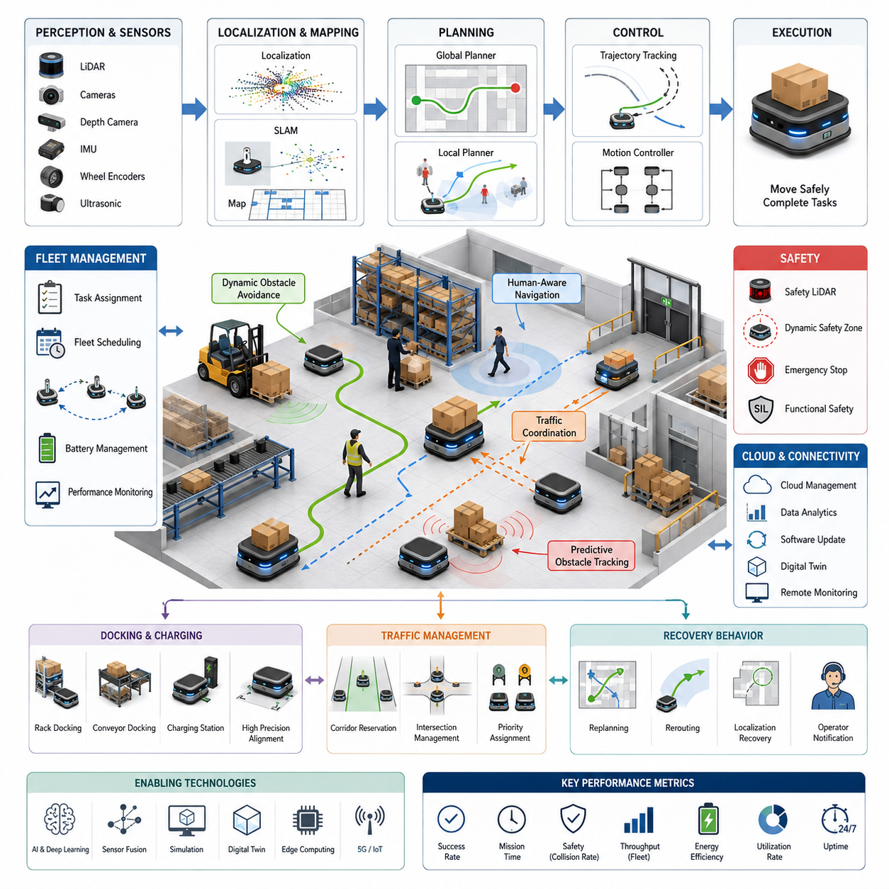
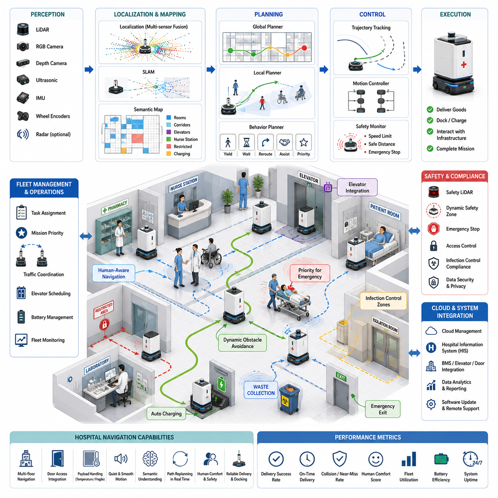
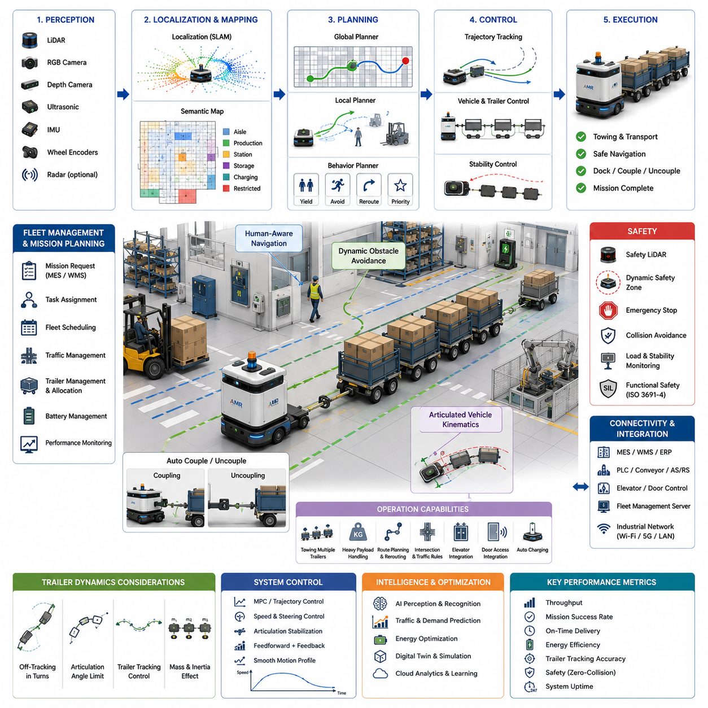
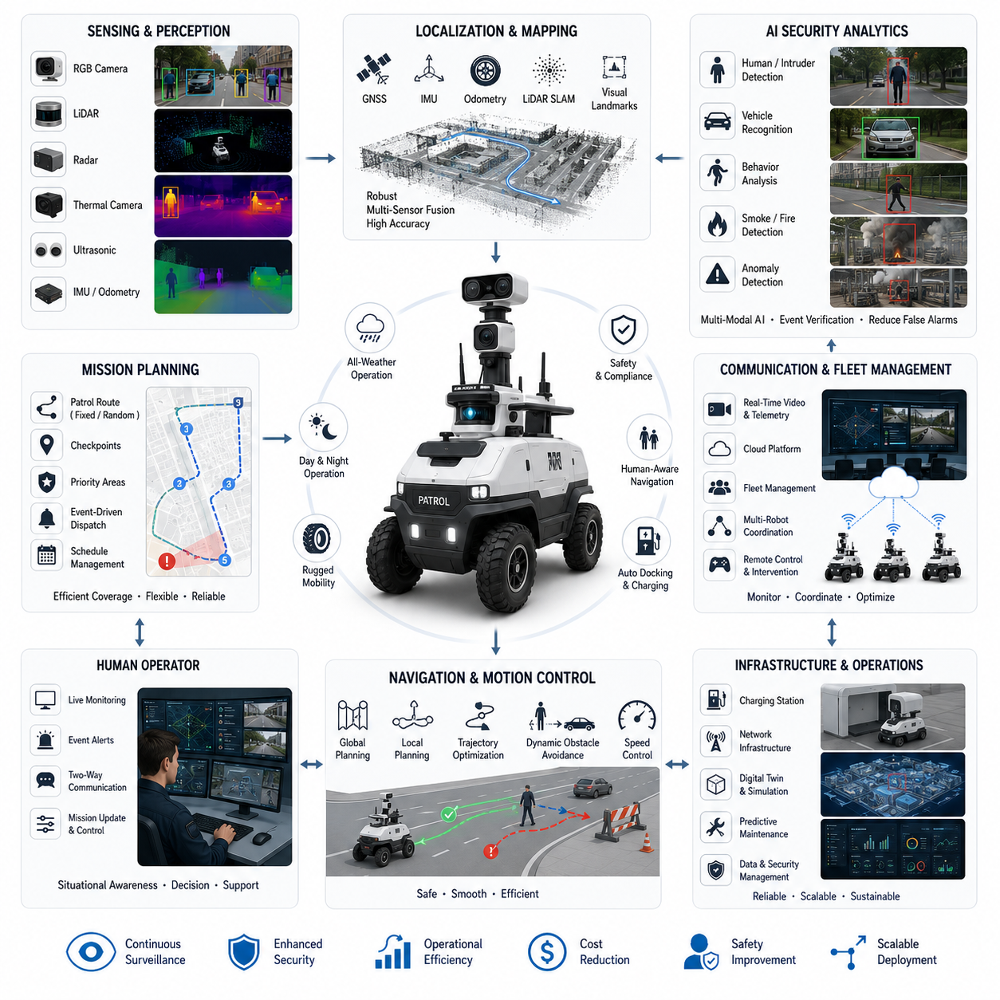
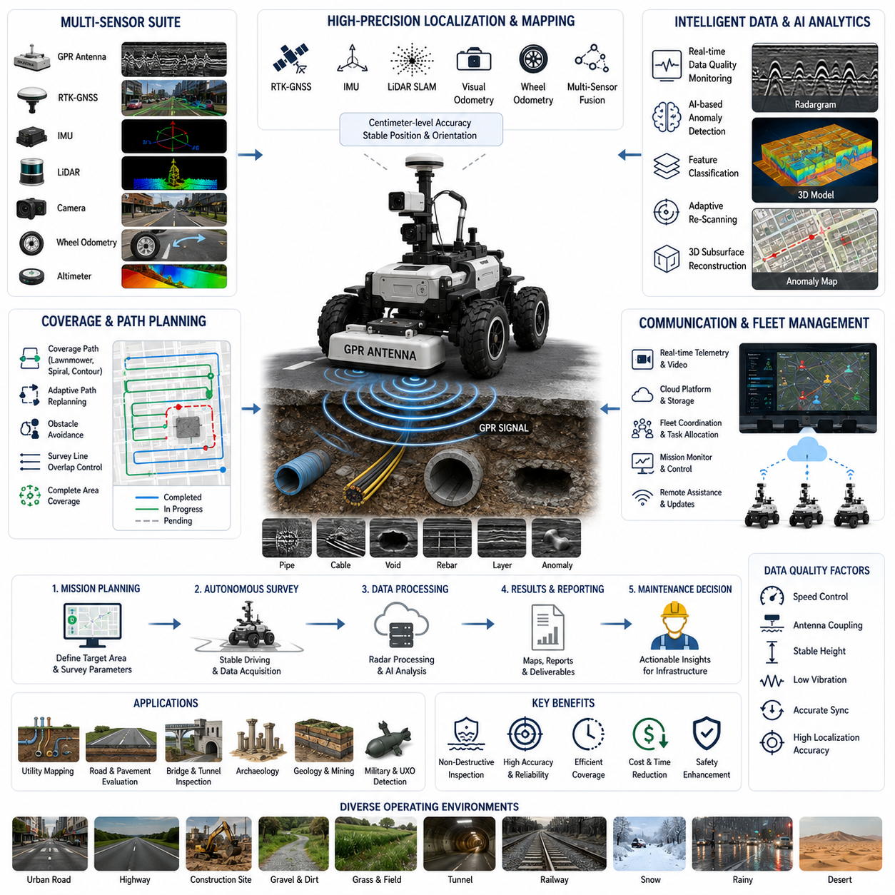
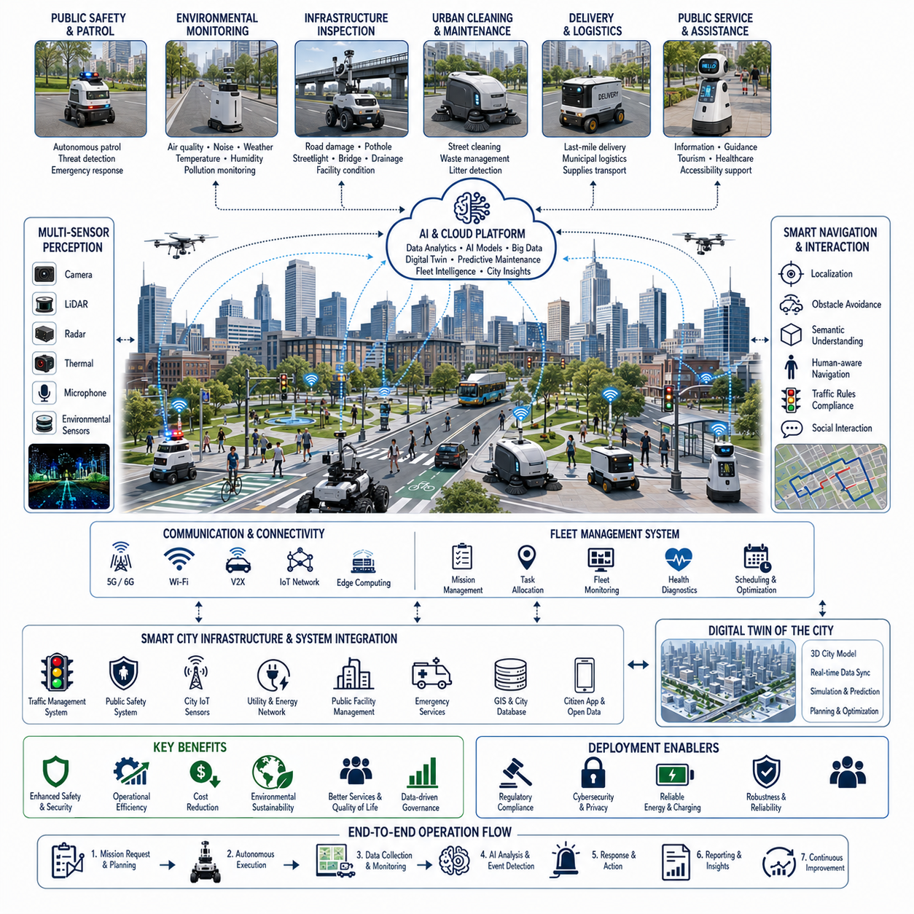
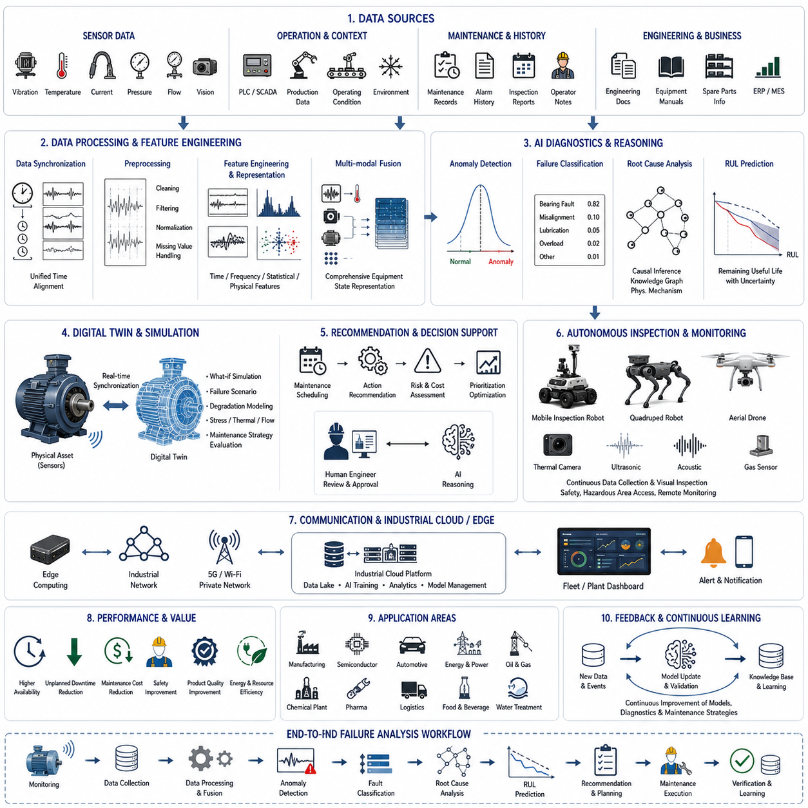

**Volume 05. Path Planning and Autonomous Navigation**

# Chapter 23. Industrial Case Studies

## 23.1 Warehouse AMR Navigation

{width="7.268055555555556in" height="7.268055555555556in"}

창고 자율주행 이동 로봇(Warehouse Autonomous Mobile Robot, AMR) 내비게이션은 자율 로봇 기술이 가장 성공적으로 상용화된 대표적인 분야 가운데 하나이다. 현대의 물류 창고는 재고 운반, 저장 위치 보충, 주문 처리(Order Fulfillment), 물류 흐름(Logistics Operation)을 사람의 개입 없이 수행하기 위해 대규모 자율주행 이동 로봇을 적극적으로 활용하고 있다. 실험실이나 구조화된 생산 셀(Production Cell)과 달리 실제 창고는 매우 넓고 지속적으로 변화하는 환경이며, 수많은 작업자, 지게차(Forklift), 컨베이어 시스템(Conveyor System), 팔레트(Pallet), 그리고 다른 로봇들이 동시에 이동하는 복잡한 공간이다. 따라서 성공적인 창고 내비게이션은 단순한 경로 계획(Path Planning)을 넘어 인식(Perception), 위치 추정(Localization), 지도 작성(Mapping), 경로 계획(Planning), 제어(Control), 플릿 관리(Fleet Coordination), 안전 관리(Safety Management), 클라우드 기반 운영 지능(Cloud-Based Operational Intelligence)이 하나의 통합 시스템으로 동작해야 한다.

창고 내비게이션의 가장 중요한 목표는 안전성과 신뢰성을 유지하면서 물류 운송 효율을 최대화하는 것이다. AMR은 입고 구역(Receiving Station), 저장 공간(Storage Area), 피킹 구역(Picking Zone), 포장 구역(Packaging Station), 출하 구역(Shipping Dock) 사이에서 저장 박스(Bin), 팔레트, 상자(Carton), 선반(Shelf), 생산 자재(Material)를 운반한다. 하나의 이동 결정은 전체 주문 처리 시간에 직접적인 영향을 미치므로, 내비게이션 알고리즘은 단순히 충돌을 피하는 것뿐 아니라 이동 시간을 최소화하고, 교통 혼잡을 줄이며, 로봇 활용률(Utilization)을 높이고, 창고 전체 생산성을 극대화하도록 설계된다.

자동유도차량(Automated Guided Vehicle, AGV)은 일반적으로 자기 테이프(Magnetic Tape), QR 코드(QR Code), 또는 바닥에 설치된 유도 시스템(Guidance Infrastructure)을 따라 이동한다. 반면 창고 AMR은 온보드 센서(Onboard Sensor)와 자율 위치 추정 기능을 이용하여 스스로 이동 경로를 결정한다. 이러한 자율성 덕분에 창고 운영자는 물리적인 유도 시설을 다시 설치하지 않고도 선반 배치를 변경하거나 작업 공간을 재구성하고 생산 라인을 유연하게 변경할 수 있다. 전자상거래(E-Commerce)와 스마트 제조(Smart Manufacturing)가 빠르게 변화하는 현대 산업에서는 이러한 유연성이 매우 중요한 경쟁력이 되고 있다.

창고 내비게이션 시스템은 여러 개의 긴밀하게 연결된 하위 시스템으로 구성된다. 인식 계층(Perception Layer)은 LiDAR, RGB 카메라, 깊이 카메라(Depth Camera), 초음파 센서(Ultrasonic Sensor), 관성측정장치(IMU), 휠 엔코더(Wheel Encoder) 등을 이용하여 주변 환경을 지속적으로 관찰한다. 위치 추정(Localization) 알고리즘은 로봇의 현재 위치를 계산하고, 지도 작성 시스템(Mapping System)은 통로(Aisle), 선반(Storage Rack), 작업 공간, 충전 스테이션(Charging Station), 제한 구역(Restricted Area), 임시 장애물을 포함한 디지털 지도를 유지한다. 전역 경로 계획기(Global Planner)는 목적지까지의 최적 경로를 생성하며, 지역 경로 계획기(Local Planner)는 주변의 움직이는 장애물을 고려하여 경로를 지속적으로 수정한다. 마지막으로 모션 제어기(Motion Controller)는 계산된 경로를 실제 바퀴 제어 명령으로 변환하여 로봇을 안전하게 이동시킨다.

위치 추정(Localization)은 창고 내비게이션의 가장 중요한 요소 가운데 하나이다. 대형 창고는 길고 반복적인 통로가 많기 때문에 모든 구역이 매우 비슷하게 보이는 경우가 많다. 이러한 환경에서는 위치를 정확히 추정하는 것이 쉽지 않다. 대부분의 AMR은 2차원 LiDAR SLAM과 휠 오도메트리(Wheel Odometry), IMU를 결합하여 위치를 계산한다. 루프 클로저(Loop Closure)는 이전에 지나간 위치를 다시 인식하여 누적 오차를 보정하며, 일부 창고는 QR 코드, AprilTag, 반사 마커(Reflective Marker) 등을 설치하여 위치 추정의 신뢰성을 더욱 향상시킨다.

지도 표현(Map Representation)은 산업 환경에 맞게 최적화되어 있다. 정적 지도(Static Map)는 벽, 선반, 기둥, 엘리베이터, 충전 도크, 비상구, 안전 구역, 생산 설비와 같이 변하지 않는 구조물을 포함한다. 동적 지도(Dynamic Map)는 임시 팔레트, 주차된 지게차, 유지보수 구역, 공사 구역, 일시적으로 폐쇄된 통로와 같이 계속 변하는 환경을 표현한다. 이러한 지도 계층을 분리하면 창고 환경이 일부 변경되더라도 전체 지도를 다시 생성할 필요가 없다.

전역 경로 계획(Global Path Planning)은 시작 위치에서 목적지까지의 최적 경로를 계산한다. 창고는 통로와 교차로가 연결된 그래프(Graph) 구조를 가지기 때문에 Dijkstra, A\*, Hybrid A\*, 그래프 기반 탐색(Graph Search) 알고리즘이 널리 사용된다. 이러한 알고리즘은 단순한 최단 거리뿐 아니라 예상 교통량(Traffic Density), 안전 구역, 작업 우선순위 등을 고려하여 최적 경로를 생성한다. 비용 지도(Cost Map)는 좁은 통로, 혼잡한 교차로, 작업자가 많은 구역, 에너지 소비가 큰 경사로 등에 추가 비용을 부여하여 더욱 현실적인 경로를 생성하도록 한다.

지역 경로 계획(Local Path Planning)은 실제 운행 중 계속해서 경로를 수정한다. 창고에는 작업자, 지게차, 카트(Cart), 다른 AMR 등 움직이는 장애물이 많다. Dynamic Window Approach(DWA), Timed Elastic Band(TEB), 모델 예측 제어(Model Predictive Control, MPC), 최적화 기반 경로 계획기(Optimization-Based Planner)는 로봇의 운동학(Kinematics)을 만족하면서도 장애물을 피할 수 있는 최적 경로를 실시간으로 계산한다. 이러한 재계획(Replanning)은 초당 여러 번 수행되어 환경 변화에 즉각적으로 대응한다.

장애물 검출(Obstacle Detection)은 창고 내비게이션의 핵심 기능이다. AMR은 팔레트, 상자, 선반, 기계 설비와 같은 고정 장애물뿐 아니라 작업자, 지게차, 다른 로봇과 같은 이동 장애물도 동시에 인식해야 한다. 센서 융합(Sensor Fusion)은 LiDAR 포인트 클라우드(Point Cloud), 깊이 영상(Depth Image), RGB 객체 인식(Object Detection), 초음파 거리 측정을 결합하여 하나의 통합된 장애물 정보를 생성한다. 이러한 다중 센서 구조는 조명 변화, 부분 가림(Occlusion), 반사 표면 등에서도 높은 신뢰성을 제공한다.

사람 중심 내비게이션(Human-Aware Navigation)은 사람과 로봇이 함께 일하는 창고에서 매우 중요하다. 단순한 충돌 회피를 넘어 사람의 이동 방향을 예측하고, 보행 의도(Intention)를 추정하며, 개인 공간(Personal Space)을 존중해야 한다. 로봇은 작업자 주변에서 속도를 줄이고 갑작스러운 방향 전환을 피하며, 충분한 안전 거리를 유지하고 필요하면 먼저 양보한다. 이러한 행동은 안전뿐 아니라 작업자의 심리적 안정감과 로봇에 대한 신뢰를 높여준다.

창고에는 폭이 좁은 통로가 많아 양방향 통행이 어려운 경우가 많다. 따라서 플릿 관리 시스템(Fleet Management System)은 통로 예약(Corridor Reservation), 교차로 관리(Intersection Management), 우선순위 제어(Priority Assignment), 교통 스케줄링(Traffic Scheduling)을 이용하여 로봇의 이동을 조정한다. 각각의 로봇이 독립적으로 움직이는 것이 아니라 중앙 시스템이 이동 순서를 조정하여 교착 상태(Deadlock)를 방지하고 전체 물류 효율을 높인다.

교통 최적화(Traffic Optimization)는 단순히 충돌을 피하는 수준을 넘어선다. 대형 창고에서는 수백 대 이상의 AMR이 동시에 운행되기 때문에 플릿 수준 내비게이션(Fleet-Level Navigation)은 창고 전체의 교통 흐름을 분석하고 혼잡을 예측하며, 대체 경로를 계산하여 전체 물류 처리량(Throughput)을 최대화한다. 클라우드 기반 최적화 시스템은 개별 로봇이 알 수 없는 전체 상황을 고려하여 더욱 효율적인 경로를 생성한다.

작업 할당(Task Assignment)은 내비게이션과 밀접하게 연결된다. 플릿 관리 시스템은 단순히 가장 가까운 로봇을 선택하는 것이 아니라 배터리 상태(Battery Level), 적재 능력(Payload Capacity), 현재 위치(Current Position), 유지보수 상태(Maintenance Status), 충전 일정(Charging Schedule), 예상 교통 상황 등을 함께 고려하여 최적의 로봇에게 작업을 할당한다. 이를 통해 공차 이동(Empty Travel)을 줄이고 전체 시스템 효율을 향상시킨다.

도킹(Docking)은 매우 높은 위치 정밀도를 요구하는 작업이다. AMR은 선반, 컨베이어, 피킹 스테이션, 엘리베이터, 충전기, 팔레트 이송 장치와 정확하게 연결되어야 한다. 일반적으로 전역 내비게이션을 통해 목적지 근처까지 이동한 후 LiDAR 반사판, AprilTag, 비전 기반 정렬(Visual Alignment), 근거리 센서(Short-Range Localization)를 이용하여 수 밀리미터 수준의 위치 정밀도를 달성한다.

자동 충전(Automatic Charging)은 창고 운영에서 매우 중요한 기능이다. 플릿 관리 시스템은 각 로봇의 배터리 상태를 지속적으로 모니터링하고 향후 작업 계획을 고려하여 적절한 시점에 충전 스테이션으로 이동하도록 지시한다. 여러 개의 충전기를 효율적으로 사용하는 충전 스케줄러(Charging Scheduler)는 충전 대기를 최소화하고 전체 플릿 가동률을 높인다.

의미 기반 내비게이션(Semantic Navigation)은 단순한 기하학적 지도(Geometric Map)를 넘어 환경의 의미를 이해한다. 창고 지도는 선반, 작업 공간, 비상구, 적재 구역, 위험 지역, 검사 구역, 포장 구역 등을 의미적으로 구분한다. 이러한 의미 정보는 로봇이 공간의 용도를 이해하고 상황에 맞는 행동을 선택할 수 있도록 한다.

행동 계획(Behavior Planning)은 단순한 경로 생성보다 상위 수준의 의사결정을 담당한다. 로봇은 언제 양보할지, 언제 우회할지, 언제 대기할지, 언제 재계획을 수행할지를 결정해야 한다. 이러한 행동은 상태 기계(State Machine), 행동 트리(Behavior Tree), 계층적 계획기(Hierarchical Planner), 최근에는 AI 기반 의사결정 시스템(AI-Based Decision System)을 이용하여 구현된다.

동적 장애물 회피(Dynamic Obstacle Avoidance)는 창고에서 가장 어려운 문제 가운데 하나이다. 팔레트를 운반하는 지게차, 이동하는 작업자, 컨베이어, 협동 로봇(Collaborative Robot) 등은 지속적으로 환경을 변화시킨다. 예측 알고리즘(Prediction Algorithm)은 장애물의 미래 이동 경로를 수 초 앞까지 예측하여 단순한 반응형 회피가 아니라 선제적인 회피(Proactive Avoidance)를 수행한다. 이를 통해 불필요한 정지를 줄이고 작업 효율을 향상시킨다.

복구 전략(Recovery Behavior)은 실제 산업 환경에서 매우 중요하다. 통로가 막히거나 센서 오류, 위치 추정 실패, 통신 장애, 공사 구역과 같은 예상하지 못한 상황이 발생하면 로봇은 자동으로 지역 재계획(Local Replanning), 전역 재계획(Global Rerouting), 위치 재추정(Localization Recovery), 장애물 재분석 또는 작업자 호출을 수행한다. 이러한 복구 기능은 시스템의 가동 시간(Uptime)을 크게 향상시킨다.

디지털 트윈(Digital Twin)은 창고 내비게이션 개발에서 점점 더 중요한 역할을 하고 있다. 실제 창고와 동일한 가상 환경을 구축하여 새로운 내비게이션 알고리즘, 플릿 규모, 선반 배치, 교통 제어 전략을 실제 적용 전에 충분히 검증할 수 있다. 이를 통해 개발 비용과 현장 위험을 크게 줄일 수 있다.

시뮬레이션(Simulation)은 내비게이션 개발 과정에서 필수적인 도구이다. Gazebo, Isaac Sim, Webots, 산업용 디지털 트윈 플랫폼은 창고 구조, 센서 특성, 플릿 운영, 장애물 이동, 통신 환경을 가상으로 재현한다. 개발자는 실제 환경에서 발생하기 어려운 수천 개의 다양한 시나리오를 안전하게 검증할 수 있으며, Sim-to-Real 검증을 통해 실제 환경에서 동일한 성능을 확보한다.

창고 내비게이션의 성능 평가는 단순히 경로 길이만 측정하지 않는다. 내비게이션 성공률(Navigation Success Rate), 평균 작업 완료 시간(Mission Completion Time), 위치 추정 정확도(Localization Accuracy), 도킹 정밀도(Docking Precision), 장애물 회피 성공률, 충돌 발생률(Collision Rate), 에너지 소비(Energy Consumption), 배터리 활용도(Battery Utilization), 교통 효율(Traffic Efficiency), 플릿 처리량(Fleet Throughput), 평균 복구 시간(Mean Recovery Time), 통신 지연 시간(Communication Latency), 계산 부하(Computational Load), 전체 물류 생산성(Productivity)을 종합적으로 평가한다.

안전(Safety)은 창고 내비게이션에서 가장 중요한 요소이다. AMR은 무거운 적재물을 운반하면서 작업자와 같은 공간에서 함께 움직인다. 안전 LiDAR(Safety LiDAR)는 로봇 주변의 보호 영역(Protective Field)을 지속적으로 감시하며, 동적 안전 영역(Dynamic Safety Zone)은 속도, 적재 중량, 제동 거리, 주변 환경에 따라 자동으로 조정된다. 위험이 감지되면 비상 정지(Emergency Stop)가 즉시 수행되며, 기능 안전(Function Safety) 구조는 센서 고장이나 통신 오류가 발생하더라도 안전한 운행을 유지하도록 설계된다.

클라우드 연결성(Cloud Connectivity)은 창고 내비게이션을 더욱 지능적으로 만든다. 중앙 플릿 관리 시스템은 모든 로봇의 데이터를 수집하고, 교통 흐름을 분석하며, 유지보수를 예측하고, 소프트웨어를 업데이트하며, 작업 스케줄을 최적화한다. 실시간 제어는 엣지 컴퓨팅(Edge Computing)이 담당하고, 복잡한 최적화와 AI 학습은 클라우드에서 수행된다.

인공지능(AI)은 창고 내비게이션을 새로운 수준으로 발전시키고 있다. 딥러닝(Deep Learning)은 장애물 인식, 의미 기반 장면 이해(Semantic Scene Understanding), 사람 행동 예측(Human Behavior Prediction), 자유 공간 검출(Free Space Detection), 이상 상황 탐지(Anomaly Detection), 위치 추정의 강건성을 향상시킨다. 강화학습(Reinforcement Learning)은 복잡한 교통 환경에서 더 효율적인 이동 전략을 학습하며, Foundation Model은 자연어 명령을 이해하고 상황을 추론하는 새로운 형태의 내비게이션을 가능하게 하고 있다.

미래의 창고 내비게이션은 월드 모델(World Model), 멀티모달 인식(Multimodal Perception), 대규모 Foundation Model, 클라우드 기반 플릿 지능(Cloud-Native Fleet Intelligence)을 하나의 통합 플랫폼으로 결합하게 될 것이다. 미래의 AMR은 단순히 목적지까지 이동하는 것이 아니라 창고 전체의 교통을 예측하고, 작업 상황을 이해하며, 사람과 협업하고, 물류 네트워크 전체를 최적화하며, 운용 과정에서 스스로 학습하는 지능형 시스템으로 발전할 것이다.

공학적 관점에서 창고 AMR 내비게이션은 로봇공학의 거의 모든 핵심 기술이 융합된 종합 시스템이다. 정확한 인식, 신뢰성 높은 위치 추정, 효율적인 지도 관리, 지능형 경로 계획, 정밀한 모션 제어, 안정적인 통신, 플릿 최적화, 기능 안전, 클라우드 컴퓨팅, 인공지능이 동시에 동작하여 하나의 자율 물류 시스템을 구성한다. 따라서 창고 내비게이션의 성공은 특정 알고리즘 하나가 아니라 이러한 다양한 기술이 얼마나 유기적으로 통합되는가에 달려 있다.

전자상거래(E-Commerce), 스마트 제조(Smart Manufacturing), 자동 물류 시스템(Automated Logistics)이 지속적으로 확대됨에 따라 창고 AMR 내비게이션은 현대 공급망(Supply Chain)을 구성하는 핵심 기술로 자리 잡고 있다. 앞으로 인공지능, 디지털 트윈, 의미 기반 추론(Semantic Reasoning), 자율 플릿 협업 기술이 더욱 발전하면서 창고 로봇은 단순한 운송 장비를 넘어 스스로 사고하고, 환경에 적응하며, 사람과 협업하고, 대규모 물류 시스템 전체를 자율적으로 최적화하는 지능형 Physical AI 플랫폼으로 발전하게 될 것이다.

## 23.2 Hospital Robot Navigation

{width="7.268055555555556in" height="7.268055555555556in"}

병원 로봇 내비게이션(Hospital Robot Navigation)은 자율 이동 로봇(Autonomous Mobile Robot, AMR)이 적용되는 분야 가운데 가장 높은 난이도를 가지는 응용 분야 중 하나이다. 병원은 창고나 공장처럼 구조가 일정하고 예측 가능한 환경이 아니라, 사람의 이동이 매우 많고 응급 상황(Emergency Situation)이 수시로 발생하며, 환자(Patient), 의료 장비(Medical Equipment), 엄격한 의료 규정(Medical Regulation)이 함께 존재하는 안전 중심(Safety-Critical)의 공간이다. 병원에서 운용되는 AMR은 의약품(Medicine), 검사 검체(Laboratory Sample), 혈액(Blood Product), 멸균 수술 기구(Sterile Instrument), 식사(Meal), 의료 폐기물(Medical Waste), 세탁물(Linen), 의료 소모품(Medical Supply) 등을 운반하면서도 환자의 안전을 보장하고, 감염 관리(Infection Control)를 유지하며, 의료진의 업무를 방해하지 않아야 한다. 따라서 병원 내비게이션은 단순한 장애물 회피를 넘어 인식(Perception), 위치 추정(Localization), 의미 기반 환경 이해(Semantic Understanding), 사람 중심 경로 계획(Human-Aware Planning), 안전 감시(Safety Monitoring), 플릿 관리(Fleet Coordination), 지능형 의사결정(Intelligent Decision Making)을 모두 통합하는 시스템이 되어야 한다.

병원 내비게이션의 가장 중요한 목표는 병원 전체에서 신뢰성 높은 물류 서비스를 안전하고 효율적으로 제공하는 것이다. 현대 병원은 하루 24시간 운영되며 약국(Pharmacy), 검사실(Laboratory), 수술실(Operating Room), 중환자실(Intensive Care Unit), 응급실(Emergency Department), 병동(Inpatient Ward), 영상의학과(Imaging Center), 멸균실(Sterilization Facility), 창고(Storage Room) 사이에서 다양한 의료 물품이 지속적으로 이동한다. 이러한 운송 작업은 반복적이지만 대부분 시간 민감성(Time-Sensitive)을 가진다. 이러한 물류를 로봇이 자동화하면 의료진은 운송 업무 대신 환자 진료에 더욱 집중할 수 있으며 병원의 운영 효율도 크게 향상된다.

병원은 기본적으로 사람을 위한 공간이다. 복도에는 환자, 보호자, 의사, 간호사, 응급 구조팀, 휠체어(Wheelchair), 이동 침대(Stretcher), 병상(Hospital Bed), 청소 카트(Cleaning Cart), 이동형 의료 장비가 항상 움직이고 있다. 따라서 병원 로봇은 단순히 충돌을 피하는 수준이 아니라 사람의 안전과 심리적 편안함을 최우선으로 고려해야 한다. 로봇은 예측 가능한 방식으로 이동하고, 자신의 이동 의도를 명확하게 표현하며, 충분한 개인 공간(Personal Space)을 유지하고, 소음을 최소화하며, 환자나 의료진에게 불안감을 주지 않아야 한다.

병원 내비게이션 시스템은 여러 개의 상호 연결된 하위 시스템으로 구성된다. 인식(Perception)은 LiDAR, RGB 카메라, 깊이 카메라(Depth Camera), 초음파 센서(Ultrasonic Sensor), 관성측정장치(IMU), 휠 엔코더(Wheel Encoder), 필요에 따라 레이더(Radar)를 이용하여 주변 환경을 지속적으로 관찰한다. 위치 추정(Localization)은 병원 디지털 지도(Digital Hospital Map)에서 로봇의 정확한 위치를 계산한다. 지도 작성(Mapping)은 병실(Patient Room), 복도(Corridor), 엘리베이터(Elevator), 간호사 스테이션(Nurse Station), 수술실, 비상구(Emergency Exit), 제한 구역(Restricted Area), 서비스 통로(Service Corridor)를 표현한다. 전역 경로 계획(Global Planning)은 장거리 이동 경로를 계산하고, 지역 경로 계획(Local Planning)은 사람과 장애물의 움직임에 따라 실시간으로 경로를 수정한다. 모션 제어기(Motion Controller)는 안전 조건을 만족하면서 부드러운 이동을 수행하도록 실제 바퀴를 제어한다.

위치 추정은 병원에서 매우 어려운 문제이다. 병원 내부에서는 GPS를 사용할 수 없으며, 길고 반복적인 복도는 시각적으로 매우 비슷하게 보인다. 또한 이동형 의료 장비, 임시 가림막, 공사 구역 등으로 환경이 지속적으로 변화한다. 대부분의 병원 로봇은 2차원 LiDAR SLAM, 휠 오도메트리(Wheel Odometry), IMU, 그리고 경우에 따라 AprilTag나 QR 코드와 같은 시각 마커(Visual Landmark)를 함께 사용하여 위치를 추정한다. 센서 융합(Sensor Fusion)은 여러 센서의 정보를 결합하여 누적 오차를 줄이고 센서 성능 저하에도 안정적인 위치 추정을 유지한다.

병원 지도는 일반적인 점유 지도(Occupancy Grid)보다 훨씬 풍부한 의미 정보를 포함한다. 지도에는 병실, 중환자실, 수술실, 영상의학과, 약국, 검사실, 대기실, 간호사 스테이션, 제한 구역, 비상 대피 경로, 멸균실, 의료 폐기물 처리 구역, 의약품 보관실, 충전 스테이션 등이 의미적으로 구분되어 있다. 이러한 의미 지도(Semantic Map)는 단순히 빈 공간을 인식하는 것이 아니라 각 공간의 용도와 운영 특성을 이해하도록 도와준다.

병원에서는 상황에 따라 이동 우선순위가 크게 달라진다. 응급 수술을 위한 혈액을 운반하는 경우와 일반 세탁물을 운반하는 경우는 동일한 경로 계획을 사용할 수 없다. 응급 의료 물품은 가장 높은 우선순위를 부여받으며 복도와 엘리베이터 사용에서도 우선권을 가진다. 반대로 일반 물품 운송은 응급 상황이나 의료진의 이동을 방해하지 않도록 자동으로 양보한다. 따라서 병원 내비게이션은 임상 우선순위(Clinical Priority), 운송 긴급성(Urgency), 배송 시간(Delivery Deadline), 병원 운영 정책(Hospital Policy)을 모두 고려하여 경로를 결정한다.

전역 경로 계획(Global Path Planning)은 병원의 여러 부서를 연결하는 복도, 엘리베이터, 서비스 통로, 공용 공간을 이용하여 목적지까지의 최적 경로를 계산한다. A\*, Dijkstra, Hybrid A\*, 그래프 탐색(Graph Search), 계층적 계획기(Hierarchical Planner)는 이동 거리뿐 아니라 예상 혼잡도(Congestion), 접근 제한(Accessibility Restriction), 엘리베이터 사용 가능 여부, 감염 관리 정책(Infection Control Policy), 응급 교통 상황까지 고려하여 최적 경로를 생성한다. 비용 지도(Cost Map)는 혼잡한 대기실, 면회 시간의 병동, 민감한 의료 공간 등에 높은 비용을 부여하여 로봇이 가능한 한 이러한 공간을 피하도록 만든다.

지역 경로 계획(Local Path Planning)은 주변 환경 변화에 맞추어 이동 경로를 지속적으로 수정한다. 병원에는 의료진, 환자, 보호자, 휠체어, 이동 침대, 병상, 이동형 의료 장비, 청소 장비, 다른 서비스 로봇이 끊임없이 이동한다. Dynamic Window Approach(DWA), Timed Elastic Band(TEB), 모델 예측 제어(Model Predictive Control, MPC), 최적화 기반 경로 생성기는 로봇의 운동학(Kinematics)을 만족하면서도 사람에게 불편함을 주지 않는 안전한 이동 경로를 지속적으로 계산한다.

사람 중심 내비게이션(Human-Aware Navigation)은 병원 로봇의 가장 중요한 특징 가운데 하나이다. 로봇은 사람의 현재 위치뿐 아니라 앞으로의 이동 방향과 속도까지 예측해야 한다. 보행 예측(Pedestrian Prediction) 알고리즘은 사람의 이동 방향, 속도, 그룹 행동(Group Behavior), 이동 의도를 분석한다. 로봇은 노인 환자 주변에서는 속도를 줄이고, 휠체어와 충분한 거리를 유지하며, 어린아이에게 갑자기 접근하지 않고, 응급 의료진에게는 반드시 우선권을 제공한다. 이러한 사회적 내비게이션(Socially Aware Navigation)은 안전성을 높이는 동시에 병원 구성원의 로봇 수용성(Acceptance)도 향상시킨다.

병원에서는 안전만큼이나 승차감과 편안함(Comfort)도 중요하다. 급격한 가속이나 급제동, 갑작스러운 회전은 휴식을 취하는 환자에게 불편함을 주거나 민감한 의료 행위에 영향을 줄 수 있다. 따라서 병원 로봇은 가속도(Acceleration), 감속도(Deceleration), 저크(Jerk), 회전 속도(Rotational Velocity)를 제한한 매우 부드러운 이동 프로파일(Motion Profile)을 사용한다. 병원에서는 최고 속도보다 예측 가능하고 안정적인 움직임이 더욱 중요하다.

엘리베이터(Elevator) 연동은 다층 병원에서 필수적인 기능이다. 로봇은 스스로 엘리베이터를 호출하고, 적절히 대기하며, 안전하게 탑승하고, 다른 승객을 방해하지 않는 위치에 정지한 뒤, 목적 층에서 자동으로 하차해야 한다. 최근 병원은 건물 자동화 시스템(Building Automation System)과 연동하여 로봇이 엘리베이터를 자동으로 사용할 수 있도록 지원하고 있다.

문(Door) 통과 역시 중요한 문제이다. 병원에는 자동문, 여닫이문, 보안 출입문, 방화문(Fire Door), 격리 병실 출입문 등이 존재한다. 병원 로봇은 건물 관리 시스템(Building Management System)과 연동하여 자동으로 문을 열 수 있으며, 보안 정책(Security Policy)을 준수하면서 이동한다. 수동문은 사람의 도움을 받거나 로봇 팔을 이용하여 조작할 수도 있다.

감염 관리(Infection Control)는 병원 내비게이션에 큰 영향을 미친다. 병원은 오염 위험 수준에 따라 여러 구역으로 나누어진다. 내비게이션 시스템은 수술실, 격리 병동, 감염 관리 구역을 임의로 통과하지 않으며 필요한 경우에만 허가를 받아 접근한다. 또한 감염 구역과 멸균 구역 사이를 이동할 때는 교차 오염(Cross Contamination)이 발생하지 않도록 경로를 선택한다.

운반하는 물품의 특성도 매우 다양하다. 의약품은 온도 관리가 필요하며, 검사 검체는 진동이 적어야 하고, 혈액은 신속한 배송이 중요하며, 멸균 기구는 오염을 방지해야 한다. 의료 폐기물은 안전하게 밀봉되어야 한다. 따라서 로봇은 적재물(Payload)의 특성에 따라 가속도 제한, 이동 경로, 우선순위를 자동으로 조정한다.

장애물 인식(Obstacle Detection)은 다양한 센서를 함께 사용한다. LiDAR는 조명과 관계없이 정확한 거리 정보를 제공하며, RGB 카메라는 사람과 휠체어, 이동 침대, 의료 카트 등을 인식한다. 깊이 카메라는 자유 공간(Free Space)을 계산하고, 초음파 센서는 투명한 장애물이나 근거리 안전을 보완한다. 센서 융합은 이러한 정보를 하나의 일관된 환경 모델(Environment Model)로 통합한다.

행동 계획(Behavior Planning)은 단순히 경로를 생성하는 것보다 상위 수준의 의사결정을 수행한다. 로봇은 혼잡한 복도에서 대기할지, 우회할지, 교차로에서 양보할지, 작업자의 도움을 요청할지, 긴급 운송 요청이 발생하면 기존 작업을 중단할지를 결정한다. 이러한 의사결정은 상태 기계(State Machine), 행동 트리(Behavior Tree), 최근에는 AI 기반 추론 시스템(AI-Based Reasoning System)을 이용하여 수행된다.

플릿 관리(Fleet Management)는 병원에서 여러 대의 로봇이 동시에 운용될 경우 매우 중요하다. 여러 로봇이 약품, 검사 검체, 식사, 세탁물, 의료 장비를 동시에 운반하기 때문에 교통 혼잡을 방지하고, 엘리베이터 사용을 조정하며, 작업을 적절히 분배하고, 배터리 사용을 균형 있게 관리하며, 좁은 복도의 사용을 예약하고, 병원 전체의 물류 효율을 최적화해야 한다. 중앙 플릿 관리 시스템은 병원 전체를 고려한 최적화를 수행하면서 각 로봇은 지역적인 자율성을 유지한다.

배터리 관리(Battery Management)는 작업 스케줄과 밀접하게 연결된다. 병원은 24시간 운영되므로 로봇의 가동률이 매우 중요하다. 플릿 관리 시스템은 향후 운송 수요, 배터리 소비량, 충전 가능 시간, 작업 우선순위를 예측하여 적절한 시점에 로봇을 충전 스테이션으로 이동시킨다. 이를 통해 응급 운송에 필요한 로봇 수를 항상 확보할 수 있다.

응급 상황(Emergency Response)은 병원 내비게이션의 중요한 요소이다. 화재, 응급 의료 상황, 재난 대응, 병원 대피가 발생하면 로봇은 병원의 응급 대응 정책에 따라 즉시 행동을 변경한다. 상황에 따라 안전한 위치에 정지하거나, 지정된 대기 장소로 이동하거나, 응급 물류를 지원하거나, 대피 경로를 확보하기 위해 이동을 중단한다. 이러한 기능은 병원의 비상 대응 시스템(Emergency Management System)과 연동된다.

통신 인프라(Communication Infrastructure)는 병원 내비게이션의 핵심 요소이다. 무선 네트워크는 플릿 관리 서버, 병원 정보 시스템(Hospital Information System), 건물 자동화 시스템(Building Automation Platform), 전자의무기록(Electronic Medical Record, EMR), 엘리베이터 제어기, 출입문 시스템, 유지보수 시스템을 연결한다. 안정적인 통신은 병원 운영의 연속성과 물류 효율을 보장한다.

사이버 보안(Cybersecurity)은 병원에서 특히 중요하다. 병원 로봇은 민감한 의료 시스템과 연결되므로 암호화된 통신, 사용자 인증(Authentication), 소프트웨어 무결성 검증(Software Integrity Verification), 네트워크 분리(Network Segmentation)를 통해 보안 위협으로부터 보호되어야 하며 의료 정보 보안 규정을 준수해야 한다.

디지털 트윈(Digital Twin)은 병원 내비게이션 개발과 운영을 크게 향상시킨다. 실제 병원의 가상 모델을 구축하여 새로운 내비게이션 알고리즘을 시험하고, 로봇 배치를 최적화하며, 응급 상황을 시뮬레이션하고, 교통 흐름을 분석하며, 새로운 운영 절차를 실제 적용 전에 충분히 검증할 수 있다.

시뮬레이션(Simulation)은 병원 로봇 개발에서 필수적인 과정이다. Gazebo, Isaac Sim, Webots, 병원 전용 디지털 트윈 플랫폼은 복잡한 병원 환경, 사람의 이동, 엘리베이터, 의료 장비, 응급 상황을 현실적으로 재현한다. 이를 통해 실제 병원에서는 수행하기 어려운 수천 개의 다양한 내비게이션 시나리오를 안전하게 검증할 수 있다.

인공지능(AI)은 병원 내비게이션을 더욱 지능적으로 만들고 있다. 딥러닝(Deep Learning)은 사람 인식, 휠체어 인식, 자유 공간 분할(Free Space Segmentation), 의미 기반 장면 이해(Semantic Scene Understanding), 이상 상황 탐지(Anomaly Detection), 위치 추정의 강건성을 향상시킨다. 머신러닝(Machine Learning)은 사람의 이동을 예측하고, 복도의 혼잡도를 예측하며, 환경 변화를 인식하고, 경로를 지속적으로 최적화한다. 앞으로 Foundation Model은 의료진의 자연어 명령을 이해하고 병원의 운영 상황을 추론하는 수준까지 발전할 것으로 예상된다.

월드 모델(World Model)은 병원 로봇의 중요한 미래 기술이다. 로봇은 현재 환경만 보는 것이 아니라 앞으로의 사람 이동, 엘리베이터 사용 가능 여부, 복도 혼잡도, 병원의 운영 흐름, 물류 수요를 미리 예측할 수 있다. 이러한 예측 기반 내비게이션(Predictive Navigation)은 이동 시간을 줄이고 병원 물류 효율을 크게 향상시킨다.

병원 내비게이션의 성능 평가는 단순한 이동 거리만으로 이루어지지 않는다. 내비게이션 성공률(Navigation Success Rate), 위치 추정 정확도(Localization Accuracy), 배송 완료 시간(Delivery Completion Time), 충돌 횟수(Collision Frequency), 근접 사고(Near-Miss Event), 사람의 편안함(Human Comfort), 도킹 정밀도(Docking Precision), 배터리 효율(Battery Efficiency), 플릿 처리량(Fleet Throughput), 엘리베이터 활용도(Elevator Utilization), 복구 성공률(Recovery Success Rate), 통신 신뢰성(Communication Reliability), 계산 지연 시간(Computational Latency), 우선순위 준수율(Mission Priority Compliance), 병원 물류 성능(Hospital Logistics Performance)을 종합적으로 평가한다.

기능 안전(Function Safety)은 병원 로봇에서 가장 중요한 요소이다. 안전 LiDAR(Safety LiDAR)는 로봇 주변의 보호 영역(Protective Field)을 지속적으로 감시하며, 동적 안전 영역(Dynamic Safety Zone)은 로봇 속도, 적재 중량, 사람의 밀집도, 제동 거리에 따라 자동으로 조정된다. 위험이 감지되면 비상 정지(Emergency Stop)가 즉시 수행되며, 이중 센서(Redundant Sensor), Fail-Safe 제어기, 자가 진단(Self-Diagnosis), 지속적인 상태 감시를 통해 하드웨어 고장 상황에서도 안전성을 유지한다.

미래의 병원 로봇 내비게이션은 멀티모달 인식(Multimodal Perception), 의미 기반 추론(Semantic Reasoning), 월드 모델(World Model), 클라우드 기반 플릿 지능(Cloud-Connected Fleet Intelligence), Foundation Model, 디지털 트윈(Digital Twin), 평생 학습(Lifelong Learning)을 하나의 통합된 의료 물류 플랫폼으로 결합하게 될 것이다. 미래의 병원 로봇은 단순히 물건을 운반하는 것이 아니라 병원의 운영 흐름을 이해하고, 물류 수요를 예측하며, 의료진과 자연스럽게 협력하고, 병원 전체의 물류를 최적화하며, 경험을 통해 지속적으로 성능을 향상시키는 지능형 시스템으로 발전하게 될 것이다.

공학적 관점에서 병원 로봇 내비게이션은 자율 로봇 기술의 가장 종합적인 응용 분야 가운데 하나이다. 정확한 인식, 신뢰성 높은 위치 추정, 의미 기반 지도(Semantic Mapping), 지능형 경로 계획(Intelligent Planning), 사람 중심 상호작용(Human-Aware Interaction), 안정적인 통신(Robust Communication), 플릿 협업(Fleet Coordination), 사이버 보안(Cybersecurity), 기능 안전(Function Safety), 클라우드 컴퓨팅(Cloud Computing), 인공지능(AI)이 모두 동시에 동작하여 안전하고 효율적인 병원 물류 시스템을 구현한다. 병원 로봇 내비게이션의 궁극적인 가치는 단순한 자율주행이 아니라, 복잡한 병원 물류를 지능적으로 자동화함으로써 의료진이 환자 치료에 더욱 집중할 수 있도록 지원하고, 최고 수준의 안전성과 신뢰성을 유지하면서 의료 서비스의 품질을 향상시키는 데 있다.

## 23.3 Towing AMR Case Study

{width="7.268055555555556in" height="7.268055555555556in"}

Towing 자율주행 이동 로봇(Autonomous Mobile Robot, AMR)은 산업용 이동 로봇 가운데 가장 실용적이며 경제적 가치가 높은 분야 중 하나이다. 선반이나 카트를 직접 운반하는 유닛 적재형(Unit-Load) AMR과 달리, Towing AMR은 하나 이상의 수동 카트(Passive Cart), 트레일러(Trailer), 또는 바퀴가 달린 운반 장치를 견인하도록 설계된다. 이러한 방식은 수동 카트에 모터(Motor), 배터리(Battery), 센서(Sensor), 온보드 컴퓨터(Onboard Computer)가 필요하지 않기 때문에 전체 시스템 비용을 크게 절감할 수 있다. 대신 모든 지능은 견인 차량(Towing Vehicle)에 집중되며, 하나의 Towing AMR이 수십 또는 수백 대의 수동 카트를 공유하여 사용할 수 있다. 따라서 Towing AMR은 유연성(Flexibility), 확장성(Scalability), 운영 효율(Operational Efficiency), 총소유비용(Total Cost of Ownership, TCO) 측면에서 매우 우수한 솔루션으로 평가받고 있다.

Towing AMR의 기본 목표는 동적인 산업 환경에서 안전성을 유지하면서 반복적인 자재 운송(Material Transportation)을 자동화하는 것이다. 대표적인 작업으로는 입고장(Receiving Dock)에서 생산 라인으로 원자재를 운송하고, 제조 셀(Manufacturing Cell) 사이에서 반제품(Semi-Finished Product)을 이동시키며, 완제품을 포장 구역(Packaging Station)으로 운반하고, 조립 공정에 필요한 부품을 작업장으로 공급하며, 빈 용기를 회수하고, 재사용 가능한 카트를 원위치로 복귀시키는 작업 등이 있다. 이러한 물류 작업은 공장이 운영되는 동안 지속적으로 수행되므로 운송 효율은 생산량(Throughput)과 공장 전체 생산성(Productivity)에 직접적인 영향을 미친다.

기존의 자동유도차량(Automated Guided Vehicle, AGV)은 일반적으로 자기 테이프(Magnetic Tape)나 유도선(Guide Wire)을 따라 이동하지만, 현대의 Towing AMR은 동시 위치 추정 및 지도 작성(Simultaneous Localization and Mapping, SLAM), 온보드 환경 인식(Onboard Perception), 동적 경로 계획(Dynamic Path Planning), 지능형 플릿 관리(Intelligent Fleet Management)를 이용하여 완전한 자율주행을 수행한다. 이러한 인프라 없는(Infrastructure-Free) 내비게이션은 생산 라인이 변경되더라도 바닥의 유도 장치를 다시 설치할 필요가 없기 때문에 다양한 제품을 생산하는 스마트 제조(Smart Manufacturing) 환경에서 매우 큰 장점을 제공한다.

일반적인 Towing AMR 시스템은 인식(Perception), 위치 추정(Localization), 내비게이션(Navigation), 차량 제어(Vehicle Control), 트레일러 관리(Trailer Management), 플릿 관리(Fleet Coordination), 통신(Communication), 안전 감시(Safety Monitoring), 미션 계획(Mission Planning) 등 여러 하위 시스템으로 구성된다. 인식 시스템은 LiDAR, RGB 카메라, 깊이 카메라(Depth Camera), 초음파 센서(Ultrasonic Sensor), 관성측정장치(IMU), 휠 엔코더(Wheel Encoder), 필요에 따라 레이더(Radar)를 이용하여 주변 환경을 지속적으로 감시한다. 위치 추정 알고리즘은 공장 지도에서 차량의 위치를 계산하며, 내비게이션 시스템은 충돌 없는 경로를 생성한다. 차량 제어기는 트레일러의 안정성을 유지하면서 부드러운 이동을 수행하고, 플릿 관리 시스템은 여러 대의 견인 로봇을 동시에 관리한다.

트레일러를 견인하는 시스템은 일반 AMR과는 다른 독특한 동역학(Dynamics)을 가진다. 일반적인 이동 로봇은 하나의 강체(Rigid Body)이지만, Towing AMR은 견인 차량과 하나 이상의 트레일러가 연결된 다물체 시스템(Multi-Body System)이다. 트레일러는 견인 차량을 따라 움직이지만 자체적인 동적 거동(Dynamic Behavior)을 가진다. 가속, 감속, 회전 과정에서 트레일러는 관성(Inertia), 연결부(Hitch Geometry), 구름 저항(Rolling Resistance), 적재물의 무게 분포(Payload Distribution)에 의해 지연된 반응을 보인다. 따라서 내비게이션 시스템은 견인 차량뿐 아니라 모든 트레일러의 미래 움직임까지 함께 예측해야 한다.

연결 차량 운동학(Articulated Vehicle Kinematics)은 Towing AMR 설계의 핵심이다. 견인 차량이 회전하면 트레일러는 히치(Hitch) 구조와 연결 각도(Articulation Angle)에 따라 서로 다른 경로를 따라 움직인다. 급격한 회전에서는 트레일러가 차량보다 안쪽으로 들어오는 오프트래킹(Off-Tracking) 현상이 발생한다. 따라서 경로 계획(Path Planning)은 트레일러의 기하 구조(Geometry), 연결 각도 제한, 최소 회전 반경(Minimum Turning Radius)을 함께 고려하여 차량과 트레일러가 모두 장애물과 충돌하지 않도록 해야 한다.

여러 대의 트레일러를 연결하는 트레일러 열차(Trailer Train)는 시스템을 더욱 복잡하게 만든다. 많은 산업 현장에서는 하나의 Towing AMR이 여러 대의 카트를 동시에 견인한다. 트레일러가 하나씩 추가될 때마다 새로운 연결 관절(Articulation Joint)이 생기며, 작은 조향 오차도 뒤쪽 트레일러에서 점점 크게 증폭될 수 있다. 따라서 최신 Towing AMR은 연결 각도를 제한하고, 회전 경로를 최적화하며, 모든 트레일러의 위치를 지속적으로 추정하여 안정성을 유지한다.

위치 추정(Localization)은 안정적인 운송을 위해 필수적이다. 대부분의 실내 Towing AMR은 2차원 LiDAR SLAM, 휠 오도메트리(Wheel Odometry), IMU를 함께 사용한다. 공장 내부는 긴 복도와 반복적인 구조가 많기 때문에 루프 클로저(Loop Closure), 랜드마크 인식(Landmark Recognition), 센서 융합(Sensor Fusion)을 이용하여 장시간 운행 중에도 센티미터 수준의 위치 정확도를 유지한다.

산업용 지도(Map)는 단순한 장애물 정보보다 훨씬 풍부한 의미 정보를 포함한다. 생산 셀, 적재 구역, 하역 구역, 저장 공간, 충전 스테이션, 유지보수 구역, 비상구, 보행자 통로, 안전 펜스, 지게차 전용 통로, 제한 구역 등을 의미적으로 구분하는 의미 지도(Semantic Map)가 사용된다. 이러한 지도는 단순한 최단 경로가 아니라 실제 공장 운영에 적합한 이동 경로를 생성하도록 도와준다.

미션 계획(Mission Planning)은 자재 운송 작업 전체를 관리한다. 제조 실행 시스템(Manufacturing Execution System, MES)은 적재 위치, 목적지, 트레일러 종류, 적재 중량, 우선순위, 완료 시간을 포함한 운송 작업을 생성한다. 플릿 관리 시스템은 차량의 현재 위치, 배터리 상태, 견인 능력(Towing Capacity), 사용 가능한 트레일러, 예상 교통 상황, 전체 작업량을 고려하여 가장 적합한 로봇에 작업을 할당한다. 이를 통해 공차 이동(Empty Travel)을 최소화하고 플릿 활용률(Utilization)을 높일 수 있다.

트레일러 연결(Coupling)과 분리(Decoupling)는 중요한 자동화 기능이다. 자동 히치(Auto Hitch) 메커니즘을 이용하면 사람의 개입 없이 트레일러를 연결하거나 분리할 수 있다. 비전 시스템(Vision System), LiDAR 정렬(LiDAR Alignment), 마커(Fiducial Marker), 근거리 위치 센서(Short-Range Localization Sensor)는 정밀한 도킹(Docking)을 수행하며, 기계식 잠금 장치(Mechanical Locking System)는 연결 상태를 지속적으로 확인하여 안전한 견인을 보장한다.

적재물(Payload)의 특성은 차량 동역학에 큰 영향을 미친다. 무거운 트레일러는 더 긴 제동 거리(Stopping Distance), 낮은 가속도, 낮은 회전 속도를 요구하며 더 큰 견인력을 필요로 한다. 반면 깨지기 쉬운 화물은 진동(Vibration), 저크(Jerk), 횡가속도(Lateral Acceleration)를 최소화해야 한다. 따라서 내비게이션 시스템은 적재 중량, 무게 중심(Center of Gravity), 화물 특성, 바닥 상태에 따라 모션 프로파일(Motion Profile)을 자동으로 조정한다.

Towing AMR의 경로 계획은 일반 AMR과 상당히 다르다. 일반적인 경로 계획기는 하나의 강체 차량만 고려하지만, Towing AMR은 차량과 트레일러의 미래 움직임을 동시에 계산해야 한다. 이를 위해 연결 차량 모델(Articulated Vehicle Model), 트레일러의 스위프 경로(Swept Path), 곡률 제한(Curvature Constraint), 장애물 여유 공간(Clearance)을 고려하는 모델 예측 제어(Model Predictive Control, MPC), 최적화 기반 경로 생성(Optimization-Based Trajectory Generation), Lattice Planning, Hybrid A\*, 운동학 기반 탐색(Kinodynamic Search) 등이 사용된다.

지역 장애물 회피(Local Obstacle Avoidance)는 운행 중 지속적으로 수행된다. 작업자, 지게차, 다른 AMR, 수동 카트, 임시 팔레트와 같은 동적 장애물(Dynamic Obstacle)이 이동 경로에 자주 나타난다. 지역 경로 계획기는 연결 각도 제한과 트레일러 안정성을 유지하면서 실시간으로 새로운 경로를 계산한다. 일반 AMR과 달리 급격한 조향은 트레일러를 불안정하게 만들 수 있기 때문에 예측 기반 장애물 회피(Predictive Obstacle Avoidance)가 특히 중요하다.

사람 중심 내비게이션(Human-Aware Navigation)은 Towing AMR에서도 매우 중요하다. 긴 트레일러를 견인하는 차량은 작업자 주변에서 속도를 줄이고 더 넓은 안전 거리를 유지하며, 사람의 이동 방향을 예측하고 급격한 조향을 피한다. 경광등(Warning Light), 음성 안내(Audio Notification), 바닥 투영 표시(Projected Light), 사람-기계 인터페이스(Human-Machine Interface)를 이용하여 자신의 이동 의도를 주변 작업자에게 명확하게 전달한다.

교통 관리(Traffic Management)는 대규모 공장에서 핵심적인 역할을 한다. 플릿 관리 시스템은 통로 예약(Corridor Reservation), 교차로 우선순위(Intersection Priority), 일방통행 정책(One-Way Policy), 추월 제한(Overtaking Restriction), 동적 우회(Dynamic Rerouting)를 이용하여 교통 혼잡과 교착 상태(Deadlock)를 방지한다. Towing AMR은 일반 AMR보다 차체 길이가 길기 때문에 트레일러 길이와 회전 반경까지 함께 고려하여 교통을 관리한다.

배터리 관리(Battery Management)는 대형 화물을 견인하는 차량에서 더욱 중요하다. 무거운 화물을 운반하면 에너지 소비(Energy Consumption)가 크게 증가한다. 플릿 관리 시스템은 운송 거리, 적재 중량, 경사도(Floor Gradient), 교통 상황, 가속도 프로파일을 고려하여 배터리 사용량을 예측하고 적절한 충전 일정을 생성하여 전체 플릿의 가동률을 유지한다.

모션 제어(Motion Control)는 종방향 속도(Longitudinal Velocity), 조향 제어(Steering Control), 연결 각도 안정화(Articulation Stabilization), 트레일러 추종(Trailer Tracking)을 하나의 통합 제어 구조로 구현한다. 피드포워드 보상(Feedforward Compensation)은 회전과 가속 시 트레일러의 움직임을 미리 예측하고, 피드백 제어기(Feedback Controller)는 연결 각도 센서, IMU, 휠 엔코더, 위치 추정 정보를 이용하여 오차를 지속적으로 보정한다. 모델 예측 제어(MPC)는 차량과 트레일러의 미래 움직임을 동시에 최적화하여 안정성과 경로 추종 성능을 향상시킨다.

안전(Safety)은 Towing AMR에서 가장 중요한 요소이다. 견인 차량은 수백에서 수천 킬로그램의 화물을 운반할 수 있기 때문에 높은 수준의 안전성이 요구된다. 안전 LiDAR(Safety LiDAR)는 차량뿐 아니라 트레일러 주변까지 포함한 보호 영역(Protective Zone)을 지속적으로 감시한다. 동적 안전 영역(Dynamic Safety Field)은 차량 속도, 적재 중량, 트레일러 길이, 제동 거리에 따라 자동으로 확대된다. 비상 정지(Emergency Stop)는 차량과 트레일러를 동시에 안정적으로 감속시키며, 기능 안전(Function Safety)은 이중 센서(Redundant Sensor), Fail-Safe 제어기, 지속적인 자가 진단(Self-Diagnostics)을 통해 산업 안전 규격을 만족한다.

산업용 통신(Industrial Communication)은 Towing AMR을 제조 실행 시스템(MES), 창고 관리 시스템(Warehouse Management System, WMS), 전사적 자원 관리(Enterprise Resource Planning, ERP), PLC, 컨베이어 시스템, 자동 창고(Automated Storage System), 엘리베이터, 자동문, 플릿 관리 서버와 연결한다. 산업용 표준 통신 프로토콜(Standard Industrial Communication Protocol)은 다양한 자동화 설비와의 상호 운용성을 보장한다.

디지털 트윈(Digital Twin)은 Towing AMR 구축 과정에서 중요한 역할을 한다. 가상의 공장 환경은 생산 라인, 교통 흐름, 트레일러 동역학, 자재 흐름, 로봇 플릿을 실제와 동일하게 재현한다. 이를 이용하여 플릿 규모, 운송 정책, 생산 일정, 트레일러 배치, 내비게이션 알고리즘을 실제 구축 전에 충분히 검증할 수 있으며, 구축 시간과 운영 비용을 크게 줄일 수 있다.

시뮬레이션(Simulation)은 개발 과정에서 필수적이다. Gazebo, Isaac Sim, Webots, 산업용 디지털 트윈 플랫폼은 연결 차량의 동역학, 트레일러 움직임, 센서 특성, 공장 환경, 동적 교통을 정밀하게 재현한다. 이를 통해 실제 현장에서 재현하기 어려운 다양한 운송 시나리오와 고장 상황까지 안전하게 검증할 수 있다.

인공지능(AI)은 Towing AMR의 성능을 지속적으로 향상시키고 있다. 딥러닝(Deep Learning)은 팔레트 인식(Pallet Recognition), 트레일러 인식(Trailer Identification), 자유 공간 분할(Free Space Segmentation), 의미 기반 장면 이해(Semantic Scene Understanding), 장애물 분류(Obstacle Classification), 이상 상황 탐지(Anomaly Detection)를 수행한다. 머신러닝(Machine Learning)은 교통 혼잡을 예측하고, 적재 상태에 따른 트레일러 동역학을 추정하며, 기계적 이상을 조기에 발견하고, 플릿 운영을 최적화한다. 강화학습(Reinforcement Learning)은 에너지 효율적인 주행 전략을 학습하며, 앞으로 Foundation Model은 자연어 기반 물류 명령까지 이해할 수 있게 될 것으로 기대된다.

월드 모델(World Model)은 차세대 Towing AMR의 핵심 기술 가운데 하나이다. 로봇은 현재 환경뿐 아니라 앞으로의 교통 흐름, 트레일러의 움직임, 장애물의 이동, 배터리 소비, 생산 일정, 물류 수요까지 내부적으로 예측한다. 이러한 예측 기반 내비게이션(Predictive Navigation)은 교통 혼잡을 줄이고 공장 전체 생산성을 향상시킨다.

클라우드 기반 플릿 지능(Cloud-Connected Fleet Intelligence)은 모든 견인 로봇으로부터 수집한 데이터를 장기적으로 분석한다. 이를 통해 교통 병목(Traffic Bottleneck), 운송 경로 최적화(Route Optimization), 유지보수 예측(Predictive Maintenance), 배터리 열화(Battery Degradation), 트레일러 활용률(Utilization), 공장 레이아웃 개선(Layout Optimization) 등을 수행한다. 클라우드는 계산량이 많은 최적화를 담당하고, 엣지 컴퓨팅(Edge Computing)은 실시간 차량 제어를 담당한다.

성능 평가는 단순한 내비게이션 성공률만으로 이루어지지 않는다. 작업 완료율(Mission Completion Rate), 운송 처리량(Transportation Throughput), 위치 정확도(Localization Accuracy), 트레일러 추종 오차(Trailer Tracking Error), 도킹 정밀도(Docking Precision), 연결 각도 안정성(Articulation Stability), 장애물 회피 성공률, 에너지 소비, 플릿 활용률(Fleet Utilization), 평균 배송 시간(Average Delivery Time), 트레일러 연결 성공률(Coupling Success Rate), 통신 신뢰성(Communication Reliability), 계산 지연 시간(Computational Latency), 적재 성능(Payload Handling Performance), 시스템 가동률(System Uptime), 전체 물류 생산성(Logistics Productivity) 등을 종합적으로 평가한다.

유지보수(Maintenance)와 신뢰성(Reliability)은 장시간 연속 운전이 필요한 산업 환경에서 매우 중요하다. 예지 보전(Predictive Maintenance)은 모터 전류(Motor Current), 기어박스 진동(Gearbox Vibration), 휠 마모(Wheel Wear), 배터리 상태(Battery Health), 히치 메커니즘(Hitch Mechanism), 연결 관절(Articulation Joint), 조향 액추에이터(Steering Actuator), 센서 상태를 지속적으로 모니터링하여 고장을 조기에 발견하고 계획된 유지보수를 수행한다.

미래의 Towing AMR은 멀티모달 인식(Multimodal Perception), 월드 모델(World Model), 의미 기반 추론(Semantic Reasoning), 디지털 트윈(Digital Twin), 클라우드 기반 플릿 지능(Cloud-Native Fleet Intelligence), Foundation Model, 평생 학습(Lifelong Learning)을 하나의 통합된 자율 물류 플랫폼으로 결합하게 될 것이다. 미래의 로봇은 생산 상황을 이해하고, 물류 수요를 예측하며, 작업자와 협력하고, 공장 전체의 자재 흐름을 최적화하며, 운용 경험을 통해 지속적으로 성능을 향상시키게 될 것이다.

공학적 관점에서 Towing AMR은 단순한 자율주행 기술을 넘어 산업 물류 자동화 전체를 구현하는 대표적인 사례이다. 정확한 인식, 신뢰성 높은 위치 추정, 연결 차량 동역학(Articulated Vehicle Dynamics), 지능형 경로 계획(Intelligent Planning), 예측 기반 제어(Predictive Control), 플릿 협업(Fleet Coordination), 안전 공학(Safety Engineering), 클라우드 컴퓨팅(Cloud Computing), 인공지능(AI)이 하나의 시스템으로 통합되어 복잡한 제조 환경에서도 안정적인 자재 운송을 수행한다. 앞으로 산업 4.0(Industry 4.0), 스마트 제조(Smart Manufacturing), 자율 생산 시스템(Autonomous Production System)이 더욱 확대됨에 따라 Towing AMR은 공장의 모든 생산 공정을 연결하는 핵심 물류 인프라로 발전하며, 더욱 안전하고 유연하며 고효율의 제조 환경을 실현하는 핵심 Physical AI 플랫폼으로 자리 잡게 될 것이다.

## 23.4 Autonomous Forklift Case Study

자율 지게차(Autonomous Forklift)는 산업용 이동 로봇 가운데 가장 기술적으로 발전한 분야 중 하나로 평가된다. 일반적인 자율주행 이동 로봇(Autonomous Mobile Robot, AMR)이 이미 적재되어 있는 카트나 팔레트를 운반하는 데 초점을 맞춘다면, 자율 지게차는 팔레트를 직접 들어 올리고(Lifting), 적재(Stacking), 인출(Retrieval), 운반(Transportation), 배치(Placement)하는 능력을 동시에 갖춘다. 따라서 자율 지게차는 이동 로봇(Mobile Robotics), 정밀 조작(Precision Manipulation), 산업 안전 공학(Industrial Safety Engineering), 창고 관리(Warehouse Management), 플릿 관리(Fleet Coordination), 환경 인식(Perception), 인공지능(AI)을 하나의 통합된 물류 플랫폼으로 결합한 시스템이라고 할 수 있다. 전 세계적으로 산업 4.0(Industry 4.0), 스마트 물류(Smart Logistics), 스마트 제조(Smart Manufacturing)가 빠르게 확산되면서 자율 지게차는 완전 자동화 물류 시스템의 핵심 장비로 자리 잡고 있다.

자율 지게차의 가장 중요한 목적은 팔레트(Pallet)에 적재된 자재를 사람의 지속적인 조작 없이 안전하고 효율적이며 정확하게 운반하는 것이다. 대표적인 작업으로는 입고장(Receiving Dock)에서 트럭의 화물을 하역(Unloading)하고, 팔레트를 창고(Storage Area)로 이동시키며, 생산 라인에 원자재를 공급하고, 제조 셀(Manufacturing Cell) 간에 반제품(Semi-Finished Product)을 운반하며, 조립 공정에 필요한 부품을 공급하고, 재고를 정리하며, 크로스 도킹(Cross-Docking)을 지원하고, 출하 트럭에 완제품을 적재하는 작업 등이 있다. 지게차는 산업 현장의 거의 모든 물류 흐름을 담당하기 때문에 자율 지게차의 성능 향상은 창고 처리량(Throughput), 작업 효율(Labor Efficiency), 안전성(Safety), 운영 유연성(Flexibility)을 직접적으로 향상시킨다.

기존의 수동 지게차(Manual Forklift)는 운전자 피로, 제한된 시야, 과속, 불안정한 적재물, 사람의 실수 등으로 인해 산업 현장에서 가장 많은 사고를 발생시키는 장비 가운데 하나이다. 자율 지게차는 항상 동일한 운전 규칙을 유지하고, 주변 환경을 지속적으로 감시하며, 안전 속도를 자동으로 유지하고, 표준화된 적재 절차를 수행함으로써 이러한 위험을 크게 줄일 수 있다. 자율 지게차는 사람을 완전히 대체하기보다는 반복적인 물류 작업을 수행하고, 숙련된 작업자는 보다 고차원의 물류 관리와 감독 업무를 담당하도록 지원한다.

자동유도차량(Automated Guided Vehicle, AGV)이 자기 테이프(Magnetic Tape)나 유도선(Guide Wire)을 따라 이동하는 것과 달리, 자율 지게차는 동시 위치 추정 및 지도 작성(Simultaneous Localization and Mapping, SLAM), 센서 융합(Sensor Fusion), 의미 기반 환경 이해(Semantic Understanding), 동적 경로 계획(Dynamic Path Planning)을 이용하여 인프라 없이 자율주행을 수행한다. 이러한 특성 덕분에 창고의 레이아웃이 변경되거나 선반 위치가 바뀌더라도 별도의 유도 장치를 다시 설치할 필요가 없으며, 변화하는 생산 환경에 매우 유연하게 대응할 수 있다.

일반적인 자율 지게차는 인식(Perception), 위치 추정(Localization), 지도 작성(Mapping), 내비게이션(Navigation), 적재 제어(Load Handling), 마스트 제어(Mast Control), 차량 제어(Vehicle Control), 플릿 관리(Fleet Management), 안전 감시(Safety Monitoring), 통신(Communication), 미션 계획(Mission Planning)으로 구성된다. 인식 시스템은 LiDAR, RGB 카메라, 스테레오 카메라(Stereo Camera), 깊이 카메라(Depth Camera), 초음파 센서(Ultrasonic Sensor), 관성측정장치(IMU), 휠 엔코더(Wheel Encoder), 필요에 따라 레이더(Radar)를 이용하여 주변 환경을 지속적으로 관찰한다. 위치 추정은 창고 지도에서 차량의 위치를 계산하고, 내비게이션은 충돌 없는 이동 경로를 생성한다. 적재 제어기는 포크(Fork), 마스트(Mast), 틸트(Tilt), 포크 높이를 정밀하게 제어하며, 플릿 관리 시스템은 여러 대의 자율 지게차를 동시에 운영한다.

자재 취급(Material Handling)은 자율 지게차를 일반 AMR과 구분하는 가장 큰 특징이다. 지게차는 팔레트 앞으로 접근하고, 포크를 팔레트 입구에 정확하게 정렬하며, 포크 간격을 조정하고, 적절한 깊이까지 삽입한 후, 무거운 화물을 들어 올리고, 이동 중에도 적재물을 안정적으로 유지하며, 목적지에서 정확한 위치에 화물을 내려놓고, 포크를 안전하게 빼내야 한다. 이러한 모든 과정은 정밀한 환경 인식과 밀리미터 수준의 위치 정확도, 차량 이동과 마스트 조작의 정교한 협조 제어를 요구한다.

팔레트 인식(Pallet Detection)은 자율 지게차에서 가장 중요한 인식 기술 가운데 하나이다. 실제 창고에는 크기, 재질, 색상, 손상 정도, 적재 상태가 서로 다른 다양한 팔레트가 존재한다. 컴퓨터 비전(Computer Vision)은 팔레트의 입구를 인식하고, 팔레트의 방향을 추정하며, 포크 삽입 위치를 계산하고, 손상된 팔레트를 검출하여 안전하지 않은 적재를 방지한다. 3차원 환경 인식은 LiDAR 포인트 클라우드(Point Cloud)와 깊이 영상을 결합하여 부분적으로 가려진 팔레트도 정확하게 인식할 수 있다.

포크 정렬(Fork Alignment)은 매우 높은 위치 정확도를 요구한다. 좌우 위치나 각도가 조금만 틀어져도 포크가 팔레트에 삽입되지 않거나 화물을 손상시킬 수 있다. 따라서 자율 지게차는 먼저 전역 내비게이션을 이용하여 팔레트 근처까지 이동한 후, 비전 기반 위치 추정(Vision-Based Localization), LiDAR 반사판(LiDAR Reflector), AprilTag와 같은 마커(Fiducial Marker), 깊이 기반 자세 추정(Depth-Based Pose Estimation)을 이용하여 미세 정렬(Fine Alignment)을 수행한다. 제어기는 포크가 허용 오차 내에서 정확하게 정렬될 때까지 차량의 위치와 방향을 지속적으로 수정한다.

마스트 제어(Mast Control)는 일반 이동 로봇에는 없는 추가적인 제어 문제를 가진다. 마스트는 화물을 들어 올리고(Lifting), 기울이며(Tilt), 좌우 이동(Side Shift)을 수행하고, 경우에 따라 포크를 전후로 확장(Fork Extension)하기도 한다. 차량 이동과 마스트 조작은 서로 긴밀하게 연동되어야 하며, 적재물의 흔들림을 최소화하면서 작업 시간을 줄여야 한다.

적재물의 안정성(Load Stability)은 자율 지게차 설계에서 가장 중요한 요소 중 하나이다. 무거운 팔레트를 들어 올리면 차량의 무게 중심(Center of Gravity)이 높아지고 전복(Rollover)의 위험이 증가한다. 동적 안정성 제어기(Dynamic Stability Controller)는 적재 중량, 무게 중심, 마스트 높이, 차량 속도, 조향각, 관성력을 실시간으로 계산하여 안전성을 평가한다. 무거운 화물을 높이 들어 올린 상태에서는 자동으로 가속도와 회전 속도를 제한하여 전복 가능성을 줄인다.

창고 내부의 위치 추정(Localization)은 반복적인 통로와 지속적으로 이동하는 화물 때문에 쉽지 않다. 대부분의 자율 지게차는 2차원 LiDAR SLAM, 휠 오도메트리(Wheel Odometry), IMU를 결합하여 위치를 계산한다. 센서 융합은 무거운 화물 운반으로 발생하는 휠 슬립(Wheel Slip)을 보정하며, 루프 클로저(Loop Closure)는 장시간 운행 중 누적되는 위치 오차를 지속적으로 수정한다.

창고 지도(Map)는 단순한 장애물 정보보다 훨씬 풍부한 의미 정보를 포함한다. 의미 지도(Semantic Map)는 저장 랙(Storage Rack), 입고장, 출하장, 팔레트 적재 위치, 충전 스테이션, 유지보수 구역, 보행자 통로, 지게차 전용 통로, 비상구, 위험물 저장소(Hazardous Material Storage), 자동 컨베이어 인터페이스 등을 구분하여 표현한다. 이러한 정보는 자율 지게차가 단순히 최단 경로를 계산하는 것이 아니라 실제 물류 운영 상황을 고려하여 의사결정을 수행하도록 지원한다.

미션 계획(Mission Planning)은 창고 관리 시스템(Warehouse Management System, WMS) 및 제조 실행 시스템(Manufacturing Execution System, MES)과 긴밀하게 연동된다. 운송 요청에는 팔레트 번호, 저장 위치, 목적지, 우선순위, 재고 상태, 취급 조건, 배송 기한 등이 포함된다. 플릿 관리 시스템은 차량 위치, 배터리 상태, 적재 능력, 포크 사양, 현재 작업량, 예상 교통 상황 등을 종합적으로 고려하여 가장 적합한 차량에 작업을 할당한다. 이러한 지능형 스케줄링(Intelligent Scheduling)은 공차 이동(Empty Travel)을 줄이고 전체 플릿 생산성을 향상시킨다.

전역 경로 계획(Global Path Planning)은 창고 전체를 대상으로 효율적인 이동 경로를 생성한다. A\*, Hybrid A\*, 그래프 탐색(Graph Search), Lattice Planning, 최적화 기반 경로 계획(Optimization-Based Planning)은 이동 거리뿐 아니라 교통 혼잡, 차량 크기, 회전 반경, 팔레트 크기, 작업 우선순위 등을 고려한다. 비용 지도(Cost Map)는 보행자가 많은 구역, 좁은 통로, 유지보수 구역, 혼잡 지역에 높은 비용을 부여하여 보다 안전한 경로를 선택하도록 한다.

지역 경로 계획(Local Planning)은 주변 환경 변화에 따라 실시간으로 이동 경로를 수정한다. 작업자, 수동 지게차, AMR, 팔레트 잭(Pallet Jack), 청소 장비, 이동 중인 화물, 임시 적재물 등이 지속적으로 이동하기 때문에 지역 계획기는 차량의 운동학(Kinematics), 적재물 안정성, 마스트 상태를 모두 고려하여 충돌 없는 부드러운 경로를 생성한다.

사람 중심 내비게이션(Human-Aware Navigation)은 자율 지게차에서 매우 중요한 안전 기능이다. 단순한 장애물 회피를 넘어 사람의 이동 방향을 예측하고, 충분한 안전 거리를 유지하며, 작업자 주변에서는 속도를 줄이고, 급격한 조향을 피한다. 경광등(Warning Light), 음성 안내(Audio Notification), 디스플레이(Display), 사람-기계 인터페이스(Human-Machine Interface)를 이용하여 로봇의 이동 의도를 작업자에게 명확하게 전달함으로써 안전성과 작업자의 신뢰를 향상시킨다.

교통 관리(Traffic Management)는 자율 지게차, Towing AMR, 일반 AMR, 수동 지게차, 작업자가 함께 존재하는 창고에서 필수적이다. 플릿 관리 시스템은 교차로 우선순위, 통로 예약(Corridor Reservation), 일방통행 정책, 추월 제한, 엘리베이터 예약, 동적 우회(Dynamic Rerouting)를 이용하여 혼잡을 방지하고 전체 물류 처리량을 극대화한다. 중앙 집중형 교통 최적화(Centralized Traffic Optimization)는 각 차량의 지역 장애물 회피와 함께 동작하여 창고 전체의 효율을 높인다.

배터리 관리(Battery Management)는 운영 가동률에 직접적인 영향을 준다. 무거운 화물을 반복적으로 들어 올리는 작업은 일반 AMR보다 훨씬 많은 에너지를 소비한다. 플릿 관리 시스템은 적재 중량, 운송 거리, 리프팅 횟수, 경사도, 대기 시간 등을 고려하여 배터리 소비를 예측하며, 작업이 적은 시간에 자동 충전(Auto Charging)을 수행하여 긴급 작업에 필요한 차량을 항상 확보한다.

도킹(Docking)과 팔레트 적재는 매우 높은 위치 정밀도를 요구한다. 자율 지게차는 저장 랙, 컨베이어, 자동 창고(Automated Storage and Retrieval System, AS/RS), 생산 라인, 출하 도크, 트럭과 지속적으로 상호작용한다. 비전 기반 위치 추정, LiDAR 위치 추정, 근거리 센서를 이용하여 센티미터 수준 또는 밀리미터 수준의 정밀도를 달성하며, 이를 통해 기계적 마모를 줄이고 적재 효율을 향상시킨다.

트레일러 적재(Trailer Loading)는 또 다른 복잡한 작업이다. 자율 지게차는 트레일러 내부로 안전하게 진입하고, 조명 변화, 바닥의 높이 차이, 트레일러의 미세한 움직임, 좁은 공간을 모두 고려하여 작업해야 한다. 환경 인식 시스템은 변화하는 조명 조건에서도 안정적으로 동작하며, 위치 추정 알고리즘은 특징점이 적은 트레일러 내부에서도 정확한 위치를 유지한다.

장애물 검출(Obstacle Detection)은 다양한 센서를 이용한다. LiDAR는 조명과 무관하게 정확한 거리 정보를 제공하고, RGB 카메라는 사람, 지게차, 팔레트, 차량, 창고 설비를 분류한다. 깊이 카메라는 자유 공간과 장애물의 형상을 계산하며, 초음파 센서는 투명한 물체나 근거리 안전을 보완한다. 센서 융합은 이러한 정보를 하나의 일관된 월드 모델(World Model)로 통합하여 안정적인 자율주행을 가능하게 한다.

인공지능(AI)은 자율 지게차의 성능을 지속적으로 향상시키고 있다. 딥러닝(Deep Learning)은 팔레트 인식, 랙 검출(Rack Detection), 객체 분류(Object Classification), 자유 공간 분할(Free Space Segmentation), 의미 기반 장면 이해(Semantic Scene Understanding), 이상 탐지(Anomaly Detection), 위치 추정의 강건성(Robust Localization)을 향상시킨다. 머신러닝(Machine Learning)은 창고 교통을 예측하고, 팔레트의 위치를 추정하며, 손상된 화물을 검출하고, 물류 스케줄을 최적화하며, 장비 상태를 분석하여 예지 보전(Predictive Maintenance)을 수행한다.

월드 모델(World Model)은 자율 지게차의 차세대 핵심 기술이다. 로봇은 현재 센서 정보만을 사용하는 것이 아니라, 앞으로의 창고 교통, 팔레트 위치, 도크 사용 상태, 생산 수요, 배터리 소비, 플릿 작업량까지 예측한다. 이러한 예측 기반 추론(Predictive Reasoning)은 물류 병목(Bottleneck)이 발생하기 전에 미리 대응하여 전체 물류 효율을 향상시킨다.

디지털 트윈(Digital Twin)은 자율 지게차 구축 과정에서 매우 중요한 역할을 한다. 가상의 창고는 저장 랙, 지게차 동역학, 교통 흐름, 재고 이동, 작업 스케줄을 실제와 동일하게 재현한다. 이를 통해 플릿 규모, 저장 레이아웃, 내비게이션 알고리즘, 교통 정책을 실제 구축 전에 충분히 검증할 수 있으며, 구축 비용과 운영 위험을 크게 줄일 수 있다.

시뮬레이션(Simulation)은 다양한 운용 시나리오를 안전하게 검증하기 위한 필수 도구이다. Gazebo, Isaac Sim, Webots, 산업용 디지털 트윈 플랫폼은 차량 동역학, 마스트 제어, 팔레트 조작, 센서 특성, 창고 구조, 사람의 이동, 드문 고장 상황까지 모두 재현한다. 이후 Sim-to-Real 검증을 통해 실제 환경에서도 동일한 성능을 확보한다.

통신 인프라(Communication Infrastructure)는 자율 지게차를 WMS, MES, 전사적 자원 관리(Enterprise Resource Planning, ERP), PLC, 자동 창고, 컨베이어 시스템, 엘리베이터, 출하 관리 시스템, 클라우드 기반 플릿 관리 서버와 연결한다. 산업용 표준 통신 프로토콜(Standard Industrial Communication Protocol)은 다양한 자동화 설비 간의 상호 운용성을 보장한다.

사이버 보안(Cybersecurity)은 자율 지게차가 산업 운영의 핵심 설비가 되면서 더욱 중요해지고 있다. 암호화된 통신, 사용자 인증(Authentication), 소프트웨어 무결성 검증(Software Integrity Verification), 네트워크 분리(Network Segmentation), 지속적인 침입 탐지(Intrusion Detection)를 통해 물류 시스템을 사이버 공격으로부터 보호하고 안정적인 창고 운영을 유지한다.

기능 안전(Function Safety)은 자율 지게차에서 가장 중요한 공학적 요소이다. 자율 지게차는 수백에서 수천 킬로그램의 화물을 운반하기 때문에 높은 수준의 안전이 요구된다. 안전 LiDAR(Safety LiDAR)는 차량과 적재물 주변의 보호 영역을 지속적으로 감시하며, 동적 안전 영역(Dynamic Safety Zone)은 차량 속도, 적재 중량, 마스트 높이, 제동 거리, 보행자 밀도에 따라 자동으로 확대된다. 비상 정지(Emergency Stop)는 적재물의 안정성을 유지하면서 차량을 안전하게 정지시키며, 이중 센서(Redundant Sensor), Fail-Safe 제어기, 지속적인 자가 진단(Self-Diagnostics), 안전 인증 소프트웨어(Safety-Certified Software)를 통해 산업 기능 안전 규격을 만족한다.

성능 평가는 단순한 이동 성공률만으로 이루어지지 않는다. 작업 완료율(Mission Completion Rate), 팔레트 처리 성공률(Pallet Handling Success), 포크 정렬 정확도(Fork Alignment Accuracy), 적재 위치 정확도(Load Placement Precision), 위치 추정 정확도(Localization Accuracy), 운송 처리량(Transportation Throughput), 충돌 발생률(Collision Frequency), 에너지 효율(Energy Efficiency), 플릿 활용률(Fleet Utilization), 배터리 성능(Battery Performance), 도킹 정확도(Docking Accuracy), 교통 효율(Traffic Efficiency), 복구 성공률(Recovery Success Rate), 계산 지연 시간(Computational Latency), 통신 신뢰성(Communication Reliability), 장비 가동률(Equipment Availability), 전체 창고 생산성(Warehouse Productivity)을 종합적으로 평가한다.

예지 보전(Predictive Maintenance)은 장기적인 운영 신뢰성을 크게 향상시킨다. 모터 전류(Motor Current), 기어박스 진동(Gearbox Vibration), 마스트 액추에이터(Mast Actuator), 유압 시스템(Hydraulic System), 포크 마모(Fork Wear), 조향 장치(Steering Mechanism), 휠 상태(Wheel Condition), 배터리(Battery), 센서(Sensor), 리프팅 장치(Lifting Assembly)를 지속적으로 모니터링하여 고장을 조기에 발견하고 계획된 유지보수를 수행함으로써 장비 수명을 연장하고 가동 중단 시간을 최소화한다.

미래의 자율 지게차는 멀티모달 인식(Multimodal Perception), 의미 기반 추론(Semantic Reasoning), 월드 모델(World Model), 디지털 트윈(Digital Twin), Foundation Model, 클라우드 기반 플릿 지능(Cloud-Native Fleet Intelligence), 평생 학습(Lifelong Learning)을 하나의 통합 플랫폼으로 결합하게 될 것이다. 미래의 지게차는 작업 상황을 이해하고, 물류 수요를 예측하며, 작업자와 자연스럽게 협업하고, 창고 전체의 자재 흐름을 최적화하며, 운용 경험을 통해 지속적으로 성능을 향상시키는 지능형 Physical AI 시스템으로 발전할 것이다.

공학적 관점에서 자율 지게차는 산업 자동화에서 가장 대표적인 Physical AI 응용 사례 가운데 하나이다. 정확한 인식, 신뢰성 높은 위치 추정, 의미 기반 환경 이해, 정밀 조작, 지능형 경로 계획, 예측 기반 제어(Predictive Control), 플릿 협업, 안전 공학(Safety Engineering), 클라우드 컴퓨팅(Cloud Computing), 인공지능(AI), 창고 관리가 하나의 통합 시스템으로 동작하여 산업 물류의 핵심 작업을 자동화한다. 앞으로 전 세계 제조업과 물류 산업이 완전 자율화로 발전함에 따라 자율 지게차는 생산, 저장, 운송, 공급망 관리(Supply Chain Management)를 연결하는 핵심 Physical AI 인프라로 자리매김하며, 더욱 안전하고 유연하며 고효율의 산업 생태계를 구축하는 중심 기술이 될 것이다.

## 23.5 Outdoor Patrol Robot Case Study

{width="7.268055555555556in" height="7.268055555555556in"}

옥외 순찰 로봇(Outdoor Patrol Robot)은 자율주행(Autonomous Navigation) 응용 분야 가운데 가장 까다로운 시스템 중 하나이다. 이러한 로봇은 넓고 역동적이며 예측하기 어려운 환경에서 지속적으로 운용되어야 하는 동시에 높은 수준의 안전성(Safety), 신뢰성(Reliability), 그리고 임무 수행 능력(Mission Effectiveness)을 유지해야 한다. 구조화된 환경과 안정적인 조명, 비교적 통제된 교통 환경을 전제로 하는 실내 자율이동로봇(AMR, Autonomous Mobile Robot)과 달리, 옥외 순찰 로봇은 변화하는 기상 조건, 울퉁불퉁한 지형, 다양한 조명 환경, 이동 차량, 보행자, 동물, 공사 구역, 그리고 다양한 예기치 못한 환경 변화에 대응해야 한다. 따라서 성공적인 순찰 로봇은 강인한 인지(Perception), 정확한 위치 추정(Localization), 지능형 행동 계획(Behavior Planning), 높은 내구성을 갖춘 하드웨어(Hardware), 그리고 플릿(Fleet) 수준의 운영 관리 기능을 하나의 통합된 자율 시스템으로 결합하여 장시간 안정적으로 운용될 수 있어야 한다.

일반적인 구축 과정은 순찰 임무(Patrol Mission)의 목적을 정의하는 것에서 시작된다. 보안 기관, 산업 시설, 물류 터미널, 공항, 항만, 발전소, 캠퍼스, 군사 기지, 철도 시설, 주거 단지, 그리고 스마트 시티(Smart City)는 모두 넓은 지역을 지속적으로 감시할 필요가 있다. 사람이 수행하는 순찰은 비용이 높고 일관성이 떨어질 뿐 아니라, 특히 야간이나 악천후에서는 위험에 노출될 가능성이 크다. 옥외 순찰 로봇은 반복적인 감시 업무를 일정한 품질로 수행함으로써 인간 경비 인력을 보완하며, 운영자가 보다 고차원의 의사결정에 집중할 수 있도록 지원한다. 이 로봇은 사람을 완전히 대체하기보다는 운영 범위를 확대하고 노동 강도를 줄여 주는 자율적인 전력 증강 장비(Force Multiplier)의 역할을 수행한다.

로봇 플랫폼은 아스팔트 도로, 콘크리트 보도, 자갈길, 다져진 흙길, 주차장, 그리고 적당한 수준의 비포장 지형까지 주행할 수 있도록 설계된다. 차체는 충분한 최저 지상고(Ground Clearance), 서스펜션(Suspension), 구동력 제어(Traction Control), 그리고 방수·방진 구조를 갖추어 계절 변화 속에서도 안정적인 운용이 가능하도록 한다. 대형 공기압 타이어는 승차감을 향상시키고 센서에 전달되는 진동을 줄여준다. 방수 커넥터, 밀폐형 전자 장치, 온도 관리 시스템, 내식성 재료는 비, 먼지, 눈, 높은 습도 환경에서도 장기간 운용을 가능하게 한다. 배터리 용량은 자동 도킹(Docking)과 충전(Charging)을 수행하기 전까지 수 시간 이상의 자율 순찰이 가능하도록 선정된다.

신뢰성 있는 위치 추정은 옥외 자율주행의 핵심 요소이다. 위성항법시스템(GNSS, Global Navigation Satellite System)은 넓은 야외 환경에서 절대 위치를 제공하지만, 이것만으로는 자율주행에 필요한 정밀도를 만족시키기 어렵다. 건물, 수목, 터널, 교량 주변에서는 다중 경로(Multipath)와 신호 차단이 발생하여 위치 오차가 허용 범위를 초과할 수 있다. 따라서 GNSS는 관성측정장치(IMU, Inertial Measurement Unit), 휠 오도메트리(Wheel Odometry), 라이다(LiDAR) 기반 위치 추정, 시각적 랜드마크(Landmark), 그리고 동시적 위치추정 및 지도작성(SLAM, Simultaneous Localization and Mapping)과 융합된다. 이러한 다중 센서 융합(Multi-Sensor Fusion)은 특정 센서가 일시적으로 신뢰성을 잃더라도 지속적으로 정확한 위치를 추정할 수 있도록 지원한다. 또한 위치 추정 시스템은 신뢰도를 지속적으로 평가하여 불확실성이 증가하면 이에 맞추어 주행 행동을 자동으로 조정한다.

인지 시스템은 다양한 센서를 결합하여 주변 환경을 종합적으로 이해한다. 고해상도 RGB 카메라(Camera)는 사람, 차량, 동물, 시설물, 그리고 보안 이벤트(Security Event)를 인식한다. 깊이 카메라(Depth Camera)는 근거리 장애물의 형상을 추정하며, 라이다는 주변 공간을 정밀한 3차원 정보로 측정한다. 레이더(Radar)는 비, 안개, 먼지, 야간처럼 광학 센서 성능이 저하되는 환경에서도 안정적인 탐지를 제공한다. 초음파 센서(Ultrasonic Sensor)는 도킹이나 협소한 공간에서의 근거리 충돌 방지를 담당한다. 열화상 카메라(Thermal Camera)는 야간의 침입자 탐지, 과열 장비 발견, 화재 징후 감지 등에 활용될 수 있다. 이러한 센서들의 정보는 센서 융합을 통해 하나의 통합된 환경 모델(Environment Model)로 구성되며, 이는 주행과 보안 감시를 동시에 지원한다.

환경 인지는 단순히 장애물을 찾는 것에서 끝나지 않는다. 의미 기반 이해(Semantic Understanding)는 도로, 보도, 횡단보도, 울타리, 출입문, 건물, 식생, 주차 차량, 교통 표지판, 순찰 지점을 구분할 수 있게 한다. 내비게이션 시스템은 감속이 필요한 구역, 주의가 필요한 구역, 출입 금지 구역을 스스로 구분한다. 공사 구역, 임시 장애물, 긴급 차량이 발견되면 임무를 중단하지 않고 동적으로 경로를 재계획(Replanning)한다. 사람 중심 주행(Human-Aware Navigation)은 보행자의 이동을 예측하여 적절한 안전거리를 유지하면서도 불필요한 위협감을 주지 않는 자연스러운 이동 경로를 생성한다. 이러한 상황 인식(Context-Aware) 기반 행동은 공공 환경에서 로봇의 사회적 수용성을 크게 향상시킨다.

임무 계획(Mission Planning)은 순찰 구역을 여러 개의 체크포인트(Checkpoint)로 나누고 이를 최적의 경로로 연결하여 수행된다. 순찰 방식은 고정 경로, 무작위 경로, 우선순위 기반 순찰, 이벤트 기반 순찰 등 다양한 형태로 구성될 수 있다. 고정 경로는 일관성을 제공하고, 무작위 순찰은 예측 가능성을 줄여 보안 효과를 높인다. 이벤트 기반 임무는 경보, 센서 이상, 운영자 요청이 발생할 경우 현재 순찰을 중단하고 우선 대응한다. 임무가 종료되면 로봇은 별도의 개입 없이 원래 순찰 경로로 자동 복귀한다.

주행 구조(Navigation Architecture)는 일반적으로 계층적(Hierarchical)으로 구성된다. 전역 경로 계획기(Global Planner)는 전체 지도(Map)를 기반으로 효율적인 이동 경로를 계산한다. 지역 경로 계획기(Local Planner)는 이동 차량, 보행자, 자전거, 공사 장비, 임시 장애물 등을 실시간으로 회피한다. 궤적 최적화(Trajectory Optimization)는 차량의 조향 성능, 가속 및 감속 한계, 제동 거리 등을 고려하여 안전한 이동을 생성한다. 실시간 장애물 회피는 전체 임무 효율을 유지하면서도 불필요한 우회 경로를 최소화한다.

보안 감시는 순찰 로봇의 핵심 임무이다. 여러 개의 인공지능(AI) 모델은 입력되는 센서 데이터를 지속적으로 분석하여 이상 상황을 탐지한다. 사람 탐지는 허가된 인원과 침입자를 구분하고, 차량 인식은 무단 주차, 불법 출입, 방치 차량을 식별한다. 행동 분석은 배회(Loitering), 울타리 침입, 폭력 행위, 쓰러진 사람(Fallen Person), 연기(Smoke), 화재(Fire), 무기 형태의 물체, 기타 사전에 정의된 보안 이벤트를 탐지한다. 산업 현장에서는 과열 장비, 액체 누출, 위험 물질 유출, 제한 구역 침입도 감시 대상이 될 수 있다. 이러한 시스템은 하나의 AI 모델이 아니라 여러 전문 모델이 센서 융합을 통해 협력함으로써 오탐(False Alarm)을 줄이고 탐지 신뢰도를 향상시킨다.

이상 상황이 감지되면 로봇은 즉시 경보를 보내지 않고 자율적인 확인 절차를 수행한다. 보다 명확한 영상을 얻기 위해 위치를 변경하거나, 팬틸트줌 카메라(PTZ Camera)를 이용하여 확대 촬영하거나, 야간에는 조명을 켜거나, 열화상 정보를 추가로 수집한다. 여러 센서를 통해 동일한 상황을 검증한 후 신뢰도(Confidence)가 기준 이상일 경우에만 운영자에게 보고한다. 이러한 검증 과정은 불필요한 경보를 크게 줄여 운영자의 부담을 감소시킨다.

통신 인프라(Communication Infrastructure)는 현장의 로봇과 중앙 플릿 관리 시스템(Fleet Management System)을 연결한다. 고속 무선 네트워크는 영상 스트림(Video Stream), 센서 데이터, 위치 정보, 배터리 상태, 임무 진행 상황, 진단 정보 등을 지속적으로 전송한다. 클라우드(Cloud)는 데이터를 저장하고 분석하며, 지연 시간이 중요한 인지와 주행은 엣지 컴퓨팅(Edge Computing)에서 수행된다. 운영자는 중앙 관제 화면을 통해 여러 대의 로봇 위치, 순찰 상태, 감지된 이벤트, 장비 상태, 통신 품질을 동시에 모니터링할 수 있다. 또한 필요 시 원격으로 임무를 변경하거나 의심 상황을 직접 확인할 수도 있다.

여러 대의 순찰 로봇이 동시에 운용되는 경우 플릿 관리의 중요성은 더욱 커진다. 플릿 관리 시스템은 순찰 구역을 자동으로 분배하고, 중복 순찰을 줄이며, 충돌을 예방한다. 충전소, 교차로, 출입문, 좁은 통로에서는 로봇 간 이동을 조율하여 혼잡을 최소화한다. 각 로봇은 자신의 위치, 계획된 경로, 현재 상태를 서로 공유하며 협력적으로 이동한다. 특정 로봇이 충전이나 유지보수로 임무를 수행할 수 없게 되면 다른 로봇이 자동으로 해당 구역을 인계받아 전체 감시 범위를 유지한다.

에너지 관리(Energy Management)는 운영 가능 시간을 결정하는 중요한 요소이다. 순찰 일정은 배터리 용량, 이동 거리, 지형 난이도, 적재 하중, 기상 조건, 예상 계산 부하 등을 고려하여 계획된다. 배터리가 완전히 소모될 때까지 기다리지 않고 미래의 전력 소비를 예측하여 적절한 시점에 자동 충전을 수행한다. 또한 한가한 시간에는 기회 충전(Opportunity Charging)을 수행하여 전체 운용 효율을 높인다. 배터리 관리 시스템(BMS, Battery Management System)은 전압, 온도, 충전 효율, 장기 열화를 지속적으로 모니터링하여 안전성과 수명을 동시에 확보한다.

신뢰성 설계(Reliability Engineering)는 실제 환경에서 발생하는 다양한 고장을 전제로 한다. 카메라는 빗물이나 흙으로 오염될 수 있으며, 라이다는 먼지가 쌓일 수 있다. GNSS 신호는 고층 건물 주변에서 끊길 수 있고, 무선 통신도 일시적으로 불안정해질 수 있다. 시스템은 이러한 이상을 실시간으로 감지하고 가능한 경우 자동으로 대체 센서를 활용한다. 부분적인 센서 고장에도 안전하게 임무를 지속하는 점진적 성능 저하(Graceful Degradation) 전략이 적용된다. 위치 추정 신뢰도가 일정 수준 이하로 떨어지면 속도를 줄이거나 안전 구역에 정지한 뒤 위치 정확도가 회복될 때까지 대기한다. 또한 시스템은 센서, 컴퓨팅 자원, 저장 장치, 통신, 구동기의 상태를 지속적으로 자체 진단(Self-Diagnosis)한다.

기상 적응(Weather Adaptation)은 옥외 로봇을 실내 로봇과 구분하는 중요한 특징이다. 폭우는 카메라 시야를 감소시키고, 눈은 노면과 지형 특성을 변화시키며, 안개는 광학 센서의 탐지 거리를 줄인다. 강한 햇빛은 눈부심과 깊은 그림자를 만들고, 강풍은 주변 물체의 움직임과 음향 센서 성능에 영향을 준다. 시스템은 현재 기상 상태를 지속적으로 추정하여 인식 알고리즘, 주행 속도, 제동 거리, 센서 가중치, 임무 계획을 자동으로 조정한다. 운용 한계를 초과하는 악천후에서는 로봇이 자동으로 도킹 스테이션이나 보호 시설로 복귀한다.

야간 순찰은 추가적인 어려움이 있지만 동시에 중요한 장점도 제공한다. 적외선 조명, 열화상 카메라, 고감도 이미지 센서는 낮은 조도에서도 안정적인 인식을 가능하게 한다. 인공지능은 야간에는 라이다, 레이더, 열화상 센서의 비중을 높여 시각 정보 부족을 보완한다. 필요할 때만 조명을 켜는 자동 조명 시스템은 에너지를 절약하면서도 주변 환경에 미치는 영향을 최소화한다. 또한 야간에는 온도 차이가 커지므로 열화상 기반 이상 탐지의 정확도가 더욱 높아진다.

사람과 로봇의 상호작용(Human-Robot Interaction)은 높은 자율성을 가진 시스템에서도 여전히 중요하다. 보안 요원은 특정 지역으로 로봇을 즉시 출동시키거나, 실시간 영상을 요청하거나, 임시 출입 금지 구역을 설정하거나, 특수 상황에서는 원격으로 로봇을 직접 제어할 수 있다. 로봇은 조명, 음성 안내, 디스플레이, 경로 표시 등을 이용하여 자신의 의도를 주변 사람들에게 명확하게 전달한다. 또한 비상 정지(Emergency Stop) 장치는 항상 쉽게 접근할 수 있도록 설계되어 산업 안전 규정을 만족한다.

디지털 트윈(Digital Twin)은 구축과 운영 효율을 크게 향상시킨다. 실제 설치 이전에 도로, 건물, 식생, 조명, 기상 조건, 교통 흐름을 포함한 가상 환경을 구축하여 주행 알고리즘, 순찰 계획, AI 탐지 모델, 통신 성능, 배터리 지속 시간, 장애 복구 기능을 수천 개의 시나리오에서 검증할 수 있다. 실제 운영 이후에는 현장 데이터를 디지털 트윈에 지속적으로 반영하여 예지 정비(Predictive Maintenance), 임무 최적화, 성능 분석을 수행한다.

성능 평가는 주행 품질과 보안 효과를 동시에 측정한다. 주행 측면에서는 위치 정확도, 경로 완주율, 평균 속도, 장애물 회피 성공률, 도킹 성공률, 배터리 활용률, 임무 완료 시간, 자율 복구 성공률 등을 평가한다. 보안 측면에서는 탐지 정확도, 재현율(Recall), 오탐률, 사건 대응 시간, 조사 품질, 운영자 업무 감소 효과, 감시 범위 등을 분석한다. 장기간의 운영 데이터는 지속적인 소프트웨어 개선과 차세대 하드웨어 개발을 위한 객관적인 근거가 된다.

대표적인 산업 적용 사례를 살펴보면, 수 km² 규모의 대형 물류 터미널에서 여러 대의 자율 순찰 로봇이 창고, 주차장, 하역장, 울타리, 출입문, 기반 시설을 24시간 감시한다. 평상시에는 최적화된 경로를 따라 이동하며 설비 상태, 출입문 개폐 여부, 보행자 안전, 차량 이동을 감시한다. 야간에 한 대의 로봇이 제한 구역 근처에서 사람을 발견하면 RGB 카메라로 최초 탐지를 수행하고, 열화상 카메라로 확인하며, 라이다를 이용하여 이동 경로를 추적한다. 즉시 경보를 보내는 대신 보다 명확한 증거를 확보하기 위해 위치를 조정하면서 안전거리를 유지한다. 여러 센서를 통한 검증 후 신뢰도가 충분히 높아지면 영상, 열화상 이미지, 위치 정보, 이벤트 데이터를 중앙 관제실로 전송한다. 동시에 주변 로봇들은 자동으로 순찰 경로를 변경하여 해당 지역의 감시 밀도를 높인다. 보안 요원은 현장에 도착하기 전에 충분한 상황 정보를 확보할 수 있으므로 대응 시간이 단축되고 전체적인 안전성이 향상된다.

이 사례는 옥외 순찰 로봇이 단순히 이동하는 감시 카메라가 아니라는 점을 보여준다. 이러한 시스템은 강인한 이동 플랫폼, 안정적인 위치 추정, 다중 센서 기반 인지, 지능형 자율주행, AI 기반 보안 분석, 플릿 협조, 클라우드 연결, 자율 복구, 예지 정비, 장시간 운영 관리가 하나로 통합된 복합적인 자율 시스템이다. 앞으로 파운데이션 모델(Foundation Model), 월드 모델(World Model), 멀티모달 추론(Multimodal Reasoning), 체화형 인공지능(Embodied AI)이 더욱 발전함에 따라, 미래의 옥외 순찰 로봇은 단순히 미리 정의된 경로를 반복하는 수준을 넘어 임무의 목적을 이해하고, 복잡한 환경을 해석하며, 사고가 발생하기 전에 잠재적인 위험을 예측하고, 사람과 다른 자율 시스템과 자연스럽게 협력하는 지능형 보안 플랫폼으로 발전하게 될 것이다. 이러한 발전은 중요한 사회 기반 시설, 산업 현장, 교통 인프라, 그리고 스마트 시티를 기존의 수작업 순찰보다 훨씬 높은 일관성, 확장성, 상황 인식 능력으로 보호할 수 있도록 만들어 줄 것이다.

## 23.6 GPR Robot Navigation

{width="7.268055555555556in" height="7.268055555555556in"}

지표투과레이더 로봇(GPR Robot, Ground Penetrating Radar Robot)은 지면을 직접 굴착하지 않고도 지하 구조물을 탐지하고, 지도화(Map), 분석(Analysis)할 수 있도록 설계된 특수 목적의 자율이동로봇(AMR, Autonomous Mobile Robot)이다. 일반적인 옥외 순찰 로봇이나 물류 로봇이 지상의 환경을 인식하고 이동하는 데 집중하는 것과 달리, GPR 로봇은 주행하는 지표면과 실제 임무 대상인 지하 구조물을 동시에 이해해야 한다. 이러한 이중 환경 인식(Dual-Layer Perception)은 자율주행, 센서 처리, 위치 추정(Localization), 이동 제어(Motion Control), 데이터 동기화(Data Synchronization), 그리고 임무 계획(Mission Planning)에 매우 독특한 요구사항을 만들어낸다. 따라서 성공적인 GPR 로봇은 자율 이동, 고정밀 위치 추정, 지하 탐사 센싱(Subsurface Sensing), 환경 이해(Environment Understanding), 그리고 지능형 데이터 관리(Intelligent Data Management)를 긴밀하게 통합한 시스템으로 구성된다.

일반적인 GPR 임무는 단순히 목적지를 설정하는 것이 아니라 탐사 목적(Inspection Objective)을 정의하는 것에서 시작된다. 로봇은 지하 매설 배관(Utility Pipe), 전력 케이블(Electrical Cable), 통신관(Communication Conduit), 상수도망(Water Distribution Network), 하수관(Sewer System), 지하 저장탱크(Buried Storage Tank), 불발탄(Unexploded Ordnance), 고고학 유적(Archaeological Remains), 포장도로 손상(Pavement Deterioration), 싱크홀(Sinkhole), 공동(Void), 철근 콘크리트 구조(Reinforced Concrete Structure), 지질 이상(Geological Anomaly) 등을 탐지하기 위해 활용된다. 각 응용 분야는 서로 다른 센서 구성, 탐사 해상도, 주행 속도, 안테나 주파수, 그리고 자율주행 전략을 요구한다. 따라서 임무 계획은 단순히 이동 거리를 최소화하는 것이 아니라 센싱 품질을 최우선으로 고려하여 설계된다.

GPR 로봇의 운용 환경은 일반 산업용 자율이동로봇보다 훨씬 다양하다. 탐사는 도시 도로, 고속도로, 공항 활주로, 철도 구간, 교량, 터널, 산업 시설, 건설 현장, 농경지, 광산, 군사 기지, 고고학 발굴 현장 등에서 수행될 수 있다. 노면은 아스팔트, 콘크리트, 자갈, 흙, 잔디, 모래, 진흙, 눈, 그리고 다양한 비정형 지형으로 계속 변화한다. 기상 조건 역시 구동력(Traction), 시야 확보, 그리고 전자기파(Electromagnetic Wave)의 전달 특성에 영향을 준다. 따라서 자율주행 시스템은 매우 다양한 환경에서도 안정적으로 동작하면서 동시에 지하 구조를 정확하게 지도화할 수 있는 수준의 위치 정확도를 유지해야 한다.

로봇의 이동 성능은 레이더 데이터의 품질을 직접적으로 결정한다. 일반 배송 로봇이 빠른 이동을 우선시하는 것과 달리 GPR 로봇은 안정적이고 반복 가능하며 진동이 최소화된 이동을 가장 중요하게 고려한다. 급가속, 급조향, 바퀴 미끄러짐(Wheel Slip), 차체 진동은 모두 레이더 영상의 왜곡을 유발하여 지하 영상 복원 품질을 저하시킨다. 따라서 이동 제어는 부드러운 궤적 생성(Trajectory Generation), 속도 제어(Velocity Regulation), 서스펜션 최적화(Suspension Optimization), 그리고 지형 적응형 주행(Terrain-Adaptive Driving)을 포함한다. 로봇은 주행 중 바퀴 미끄러짐, 차량의 피치(Pitch)와 롤(Roll), 진동 수준, 안테나 안정성을 지속적으로 모니터링하여 일정한 측정 환경을 유지한다.

GPR 로봇의 위치 추정은 일반 자율주행보다 훨씬 높은 정밀도를 요구한다. 탐지된 지하 구조물은 이후 굴착이나 유지보수 작업에 직접 활용되므로 수 cm 수준의 오차도 잘못된 굴착 위치를 초래할 수 있다. 따라서 위치 추정은 실시간 이동기준 위성항법(RTK-GNSS, Real-Time Kinematic Global Navigation Satellite System), 관성측정장치(IMU, Inertial Measurement Unit), 휠 오도메트리(Wheel Odometry), 라이다 기반 위치 추정(LiDAR Localization), 비전 오도메트리(Visual Odometry), 동시적 위치추정 및 지도작성(SLAM, Simultaneous Localization and Mapping), 그리고 GNSS 사용이 어려운 환경에서는 토탈 스테이션(Total Station)까지 함께 활용된다. 이러한 다중 센서 융합(Multi-Sensor Fusion)은 장시간 탐사에서도 높은 위치 정확도를 유지하도록 지원한다.

자율주행 센서와 GPR 데이터 사이의 시간 동기화(Time Synchronization)는 매우 중요한 요소이다. 모든 레이더 스캔은 정확한 위치, 자세, 시간, 그리고 주행 속도와 연결되어야 한다. 위치 정보와 레이더 데이터 사이에 작은 시간 오차만 발생해도 최종 지하 지도에서는 수 cm 이상의 위치 오차가 발생할 수 있다. 이를 위해 정밀 시간 프로토콜(Precision Time Protocol), 하드웨어 트리거(Hardware Trigger), 동기화된 시계(Synchronized Clock), 결정론적 통신망(Deterministic Communication Network)을 활용하여 레이더, 라이다, 카메라, IMU, 위치 정보를 완벽하게 정렬한다. 이러한 동기화는 후처리(Post-Processing)에서 신뢰성 높은 3차원 지하 구조 복원을 가능하게 한다.

지표투과레이더(GPR)는 전자기 펄스(Electromagnetic Pulse)를 지면으로 방사한 후 지하 물체나 물질 경계에서 반사되는 신호를 분석하는 방식으로 동작한다. 안테나 주파수는 탐사 깊이와 공간 해상도를 결정한다. 고주파 안테나는 포장층이나 얕은 배관과 같은 구조를 높은 해상도로 관찰할 수 있지만 탐사 깊이는 제한된다. 반대로 저주파 안테나는 더 깊은 구조까지 탐사할 수 있으나 해상도는 낮아진다. 따라서 임무 계획 단계에서는 토양 특성, 예상 탐사 깊이, 환경 조건, 탐사 목적에 맞는 안테나를 선택해야 한다. 또한 안테나 특성에 따라 필요한 주행 속도와 탐사 간격도 달라지므로 자율주행 전략 역시 이에 맞추어 조정된다.

탐사 범위 계획(Coverage Planning)은 GPR 자율주행의 가장 중요한 특징 중 하나이다. 일반적인 목적지 이동과 달리 GPR 탐사는 전체 영역을 일정한 간격으로 중복 없이 스캔해야 한다. 이를 위해 커버리지 경로 계획(Coverage Path Planning) 알고리즘이 사용되며, 평행 왕복(Lawnmower Pattern), 나선형(Spiral), 등고선 추종(Contour Following), 적응형 지역 탐사(Adaptive Regional Scanning), 다중 패스(Multi-Pass Inspection) 등의 다양한 경로가 생성된다. 탐사 간격은 안테나 폭, 목표 구조물의 크기, 요구 해상도, 허용 가능한 복원 오차에 따라 결정된다. 자동 중첩 관리(Automatic Overlap Management)는 탐사 누락 구역이 발생하지 않도록 보장한다.

지형 이해(Terrain Understanding)는 주행 안전성과 레이더 품질 모두에 큰 영향을 미친다. 노면의 요철은 안테나와 지면 사이의 높이를 변화시켜 레이더 신호에 영향을 준다. 따라서 로봇은 라이다, 스테레오 비전(Stereo Vision), 깊이 카메라, 서스펜션 센서를 이용하여 지형 높이를 지속적으로 추정한다. 또한 포장도로, 잔디, 자갈, 흙, 진흙, 장애물을 구분하는 지형 분류(Terrain Classification)를 수행한다. 이동 제어는 이러한 정보를 이용하여 속도, 조향, 서스펜션 동작을 자동으로 조정함으로써 안테나 높이를 일정하게 유지한다. 매우 불규칙한 지형에서는 능동형 안테나 마운트(Adaptive Antenna Mount)가 차체의 움직임을 보상하여 측정 품질을 유지할 수도 있다.

장애물 탐지는 일반적인 충돌 회피보다 더 복잡한 의미를 가진다. 주차 차량, 공사 장비, 보행자, 자전거, 임시 구조물, 식생 등이 탐사 경로를 막을 수 있다. 하지만 이러한 장애물 때문에 전체 탐사를 중단해서는 안 된다. 로봇은 장애물을 우회하면서 동시에 미탐사 영역을 기록하고 이후 다시 해당 구역을 탐사한다. 탐사 지도는 완료 구역, 부분 완료 구역, 미완료 구역을 지속적으로 관리하며, 동적 재계획(Dynamic Replanning)을 통해 최종적으로 전체 영역을 완전하게 탐사한다. 이러한 기능은 실제 환경에서 탐사 효율을 크게 향상시킨다.

의미 기반 환경 이해(Semantic Understanding)는 자율주행 효율을 더욱 높여준다. 로봇은 도로, 보도, 주차 공간, 교량, 철도 건널목, 배수 시설, 맨홀, 차선 표시, 공사 구역 등을 자동으로 구분한다. 기존의 지하시설 지도와 연계하면 매설 배관이 집중된 지역은 더 높은 해상도로 탐사하고, 단순 지역은 보다 빠르게 조사할 수 있다. 즉 의미 기반 지도(Semantic Map)는 단순한 공간 정보가 아니라 실제 엔지니어링 우선순위를 반영한 탐사 전략을 가능하게 한다.

데이터 품질 모니터링(Data Quality Monitoring)은 탐사 전 과정에서 지속적으로 수행된다. 시스템은 레이더 신호 세기, 노이즈 수준, 안테나 결합 상태, 위치 정확도, 바퀴 미끄러짐, 차체 진동, 통신 지연, 시간 동기화 정확도를 실시간으로 평가한다. 데이터 품질이 기준 이하로 떨어지면 로봇은 자동으로 속도를 줄이거나, 해당 구간을 다시 스캔하거나, 가능하다면 안테나 높이를 조정하며, 필요 시 운영자에게 경고를 전달한다. 이러한 자율 품질 관리(Quality Assurance)는 재탐사의 필요성을 크게 줄여준다.

인공지능(AI)은 과거처럼 후처리에서만 활용되는 것이 아니라 탐사 중에도 적극적으로 사용된다. 심층신경망(Deep Neural Network)은 배관, 케이블, 공동(Void), 철근(Rebar), 포장 손상, 지질 경계 등 다양한 레이더 반사 패턴을 자동으로 인식한다. AI는 전문가를 대체하는 것이 아니라 관심 영역(Region of Interest)을 강조하고 탐지 신뢰도를 평가하며 추가 탐사를 추천하는 역할을 수행한다. 이상 구조가 발견되면 로봇은 서로 다른 방향에서 자동으로 재탐사를 수행하여 보다 정확한 지하 구조 복원을 지원한다. 이러한 적응형 탐사(Adaptive Exploration)는 기존의 수동 탐사를 능동적인 자율 탐사 방식으로 발전시킨다.

대규모 인프라 탐사에서는 GPR 외에도 다양한 센서가 함께 활용된다. 고해상도 RGB 카메라는 노면 균열, 차선, 배수 시설, 표면 손상을 기록한다. 라이다는 정밀한 3차원 지형을 생성하고, 열화상 카메라는 수분 침투나 열 이상을 탐지한다. IMU는 노면의 거칠기를 추정하고, 음향 센서는 공동이나 빈 공간을 탐지하는 데 활용될 수 있다. 이러한 멀티모달 센서 융합(Multi-Modal Sensor Fusion)은 지상과 지하를 동시에 분석하는 종합적인 인프라 진단을 가능하게 한다.

통신 구조(Communication Architecture)는 현장의 로봇과 중앙 엔지니어링 시스템을 연결한다. 고속 무선 통신은 주행 상태, 레이더 영상, 위치 정보, 데이터 품질, 장비 상태, 임무 진행 상황을 지속적으로 전송한다. 엣지 컴퓨팅(Edge Computing)은 실시간 자율주행과 위치 추정을 담당하고, 계산량이 많은 레이더 복원과 AI 분석은 클라우드(Cloud)에서 수행될 수 있다. 엔지니어는 원격에서 탐사 진행 상황을 확인하고, 새로운 탐사 구역을 지정하거나 탐사 조건을 변경할 수 있다.

대규모 도로망, 공항, 철도, 산업 단지, 도시 지하시설과 같은 광범위한 지역에서는 여러 대의 GPR 로봇을 동시에 운용하는 것이 효율적이다. 플릿 관리 시스템(Fleet Management System)은 탐사 구역을 분배하고, 중복 탐사를 방지하며, 충전 일정을 최적화하고, 전체 임무 시간을 최소화한다. 여러 대의 로봇은 동일한 위치 기준을 공유하여 하나의 통합된 지하 인프라 지도를 구축한다. 특정 로봇이 장애물이나 유지보수로 임무를 수행하지 못하면 다른 로봇이 자동으로 해당 구역을 인계받는다.

에너지 관리(Energy Management)는 장시간 현장 운용을 위해 매우 중요하다. 레이더 측정, 위치 추정, 센서 융합, AI 추론, 통신, 자율주행은 모두 상당한 전력을 소비한다. 임무 계획은 지형, 이동 거리, 계산 부하, 환경 조건을 고려하여 예상 전력 소비를 계산한다. 필요 시 자율 충전(Autonomous Charging)을 수행하여 탐사를 중단하지 않도록 한다. 또한 배터리 상태를 지속적으로 관리하여 장시간 안정적인 운용을 보장한다.

신뢰성 설계(Reliability Engineering)는 다양한 현장 환경에서 발생할 수 있는 문제를 고려한다. GNSS는 건물이나 터널 주변에서 수신이 불안정해질 수 있고, 안테나는 진흙이나 먼지에 오염될 수 있으며, 카메라는 비나 강한 햇빛의 영향을 받을 수 있다. 젖은 잔디나 자갈길에서는 바퀴 미끄러짐도 증가한다. 시스템은 이러한 센서 상태를 지속적으로 감시하고 상황에 따라 자율주행 전략을 자동으로 변경한다. 일부 센서가 고장 나더라도 허용 가능한 품질을 유지하는 범위 내에서는 임무를 계속 수행하는 점진적 성능 저하(Graceful Degradation) 기능도 포함된다.

기상 적응(Weather Adaptation)은 GPR에서 특히 중요하다. 토양 수분은 전자기파의 전파 특성을 크게 변화시키며, 폭우는 신호 감쇠를 증가시키고, 동결된 지반은 전파 특성을 변화시킨다. 매우 건조한 토양, 점토가 많은 지역, 모래 지형, 전도성이 높은 토양도 탐사 깊이에 영향을 미친다. 시스템은 환경 센서와 과거 데이터를 이용하여 현재 토양 특성을 추정하고, 주행 속도, 안테나 설정, 탐사 간격, AI 해석 파라미터를 자동으로 조정하여 탐사 품질을 향상시킨다.

안전성(Safety)은 단순한 충돌 회피 이상의 의미를 가진다. GPR 로봇은 교통량이 있는 도로, 보행자, 대형 건설 장비, 주요 기반 시설 근처에서 작업하는 경우가 많다. 동적 안전 구역(Dynamic Safety Zone)은 주행 속도와 교통 상황에 따라 자동으로 조정된다. 사람 중심 자율주행(Human-Aware Navigation)은 보행자의 이동을 예측하여 자연스럽고 안전한 이동을 수행한다. 비상 정지(Emergency Stop)는 항상 가능하며, 필요 시 원격 운영자가 즉시 개입할 수 있다. 또한 교통 및 산업 안전 규정을 모두 만족하도록 설계된다.

디지털 트윈(Digital Twin)은 임무 준비부터 운영, 분석까지 통합적으로 활용된다. 기존 GIS(Geographic Information System), 지하시설 데이터베이스, 설계도면, 라이다 지도, 위성 영상, 과거 탐사 데이터를 결합하여 가상 환경을 구축한다. 실제 탐사 전에 자율주행 경로, 위치 정확도, 배터리 지속 시간, 장애물 회피 성능을 시뮬레이션에서 검증한다. 탐사가 완료되면 새롭게 발견된 지하 구조물과 시설 상태가 디지털 트윈에 자동으로 반영되어 장기적인 인프라 관리 자산으로 활용된다.

성능 평가는 자율주행 정확도, 탐사 완료율, 레이더 영상 품질, 이상 탐지 정확도, 위치 정밀도, 에너지 효율, 임무 수행 시간, 시스템 신뢰성, 운영 비용 등을 종합적으로 고려한다. 탐사 완료율은 전체 대상 지역이 모두 조사되었는지를 평가하며, 위치 정확도는 굴착 작업의 신뢰성을 결정한다. AI는 정밀도(Precision), 재현율(Recall), 오탐률(False Detection Rate)을 평가한다. 이러한 장기 운영 데이터는 자율주행 알고리즘과 탐사 기술을 지속적으로 개선하는 기반이 된다.

대표적인 적용 사례를 살펴보면, 노후 상수도관을 관리하는 도시 기반 시설 기관이 야간에 GPR 로봇을 이용하여 주요 도로를 탐사한다고 가정해 보자. 탐사 전에 디지털 인프라 지도와 과거 유지보수 기록을 이용하여 위험 지역을 우선 선정한다. 로봇은 RTK-GNSS, 라이다 위치 추정, 관성항법을 이용하여 정밀한 탐사 경로를 따라 이동한다. 레이더 데이터는 cm 수준의 위치 정보와 정확하게 동기화되며, AI는 배관 변형, 공동, 이상 토양 구조를 실시간으로 탐지한다. 주차 차량과 같은 임시 장애물은 자동으로 우회하면서도 미탐사 구역은 이후 다시 조사하여 전체 탐사 품질을 유지한다. 의심 구조가 발견되면 서로 다른 방향에서 자동 재탐사를 수행하여 복원 정확도를 높인다. 엔지니어는 원격에서 실시간 결과를 확인하고, 클라우드 기반 분석은 정밀한 3차원 지하 구조 지도를 생성한다. 탐사가 완료되면 새로운 지하 구조 정보는 도시 디지털 트윈에 자동으로 반영되며, 유지보수 팀은 실제 고장 발생 이후 대응하는 것이 아니라 구조적 위험도를 기반으로 선제적인 유지보수를 수행할 수 있다.

이 사례는 자율 GPR 로봇이 단순한 이동형 레이더 장비가 아니라는 점을 잘 보여준다. 이러한 시스템은 고정밀 위치 추정, 체계적인 커버리지 경로 계획(Coverage Path Planning), 지형 적응형 자율주행(Terrain-Aware Navigation), 시간 동기화된 멀티모달 센서 융합(Multi-Modal Sensor Fusion), 인공지능(AI), 클라우드 기반 플릿 관리(Fleet Management), 디지털 트윈(Digital Twin), 그리고 자율 의사결정(Autonomous Decision Making)을 하나로 통합한 지능형 탐사 플랫폼이다. 앞으로 로보틱스 파운데이션 모델(Robotics Foundation Model), 월드 모델(World Model), 멀티모달 추론(Multimodal Reasoning), 자기지도학습(Self-Supervised Learning), 체화형 인공지능(Embodied AI)이 발전함에 따라 미래의 GPR 로봇은 인프라의 구조적 맥락까지 이해하고, 최적의 탐사 전략을 스스로 선택하며, 지하 구조물의 열화와 고장을 사전에 예측하고, 지상 및 공중 로봇과 협업하여 지속적으로 업데이트되는 지하 디지털 인프라 지도를 구축하게 될 것이다. 이러한 기술은 예지 정비(Predictive Maintenance), 스마트 시티(Smart City), 지능형 교통 인프라(Intelligent Transportation Infrastructure), 그리고 지속 가능한 토목 엔지니어링(Sustainable Civil Engineering)의 핵심 기반 기술로 자리 잡게 될 것이다.

## 23.7 Smart City Robot Deployment

{width="7.268055555555556in" height="7.268055555555556in"}

스마트 시티 로봇 배치(Smart City Robot Deployment)는 자율이동로봇(AMR, Autonomous Mobile Robot)을 도시 환경 전반에 대규모로 통합하여 사람, 도시 인프라(Infrastructure), 교통 시스템(Transportation System), 공공 서비스(Public Service), 그리고 디지털 정보 네트워크(Digital Information Network)와 지속적으로 상호작용하도록 하는 것을 의미한다. 독립적으로 운영되는 산업용 로봇과 달리 스마트 시티 로봇은 복잡한 사이버-물리 시스템(Cyber-Physical System)의 협력 구성원으로 동작해야 한다. 따라서 자율주행(Navigation)은 단순한 이동 기술이 아니라 인지(Perception), 통신(Communication), 클라우드 컴퓨팅(Cloud Computing), 인공지능(AI), 디지털 트윈(Digital Twin), 공공 안전(Public Safety), 환경 모니터링(Environmental Monitoring), 인프라 관리(Infrastructure Management), 그리고 도시 운영(Municipal Operations)을 통합하는 지능형 도시 플랫폼(Intelligent Urban Platform)의 한 요소가 된다. 스마트 시티 로봇 배치의 성공은 개별 로봇의 성능보다도 자율 시스템이 기존 도시 인프라와 얼마나 효과적으로 협력하며 도시 효율성(Efficiency), 지속가능성(Sustainability), 안전성(Safety), 그리고 시민 삶의 질(Quality of Life)을 향상시키는지에 의해 결정된다.

스마트 시티 구축은 특정 로봇 하드웨어를 선택하는 것이 아니라 도시 서비스의 목표(Service Objectives)를 정의하는 것에서 시작된다. 도시마다 인구 밀도, 교통망, 산업 구조, 기후 환경, 공공 서비스의 특성이 다르므로 우선순위 역시 달라진다. 어떤 도시는 자율 순찰 로봇을 통한 공공 안전을 중시하고, 다른 도시는 환경 모니터링, 도시 청소, 인프라 점검, 라스트 마일 배송(Last-Mile Delivery), 의료 지원, 관광 안내, 또는 지능형 교통 관리(Intelligent Transportation Management)를 우선적으로 추진할 수 있다. 이러한 응용 분야는 로봇 하드웨어, 센서 구성, 통신 구조, 플릿(Fleet) 아키텍처, 자율주행 전략, 규제 준수, 운영 일정에 직접적인 영향을 미친다. 따라서 스마트 시티 배치는 독립적인 로봇을 도입하는 것이 아니라 도시 행정과 운영 체계 속에 로봇을 자연스럽게 통합하는 과정이다.

도시 환경은 자율주행 로봇이 직면하는 가장 어려운 환경 중 하나이다. 보도, 자전거 도로, 횡단보도, 광장, 공원, 대중교통 터미널, 상업 지구, 주거 지역, 산업 단지, 복합 개발 지역은 모두 서로 다른 이동 특성과 환경을 가진다. 또한 보행자, 자전거, 전동 킥보드, 휠체어, 반려동물, 주차 차량, 배송 트럭, 공사 장비, 임시 시설물, 야외 행사, 긴급 차량 등 다양한 동적 장애물(Dynamic Obstacle)이 존재한다. 로봇은 지역 교통 규칙, 보행자 우선 원칙, 접근성(Accessibility), 사회적 이동 규범(Social Etiquette)을 준수하면서 지속적으로 자율주행 행동을 조정해야 한다. 따라서 안전한 자율주행은 단순한 장애물 회피가 아니라 사람의 의도(Human Intention), 문화적 특성(Cultural Expectation), 그리고 도시 환경에서의 사회적 행동을 이해하는 것을 포함한다.

스마트 시티에서의 위치 추정(Localization)은 일반 산업 환경보다 훨씬 높은 수준의 강인성(Robustness)을 요구한다. 고층 건물은 GNSS(Global Navigation Satellite System) 신호의 반사와 차폐를 유발하여 위치 정확도를 저하시킨다. 지하 통로, 터널, 울창한 수목, 교량, 실내 공공 공간도 위치 추정을 어렵게 만든다. 따라서 도시 로봇은 RTK-GNSS(Real-Time Kinematic GNSS), 관성측정장치(IMU, Inertial Measurement Unit), 라이다 위치 추정(LiDAR Localization), 비전 기반 동시적 위치추정 및 지도작성(Visual SLAM, Simultaneous Localization and Mapping), 휠 오도메트리(Wheel Odometry), 의미 기반 랜드마크(Semantic Landmark), 도시 인프라 비콘(Infrastructure Beacon), 클라우드 보조 위치 추정(Cloud-Assisted Localization)을 통합하여 사용한다. 다중 센서 융합(Multi-Sensor Fusion)은 지속적으로 위치를 계산하며, 위치 신뢰도를 평가하여 필요할 경우 자율주행 행동을 자동으로 변경한다.

인지 시스템(Perception System)은 스마트 시티 로봇의 핵심 기반이다. RGB 카메라는 도시 환경을 정밀하게 이해하며, 깊이 카메라(Depth Camera)는 주변의 3차원 구조를 추정한다. 라이다(LiDAR)는 조명과 무관하게 정확한 공간 정보를 생성하고, 레이더(Radar)는 비, 안개, 먼지, 야간 환경에서도 안정적인 탐지를 수행한다. 열화상 카메라(Thermal Camera)는 과열 설비, 화재 위험, 시야가 제한된 상황에서 사람을 탐지할 수 있다. 마이크 어레이(Microphone Array)는 사이렌, 사고 소리, 이상 음향을 감지할 수 있으며, 환경 센서는 온도, 습도, 대기질(Air Quality), 미세먼지(Particulate Matter), 소음(Noise), 방사선(Radiation), 기상 상태를 측정한다. 이러한 다양한 센서는 하나의 통합된 환경 모델(Environment Model)로 융합되어 자율주행과 도시 서비스 모두를 지원한다.

의미 기반 환경 이해(Semantic Understanding)는 도시에서의 자율 행동을 크게 향상시킨다. 로봇은 단순히 장애물을 인식하는 것이 아니라 보도, 횡단보도, 신호등, 자전거 도로, 버스 정류장, 건물 출입구, 충전소, 공공 시설, 주차장, 공사 구역, 긴급 차량 전용 구역, 제한 구역 등을 구분한다. 의미 지도(Semantic Map)는 공간에 기능적인 의미를 부여하여 상황 인식(Context-Aware) 기반 의사결정을 가능하게 한다. 예를 들어 등교 시간에는 학교 주변에서 자동으로 속도를 줄이고, 병원 근처에서는 더욱 신중하게 이동하며, 대규모 행사에서는 혼잡 지역을 우회하고, 긴급 차량의 이동 경로를 우선적으로 확보한다. 이러한 의미 기반 자율주행은 단순한 경로 추종(Path Following)을 도시 상황을 이해하는 지능형 행동으로 발전시킨다.

스마트 시티에서의 임무 계획(Mission Planning)은 매우 동적이다. 순찰 로봇은 긴급 경보가 발생하면 즉시 기존 순찰을 중단하고 현장으로 이동한다. 환경 모니터링 로봇은 악천후 이후 특정 지역의 점검 빈도를 자동으로 증가시킨다. 배송 로봇은 교통 혼잡과 고객의 일정에 따라 배송 계획을 변경하며, 인프라 점검 로봇은 새롭게 신고된 도로 손상이나 시설 이상을 우선적으로 조사한다. 또한 축제, 스포츠 행사, 재난 대응 시에는 공공 서비스 로봇이 새로운 임무를 수행한다. 이벤트 기반 임무 계획(Event-Driven Mission Planning)은 변화하는 도시 상황에 따라 로봇이 스스로 우선순위를 조정하도록 한다.

통신 인프라(Communication Infrastructure)는 로봇과 도시 관제센터(Command Center), 클라우드 플랫폼, 엣지 컴퓨팅(Edge Computing), 교통 관리 시스템(Traffic Management System), 사물인터넷(IoT, Internet of Things), 긴급 대응 시스템을 연결한다. 고속 무선 통신은 영상, 센서 데이터, 위치 정보, 환경 정보, 장비 상태를 실시간으로 전송한다. 엣지 컴퓨팅은 실시간 인지와 자율주행을 담당하고, 클라우드는 장기 데이터 저장, AI 분석, 예지 정비(Predictive Maintenance), 플릿 최적화(Fleet Optimization), 도시 단위 데이터 분석을 수행한다. 또한 다중 통신망을 이용한 이중화(Redundancy)는 네트워크 장애가 발생하더라도 안정적인 운영을 보장한다.

인공지능(AI)은 스마트 시티 로봇의 핵심 의사결정 시스템이다. 심층신경망(Deep Neural Network)은 사람, 차량, 자전거, 동물, 교통 표지판, 신호등, 도로 손상, 쓰레기, 침수(Flooding), 연기(Smoke), 화재(Fire), 낙서(Graffiti) 등 다양한 도시 객체와 상황을 인식한다. 멀티모달 파운데이션 모델(Multimodal Foundation Model)은 영상, 공간 정보, 언어, 환경 데이터를 통합하여 하나의 상황 인식(Situational Awareness)을 생성한다. AI는 단순한 객체 인식이 아니라 도시의 상태를 이해하고 미래 상황을 예측하며 최적의 대응 방안을 제안한다. 사람은 전략적 의사결정을 담당하고, AI는 일상적인 운영을 대부분 자동으로 처리한다.

사람 중심 자율주행(Human-Aware Navigation)은 도시 환경에서 매우 중요하다. 노인, 어린이, 관광객, 시각장애인, 자전거 이용자, 유지보수 작업자, 긴급 구조대원은 모두 서로 다른 이동 특성을 가진다. 로봇은 보행자의 이동 경로를 예측하고, 적절한 사회적 거리(Social Distance)를 유지하며, 조명이나 음성으로 자신의 이동 의도를 전달한다. 이러한 사회적 자율주행(Socially Compliant Navigation)은 시민의 불편을 최소화하고 도시에서 로봇에 대한 수용성을 높여준다.

교통 협조(Traffic Coordination)는 개별 로봇 수준을 넘어 도시 전체의 이동성(Mobility)을 최적화한다. 로봇은 중앙 교통 관리 시스템과 계획된 이동 경로를 공유한다. 지능형 교차로(Intelligent Intersection)는 차량, 보행자, 긴급 차량, 로봇의 이동 우선순위를 상황에 맞게 조정한다. 또한 보도 혼잡을 예측하여 미리 우회 경로를 선택하고, 플릿 차원에서는 중복 이동을 줄이며 전체 작업 부하를 균형 있게 분배한다. 이러한 협력형 교통 관리는 도시 이동 효율을 높이면서도 시민의 이동을 방해하지 않는다.

디지털 트윈(Digital Twin)은 구축부터 운영까지 핵심적인 역할을 수행한다. 도시 전체의 디지털 트윈은 3차원 건물 모델, 교통망, 지하시설, 환경 센서, 교통 흐름, 기상 예보, 공사 일정, 공공 행사, 그리고 로봇의 실시간 데이터를 하나의 가상 도시로 통합한다. 시뮬레이션(Simulation)은 자율주행 알고리즘, 통신 구조, 플릿 운영, 긴급 대응 절차, 인프라 변경 사항을 실제 적용 전에 검증한다. 운영 중에는 디지털 트윈이 실제 도시와 지속적으로 동기화되며 운영 최적화와 전략적 의사결정을 지원한다.

인프라 모니터링(Infrastructure Monitoring)은 스마트 시티 로봇의 가장 중요한 응용 분야 가운데 하나이다. 비전 시스템은 도로 균열, 포트홀(Pothole), 교통 표지판 손상, 가로등 고장, 교량 이상, 배수 시설 막힘, 수목 과성장, 낙서, 쓰레기, 공공 시설 파손 등을 자동으로 탐지한다. 열화상 카메라는 과열된 전기 설비를 발견하고, 환경 센서는 침수 위험, 대기오염, 도시 열섬(Urban Heat Island), 소음 등을 지속적으로 측정한다. 이러한 지속적인 자동 점검은 사후 대응이 아닌 예지 정비(Predictive Maintenance)를 가능하게 한다.

환경 지속가능성(Environmental Sustainability)은 이동형 로봇 센서를 통해 크게 향상될 수 있다. 로봇은 고정형 센서를 보완하여 도시 전역에서 미세먼지, 온실가스(Greenhouse Gas), 휘발성유기화합물(VOC, Volatile Organic Compound), 소음, 자외선(Ultraviolet Radiation), 온도, 습도 등을 고해상도로 측정한다. 여러 대의 로봇이 수집한 데이터는 도시 기후 모델(Urban Climate Model)의 정확도를 향상시키며 오염 저감 정책과 녹지 계획(Green Infrastructure Planning)을 지원한다. 장기간 축적된 데이터는 기후 변화 대응과 지속가능한 도시 계획의 중요한 자산이 된다.

공공 안전(Public Safety)은 단순한 순찰을 넘어 다양한 서비스를 제공한다. 로봇은 교통사고, 화재, 침수, 쓰러진 사람(Fallen Person), 위험물 유출, 시설 손상, 의심 물체, 군중 이상 행동 등을 탐지한다. 멀티모달 AI는 사건의 심각도를 분석한 후 긴급 대응 기관에 전달한다. 로봇은 안전거리를 유지하면서 현장으로 이동하여 추가 정보를 수집한다. 고해상도 영상, 열화상, 환경 데이터, 정확한 위치 정보는 구조대가 현장에 도착하기 전부터 충분한 상황 인식을 제공하여 대응 시간을 단축시킨다.

공공 서비스 로봇(Public Service Robot)은 시민에게 직접 다양한 서비스를 제공한다. 대화형 안내 로봇은 관광객을 안내하고, 다국어 음성 시스템은 공공 정보를 제공한다. 배송 로봇은 시청이나 병원 간 물품을 운반하고, 의료 지원 로봇은 고령자를 지원하며, 접근성 지원 로봇은 장애인의 이동을 돕는다. 언어 기반 인터페이스(Language-Guided Interaction)는 자연스러운 대화를 가능하게 하며, 클라우드 기반 지식 시스템은 항상 최신 도시 정보를 제공한다. 이러한 로봇은 도시 생활의 일상적인 구성 요소가 된다.

플릿 관리(Fleet Management)는 수백에서 수천 대의 로봇을 동시에 운영하는 핵심 기술이다. 다양한 역할을 수행하는 로봇은 지도(Map), 통신망, 위치 추정, 충전소, 유지보수 시설을 공유한다. 중앙 플릿 관리 시스템은 로봇의 성능, 배터리 상태, 위치, 유지보수 일정, 임무 우선순위를 고려하여 작업을 배분한다. 또한 전체 작업 부하를 균형 있게 조정하고 불필요한 이동을 최소화하여 에너지 소비를 줄인다. 여러 종류의 로봇이 협력하여 복합적인 도시 서비스를 제공할 수도 있다.

에너지 관리(Energy Management)는 도시 규모의 운영에서 매우 중요한 요소이다. 충전 인프라는 다양한 종류의 로봇을 지원해야 하며 전력 피크(Peak Load)를 최소화해야 한다. AI 기반 충전 스케줄링은 전기요금, 재생에너지 사용량, 예상 작업량, 배터리 상태를 고려하여 자동으로 충전을 계획한다. 유휴 시간에는 기회 충전(Opportunity Charging)을 수행하여 서비스 중단 없이 운영 효율을 높인다. 장기적인 배터리 분석은 예측 교체를 가능하게 하여 운영 비용을 절감한다.

신뢰성 설계(Reliability Engineering)는 매우 다양한 도시 환경에서의 지속적인 운용을 목표로 한다. 로봇은 비, 눈, 얼음, 안개, 먼지, 고온, 강한 햇빛, 전자파 간섭, 통신 장애, 의도적인 훼손(Vandalism), 예상치 못한 장애물, 인프라 고장을 모두 경험할 수 있다. 자체 진단(Self-Diagnosis)은 센서, 구동기, 통신, 컴퓨팅 자원, 위치 추정 상태를 지속적으로 점검한다. 일부 시스템이 고장 나더라도 안전하게 동작하는 점진적 성능 저하(Graceful Degradation)가 적용되며, 필요 시 자동 경로 재계획, 센서 재구성, 통신 대체, 임무 일시 중단, 유지보수 시설 복귀를 수행한다.

사이버 보안(Cybersecurity)은 스마트 시티에서 매우 중요한 요소이다. 로봇은 도시의 핵심 인프라와 연결되므로 모든 통신은 안전하게 보호되어야 한다. 인증(Authentication)은 무단 제어를 방지하고, 암호화(Encryption)는 시민 개인정보와 도시 데이터를 보호한다. AI는 네트워크 트래픽을 지속적으로 분석하여 사이버 공격을 탐지한다. 또한 안전한 소프트웨어 업데이트(Secure Software Update)는 장기간 운영되는 로봇이 새로운 보안 위협에도 대응할 수 있도록 지원한다. 따라서 사이버 보안은 기계적인 신뢰성과 동일한 수준으로 중요하다.

규제 준수(Regulatory Compliance)는 스마트 시티 로봇의 모든 요소에 적용된다. 로봇은 교통 규정, 접근성 기준, 개인정보 보호법, 환경 규정, 전자파 적합성, 기능 안전(Function Safety), 사이버 보안 기준을 모두 만족해야 한다. 또한 AI의 투명성, 개인정보 보호, 공정성, 접근성, 책임성(Accountability)과 같은 윤리적 요구사항도 고려해야 한다. 시민과의 지속적인 소통은 도시 로봇에 대한 신뢰를 높이고 운영 개선에도 중요한 역할을 한다.

성능 평가는 단순한 로봇 성능을 넘어 도시 전체에 미치는 영향을 평가한다. 자율주행 정확도, 장애물 회피 성공률, 임무 완료율, 플릿 활용률, 배터리 효율, 통신 안정성, 위치 정확도는 기본적인 기술 지표이다. 동시에 도시는 유지보수 비용 절감, 환경 개선, 긴급 대응 시간 단축, 공공 안전 향상, 행정 효율성, 시민 만족도, 에너지 절감, 지속가능성, 장기적인 경제적 효과까지 함께 평가한다. 이러한 지속적인 성능 평가는 향후 정책 결정과 기술 투자 방향을 결정하는 근거가 된다.

대표적인 적용 사례를 살펴보면, 중형 규모의 스마트 시티에서 수백 대의 자율 로봇이 순찰, 환경 모니터링, 인프라 점검, 공공 배송, 관광 안내 서비스를 수행한다고 가정해 보자. 평상시에는 순찰 로봇이 공원과 교통 허브를 감시하고, 환경 모니터링 로봇은 대기질과 소음을 측정한다. 인프라 점검 로봇은 도로 균열과 가로등 이상을 조기에 발견하며, 배송 로봇은 병원과 공공기관 사이에서 의료 물품을 운반한다. 관광 안내 로봇은 교통 터미널에서 시민과 관광객을 지원한다. 갑작스러운 집중호우로 주요 교차로가 침수되면 환경 모니터링 로봇이 수위를 감지하고, 인프라 점검 로봇은 배수 시설 막힘을 확인한다. 주변 순찰 로봇은 시민을 위험 지역에서 안전하게 유도하고 실시간 영상과 열화상 정보를 관제센터로 전송한다. 교통 관리 시스템은 즉시 신호 체계를 변경하여 차량을 우회시키고, 배송 로봇도 침수 지역을 자동으로 회피한다. 디지털 트윈은 실시간 센서 데이터를 이용하여 침수 확산을 예측하며 긴급 대응 기관은 이를 기반으로 우선순위를 결정한다. 모든 운영 데이터는 도시의 장기 데이터베이스에 저장되어 향후 재난 대응 모델과 도시 계획 개선에 활용된다.

이 사례는 스마트 시티 로보틱스(Smart City Robotics)가 독립적인 로봇들의 집합이 아니라 하나의 거대한 생태계(Ecosystem)임을 보여준다. 개별 로봇은 이동성과 센싱을 담당하지만, 클라우드 컴퓨팅, 디지털 트윈, 인공지능, 통신 인프라, 도시 정보 시스템, 그리고 플릿 관리가 결합되면서 도시 전체 수준의 지능(Intelligence)이 형성된다. 앞으로 로보틱스 파운데이션 모델(Robotics Foundation Model), 멀티모달 추론(Multimodal Reasoning), 월드 모델(World Model), 체화형 인공지능(Embodied AI), 엣지 컴퓨팅, 자율 협업 기술이 발전함에 따라 미래의 스마트 시티는 분산된 자율 로봇들이 도시를 지속적으로 인식하고, 이해하고, 예측하고, 최적화하는 거대한 사이버-물리 생명체(Cyber-Physical Organism)에 가까운 형태로 발전하게 될 것이다. 이러한 지능형 로봇 생태계는 지속가능성, 재난 대응 능력, 공공 안전, 인프라 신뢰성, 환경 보호, 그리고 시민 삶의 질을 획기적으로 향상시키며 점점 더 복잡해지는 미래 도시를 효율적으로 운영하는 핵심 기반 기술이 될 것이다.

## 23.8 Industrial Failure Analysis

{width="7.268055555555556in" height="7.268055555555556in"}

산업 고장 분석(Industrial Failure Analysis)은 현대 로보틱스(Robotics), 인공지능(AI), 디지털 트윈(Digital Twin), 그리고 산업용 파운데이션 모델(Industrial Foundation Model)의 가장 가치 있는 응용 분야 가운데 하나이다. 이는 단순한 운영 데이터를 장비 고장의 원인, 진행 과정, 예측, 그리고 예방에 대한 실행 가능한 지식(Actionable Knowledge)으로 전환하기 때문이다. 기존의 고장 분석은 대부분 장비가 실제로 고장 난 이후에 시작되며, 엔지니어는 과거 로그를 분석하고 손상된 부품을 점검하며 사고의 진행 과정을 수작업으로 재구성해야 했다. 그러나 현대의 지능형 제조(Intelligent Manufacturing)는 이러한 방식을 지속적인 모니터링(Continuous Monitoring), 자율 진단(Autonomous Diagnosis), 예측 추론(Predictive Reasoning), 그리고 선제적 개입(Proactive Intervention) 중심으로 변화시키고 있다. 이제는 생산이 중단된 이후에 "왜 고장이 발생했는가?"를 묻는 것이 아니라, 시스템이 장비의 상태를 지속적으로 평가하고 초기 이상 신호를 발견하며 미래의 열화(Degradation)를 예측하고, 생산에 영향을 주기 전에 유지보수를 수행하도록 권고한다.

산업 고장 분석의 궁극적인 목적은 단순히 고장 난 부품을 찾는 것이 아니라, 운전 조건(Operating Condition), 물리적 열화(Physical Degradation), 센서 데이터(Sensor Observation), 유지보수 이력(Maintenance History), 환경 조건(Environmental Influence), 그리고 생산 요구사항(Production Requirement)을 연결하는 전체 인과 관계(Causal Chain)를 이해하는 것이다. 모든 산업 장비는 기계적 힘(Mechanical Force), 전기 시스템(Electrical System), 유압 회로(Hydraulic Circuit), 열 시스템(Thermal Process), 제어 알고리즘(Control Algorithm), 작업자(Operator), 그리고 주변 환경과 지속적으로 상호작용한다. 실제 고장은 대부분 하나의 원인으로 발생하지 않으며, 여러 하위 시스템이 장기간에 걸쳐 상호작용하면서 점진적으로 발생한다. 따라서 지능형 고장 분석은 시간적·물리적 차원에서 다양한 데이터를 통합하여 장비의 전체적인 동작을 이해해야 한다.

산업 환경은 제조 공장, 반도체 생산 시설, 자동차 조립 라인, 물류 센터, 발전소, 화학 플랜트, 제철소, 식품 공장, 제약 공장, 광산, 석유 및 가스 설비, 정수 처리 시설 등 매우 다양하다. 각각의 산업은 서로 다른 운전 특성, 고장 메커니즘(Failure Mechanism), 유지보수 전략(Maintenance Strategy), 규제 요건(Regulatory Requirement), 그리고 경제적 우선순위를 가진다. 그러나 모든 산업 시스템은 장비 가동률(Availability)을 최대화하고 운영 비용, 생산 중단, 안전 위험, 계획되지 않은 유지보수를 최소화한다는 공통된 목표를 가진다.

고장 분석은 포괄적인 데이터 수집(Data Acquisition)에서 시작된다. 현대 산업 장비는 PLC(Programmable Logic Controller), SCADA(Supervisory Control and Data Acquisition), 산업용 사물인터넷(Industrial IoT), 임베디드 제어기, 머신 비전(Machine Vision), 열화상 카메라(Thermal Camera), 진동 센서(Vibration Sensor), 음향 센서(Acoustic Sensor), 전류 센서(Current Monitor), 유압 압력 센서(Hydraulic Pressure Sensor), 온도 센서(Temperature Sensor), 유량계(Flow Meter), 토크 센서(Torque Sensor), 엔코더(Encoder) 등 다양한 센서를 통해 방대한 양의 데이터를 생성한다. 또한 유지보수 기록, 작업자 메모, 생산 일정, 품질 검사 데이터베이스, 설계 문서, 장비 매뉴얼, ERP(Enterprise Resource Planning) 시스템에도 중요한 정보가 존재한다. 지능형 고장 분석은 이러한 모든 정보를 하나의 통합된 운영 지식 기반(Operational Knowledge Base)으로 결합한다.

모든 데이터의 시간 동기화(Time Synchronization)는 정확한 고장 진단의 필수 조건이다. 센서는 밀리초 단위부터 수 시간 단위까지 서로 다른 주기로 데이터를 생성하며, 생산 로그, 유지보수 기록, 경보, 검사 결과, 환경 데이터도 서로 다른 시스템에서 생성된다. 시간 동기화가 정확하지 않으면 실제 원인과 결과의 관계를 잘못 해석할 수 있다. 따라서 현대 산업 시스템은 결정론적 산업 네트워크(Deterministic Industrial Network), 동기화된 시계(Synchronized Clock), 정밀 시간 프로토콜(Precision Time Protocol), 그리고 통합 이벤트 타임스탬프(Event Timestamp)를 사용하여 모든 데이터를 동일한 시간 축 위에 정렬한다. 이러한 시간 정렬은 고장 진행 과정을 높은 신뢰도로 재구성할 수 있게 한다.

신호 전처리(Signal Preprocessing)는 진단 정확도에 매우 큰 영향을 미친다. 산업 센서 데이터에는 측정 노이즈(Measurement Noise), 누락 데이터(Missing Sample), 센서 드리프트(Calibration Drift), 통신 장애, 센서 포화(Sensor Saturation), 전자파 간섭(Electromagnetic Interference), 그리고 실제 고장과 무관한 일시적 이상이 포함될 수 있다. 데이터 정제(Data Cleaning)는 잘못된 데이터를 제거하고, 보간법(Interpolation)은 필요한 경우 누락된 값을 복원한다. 필터링(Filtering)은 의미 있는 물리 현상을 유지하면서 노이즈를 제거하며, 정규화(Normalization)는 생산량이나 환경 조건의 변화에 따른 영향을 보정한다. 이러한 고품질 전처리는 AI가 센서 오류가 아닌 실제 장비 상태를 분석하도록 만든다.

특징 추출(Feature Engineering)은 원시 센서 데이터를 장비 상태를 표현하는 의미 있는 특징으로 변환한다. 기계 시스템은 진동 스펙트럼(Vibration Spectrum), 고조파(Harmonic), 회전 불균형(Rotational Imbalance), 베어링 특성 주파수(Bearing Characteristic Frequency), 축 정렬 불량(Shaft Misalignment), 기어 맞물림 주파수(Gear Mesh Frequency), 충격 이벤트(Impact Event) 등을 통해 열화를 나타낸다. 전기 장비는 전류 고조파(Current Harmonic), 전압 불안정(Voltage Instability), 절연 열화(Insulation Degradation), 역률(Power Factor), 스위칭 이상을 보인다. 열 시스템은 비정상적인 온도 분포와 냉각 성능 저하를 나타내며, 유압 시스템은 압력 변화, 유량 이상, 누설, 밸브 응답 이상을 보인다. 지능형 특징 추출은 이러한 물리적 현상을 정량적으로 표현한다.

최근에는 인공지능이 원시 데이터로부터 직접 특징을 학습하는 방식이 점점 확대되고 있다. 심층신경망(Deep Neural Network), 트랜스포머(Transformer), 그래프 신경망(Graph Neural Network), 시계열 합성곱 네트워크(Temporal Convolutional Network), 순환신경망(Recurrent Neural Network), 자기지도학습(Self-Supervised Learning), 그리고 멀티모달 파운데이션 모델(Multimodal Foundation Model)은 사람이 설계한 특징보다 더 우수한 잠재 표현(Latent Representation)을 학습할 수 있다. 이러한 모델은 엔지니어의 전문 지식을 대체하는 것이 아니라 사람이 발견하기 어려운 통계적 패턴을 찾아내는 역할을 수행한다. 특히 물리 기반 모델(Physics-Informed Model)과 데이터 기반 학습(Data-Driven Learning)을 결합한 하이브리드(Hybrid) 접근법은 가장 높은 진단 신뢰성을 제공한다.

고장 탐지(Failure Detection)는 지능형 진단의 첫 번째 단계이다. 이상 탐지(Anomaly Detection) 알고리즘은 현재 장비 상태를 정상 운전 모델과 지속적으로 비교한다. 통계적 공정 관리(Statistical Process Monitoring)는 기대되는 분포와의 차이를 분석하며, 머신러닝 모델은 재구성 오차(Reconstruction Error), 예측 오차(Prediction Error), 잠재 공간(Latent Space)의 이상을 평가한다. 실제 산업에서는 고장 데이터가 매우 적기 때문에 비지도학습(Unsupervised Learning)이 특히 유용하다. 정상 상태를 학습한 시스템은 이전에 경험하지 못한 새로운 고장도 조기에 탐지할 수 있다.

고장 분류(Failure Classification)는 이상이 발생한 이후 실제 고장 유형을 판별하는 단계이다. 베어링(Bearing), 모터(Motor), 기어박스(Gearbox), 펌프(Pump), 압축기(Compressor), 컨베이어(Conveyor), 로봇 관절(Robot Joint), 용접 장비(Welding System), 공작기계(Machine Tool), 유압 액추에이터(Hydraulic Actuator), 전기 구동기(Electric Drive), 산업용 제어기(Industrial Controller)는 각각 고유한 열화 패턴을 가진다. 다중 클래스 분류(Multi-Class Classification)는 다양한 고장 유형의 확률을 계산하며, 기존 데이터와 다른 경우에는 불확실성(Uncertainty)도 함께 제시한다. 또한 계층적 분류(Hierarchical Classification)는 시스템, 하위 시스템, 부품, 물리적 메커니즘, 심각도 수준까지 단계적으로 분류하여 유지보수 우선순위를 결정한다.

근본 원인 분석(Root Cause Analysis)은 산업 지능에서 가장 어려운 문제 중 하나이다. 실제로 관찰되는 증상은 고장의 원인과 매우 멀리 떨어져 있는 경우가 많다. 예를 들어 모터 진동 증가는 베어링 마모, 축 정렬 불량, 구조 공진, 윤활 부족, 과부하, 열팽창, 기초 구조물 변형, 제어 불안정 등 다양한 원인에서 발생할 수 있다. 따라서 지능형 시스템은 인과 추론(Causal Inference), 베이지안 네트워크(Bayesian Network), 확률 그래프 모델(Probabilistic Graphical Model), 지식 그래프(Knowledge Graph), 그리고 산업용 파운데이션 모델을 이용하여 상관관계(Correlation)와 실제 원인(Causation)을 구분한다.

시간 기반 추론(Temporal Reasoning)은 고장이 갑자기 발생하는 것이 아니라 점진적으로 진행된다는 사실을 활용한다. 마모(Wear), 피로 균열(Fatigue Crack), 부식(Corrosion), 열 피로(Thermal Cycling), 윤활유 열화(Lubricant Degradation), 오염(Contamination), 절연 노화(Electrical Insulation Aging), 씰 열화(Seal Degradation), 크리프(Creep)는 모두 시간에 따른 고유한 진행 패턴을 가진다. 시퀀스 모델(Sequence Model)은 장기간의 데이터를 분석하여 건강 상태가 열화 상태로 전환되는 시점을 예측하며, 유지보수를 충분히 여유 있게 계획할 수 있도록 지원한다.

디지털 트윈(Digital Twin)은 산업 고장 분석에서 매우 강력한 도구이다. 가상 장비는 실제 장비의 형상, 재료, 구조 동역학, 열 특성, 전기 특성, 유체 거동, 제어 시스템을 모델링한다. 실제 센서 데이터는 지속적으로 디지털 트윈과 동기화된다. 이를 통해 엔지니어는 실제 생산을 중단하지 않고 다양한 고장 시나리오를 시뮬레이션하고, 잔여 수명(Remaining Useful Life)을 추정하며, 진단 결과를 검증하고, 다양한 유지보수 전략의 효과를 비교할 수 있다. 디지털 트윈은 사후 분석을 미래 예측 기반의 운영 지능으로 전환시킨다.

잔여 수명 예측(Remaining Useful Life Estimation)은 예지 정비(Predictive Maintenance)의 핵심 기술이다. 머신러닝 모델은 현재 센서 데이터, 과거 열화 패턴, 운전 부하, 유지보수 이력, 환경 조건, 물리 모델을 종합하여 앞으로 얼마나 안전하게 운전할 수 있는지를 예측한다. 최신 시스템은 하나의 예측값만 제공하는 것이 아니라 확률적 예측(Probabilistic Forecasting)을 통해 불확실성까지 함께 제공하여 유지보수 계획 수립을 더욱 신뢰성 있게 만든다.

멀티모달 센서 융합(Multi-Modal Sensor Fusion)은 진단의 신뢰성을 크게 향상시킨다. 진동 분석만으로는 열 문제를 정확히 구분하기 어렵고, 열화상만으로는 구조적 결함을 찾기 어렵다. 음향 센서는 충격을 감지하고, 전기 센서는 부하를 분석하며, 머신 비전은 마모, 누설, 부식, 부품 위치 변화를 관찰한다. 진동, 열, 음향, 영상, 전기, 유압, 운전 데이터, 유지보수 이력을 함께 분석하면 개별 센서보다 훨씬 정확한 장비 상태 평가가 가능해진다.

산업용 파운데이션 모델(Industrial Foundation Model)은 다양한 장비와 산업 환경을 일반화하여 이해할 수 있는 새로운 패러다임을 제공한다. 과거에는 장비마다 별도의 AI 모델을 만들어야 했지만, 파운데이션 모델은 여러 공장과 산업에서 수집된 대규모 데이터를 학습하여 범용적인 산업 표현(Universal Industrial Representation)을 생성한다. 이후 특정 공장에 맞게 미세조정(Fine-Tuning)을 수행하면 광범위한 산업 지식을 유지하면서도 현장에 최적화된 성능을 제공할 수 있다. 이러한 모델은 센서 데이터, 설계도(CAD), 유지보수 문서, 검사 영상, 운영 로그, 자연어 보고서를 동시에 이해할 수 있다.

산업용 지식 그래프(Industrial Knowledge Graph)는 부품, 고장 모드(Failure Mode), 물리 메커니즘, 유지보수 절차, 운전 조건, 과거 사고, 예비 부품, 제조사 권고 사항을 연결한 구조화된 지식 체계이다. AI는 이러한 그래프를 이용하여 관찰된 증상과 실제 원인을 연결하는 추론을 수행한다. 또한 지식 그래프는 사람이 이해할 수 있는 설명 가능한 AI(Explainable AI)를 구현하는 데 중요한 역할을 한다.

자율 로봇 검사(Autonomous Robotic Inspection)는 고정형 센서를 보완하는 중요한 기술이다. 이동형 검사 로봇은 고해상도 카메라, 열화상 카메라, 라이다, 초음파 센서, 가스 센서, 마이크, 진동 센서를 이용하여 공장을 순찰하면서 생산을 중단하지 않고 설비를 점검한다. 4족 보행 로봇(Quadruped Robot)은 사람이 접근하기 어려운 위험 지역을 검사하며, 드론(UAV)은 대형 탱크, 파이프라인, 송전선, 대규모 산업 설비를 검사한다. 이러한 자율 로봇은 기존 고정 센서가 제공하지 못하는 시각 정보를 지속적으로 디지털 트윈에 제공한다.

사람과 AI의 협력(Human-Machine Collaboration)은 자동화가 발전해도 여전히 매우 중요하다. AI는 이상을 탐지하고, 고장 확률을 계산하며, 잔여 수명을 예측하고, 유지보수 우선순위를 제안한다. 그러나 엔지니어는 산업 경험, 현장 상황, 규제 지식, 전략적 판단을 제공한다. 진단 인터페이스는 신뢰도, 인과 관계, 과거 사례, 시뮬레이션 결과를 함께 제시하여 사람이 효율적으로 최종 판단을 내릴 수 있도록 지원한다.

통신 인프라(Communication Infrastructure)는 여러 공장에 걸친 고장 분석을 가능하게 한다. 엣지 컴퓨팅은 실시간 이상 탐지를 수행하고, 클라우드는 여러 공장의 데이터를 통합 분석한다. 동일한 장비가 서로 다른 공장에서 어떻게 열화되는지를 비교할 수 있으며, 과거 사고 경험을 다른 공장과 공유하여 진단 속도를 향상시킬 수 있다. 동시에 산업용 보안 통신은 중요한 생산 데이터를 안전하게 보호한다.

사이버 보안(Cybersecurity)은 현대 산업 시스템에서 신뢰성과 동일한 수준으로 중요하다. 네트워크 기반 제어 시스템, 클라우드, 원격 진단이 증가하면서 센서 위조(Sensor Spoofing), 통신 조작, 악성코드 등에 의해 실제 고장과 유사한 현상이 발생할 수 있다. 따라서 AI는 기계적 고장뿐 아니라 사이버 공격도 동시에 분석하여 진짜 설비 이상과 보안 사고를 구분한다. 이러한 사이버-물리 보안(Cyber-Physical Security)은 안전한 산업 운영의 필수 요소이다.

경제적 최적화(Economic Optimization)는 기술적 진단 결과를 실제 생산 목표와 연결한다. 즉시 유지보수를 수행하면 생산이 중단될 수 있고, 유지보수를 늦추면 고장 위험이 증가한다. 따라서 AI는 유지보수 비용, 예비 부품 재고, 작업 인력, 생산 일정, 납기, 안전 위험, 환경 영향까지 함께 고려하여 최적의 유지보수 시점을 결정한다.

성능 평가는 탐지 정확도, 오탐률(False Alarm Rate), 미탐률(Missed Failure Probability), 원인 분석 정확도, 잔여 수명 예측 오차, 유지보수 비용 절감, 장비 가동률, 생산 가동 시간(Uptime), 평균 고장 간격(MTBF, Mean Time Between Failures), 평균 수리 시간(MTTR, Mean Time To Repair), 유지보수 응답 시간, 설비종합효율(OEE, Overall Equipment Effectiveness) 등을 이용하여 수행된다. 또한 장기적으로는 투자 대비 효과(Return on Investment), 생산성, 예비 부품 활용률, 에너지 효율, 안전성 향상, 환경 지속가능성도 함께 평가된다.

대표적인 적용 사례를 살펴보면, 수백 대의 산업용 로봇, 컨베이어, 용접 설비, 공작기계, 압축기, 자동 물류 시스템이 운영되는 자동차 생산 공장을 가정할 수 있다. 모든 장비는 진동, 전류, 모터 온도, 유압 압력, 운전 상태, 생산량, 유지보수 이력, 환경 정보를 지속적으로 산업 AI 플랫폼으로 전송한다. 정상 생산 중 AI는 한 용접 로봇의 진동이 미세하게 증가하는 현상을 탐지한다. 아직 생산 품질에는 문제가 없지만, 시간 기반 열화 모델은 베어링 마모가 빠르게 진행되고 있음을 예측하고, 디지털 트윈은 향후 생산 부하에서 관절 하중이 증가할 것으로 시뮬레이션한다. 멀티모달 AI는 진동, 열화상, 모터 전류, 유지보수 기록, 운전 이력을 종합하여 윤활 부족으로 인해 베어링 고장이 진행 중이라는 결론을 내린다. 잔여 수명은 약 3주로 예측되며, 경제성 분석은 예정된 주말 정비 시간에 베어링을 교체하는 것이 생산 손실과 고장 위험을 모두 최소화한다고 판단한다. 엔지니어는 설명 가능한 AI가 제시한 근거를 검토한 후 유지보수를 승인하고, 예비 부품을 자동으로 예약한다. 유지보수 후 AI는 장비 상태가 정상으로 회복되었음을 확인하며, 전체 과정은 지식 기반(Knowledge Base)에 저장되어 향후 동일한 장비의 진단 정확도를 더욱 향상시킨다. 그 결과 생산은 예기치 않은 중단 없이 계속되고, 유지보수 비용은 긴급 수리보다 크게 감소하며, 디지털 트윈은 공장 전체의 동일한 로봇에 대한 예측 능력을 지속적으로 향상시킨다.

이 사례는 산업 고장 분석이 단순한 사후 조사(Post-Failure Investigation)가 아니라, 로보틱스(Robotics), 산업용 사물인터넷(Industrial IoT), 멀티모달 센서(Multi-Modal Sensor), 인공지능(AI), 디지털 트윈(Digital Twin), 지식 그래프(Knowledge Graph), 예지 정비(Predictive Maintenance), 산업용 파운데이션 모델(Industrial Foundation Model)을 통합한 지능형 의사결정 생태계(Intelligent Decision Ecosystem)로 발전하고 있음을 보여준다. 앞으로 월드 모델(World Model), 체화형 인공지능(Embodied AI), 인과 추론(Causal Reasoning), 자기지도학습(Self-Supervised Learning), 자율 로봇(Autonomous Robotics), 대규모 산업용 파운데이션 모델이 더욱 발전함에 따라 미래의 제조 시스템은 자신의 상태를 스스로 이해하고, 열화 메커니즘을 설명하며, 자율 검사를 수행하고, 유지보수를 능동적으로 최적화하며, 산업 생태계 전체의 신뢰성을 지속적으로 향상시키는 자기 인식(Self-Aware), 자기 모니터링(Self-Monitoring), 그리고 궁극적으로 자기 최적화(Self-Optimizing) 생산 시스템으로 발전하게 될 것이다. 이러한 기술은 산업 현장의 안전성(Safety), 생산성(Productivity), 지속가능성(Sustainability), 그리고 장기적인 운영 회복력(Operational Resilience)을 극대화하는 핵심 기반 기술이 될 것이다.
