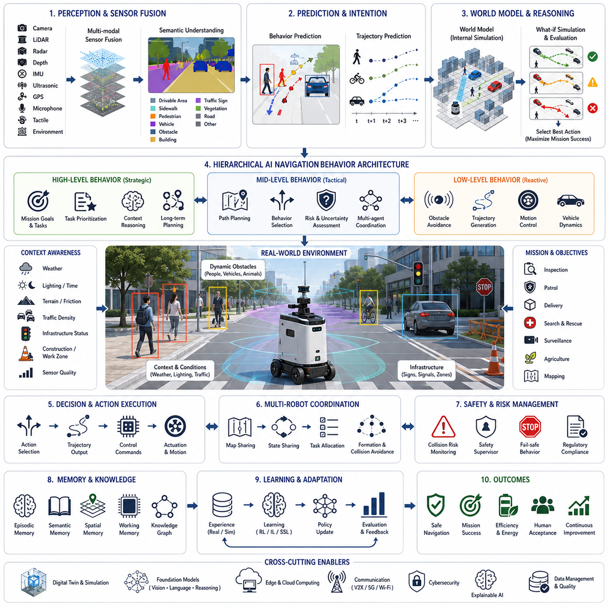
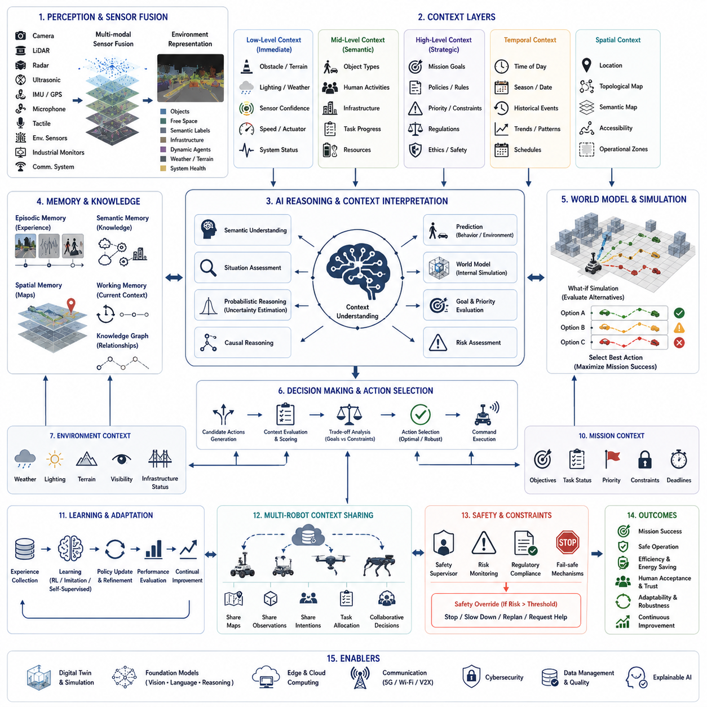
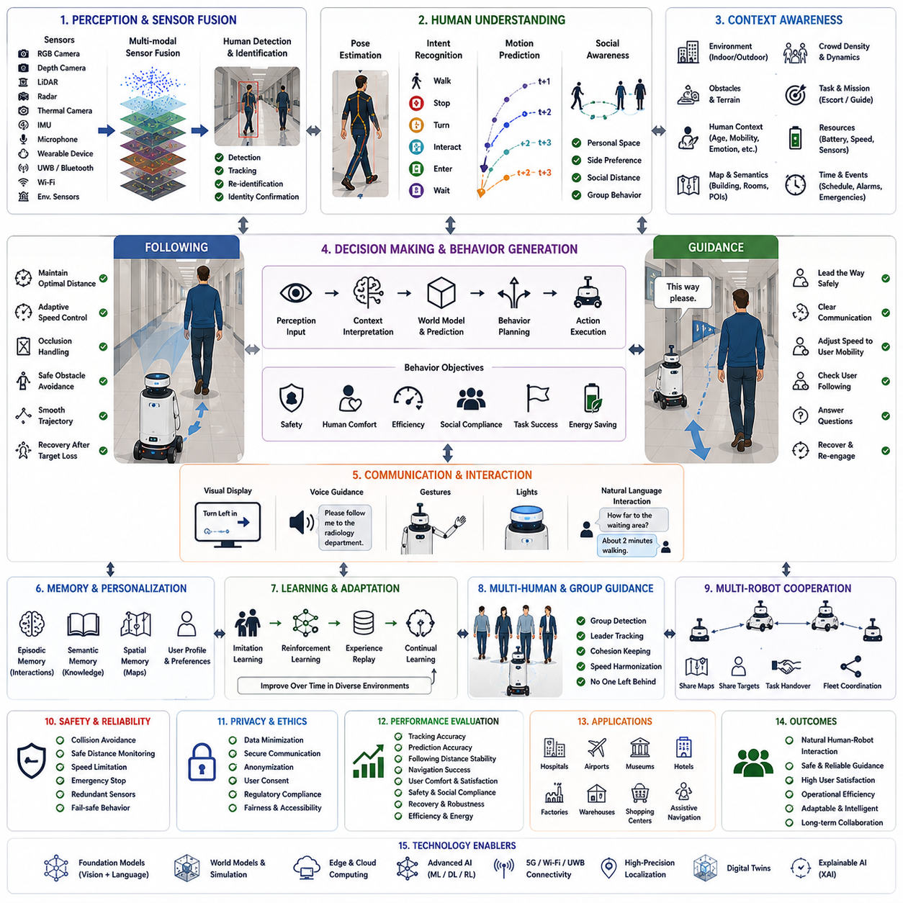
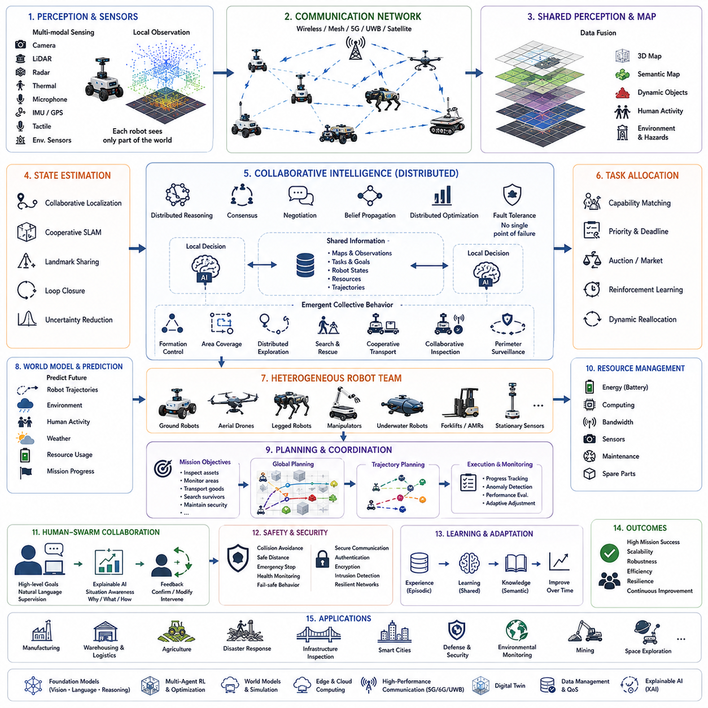
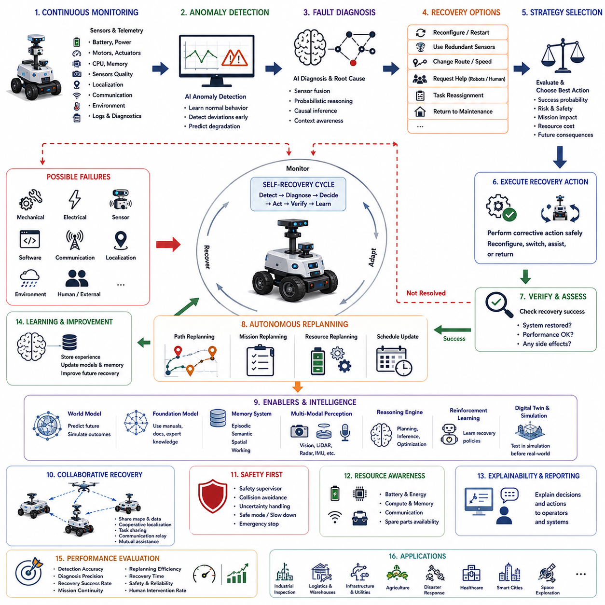
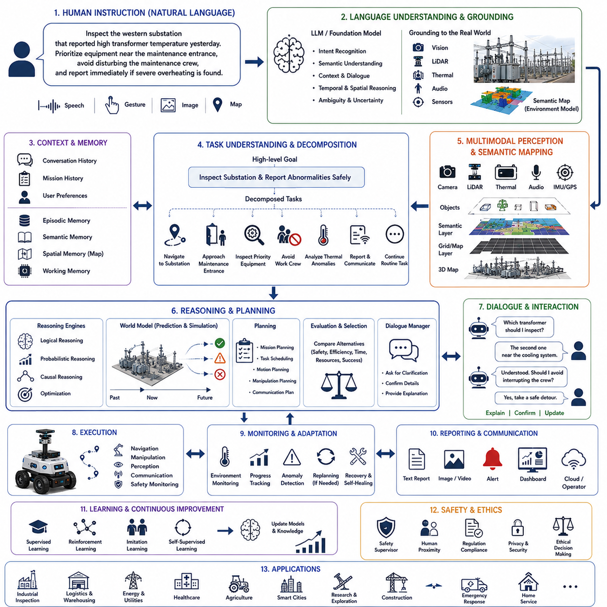
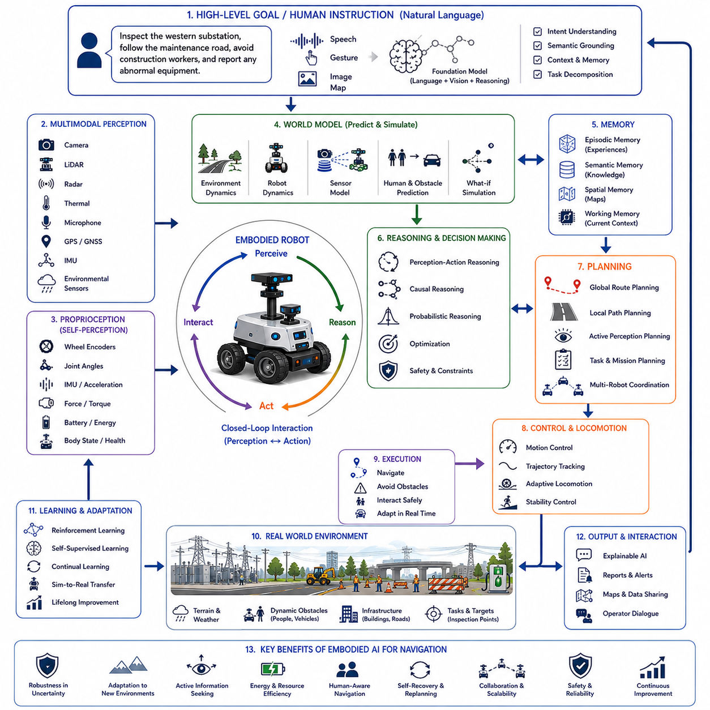
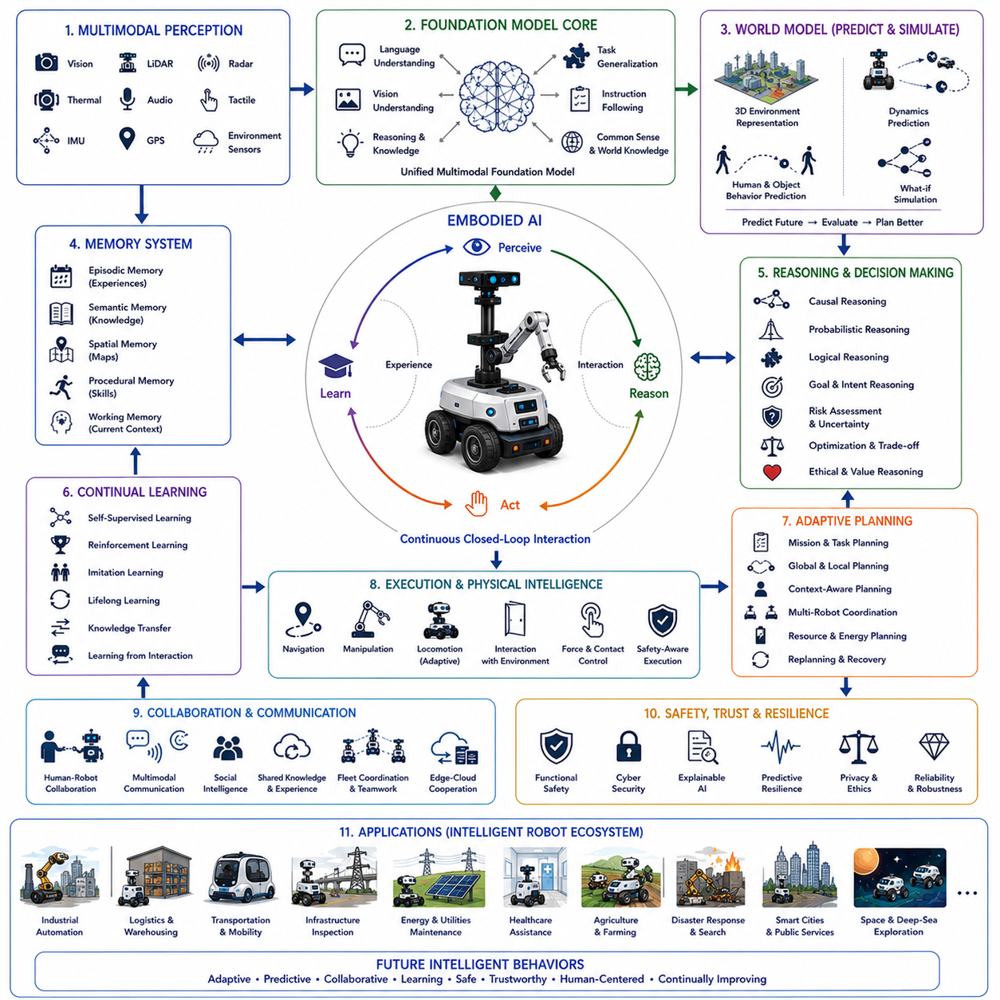

**Volume 05. Path Planning and Autonomous Navigation**

# Chapter 24. Advanced Autonomous Behaviors

## 24.1 AI-Based Navigation Behaviors

{width="7.268055555555556in" height="7.268055555555556in"}

AI-based navigation behaviors represent the decision-making intelligence that transforms autonomous robots from simple path-following machines into adaptive agents capable of understanding, interpreting, and responding to complex real-world environments. Traditional autonomous navigation primarily focuses on localization, mapping, obstacle avoidance, and path planning. These capabilities allow a robot to move safely from one location to another, but they do not necessarily enable the robot to understand why it is moving, how surrounding entities may behave, or how navigation decisions should adapt according to changing mission objectives. AI-based navigation extends conventional autonomy by integrating perception, reasoning, prediction, learning, world modeling, and behavioral intelligence into a unified decision-making architecture that continuously evaluates both the external environment and internal mission state.

The concept of navigation behavior extends beyond physical movement. Every navigation decision represents a behavioral choice influenced by objectives, environmental conditions, social interactions, safety constraints, operational priorities, uncertainty, and anticipated future events. Rather than selecting the geometrically shortest path, an intelligent robot may deliberately choose safer routes, socially acceptable trajectories, energy-efficient motions, inspection-oriented viewpoints, or strategically advantageous positions depending on the current mission. Consequently, AI-based navigation treats movement not as an isolated control problem but as a continuous reasoning process linking perception, cognition, planning, and execution.

Modern AI navigation systems operate through hierarchical behavioral architectures. Low-level controllers regulate motor torque, steering angles, wheel velocities, actuator synchronization, and vehicle dynamics. Intermediate layers manage obstacle avoidance, local trajectory generation, motion optimization, and environmental interaction. Higher-level behavioral planners evaluate mission goals, semantic understanding, task priorities, environmental context, and long-term operational objectives. Foundation models and world models increasingly occupy the highest cognitive layer, allowing robots to reason about abstract goals, future consequences, human intentions, and alternative strategies before selecting navigation behaviors. This hierarchical organization enables real-time responsiveness while preserving strategic decision-making capability.

Perception serves as the foundation of every navigation behavior. Autonomous robots continuously collect information through cameras, LiDAR, radar, depth sensors, inertial measurement units, ultrasonic sensors, GPS receivers, microphones, tactile sensors, and environmental monitoring devices. Individual sensors provide only partial observations of the surrounding world. Artificial intelligence therefore performs multi-modal sensor fusion, combining heterogeneous measurements into coherent representations describing objects, free space, terrain, dynamic obstacles, environmental conditions, infrastructure, and semantic context. Behavioral reasoning depends heavily upon the quality and completeness of these integrated environmental representations.

Semantic perception fundamentally changes navigation behavior by allowing robots to recognize meaning rather than merely detecting geometry. Instead of classifying observations solely as occupied or free space, semantic understanding identifies pedestrians, vehicles, bicycles, staircases, sidewalks, roads, buildings, doors, elevators, charging stations, traffic signs, restricted areas, emergency exits, work zones, vegetation, and numerous additional environmental categories. Semantic labels provide contextual information that influences navigation policies. For example, robots naturally reduce speed near schools, avoid blocking emergency exits, maintain larger distances from children, or prioritize inspection near industrial equipment exhibiting abnormal conditions. Semantic understanding therefore transforms navigation into context-sensitive behavior.

Behavior prediction represents another essential capability of AI-based navigation. Static obstacle avoidance assumes that surrounding objects remain stationary, whereas real environments contain humans, vehicles, animals, and other autonomous systems exhibiting continuously changing behavior. Artificial intelligence estimates future trajectories of nearby agents using historical observations, social interaction models, intention prediction, environmental context, and probabilistic reasoning. Predictive navigation enables robots to anticipate collisions before they become imminent, negotiate crowded environments smoothly, and generate trajectories that appear natural and cooperative rather than purely reactive.

Human-aware navigation has become increasingly important as robots leave controlled industrial environments and operate within public spaces. Human movement follows social conventions that extend beyond physical collision avoidance. People expect comfortable interpersonal distances, predictable movement patterns, appropriate yielding behavior, respect for queues, awareness of personal space, and culturally acceptable interactions. AI-based behavioral models estimate human intentions, walking speed, attention direction, group formation, emotional state, and possible future actions. Navigation policies incorporate these social factors to minimize discomfort while preserving operational efficiency. Social navigation therefore becomes a multidimensional optimization balancing safety, efficiency, comfort, and human acceptance.

Environmental context continuously modifies behavioral decision making. Weather conditions, lighting, surface friction, terrain type, traffic density, visibility, time of day, operational urgency, and infrastructure status all influence navigation behavior. Heavy rain may reduce sensor confidence and increase braking distance. Snow changes traction characteristics. Fog reduces visibility. Nighttime alters perception quality. Construction activities temporarily modify traversable regions. AI systems evaluate these contextual factors and automatically adjust speed limits, obstacle margins, localization confidence thresholds, sensing priorities, and path selection strategies according to estimated environmental risk.

Goal-directed behavior distinguishes intelligent navigation from reactive obstacle avoidance. Traditional planners optimize geometric objectives such as minimizing travel distance or travel time. AI-based behavioral planners optimize mission success. Inspection robots position themselves to maximize sensor visibility rather than minimizing path length. Patrol robots intentionally visit strategic observation points. Delivery robots balance delivery deadlines against pedestrian congestion. Search-and-rescue robots prioritize regions with the highest probability of finding survivors. Agricultural robots optimize crop coverage while minimizing soil compaction. Mission objectives therefore dynamically reshape navigation behavior throughout autonomous operation.

Reinforcement learning has become a powerful methodology for acquiring navigation behaviors through experience rather than explicit programming. Instead of manually designing behavioral rules for every possible situation, reinforcement learning agents interact with simulated environments, receive rewards for successful actions, and gradually discover policies maximizing long-term performance. Reward functions encode objectives including safety, efficiency, energy conservation, social compliance, task completion, observation quality, and operational robustness. Large-scale simulation enables robots to experience millions of navigation scenarios impossible to reproduce physically. Learned behavioral policies subsequently transfer to real-world operation through domain adaptation and continual refinement.

Imitation learning complements reinforcement learning by enabling robots to acquire navigation behaviors directly from human demonstrations. Expert operators navigate complex environments while artificial intelligence observes sensory inputs, control actions, decision sequences, and contextual reasoning. Behavioral cloning learns mappings between observations and navigation actions without explicitly modeling underlying objectives. More advanced inverse reinforcement learning estimates latent reward functions explaining expert behavior, allowing robots to generalize beyond demonstrated situations. Human demonstrations therefore provide valuable prior knowledge accelerating deployment in complex operational environments.

World models increasingly serve as internal simulation engines supporting intelligent navigation. Rather than reacting only to immediate sensory observations, robots construct predictive internal representations capable of simulating future environmental evolution under alternative actions. Candidate trajectories are evaluated within the world model before physical execution. Navigation decisions therefore become hypothetical reasoning processes rather than reactive responses. The robot estimates future obstacle movement, environmental changes, mission progress, energy consumption, communication quality, and operational risk prior to committing to actual motion. Internal simulation substantially improves long-horizon planning under uncertainty.

Foundation models further expand behavioral intelligence by integrating language, vision, reasoning, memory, and planning into unified navigation architectures. Robots receiving natural language instructions such as "inspect all emergency exits while avoiding crowded corridors" or "patrol the parking lot but remain close to illuminated pathways after sunset" interpret these abstract goals using multimodal reasoning. Foundation models associate linguistic concepts with spatial knowledge, semantic understanding, environmental context, and operational objectives. Navigation behaviors therefore become increasingly flexible, explainable, and adaptable to previously unseen tasks without requiring explicit reprogramming.

Memory plays an important role in adaptive navigation. Episodic memory stores previous experiences associated with specific locations, obstacles, failures, successful strategies, or environmental conditions. Semantic memory accumulates general knowledge about object categories, infrastructure, operational procedures, and navigation policies. Spatial memory maintains maps, landmarks, traversability estimates, and environmental topology. Working memory temporarily retains information relevant to ongoing decision making. AI integrates these complementary memory systems, allowing navigation behaviors to improve continuously through accumulated operational experience rather than treating every mission as an entirely independent task.

Uncertainty estimation fundamentally influences intelligent behavior. Every perception system contains measurement error, localization uncertainty, prediction ambiguity, sensor degradation, communication latency, and incomplete observations. AI-based navigation explicitly estimates uncertainty associated with environmental understanding, obstacle prediction, localization accuracy, and behavioral outcomes. Risk-aware planning naturally increases safety margins whenever uncertainty grows. Robots reduce speed, request additional observations, reposition sensors, or seek alternative routes whenever confidence decreases below acceptable thresholds. Explicit uncertainty reasoning prevents excessive confidence that could otherwise produce unsafe autonomous behavior.

Energy-aware navigation optimizes robot behavior according to available resources. Battery capacity, computational workload, sensor utilization, communication requirements, terrain difficulty, and mission duration collectively determine future operational capability. AI continuously estimates expected energy consumption for alternative trajectories and behavioral strategies. Instead of maximizing immediate task efficiency, intelligent navigation balances current objectives against future operational requirements. Robots may choose smoother terrain, lower speeds, shorter communication paths, or intermediate charging opportunities to maximize long-term mission success under limited energy resources.

Multi-robot coordination introduces collective behavioral intelligence extending beyond individual navigation. Robots exchange localization information, environmental observations, planned trajectories, task assignments, and predicted future actions. Cooperative behaviors include formation control, area coverage, obstacle sharing, distributed mapping, cooperative transportation, traffic negotiation, and dynamic task redistribution. Artificial intelligence optimizes fleet-level behavior rather than independently controlling each robot. Shared world models enable distributed autonomous systems to maintain consistent environmental understanding while minimizing redundant sensing and communication overhead.

Safety remains the highest behavioral priority regardless of mission objectives. AI-based navigation continuously evaluates collision probability, system health, localization confidence, environmental hazards, mechanical limitations, communication integrity, and regulatory constraints. Safety supervisors monitor behavioral decisions independently from mission planners, overriding navigation commands whenever unacceptable risk emerges. Formal verification, runtime monitoring, redundant sensing, and fail-safe behaviors ensure that adaptive intelligence never compromises operational safety. Autonomous systems therefore balance behavioral flexibility with rigorous safety guarantees required for deployment in real-world environments.

Explainability increasingly becomes essential as navigation behavior grows more sophisticated. Human operators must understand why autonomous systems selected particular routes, avoided certain regions, reduced speed unexpectedly, or interrupted assigned missions. Explainable AI generates interpretable reasoning linking observations, environmental context, mission objectives, uncertainty estimates, and predicted outcomes to behavioral decisions. Transparent reasoning improves operator trust, accelerates debugging, supports regulatory compliance, and facilitates collaborative human-robot operation in complex industrial and public environments.

Continual learning allows navigation behaviors to evolve throughout operational deployment. Environmental conditions change over time due to infrastructure modifications, seasonal weather variation, changing traffic patterns, equipment aging, or evolving mission requirements. AI continuously incorporates newly observed experiences while preserving previously acquired knowledge. Catastrophic forgetting is mitigated through replay mechanisms, memory consolidation, parameter isolation, or modular learning architectures. Lifelong adaptation enables robots to remain effective despite long-term environmental evolution without requiring complete retraining after every operational change.

Digital twins provide an ideal environment for developing, validating, and optimizing navigation behaviors before physical deployment. High-fidelity simulation reproduces environmental geometry, dynamic agents, weather conditions, lighting variation, sensor characteristics, communication networks, and vehicle dynamics. Millions of behavioral scenarios including rare safety-critical events can be evaluated efficiently within virtual environments. Reinforcement learning, behavior validation, stress testing, failure analysis, and policy optimization all benefit from digital twin simulation prior to transferring navigation models into real robotic platforms.

Evaluation of AI-based navigation extends far beyond conventional path planning metrics. Navigation success includes mission completion, safety, trajectory smoothness, energy efficiency, localization robustness, social compliance, human comfort, obstacle prediction accuracy, uncertainty calibration, computational efficiency, recovery capability, adaptability, and long-term learning performance. Large-scale benchmarking employs diverse environments including indoor facilities, outdoor campuses, industrial plants, urban streets, disaster zones, warehouses, hospitals, airports, agricultural fields, and construction sites. Comprehensive evaluation ensures that learned navigation behaviors generalize reliably across varying operational conditions rather than overfitting to specific training environments.

A representative deployment demonstrates the integration of these behavioral capabilities within a modern autonomous industrial inspection system operating across a large manufacturing facility. During routine inspection, the robot receives a high-level instruction to inspect critical production equipment while minimizing disruption to ongoing manufacturing activities. Foundation models interpret the natural language mission and generate semantic objectives emphasizing production-critical machinery, emergency exits, safety equipment, and maintenance access points. Multi-modal perception constructs a continuously updated environmental representation combining LiDAR geometry, RGB imagery, thermal observations, operational sensor data, and worker locations. Human-aware navigation predicts pedestrian trajectories and adjusts movement to avoid interrupting production personnel. Behavioral planners recognize that one inspection route passes through a temporarily congested maintenance corridor while an alternative path provides better visibility with slightly longer travel distance. World model simulation predicts future corridor congestion and recommends delaying inspection of that region until maintenance activity decreases. Simultaneously, energy-aware planning estimates sufficient battery capacity to complete the modified mission without intermediate charging. During inspection, thermal imaging identifies abnormal equipment heating. Behavioral reasoning immediately reprioritizes nearby inspection tasks, autonomously collecting additional observations from multiple viewpoints before transmitting high-confidence diagnostic information to maintenance engineers. Multi-robot coordination dispatches another inspection robot toward adjacent production lines while preventing redundant coverage. After mission completion, operational experiences update episodic memory, improving future navigation decisions under similar production conditions. Throughout the mission, explainable reasoning continuously records why specific behavioral choices were selected, allowing engineers to review autonomous decision processes during post-mission analysis.

This example demonstrates that AI-based navigation behaviors represent far more than intelligent motion planning. They integrate perception, semantic understanding, prediction, reasoning, learning, memory, world modeling, foundation models, uncertainty estimation, human interaction, multi-robot cooperation, digital twins, and continual adaptation into a unified cognitive architecture supporting autonomous decision making across highly dynamic environments. As embodied artificial intelligence, robotics foundation models, causal reasoning, multimodal world models, self-supervised learning, and lifelong adaptation continue to mature, future autonomous robots will increasingly navigate not simply by avoiding obstacles but by understanding intentions, anticipating future events, coordinating with humans and machines, explaining their own decisions, and continuously improving behavioral intelligence through accumulated operational experience. These capabilities will transform navigation from reactive mobility into context-aware autonomous reasoning, establishing the foundation for truly intelligent robotic systems operating safely and effectively across industrial, commercial, urban, and societal environments.

## 24.2 Context-Aware Decision Making

{width="7.268055555555556in" height="7.268055555555556in"}

Context-aware decision making represents one of the defining characteristics of intelligent autonomous systems because it enables robots to select actions based not only on immediate sensory observations but also on environmental conditions, mission objectives, operational constraints, historical experience, social interactions, and predicted future events. Traditional robotic systems generally rely on predefined rules or deterministic algorithms that respond to specific sensor inputs in fixed ways. While these approaches perform reliably in structured environments, they often struggle when operating in dynamic real-world situations where identical sensory observations may require different responses depending on surrounding circumstances. Context-aware decision making addresses this limitation by integrating perception, semantic understanding, reasoning, memory, prediction, world models, and adaptive intelligence into a unified cognitive framework capable of interpreting situations before determining appropriate actions.

The concept of context extends far beyond physical surroundings. Context includes spatial information, temporal conditions, mission objectives, environmental states, operational history, available resources, social interactions, infrastructure conditions, organizational policies, regulatory constraints, and uncertainty associated with observations. A robot operating inside a hospital interprets the same corridor differently during normal patient transport, emergency evacuation, nighttime maintenance, or infectious disease isolation procedures. Likewise, an outdoor inspection robot may behave differently on the same road depending on weather conditions, traffic density, battery level, communication quality, or the urgency of its assigned mission. Intelligent decision making therefore depends on understanding not only what is currently observed but also why the situation matters.

Modern autonomous systems organize contextual information through hierarchical representations. Low-level context includes immediate sensory observations such as obstacle locations, terrain geometry, lighting conditions, temperature, vehicle speed, actuator status, and sensor confidence. Intermediate context incorporates semantic understanding, environmental classification, human activities, infrastructure conditions, task execution status, and operational resources. High-level context represents strategic objectives, organizational priorities, mission success criteria, long-term operational planning, legal regulations, ethical considerations, and predicted future developments. Artificial intelligence continuously integrates information across these hierarchical levels so that local decisions remain consistent with global objectives.

Perception provides the initial source of contextual information. Cameras, LiDAR, radar, ultrasonic sensors, inertial measurement units, GPS receivers, environmental sensors, microphones, tactile sensors, industrial monitoring devices, and communication systems continuously observe both the robot and its surroundings. Individual sensors provide fragmented observations, often affected by noise, uncertainty, occlusion, or limited coverage. Multi-modal sensor fusion combines these heterogeneous measurements into coherent environmental representations that include objects, free space, semantic categories, infrastructure, dynamic agents, weather conditions, terrain characteristics, and system health. Context-aware reasoning depends fundamentally on the completeness, consistency, and reliability of these integrated perceptual models.

Semantic understanding transforms raw observations into meaningful contextual knowledge. Rather than recognizing only geometric structures, intelligent systems identify roads, sidewalks, intersections, factories, warehouses, hospitals, airports, emergency exits, hazardous zones, charging stations, pedestrian crossings, industrial equipment, vehicles, work areas, restricted regions, and numerous additional semantic entities. Objects are further associated with functional meaning, expected behaviors, operational importance, and safety implications. A doorway may represent an ordinary entrance, a fire exit, a restricted laboratory, or an emergency evacuation route depending on the surrounding operational context. Decision-making systems therefore interpret observations according to semantic relationships rather than isolated visual appearance.

Temporal context significantly influences intelligent behavior because identical situations may require different actions at different times. Time of day affects pedestrian density, traffic patterns, lighting conditions, energy pricing, industrial production schedules, and environmental conditions. Seasonal variation influences weather, vegetation, infrastructure accessibility, and operational priorities. Historical events provide additional temporal context by revealing trends, recurring behaviors, maintenance history, equipment degradation, or previous mission outcomes. Context-aware systems integrate temporal information into decision making, enabling robots to anticipate regular environmental changes and adapt proactively rather than reacting only after conditions have already evolved.

Spatial context provides another essential dimension of intelligent reasoning. Position alone is insufficient; robots must understand relationships among locations, infrastructure, operational zones, accessibility constraints, and mission relevance. The same object may require different responses depending upon where it is located. A parked vehicle inside a designated parking area represents normal infrastructure, whereas the identical vehicle positioned within an emergency access corridor may require immediate attention. Spatial reasoning incorporates topological maps, semantic maps, geometric relationships, visibility analysis, traversability estimation, and operational boundaries to interpret environmental observations within their broader geographical context.

Mission context directly shapes autonomous decision making by defining operational priorities. Delivery robots emphasize punctual transportation while inspection robots maximize sensing quality. Security patrol robots prioritize surveillance coverage and anomaly detection. Agricultural robots optimize crop monitoring while minimizing soil disturbance. Search-and-rescue robots maximize survivor detection probability despite increased navigation risk. Context-aware architectures continuously evaluate mission objectives alongside environmental observations so that behavioral decisions remain aligned with evolving operational goals. Mission priorities may also change dynamically in response to emergencies, equipment failures, weather events, or operator instructions.

Human context becomes increasingly important as autonomous systems interact more frequently with people. Human-aware decision making extends beyond obstacle avoidance by considering social norms, cultural expectations, emotional states, group behavior, attention direction, accessibility requirements, communication preferences, and individual vulnerability. Elderly individuals, children, hospital patients, industrial workers, emergency responders, and tourists each require different interaction strategies. Artificial intelligence estimates human intentions, predicts future actions, evaluates comfort zones, and selects navigation or communication behaviors appropriate for each social context. Such adaptive interaction significantly improves public acceptance while maintaining operational safety.

Environmental context encompasses weather, lighting, terrain conditions, visibility, temperature, humidity, wind, precipitation, electromagnetic interference, communication quality, and infrastructure status. Heavy rain reduces sensor performance and increases braking distance. Snow modifies traversability and localization accuracy. Fog limits perception range. Construction activities temporarily alter environmental topology. Artificial intelligence continuously evaluates these environmental variables, adjusting navigation policies, sensing priorities, localization confidence, speed limits, and operational strategies according to estimated environmental risk. Context-aware adaptation enables robust performance despite continuously changing external conditions.

Resource context influences decision making by considering available computational capacity, battery energy, communication bandwidth, storage resources, sensor availability, actuator health, maintenance schedules, and operational workload. A robot operating with abundant battery reserves may perform additional inspection tasks, whereas identical mission conditions under limited energy resources require conservative planning. Communication interruptions may shift computation toward onboard processing while reducing dependence upon cloud services. Context-aware resource management balances mission objectives against remaining operational capability, maximizing long-term effectiveness rather than short-term performance alone.

Memory provides accumulated contextual knowledge unavailable through immediate perception. Episodic memory stores previous experiences associated with locations, environmental conditions, failures, successes, human interactions, and operational decisions. Semantic memory accumulates general engineering knowledge, environmental understanding, procedural rules, and task relationships. Spatial memory maintains maps, landmarks, traversability estimates, and navigation experiences. Working memory temporarily stores information relevant to current reasoning processes. Context-aware systems integrate these complementary memory structures, enabling decisions to benefit from both historical experience and present observations. Learning from accumulated operational experience allows robots to improve contextual reasoning continuously.

World models further enhance contextual intelligence by predicting future environmental evolution. Rather than responding only to current observations, autonomous systems internally simulate alternative futures corresponding to different candidate actions. The robot estimates how obstacles may move, weather may change, human activities may evolve, battery resources may decrease, communication quality may fluctuate, or mission objectives may progress under various decision alternatives. Decision making therefore becomes prospective rather than purely reactive, selecting actions expected to produce favorable future outcomes despite uncertainty regarding environmental evolution.

Foundation models significantly expand contextual reasoning capabilities by integrating language, vision, sensor observations, reasoning, memory, and planning within unified architectures. Natural language instructions such as "inspect the western production area while avoiding noisy maintenance operations" require simultaneous interpretation of geographical context, industrial operations, environmental conditions, human activities, and mission priorities. Foundation models associate linguistic concepts with semantic environmental understanding, enabling robots to generalize contextual reasoning across previously unseen tasks without requiring explicit programming for every possible operational scenario.

Probabilistic reasoning addresses uncertainty inherent in contextual interpretation. Sensors contain measurement errors, localization remains imperfect, predictions are uncertain, and environmental observations frequently remain incomplete due to occlusion or communication loss. Bayesian inference, probabilistic graphical models, Monte Carlo methods, belief propagation, and uncertainty-aware neural networks estimate confidence associated with contextual understanding. Rather than assuming complete environmental knowledge, intelligent systems explicitly represent uncertainty throughout decision making. Conservative behaviors naturally emerge whenever contextual confidence decreases below acceptable thresholds, improving operational safety under ambiguous conditions.

Causal reasoning distinguishes correlation from genuine cause-and-effect relationships within complex environments. Merely observing simultaneous events does not imply causal dependence. Increased equipment temperature may result from heavy workload, cooling system degradation, sensor malfunction, or environmental heating. Traffic congestion may originate from accidents, weather, construction, public events, or communication failures. Context-aware artificial intelligence employs structural causal models, intervention reasoning, counterfactual analysis, and knowledge graphs to estimate underlying mechanisms generating observed situations. Understanding causal structure substantially improves decision quality compared with purely statistical pattern recognition.

Digital twins provide comprehensive contextual environments supporting both operational decision making and algorithm development. Virtual representations integrate three-dimensional infrastructure, environmental conditions, sensor models, communication networks, operational workflows, historical data, maintenance information, and predicted future states into continuously synchronized simulations. Context-aware algorithms evaluate alternative decisions within digital twins before physical execution, estimating consequences under numerous hypothetical scenarios impossible to reproduce safely in reality. Simulation therefore becomes an essential component of intelligent contextual reasoning.

Reinforcement learning enables autonomous systems to acquire contextual decision policies through large-scale experience. Rather than programming explicit behavioral rules, designers specify reward functions representing mission success, safety, efficiency, energy conservation, human comfort, regulatory compliance, and operational reliability. Learning agents interact with simulated environments containing diverse contextual situations, gradually discovering policies maximizing long-term cumulative reward. Rich contextual variation during training improves policy generalization, enabling robust performance across previously unseen operational conditions after deployment.

Continual learning allows contextual reasoning to evolve throughout operational life. Urban infrastructure changes, industrial facilities undergo modification, seasonal weather varies, human behaviors evolve, equipment ages, and mission requirements expand. Artificial intelligence continuously incorporates newly observed contextual relationships while preserving previously acquired knowledge. Memory replay, parameter isolation, modular adaptation, and knowledge consolidation mitigate catastrophic forgetting, ensuring long-term improvement without sacrificing established capabilities. Lifelong contextual learning therefore transforms autonomous systems into continuously evolving decision makers rather than static programmed machines.

Collaborative contextual intelligence emerges when multiple robots share environmental understanding. Distributed autonomous systems exchange semantic maps, contextual observations, predicted hazards, mission status, resource availability, environmental changes, and learned experiences. Shared contextual knowledge significantly improves decision quality because individual robots collectively observe larger portions of the environment than any single platform alone. Fleet-level context management further supports coordinated task allocation, cooperative navigation, distributed sensing, and collaborative inspection while minimizing redundant observations and communication overhead.

Safety remains the highest priority throughout contextual decision making. Mission objectives, productivity, efficiency, and adaptability never override fundamental safety requirements. Independent safety supervisors continuously evaluate contextual interpretations, prediction uncertainty, sensor integrity, system health, regulatory compliance, and operational risk. Whenever contextual ambiguity increases beyond acceptable limits, robots automatically reduce speed, increase observation frequency, seek additional information, request human assistance, or transition into fail-safe operating modes. Context-aware safety therefore balances intelligent adaptability with rigorous operational reliability.

Explainability becomes increasingly important because contextual reasoning often involves numerous interacting factors invisible to human observers. Operators require understandable explanations describing why robots selected particular actions under specific circumstances. Explainable artificial intelligence identifies influential contextual variables, predicted consequences, uncertainty estimates, causal relationships, and alternative decision options supporting chosen behaviors. Transparent reasoning enhances operator trust, facilitates debugging, supports regulatory compliance, and improves collaborative human-machine operation within complex industrial and public environments.

Evaluation of context-aware decision making extends beyond conventional navigation metrics. Performance includes contextual understanding accuracy, semantic interpretation quality, prediction reliability, causal reasoning correctness, mission success, safety, energy efficiency, adaptability, robustness under uncertainty, human acceptance, computational efficiency, learning capability, and long-term operational improvement. Benchmark environments intentionally introduce diverse contextual variations involving weather, lighting, infrastructure modifications, human interactions, equipment failures, communication disruptions, and changing mission objectives. Comprehensive evaluation ensures that contextual intelligence generalizes across real-world operational complexity rather than memorizing isolated scenarios.

A representative deployment illustrates the integration of these contextual reasoning capabilities within an autonomous outdoor inspection robot operating throughout a large industrial manufacturing campus. The robot receives a high-level mission requesting inspection of critical electrical substations while minimizing interference with ongoing maintenance activities. Foundation models interpret the natural language objective, identifying mission priorities and operational constraints. Multi-modal perception continuously integrates LiDAR, RGB cameras, thermal imaging, environmental sensors, weather information, worker locations, equipment status, and communication quality into a unified contextual representation. Semantic understanding recognizes production zones, hazardous areas, maintenance corridors, emergency exits, restricted facilities, and inspection targets. Heavy rainfall begins during operation, reducing localization confidence while increasing electrical safety risks. Context-aware reasoning immediately modifies navigation behavior by selecting covered inspection routes, reducing vehicle speed, increasing obstacle safety margins, and postponing inspections requiring exposure to hazardous weather conditions. Simultaneously, maintenance personnel unexpectedly occupy one scheduled inspection area. Human-aware reasoning predicts worker movement, identifies safe waiting locations, and temporarily reprioritizes nearby inspection tasks rather than interrupting maintenance operations. World model simulation estimates future weather improvement within thirty minutes, allowing delayed inspection without compromising mission completion. Resource-aware reasoning confirms sufficient battery capacity for extended operation despite modified routing. During inspection, thermal imaging detects abnormal transformer heating. Causal reasoning combines thermal observations, electrical load information, historical maintenance records, environmental temperature, and weather conditions before concluding that cooling system degradation rather than temporary environmental heating most likely explains the observed anomaly. High-confidence diagnostic information is transmitted immediately to maintenance engineers together with explainable reasoning describing the contextual evidence supporting this conclusion. After mission completion, all contextual observations become part of episodic memory, continuously improving future decision quality throughout similar operational environments.

This example demonstrates that context-aware decision making extends autonomous intelligence far beyond conventional reactive robotics. Intelligent systems integrate perception, semantic understanding, temporal reasoning, spatial awareness, mission interpretation, environmental adaptation, human interaction, resource management, memory, world models, foundation models, probabilistic reasoning, causal inference, continual learning, digital twins, and explainable artificial intelligence into unified cognitive architectures capable of understanding situations before selecting actions. As robotics foundation models, embodied artificial intelligence, multimodal reasoning, self-supervised learning, world models, causal intelligence, and lifelong learning continue to mature, future autonomous systems will increasingly understand not only what they observe but also why situations matter, how circumstances are likely to evolve, and which decisions best satisfy long-term operational objectives. Context-aware decision making will therefore become one of the foundational capabilities enabling trustworthy, adaptive, and human-compatible autonomous robots operating safely and intelligently across industrial, commercial, urban, and societal environments.

## 24.3 Human Following and Guidance

{width="7.268055555555556in" height="7.268055555555556in"}

Human following and guidance represent one of the most important capabilities in modern service robotics, collaborative robotics, autonomous mobile robots, and embodied artificial intelligence because they enable robots to interact naturally with people while maintaining safety, efficiency, and social acceptability. Unlike conventional navigation, where the robot moves independently toward predefined goals, human-following systems continuously adapt their behavior according to human movement, intentions, environmental conditions, social conventions, and mission objectives. Guidance extends this capability further by allowing robots not only to follow people but also to lead them safely through complex environments while maintaining effective communication and situational awareness. Together, these capabilities transform robots from autonomous machines into intelligent partners capable of supporting humans in industrial, commercial, healthcare, logistics, hospitality, and public service applications.

The fundamental challenge of human following lies in recognizing that people are not deterministic moving obstacles. Human behavior is inherently variable, context dependent, and influenced by intentions, emotions, social interactions, environmental constraints, and unpredictable events. Two individuals walking through the same corridor may choose entirely different trajectories, walking speeds, stopping behaviors, or interaction patterns. A robot cannot simply maintain a fixed distance behind a target person. Instead, it must continuously interpret human behavior, predict future movement, estimate uncertainty, and adapt navigation accordingly. Human-following therefore combines perception, prediction, behavioral intelligence, motion planning, and social reasoning into an integrated autonomous system.

Human guidance introduces an even more sophisticated interaction model. Rather than responding to human movement, the robot becomes responsible for leading people toward destinations while ensuring that they remain safely engaged throughout the journey. A guidance robot must continuously verify that the human is still following, adjust walking speed according to the person\'s mobility, provide understandable navigation cues, respond to questions, recover from temporary separation, and dynamically modify routes when environmental conditions change. Guidance therefore requires bidirectional interaction in which both human and robot continuously adapt to each other\'s behavior instead of operating independently.

Reliable human perception forms the foundation of every following and guidance system. Modern robots integrate RGB cameras, stereo cameras, depth sensors, LiDAR, radar, thermal imaging, inertial measurement units, microphones, wearable devices, Bluetooth localization, Ultra-Wideband positioning, Wi-Fi localization, and environmental sensors to detect and identify people under diverse operating conditions. Individual sensing modalities possess inherent limitations. Cameras may fail under poor lighting or occlusion. LiDAR provides accurate geometry but limited semantic information. Radar remains robust during adverse weather but offers lower spatial resolution. Thermal imaging performs well at night but cannot distinguish personal identity. Multi-modal sensor fusion combines complementary sensing technologies to achieve robust human detection under varying environmental conditions.

Human identification extends beyond simply detecting the presence of a person. Robots frequently operate within crowded environments containing numerous individuals exhibiting similar appearances and behaviors. Following the wrong person may create safety hazards or operational failures. Artificial intelligence therefore integrates visual appearance, clothing characteristics, body shape, gait patterns, skeletal pose estimation, face recognition where appropriate and legally permitted, voice identification, wearable device communication, and long-term trajectory consistency into unified identity tracking systems. Robust person re-identification allows robots to maintain target identity even after temporary occlusions or crowd interactions.

Pose estimation provides detailed understanding of human body configuration beyond simple location tracking. Deep learning models estimate joint positions, body orientation, head direction, arm movement, walking posture, and limb dynamics from visual observations. Human pose reveals valuable information regarding movement intention, activity recognition, emotional state, and interaction readiness. A person turning toward a doorway, reaching for an object, waving toward the robot, or stopping unexpectedly generates distinctive pose patterns enabling predictive behavioral interpretation. Pose-aware perception therefore significantly improves both following reliability and interactive guidance quality.

Human motion prediction enables robots to anticipate future movement rather than merely reacting after motion occurs. Prediction models analyze historical trajectories, walking velocity, acceleration, body orientation, environmental context, destination likelihood, crowd interactions, and semantic map information to estimate probable future positions. Modern approaches employ recurrent neural networks, transformers, graph neural networks, diffusion models, probabilistic forecasting, and social interaction modeling to generate multiple possible future trajectories with associated confidence estimates. Predictive navigation reduces abrupt robot maneuvers while improving both safety and perceived naturalness.

Socially compliant following requires robots to respect implicit human behavioral conventions. Humans generally maintain comfortable interpersonal distances depending on cultural norms, familiarity, environmental density, and social context. Following too closely creates discomfort, whereas excessive separation reduces communication effectiveness and increases tracking failure risk. Robots continuously adjust following distance according to walking speed, crowd density, corridor width, environmental hazards, and user preference. Artificial intelligence further considers side-by-side positioning, visual contact, conversational orientation, and pedestrian flow to produce behavior perceived as polite rather than mechanically optimized.

Adaptive speed control represents another critical capability. Human walking speed varies substantially according to age, physical condition, purpose, emotional state, terrain, fatigue, and environmental conditions. Elderly individuals may require slow, carefully regulated movement, whereas industrial workers may move rapidly between production areas. Guidance robots dynamically estimate comfortable walking speed while monitoring acceleration, deceleration, stopping frequency, and fatigue indicators. Rather than forcing humans to adapt to robotic movement, intelligent systems continuously modify their own velocity profile to accommodate individual user characteristics.

Context-aware following significantly enhances behavioral quality. Environmental context includes narrow corridors, open spaces, staircases, elevators, intersections, construction zones, hazardous industrial areas, hospitals, airports, shopping centers, warehouses, factories, and outdoor urban environments. Mission context distinguishes escorting visitors, guiding patients, supporting logistics personnel, assisting visually impaired users, following maintenance technicians, or accompanying security patrols. Human context considers age, mobility limitations, cognitive workload, emotional state, language preference, accessibility requirements, and familiarity with the environment. Context-aware behavioral policies continuously integrate these diverse contextual factors before selecting navigation actions.

Obstacle avoidance during human following presents unique challenges because robots must simultaneously maintain awareness of both the target individual and surrounding obstacles. Temporary occlusion frequently occurs when people pass behind furniture, machinery, vehicles, structural columns, or other pedestrians. Artificial intelligence predicts target movement during temporary visibility loss using motion models, environmental constraints, semantic maps, and historical trajectory information. Simultaneously, obstacle avoidance algorithms generate collision-free trajectories without sacrificing long-term target tracking. Recovery behaviors automatically reacquire visual contact whenever the target reappears.

Human guidance requires effective communication throughout navigation. Visual interfaces display directional arrows, destination information, progress indicators, and contextual instructions. Audio guidance provides spoken navigation assistance, warnings, confirmations, and conversational interaction. Gesture generation communicates turning intentions or stopping behavior. Light signals indicate operational status or emergency conditions. Increasingly, large language models enable natural dialogue allowing users to ask questions, modify destinations, request explanations, or obtain contextual information during guidance. Multimodal communication significantly improves user confidence and operational transparency.

Natural language understanding expands human guidance beyond predefined interaction scripts. Instead of requiring structured commands, robots interpret conversational requests such as "Take me to the nearest emergency exit," "Guide me to radiology while avoiding crowded waiting areas," or "Follow the maintenance supervisor until inspection is complete." Foundation models integrate linguistic understanding with semantic maps, operational knowledge, environmental context, and navigation planning. Consequently, human guidance becomes increasingly flexible, intuitive, and adaptable across diverse operational scenarios.

Human intention recognition substantially improves interaction quality. People rarely communicate every navigation objective explicitly. Body orientation, gaze direction, gesture, walking behavior, conversation, object interaction, environmental attention, and historical behavior collectively reveal likely intentions. Artificial intelligence estimates whether individuals intend to stop, enter buildings, inspect equipment, avoid obstacles, engage in conversation, or modify destinations. Anticipating human intention enables robots to respond proactively rather than waiting for explicit commands after behavioral changes have already occurred.

World models provide predictive internal simulation supporting both following and guidance. Rather than reacting exclusively to current observations, robots simulate alternative future scenarios corresponding to different human actions, environmental changes, and navigation strategies. Internal simulation evaluates candidate trajectories according to safety, comfort, efficiency, communication quality, and mission success before selecting physical actions. World models therefore enable long-horizon reasoning under uncertainty while reducing unnecessary behavioral oscillations during dynamic human interaction.

Memory supports long-term personalization of human-following behavior. Episodic memory records previous interactions with individual users, preferred walking speeds, commonly visited destinations, communication preferences, mobility limitations, and successful guidance strategies. Semantic memory stores general knowledge regarding building layouts, organizational procedures, accessibility regulations, emergency protocols, and social conventions. Spatial memory maintains maps, landmarks, semantic locations, and navigational experiences. Personalized memory allows robots to provide increasingly natural assistance through repeated interaction without requiring users to repeat identical preferences during every encounter.

Reinforcement learning enables autonomous acquisition of following and guidance behaviors through large-scale simulation. Reward functions simultaneously optimize tracking reliability, human comfort, obstacle avoidance, energy efficiency, communication quality, mission completion, social compliance, and safety. Millions of simulated interactions expose learning agents to diverse human behaviors, environmental configurations, and operational scenarios impossible to reproduce manually. Domain randomization, physics simulation, synthetic crowd generation, and digital twins improve transfer from virtual environments to physical robotic deployment while maintaining robust generalization across real-world conditions.

Imitation learning complements reinforcement learning by directly learning from expert human demonstrations. Professional guides, experienced operators, caregivers, or security personnel naturally demonstrate effective human guidance strategies. Artificial intelligence observes environmental context, sensory observations, navigation actions, communication timing, interpersonal distance, and behavioral adaptations. Behavioral cloning reproduces demonstrated policies while inverse reinforcement learning estimates latent objectives underlying expert behavior. Human expertise therefore becomes encoded within robotic navigation without explicitly programming every interaction rule.

Multi-human interaction introduces additional complexity beyond following individual users. Hospitals, airports, museums, shopping centers, factories, and public events often require robots to guide families, work teams, tourists, or emergency response groups. Group guidance requires estimating group cohesion, identifying leadership structure, maintaining visibility for multiple participants, balancing walking speed across heterogeneous mobility levels, and ensuring that no individual becomes unintentionally separated. Artificial intelligence models social group dynamics rather than treating each person independently, thereby producing coherent collaborative guidance behavior.

Multi-robot cooperation further expands human guidance capabilities. Multiple robots share localization information, human identities, environmental observations, semantic maps, crowd density estimates, communication quality, and mission status. One robot may transfer responsibility for a guided individual to another robot better positioned to continue assistance. Cooperative fleets distribute guidance responsibilities throughout large facilities while maintaining continuous user support despite robot charging, maintenance, or unexpected operational interruptions. Shared contextual information significantly improves overall system robustness.

Safety remains the highest priority during every stage of human following and guidance. Independent safety supervisors continuously evaluate collision probability, sensor integrity, localization confidence, communication reliability, human proximity, environmental hazards, and robot health. Functional safety architectures guarantee conservative behavior whenever uncertainty exceeds acceptable limits. Emergency stop mechanisms, speed limitation, redundant sensing, human override capability, and fail-safe operational modes ensure that adaptive intelligence never compromises physical safety. Particularly in healthcare, industrial, and public environments, safety certification becomes essential before deployment.

Privacy and ethical considerations become increasingly significant because human-following systems frequently process personal information including appearance, movement history, voice, behavioral patterns, and location. Privacy-preserving artificial intelligence minimizes unnecessary data collection while employing secure communication, encrypted storage, federated learning, anonymization, and regulatory compliance. Ethical deployment requires transparency regarding data usage, informed consent where appropriate, fairness across diverse populations, accessibility for individuals with disabilities, and avoidance of unnecessary surveillance. Responsible human guidance therefore balances technological capability with societal trust.

Explainable artificial intelligence enhances transparency during human interaction. Users naturally seek to understand why robots selected particular routes, stopped unexpectedly, changed speed, waited at intersections, or requested alternative paths. Explainable systems generate understandable reasoning connecting environmental observations, human behavior, contextual constraints, safety considerations, and mission objectives with selected navigation actions. Transparent communication increases user confidence while supporting debugging, regulatory evaluation, and continuous system improvement.

Performance evaluation extends beyond conventional navigation metrics. Following systems are evaluated using tracking accuracy, re-identification reliability, prediction accuracy, following distance stability, trajectory smoothness, obstacle avoidance success, energy efficiency, communication effectiveness, human comfort, social acceptability, safety performance, personalization quality, recovery capability after target loss, computational efficiency, and long-term adaptation. Guidance systems further evaluate destination success rate, user comprehension, conversational quality, route optimization, accessibility support, mission completion time, and overall user satisfaction. Comprehensive benchmarking across hospitals, airports, factories, warehouses, shopping centers, museums, hotels, campuses, and outdoor urban environments ensures robust generalization under realistic operational diversity.

A representative deployment illustrates the integration of these capabilities within a large international hospital. A service robot receives a request to guide an elderly patient from the main entrance to a specialized diagnostic department. Natural language understanding interprets the spoken request while accessing hospital semantic maps, appointment schedules, accessibility constraints, elevator availability, and current corridor congestion. Multi-modal perception identifies the patient using RGB cameras, depth sensing, LiDAR, and voice confirmation. Human pose estimation recognizes reduced walking stability, prompting adaptive speed control and increased interpersonal safety distance. During guidance, the robot continuously monitors whether the patient remains within comfortable visual range while explaining upcoming turns through voice, display, and gesture. Unexpected maintenance activity temporarily blocks the planned corridor. World model simulation predicts several alternative routes, selecting one minimizing walking distance while avoiding crowded waiting areas and construction noise. Along the new path, another patient accidentally crosses between the robot and its assigned user, temporarily interrupting visual tracking. Multi-modal person re-identification combines appearance, gait, trajectory prediction, and voice cues to reacquire the correct individual without confusion. Thermal environmental monitoring simultaneously detects abnormal equipment temperature near a utility room. Although unrelated to the guidance mission, contextual reasoning transmits maintenance alerts automatically while continuing patient assistance without interruption. Upon reaching the destination, the robot confirms appointment details, verifies successful arrival, updates episodic memory regarding the patient\'s preferred walking speed and communication style, and transfers contextual information to another service robot responsible for post-examination guidance. Throughout the mission, explainable reasoning records navigation decisions, environmental adaptations, and safety interventions for later performance analysis and continuous learning.

This case study demonstrates that human following and guidance extend autonomous robotics beyond independent navigation into collaborative human-centered intelligence. These capabilities integrate perception, semantic understanding, person identification, pose estimation, intention recognition, behavioral prediction, world models, foundation models, natural language interaction, memory, reinforcement learning, imitation learning, social reasoning, multi-robot coordination, safety supervision, privacy protection, and explainable artificial intelligence within unified cognitive architectures supporting natural long-term human-robot collaboration. As robotics foundation models, embodied artificial intelligence, multimodal reasoning, world models, self-supervised learning, lifelong adaptation, and conversational intelligence continue to advance, future robots will increasingly understand human behavior, anticipate intentions, personalize assistance, communicate naturally, coordinate collaboratively, and provide trustworthy guidance across industrial, commercial, healthcare, hospitality, transportation, and public environments. Human following and guidance will therefore become foundational capabilities enabling autonomous robots to function not merely as intelligent machines but as reliable partners supporting people safely, efficiently, and intuitively throughout everyday life and complex professional operations.

## 24.4 Swarm and Collaborative Robotics

{width="7.268055555555556in" height="7.268055555555556in"}

Swarm and collaborative robotics represent a major evolution beyond traditional single-robot autonomy by enabling multiple autonomous robots to cooperate toward common objectives through distributed intelligence, coordinated decision making, shared perception, and collective adaptation. While an individual robot is limited by its sensing range, computational resources, physical capabilities, battery capacity, and operational reliability, a swarm of robots can collectively perform tasks that would be impossible or inefficient for any single platform. Inspired by biological systems such as ant colonies, bee swarms, bird flocks, fish schools, and human organizations, swarm robotics studies how relatively simple autonomous agents can generate sophisticated collective behaviors through local interactions rather than centralized control. Collaborative robotics expands this concept further by incorporating heterogeneous robots, human operators, cloud intelligence, foundation models, and adaptive coordination strategies into unified multi-agent systems capable of solving complex industrial and societal problems.

The central concept underlying swarm robotics is emergence. Individual robots typically execute relatively simple behavioral rules based upon local observations, neighboring robots, mission objectives, and communication. Despite the simplicity of individual behaviors, global system intelligence emerges from continuous interactions among all participating agents. No single robot necessarily possesses complete knowledge of the environment or overall mission state. Instead, collective behavior gradually develops through information sharing, distributed optimization, cooperative task execution, and adaptive feedback. This decentralized approach improves scalability, fault tolerance, flexibility, and robustness compared with centralized robotic architectures that rely upon a single controller responsible for all decisions.

Distributed intelligence fundamentally distinguishes swarm systems from conventional robotic fleets. Traditional fleet management often relies on centralized servers assigning tasks, planning routes, monitoring robot status, and coordinating operations. Although effective in structured environments, centralized architectures create communication bottlenecks, computational limitations, and single points of failure. Swarm robotics distributes reasoning across all participating robots. Each robot independently evaluates local observations, exchanges information with nearby teammates, estimates environmental conditions, and contributes to collective decision making. Distributed intelligence therefore enables continued operation even when individual robots fail or communication with central infrastructure becomes temporarily unavailable.

Communication serves as the foundation enabling collaborative behavior. Robots exchange localization information, environmental observations, semantic maps, task assignments, obstacle detections, sensor measurements, resource availability, system health, predicted trajectories, and mission progress through wireless communication networks. Depending on operational requirements, communication may utilize Wi-Fi, 5G, Ultra-Wideband, mesh networking, dedicated industrial wireless systems, satellite communication, or hybrid networking architectures. Efficient communication protocols minimize bandwidth consumption while ensuring timely dissemination of information necessary for coordinated decision making. Artificial intelligence further prioritizes critical messages according to mission urgency, environmental risk, and communication quality.

Shared perception significantly expands environmental understanding beyond individual sensor limitations. Every robot observes only a limited portion of the environment using cameras, LiDAR, radar, thermal imaging, microphones, environmental sensors, inertial measurement units, GPS receivers, tactile sensors, and additional sensing modalities. Collaborative perception fuses observations from multiple robots into unified environmental representations containing geometric maps, semantic understanding, dynamic obstacle locations, infrastructure conditions, human activities, weather information, and operational hazards. Shared perception increases environmental coverage, reduces uncertainty, compensates for temporary sensor occlusions, and improves robustness against individual sensor failures.

Collaborative localization enables robot teams to estimate their positions more accurately than isolated navigation systems. Individual localization errors accumulate because of sensor noise, wheel slip, environmental ambiguity, and limited landmark visibility. Robots continuously exchange localization estimates, shared landmarks, simultaneous observations, loop closures, and semantic references. Cooperative simultaneous localization and mapping integrates these distributed observations into globally consistent maps while reducing accumulated positioning error. Collective localization proves especially valuable within GPS-denied environments including warehouses, underground facilities, industrial plants, hospitals, tunnels, disaster zones, and large indoor campuses.

Task allocation represents one of the most important decision-making problems in collaborative robotics. Complex missions frequently involve numerous subtasks differing in required capabilities, priorities, deadlines, environmental constraints, energy consumption, and geographic distribution. Artificial intelligence dynamically assigns tasks according to robot capabilities, sensor availability, battery reserves, communication quality, workload balancing, travel distance, environmental accessibility, and mission urgency. Allocation strategies range from market-based auctions and distributed optimization to reinforcement learning, graph neural networks, multi-agent planning, and foundation-model reasoning. Dynamic task reassignment enables continuous adaptation whenever robots fail, environmental conditions change, or mission priorities evolve.

Heterogeneous collaboration extends swarm robotics beyond identical robot populations. Modern autonomous systems increasingly combine ground robots, aerial drones, quadruped robots, humanoid platforms, industrial manipulators, underwater vehicles, autonomous forklifts, warehouse robots, inspection crawlers, and stationary sensing infrastructure into integrated operational ecosystems. Different robotic platforms contribute complementary sensing capabilities, mobility characteristics, payload capacities, manipulation skills, endurance, communication coverage, and computational resources. Artificial intelligence coordinates heterogeneous teams according to each platform\'s unique strengths, creating collective capabilities significantly exceeding homogeneous robotic swarms.

Behavior coordination ensures that individual robot actions remain consistent with overall mission objectives. Cooperative behaviors include formation control, convoy movement, distributed exploration, area coverage, search-and-rescue operations, collaborative transportation, cooperative inspection, distributed sensing, perimeter surveillance, environmental monitoring, warehouse logistics, and synchronized industrial operations. Behavior coordination continuously balances local autonomy against global mission optimization. Robots independently adapt to local environmental conditions while maintaining compatibility with collective operational strategies.

Formation control represents a widely studied collaborative behavior. Robots maintain specified spatial relationships while navigating dynamic environments containing obstacles, humans, vehicles, and changing terrain. Formation geometries may include lines, columns, circles, wedges, grids, adaptive networks, or task-specific configurations optimized for sensing coverage, communication connectivity, transportation stability, or defensive security. Artificial intelligence continuously modifies formation geometry according to terrain accessibility, environmental hazards, communication quality, mission objectives, and predicted future events. Adaptive formation control therefore combines flexibility with coordinated collective movement.

Distributed exploration enables multiple robots to investigate unknown environments substantially faster than individual platforms. Search efficiency depends upon minimizing redundant exploration while maximizing environmental coverage. Robots exchange frontier locations, explored regions, semantic observations, hazard detections, communication quality estimates, and resource availability. Multi-agent exploration algorithms optimize global coverage through decentralized coordination rather than centralized planning. Distributed exploration has become essential within disaster response, planetary exploration, mining operations, environmental monitoring, agricultural inspection, military reconnaissance, warehouse inventory, and infrastructure inspection.

Collaborative mapping extends simultaneous localization and mapping beyond individual robots. Every participating platform contributes local observations describing geometry, landmarks, semantic objects, traversability, environmental conditions, and dynamic changes. Artificial intelligence merges these distributed maps into globally consistent representations while identifying conflicting observations, correcting localization errors, and maintaining temporal consistency. Shared maps continuously evolve throughout missions as robots collectively observe changing environments. Collaborative mapping significantly accelerates environmental understanding while improving navigation accuracy for all participating agents.

Collective decision making differs fundamentally from centralized command structures. Rather than relying upon one supervisory controller, swarm systems often employ consensus algorithms, distributed optimization, voting mechanisms, negotiation protocols, confidence weighting, belief propagation, and decentralized reinforcement learning. Individual robots evaluate candidate actions according to locally available information before exchanging preferences with neighboring teammates. Collective decisions gradually converge through iterative communication while remaining robust against individual failures or communication interruptions. Consensus-based reasoning improves scalability while preserving operational flexibility across large robotic populations.

Artificial intelligence increasingly enhances swarm coordination through multi-agent reinforcement learning. Rather than training isolated robots independently, learning algorithms optimize collective behavior directly. Reward functions incorporate mission success, safety, communication efficiency, energy conservation, workload balance, resource utilization, environmental coverage, and long-term collaboration quality. Multi-agent reinforcement learning enables emergent cooperative strategies often exceeding manually designed coordination rules. Digital twins and high-fidelity simulation provide millions of collaborative experiences supporting robust policy learning before physical deployment.

Foundation models introduce higher-level reasoning capabilities into collaborative robotics. Natural language instructions such as "inspect every electrical transformer while assigning drones to rooftop observation and ground robots to detailed thermal inspection" require semantic understanding, task decomposition, heterogeneous coordination, environmental reasoning, and adaptive planning. Foundation models interpret abstract objectives, generate collaborative workflows, coordinate specialized robotic capabilities, explain decision rationale, and adapt plans whenever operational conditions evolve. Consequently, collaborative systems become increasingly flexible without requiring manually programmed coordination strategies for every mission.

World models provide predictive simulation supporting collective planning. Individual robots maintain internal representations estimating future environmental evolution, teammate behavior, communication quality, resource consumption, weather changes, human activities, and mission progress. Shared world models integrate predictions from multiple robots into unified simulations evaluating alternative collaborative strategies before execution. Multi-agent world models therefore improve long-horizon planning by anticipating interactions among robots, humans, infrastructure, and environmental dynamics rather than reacting only to immediate observations.

Memory enables collaborative systems to accumulate operational knowledge across repeated missions. Episodic memory stores previous collaborative experiences, successful coordination strategies, communication failures, environmental hazards, and mission outcomes. Semantic memory accumulates engineering knowledge, operational procedures, infrastructure information, and task relationships. Spatial memory maintains collaboratively generated maps, landmarks, traversability estimates, and environmental changes. Shared memory repositories allow newly deployed robots to benefit immediately from historical operational experience without repeating identical exploration or learning processes.

Human-swarm collaboration represents an increasingly important research direction. Rather than individually controlling every robot, human operators supervise collective behavior through high-level mission objectives, natural language instructions, strategic intervention, and situational oversight. Artificial intelligence automatically decomposes human intentions into coordinated multi-robot behaviors while continuously providing explainable feedback regarding swarm status, environmental understanding, predicted mission outcomes, and operational risks. Human supervisors therefore manage entire robotic populations rather than individual vehicles, significantly improving operational scalability.

Context-aware collaboration allows swarm systems to adapt collective behavior according to environmental conditions, mission priorities, infrastructure constraints, human activities, communication quality, weather, regulatory requirements, and resource availability. Industrial facilities, agricultural fields, disaster zones, hospitals, airports, warehouses, ports, construction sites, and urban environments each require different collaborative strategies. Artificial intelligence continuously evaluates contextual information before selecting coordination policies appropriate for current operational conditions rather than relying upon fixed behavioral rules.

Resource management becomes increasingly important as swarm size grows. Robots collectively manage battery reserves, charging infrastructure, computational workload, sensing responsibilities, communication bandwidth, spare components, maintenance schedules, and operational availability. Cooperative resource allocation prevents unnecessary duplication while maximizing overall mission effectiveness. Robots approaching battery depletion may transfer unfinished tasks to teammates before returning autonomously for charging. Communication-intensive computations may migrate toward robots possessing greater processing capability or stronger network connectivity.

Fault tolerance represents one of the greatest advantages of swarm robotics. Individual robot failures rarely terminate overall mission execution because remaining robots automatically compensate through dynamic task reassignment, collaborative localization, shared perception, and adaptive coordination. Artificial intelligence continuously monitors system health, identifies degraded platforms, predicts potential failures, isolates malfunctioning robots, and reorganizes collaborative behavior without requiring human intervention. Redundancy emerges naturally through distributed intelligence rather than expensive hardware duplication.

Cybersecurity becomes increasingly critical as collaborative systems exchange growing volumes of operational information. Secure communication protocols, authentication mechanisms, encrypted networking, intrusion detection, distributed trust management, anomaly detection, and resilient consensus algorithms protect swarm operations against malicious interference. Artificial intelligence distinguishes communication failures resulting from environmental conditions from deliberate cyberattacks while maintaining coordinated operation whenever possible. Cyber-physical security therefore becomes an integral component of trustworthy collaborative autonomy.

Explainable artificial intelligence enhances transparency within collaborative decision making. Human operators require understandable explanations describing why particular robots received specific tasks, why formations changed, why collaborative plans were modified, or why individual robots temporarily disengaged from assigned missions. Explainable reasoning identifies influential environmental observations, resource constraints, predicted outcomes, uncertainty estimates, and collaborative optimization criteria supporting collective decisions. Transparent coordination improves operator trust while simplifying debugging, certification, and long-term operational optimization.

Performance evaluation extends beyond individual robot capability toward collective system intelligence. Important evaluation metrics include mission completion rate, task allocation efficiency, communication latency, localization accuracy, mapping consistency, environmental coverage, formation stability, resource utilization, fault tolerance, scalability, energy efficiency, collaborative learning performance, recovery after robot failures, computational efficiency, human supervisory workload, and long-term operational robustness. Benchmark environments intentionally vary swarm size, communication quality, environmental complexity, dynamic obstacles, infrastructure availability, heterogeneous robot composition, and mission diversity to evaluate genuine collaborative intelligence rather than isolated robotic performance.

A representative deployment illustrates collaborative robotics within a large international container port operating continuously throughout day and night. The autonomous system includes outdoor inspection vehicles, autonomous forklifts, aerial drones, quadruped inspection robots, mobile manipulation platforms, stationary environmental sensors, and cloud-based coordination infrastructure. Foundation models interpret high-level operational objectives requesting inspection of electrical substations, monitoring container storage areas, supporting logistics operations, detecting infrastructure anomalies, and maintaining perimeter security simultaneously. Artificial intelligence decomposes these objectives into distributed tasks assigned according to robot specialization, battery reserves, sensing capabilities, weather conditions, communication quality, and operational priorities. Drones perform rapid aerial inspection of container stacks while ground robots conduct detailed thermal imaging and structural assessment. Quadruped robots inspect narrow machinery spaces inaccessible to wheeled platforms. Shared perception integrates observations from all robots into continuously updated semantic maps describing infrastructure condition, vehicle movement, worker locations, hazardous materials, weather evolution, and security events. During operation, one inspection robot experiences unexpected drive system failure. Distributed coordination immediately reallocates unfinished inspection tasks among nearby teammates while autonomous maintenance vehicles retrieve the disabled platform without interrupting ongoing operations. Simultaneously, severe weather temporarily reduces drone flight safety. Context-aware planning shifts aerial observation responsibilities toward stationary cameras and elevated ground robots until environmental conditions improve. Collaborative localization maintains accurate navigation despite temporary GPS degradation near large metal container stacks through cooperative map sharing and distributed landmark recognition. Throughout the mission, explainable artificial intelligence continuously reports collective progress, resource utilization, task completion estimates, environmental anomalies, and coordination rationale to human supervisors. Operational experiences become integrated into shared episodic memory, improving future collaborative planning, task allocation, and failure recovery across subsequent missions.

This example demonstrates that swarm and collaborative robotics extend autonomous intelligence beyond individual robotic capability into distributed collective cognition. These systems integrate perception, shared sensing, distributed intelligence, collaborative localization, semantic mapping, task allocation, behavior coordination, formation control, world models, foundation models, reinforcement learning, heterogeneous collaboration, human supervision, context-aware adaptation, resource management, fault tolerance, cybersecurity, explainable artificial intelligence, and lifelong learning within unified multi-agent cognitive architectures. As robotics foundation models, embodied artificial intelligence, multimodal reasoning, world models, self-supervised learning, multi-agent reinforcement learning, distributed causal reasoning, and continual adaptation continue to mature, future robotic swarms will increasingly function as intelligent cooperative ecosystems capable of understanding complex environments, coordinating specialized capabilities, anticipating future operational requirements, recovering autonomously from failures, and continuously improving collective performance through accumulated experience. Swarm and collaborative robotics will therefore become foundational technologies enabling scalable, resilient, and trustworthy autonomous systems across manufacturing, logistics, transportation, healthcare, agriculture, environmental monitoring, disaster response, infrastructure management, smart cities, planetary exploration, and numerous future applications requiring coordinated intelligent autonomy.

## 24.5 Self-Recovery and Autonomous Replanning

{width="7.268055555555556in" height="7.268055555555556in"}

Self-recovery and autonomous replanning represent fundamental capabilities required for long-term autonomous robots operating in dynamic, uncertain, and unpredictable environments. Traditional robotic systems generally assume that missions proceed according to predefined plans under relatively stable environmental conditions. In practice, however, autonomous robots continuously encounter unexpected obstacles, sensor failures, localization errors, communication interruptions, actuator degradation, changing mission priorities, weather variations, human intervention, infrastructure modifications, and hardware malfunctions. Without the ability to recover from these events autonomously, robots frequently require human intervention, resulting in reduced operational efficiency, increased maintenance costs, and limited deployment scalability. Self-recovery and autonomous replanning transform robots from reactive automation systems into resilient intelligent agents capable of maintaining mission continuity despite unexpected disruptions.

The concept of self-recovery extends beyond simple fault detection. Detecting an abnormal condition represents only the first step in a much broader cognitive process. Intelligent recovery requires recognizing that a failure has occurred, diagnosing its probable cause, estimating its operational impact, evaluating available recovery options, predicting future consequences, selecting an appropriate corrective strategy, executing recovery actions, verifying successful restoration, and continuously monitoring for recurring problems. Autonomous replanning complements this process by modifying mission plans whenever recovery actions alter environmental conditions, robot capabilities, resource availability, or operational objectives. Together, these capabilities enable robots to maintain productive operation without requiring complete mission restart after every unexpected event.

Failures encountered by autonomous robots originate from multiple sources. Mechanical failures include wheel slippage, actuator degradation, steering malfunction, suspension damage, battery degradation, manipulator failure, and sensor mounting disturbances. Electrical failures include power fluctuations, communication hardware faults, motor controller errors, connector degradation, and battery management anomalies. Software failures involve algorithm crashes, memory corruption, synchronization problems, operating system instability, planning failures, perception errors, and localization divergence. Environmental failures arise from severe weather, flooded terrain, smoke, dust, poor lighting, dynamic obstacles, construction activities, electromagnetic interference, and unexpected infrastructure modifications. Human-related events include operator intervention, pedestrian congestion, unauthorized access, changing work schedules, and emergency situations. Effective self-recovery must address all of these heterogeneous failure categories through unified reasoning rather than isolated error handling routines.

Continuous health monitoring provides the earliest indication that recovery may become necessary. Every subsystem generates operational telemetry including battery voltage, current consumption, processor utilization, memory usage, storage capacity, motor temperature, actuator torque, communication quality, sensor confidence, localization uncertainty, network latency, diagnostic logs, and environmental measurements. Artificial intelligence continuously analyzes these signals using anomaly detection algorithms capable of identifying subtle deviations before complete system failure occurs. Early detection enables preventive recovery actions that minimize mission disruption while extending hardware lifetime and improving operational reliability.

Anomaly detection has evolved significantly beyond fixed threshold monitoring. Traditional rule-based diagnostics identify failures only after measured variables exceed predefined limits. Modern artificial intelligence instead learns normal system behavior through historical operational data and continuously estimates expected performance under varying environmental conditions. Machine learning models detect statistical deviations, unusual temporal patterns, unexpected sensor relationships, abnormal energy consumption, inconsistent localization estimates, and emerging degradation trends before conventional diagnostics recognize explicit faults. Self-supervised learning further enables robots to discover previously unseen failure modes without requiring manually labeled training data.

Failure diagnosis determines the underlying causes responsible for abnormal behavior. Similar symptoms may originate from entirely different mechanisms. Reduced navigation accuracy may result from camera contamination, LiDAR malfunction, wheel slippage, map inconsistency, GPS degradation, communication delay, or environmental changes. Artificial intelligence integrates probabilistic reasoning, causal inference, model-based diagnosis, knowledge graphs, and multimodal sensor fusion to estimate the most probable root causes explaining observed anomalies. Accurate diagnosis significantly improves recovery effectiveness because corrective actions become specifically targeted toward underlying problems rather than superficial symptoms.

Context-aware diagnosis substantially improves fault interpretation by considering operational circumstances alongside technical observations. Identical sensor measurements may indicate normal operation under one context but serious malfunction under another. Increased processor utilization may represent expected computational demand during complex perception tasks while indicating software instability during idle operation. Battery temperature acceptable during rapid charging may become abnormal during standby conditions. Environmental context, mission objectives, workload, weather, infrastructure conditions, and historical operational patterns therefore become integral components of intelligent diagnostic reasoning.

Recovery strategy selection represents one of the most challenging aspects of autonomous resilience. Multiple recovery options frequently exist for every detected failure. A localization error may be corrected by revisiting previously mapped landmarks, activating additional sensors, requesting collaborative localization assistance, reducing vehicle speed, or restarting localization algorithms. Communication interruptions may trigger network switching, local autonomy, delayed synchronization, mesh networking, or temporary mission suspension. Mechanical degradation may require reduced operating speed, modified trajectory planning, task reassignment, or return-to-maintenance procedures. Artificial intelligence evaluates expected effectiveness, operational risk, mission impact, resource consumption, and future consequences before selecting recovery strategies maximizing long-term mission success.

Hierarchical recovery architectures organize corrective actions according to failure severity. Minor disturbances often require only local algorithmic adjustment without affecting overall mission planning. Moderate failures may temporarily modify navigation behavior, sensing priorities, or operational parameters while preserving mission objectives. Severe failures demand complete mission replanning, collaborative assistance from neighboring robots, human notification, or controlled return to maintenance facilities. Catastrophic failures initiate emergency safety procedures preventing further system damage or environmental hazards. Hierarchical recovery enables proportional responses avoiding unnecessary operational interruption for minor anomalies while ensuring rigorous safety under critical conditions.

Autonomous replanning begins whenever environmental understanding, operational capability, or mission constraints change significantly. Classical path planning typically assumes static environments and fixed objectives. Real-world operations instead require continuous revision of navigation routes, task schedules, resource allocation, inspection priorities, communication strategies, and collaborative coordination according to evolving circumstances. Artificial intelligence treats planning as an ongoing adaptive process rather than a one-time optimization performed before mission execution. Every significant environmental observation potentially triggers incremental replanning ensuring that robot behavior remains aligned with current operational reality.

Dynamic path replanning represents the most visible component of autonomous adaptation. Unexpected obstacles, blocked corridors, temporary construction, traffic congestion, hazardous materials, severe weather, human activities, and changing accessibility continuously alter navigable environments. Modern planning algorithms integrate graph search, optimization, probabilistic planning, sampling-based methods, trajectory optimization, reinforcement learning, and world models to generate collision-free alternative routes while minimizing mission delay. Continuous replanning allows robots to navigate highly dynamic environments without becoming immobilized by unexpected changes.

Mission replanning extends beyond navigation into strategic task management. Inspection priorities may change after anomaly detection. Delivery schedules evolve according to customer requests. Search-and-rescue operations redirect resources toward newly detected survivors. Industrial maintenance robots prioritize equipment exhibiting early signs of failure. Agricultural robots modify inspection order according to weather forecasts and crop conditions. Artificial intelligence continuously balances mission urgency, operational risk, available resources, environmental accessibility, and long-term objectives while constructing updated mission plans reflecting current operational needs.

World models substantially enhance both recovery and replanning through predictive internal simulation. Rather than selecting corrective actions solely according to current observations, robots evaluate alternative future scenarios before execution. Internal simulations estimate how recovery strategies influence navigation success, energy consumption, communication quality, hardware stress, environmental interaction, human safety, and mission completion probability. Predictive reasoning allows autonomous systems to avoid locally attractive actions producing undesirable long-term consequences while identifying recovery strategies maximizing future operational flexibility.

Foundation models increasingly contribute high-level reasoning during recovery. Natural language maintenance manuals, engineering documentation, operational procedures, historical maintenance records, and expert troubleshooting knowledge become accessible through language-based reasoning. When encountering unfamiliar failures, robots may interpret documentation, summarize probable causes, generate candidate recovery procedures, explain diagnostic reasoning, and communicate understandable status reports to human operators. Foundation models therefore augment traditional engineering diagnostics with flexible knowledge integration and generalized reasoning across diverse operational domains.

Memory plays an essential role in resilient autonomy by preserving accumulated recovery experience. Episodic memory records previous failures, environmental conditions, applied recovery strategies, diagnostic evidence, and mission outcomes. Semantic memory stores engineering knowledge, operational procedures, equipment specifications, maintenance guidelines, and causal relationships among system components. Spatial memory retains locations where recurrent failures frequently occur, communication dead zones, hazardous terrain, and environmental anomalies. Working memory temporarily integrates current diagnostic evidence supporting immediate reasoning. Together, these complementary memory systems enable robots to improve recovery effectiveness continuously through accumulated operational experience.

Collaborative recovery significantly increases system resilience within multi-robot deployments. Robots experiencing degraded localization, reduced sensing capability, communication problems, or mechanical limitations request assistance from neighboring teammates. Shared perception, cooperative localization, distributed task reassignment, resource sharing, communication relaying, and collaborative diagnostics enable collective recovery exceeding individual robot capability. Multi-agent coordination prevents localized failures from escalating into complete mission interruption while maintaining overall operational continuity across distributed robotic fleets.

Learning continuously improves autonomous recovery throughout operational life. Reinforcement learning optimizes recovery policies through repeated simulated experience covering millions of diverse failure scenarios. Imitation learning captures expert troubleshooting behavior demonstrated by maintenance engineers and experienced operators. Self-supervised learning identifies previously unknown degradation patterns without requiring manually labeled fault data. Continual learning incorporates newly observed failures while preserving established diagnostic knowledge, preventing catastrophic forgetting as robotic systems accumulate long-term operational experience.

Digital twins provide ideal environments for validating recovery strategies before deployment. High-fidelity virtual environments reproduce robot dynamics, sensor characteristics, communication systems, environmental conditions, infrastructure, weather, human activities, and hardware failures with remarkable realism. Artificial intelligence systematically injects simulated faults into digital twins, evaluating recovery algorithms across enormous scenario diversity impossible to reproduce safely within physical environments. Successful recovery policies subsequently transfer toward real robots through domain adaptation, significantly reducing deployment risk while improving operational robustness.

Safety remains the highest priority throughout every recovery process. Recovery actions must never introduce greater risk than the original failure itself. Independent functional safety supervisors continuously evaluate collision probability, actuator integrity, localization confidence, communication reliability, environmental hazards, human proximity, and hardware health before authorizing corrective actions. Whenever uncertainty exceeds acceptable limits, robots automatically transition into conservative operating modes involving reduced speed, increased obstacle clearance, simplified navigation, restricted functionality, or emergency stop procedures. Safe recovery therefore balances mission continuity against rigorous protection of people, infrastructure, equipment, and the robot itself.

Resource-aware recovery considers remaining battery capacity, computational resources, communication bandwidth, spare sensing capability, hardware redundancy, and available maintenance support while selecting corrective actions. Aggressive recovery procedures consuming substantial energy may become inappropriate when battery reserves remain limited. Computationally intensive localization algorithms may require temporary simplification under reduced processing availability. Artificial intelligence therefore optimizes recovery according to current resource constraints while preserving sufficient operational reserves for future contingencies.

Explainable artificial intelligence improves operator confidence during autonomous recovery by generating understandable descriptions connecting detected anomalies, diagnostic reasoning, selected recovery strategies, predicted consequences, uncertainty estimates, and expected mission impacts. Maintenance personnel require transparent explanations describing why robots modified routes, suspended tasks, reduced speed, restarted software modules, requested assistance, or returned for maintenance. Explainable reasoning facilitates debugging, certification, regulatory compliance, human supervision, and continuous improvement of autonomous recovery systems.

Cyber resilience has become increasingly important because software failures may originate from communication attacks, malicious data injection, authentication compromise, distributed denial-of-service events, or unauthorized network access. Intelligent recovery distinguishes accidental technical failures from deliberate cyber threats through anomaly analysis, behavioral consistency checking, secure authentication, distributed trust management, and resilient communication protocols. Autonomous systems isolate compromised subsystems while preserving essential mission capability whenever possible, thereby maintaining operational continuity despite cybersecurity incidents.

Evaluation of self-recovery and autonomous replanning extends beyond conventional reliability metrics. Performance includes anomaly detection accuracy, diagnostic precision, root-cause identification, recovery success rate, mission continuation probability, replanning efficiency, recovery latency, safety performance, resource utilization, fault tolerance, learning improvement, human intervention frequency, explainability quality, computational efficiency, and long-term operational robustness. Benchmark scenarios intentionally combine simultaneous hardware faults, communication degradation, dynamic environmental changes, uncertain localization, weather disturbances, human interaction, and evolving mission priorities to evaluate integrated resilience rather than isolated recovery algorithms.

A representative deployment illustrates these capabilities within a large outdoor autonomous infrastructure inspection system operating across electrical substations, railway corridors, bridges, and industrial facilities. The mission begins with several inspection robots collaboratively surveying distributed assets while sharing semantic maps, thermal observations, localization information, and maintenance priorities. During inspection, one robot encounters unexpectedly muddy terrain causing severe wheel slippage and increasing localization uncertainty. Simultaneously, heavy rainfall degrades camera visibility while intermittent communication disrupts cloud connectivity. Continuous health monitoring detects abnormal wheel torque, localization inconsistency, declining sensor confidence, and communication instability before complete navigation failure occurs. Artificial intelligence integrates these observations with environmental context, concluding that environmental conditions rather than hardware malfunction represent the primary cause. World model simulation evaluates multiple recovery alternatives including route reversal, reduced speed, LiDAR-dominant localization, collaborative localization assistance, waiting for weather improvement, and task transfer. Predictive reasoning determines that switching toward LiDAR-based localization, reducing vehicle speed, requesting semantic map updates from neighboring robots, and selecting an alternative gravel maintenance road provides the highest probability of successful mission completion. Autonomous replanning immediately modifies inspection schedules because delayed arrival at one substation would otherwise violate maintenance priorities. Nearby robots automatically assume responsibility for lower-priority inspections while the affected platform focuses exclusively on critical infrastructure. During continued operation, thermal analysis identifies abnormal transformer heating requiring immediate investigation. Mission replanning reprioritizes inspection order accordingly while communication relays established through neighboring robots maintain connectivity despite degraded wireless coverage. Throughout recovery, explainable artificial intelligence continuously reports diagnostic reasoning, selected corrective actions, expected operational consequences, and confidence estimates to remote supervisors. After mission completion, every anomaly, environmental condition, recovery strategy, and operational outcome becomes integrated into shared episodic memory supporting continual improvement of future diagnostic accuracy and autonomous resilience.

This case study demonstrates that self-recovery and autonomous replanning transform autonomous robots from systems requiring frequent human intervention into resilient cognitive agents capable of sustaining long-term operation despite uncertain environments, evolving missions, hardware degradation, software faults, communication disruption, and unforeseen events. These capabilities integrate continuous health monitoring, anomaly detection, probabilistic diagnosis, causal reasoning, world models, foundation models, memory, collaborative intelligence, reinforcement learning, digital twins, explainable artificial intelligence, cybersecurity, resource management, and adaptive planning within unified cognitive architectures supporting resilient autonomy. As robotics foundation models, embodied artificial intelligence, multimodal reasoning, world models, continual learning, predictive maintenance, distributed intelligence, and self-supervised adaptation continue to mature, future autonomous robots will increasingly anticipate failures before they occur, recover independently with minimal operational interruption, coordinate corrective actions collaboratively across robotic fleets, continuously improve resilience through accumulated experience, and maintain trustworthy long-duration autonomy across manufacturing, logistics, infrastructure inspection, transportation, agriculture, healthcare, disaster response, smart cities, planetary exploration, and numerous future physical AI applications. Self-recovery and autonomous replanning will therefore become indispensable foundations for reliable, scalable, and continuously operating intelligent robotic ecosystems.

## 24.6 Language-Guided Robot Control

{width="7.268055555555556in" height="7.268055555555556in"}

Language-guided robot control represents one of the most transformative developments in modern robotics because it enables humans to communicate with autonomous robots using natural language rather than specialized programming, predefined command sequences, or manually engineered interfaces. Instead of requiring operators to specify precise navigation coordinates, low-level control commands, or structured task descriptions, robots can increasingly understand instructions expressed in ordinary human language, interpret the underlying intent, connect linguistic information with perception and environmental knowledge, generate executable robot behaviors, and continuously interact with users throughout mission execution. This capability fundamentally changes human-robot interaction by making autonomous systems significantly more accessible, adaptable, and scalable across industrial, commercial, healthcare, logistics, domestic, scientific, and public service applications.

Traditional robotic control systems rely upon explicit programming where every action must be carefully defined before deployment. Navigation goals, manipulation trajectories, sensor configurations, safety parameters, recovery procedures, and operational constraints are typically specified through engineering interfaces requiring extensive technical expertise. While this approach provides deterministic behavior within structured environments, it lacks flexibility when operational requirements evolve or unforeseen situations emerge. Language-guided robot control replaces rigid command structures with semantic communication in which robots interpret human intentions rather than merely executing predefined instructions. Consequently, robots become capable of responding to new tasks without requiring software modification for every operational variation.

Natural language understanding forms the foundation of language-guided robotics. Human language contains ambiguity, incomplete information, implicit assumptions, contextual references, temporal relationships, spatial descriptions, uncertainty, and conversational variation that traditional command interpreters cannot adequately process. Modern language models analyze grammar, semantics, pragmatics, discourse context, world knowledge, and conversational history simultaneously to infer intended meaning rather than relying solely upon literal word interpretation. Instructions such as "Inspect the western substation after checking the transformer that showed abnormal temperature yesterday, but avoid disrupting the maintenance crew if they are still working," require understanding temporal references, historical operational records, spatial relationships, priorities, social constraints, and environmental context within a single reasoning process.

Language grounding connects abstract linguistic concepts with physical perception and robot actions. Words themselves possess no operational meaning unless associated with observable objects, locations, actions, relationships, and environmental states. Grounding therefore links expressions such as "red container," "nearest emergency exit," "damaged pipeline," "slippery floor," "loading dock," or "inspection corridor" with corresponding sensory observations generated by cameras, LiDAR, radar, thermal imaging, semantic maps, and environmental sensors. Foundation models integrate language understanding with visual perception, spatial reasoning, and environmental representations, allowing robots to interpret verbal instructions relative to the physical world surrounding them.

Semantic mapping plays a central role in language-guided navigation. Conventional maps represent geometry and obstacle locations but rarely contain meaningful human concepts. Semantic maps enrich geometric representations with labels describing rooms, corridors, offices, electrical substations, charging stations, hazardous zones, emergency exits, elevators, production lines, storage areas, laboratories, pedestrian walkways, and countless additional environmental entities. When users instruct robots to "Go to the warehouse entrance near the loading area and inspect the second transformer beside the cooling system," semantic reasoning associates linguistic descriptions with mapped environmental knowledge, enabling accurate autonomous navigation without manually specifying coordinates.

Large language models substantially expand robotic reasoning capabilities beyond keyword recognition. Earlier robotic interfaces typically mapped predefined phrases toward corresponding action templates. Modern foundation models instead analyze complete linguistic structure, infer missing information, resolve ambiguous references, decompose complex objectives, generate reasoning chains, estimate uncertainty, and maintain conversational memory throughout extended interactions. Language models therefore function as high-level cognitive planners translating abstract human objectives into structured robotic behaviors while remaining capable of explaining intermediate reasoning whenever clarification becomes necessary.

Task decomposition represents one of the most valuable contributions provided by language-guided intelligence. Human instructions frequently describe high-level objectives rather than executable robot behaviors. A request such as "Inspect the production facility and report any equipment requiring maintenance while avoiding active work zones" implicitly contains numerous subtasks involving localization, navigation, semantic perception, anomaly detection, safety monitoring, communication, reporting, and mission prioritization. Artificial intelligence automatically decomposes these objectives into sequential or parallel executable actions while preserving consistency with the original human intention. Dynamic task decomposition further adapts workflows whenever environmental conditions evolve during mission execution.

Context-aware language understanding significantly improves operational flexibility. Human language depends heavily upon contextual knowledge accumulated throughout previous conversation, current environmental observations, organizational procedures, historical operations, user preferences, and shared background knowledge. Commands such as "Return there after finishing the previous inspection" or "Continue with the remaining tasks but prioritize the critical equipment" cannot be interpreted correctly without integrating conversational memory, mission history, semantic understanding, and current operational state. Context-aware reasoning therefore enables coherent long-duration interaction instead of isolated command execution.

Spatial language interpretation enables robots to understand descriptions naturally employed by humans rather than requiring numerical coordinates. People commonly describe locations relative to landmarks, objects, people, buildings, directions, distances, accessibility, or functional relationships. Expressions including "behind the warehouse," "next to the electrical cabinet," "across the railway crossing," "near the emergency staircase," "inside the restricted maintenance zone," or "between the two storage tanks" require geometric reasoning integrated with semantic environmental understanding. Artificial intelligence continuously associates relational language with spatial representations supporting intuitive communication between humans and autonomous robots.

Temporal reasoning allows robots to interpret instructions involving sequences, deadlines, durations, historical events, predicted future activities, recurring schedules, and conditional execution. Instructions such as "Inspect the cooling system before sunset unless maintenance begins first," "Repeat this inspection every evening," or "Continue monitoring until the vibration returns to normal" require integrating time management with environmental perception, scheduling, prediction, and mission planning. Language-guided temporal reasoning therefore extends robotic intelligence beyond immediate command execution toward long-term autonomous operation.

Interactive dialogue substantially improves reliability compared with one-directional command interpretation. Human instructions frequently omit essential information because people naturally assume shared understanding. Rather than blindly executing incomplete commands, intelligent robots engage in clarification dialogue whenever ambiguity exceeds acceptable confidence. Questions such as "Which transformer do you mean?" "Should I interrupt inspection if workers enter the area?" or "Do you prefer the fastest route or the safest route?" reduce misunderstanding while maintaining natural conversational interaction. Dialogue management continuously balances efficient task execution against the need for sufficient operational certainty.

Multimodal perception complements language understanding by connecting conversation with visual, spatial, auditory, and environmental observations. During interaction, users frequently combine spoken language with gestures, pointing, gaze direction, maps, photographs, or graphical interfaces. Artificial intelligence integrates speech recognition, computer vision, gesture recognition, object detection, semantic segmentation, gaze estimation, and environmental sensing into unified multimodal reasoning systems. A person saying "Inspect that transformer" while pointing toward equipment becomes understandable because linguistic and visual observations reinforce one another within shared contextual representations.

World models significantly enhance language-guided planning by simulating alternative interpretations and execution strategies before physical action occurs. Internal predictive models estimate future environmental evolution, navigation outcomes, resource consumption, communication quality, human movement, weather conditions, and task completion probability corresponding to candidate plans generated from language instructions. Rather than executing commands immediately, robots evaluate multiple execution alternatives internally before selecting strategies maximizing safety, efficiency, mission success, and human satisfaction.

Memory enables personalized language interaction improving continuously throughout repeated collaboration. Episodic memory stores previous conversations, completed missions, user preferences, clarification history, successful planning strategies, and operational outcomes. Semantic memory accumulates engineering terminology, organizational procedures, equipment knowledge, spatial concepts, and causal relationships. Spatial memory maintains semantic maps enriched through accumulated experience. Working memory preserves active conversational context supporting coherent reasoning across extended dialogue. Personalized memory allows robots to interpret recurring user expressions without requiring repeated explanation while adapting communication style according to individual preferences.

Reasoning engines bridge language understanding with executable robotic behavior. Logical reasoning validates task feasibility, verifies safety constraints, identifies conflicting objectives, and ensures procedural consistency. Probabilistic reasoning evaluates uncertainty within language interpretation, environmental perception, and future prediction. Causal reasoning estimates consequences resulting from candidate actions while distinguishing correlation from genuine cause-and-effect relationships. Optimization algorithms generate efficient task schedules balancing mission priorities, resource limitations, and operational constraints. Together these complementary reasoning mechanisms transform conversational instructions into robust autonomous behavior.

Planning systems convert structured task representations into executable robotic actions. High-level mission planners determine objective sequencing, resource allocation, collaborative coordination, and contingency strategies. Motion planners generate collision-free trajectories respecting robot dynamics, environmental obstacles, safety regulations, and human activities. Manipulation planners compute grasping strategies, tool selection, force control, and object interaction. Continuous replanning modifies execution whenever environmental observations differ from initial assumptions. Language-guided planning therefore integrates symbolic reasoning with physical execution across multiple levels of robotic autonomy.

Human-aware language understanding incorporates social conventions, organizational policies, accessibility requirements, cultural expectations, and ethical considerations into robot behavior. Commands potentially violating safety regulations, privacy policies, operational procedures, or ethical guidelines require careful interpretation rather than literal execution. Artificial intelligence distinguishes authorized requests from unsafe instructions while generating polite explanations whenever requested actions cannot be completed. Human-centered reasoning therefore balances obedience with responsible autonomous decision making.

Collaborative robotics greatly benefits from language-guided coordination. Human supervisors increasingly manage heterogeneous robotic teams using high-level conversational instructions instead of individually programming every platform. Commands such as "Assign aerial drones to inspect rooftops while ground robots examine transformers and quadrupeds investigate confined spaces" require automatic task decomposition, heterogeneous capability matching, collaborative scheduling, communication coordination, and distributed mission planning. Foundation models coordinate multi-robot systems through natural language while continuously adapting collaboration according to changing environmental conditions.

Learning continuously improves language-guided interaction over operational lifetime. Supervised learning establishes initial language understanding from large-scale linguistic datasets. Reinforcement learning optimizes dialogue strategies, task execution, and planning policies through environmental feedback. Imitation learning captures expert operator behavior demonstrated during collaborative missions. Self-supervised learning discovers relationships among language, perception, and action without exhaustive manual annotation. Continual learning incorporates newly observed terminology, operational procedures, environmental concepts, and conversational styles while preserving previously acquired knowledge, enabling robots to evolve alongside changing organizations and operational practices.

Digital twins provide powerful environments for developing and validating language-guided robotic systems. Virtual facilities accurately reproduce geometry, infrastructure, environmental dynamics, sensor behavior, communication systems, and human activities. Engineers evaluate conversational task execution, semantic grounding, planning algorithms, collaborative interaction, recovery behavior, and safety procedures across thousands of simulated scenarios before deployment within physical environments. Domain adaptation subsequently transfers validated language-guided policies toward real robotic platforms while minimizing operational risk.

Safety remains the highest priority throughout language-guided autonomy. Natural language commands should never override fundamental safety principles. Independent safety supervisors continuously verify command feasibility, environmental hazards, localization confidence, actuator integrity, human proximity, regulatory compliance, and functional safety before authorizing execution. Unsafe instructions automatically trigger clarification dialogue, alternative suggestions, restricted execution, or emergency intervention whenever necessary. Language-guided autonomy therefore remains fundamentally constrained by trustworthy physical operation rather than unrestricted conversational flexibility.

Explainable artificial intelligence becomes especially important because language-guided systems frequently perform complex reasoning invisible to users. Operators require understandable explanations describing how verbal instructions were interpreted, why specific plans were generated, which environmental observations influenced decision making, what uncertainties remain, and how safety constraints affected execution. Transparent reasoning increases trust while facilitating debugging, certification, regulatory compliance, operator training, and long-term human-robot collaboration.

Performance evaluation extends beyond conventional language processing benchmarks toward integrated physical intelligence. Important metrics include language understanding accuracy, semantic grounding quality, task completion rate, dialogue efficiency, clarification frequency, planning effectiveness, execution reliability, safety performance, contextual reasoning, personalization quality, multimodal integration accuracy, computational efficiency, human satisfaction, explainability, and long-term adaptation. Evaluation environments intentionally introduce ambiguous language, dynamic environmental changes, multiple simultaneous objectives, communication interruptions, human intervention, and unforeseen operational conditions to assess genuine language-guided autonomy rather than isolated linguistic capability.

A representative deployment illustrates language-guided robot control within a large electrical utility responsible for inspecting substations, transmission corridors, and renewable energy facilities distributed across a wide geographic region. Human operators communicate with autonomous inspection robots using conversational language rather than predefined mission scripts. A supervisor instructs, "Inspect the western transmission substation that reported elevated transformer temperature yesterday. Prioritize equipment closest to the maintenance entrance, avoid interfering with technicians currently replacing circuit breakers, and if severe overheating is confirmed, notify the maintenance center immediately before continuing with routine inspection." The foundation model interprets temporal references, historical inspection records, maintenance schedules, semantic maps, organizational procedures, equipment knowledge, and operational priorities simultaneously. Task decomposition generates navigation objectives, inspection sequences, thermal analysis procedures, communication workflows, safety monitoring, and contingency plans. During execution, multimodal perception identifies maintenance personnel occupying part of the planned route. Context-aware reasoning automatically replans navigation without interrupting ongoing work while maintaining inspection priorities. Thermal imaging subsequently detects abnormal transformer heating exceeding historical operating patterns. Causal reasoning distinguishes likely cooling system degradation from temporary environmental temperature variation using historical maintenance records, environmental measurements, and predictive world models. The robot immediately generates understandable reports explaining observed evidence, estimated failure probability, recommended maintenance urgency, and supporting thermal imagery before continuing remaining inspection tasks. Unexpected heavy rainfall later reduces visual sensor performance. Autonomous reasoning shifts perception emphasis toward LiDAR and thermal sensing while modifying navigation speed and inspection procedures accordingly. Throughout the mission, conversational interaction remains active, allowing supervisors to modify priorities, request explanations, assign additional inspections, or terminate tasks using ordinary language. Every interaction, environmental observation, planning decision, and operational outcome becomes integrated into episodic memory supporting continual improvement of future language understanding, planning quality, and autonomous execution.

This deployment demonstrates that language-guided robot control transforms autonomous robotics from manually programmed automation into conversational cognitive systems capable of understanding human intent, grounding language within physical environments, reasoning about complex objectives, adapting plans dynamically, interacting naturally throughout mission execution, and continuously improving through accumulated operational experience. These capabilities integrate foundation models, natural language understanding, semantic mapping, multimodal perception, reasoning engines, world models, memory, collaborative intelligence, adaptive planning, reinforcement learning, digital twins, explainable artificial intelligence, safety supervision, and continual learning within unified cognitive architectures supporting trustworthy human-centered autonomy. As robotics foundation models, embodied artificial intelligence, multimodal reasoning, self-supervised learning, world models, continual adaptation, conversational intelligence, and physical AI continue to advance, future robots will increasingly communicate with humans as knowledgeable teammates rather than programmable machines, interpreting complex intentions, collaborating naturally across extended missions, learning continuously from experience, and providing transparent, reliable, and intelligent assistance across manufacturing, logistics, healthcare, infrastructure inspection, agriculture, smart cities, scientific exploration, domestic service, and countless future autonomous applications. Language-guided robot control will therefore become one of the defining foundations enabling intuitive, scalable, and trustworthy interaction between humans and intelligent robotic systems.

## 24.7 Embodied AI for Navigation

{width="7.268055555555556in" height="7.268055555555556in"}

Embodied AI for navigation represents a fundamental shift in autonomous robotics by moving beyond perception and planning as isolated computational problems toward intelligence that emerges through continuous interaction between the robot\'s body, sensors, actions, environment, and accumulated experience. Classical navigation systems often separate perception, localization, mapping, planning, and control into independent software modules connected through predefined interfaces. While this modular architecture has achieved remarkable success in structured environments, it often struggles when robots encounter unfamiliar situations, ambiguous observations, changing terrain, unpredictable human behavior, or tasks requiring flexible adaptation. Embodied AI instead views navigation as an integrated cognitive process in which perception, reasoning, movement, memory, learning, and environmental interaction continuously influence one another. Intelligence therefore arises not solely from computation but from the closed-loop relationship between the physical body and the surrounding world.

The concept of embodiment originates from cognitive science, neuroscience, developmental psychology, and biological intelligence. Animals do not merely observe their environments before selecting actions. Instead, sensing and movement occur simultaneously, allowing perception to evolve through active interaction with the world. Humans continuously move their heads, adjust body posture, redirect gaze, manipulate objects, and modify locomotion while acquiring new sensory information. Navigation therefore becomes an active process rather than passive observation. Embodied AI applies the same principle to autonomous robots by allowing movement itself to become part of perception and reasoning rather than treating locomotion as merely the execution of previously computed plans.

Traditional navigation pipelines generally begin with sensor acquisition, followed by localization, mapping, path planning, trajectory generation, and low-level control. Each module optimizes its own objective while exchanging predefined data with neighboring components. Although this decomposition simplifies engineering and verification, it also introduces information bottlenecks because each module possesses only limited awareness of the complete operational context. Embodied navigation instead encourages continuous integration among perception, motion, prediction, memory, and decision making. Sensor observations influence action selection, while executed actions immediately generate new observations that reshape internal understanding. This continuous perception-action cycle allows robots to adapt naturally to uncertain environments without requiring perfectly accurate world models before acting.

Perception within embodied navigation extends beyond passive sensing. Cameras, LiDAR, radar, thermal imaging, tactile sensors, microphones, inertial measurement units, force sensors, wheel encoders, joint torque sensors, GPS receivers, environmental sensors, and proprioceptive measurements collectively describe not only external surroundings but also the robot\'s own physical state. The robot simultaneously estimates environmental structure, terrain characteristics, dynamic obstacles, body posture, actuator performance, stability margins, energy consumption, sensor confidence, and interaction forces. External perception and self-perception therefore become inseparable components of navigation intelligence.

Proprioception plays an especially important role in embodied intelligence. Biological organisms continuously monitor joint angles, muscle tension, balance, acceleration, and body orientation to coordinate movement. Similarly, autonomous robots estimate wheel slip, actuator torque, suspension motion, joint positions, center of mass, contact forces, vibration, battery state, and structural loading during navigation. Internal physical awareness enables adaptive locomotion even when external sensing becomes partially unreliable due to darkness, fog, dust, smoke, rain, snow, or sensor occlusion. Embodied navigation therefore relies upon both environmental observation and self-awareness to maintain robust operation.

Action directly influences future perception within embodied systems. A robot may intentionally reposition itself to improve visibility, obtain more informative sensor observations, reduce localization uncertainty, avoid occlusions, improve communication quality, or stabilize locomotion before making important decisions. Navigation therefore becomes an information-gathering process rather than simply traveling toward destinations. Active perception strategies deliberately select robot movements maximizing expected future knowledge while balancing energy consumption, mission objectives, safety, and operational efficiency. Intelligent movement consequently serves both locomotion and perception simultaneously.

Learning sensorimotor relationships represents one of the defining characteristics of embodied navigation. Rather than relying exclusively upon manually engineered control rules, robots continuously learn how motor commands influence sensory observations under diverse environmental conditions. Machine learning models gradually capture relationships among wheel velocity, terrain friction, body motion, visual appearance, inertial measurements, force feedback, energy consumption, localization uncertainty, and navigation success. These learned sensorimotor representations enable robust adaptation to environments significantly different from those encountered during initial development.

World models provide predictive internal representations supporting embodied reasoning. Instead of merely storing static maps, world models estimate how the environment evolves as the robot moves through it. Internal simulations predict future observations resulting from candidate actions, estimate obstacle movement, anticipate human behavior, evaluate terrain traversability, forecast communication quality, estimate battery consumption, and assess mission progress. Predictive world models allow robots to compare multiple navigation strategies internally before committing to physical action, substantially improving decision quality under uncertainty.

Embodied navigation naturally integrates spatial understanding with semantic reasoning. Geometric maps describe free space, obstacles, elevations, and traversable regions, while semantic maps identify buildings, roads, corridors, machinery, charging stations, hazardous zones, loading docks, inspection targets, pedestrian crossings, vegetation, and infrastructure components. Rather than treating semantic information separately from geometry, embodied intelligence combines physical accessibility with functional meaning. The robot therefore understands not only where objects exist but also how those objects influence task execution, safety, and future planning.

Foundation models significantly expand embodied navigation by providing generalized reasoning across language, perception, planning, memory, and environmental understanding. Instead of depending upon narrowly trained navigation algorithms, robots increasingly employ multimodal foundation models capable of integrating images, language, maps, sensor observations, and historical experience into unified representations. High-level instructions such as "Follow the maintenance road until reaching the damaged bridge, inspect surrounding infrastructure, and avoid interfering with construction workers" require semantic understanding, environmental grounding, temporal reasoning, safety awareness, and adaptive planning. Foundation models bridge these diverse cognitive processes within a unified reasoning framework.

Language grounding further strengthens embodied navigation by connecting verbal concepts with physical experience. Terms including "slippery road," "steep hill," "maintenance entrance," "temporary obstacle," "restricted area," or "inspection corridor" acquire meaning through repeated interaction between language, perception, and navigation outcomes. Robots therefore understand navigation instructions not merely as symbolic commands but as descriptions grounded in accumulated sensorimotor experience. Language becomes another modality integrated with physical perception rather than an independent communication channel.

Memory enables navigation policies to improve continuously throughout operational life. Episodic memory records previous navigation experiences including environmental conditions, successful trajectories, encountered hazards, localization failures, recovery actions, human interactions, and mission outcomes. Semantic memory accumulates knowledge regarding infrastructure, operational procedures, terrain characteristics, traffic patterns, and environmental relationships. Spatial memory stores progressively refined maps enriched with semantic information, traversability estimates, communication quality, and historical observations. Working memory maintains immediate situational awareness supporting real-time reasoning. Together these complementary memory systems enable lifelong navigation improvement.

Context-aware reasoning allows embodied navigation to adapt behavior according to mission objectives, environmental conditions, operational priorities, weather, traffic, human activities, battery reserves, communication quality, safety requirements, and organizational policies. The same physical environment may require entirely different navigation strategies depending upon whether the robot performs emergency response, infrastructure inspection, logistics transportation, security patrol, or environmental monitoring. Embodied intelligence therefore continuously balances physical capability with contextual understanding instead of relying upon fixed navigation policies.

Reinforcement learning has become a major methodology supporting embodied navigation because it directly optimizes long-term behavior through environmental interaction. Rather than learning isolated perception or control modules independently, reinforcement learning evaluates complete navigation policies considering future rewards associated with safety, efficiency, energy consumption, exploration, localization quality, collaboration, and mission completion. Large-scale simulation enables millions of navigation experiences across diverse terrain, weather conditions, obstacles, lighting environments, and operational scenarios before transferring learned policies toward physical robots through sim-to-real adaptation techniques.

Self-supervised learning further enhances embodiment by allowing robots to learn directly from unlabeled experience. As robots navigate, they naturally observe relationships among motion, visual appearance, inertial measurements, terrain response, wheel slip, sensor consistency, and future observations. Predictive learning algorithms exploit these naturally occurring correlations to construct internal representations without requiring expensive manual annotation. Consequently, every navigation mission contributes new knowledge improving future autonomous performance.

Digital twins provide indispensable environments for embodied navigation research. High-fidelity simulations reproduce robot dynamics, actuator characteristics, sensor behavior, environmental physics, weather, lighting, communication systems, infrastructure, and human interaction with remarkable realism. Artificial intelligence systematically explores millions of navigation scenarios involving slippery surfaces, uneven terrain, construction zones, moving pedestrians, communication failures, sensor degradation, and unexpected obstacles. Policies validated within digital twins subsequently transfer toward physical robots through domain adaptation, reducing development cost while improving operational robustness.

Adaptive locomotion illustrates the close relationship between embodiment and navigation. Wheeled robots, tracked vehicles, quadrupeds, humanoids, leg-wheel hybrids, aerial drones, and underwater robots each possess fundamentally different movement capabilities influencing perception and planning. Embodied intelligence explicitly reasons about these physical characteristics when selecting navigation strategies. A quadruped may climb stairs inaccessible to wheeled robots. Aerial vehicles may rapidly survey environments before ground robots perform detailed inspection. Humanoids may manipulate doors or tools while navigating human-designed infrastructure. Navigation therefore becomes inseparable from physical embodiment itself.

Terrain understanding extends beyond obstacle avoidance toward comprehensive physical interaction modeling. Robots estimate surface friction, compliance, slope, roughness, deformability, load-bearing capacity, vegetation density, water depth, loose gravel, mud, ice, snow, sand, and structural stability while continuously adapting locomotion. Multimodal perception integrates visual appearance, force sensing, vibration, proprioception, thermal imaging, and historical experience to predict traversability before entering uncertain terrain. Embodied navigation thereby minimizes mobility risk through predictive environmental interaction rather than reactive obstacle avoidance alone.

Human-aware navigation represents another essential aspect of embodiment. Autonomous robots increasingly share environments with pedestrians, maintenance personnel, drivers, healthcare workers, customers, and collaborative operators. Human movement often follows social conventions rather than purely geometric optimization. Embodied AI therefore predicts human intention, maintains comfortable interpersonal distance, communicates navigation intent through motion, yields appropriately at intersections, respects workplace protocols, and adapts behavior according to cultural expectations. Safe navigation consequently includes both physical collision avoidance and socially acceptable interaction.

Collaborative embodied navigation expands individual robot capability through distributed intelligence. Multiple robots exchange semantic maps, localization estimates, traversability information, environmental observations, communication quality, battery status, and mission priorities while jointly exploring complex environments. Shared perception enables robots to anticipate environmental changes beyond individual sensing range. Cooperative localization improves positioning accuracy. Distributed planning allocates navigation responsibilities according to platform capability. Embodied intelligence therefore scales naturally from individual robots toward coordinated robotic ecosystems.

Self-recovery and autonomous replanning become tightly integrated with embodied navigation because environmental interaction continuously generates unexpected situations. Wheel slip, localization uncertainty, blocked passages, weather changes, communication degradation, mechanical faults, and dynamic obstacles require continuous adaptation rather than fixed execution. Embodied systems detect these changes through ongoing sensorimotor feedback, diagnose underlying causes, evaluate alternative behaviors through predictive world models, and modify navigation policies while preserving mission objectives. Recovery therefore emerges naturally from continuous interaction rather than isolated emergency procedures.

Energy-aware navigation represents another consequence of embodied reasoning. Physical movement directly influences battery consumption, actuator heating, mechanical wear, computation demand, and mission endurance. Embodied AI predicts energy expenditure associated with alternative routes, terrain conditions, locomotion modes, environmental resistance, sensor activation, and computational workload. Navigation strategies therefore optimize not only travel distance but also long-term operational sustainability. Resource-aware planning becomes increasingly important for long-duration autonomous missions operating across extensive geographic regions.

Explainable artificial intelligence improves trustworthiness by describing navigation reasoning in understandable terms. Human operators require explanations concerning why robots selected particular routes, avoided certain regions, reduced speed, modified locomotion, requested assistance, or changed mission priorities. Explainable reasoning identifies influential environmental observations, uncertainty estimates, safety constraints, predicted outcomes, and optimization criteria supporting navigation decisions. Transparent explanations simplify certification, debugging, operator training, and collaborative human-robot interaction.

Evaluation of embodied navigation extends beyond conventional localization accuracy or path efficiency. Comprehensive performance metrics include navigation success rate, mission completion probability, collision avoidance, terrain adaptation, localization robustness, semantic understanding, energy efficiency, communication reliability, recovery performance, human interaction quality, learning efficiency, generalization across unseen environments, computational efficiency, explainability, long-term adaptation, and resilience under changing operational conditions. Benchmark environments intentionally vary terrain complexity, weather, infrastructure, lighting, human activity, sensor degradation, and mission diversity to evaluate genuine embodied intelligence rather than isolated navigation algorithms.

A representative deployment demonstrates embodied AI within a large outdoor autonomous infrastructure inspection network responsible for monitoring railways, electrical substations, bridges, pipelines, renewable energy facilities, and industrial complexes. Autonomous inspection robots begin each mission by integrating semantic maps, historical maintenance records, weather forecasts, communication availability, battery reserves, and current mission priorities into predictive world models. Human supervisors issue high-level instructions through natural language, requesting inspection of specific infrastructure while emphasizing safety and operational priorities. As robots traverse uneven gravel roads, muddy maintenance paths, steep embankments, and narrow industrial corridors, proprioceptive sensing continuously estimates wheel slip, suspension loading, vibration, and actuator effort while visual perception identifies terrain appearance, dynamic obstacles, worker activity, and infrastructure condition. Internal world models predict future traversability and energy consumption before selecting locomotion strategies. During operation, unexpected rainfall transforms previously stable terrain into slippery mud, increasing localization uncertainty. Rather than merely reacting after failure, embodied reasoning anticipates deteriorating traction through combined visual observation, force sensing, and historical experience. Navigation policies immediately reduce speed, redistribute wheel torque, modify suspension behavior, activate LiDAR-dominant localization, and reroute through nearby gravel access roads. Simultaneously, collaborative robots share updated terrain information with neighboring platforms, preventing repeated mobility failures. Thermal inspection subsequently identifies abnormal transformer heating requiring immediate investigation. Context-aware planning dynamically reprioritizes inspection schedules while preserving battery reserves sufficient for safe return. Throughout the mission, conversational interaction remains active, allowing operators to refine objectives, request explanations, assign additional tasks, or modify operational priorities using natural language. Every environmental interaction, locomotion adjustment, sensor observation, planning decision, recovery action, and mission outcome becomes integrated into long-term episodic memory, continually improving embodied navigation performance across future deployments.

This deployment demonstrates that embodied AI transforms navigation from isolated path planning into an integrated cognitive process emerging through continuous interaction among perception, action, memory, prediction, reasoning, learning, physical embodiment, and environmental experience. Embodied navigation combines multimodal perception, proprioception, semantic understanding, world models, foundation models, reinforcement learning, self-supervised learning, digital twins, collaborative intelligence, adaptive locomotion, explainable artificial intelligence, continual learning, autonomous recovery, context-aware planning, and lifelong experience within unified cognitive architectures capable of resilient physical intelligence. As robotics foundation models, multimodal reasoning, embodied cognition, world models, self-supervised learning, continual adaptation, causal reasoning, and physical AI continue advancing, future autonomous robots will increasingly navigate not by following predetermined maps or fixed algorithms but by understanding, experiencing, predicting, and continuously adapting to the physical world as intelligent embodied agents. Embodied AI for navigation will therefore become one of the foundational technologies enabling reliable, trustworthy, scalable, and human-compatible autonomous systems across manufacturing, logistics, transportation, agriculture, infrastructure inspection, disaster response, healthcare, smart cities, planetary exploration, and numerous future physical AI applications.

## 24.8 Future Intelligent Behaviors

{width="7.268055555555556in" height="7.268055555555556in"}

Future intelligent behaviors represent the long-term evolution of autonomous robotics from task-specific automation toward adaptive cognitive agents capable of understanding, reasoning, learning, collaborating, and continuously improving through interaction with the physical world. Traditional robots execute predefined procedures within carefully engineered environments, while future intelligent robots will interpret complex situations, anticipate future events, coordinate with humans and other robots, and autonomously generate new behaviors that were never explicitly programmed. The transition from automation to intelligence is therefore not simply an increase in computational capability but a transformation in the way robots perceive, understand, and interact with reality.

Future robotic intelligence will emerge through the integration of perception, reasoning, memory, learning, planning, communication, and physical embodiment into unified cognitive architectures. Rather than treating these capabilities as independent software modules, future systems will continuously exchange information across all cognitive processes. Environmental observations will influence reasoning, reasoning will modify planning, planning will guide actions, actions will generate new observations, and accumulated experience will reshape future decision making. This continuous cognitive loop will enable robots to operate robustly within uncertain and rapidly changing environments.

Embodied AI will become one of the defining foundations of future intelligent behavior. Intelligence will no longer be viewed solely as computation performed inside processors but as a property emerging through interaction between the robot\'s body, sensors, actuators, environment, and accumulated experience. Robots will understand the world not only by observing it but also by actively exploring, manipulating, and physically interacting with their surroundings. Every movement will contribute new knowledge, making action itself part of the learning and reasoning process.

World models will evolve into comprehensive predictive engines capable of simulating future environmental states before actions are executed. Instead of reacting only after events occur, robots will continuously predict multiple future scenarios, estimate uncertainty, evaluate risks, and compare alternative behaviors within internal simulations. This predictive capability will significantly reduce operational errors while improving safety, efficiency, and long-term mission success across highly dynamic environments.

Foundation models will increasingly serve as the cognitive core connecting language, vision, reasoning, planning, memory, and environmental understanding. Rather than relying upon numerous independent AI models optimized for individual tasks, future robots will utilize unified multimodal foundation models capable of generalizing across diverse environments and applications. These models will provide broad prior knowledge while remaining adaptable through continual interaction with the physical world.

Language-guided reasoning will evolve from command interpretation into collaborative dialogue. Robots will not simply execute verbal instructions but will participate in conversations, request clarification, explain reasoning, negotiate alternative solutions, and maintain long-term contextual understanding throughout extended missions. Communication will increasingly resemble interaction between knowledgeable teammates rather than exchanges between operators and machines.

Semantic understanding will become deeply integrated with navigation and manipulation. Robots will understand not only geometric structure but also functional meaning, social significance, operational importance, and contextual relationships among objects, places, people, and activities. A corridor will no longer be recognized merely as free space but as an evacuation route, maintenance access, pedestrian area, or restricted security zone depending upon current operational circumstances.

Context-aware intelligence will allow robots to modify behavior according to mission objectives, organizational policies, weather conditions, human activity, resource availability, infrastructure state, and operational priorities. Identical physical environments may require entirely different actions depending upon emergency response, logistics, inspection, healthcare, agriculture, or collaborative manufacturing tasks. Context will therefore become as important as perception itself.

Continual learning will replace static deployment models. Future robots will improve throughout their operational lifetime by incorporating every mission into long-term memory. New environments, unfamiliar objects, unexpected failures, successful recovery strategies, and human feedback will continuously refine perception, planning, reasoning, and decision making. Learning will become a permanent operational capability rather than a separate offline training process.

Self-supervised learning will greatly reduce dependence on manually labeled datasets. Robots will naturally generate enormous amounts of multimodal experience while interacting with the physical world. Relationships among vision, motion, force, language, sound, environmental dynamics, and future observations will provide rich supervision without requiring extensive human annotation. Every interaction will therefore become an opportunity for autonomous knowledge acquisition.

Reinforcement learning will increasingly optimize long-term intelligent behavior rather than isolated control policies. Future systems will evaluate actions according to cumulative mission success, safety, energy efficiency, collaboration quality, human satisfaction, and operational resilience. Large-scale simulation combined with digital twins will allow millions of virtual experiences before transferring optimized behaviors into real robotic platforms.

Memory architectures will become significantly more sophisticated. Episodic memory will preserve operational experiences, semantic memory will organize general knowledge, spatial memory will continuously refine environmental understanding, procedural memory will improve motor skills, and working memory will support immediate reasoning. Together these complementary memory systems will enable robots to accumulate practical intelligence over many years of operation.

Causal reasoning will become increasingly important as robots move beyond statistical pattern recognition. Future intelligent systems will distinguish correlation from genuine cause-and-effect relationships, allowing more reliable diagnosis, planning, explanation, and decision making. Understanding why events occur will become as valuable as recognizing that they have occurred.

Explainable AI will become a fundamental requirement for trustworthy autonomy. Human operators, regulatory agencies, customers, and collaborative partners will require understandable explanations regarding navigation decisions, task priorities, safety interventions, anomaly detection, and recovery strategies. Transparent reasoning will strengthen trust while supporting certification, debugging, legal accountability, and operational validation.

Adaptive planning will continuously revise mission objectives according to environmental changes. Rather than following fixed schedules, robots will dynamically modify inspection priorities, delivery routes, collaborative assignments, energy management, and recovery strategies whenever new observations become available. Planning will therefore become a continuous optimization process rather than a one-time calculation.

Self-recovery will evolve into predictive resilience. Instead of waiting for failures to occur before initiating corrective action, future robots will identify early indicators of degradation, predict likely future failures, evaluate preventive maintenance strategies, and proactively modify behavior to avoid operational interruption. Predictive maintenance and autonomous adaptation will significantly extend system reliability.

Collaborative intelligence will expand beyond communication among robots toward collective cognition. Robotic teams will exchange semantic knowledge, environmental observations, learned experiences, predictive models, navigation information, and mission status in real time. Knowledge acquired by one robot will rapidly become available throughout the entire robotic fleet, accelerating collective learning while reducing redundant exploration.

Human-robot collaboration will become increasingly natural through multimodal communication. Speech, gesture, gaze, facial expression, environmental context, wearable devices, augmented reality, and shared workspaces will combine into integrated interaction systems. Robots will understand implicit human intentions while humans gain intuitive insight into robotic reasoning and operational status.

Social intelligence will become essential as autonomous systems increasingly operate within human environments. Robots will recognize emotional cues, respect interpersonal distance, interpret social conventions, anticipate cooperative behavior, and communicate intentions through understandable movement and dialogue. Navigation will therefore include both physical safety and socially acceptable interaction.

Physical intelligence will integrate manipulation with mobility. Navigation will no longer end when robots reach destinations. Instead, robots will seamlessly combine locomotion, object manipulation, inspection, maintenance, tool usage, environmental modification, and collaborative assistance within unified behavioral policies. Physical interaction will become increasingly flexible across diverse operational tasks.

Energy-aware cognition will optimize long-duration autonomy. Intelligent robots will continuously estimate battery consumption, computational workload, mechanical wear, communication cost, and environmental resistance while selecting behaviors that maximize operational endurance. Resource management will become tightly integrated with planning and decision making rather than treated as an independent subsystem.

Digital twins will continuously synchronize with physical robots throughout operational life. Real-world observations will update virtual environments while simulated experiences generate improved behavioral policies. This bidirectional interaction will create continuous improvement cycles connecting physical deployment with large-scale virtual experimentation and validation.

Distributed edge intelligence will allow cognitive processing to occur across robots, vehicles, infrastructure, cloud systems, and embedded computing platforms. Rather than centralizing all reasoning within a single processor, intelligent behavior will emerge through coordinated computation distributed across heterogeneous hardware while respecting communication latency, bandwidth, privacy, and reliability constraints.

Multimodal perception will continue expanding beyond cameras and LiDAR toward comprehensive environmental understanding. Future systems will integrate vision, thermal imaging, radar, tactile sensing, acoustic perception, vibration analysis, chemical sensing, electromagnetic observation, weather monitoring, physiological sensing, and contextual information into unified representations describing both external environments and internal system health.

Safety will remain the highest priority throughout future intelligent behavior. Advanced autonomy will never replace rigorous functional safety. Independent safety supervisors will continuously validate perception quality, localization confidence, actuator integrity, communication reliability, environmental hazards, cybersecurity status, and behavioral consistency before allowing autonomous execution. Safety reasoning will therefore coexist alongside increasingly sophisticated cognitive intelligence.

Cyber resilience will become inseparable from intelligent autonomy. Future robots will distinguish accidental failures from malicious attacks, isolate compromised components, maintain secure communication, verify software integrity, and preserve essential operational capability despite cyber threats. Intelligent security will evolve into an autonomous cognitive capability rather than a passive protective layer.

Generalization across unseen environments will become one of the defining characteristics of future robotic intelligence. Instead of requiring retraining for every new factory, hospital, warehouse, city, or infrastructure facility, robots will transfer accumulated knowledge across domains by reasoning through abstract concepts rather than memorized examples. Adaptation will increasingly rely upon understanding instead of repetition.

Lifelong autonomy will require robots to balance exploration with exploitation. Systems must continuously discover new knowledge while maintaining reliable mission execution. Excessive exploration introduces operational risk, whereas excessive conservatism limits learning. Intelligent behavior will therefore involve adaptive strategies balancing innovation, safety, efficiency, and long-term capability development.

Ethical reasoning will become increasingly important as robots receive greater operational authority. Intelligent systems will evaluate privacy, fairness, transparency, accountability, human well-being, environmental impact, and organizational responsibility alongside traditional performance metrics. Decision making will therefore extend beyond optimization toward socially responsible autonomous behavior.

Future intelligent behaviors will increasingly emerge through interaction rather than explicit programming. Engineers will specify objectives, constraints, safety requirements, and learning frameworks while robots autonomously discover effective behavioral strategies through experience. The role of software engineering will gradually shift from programming individual actions toward designing cognitive architectures capable of self-improvement.

A representative future deployment illustrates these concepts within a globally distributed autonomous infrastructure management network supervising railways, electrical grids, transportation corridors, renewable energy facilities, ports, factories, and smart cities. Thousands of heterogeneous robots operate collaboratively across extensive geographic regions while continuously exchanging semantic maps, environmental observations, predictive models, maintenance knowledge, operational experience, and mission priorities. Foundation models integrate language, perception, planning, and reasoning into unified cognitive systems capable of understanding high-level organizational objectives rather than isolated commands. World models continuously predict infrastructure degradation, weather evolution, traffic flow, equipment failures, human activity, and resource availability before generating adaptive mission plans. Embodied intelligence allows robots to learn directly from physical interaction, improving locomotion, manipulation, inspection, and recovery through lifelong experience. Self-supervised learning transforms every operational mission into new training data while reinforcement learning refines collective decision making within digital twin simulations synchronized with physical deployments. Context-aware reasoning continuously modifies behavior according to changing environmental conditions, regulatory requirements, emergency events, and organizational priorities. Human supervisors interact naturally through multimodal dialogue while explainable AI transparently communicates reasoning, uncertainty, predicted outcomes, and safety considerations. Collaborative robotic fleets autonomously redistribute tasks, share knowledge, recover from failures, and optimize resource utilization without centralized micromanagement. The entire intelligent ecosystem therefore evolves continuously, becoming more capable, more reliable, more efficient, and more trustworthy throughout years of autonomous operation.

This future vision demonstrates that intelligent robotic behavior will no longer consist of isolated perception, navigation, manipulation, or planning algorithms operating independently. Instead, future intelligence will emerge through tightly integrated cognitive architectures combining embodied AI, world models, foundation models, multimodal perception, language understanding, memory, reasoning, continual learning, self-supervised adaptation, reinforcement learning, collaborative intelligence, digital twins, explainable AI, predictive resilience, ethical reasoning, cybersecurity, and lifelong autonomous improvement. As these technologies mature together, autonomous robots will transition from specialized programmable machines into adaptive cognitive partners capable of understanding the physical world, learning continuously from experience, collaborating naturally with humans, anticipating future events, solving previously unseen problems, and operating safely across manufacturing, logistics, transportation, healthcare, agriculture, infrastructure inspection, disaster response, smart cities, planetary exploration, and countless future Physical AI applications. Future intelligent behaviors will therefore become the defining characteristic separating truly autonomous cognitive systems from conventional automated machines.
