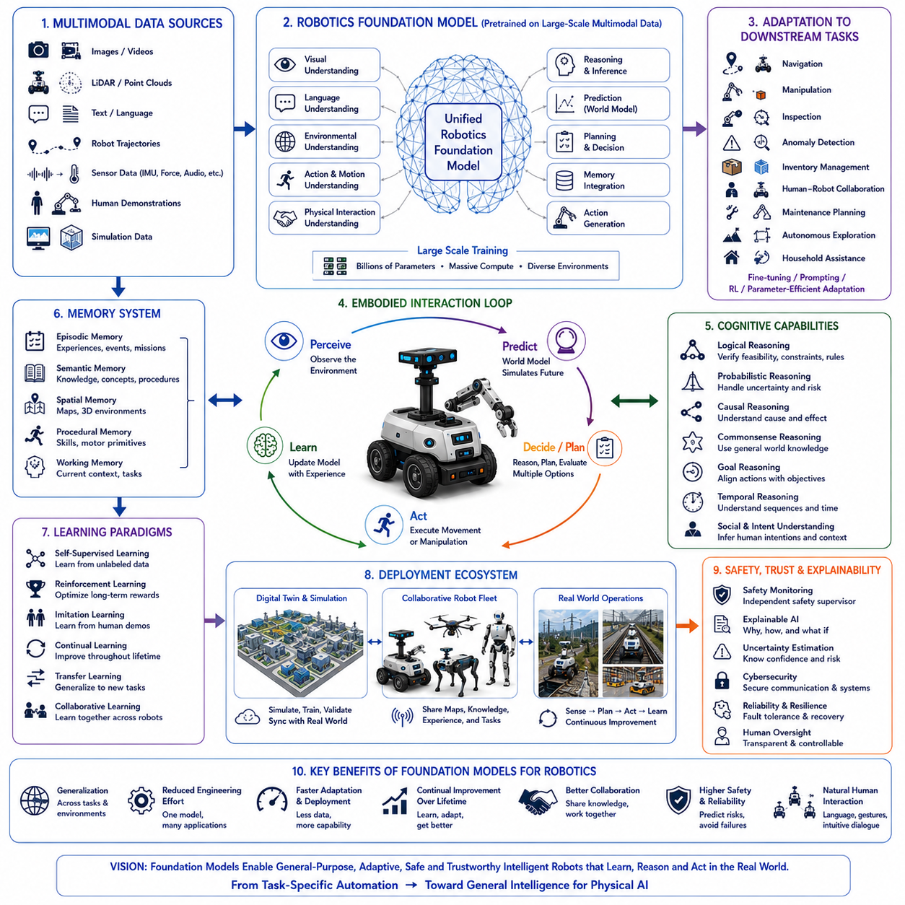
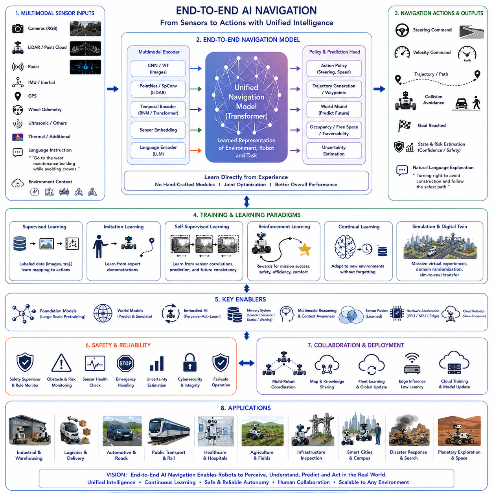
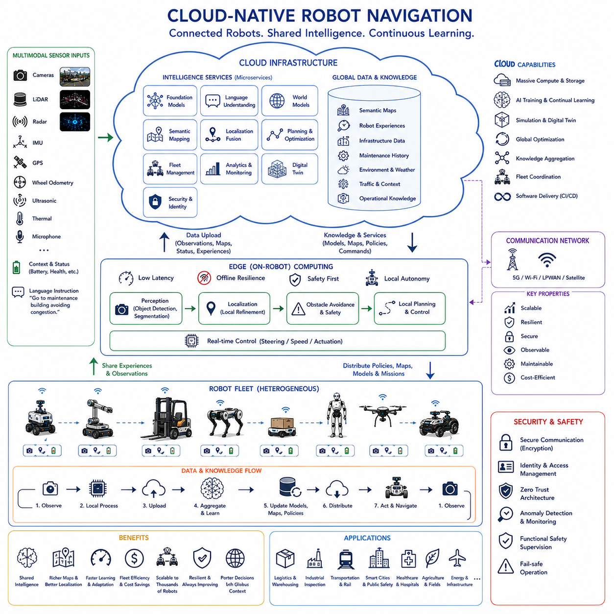
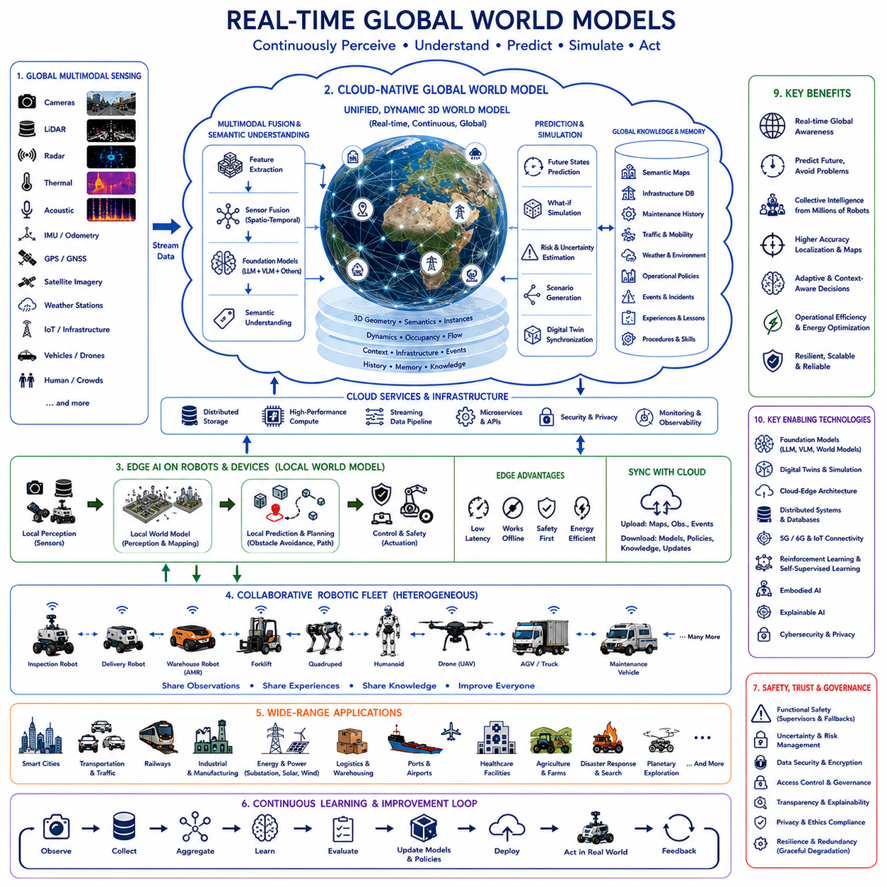
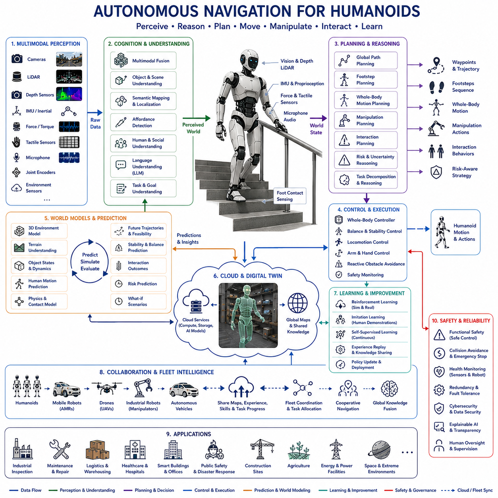
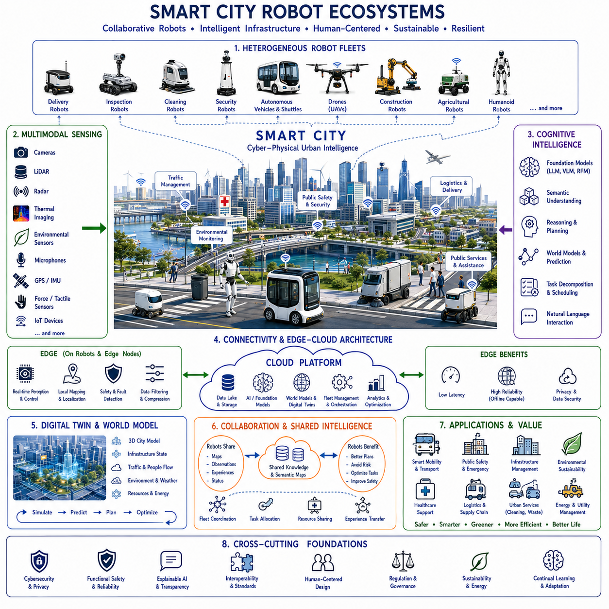
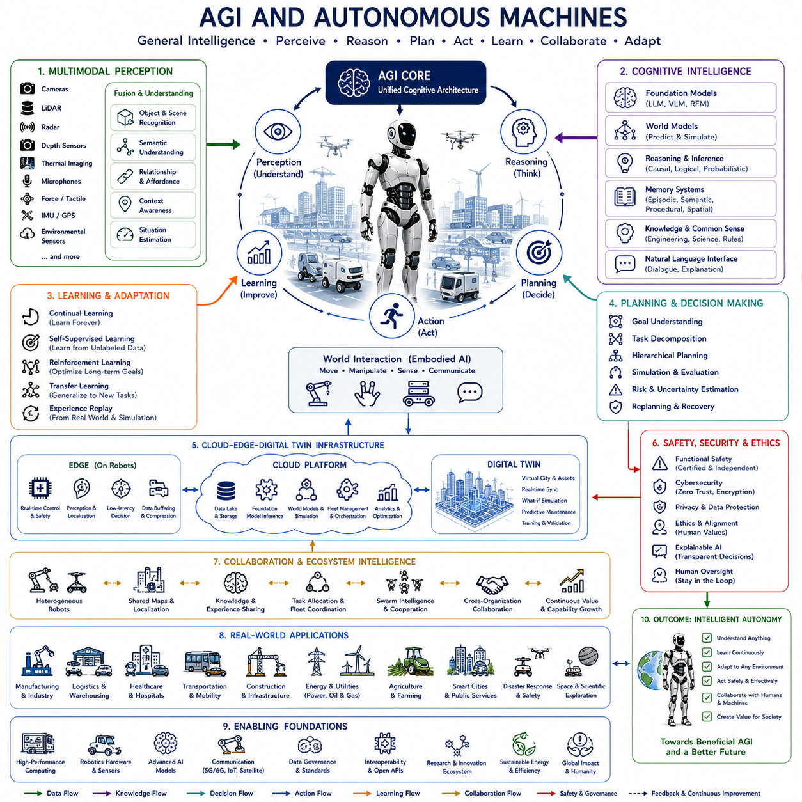
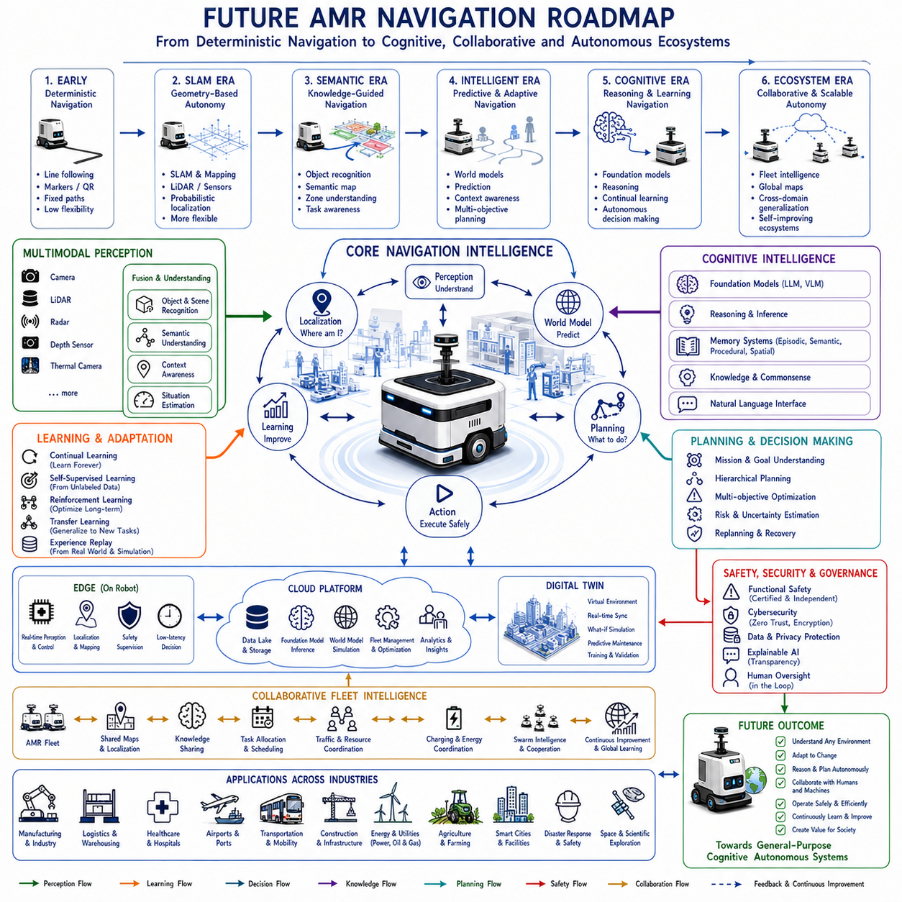

**Volume 05. Path Planning and Autonomous Navigation**


# Chapter 25. Future of Autonomous Navigation

##  

## 25.1 Foundation Models for Robotics

{width="7.268055555555556in" height="7.268055555555556in"}

Foundation models for robotics represent one of the most significant transitions in the history of autonomous systems because they transform robots from task-specific machines into general-purpose intelligent agents capable of learning, reasoning, adapting, and operating across many environments. Earlier robotic systems were typically designed for narrowly defined applications such as industrial manipulation, warehouse transportation, mobile inspection, or household cleaning. Each application required its own perception algorithms, navigation software, manipulation strategies, and control policies. These systems often performed exceptionally well within carefully engineered environments but struggled when transferred to new tasks or unfamiliar surroundings. Foundation models introduce a different paradigm in which a single large-scale model acquires broad knowledge from diverse data sources before being adapted to many downstream robotic applications.

The concept of a foundation model originates from large-scale pretraining followed by efficient adaptation. Instead of developing independent models for every robotic capability, engineers first train a general model using enormous collections of multimodal data that include images, videos, language, robot trajectories, sensor observations, simulation experiences, and human demonstrations. The resulting model develops general representations of objects, environments, actions, physical interactions, spatial relationships, and human intentions. Specific robotic tasks are then solved through fine-tuning, prompting, reinforcement learning, or parameter-efficient adaptation rather than constructing entirely new models.

Unlike conventional robotics pipelines, foundation models attempt to unify perception, language understanding, reasoning, planning, memory, prediction, and action generation inside a common computational framework. Traditional robotic architectures frequently separate localization, mapping, object detection, motion planning, manipulation planning, obstacle avoidance, and task scheduling into individual software modules. Each module communicates through predefined interfaces while optimizing only its local objective. Foundation models instead encourage shared representations across multiple cognitive functions, allowing information learned in one domain to improve performance in others.

Scale is one of the defining characteristics of foundation models. These models are trained using billions of parameters, massive computational infrastructure, and datasets collected from numerous environments. Large-scale learning enables statistical generalization beyond individual tasks. Rather than memorizing isolated examples, foundation models learn abstract representations describing geometry, semantics, physics, language, causality, and environmental dynamics. These generalized representations allow robots to perform tasks they have never encountered explicitly during training while requiring significantly less task-specific engineering.

Multimodal learning forms the core of robotics foundation models. Physical robots continuously observe the world through cameras, LiDAR, radar, inertial sensors, tactile sensing, force feedback, microphones, GPS receivers, joint encoders, torque sensors, thermal cameras, and numerous additional sensing modalities. Foundation models integrate these heterogeneous observations into unified latent representations where relationships among vision, language, motion, sound, touch, and environmental context become naturally connected. Such multimodal integration allows robots to reason more comprehensively than systems relying upon individual sensor streams.

Vision-language models have become an important precursor to robotics foundation models. These systems learn associations between visual observations and natural language descriptions by analyzing enormous image-text datasets. As a result, robots inherit semantic understanding allowing recognition of objects, activities, environments, affordances, and human intentions using ordinary language. Instead of recognizing only predefined object categories, foundation models understand broader concepts such as damaged equipment, hazardous areas, maintenance tools, emergency exits, pedestrian activity, and operational procedures.

Language becomes a universal interface connecting humans with robotic intelligence. Human operators increasingly communicate using natural conversation instead of specialized command syntax. Instructions such as "Inspect the northern transformer after checking the nearby cooling system, but avoid maintenance workers if they are present," require simultaneous language understanding, environmental grounding, temporal reasoning, semantic mapping, and task planning. Foundation models translate these high-level instructions into executable robotic behaviors while preserving contextual meaning throughout mission execution.

Embodied learning distinguishes robotics foundation models from purely language-based systems. Physical intelligence requires understanding how actions influence future observations through interaction with the environment. Robots therefore learn not only from images and text but also from movement, manipulation, force interaction, locomotion, sensorimotor feedback, and environmental response. Every executed action generates additional training information linking perception, prediction, action, and consequence. Embodied learning allows robots to understand physics through experience rather than symbolic description alone.

World models increasingly complement robotics foundation models by providing predictive simulation capability. Rather than reacting solely to current observations, robots internally predict multiple future scenarios before selecting actions. Candidate navigation routes, manipulation strategies, collaborative behaviors, inspection plans, and recovery procedures are evaluated through internal simulation. Predictive reasoning significantly improves safety, efficiency, energy management, and long-term mission success while reducing unnecessary physical experimentation.

Memory systems become substantially more powerful when integrated with foundation models. Episodic memory preserves previous missions, environmental conditions, failures, successes, and interactions. Semantic memory accumulates engineering knowledge, operational procedures, equipment characteristics, and environmental concepts. Spatial memory continuously refines semantic maps through accumulated exploration. Working memory maintains immediate conversational context and active planning information. Together these memory systems transform isolated task execution into continuous lifelong knowledge accumulation.

Generalization represents one of the primary advantages of robotics foundation models. Traditional robotic software often performs well only within environments similar to those encountered during development. Foundation models instead learn transferable knowledge supporting adaptation across factories, hospitals, warehouses, farms, smart cities, transportation systems, infrastructure inspection sites, construction environments, and domestic settings. Although domain adaptation remains necessary, prior knowledge substantially reduces retraining effort while accelerating deployment into previously unseen operational scenarios.

Transfer learning allows pretrained knowledge to support numerous downstream applications. A foundation model initially trained for object understanding may subsequently contribute to navigation, manipulation, inspection, anomaly detection, inventory management, collaborative robotics, autonomous exploration, or maintenance planning. Shared internal representations reduce computational redundancy while enabling knowledge acquired in one application domain to improve performance elsewhere.

Parameter-efficient adaptation further reduces deployment cost. Instead of retraining billions of parameters for every customer or environment, modern adaptation methods modify only small subsets of model parameters or employ lightweight adapters preserving most pretrained knowledge. This approach significantly decreases computational expense while enabling rapid customization according to industrial requirements, regulatory constraints, operational procedures, or customer-specific infrastructure.

Self-supervised learning provides enormous advantages because manually labeling robotic datasets remains expensive and time consuming. Robots naturally collect multimodal observations throughout everyday operation. Relationships among images, motion, force, language, localization, environmental dynamics, and future observations create abundant supervisory signals without requiring extensive human annotation. Foundation models exploit these naturally occurring correlations to improve continuously throughout deployment.

Reinforcement learning complements foundation model pretraining by optimizing sequential decision making. While pretraining provides broad prior knowledge, reinforcement learning refines policies according to mission objectives, safety constraints, operational efficiency, collaboration quality, and long-term reward. Large-scale simulation environments enable millions of interactions before transferring optimized behaviors toward physical robotic platforms through sim-to-real adaptation techniques.

Human demonstration remains another valuable knowledge source. Demonstration data capture expert manipulation, navigation, inspection, maintenance, assembly, and collaborative procedures. Foundation models learn general behavioral priors from diverse demonstrations rather than memorizing individual trajectories. Consequently, robots imitate underlying strategies instead of reproducing exact movements, allowing adaptation to changing environments while preserving operational objectives.

Digital twins play an increasingly important role during foundation model development. High-fidelity virtual environments generate enormous quantities of diverse robotic experience under varying weather conditions, terrain characteristics, lighting environments, infrastructure configurations, equipment failures, human activities, and communication conditions. Simulation complements physical data collection while exposing robots to rare but safety-critical situations difficult to reproduce experimentally.

Multirobot learning significantly expands available training data. Heterogeneous robots operating across factories, logistics centers, construction sites, agricultural fields, hospitals, ports, airports, and urban infrastructure collectively generate enormous experience datasets. Foundation models aggregate knowledge acquired by many robotic platforms into unified representations benefiting every participating system. Experience sharing accelerates learning while reducing redundant exploration.

Reasoning capabilities become increasingly sophisticated through foundation model architectures. Logical reasoning verifies task feasibility and procedural consistency. Probabilistic reasoning estimates uncertainty arising from perception and prediction. Causal reasoning distinguishes genuine physical relationships from statistical coincidence. Commonsense reasoning incorporates everyday environmental knowledge. Goal reasoning aligns action selection with mission objectives while balancing competing operational constraints. These complementary reasoning processes produce substantially more reliable autonomous behavior than isolated decision algorithms.

Planning evolves beyond deterministic trajectory generation toward cognitive task organization. Foundation models decompose high-level objectives into executable subtasks while continuously adapting according to changing observations. Navigation planning, manipulation planning, inspection scheduling, resource allocation, collaborative coordination, and contingency management become interconnected within unified planning architectures. Continuous replanning maintains mission progress despite unexpected environmental change.

Context awareness allows robotic behavior to remain sensitive to operational circumstances. Environmental conditions, organizational procedures, human activity, weather, battery reserves, communication quality, regulatory requirements, and mission priorities all influence behavior generation. Foundation models interpret identical instructions differently depending upon surrounding context, enabling flexible adaptation instead of rigid rule execution.

Collaborative intelligence emerges naturally because foundation models share common semantic representations among multiple robots. Information regarding navigation, object recognition, environmental hazards, infrastructure status, maintenance history, communication quality, and task allocation becomes immediately understandable across heterogeneous robotic platforms. Collaborative planning therefore requires substantially less manual interface engineering than previous distributed robotic systems.

Explainability remains essential despite increasing model complexity. Human operators require understandable explanations describing why robots selected particular actions, modified plans, requested clarification, or identified anomalies. Foundation models increasingly generate natural language explanations summarizing influential observations, uncertainty estimates, predicted consequences, safety considerations, and reasoning pathways. Transparent communication improves trust, certification, debugging, regulatory compliance, and collaborative operation.

Safety supervision remains independent of learned intelligence. Although foundation models generate increasingly capable behaviors, dedicated safety systems continue validating localization quality, actuator integrity, environmental hazards, cybersecurity status, communication reliability, sensor confidence, and operational constraints before permitting physical execution. Learned intelligence therefore operates within carefully engineered safety boundaries rather than replacing traditional functional safety mechanisms.

Evaluation of robotics foundation models requires substantially broader benchmarks than conventional robotics. Performance includes perception accuracy, language understanding, semantic grounding, navigation robustness, manipulation success, reasoning quality, planning effectiveness, memory utilization, continual learning, transfer capability, energy efficiency, collaboration quality, explainability, safety, resilience, computational efficiency, and adaptation across previously unseen environments. Comprehensive evaluation reflects integrated cognitive capability rather than isolated algorithmic performance.

A representative deployment illustrates robotics foundation models within a nationwide intelligent infrastructure management system responsible for railways, electrical substations, renewable energy facilities, industrial complexes, transportation corridors, and smart cities. Thousands of heterogeneous autonomous robots continuously collect multimodal observations including images, LiDAR scans, thermal measurements, environmental sensing, operational logs, maintenance reports, and human interactions. A unified robotics foundation model integrates these diverse experiences into shared representations supporting navigation, inspection, manipulation, anomaly detection, maintenance prediction, collaborative planning, and conversational interaction. Human operators communicate using natural language while foundation models interpret mission objectives, decompose tasks, generate adaptive plans, predict future operational states, and coordinate robotic fleets. World models evaluate candidate behaviors before execution, reducing operational risk through predictive simulation. Digital twins synchronize continuously with physical infrastructure, allowing reinforcement learning and self-supervised learning to improve behavioral policies without interrupting ongoing operations. Knowledge acquired by inspection robots immediately benefits logistics robots, maintenance robots, security robots, and collaborative mobile manipulators through common foundation model representations. Unexpected environmental changes including severe weather, infrastructure degradation, communication failures, or emergency events trigger autonomous replanning while preserving safety and mission priorities. Throughout long-term deployment, episodic memory accumulates operational experience, semantic memory expands engineering knowledge, spatial memory refines infrastructure maps, and continual learning updates model capability without catastrophic forgetting. Consequently, the robotic ecosystem becomes progressively more intelligent, reliable, adaptive, efficient, and trustworthy across years of autonomous operation.

This example demonstrates that robotics foundation models represent far more than larger neural networks. They establish a unified computational substrate connecting multimodal perception, language understanding, embodied interaction, world models, reasoning, planning, memory, continual learning, transfer learning, self-supervised adaptation, reinforcement learning, collaborative intelligence, digital twins, explainability, and safety within integrated cognitive architectures. As computational resources, multimodal datasets, simulation technology, embodied learning, world modeling, and physical AI continue advancing together, robotics foundation models will increasingly replace collections of isolated task-specific algorithms with broadly capable intelligent systems able to understand new environments, adapt through experience, collaborate naturally with humans, predict future events, and autonomously solve previously unseen problems. They will therefore become one of the fundamental technologies enabling scalable Physical AI across manufacturing, logistics, healthcare, agriculture, infrastructure inspection, transportation, disaster response, smart cities, planetary exploration, and countless future autonomous robotic applications.

로보틱스를 위한 파운데이션 모델(Foundation Models for Robotics)은 자율 시스템의 역사에서 가장 중요한 전환점 가운데 하나이다. 이는 로봇을 특정 작업만 수행하는 기계(Task-Specific Machine)에서 다양한 환경에서 학습하고, 추론하며, 적응하고, 작업을 수행할 수 있는 범용 지능형 에이전트(General-Purpose Intelligent Agent)로 변화시킨다. 기존의 로봇은 산업용 조작(Industrial Manipulation), 창고 물류(Warehouse Transportation), 이동 검사(Mobile Inspection), 가정용 서비스(Household Cleaning)와 같은 개별 응용 분야를 위해 설계되었다. 각 응용 분야마다 별도의 인지 알고리즘, 자율주행 소프트웨어, 조작 전략, 제어 정책이 필요했으며, 이러한 시스템은 잘 설계된 환경에서는 뛰어난 성능을 보였지만 새로운 작업이나 낯선 환경에서는 쉽게 성능이 저하되었다. 파운데이션 모델은 하나의 대규모 모델이 다양한 데이터로부터 폭넓은 지식을 먼저 학습한 뒤, 이를 다양한 로봇 응용 분야에 적용하는 새로운 패러다임을 제시한다.

파운데이션 모델의 핵심 개념은 대규모 사전학습(Pretraining)과 효율적인 적응(Adaptation)에 있다. 각 로봇 기능마다 별도의 모델을 개발하는 대신, 먼저 이미지(Image), 영상(Video), 언어(Language), 로봇 동작 궤적(Robot Trajectory), 센서 데이터(Sensor Observation), 시뮬레이션 경험(Simulation Experience), 사람의 시연(Human Demonstration)과 같은 방대한 멀티모달 데이터를 이용하여 하나의 범용 모델을 학습한다. 이 모델은 물체, 환경, 행동, 물리적 상호작용, 공간 관계, 사람의 의도에 대한 일반적인 표현을 학습한다. 이후 개별 로봇 작업은 새로운 모델을 처음부터 개발하는 것이 아니라 미세조정(Fine-Tuning), 프롬프팅(Prompting), 강화학습(Reinforcement Learning), 매개변수 효율적 적응(Parameter-Efficient Adaptation)을 통해 해결한다.

기존의 로보틱스 파이프라인과 달리 파운데이션 모델은 인지(Perception), 언어 이해(Language Understanding), 추론(Reasoning), 계획(Planning), 기억(Memory), 예측(Prediction), 행동 생성(Action Generation)을 하나의 공통된 계산 프레임워크 안에서 통합하려고 한다. 기존 로봇 시스템은 위치 추정(Localization), 지도 작성(Mapping), 객체 인식(Object Detection), 이동 계획(Motion Planning), 조작 계획(Manipulation Planning), 장애물 회피(Obstacle Avoidance), 작업 스케줄(Task Scheduling)을 각각 독립된 소프트웨어 모듈로 구현하였다. 각 모듈은 제한된 인터페이스를 통해서만 정보를 교환하였다. 반면 파운데이션 모델은 여러 인지 기능이 동일한 내부 표현(Shared Representation)을 공유하도록 하여 하나의 분야에서 학습한 지식이 다른 분야에도 자연스럽게 활용되도록 한다.

대규모 학습(Scale)은 파운데이션 모델의 가장 중요한 특징 가운데 하나이다. 이러한 모델은 수십억 개 이상의 파라미터(Parameter), 대규모 컴퓨팅 인프라, 그리고 다양한 환경에서 수집된 방대한 데이터셋을 이용하여 학습된다. 이러한 대규모 학습은 개별 작업을 단순히 암기하는 것이 아니라 기하학(Geometry), 의미(Semantics), 물리(Physics), 언어(Language), 인과관계(Causality), 환경 동역학(Environmental Dynamics)에 대한 추상적인 표현(Abstract Representation)을 학습하도록 한다. 이러한 일반화된 표현은 학습 중 경험하지 못한 새로운 작업에서도 적은 추가 학습만으로 높은 성능을 발휘하게 한다.

멀티모달 학습(Multimodal Learning)은 로보틱스 파운데이션 모델의 핵심을 이룬다. 실제 로봇은 카메라(Camera), 라이다(LiDAR), 레이더(Radar), 관성측정장치(IMU, Inertial Measurement Unit), 촉각 센서(Tactile Sensor), 힘 센서(Force Sensor), 마이크(Microphone), GPS, 관절 엔코더(Joint Encoder), 토크 센서(Torque Sensor), 열화상 카메라(Thermal Camera) 등 매우 다양한 센서를 사용한다. 파운데이션 모델은 이러한 이질적인 센서 정보를 하나의 잠재 표현(Latent Representation)으로 통합하여 영상, 언어, 움직임, 소리, 촉각, 환경 정보 사이의 관계를 자연스럽게 학습한다. 이러한 멀티모달 통합은 단일 센서 기반 시스템보다 훨씬 풍부한 환경 이해를 가능하게 한다.

비전-언어 모델(Vision-Language Model)은 로보틱스 파운데이션 모델의 중요한 전신(Precursor) 역할을 하였다. 이러한 모델은 방대한 이미지와 텍스트 데이터를 함께 학습하여 영상과 자연어 사이의 관계를 이해한다. 이를 통해 로봇은 미리 정의된 물체만 인식하는 것이 아니라 손상된 장비(Damaged Equipment), 위험 구역(Hazardous Area), 유지보수 도구(Maintenance Tool), 비상구(Emergency Exit), 사람의 활동(Pedestrian Activity), 운영 절차(Operation Procedure)와 같은 의미적인 개념까지 이해할 수 있게 된다.

언어(Language)는 사람과 로봇을 연결하는 보편적인 인터페이스가 된다. 운영자는 더 이상 복잡한 명령어 대신 자연어를 이용하여 로봇과 상호작용한다. 예를 들어 "근처 냉각 장치를 먼저 점검한 후 북쪽 변압기를 검사하고, 유지보수 작업자가 있으면 방해하지 말라."와 같은 명령은 언어 이해, 환경 접지(Environment Grounding), 시간 추론(Temporal Reasoning), 의미 지도(Semantic Mapping), 작업 계획(Task Planning)을 동시에 요구한다. 파운데이션 모델은 이러한 고수준 명령을 실제 실행 가능한 로봇 행동으로 변환하면서 전체 문맥을 유지한다.

체화형 학습(Embodied Learning)은 로보틱스 파운데이션 모델을 일반 언어모델과 구분하는 가장 중요한 요소이다. 물리적 지능(Physical Intelligence)은 행동(Action)이 미래의 관측(Observation)에 어떤 영향을 미치는지를 실제 환경에서 학습해야 한다. 따라서 로봇은 이미지와 텍스트뿐 아니라 이동, 조작, 힘 상호작용, 보행, 감각-운동 피드백(Sensorimotor Feedback), 환경 반응(Environmental Response)까지 함께 학습한다. 모든 행동은 인지, 예측, 행동, 결과를 연결하는 새로운 학습 데이터가 된다. 체화형 학습은 로봇이 물리를 단순한 이론이 아니라 실제 경험을 통해 이해하도록 만든다.

월드 모델(World Model)은 파운데이션 모델과 결합하여 미래 예측 능력을 제공한다. 로봇은 현재 상태만 보고 행동하지 않고 내부적으로 다양한 미래 시나리오를 예측한다. 자율주행 경로, 조작 전략, 협업 행동, 검사 계획, 복구 전략은 내부 시뮬레이션을 통해 미리 평가된다. 이러한 예측 능력은 안전성, 운영 효율, 에너지 관리, 장기적인 임무 성공률을 크게 향상시키며 불필요한 실제 시행착오를 줄여준다.

기억 시스템(Memory System)은 파운데이션 모델과 결합하면서 더욱 강력해진다. 에피소드 기억(Episodic Memory)은 과거 임무, 환경 조건, 실패 사례, 성공 사례, 상호작용을 저장한다. 의미 기억(Semantic Memory)은 공학 지식, 운영 절차, 장비 특성, 환경 개념을 저장한다. 공간 기억(Spatial Memory)은 지속적인 탐색을 통해 의미 지도를 계속 발전시킨다. 작업 기억(Working Memory)은 현재 대화와 계획에 필요한 정보를 유지한다. 이러한 다양한 기억 시스템은 단순한 작업 수행을 평생학습(Lifelong Learning) 기반의 지식 축적으로 발전시킨다.

일반화(Generalization)는 로보틱스 파운데이션 모델이 제공하는 가장 큰 장점 가운데 하나이다. 기존 로봇은 개발 과정에서 경험한 환경에서만 높은 성능을 보이는 경우가 많았다. 반면 파운데이션 모델은 공장, 병원, 창고, 농장, 스마트 시티, 교통 시스템, 사회기반시설, 건설 현장, 가정 등 다양한 환경으로 지식을 이전할 수 있다. 물론 도메인 적응(Domain Adaptation)은 여전히 필요하지만 기존 시스템보다 훨씬 적은 학습으로 새로운 환경에 빠르게 적응할 수 있다.

전이학습(Transfer Learning)은 사전학습된 지식을 다양한 응용 분야에서 활용하도록 한다. 하나의 파운데이션 모델이 객체 인식을 위해 학습되었다면 이후 자율주행, 조작, 검사, 이상 탐지, 재고 관리, 협업 로보틱스, 자율 탐사, 유지보수 계획에도 동일한 내부 표현을 활용할 수 있다. 이러한 공유 표현은 계산량을 줄이고 여러 분야에서 동시에 성능을 향상시킨다.

매개변수 효율적 적응(Parameter-Efficient Adaptation)은 실제 산업 적용 비용을 크게 줄인다. 수십억 개의 파라미터를 매번 다시 학습하는 대신 일부 작은 매개변수만 수정하거나 어댑터(Adapter)를 추가하여 대부분의 사전학습 지식을 그대로 유지한다. 이를 통해 계산 비용을 크게 줄이면서도 고객의 환경, 운영 절차, 규제 조건에 빠르게 맞춤화할 수 있다.

자기지도학습(Self-Supervised Learning)은 로보틱스 데이터 구축 비용을 크게 줄인다. 로봇은 일상적인 운영 과정에서 영상, 이동, 힘, 언어, 위치 정보, 환경 변화와 같은 방대한 데이터를 자연스럽게 수집한다. 이러한 데이터 사이의 관계는 별도의 사람이 라벨링(Labeling)하지 않아도 풍부한 학습 정보를 제공한다. 파운데이션 모델은 이러한 자연스러운 상관관계를 이용하여 실제 운영 중에도 지속적으로 성능을 향상시킨다.

강화학습(Reinforcement Learning)은 파운데이션 모델의 사전학습을 실제 행동 최적화와 연결한다. 사전학습은 일반적인 지식을 제공하고, 강화학습은 안전성, 임무 성공률, 운영 효율, 협업 품질, 장기적인 보상을 고려하여 행동 정책(Policy)을 최적화한다. 대규모 시뮬레이션은 수백만 번의 경험을 제공하며, Sim-to-Real 적응(Sim-to-Real Adaptation)을 통해 실제 로봇으로 이전된다.

사람의 시연(Human Demonstration)은 매우 중요한 학습 데이터이다. 전문가가 수행한 조작, 자율주행, 검사, 유지보수, 조립, 협업 작업은 로봇에게 일반적인 행동 원리를 학습시킨다. 파운데이션 모델은 단순히 동일한 경로를 따라 하는 것이 아니라 그 행동의 전략과 목적을 학습하므로 환경이 변해도 적응할 수 있다.

디지털 트윈(Digital Twin)은 파운데이션 모델 개발에서 점점 더 중요한 역할을 한다. 고정밀 가상 환경은 다양한 기상 조건, 지형, 조명, 시설 구조, 장비 고장, 사람의 활동, 통신 상태를 포함하는 방대한 경험을 생성한다. 시뮬레이션은 실제 데이터 수집을 보완하며 실제 환경에서 재현하기 어려운 위험한 상황까지 안전하게 학습할 수 있도록 한다.

다중 로봇 학습(Multi-Robot Learning)은 학습 데이터를 폭발적으로 증가시킨다. 공장, 물류센터, 건설 현장, 농장, 병원, 항만, 공항, 스마트 시티에서 운영되는 다양한 로봇이 동시에 방대한 데이터를 생성한다. 파운데이션 모델은 여러 로봇이 얻은 경험을 하나의 공통된 표현으로 통합하여 전체 시스템의 학습 속도를 높이고 중복 탐색을 줄인다.

추론 능력(Reasoning Capability)은 파운데이션 모델을 통해 크게 향상된다. 논리 추론(Logical Reasoning)은 작업 가능성과 절차의 일관성을 검증하고, 확률 추론(Probabilistic Reasoning)은 불확실성을 계산하며, 인과 추론(Causal Reasoning)은 진짜 원인과 단순한 상관관계를 구분한다. 상식 추론(Commonsense Reasoning)은 일반적인 환경 지식을 활용하고, 목표 추론(Goal Reasoning)은 다양한 제약 조건 속에서도 임무 목표를 유지한다. 이러한 다양한 추론 능력이 결합되어 기존 시스템보다 훨씬 신뢰성 높은 자율 행동을 생성한다.

계획(Planning)은 단순한 경로 생성에서 벗어나 인지 기반 작업 조직(Cognitive Task Organization)으로 발전한다. 파운데이션 모델은 고수준 목표를 여러 개의 세부 작업으로 분해하고, 환경 변화에 따라 지속적으로 수정한다. 자율주행, 조작, 검사 일정, 자원 배분, 협업, 비상 대응이 하나의 통합된 계획 시스템으로 연결된다. 지속적인 재계획(Continuous Replanning)은 예상하지 못한 환경 변화 속에서도 임무를 안정적으로 유지하도록 한다.

상황 인식(Context Awareness)은 현재의 운영 상황에 맞추어 행동을 생성하도록 한다. 환경 상태, 조직의 운영 절차, 사람의 활동, 기상, 배터리 상태, 통신 품질, 규제 조건, 임무 우선순위는 모두 행동 생성에 영향을 미친다. 동일한 명령이라도 상황에 따라 전혀 다른 행동을 수행할 수 있으므로 기존의 규칙 기반 시스템보다 훨씬 높은 유연성을 가진다.

협업 지능(Collaborative Intelligence)은 여러 로봇이 동일한 의미 표현을 공유하면서 자연스럽게 발전한다. 자율주행 정보, 객체 인식 결과, 위험 정보, 시설 상태, 유지보수 이력, 통신 품질, 작업 분배가 서로 쉽게 이해된다. 따라서 여러 로봇이 함께 작업하는 분산 로보틱스(Distributed Robotics)를 훨씬 쉽게 구축할 수 있다.

설명 가능성(Explainability)은 모델이 복잡해질수록 더욱 중요해진다. 운영자는 로봇이 왜 특정 행동을 선택했는지, 왜 계획을 수정했는지, 왜 추가 질문을 했는지, 왜 이상을 탐지했는지를 이해해야 한다. 파운데이션 모델은 중요한 환경 정보, 불확실성, 미래 예측, 안전 고려사항, 추론 과정을 자연어로 설명할 수 있다. 이러한 설명은 신뢰성, 인증, 디버깅, 규제 준수, 사람과의 협업을 크게 향상시킨다.

안전 관리(Safety Supervision)는 학습 기반 지능과는 독립적으로 유지된다. 파운데이션 모델이 매우 뛰어난 행동을 생성하더라도 전용 안전 시스템은 위치 추정 정확도, 액추에이터 상태, 환경 위험, 사이버 보안, 통신 품질, 센서 신뢰도를 지속적으로 확인한 뒤에만 실제 행동을 허용한다. 따라서 학습 기반 지능은 기존의 기능 안전(Function Safety)을 대체하는 것이 아니라 그 위에서 동작하게 된다.

로보틱스 파운데이션 모델의 평가는 기존보다 훨씬 다양한 항목을 포함한다. 인지 정확도, 언어 이해, 의미 접지(Semantic Grounding), 자율주행 강인성, 조작 성공률, 추론 품질, 계획 성능, 기억 활용, 지속학습, 전이학습, 에너지 효율, 협업 품질, 설명 가능성, 안전성, 회복력, 계산 효율, 새로운 환경에 대한 적응 능력을 종합적으로 평가해야 한다. 미래의 평가는 개별 알고리즘이 아니라 전체 인지 시스템(Cognitive System)의 성능을 평가하는 방향으로 발전하게 된다.

대표적인 적용 사례를 살펴보면, 철도, 변전소, 신재생 에너지 시설, 산업 단지, 교통망, 스마트 시티를 관리하는 국가 규모의 지능형 인프라 관리 시스템을 생각할 수 있다. 수천 대의 이기종 자율 로봇은 영상, 라이다, 열화상, 환경 센서, 운영 기록, 유지보수 보고서, 사람과의 상호작용 데이터를 지속적으로 수집한다. 하나의 로보틱스 파운데이션 모델은 이러한 다양한 경험을 통합하여 자율주행, 검사, 조작, 이상 탐지, 유지보수 예측, 협업 계획, 대화형 상호작용을 동시에 지원한다. 운영자는 자연어를 이용하여 임무를 지시하고, 파운데이션 모델은 목표를 이해하여 작업을 분해하고, 적응형 계획을 생성하며, 미래 상태를 예측하고, 로봇 집단을 협업시킨다. 월드 모델은 실제 행동 전에 여러 가지 행동 전략을 내부적으로 평가하여 운영 위험을 줄인다. 디지털 트윈은 실제 시설과 지속적으로 동기화되며, 강화학습과 자기지도학습은 실제 운영을 방해하지 않으면서 행동 정책을 계속 향상시킨다. 검사 로봇이 획득한 지식은 즉시 물류 로봇, 유지보수 로봇, 보안 로봇, 이동형 매니퓰레이터(Mobile Manipulator)와 공유된다. 폭우, 시설 열화, 통신 장애, 긴급 상황이 발생하면 파운데이션 모델은 자율적으로 계획을 수정하면서도 안전성과 임무 목표를 유지한다. 장기간 운영이 지속될수록 에피소드 기억은 운영 경험을 축적하고, 의미 기억은 공학 지식을 확장하며, 공간 기억은 시설 지도를 더욱 정교하게 만들고, 지속학습은 재앙적 망각(Catastrophic Forgetting) 없이 전체 시스템의 능력을 계속 향상시킨다. 결과적으로 전체 로봇 생태계는 시간이 지날수록 더욱 지능적이고, 신뢰성이 높으며, 적응력이 뛰어나고, 효율적인 방향으로 발전하게 된다.

이 사례는 로보틱스 파운데이션 모델이 단순히 더 큰 신경망이 아니라는 사실을 보여준다. 이는 멀티모달 인지(Multimodal Perception), 언어 이해(Language Understanding), 체화형 상호작용(Embodied Interaction), 월드 모델(World Model), 추론(Reasoning), 계획(Planning), 기억(Memory), 지속학습(Continual Learning), 전이학습(Transfer Learning), 자기지도 적응(Self-Supervised Adaptation), 강화학습(Reinforcement Learning), 협업 지능(Collaborative Intelligence), 디지털 트윈(Digital Twin), 설명 가능한 AI(Explainable AI), 안전 관리(Safety)을 하나의 통합된 인지 아키텍처(Cognitive Architecture)로 연결하는 공통 계산 기반(Common Computational Substrate)을 제공한다. 앞으로 컴퓨팅 자원, 멀티모달 데이터셋, 시뮬레이션 기술, 체화형 학습(Embodied Learning), 월드 모델, 물리적 인공지능(Physical AI)이 함께 발전함에 따라 로보틱스 파운데이션 모델은 개별 알고리즘의 집합을 대체하여 새로운 환경을 이해하고, 경험을 통해 적응하며, 사람과 자연스럽게 협력하고, 미래를 예측하며, 이전에 경험하지 못한 문제를 스스로 해결하는 범용 지능 시스템으로 발전하게 될 것이다. 이러한 모델은 제조, 물류, 의료, 농업, 사회기반시설 검사, 교통, 재난 대응, 스마트 시티, 우주 탐사 등 다양한 물리적 인공지능 응용 분야에서 확장 가능한 차세대 자율 로봇의 핵심 기반 기술이 될 것이다.

##  

## 25.2 End-to-End AI Navigation

{width="7.268055555555556in" height="7.268055555555556in"}

End-to-end AI navigation represents a major shift in autonomous robotics by replacing modular navigation pipelines with unified learning architectures. Instead of designing perception, localization, mapping, planning, and control independently, a single AI model learns the complete navigation process directly from experience. This approach allows robots to optimize overall navigation performance rather than improving isolated software components.

Traditional navigation systems divide the navigation problem into multiple sequential modules. Cameras and LiDAR collect observations, localization estimates the robot position, mapping constructs the environment, planning generates trajectories, and controllers execute movement. Every module has its own algorithms, interfaces, parameters, and optimization objectives. While this architecture provides interpretability and engineering flexibility, it often suffers from accumulated errors and complex system integration.

End-to-end learning removes many intermediate representations by directly mapping sensor observations to navigation actions. Images, point clouds, inertial measurements, GPS data, wheel encoders, language instructions, and environmental context become inputs to a unified neural network. The output consists of steering commands, wheel velocities, motion trajectories, navigation policies, or high-level action sequences. The model automatically learns the relationships connecting perception and control.

The motivation behind end-to-end navigation comes from biological intelligence. Humans rarely separate perception, localization, planning, and motor control into independent cognitive modules. Instead, visual perception, memory, body awareness, prediction, and movement continuously interact during navigation. Learning emerges through repeated sensorimotor experience rather than manually engineered computational pipelines. End-to-end AI attempts to capture similar principles within robotic systems.

Deep neural networks provide the computational foundation for end-to-end navigation. Convolutional neural networks extract visual features from cameras. Vision Transformers capture long-range visual relationships. Recurrent networks preserve temporal continuity. Graph neural networks model spatial structures. Multimodal transformers integrate diverse sensor information into shared latent representations supporting robust decision making across changing environments.

Sensor fusion becomes significantly more efficient because multiple sensing modalities are learned jointly rather than processed independently. Cameras, LiDAR, radar, IMU, GPS, ultrasonic sensors, thermal cameras, tactile sensing, and wheel odometry contribute complementary information. The neural network automatically determines the relative importance of each sensor according to environmental conditions, sensor reliability, and navigation objectives.

Visual navigation is one of the earliest successes of end-to-end learning. Cameras directly observe roads, corridors, obstacles, pedestrians, terrain, signs, and environmental appearance. Instead of explicitly constructing semantic maps before planning, neural networks learn navigation-relevant visual representations supporting safe movement. Visual features become optimized specifically for navigation rather than generic object recognition.

LiDAR continues to play a critical role in many end-to-end systems. Point clouds provide accurate geometric understanding independent of lighting conditions. Neural architectures process three-dimensional structures while combining them with visual appearance and motion information. The resulting representations support obstacle avoidance, free-space estimation, traversability prediction, and robust navigation under adverse weather and illumination.

Temporal learning distinguishes intelligent navigation from instantaneous perception. Navigation decisions depend upon historical observations, previous actions, accumulated experience, and future expectations. Sequential neural architectures learn temporal dependencies connecting past environmental changes with future navigation requirements. Memory therefore becomes an intrinsic component of end-to-end decision making.

Foundation models increasingly enhance end-to-end navigation through large-scale multimodal pretraining. Instead of learning navigation entirely from task-specific datasets, robots inherit broad visual, linguistic, semantic, and physical knowledge acquired from enormous multimodal corpora. Fine-tuning adapts these pretrained models toward autonomous navigation while preserving extensive prior knowledge about objects, environments, and human activities.

Language-conditioned navigation extends end-to-end learning beyond autonomous movement. Human operators specify destinations and mission objectives through natural language rather than predefined coordinate systems. Instructions such as "Move toward the western maintenance building while avoiding crowded walkways" require semantic understanding, environmental grounding, reasoning, and adaptive planning. Unified models translate language directly into executable navigation behavior.

World models further strengthen end-to-end architectures by introducing predictive reasoning. Rather than selecting actions solely according to current observations, robots internally simulate possible future outcomes before acting. Candidate navigation strategies are evaluated according to predicted safety, efficiency, energy consumption, uncertainty, and mission success. Prediction therefore complements reactive perception within unified navigation policies.

Embodied AI provides the conceptual foundation for end-to-end navigation. Intelligence emerges through interaction among perception, movement, environmental feedback, and accumulated experience. Every action changes future observations, while every observation influences subsequent actions. Learning therefore occurs within continuous perception-action loops instead of isolated computational stages. Navigation becomes an active cognitive process rather than sequential information processing.

Reinforcement learning provides one of the primary optimization methods for end-to-end navigation. Robots receive rewards according to successful mission completion, collision avoidance, energy efficiency, comfort, operational safety, and long-term task performance. Rather than manually specifying navigation rules, designers define optimization objectives while learning algorithms discover effective behavioral policies through extensive interaction with simulation and physical environments.

Imitation learning offers another efficient training strategy. Human demonstrations capture expert navigation behavior across diverse environments including warehouses, hospitals, urban streets, agricultural fields, factories, and industrial inspection sites. End-to-end models learn navigation policies directly from demonstrations, significantly reducing manual engineering while preserving human expertise within autonomous decision making.

Self-supervised learning substantially reduces dependence upon manually labeled navigation datasets. Robots naturally collect synchronized observations while operating. Consecutive images, motion estimates, inertial measurements, wheel movements, and environmental changes provide abundant supervisory signals. Neural networks learn predictive representations from these relationships without requiring expensive annotation procedures.

Simulation plays an indispensable role during end-to-end navigation development. Digital twins reproduce roads, factories, warehouses, buildings, weather, lighting, terrain, pedestrians, vehicles, and dynamic obstacles with high fidelity. Millions of navigation episodes become available before physical deployment. Domain randomization and sim-to-real adaptation subsequently transfer learned behaviors toward real robotic platforms.

Generalization remains one of the greatest research challenges. End-to-end models must operate reliably within environments never encountered during training. Differences in weather, infrastructure, lighting, sensor noise, terrain, obstacle appearance, and human behavior all influence navigation performance. Robust foundation models, extensive datasets, domain adaptation, continual learning, and multimodal sensing collectively improve generalization across unseen environments.

Interpretability presents another important challenge. Classical navigation systems expose explicit maps, trajectories, localization estimates, and planning outputs. End-to-end neural networks instead produce navigation decisions through complex internal representations that may be difficult to interpret. Explainable AI therefore becomes increasingly important for understanding decision processes, validating safety, debugging failures, and satisfying regulatory requirements.

Functional safety remains essential despite increased AI capability. Independent safety supervisors continue monitoring localization confidence, obstacle proximity, sensor integrity, actuator status, communication reliability, and emergency conditions. Learned navigation policies operate within certified safety boundaries rather than replacing conventional functional safety architectures. Safe autonomy therefore combines learned intelligence with deterministic safety verification.

Context awareness enables navigation policies to adapt according to operational circumstances. Mission objectives, battery reserves, weather conditions, traffic density, organizational priorities, human activity, regulatory constraints, and infrastructure conditions all influence navigation decisions. The same physical environment may require substantially different behavior depending upon current operational context.

Memory architectures increasingly support long-term navigation capability. Episodic memory preserves previous missions and encountered situations. Semantic memory stores environmental knowledge and operational concepts. Spatial memory continuously refines maps through repeated exploration. Working memory maintains current navigation context during real-time reasoning. Together these memory systems improve long-term autonomy through accumulated operational experience.

Collaborative navigation extends end-to-end learning toward robotic fleets. Multiple robots exchange environmental observations, semantic maps, localization information, predicted hazards, traversability estimates, and navigation experience. Knowledge acquired by one robot rapidly benefits every robot sharing the same foundation model. Fleet intelligence therefore improves much faster than isolated individual learning.

Cloud robotics further expands learning capability by combining edge intelligence with centralized knowledge sharing. Individual robots perform low-latency inference locally while periodically synchronizing experiences with cloud-based foundation models. Global updates subsequently improve navigation policies deployed across thousands of distributed robotic platforms operating within diverse environments worldwide.

Energy-aware navigation becomes naturally integrated into end-to-end optimization. Neural networks learn relationships among terrain characteristics, actuator efficiency, battery consumption, environmental resistance, computational workload, and mission duration. Navigation policies therefore optimize both mobility and resource utilization simultaneously rather than treating energy management as an independent subsystem.

Human-aware navigation receives increasing attention as robots enter shared environments. End-to-end models learn socially acceptable movement by observing human demonstrations and large-scale interaction datasets. Navigation behaviors incorporate interpersonal distance, pedestrian flow, collaborative workspaces, accessibility considerations, and implicit social conventions while maintaining operational safety.

Multimodal reasoning allows navigation decisions to combine visual appearance, geometric structure, semantic understanding, language instructions, environmental history, predictive simulation, and contextual information. Instead of depending upon isolated perception algorithms, integrated reasoning generates coherent navigation strategies considering multiple information sources simultaneously.

Continuous learning enables navigation policies to improve throughout deployment. Robots incorporate newly collected experience without catastrophic forgetting of previously acquired knowledge. New infrastructure, seasonal weather patterns, changing traffic behavior, evolving operational procedures, and emerging environmental conditions continuously refine navigation capability during real-world operation.

Hardware acceleration plays a crucial role in practical deployment. Modern GPUs, AI accelerators, specialized inference processors, edge computing platforms, and optimized neural architectures enable real-time execution of large multimodal models. Efficient inference ensures that advanced navigation intelligence satisfies strict latency, energy, and reliability requirements required by autonomous robotic systems.

Evaluation of end-to-end navigation extends beyond path accuracy alone. Comprehensive benchmarks include collision avoidance, mission completion, localization robustness, energy efficiency, computational performance, environmental adaptation, recovery capability, uncertainty estimation, human interaction quality, explanation accuracy, generalization, safety compliance, and long-term operational reliability. Integrated evaluation reflects the holistic nature of learned navigation behavior.

A representative deployment illustrates end-to-end navigation within a nationwide autonomous railway inspection network. Mobile inspection robots continuously receive synchronized camera images, LiDAR scans, IMU measurements, GPS observations, thermal imagery, weather information, infrastructure databases, maintenance schedules, and natural language mission instructions. A unified multimodal foundation model directly transforms these heterogeneous observations into navigation actions while simultaneously predicting future environmental states through an integrated world model. Rather than constructing separate localization, mapping, planning, and control pipelines, the end-to-end architecture jointly optimizes perception, reasoning, prediction, decision making, and motion generation according to mission objectives and safety constraints. Digital twins generate millions of inspection scenarios involving rain, snow, fog, damaged tracks, construction activity, communication failures, dynamic obstacles, and degraded sensor performance before deployment. Reinforcement learning refines long-term navigation strategies while self-supervised learning continuously incorporates new operational experience collected throughout daily inspections. Collaborative robotic fleets exchange semantic maps, traversability estimates, anomaly observations, and navigation knowledge through cloud robotics infrastructure. Human operators communicate using natural language while explainable AI provides transparent descriptions of navigation decisions, predicted risks, confidence estimates, and recovery strategies. Independent functional safety supervisors continuously validate every navigation command before execution. Consequently, the robotic inspection ecosystem gradually becomes more intelligent, adaptive, reliable, efficient, and trustworthy throughout years of autonomous operation.

This example demonstrates that end-to-end AI navigation represents considerably more than replacing traditional navigation software with larger neural networks. It establishes an integrated cognitive architecture combining multimodal perception, foundation models, world models, embodied intelligence, reinforcement learning, imitation learning, self-supervised learning, continual adaptation, collaborative robotics, cloud intelligence, explainable AI, functional safety, and lifelong learning into unified navigation systems. As robotics foundation models, multimodal reasoning, digital twins, embodied AI, hardware acceleration, predictive world models, and Physical AI continue advancing together, end-to-end navigation will increasingly replace fragmented software pipelines with holistic cognitive systems capable of understanding complex environments, adapting through experience, collaborating naturally with humans, predicting future situations, and autonomously navigating across manufacturing, logistics, healthcare, transportation, agriculture, infrastructure inspection, disaster response, smart cities, planetary exploration, and numerous future autonomous robotic applications. End-to-end AI navigation will therefore become one of the central enabling technologies supporting the next generation of intelligent Physical AI systems.

종단간 AI 자율주행(End-to-End AI Navigation)은 기존의 모듈형 자율주행 구조를 하나의 통합된 학습 구조로 대체하는 자율 로보틱스의 중요한 발전 방향이다. 기존처럼 인지(Perception), 위치 추정(Localization), 지도 작성(Mapping), 경로 계획(Planning), 제어(Control)를 각각 독립적으로 설계하는 대신, 하나의 AI 모델이 실제 경험을 통해 전체 자율주행 과정을 직접 학습한다. 이러한 접근은 개별 소프트웨어 모듈이 아니라 전체 자율주행 성능을 최적화하도록 한다.

기존 자율주행 시스템은 여러 개의 순차적인 모듈로 구성된다. 카메라와 라이다(LiDAR)는 환경을 관측하고, 위치 추정은 로봇의 위치를 계산하며, 지도 생성은 환경을 표현하고, 경로 계획은 이동 경로를 생성하며, 제어기는 실제 움직임을 수행한다. 각 모듈은 서로 다른 알고리즘과 인터페이스, 파라미터, 최적화 목표를 가진다. 이러한 구조는 해석 가능성과 개발의 유연성을 제공하지만, 모듈 간 오차가 누적되고 시스템 통합이 복잡해지는 문제가 발생한다.

종단간 학습(End-to-End Learning)은 이러한 중간 표현을 최소화하고 센서 정보에서 자율주행 행동까지 직접 연결한다. 카메라 영상, 포인트 클라우드(Point Cloud), 관성측정장치(IMU, Inertial Measurement Unit), GPS, 휠 엔코더(Wheel Encoder), 자연어 명령, 환경 정보가 하나의 신경망 입력이 된다. 출력은 조향 명령(Steering Command), 바퀴 속도, 이동 궤적(Motion Trajectory), 자율주행 정책(Navigation Policy), 또는 고수준 행동(Action Sequence)이 된다. 모델은 인지와 제어 사이의 관계를 스스로 학습한다.

종단간 자율주행의 기본 아이디어는 생물학적 지능(Biological Intelligence)에서 비롯되었다. 사람은 시각, 위치 추정, 계획, 운동 제어를 완전히 독립된 과정으로 수행하지 않는다. 시각 정보, 기억, 신체 인식, 미래 예측, 움직임은 지속적으로 상호작용한다. 학습은 사람이 직접 알고리즘을 설계하는 것이 아니라 반복적인 감각-운동 경험(Sensorimotor Experience)을 통해 이루어진다. 종단간 AI는 이러한 원리를 로봇 시스템에 적용하려고 한다.

심층 신경망(Deep Neural Network)은 종단간 자율주행의 계산 기반을 제공한다. 합성곱 신경망(CNN, Convolutional Neural Network)은 영상 특징을 추출하고, 비전 트랜스포머(Vision Transformer)는 장거리 시각 관계를 학습한다. 순환 신경망(Recurrent Neural Network)은 시간 정보를 유지하고, 그래프 신경망(Graph Neural Network)은 공간 구조를 표현한다. 멀티모달 트랜스포머(Multimodal Transformer)는 다양한 센서 정보를 하나의 잠재 표현(Latent Representation)으로 통합하여 안정적인 의사결정을 지원한다.

센서 융합(Sensor Fusion)은 여러 센서를 각각 독립적으로 처리하는 대신 하나의 모델에서 동시에 학습되므로 훨씬 효율적이다. 카메라(Camera), 라이다(LiDAR), 레이더(Radar), IMU, GPS, 초음파 센서(Ultrasonic Sensor), 열화상 카메라(Thermal Camera), 촉각 센서(Tactile Sensor), 휠 오도메트리(Wheel Odometry)는 서로 보완적인 정보를 제공한다. 신경망은 환경 조건과 센서 신뢰도에 따라 어떤 센서가 더 중요한지를 스스로 학습한다.

영상 기반 자율주행(Visual Navigation)은 종단간 학습이 가장 먼저 성공한 분야 가운데 하나이다. 카메라는 도로, 복도, 장애물, 사람, 지형, 표지판, 환경의 외형을 직접 관찰한다. 기존처럼 의미 지도(Semantic Map)를 먼저 생성하는 것이 아니라 신경망이 자율주행에 필요한 시각 표현을 직접 학습한다. 이러한 특징은 일반적인 객체 인식이 아니라 안전한 자율주행을 위해 최적화된다.

라이다(LiDAR)는 종단간 시스템에서도 여전히 중요한 역할을 한다. 포인트 클라우드는 조명에 영향을 거의 받지 않는 정확한 3차원 기하 정보를 제공한다. 신경망은 이러한 3차원 구조를 영상과 움직임 정보와 함께 학습하여 장애물 회피(Obstacle Avoidance), 자유 공간(Free Space), 이동 가능성(Traversability), 악천후 환경에서의 안정적인 자율주행을 지원한다.

시간 기반 학습(Temporal Learning)은 순간적인 인지와 지능형 자율주행을 구분하는 핵심 요소이다. 자율주행은 현재 정보뿐 아니라 과거의 관측, 이전 행동, 누적된 경험, 미래의 예상까지 함께 고려해야 한다. 순차 신경망(Sequential Neural Network)은 과거 환경 변화와 미래의 자율주행 요구사항 사이의 시간적 관계를 학습한다. 따라서 기억(Memory)은 종단간 의사결정의 중요한 구성 요소가 된다.

파운데이션 모델(Foundation Model)은 대규모 멀티모달 사전학습을 통해 종단간 자율주행을 더욱 발전시키고 있다. 기존에는 자율주행 데이터만 이용하여 학습했지만, 이제는 이미지, 언어, 의미 정보, 물리적 상호작용을 포함하는 방대한 데이터를 먼저 학습한 후 자율주행에 맞게 미세조정(Fine-Tuning)한다. 이를 통해 새로운 환경에서도 일반화 성능이 크게 향상된다.

언어 조건 기반 자율주행(Language-Conditioned Navigation)은 종단간 학습을 이동 제어를 넘어 사람과의 협업으로 확장한다. 사람은 좌표를 입력하는 대신 자연어로 목적지와 임무를 전달한다. 예를 들어 "사람이 많은 보행로를 피하면서 서쪽 유지보수 건물로 이동하라."와 같은 명령은 의미 이해, 환경 접지(Environment Grounding), 추론, 적응형 계획을 동시에 요구한다. 통합된 모델은 이러한 언어를 직접 자율주행 행동으로 변환한다.

월드 모델(World Model)은 미래 예측 기능을 추가하여 종단간 구조를 더욱 강화한다. 로봇은 현재 상태만 보고 행동을 결정하는 것이 아니라 내부적으로 여러 미래 상황을 시뮬레이션한다. 각각의 이동 전략은 안전성, 효율성, 에너지 소비, 불확실성, 임무 성공률을 기준으로 평가된다. 따라서 예측(Prediction)은 반응형 인지(Reactive Perception)를 보완하는 중요한 요소가 된다.

체화형 인공지능(Embodied AI)은 종단간 자율주행의 개념적 기반을 제공한다. 지능은 인지, 움직임, 환경 피드백, 경험의 상호작용을 통해 형성된다. 모든 행동은 미래의 환경 정보를 변화시키고, 모든 관측은 다음 행동에 영향을 준다. 따라서 학습은 독립적인 계산 단계가 아니라 지속적인 인지-행동 순환(Perception-Action Loop)을 통해 이루어진다. 자율주행은 단순한 정보 처리 과정이 아니라 능동적인 인지 과정이 된다.

강화학습(Reinforcement Learning)은 종단간 자율주행을 최적화하는 대표적인 방법이다. 로봇은 임무 성공, 충돌 회피, 에너지 효율, 승차감, 안전성, 장기적인 임무 성과에 따라 보상(Reward)을 받는다. 개발자는 세부적인 규칙을 직접 설계하지 않고 최적화 목표만 정의하며, AI는 시뮬레이션과 실제 환경에서 반복적인 경험을 통해 가장 효과적인 자율주행 정책을 스스로 학습한다.

모방학습(Imitation Learning)은 또 다른 효율적인 학습 방법이다. 전문가가 수행한 자율주행 데이터는 창고, 병원, 도시, 농업, 공장, 산업 검사 현장과 같은 다양한 환경에서 축적된다. 종단간 모델은 이러한 사람의 행동을 직접 학습하여 복잡한 규칙을 사람이 일일이 작성하지 않아도 전문가 수준의 행동을 수행할 수 있다.

자기지도학습(Self-Supervised Learning)은 사람이 직접 라벨링(Labeling)한 자율주행 데이터에 대한 의존성을 크게 줄인다. 로봇은 운영 과정에서 연속적인 영상, 이동 정보, IMU, 휠 움직임, 환경 변화를 자연스럽게 수집한다. 이러한 데이터 사이의 관계는 매우 풍부한 학습 정보를 제공하므로 별도의 수작업 데이터 구축 없이도 지속적으로 학습할 수 있다.

시뮬레이션(Simulation)은 종단간 자율주행 개발에서 필수적인 역할을 한다. 디지털 트윈(Digital Twin)은 도로, 공장, 창고, 건물, 기상, 조명, 지형, 사람, 차량, 동적 장애물을 매우 현실적으로 재현한다. 실제 환경에 적용하기 전에 수백만 번의 자율주행 경험을 생성할 수 있으며, 도메인 랜덤화(Domain Randomization)와 Sim-to-Real 적응(Sim-to-Real Adaptation)을 통해 실제 로봇으로 이전된다.

일반화(Generalization)는 종단간 자율주행이 해결해야 할 가장 중요한 연구 과제 가운데 하나이다. AI는 학습하지 않은 새로운 환경에서도 안정적으로 동작해야 한다. 기상, 시설 구조, 조명, 센서 잡음, 지형, 장애물, 사람의 행동은 모두 자율주행 성능에 영향을 준다. 강력한 파운데이션 모델, 대규모 데이터셋, 도메인 적응(Domain Adaptation), 지속학습(Continual Learning), 멀티모달 센서가 이러한 일반화 성능을 향상시킨다.

해석 가능성(Interpretability)은 또 다른 중요한 연구 과제이다. 기존 시스템은 지도, 경로, 위치 추정, 계획 결과를 명확하게 보여준다. 반면 종단간 신경망은 복잡한 내부 표현을 이용하여 의사결정을 수행하므로 그 과정을 이해하기 어렵다. 따라서 설명 가능한 AI(Explainable AI)는 의사결정 과정의 이해, 안전성 검증, 디버깅(Debugging), 규제 준수를 위해 점점 더 중요해지고 있다.

기능 안전(Functional Safety)은 AI가 발전해도 반드시 유지되어야 한다. 독립적인 안전 감시기(Safety Supervisor)는 위치 추정 신뢰도, 장애물 거리, 센서 상태, 액추에이터 상태, 통신 품질, 비상 상황을 지속적으로 감시한다. 종단간 AI는 기존 기능 안전 시스템을 대체하는 것이 아니라 안전 경계(Safety Boundary) 안에서 동작한다.

상황 인식(Context Awareness)은 현재의 운영 상황에 따라 자율주행 정책을 변경하도록 한다. 임무 목표, 배터리 상태, 기상 조건, 교통량, 조직의 우선순위, 사람의 활동, 규제 조건, 시설 상태는 모두 자율주행 행동에 영향을 준다. 따라서 동일한 환경이라도 상황에 따라 서로 다른 행동을 수행할 수 있다.

기억 구조(Memory Architecture)는 장기적인 자율주행 능력을 향상시킨다. 에피소드 기억(Episodic Memory)은 과거의 임무와 경험을 저장하고, 의미 기억(Semantic Memory)은 환경과 운영 지식을 저장하며, 공간 기억(Spatial Memory)은 반복적인 탐색을 통해 지도를 계속 발전시키고, 작업 기억(Working Memory)은 현재 자율주행에 필요한 정보를 유지한다. 이러한 기억 구조는 시간이 지날수록 자율성을 향상시킨다.

협업 자율주행(Collaborative Navigation)은 종단간 학습을 로봇 집단(Fleet)으로 확장한다. 여러 로봇은 환경 정보, 의미 지도, 위치 정보, 위험 지역, 이동 가능성, 자율주행 경험을 서로 공유한다. 하나의 로봇이 획득한 지식은 동일한 파운데이션 모델을 사용하는 모든 로봇에 즉시 활용된다. 따라서 집단 전체의 학습 속도가 크게 향상된다.

클라우드 로보틱스(Cloud Robotics)는 엣지 AI와 중앙 학습을 결합한다. 개별 로봇은 현장에서 실시간 추론을 수행하고, 운영 경험을 클라우드 기반 파운데이션 모델과 주기적으로 동기화한다. 이후 전체 로봇 시스템은 업데이트된 정책을 다시 다운로드하여 수천 대의 로봇이 동시에 성능을 향상시킨다.

에너지 인식 자율주행(Energy-Aware Navigation)은 종단간 최적화 안에 자연스럽게 포함된다. 신경망은 지형 특성, 액추에이터 효율, 배터리 소비, 환경 저항, 계산량, 임무 시간을 함께 학습한다. 따라서 이동 효율과 에너지 관리가 하나의 통합된 목표로 최적화된다.

사람 중심 자율주행(Human-Aware Navigation)은 사람이 존재하는 환경에서 더욱 중요해진다. 종단간 모델은 사람의 시연과 대규모 상호작용 데이터를 학습하여 사회적으로 자연스러운 이동을 수행한다. 사람과의 거리, 보행 흐름, 협업 공간, 접근성, 사회적 규범을 고려하면서도 안전성을 유지한다.

멀티모달 추론(Multimodal Reasoning)은 영상, 기하 구조, 의미 정보, 언어 명령, 환경 이력, 미래 예측, 상황 정보를 함께 이용하여 자율주행을 수행한다. 각각의 알고리즘이 독립적으로 동작하는 것이 아니라 모든 정보를 동시에 고려하여 하나의 일관된 이동 전략을 생성한다.

지속학습(Continual Learning)은 실제 운영 중에도 자율주행 정책을 계속 향상시킨다. 새로운 시설, 계절 변화, 교통 패턴, 운영 절차, 환경 변화는 지속적으로 모델을 개선한다. 동시에 기존에 학습한 지식을 잃지 않도록 재앙적 망각(Catastrophic Forgetting)을 방지한다.

하드웨어 가속(Hardware Acceleration)은 실제 종단간 자율주행을 가능하게 하는 중요한 요소이다. 최신 GPU, AI 가속기(AI Accelerator), 전용 추론 프로세서(Inference Processor), 엣지 컴퓨팅 플랫폼은 대규모 멀티모달 모델을 실시간으로 실행한다. 이러한 계산 성능은 자율 시스템이 요구하는 짧은 지연시간(Latency), 낮은 전력 소비, 높은 신뢰성을 만족시킨다.

종단간 자율주행의 평가는 단순한 경로 정확도만으로 이루어지지 않는다. 충돌 회피, 임무 완료율, 위치 추정 강인성, 에너지 효율, 계산 성능, 환경 적응 능력, 복구 능력, 불확실성 추정, 사람과의 상호작용, 설명 가능성, 일반화 성능, 안전 규정 준수, 장기적인 운영 신뢰성을 모두 함께 평가해야 한다. 이러한 종합 평가는 학습 기반 자율주행의 전체적인 성능을 반영한다.

대표적인 적용 사례를 살펴보면 전국 규모의 철도 자율 검사 시스템을 생각할 수 있다. 이동형 검사 로봇은 카메라 영상, 라이다 데이터, IMU, GPS, 열화상, 기상 정보, 철도 데이터베이스, 유지보수 일정, 자연어 명령을 동시에 입력받는다. 하나의 멀티모달 파운데이션 모델(Multimodal Foundation Model)은 이러한 다양한 입력을 직접 자율주행 행동으로 변환하면서 내부 월드 모델(World Model)을 이용해 미래 환경까지 예측한다. 기존처럼 위치 추정, 지도 생성, 계획, 제어를 각각 수행하는 것이 아니라 하나의 종단간 구조가 인지, 추론, 예측, 의사결정, 이동 생성 전체를 안전성과 임무 목표에 맞추어 동시에 최적화한다. 디지털 트윈은 비, 눈, 안개, 손상된 선로, 공사 구역, 통신 장애, 동적 장애물, 센서 열화를 포함하는 수백만 개의 시나리오를 생성한다. 강화학습은 장기적인 이동 전략을 최적화하고, 자기지도학습은 실제 운영 중 수집되는 새로운 데이터를 지속적으로 반영한다. 여러 검사 로봇은 의미 지도, 이동 가능성, 이상 정보, 자율주행 경험을 클라우드를 통해 서로 공유한다. 운영자는 자연어를 이용하여 로봇과 대화하고, 설명 가능한 AI는 이동 경로 선택 이유, 위험도, 신뢰도, 복구 전략을 사람에게 투명하게 설명한다. 독립적인 기능 안전 시스템은 모든 이동 명령을 실행 전에 검증한다. 결과적으로 전체 철도 검사 생태계는 시간이 지날수록 더욱 지능적이고, 적응력이 뛰어나며, 신뢰성이 높고, 효율적인 방향으로 발전하게 된다.

이 사례는 종단간 AI 자율주행이 단순히 기존 자율주행 소프트웨어를 더 큰 신경망으로 대체하는 것이 아님을 보여준다. 이는 멀티모달 인지(Multimodal Perception), 파운데이션 모델(Foundation Model), 월드 모델(World Model), 체화형 인공지능(Embodied AI), 강화학습(Reinforcement Learning), 모방학습(Imitation Learning), 자기지도학습(Self-Supervised Learning), 지속적 적응(Continual Adaptation), 협업 로보틱스(Collaborative Robotics), 클라우드 지능(Cloud Intelligence), 설명 가능한 AI(Explainable AI), 기능 안전(Functional Safety), 평생학습(Lifelong Learning)을 하나의 통합된 자율주행 아키텍처로 결합하는 기술이다. 앞으로 로보틱스 파운데이션 모델(Robotics Foundation Model), 멀티모달 추론(Multimodal Reasoning), 디지털 트윈(Digital Twin), 체화형 AI(Embodied AI), 하드웨어 가속(Hardware Acceleration), 예측형 월드 모델(Predictive World Model), 물리적 인공지능(Physical AI)이 함께 발전함에 따라 종단간 AI 자율주행은 기존의 분리된 소프트웨어 구조를 대체하는 핵심 기술이 될 것이다. 미래의 로봇은 복잡한 환경을 이해하고, 경험을 통해 지속적으로 적응하며, 사람과 자연스럽게 협력하고, 미래를 예측하며, 제조, 물류, 의료, 운송, 농업, 사회기반시설 검사, 재난 대응, 스마트 시티, 우주 탐사 등 다양한 분야에서 이전에 경험하지 못한 문제까지 스스로 해결하는 차세대 지능형 물리적 인공지능(Physical AI) 시스템으로 발전하게 될 것이다. 종단간 AI 자율주행은 이러한 미래 자율 로보틱스를 가능하게 하는 가장 핵심적인 기반 기술 가운데 하나가 될 것이다.

##  

## 25.3 Cloud-Native Robot Navigation

{width="7.268055555555556in" height="7.268055555555556in"}

Cloud-native robot navigation represents the convergence of cloud computing, distributed intelligence, edge AI, robotics, and autonomous navigation into a unified computing paradigm. Rather than treating each robot as an isolated autonomous machine, cloud-native navigation views every robot as part of a continuously connected intelligent ecosystem where perception, planning, learning, mapping, optimization, and fleet coordination are shared across distributed computing resources. This architecture allows robots to benefit from collective intelligence while maintaining real-time autonomy at the edge.

Traditional autonomous navigation systems perform nearly all computation onboard the robot. Localization, perception, mapping, obstacle avoidance, planning, and control are executed using embedded processors installed inside individual robots. Although this architecture minimizes communication dependency, computational resources remain limited, knowledge sharing is difficult, and updating navigation capabilities across large robotic fleets requires considerable engineering effort. Cloud-native navigation addresses these limitations by distributing intelligence across edge devices, cloud infrastructure, and robotic platforms.

The cloud-native philosophy originates from modern software engineering principles including microservices, containerization, scalability, continuous deployment, distributed computing, and service-oriented architecture. Rather than implementing navigation as one monolithic application, navigation capabilities become collections of loosely coupled services that communicate through standardized APIs. Individual services evolve independently while remaining interoperable across heterogeneous robotic platforms.

Cloud computing provides virtually unlimited computational resources supporting robotics workloads impossible to execute entirely onboard mobile robots. Large foundation models, world models, digital twins, reinforcement learning, semantic mapping, multimodal reasoning, predictive analytics, and fleet optimization require substantial computational power. Cloud infrastructure enables these advanced capabilities while reducing hardware complexity on individual robots.

Edge computing complements cloud computing by executing latency-sensitive operations close to physical robots. Obstacle avoidance, emergency braking, local perception, motion control, localization refinement, and safety supervision continue operating on onboard computers even when communication with cloud services becomes temporarily unavailable. Cloud-native navigation therefore balances centralized intelligence with decentralized autonomy according to operational requirements.

Hybrid intelligence emerges naturally through cloud-edge collaboration. Immediate decisions requiring millisecond responses remain at the edge, while computationally intensive reasoning, long-term planning, global optimization, knowledge integration, and model training execute within cloud infrastructure. This division allows robots to achieve both real-time responsiveness and large-scale cognitive capability without sacrificing operational safety.

Cloud-native navigation continuously synchronizes knowledge among distributed robotic fleets. Every robot contributes newly acquired environmental observations, semantic maps, localization corrections, obstacle information, traversability estimates, infrastructure updates, and operational experience. Shared cloud services aggregate this information into continuously improving global knowledge bases benefiting every connected robotic platform.

Semantic mapping becomes significantly richer within cloud-native systems. Instead of maintaining isolated local maps, robots collaboratively construct large-scale semantic representations covering factories, hospitals, warehouses, ports, airports, campuses, transportation systems, industrial facilities, smart cities, and public infrastructure. Individual observations contribute to continuously evolving shared maps incorporating geometry, semantics, operational knowledge, maintenance history, environmental conditions, and accessibility information.

Collaborative localization improves positioning accuracy through distributed knowledge sharing. Multiple robots simultaneously observe overlapping environments while exchanging localization estimates, landmark observations, sensor corrections, and map updates. Cloud services integrate these observations into globally consistent localization frameworks supporting robust navigation even within complex or GPS-denied environments.

Fleet management becomes tightly integrated with navigation rather than existing as a separate supervisory system. Cloud-native architectures simultaneously optimize robot assignments, navigation routes, charging schedules, traffic management, mission priorities, maintenance planning, communication resources, and operational efficiency. Navigation therefore becomes part of comprehensive fleet intelligence rather than isolated path planning.

Foundation models benefit enormously from cloud-native deployment. Large multimodal models frequently exceed the computational capacity available on embedded robotic hardware. Cloud services host these foundation models while edge systems execute lightweight inference, caching, or distilled versions supporting low-latency operation. Continuous synchronization maintains consistency between centralized intelligence and distributed robotic execution.

Language-guided navigation naturally fits cloud-native architectures because natural language understanding frequently requires large language models and extensive knowledge bases. Human operators communicate with robots using conversational language while cloud-hosted foundation models interpret instructions, resolve ambiguity, retrieve operational knowledge, and generate high-level navigation objectives subsequently refined by edge navigation systems.

World models become significantly more capable through cloud-native computing. Large-scale predictive simulations evaluate weather evolution, traffic patterns, infrastructure degradation, pedestrian movement, equipment failures, environmental hazards, communication quality, and resource availability. Predictive reasoning generated in the cloud continuously informs local navigation decisions executed at the robotic edge.

Digital twins represent one of the strongest applications of cloud-native robotics. Virtual replicas continuously synchronize with physical environments using sensor data collected by distributed robotic fleets. Every navigation mission updates the digital twin while simulated experiences improve navigation policies before deployment. Physical and virtual environments therefore evolve together within continuous feedback loops.

Continuous learning becomes practical through cloud-native infrastructure. Individual robots collect multimodal operational experience during everyday navigation. These experiences synchronize with centralized learning systems where reinforcement learning, self-supervised learning, imitation learning, and foundation model adaptation continuously improve navigation capability. Updated policies subsequently propagate throughout the robotic fleet without requiring manual software installation.

Model deployment becomes significantly more efficient using cloud-native DevOps methodologies. Navigation software, perception models, localization algorithms, planning services, and reasoning modules are continuously tested, validated, versioned, monitored, and deployed using automated software pipelines. New navigation capabilities therefore become available rapidly while preserving operational stability through staged rollout procedures.

Microservice architectures improve maintainability and scalability. Navigation functionality becomes separated into localization services, semantic mapping services, route planning services, traffic coordination services, perception services, language services, fleet management services, diagnostic services, monitoring services, and analytics services. Independent development teams evolve these components without disrupting overall system integration.

Containerization further simplifies deployment across heterogeneous robotic hardware. Containers encapsulate navigation services together with required software libraries, runtime dependencies, operating environments, and communication interfaces. Robots with different processors, operating systems, or hardware configurations therefore execute identical navigation services while minimizing compatibility challenges.

Service discovery enables robots to dynamically locate available cloud services during operation. Navigation systems automatically identify localization servers, mapping services, semantic databases, language processing modules, optimization engines, and fleet coordinators according to network availability and operational requirements. Dynamic service allocation significantly increases system flexibility within changing computational environments.

Distributed databases store continuously evolving navigation knowledge. Maps, trajectories, infrastructure descriptions, maintenance records, environmental observations, traffic statistics, operational logs, and robot experiences become accessible across the entire robotic ecosystem. Consistent distributed storage ensures every authorized robotic platform benefits from accumulated organizational knowledge.

Streaming data pipelines enable continuous information exchange among robots and cloud infrastructure. Sensor observations, navigation status, anomaly reports, localization updates, mission progress, battery condition, communication quality, and environmental changes stream continuously through event-driven architectures supporting near real-time decision making across distributed robotic fleets.

Observability becomes increasingly important within cloud-native robotics. Monitoring systems continuously evaluate navigation latency, localization accuracy, communication performance, service availability, computational utilization, hardware health, anomaly frequency, safety interventions, model confidence, and operational efficiency. Comprehensive observability simplifies debugging while improving reliability and predictive maintenance.

Cybersecurity receives greater attention because cloud-native robots continuously exchange operational information across communication networks. Secure authentication, encrypted communication, access control, software integrity verification, intrusion detection, identity management, zero-trust networking, and continuous security monitoring become essential components of cloud-native navigation infrastructure protecting both robotic platforms and organizational assets.

Resilience remains fundamental despite increasing cloud dependency. Cloud-native navigation never assumes perfect communication availability. Robots continue safe operation using onboard perception, localization, planning, and control whenever connectivity becomes degraded. Cloud services enhance capability without becoming mandatory for immediate operational safety. Graceful degradation therefore becomes a defining architectural principle.

Context-aware navigation benefits from cloud-scale information integration. Weather forecasts, infrastructure maintenance schedules, temporary construction zones, pedestrian density, logistics demand, organizational priorities, emergency events, regulatory changes, and energy pricing all become available to navigation systems through cloud services. Robots therefore make decisions using substantially richer contextual information than locally observable environments alone.

Collaborative intelligence expands beyond navigation itself. Robots performing logistics, inspection, maintenance, cleaning, delivery, healthcare, agriculture, construction, and security all contribute useful environmental knowledge supporting collective navigation. Shared semantic understanding transforms independently operating robots into cooperative intelligent ecosystems continuously improving through mutual experience.

Cloud-native navigation also supports heterogeneous robotic fleets. Mobile manipulators, autonomous forklifts, quadrupeds, humanoids, warehouse robots, outdoor inspection vehicles, drones, and service robots share common cloud infrastructure despite possessing different mobility mechanisms and operational objectives. Unified navigation services reduce software duplication while encouraging knowledge transfer across robotic domains.

Energy optimization becomes more sophisticated because cloud infrastructure maintains global awareness of fleet activity. Charging station availability, mission urgency, traffic congestion, battery degradation, electricity pricing, and operational priorities collectively influence navigation planning. Fleet-wide optimization therefore improves resource utilization while extending operational lifetime.

Explainable AI integrates naturally into cloud-native systems because cloud infrastructure stores historical observations, planning decisions, reasoning traces, uncertainty estimates, and operational context. Human operators receive understandable explanations describing why navigation policies changed, why routes were modified, why tasks were reassigned, and how environmental observations influenced decision making. Transparent explanations improve trust and operational accountability.

Scalability distinguishes cloud-native navigation from earlier robotic architectures. Organizations no longer redesign software when expanding from ten robots to thousands. Elastic cloud infrastructure dynamically allocates computational resources according to fleet size, workload, environmental complexity, and operational demand. Navigation capability therefore grows proportionally with robotic deployment while maintaining consistent architectural principles.

Evaluation of cloud-native navigation extends beyond conventional navigation metrics. Performance includes cloud latency, edge responsiveness, synchronization efficiency, service availability, scalability, distributed consistency, collaborative mapping accuracy, fleet coordination quality, communication robustness, cybersecurity resilience, software deployment efficiency, model update reliability, operational continuity, and long-term organizational learning in addition to traditional navigation success and safety.

A representative deployment illustrates cloud-native navigation within a nationwide intelligent transportation and infrastructure management network supervising railways, electrical substations, renewable energy facilities, logistics hubs, industrial complexes, ports, airports, and smart cities. Thousands of heterogeneous autonomous robots continuously collect multimodal sensor observations while executing local perception, localization, obstacle avoidance, and safety supervision at the edge. Simultaneously, cloud infrastructure aggregates semantic maps, operational knowledge, maintenance history, infrastructure conditions, weather forecasts, traffic information, language interactions, and fleet telemetry into globally shared knowledge services. Foundation models hosted within cloud infrastructure interpret natural language mission requests, generate high-level objectives, retrieve engineering knowledge, and coordinate collaborative fleet behavior. World models simulate future environmental conditions before distributing predictive guidance toward edge navigation systems. Digital twins synchronize continuously with physical infrastructure while reinforcement learning and self-supervised learning improve navigation policies through accumulated operational experience. Every robot contributes new observations enriching semantic maps and predictive models immediately available across the entire robotic ecosystem. Service-oriented microarchitectures enable continuous software deployment without interrupting ongoing operations, while distributed databases preserve organizational memory accumulated over years of autonomous activity. Independent safety supervisors maintain certified functional safety regardless of communication quality, ensuring robots continue safe operation during temporary cloud disconnection. Consequently, the cloud-native navigation ecosystem becomes progressively more intelligent, adaptive, scalable, reliable, and efficient as collective knowledge accumulates throughout long-term deployment.

This deployment demonstrates that cloud-native robot navigation represents considerably more than connecting robots to remote servers. It establishes an integrated distributed intelligence architecture combining cloud computing, edge AI, foundation models, world models, digital twins, multimodal perception, semantic mapping, collaborative localization, continual learning, microservices, containerization, distributed databases, streaming analytics, fleet optimization, explainable AI, cybersecurity, resilience, and functional safety into unified robotic ecosystems. As cloud infrastructure, communication networks, edge computing, robotics foundation models, Physical AI, multimodal reasoning, and distributed autonomous systems continue advancing together, cloud-native navigation will increasingly replace isolated robotic intelligence with globally connected cognitive infrastructures capable of learning collectively, adapting continuously, sharing knowledge instantly, coordinating heterogeneous fleets, and autonomously supporting manufacturing, logistics, healthcare, agriculture, transportation, infrastructure inspection, disaster response, smart cities, planetary exploration, and countless future robotic applications operating at unprecedented scale.

클라우드 네이티브 로봇 자율주행(Cloud-Native Robot Navigation)은 클라우드 컴퓨팅(Cloud Computing), 분산 지능(Distributed Intelligence), 엣지 인공지능(Edge AI), 로보틱스(Robotics), 자율주행(Autonomous Navigation)을 하나의 통합된 컴퓨팅 패러다임으로 결합하는 개념이다. 기존에는 각각의 로봇을 독립적으로 동작하는 자율 시스템으로 보았지만, 클라우드 네이티브 자율주행은 모든 로봇을 지속적으로 연결된 하나의 지능형 생태계(Intelligent Ecosystem)로 바라본다. 인지(Perception), 계획(Planning), 학습(Learning), 지도 작성(Mapping), 최적화(Optimization), 플릿 협업(Fleet Coordination)은 클라우드와 분산 컴퓨팅 자원을 통해 공유된다. 이러한 구조는 로봇이 실시간 자율성을 유지하면서도 집단 지능(Collective Intelligence)의 이점을 활용할 수 있도록 한다.

기존 자율주행 시스템은 거의 모든 계산을 로봇 내부에서 수행하였다. 위치 추정(Localization), 인지, 지도 작성, 장애물 회피(Obstacle Avoidance), 경로 계획, 제어는 모두 로봇 내부의 임베디드 프로세서(Embedded Processor)에서 실행된다. 이러한 구조는 통신 의존성을 줄여주지만 계산 자원이 제한되고, 여러 로봇 간의 지식 공유가 어렵고, 대규모 플릿(Fleet)의 자율주행 기능을 업데이트하기 위해서는 많은 개발 노력이 필요하였다. 클라우드 네이티브 자율주행은 이러한 한계를 해결하기 위해 엣지 장치(Edge Device), 클라우드 인프라(Cloud Infrastructure), 로봇 플랫폼(Robot Platform)에 지능을 분산시킨다.

클라우드 네이티브 철학(Cloud-Native Philosophy)은 현대 소프트웨어 공학의 핵심 개념인 마이크로서비스(Microservices), 컨테이너(Containerization), 확장성(Scalability), 지속적 배포(Continuous Deployment), 분산 컴퓨팅(Distributed Computing), 서비스 지향 아키텍처(Service-Oriented Architecture)를 기반으로 한다. 자율주행 기능을 하나의 거대한 프로그램으로 구현하는 대신, 표준 API(Application Programming Interface)를 통해 통신하는 여러 개의 독립적인 서비스(Service)로 분리한다. 각 서비스는 독립적으로 발전하면서도 다양한 로봇 플랫폼에서 상호 운용성을 유지한다.

클라우드 컴퓨팅은 개별 로봇이 수행하기 어려운 대규모 계산 자원을 제공한다. 대형 파운데이션 모델(Foundation Model), 월드 모델(World Model), 디지털 트윈(Digital Twin), 강화학습(Reinforcement Learning), 의미 지도(Semantic Mapping), 멀티모달 추론(Multimodal Reasoning), 예측 분석(Predictive Analytics), 플릿 최적화(Fleet Optimization)는 막대한 계산 능력을 요구한다. 클라우드 인프라는 이러한 기능을 제공하면서도 개별 로봇의 하드웨어 복잡성을 줄여준다.

엣지 컴퓨팅(Edge Computing)은 클라우드와 상호 보완적인 역할을 수행한다. 장애물 회피, 긴급 제동(Emergency Braking), 지역 인지(Local Perception), 이동 제어(Motion Control), 위치 추정 보정(Localization Refinement), 안전 감시(Safety Supervision)와 같이 매우 짧은 응답 시간이 필요한 기능은 로봇 내부의 컴퓨터에서 실행된다. 따라서 클라우드와의 연결이 일시적으로 끊어져도 로봇은 안전하게 자율주행을 계속 수행할 수 있다. 클라우드 네이티브 자율주행은 중앙 집중형 지능과 분산 자율성을 적절히 균형 있게 결합한다.

클라우드와 엣지가 함께 동작하면서 하이브리드 지능(Hybrid Intelligence)이 자연스럽게 형성된다. 수 밀리초 수준의 응답이 필요한 기능은 엣지에서 수행되고, 대규모 추론, 장기 계획(Long-Term Planning), 전역 최적화(Global Optimization), 지식 통합(Knowledge Integration), 모델 학습(Model Training)은 클라우드에서 수행된다. 이러한 역할 분담은 안전성을 유지하면서도 높은 수준의 지능을 제공한다.

클라우드 네이티브 자율주행은 여러 로봇이 획득한 지식을 지속적으로 동기화한다. 모든 로봇은 새롭게 획득한 환경 정보(Environmental Observation), 의미 지도, 위치 보정 정보(Localization Correction), 장애물 정보, 이동 가능성(Traversability), 시설 변화, 운영 경험을 클라우드에 공유한다. 클라우드는 이러한 정보를 통합하여 지속적으로 발전하는 지식 기반(Knowledge Base)을 구축하며, 모든 로봇이 동일한 지식을 활용할 수 있도록 한다.

의미 지도(Semantic Mapping)는 클라우드 네이티브 구조에서 더욱 풍부하게 발전한다. 개별 로봇이 자신의 지역 지도만 유지하는 것이 아니라 공장, 병원, 창고, 항만, 공항, 캠퍼스, 교통망, 산업 시설, 스마트 시티 전체를 포함하는 대규모 의미 지도를 여러 로봇이 함께 구축한다. 지도에는 기하학 정보뿐 아니라 의미 정보, 운영 지식, 유지보수 이력, 환경 조건, 접근 가능성까지 함께 저장된다.

협업 위치 추정(Collaborative Localization)은 여러 로봇이 동시에 환경을 관측하면서 위치 정확도를 향상시킨다. 서로 다른 로봇은 동일한 랜드마크(Landmark)를 관찰하고 위치 정보를 공유하며 지도 보정을 수행한다. 클라우드는 이러한 정보를 통합하여 GPS가 없는 환경에서도 매우 안정적인 전역 위치 추정을 지원한다.

플릿 관리(Fleet Management)는 더 이상 자율주행과 분리된 기능이 아니다. 클라우드 네이티브 구조에서는 로봇 배정(Task Assignment), 자율주행 경로(Route Planning), 충전 일정(Charging Schedule), 교통 관리(Traffic Management), 임무 우선순위, 유지보수 계획, 통신 자원, 운영 효율을 동시에 최적화한다. 자율주행은 전체 플릿 지능(Fleet Intelligence)의 일부로 동작한다.

파운데이션 모델(Foundation Model)은 클라우드 환경에서 더욱 효과적으로 활용된다. 대규모 멀티모달 모델은 일반적인 로봇의 임베디드 하드웨어에서 실행하기 어려운 경우가 많다. 클라우드는 이러한 모델을 실행하고, 엣지에서는 경량화된 모델(Lightweight Model)이나 증류 모델(Distilled Model)을 실행한다. 지속적인 동기화를 통해 중앙 지능과 엣지 실행이 항상 일관성을 유지한다.

언어 기반 자율주행(Language-Guided Navigation)은 클라우드 네이티브 구조와 매우 잘 어울린다. 자연어 이해에는 대규모 언어모델(Large Language Model)과 방대한 지식베이스(Knowledge Base)가 필요하기 때문이다. 운영자는 자연어를 이용하여 로봇에게 임무를 지시하고, 클라우드에 위치한 파운데이션 모델은 이를 해석하여 고수준 목표를 생성한 뒤 엣지 자율주행 시스템이 실제 이동을 수행하도록 한다.

월드 모델(World Model)은 클라우드 컴퓨팅을 활용하여 더욱 강력한 예측 능력을 제공한다. 기상 변화, 교통 흐름, 시설 열화, 사람의 이동, 장비 고장, 환경 위험, 통신 품질, 자원 상태를 대규모 시뮬레이션으로 예측한다. 이러한 예측 결과는 엣지 자율주행 시스템에 전달되어 미래를 고려한 이동 계획을 수행하게 한다.

디지털 트윈(Digital Twin)은 클라우드 네이티브 로보틱스의 대표적인 응용 분야이다. 가상 환경은 실제 로봇이 수집한 데이터를 이용하여 지속적으로 갱신되고, 시뮬레이션 결과는 다시 실제 자율주행 정책을 개선하는 데 활용된다. 실제 환경과 가상 환경은 지속적인 피드백 루프(Feedback Loop)를 형성하며 함께 발전한다.

지속학습(Continual Learning)은 클라우드 네이티브 인프라를 통해 현실적으로 구현된다. 개별 로봇은 매일의 운영 과정에서 멀티모달 데이터를 수집하고, 이를 클라우드 학습 시스템으로 전송한다. 강화학습, 자기지도학습(Self-Supervised Learning), 모방학습(Imitation Learning), 파운데이션 모델 적응이 중앙에서 수행되고, 개선된 모델은 다시 전체 플릿에 배포된다. 따라서 별도의 수작업 업데이트 없이도 자율주행 성능이 계속 향상된다.

클라우드 네이티브 DevOps(Development and Operations)는 모델 배포를 크게 단순화한다. 자율주행 소프트웨어, 인지 모델, 위치 추정 알고리즘, 계획 서비스, 추론 모듈은 자동화된 파이프라인을 통해 지속적으로 시험, 검증, 버전 관리, 모니터링, 배포된다. 새로운 기능은 운영을 중단하지 않고 점진적으로 적용될 수 있다.

마이크로서비스 아키텍처(Microservice Architecture)는 유지보수성과 확장성을 크게 향상시킨다. 위치 추정 서비스, 의미 지도 서비스, 경로 계획 서비스, 교통 관리 서비스, 인지 서비스, 언어 처리 서비스, 플릿 관리 서비스, 진단 서비스, 모니터링 서비스, 분석 서비스가 각각 독립적으로 개발되고 운영된다. 서로 다른 개발팀도 전체 시스템에 영향을 주지 않고 개별 기능을 발전시킬 수 있다.

컨테이너(Containerization)는 다양한 로봇 하드웨어에 동일한 서비스를 쉽게 배포하도록 지원한다. 컨테이너는 필요한 라이브러리, 실행 환경, 통신 인터페이스를 함께 포함한다. 따라서 서로 다른 CPU, 운영체제, 하드웨어를 사용하는 로봇도 동일한 자율주행 서비스를 안정적으로 실행할 수 있다.

서비스 탐색(Service Discovery)은 운영 중 필요한 클라우드 서비스를 자동으로 찾도록 한다. 로봇은 현재 네트워크 상태와 운영 조건에 따라 위치 추정 서버, 지도 서비스, 의미 데이터베이스, 언어 처리 서비스, 최적화 엔진, 플릿 관리 서비스를 자동으로 선택한다. 이러한 동적 서비스 할당은 매우 높은 유연성을 제공한다.

분산 데이터베이스(Distributed Database)는 자율주행에 필요한 모든 지식을 저장한다. 지도, 이동 경로, 시설 정보, 유지보수 기록, 환경 정보, 교통 통계, 운영 로그, 로봇 경험은 전체 로봇 생태계에서 공유된다. 일관된 분산 저장 구조는 모든 로봇이 조직의 축적된 지식을 활용할 수 있도록 한다.

스트리밍 데이터 파이프라인(Streaming Data Pipeline)은 로봇과 클라우드 사이의 지속적인 정보 교환을 지원한다. 센서 데이터, 자율주행 상태, 이상 정보, 위치 추정 결과, 임무 진행 상황, 배터리 상태, 통신 품질, 환경 변화는 이벤트 기반(Event-Driven) 구조를 통해 거의 실시간으로 전달된다. 이를 통해 분산 플릿 전체의 의사결정이 지속적으로 이루어진다.

관측 가능성(Observability)은 클라우드 네이티브 로보틱스에서 매우 중요한 요소이다. 모니터링 시스템은 자율주행 지연시간(Latency), 위치 정확도, 통신 성능, 서비스 가용성, 계산 자원 사용량, 하드웨어 상태, 이상 발생 빈도, 안전 개입, 모델 신뢰도, 운영 효율을 지속적으로 감시한다. 이러한 정보는 디버깅과 예측 유지보수(Predictive Maintenance)에 매우 중요한 역할을 한다.

사이버 보안(Cybersecurity)은 클라우드 기반 로봇 시스템에서 더욱 중요해진다. 로봇은 지속적으로 운영 정보를 네트워크를 통해 교환하기 때문이다. 안전한 인증(Authentication), 암호화 통신(Encrypted Communication), 접근 제어(Access Control), 소프트웨어 무결성 검증(Integrity Verification), 침입 탐지(Intrusion Detection), 신원 관리(Identity Management), 제로 트러스트 네트워크(Zero-Trust Networking), 지속적인 보안 모니터링이 필수적으로 요구된다.

복원력(Resilience)은 클라우드 의존성이 높아져도 반드시 유지되어야 한다. 클라우드 네이티브 자율주행은 항상 완벽한 통신을 가정하지 않는다. 통신이 끊어지더라도 로봇은 자체 인지, 위치 추정, 계획, 제어 기능을 이용하여 안전하게 계속 동작한다. 클라우드는 기능을 향상시키는 요소이지 즉각적인 안전을 위해 반드시 필요한 요소는 아니다. 이러한 점진적 성능 저하(Graceful Degradation)는 매우 중요한 설계 원칙이다.

상황 인식 자율주행(Context-Aware Navigation)은 클라우드에서 제공되는 방대한 정보를 활용한다. 기상 예보, 시설 유지보수 일정, 공사 구역, 사람의 밀집도, 물류 수요, 조직의 우선순위, 긴급 상황, 규제 변화, 전력 요금과 같은 정보는 클라우드를 통해 제공된다. 따라서 로봇은 자신이 직접 관측한 환경보다 훨씬 넓은 정보를 바탕으로 의사결정을 수행할 수 있다.

협업 지능(Collaborative Intelligence)은 자율주행을 넘어 전체 로봇 생태계로 확장된다. 물류 로봇, 검사 로봇, 유지보수 로봇, 청소 로봇, 배송 로봇, 의료 로봇, 농업 로봇, 건설 로봇, 보안 로봇은 모두 환경 정보를 공유한다. 이러한 공동의 의미 정보는 서로 다른 로봇을 하나의 협력적 지능 시스템으로 발전시킨다.

클라우드 네이티브 자율주행은 이기종 로봇(Heterogeneous Robot)도 함께 지원한다. 이동형 매니퓰레이터(Mobile Manipulator), 자율 지게차(Autonomous Forklift), 4족 보행 로봇(Quadruped), 휴머노이드(Humanoid), 창고 로봇, 야외 검사 차량, 드론(UAV), 서비스 로봇은 이동 방식이 서로 다르더라도 동일한 클라우드 인프라를 활용할 수 있다. 공통 자율주행 서비스는 중복 개발을 줄이고 서로 다른 분야 간의 지식 이전을 가능하게 한다.

에너지 최적화(Energy Optimization)는 클라우드의 전역 정보(Global Information)를 이용하여 더욱 정교하게 수행된다. 충전소 상태, 임무 우선순위, 교통 혼잡도, 배터리 열화, 전력 요금, 운영 정책을 동시에 고려하여 자율주행 계획을 생성한다. 플릿 전체의 자원 활용률과 운영 시간이 크게 향상된다.

설명 가능한 AI(Explainable AI)는 클라우드 네이티브 환경에서 더욱 효과적으로 제공된다. 클라우드는 과거의 환경 정보, 계획 과정, 추론 과정, 불확실성, 운영 상황을 모두 저장한다. 운영자는 왜 경로가 변경되었는지, 왜 임무가 재배정되었는지, 어떤 환경 변화가 의사결정에 영향을 주었는지를 자연어로 쉽게 이해할 수 있다. 이러한 투명성은 신뢰성과 책임성을 크게 향상시킨다.

확장성(Scalability)은 클라우드 네이티브 자율주행의 가장 큰 장점 가운데 하나이다. 조직은 로봇 수가 10대에서 수천 대로 증가하더라도 소프트웨어 구조를 다시 설계할 필요가 없다. 클라우드는 플릿 규모와 작업량에 따라 계산 자원을 자동으로 확장한다. 따라서 자율주행 능력도 동일한 구조 안에서 자연스럽게 함께 확장된다.

클라우드 네이티브 자율주행의 평가는 기존 자율주행보다 훨씬 다양한 요소를 포함한다. 클라우드 지연시간, 엣지 응답성, 동기화 효율, 서비스 가용성, 확장성, 분산 일관성, 협업 지도 정확도, 플릿 협업 품질, 통신 강인성, 사이버 보안 복원력, 소프트웨어 배포 효율, 모델 업데이트 신뢰성, 장기적인 조직 학습 능력을 기존의 자율주행 성공률과 안전성 평가와 함께 종합적으로 분석해야 한다.

대표적인 적용 사례를 살펴보면 철도, 변전소, 신재생 에너지 시설, 물류 허브, 산업 단지, 항만, 공항, 스마트 시티를 관리하는 국가 규모의 지능형 인프라 관리 시스템을 생각할 수 있다. 수천 대의 이기종 자율 로봇은 엣지에서 카메라, 라이다, IMU, 장애물 회피, 위치 추정, 안전 감시를 실시간으로 수행한다. 동시에 클라우드는 의미 지도, 운영 지식, 유지보수 이력, 시설 상태, 기상 예보, 교통 정보, 자연어 대화, 플릿 상태를 통합하여 전역 지식 서비스를 제공한다. 클라우드에 위치한 파운데이션 모델은 자연어 임무를 이해하고, 고수준 목표를 생성하며, 공학 지식을 검색하고, 여러 로봇의 협업을 조정한다. 월드 모델은 미래 환경을 예측하여 엣지 자율주행 시스템에 전달하고, 디지털 트윈은 실제 시설과 지속적으로 동기화된다. 강화학습과 자기지도학습은 실제 운영 경험을 이용하여 자율주행 정책을 지속적으로 향상시킨다. 모든 로봇은 새롭게 발견한 정보를 즉시 의미 지도와 예측 모델에 반영하며, 서비스 지향 마이크로서비스 구조(Service-Oriented Microarchitecture)는 운영을 중단하지 않고 지속적으로 새로운 기능을 배포한다. 분산 데이터베이스는 수년 동안 축적된 조직의 지식을 저장한다. 독립적인 기능 안전 시스템은 통신 품질과 관계없이 항상 안전을 보장하며, 일시적으로 클라우드 연결이 끊어져도 로봇은 안전하게 임무를 계속 수행한다. 결과적으로 클라우드 네이티브 자율주행 생태계는 시간이 지날수록 더욱 지능적이고, 적응력이 높으며, 확장 가능하고, 신뢰성이 뛰어나며, 효율적인 방향으로 발전한다.

이 사례는 클라우드 네이티브 로봇 자율주행이 단순히 로봇을 원격 서버에 연결하는 기술이 아님을 보여준다. 이는 클라우드 컴퓨팅(Cloud Computing), 엣지 인공지능(Edge AI), 파운데이션 모델(Foundation Model), 월드 모델(World Model), 디지털 트윈(Digital Twin), 멀티모달 인지(Multimodal Perception), 의미 지도(Semantic Mapping), 협업 위치 추정(Collaborative Localization), 지속학습(Continual Learning), 마이크로서비스(Microservices), 컨테이너(Containerization), 분산 데이터베이스(Distributed Database), 스트리밍 분석(Streaming Analytics), 플릿 최적화(Fleet Optimization), 설명 가능한 AI(Explainable AI), 사이버 보안(Cybersecurity), 복원력(Resilience), 기능 안전(Functional Safety)을 하나의 통합된 분산 지능 아키텍처(Distributed Intelligence Architecture)로 결합하는 기술이다. 앞으로 클라우드 인프라, 통신망, 엣지 컴퓨팅, 로보틱스 파운데이션 모델(Robotics Foundation Model), 물리적 인공지능(Physical AI), 멀티모달 추론(Multimodal Reasoning), 분산 자율 시스템(Distributed Autonomous System)이 함께 발전함에 따라 클라우드 네이티브 자율주행은 개별 로봇 중심의 지능을 전 세계적으로 연결된 인지 인프라(Global Cognitive Infrastructure)로 발전시킬 것이다. 이러한 구조는 제조, 물류, 의료, 농업, 운송, 사회기반시설 검사, 재난 대응, 스마트 시티, 우주 탐사 등 다양한 분야에서 수많은 로봇이 집단적으로 학습하고, 지속적으로 적응하며, 즉시 지식을 공유하고, 이기종 플릿을 협업시키는 차세대 로보틱스의 핵심 기반 기술이 될 것이다.

##  

## 25.4 Real-Time Global World Models

{width="7.268055555555556in" height="7.268055555555556in"}

Real-time global world models represent one of the most ambitious developments in Physical AI because they extend traditional world models from individual robots to globally shared, continuously updated digital representations of the physical world. Instead of modeling only the immediate surroundings of a single robot, these systems integrate observations collected from millions of sensors, robots, vehicles, infrastructure devices, satellites, and cloud services into a unified dynamic representation of reality. The objective is not merely to store environmental information but to continuously understand, predict, and simulate the evolving state of the physical world in real time.

Conventional robotic world models are generally local in both space and time. A robot builds an internal representation of nearby obstacles, free space, semantic objects, and predicted motion using onboard sensors. Although highly effective for local navigation, these models remain limited by sensor range, computational capacity, and individual experience. Real-time global world models overcome these limitations by integrating distributed observations from numerous autonomous systems operating simultaneously across large geographic regions.

The concept combines robotics, cloud computing, edge AI, distributed sensing, multimodal foundation models, digital twins, large-scale simulation, and continuous learning into a unified cognitive infrastructure. Every connected robot becomes both a consumer and a producer of world knowledge. Local observations improve the global model, while the continuously refined global model improves the performance of every participating robot. Intelligence therefore becomes collective rather than individual.

Unlike static digital maps, global world models continuously evolve. Roads become blocked, weather changes, infrastructure degrades, equipment ages, people move, traffic fluctuates, vegetation grows, construction progresses, and operational priorities shift throughout the day. The world model continuously assimilates new observations while removing outdated information. Reality becomes represented as an evolving dynamic process rather than a fixed spatial database.

Multimodal sensing provides the foundation for constructing global world models. Cameras capture visual appearance. LiDAR measures geometry. Radar observes motion under adverse weather. Thermal cameras detect temperature anomalies. Acoustic sensors recognize environmental events. GPS and inertial sensors estimate movement. Satellite imagery provides large-scale coverage. Weather stations contribute atmospheric conditions. IoT devices monitor infrastructure. Together these heterogeneous sensing modalities describe the physical world from complementary perspectives.

Sensor fusion occurs across both space and time. Information collected by different robotic platforms operating in separate locations becomes integrated into coherent global representations. Observations collected minutes, hours, or days apart contribute to long-term environmental understanding while recent measurements preserve current operational awareness. The model therefore maintains both historical memory and real-time situational awareness simultaneously.

Cloud-native infrastructure enables world models to scale globally. Massive distributed databases store semantic maps, infrastructure descriptions, environmental observations, maintenance records, transportation networks, operational policies, weather information, and historical experience. High-performance cloud computing continuously updates predictive models while supporting thousands or millions of simultaneous robotic clients accessing shared world knowledge.

Edge computing ensures that global intelligence remains practical for real-time robotics. Robots maintain local world models capable of independent operation while periodically synchronizing with global cloud services. Immediate navigation decisions continue executing locally, whereas computationally intensive reasoning, prediction, large-scale optimization, and knowledge integration occur within cloud infrastructure. This hybrid architecture balances responsiveness with computational capability.

Foundation models dramatically improve the semantic richness of global world models. Rather than storing only geometric information, foundation models interpret environmental meaning using language, visual understanding, engineering knowledge, operational procedures, and commonsense reasoning. Buildings become hospitals, warehouses, substations, factories, schools, or transportation hubs rather than anonymous geometric structures. Roads become emergency routes, maintenance corridors, restricted areas, or pedestrian zones depending upon operational context.

Language provides an intuitive interface for interacting with global world models. Human operators ask natural questions regarding environmental conditions, navigation constraints, infrastructure status, maintenance history, weather evolution, operational priorities, or predicted risks. Large language models retrieve relevant knowledge while integrating semantic understanding, spatial reasoning, and temporal prediction into conversational responses supporting both robotic autonomy and human decision making.

World models extend beyond perception by incorporating predictive simulation. Every environmental state serves as the starting point for numerous possible future scenarios. Traffic evolution, pedestrian movement, weather progression, equipment degradation, structural fatigue, energy demand, communication quality, and mission execution are continuously simulated. Predictive capability enables robots to avoid future problems rather than merely reacting after they occur.

Digital twins provide virtual environments synchronized continuously with physical reality. Every robot, sensor, infrastructure component, vehicle, and operational process updates corresponding virtual representations. Changes occurring within physical systems immediately influence digital twins, while simulation results improve future operational planning. Physical and virtual environments therefore remain tightly coupled through continuous bidirectional information exchange.

Temporal reasoning becomes increasingly important because environments change continuously. Global world models preserve long-term historical information describing seasonal variation, maintenance history, traffic patterns, weather cycles, infrastructure aging, operational schedules, and human activity. Simultaneously they emphasize recent observations supporting immediate operational decisions. Intelligent reasoning therefore combines historical trends with current situational awareness.

Memory architectures become substantially richer than traditional robotic mapping systems. Episodic memory preserves individual operational events. Semantic memory stores generalized environmental knowledge. Spatial memory continuously refines global maps. Procedural memory records successful operational strategies. Predictive memory captures expected future evolution. Together these complementary memory systems transform world models into continuously expanding organizational knowledge repositories.

Collaborative mapping becomes a natural consequence of globally shared world models. Thousands of heterogeneous robots simultaneously explore warehouses, factories, railways, ports, airports, hospitals, agricultural fields, highways, smart cities, industrial facilities, and public infrastructure. Every observation contributes incremental refinement to shared semantic maps immediately benefiting every connected autonomous system.

Collaborative localization also improves substantially. Rather than estimating position independently, robots utilize globally maintained landmark databases, semantic features, infrastructure geometry, and collective localization corrections accumulated from numerous previous observations. Position estimation therefore becomes progressively more accurate as additional robots contribute experience over time.

Context awareness distinguishes global world models from conventional mapping systems. Navigation decisions depend not only upon geometry but also upon weather forecasts, maintenance schedules, regulatory changes, emergency situations, pedestrian density, energy availability, communication quality, organizational priorities, and infrastructure health. Context continuously modifies interpretation of identical physical environments according to current operational circumstances.

Embodied AI contributes experiential knowledge unavailable through remote sensing alone. Physical interaction reveals terrain friction, surface compliance, wheel slip, actuator load, vibration, accessibility, manipulation feasibility, structural stability, and operational difficulty. Robots therefore enrich global world models through direct physical experience complementing visual observation and environmental sensing.

Reinforcement learning continuously improves predictive world models through accumulated operational experience. Successful navigation strategies, recovery procedures, inspection policies, resource allocation methods, and collaborative behaviors generate long-term reward signals refining future prediction accuracy. Continuous learning transforms world models from passive databases into adaptive cognitive systems improving throughout deployment.

Self-supervised learning further accelerates world model development. Every observation naturally predicts subsequent observations. Motion predicts visual change. Environmental conditions predict sensor behavior. Infrastructure characteristics predict maintenance requirements. These naturally occurring relationships provide abundant supervision without requiring extensive manual annotation. World models therefore improve autonomously as robotic ecosystems expand.

Uncertainty estimation becomes an essential capability. Every environmental observation includes measurement uncertainty arising from sensor noise, communication latency, weather conditions, localization error, or incomplete coverage. Rather than assuming perfect information, world models explicitly represent confidence levels supporting risk-aware planning, robust navigation, and adaptive decision making under incomplete knowledge.

Scalability presents significant engineering challenges. Millions of robots continuously generating multimodal observations produce enormous data volumes. Efficient storage, distributed indexing, intelligent compression, incremental updates, semantic retrieval, and prioritized synchronization become fundamental requirements. Cloud-native distributed architectures provide elasticity allowing computational resources to scale according to operational demand.

Cybersecurity becomes increasingly important because globally shared world models influence critical physical infrastructure. Secure authentication, encrypted communication, software integrity verification, anomaly detection, identity management, access control, zero-trust networking, and continuous monitoring protect shared environmental knowledge from accidental corruption and malicious manipulation. Trustworthy information becomes essential for safe autonomous operation.

Resilience ensures continued operation despite communication failures or partial information loss. Individual robots preserve local world models supporting independent navigation whenever cloud connectivity becomes unavailable. Once communication resumes, accumulated observations synchronize automatically with the global model. Distributed architecture therefore tolerates network interruptions while maintaining operational continuity.

Explainable AI becomes essential because world models increasingly influence high-level autonomous decision making. Human operators require understandable explanations describing why predictions changed, why navigation routes were modified, why infrastructure risks increased, or why maintenance priorities shifted. Transparent reasoning strengthens trust, supports certification, simplifies debugging, and improves collaborative human supervision.

Ethical considerations become increasingly significant as global world models integrate large quantities of environmental and human activity data. Privacy protection, responsible data governance, fairness, transparency, accountability, and regulatory compliance must accompany technical capability. World models should enhance societal benefit while respecting legal and ethical constraints regarding data collection and autonomous decision making.

Interoperability enables heterogeneous robotic platforms to share common world knowledge despite differences in hardware, mobility, sensing, and operational objectives. Standardized semantic representations, communication protocols, coordinate systems, map formats, ontology definitions, and service interfaces ensure robots from different manufacturers contribute effectively to common global cognitive infrastructure.

Energy optimization benefits substantially from globally shared knowledge. Weather predictions, terrain conditions, charging infrastructure, electricity pricing, traffic congestion, mission urgency, battery health, and fleet activity become integrated into predictive planning. Robots therefore optimize both navigation and long-term operational sustainability using information unavailable through local sensing alone.

Evaluation of real-time global world models extends beyond mapping accuracy. Performance includes semantic consistency, prediction accuracy, synchronization latency, scalability, collaborative localization quality, knowledge freshness, uncertainty estimation, simulation fidelity, resilience, cybersecurity, explainability, continual learning, interoperability, computational efficiency, and long-term operational improvement across large autonomous ecosystems.

A representative deployment illustrates a global world model supporting nationwide railway infrastructure, electrical substations, renewable energy facilities, logistics centers, industrial parks, ports, airports, highways, and smart cities. Millions of distributed sensors, autonomous inspection robots, maintenance vehicles, drones, weather stations, IoT devices, surveillance systems, and satellite observations continuously update a unified cloud-native world model. Foundation models transform multimodal observations into semantic knowledge describing infrastructure condition, operational context, environmental evolution, maintenance history, transportation activity, human behavior, and engineering relationships. World models simulate future weather, traffic, equipment degradation, structural fatigue, communication quality, energy demand, and mission execution before recommending adaptive navigation strategies. Digital twins synchronize physical infrastructure with large-scale virtual simulation environments supporting reinforcement learning, self-supervised learning, and predictive maintenance. Collaborative robotic fleets share semantic maps, localization corrections, traversability estimates, anomaly observations, operational experience, and mission outcomes through distributed cloud services. Edge AI maintains safe autonomous operation during communication interruptions while cloud infrastructure continuously improves predictive models using accumulated global knowledge. Explainable AI communicates prediction rationale, uncertainty, confidence estimates, environmental changes, and operational recommendations through natural language supporting both autonomous robots and human operators. Throughout years of deployment, every observation contributes to continuously expanding organizational intelligence, allowing the entire robotic ecosystem to become progressively more adaptive, predictive, reliable, efficient, and resilient.

This example demonstrates that real-time global world models represent far more than larger digital maps or centralized databases. They establish continuously evolving cognitive infrastructures combining distributed sensing, multimodal perception, foundation models, world models, digital twins, cloud computing, edge AI, collaborative mapping, predictive simulation, continual learning, embodied intelligence, semantic reasoning, explainable AI, cybersecurity, interoperability, uncertainty estimation, and Physical AI into globally shared representations of the physical world. As communication networks, cloud infrastructure, robotics foundation models, multimodal reasoning, distributed autonomous systems, digital twins, and embodied AI continue advancing together, real-time global world models will become one of the fundamental technologies enabling future intelligent robotic civilizations where millions of autonomous systems collectively perceive, understand, predict, and continuously improve their shared understanding of the physical world across manufacturing, logistics, healthcare, agriculture, transportation, infrastructure inspection, disaster response, smart cities, planetary exploration, and countless future Physical AI applications.

실시간 글로벌 월드 모델(Real-Time Global World Models)은 전통적인 월드 모델(World Model)을 개별 로봇 수준에서 전 세계적으로 공유되는 실시간 디지털 표현으로 확장하는 물리적 인공지능(Physical AI)의 가장 야심찬 발전 방향 가운데 하나이다. 기존의 월드 모델이 하나의 로봇 주변 환경만 표현하였다면, 실시간 글로벌 월드 모델은 수백만 개의 센서, 로봇, 차량, 인프라 장치, 위성, 클라우드 서비스에서 수집되는 정보를 하나의 통합된 동적 세계 표현(Dynamic Representation of Reality)으로 결합한다. 목표는 단순히 환경 정보를 저장하는 것이 아니라 실제 물리적 세계를 실시간으로 이해하고, 예측하며, 시뮬레이션하는 것이다.

기존 로봇의 월드 모델은 공간적으로나 시간적으로 매우 제한적이다. 로봇은 자신의 센서를 이용하여 주변 장애물, 자유 공간, 의미 객체, 움직임을 내부적으로 표현한다. 이러한 모델은 지역적인 자율주행에는 효과적이지만 센서 범위, 계산 능력, 개별 경험에 의해 한계가 존재한다. 실시간 글로벌 월드 모델은 서로 다른 지역에서 동시에 동작하는 수많은 자율 시스템의 관측 정보를 통합하여 이러한 한계를 극복한다.

이 개념은 로보틱스(Robotics), 클라우드 컴퓨팅(Cloud Computing), 엣지 인공지능(Edge AI), 분산 센싱(Distributed Sensing), 멀티모달 파운데이션 모델(Multimodal Foundation Model), 디지털 트윈(Digital Twin), 대규모 시뮬레이션(Large-Scale Simulation), 지속학습(Continual Learning)을 하나의 통합된 인지 인프라(Cognitive Infrastructure)로 결합한다. 연결된 모든 로봇은 세계 지식(World Knowledge)의 소비자이면서 동시에 생산자가 된다. 개별 로봇의 관측은 글로벌 모델을 향상시키고, 향상된 글로벌 모델은 다시 모든 로봇의 성능을 개선한다. 따라서 지능은 개별적인 것이 아니라 집단적(Collective Intelligence)으로 발전한다.

실시간 글로벌 월드 모델은 정적인 디지털 지도(Digital Map)와는 근본적으로 다르다. 도로는 막히고, 날씨는 변하며, 사회기반시설은 노후화되고, 장비는 마모되며, 사람은 이동하고, 교통량은 변화하고, 식생은 성장하며, 공사는 진행되고, 운영 우선순위도 지속적으로 바뀐다. 월드 모델은 새로운 관측 정보를 지속적으로 통합하면서 오래된 정보를 제거한다. 따라서 현실은 고정된 데이터베이스가 아니라 끊임없이 변화하는 동적인 과정으로 표현된다.

멀티모달 센싱(Multimodal Sensing)은 글로벌 월드 모델을 구축하는 핵심 기반이다. 카메라는 시각 정보를 제공하고, 라이다(LiDAR)는 기하학적 구조를 측정하며, 레이더(Radar)는 악천후에서도 움직임을 관측한다. 열화상 카메라(Thermal Camera)는 온도 이상을 탐지하고, 음향 센서(Acoustic Sensor)는 환경 이벤트를 인식한다. GPS와 관성측정장치(IMU, Inertial Measurement Unit)는 이동을 추정하고, 위성 영상(Satellite Imagery)은 광범위한 지역을 관측한다. 기상 관측소는 대기 정보를 제공하며, 사물인터넷(IoT, Internet of Things) 장치는 사회기반시설 상태를 지속적으로 모니터링한다. 이러한 다양한 센서는 서로를 보완하면서 물리적 세계를 다각도로 표현한다.

센서 융합(Sensor Fusion)은 공간과 시간을 모두 포함하여 수행된다. 서로 다른 지역에서 활동하는 다양한 로봇의 관측 정보는 하나의 일관된 글로벌 표현으로 통합된다. 몇 분 전, 몇 시간 전, 며칠 전에 수집된 데이터는 장기적인 환경 이해를 지원하며, 최신 관측은 현재의 운영 상황을 반영한다. 따라서 월드 모델은 과거의 기억과 현재의 상황 인식을 동시에 유지한다.

클라우드 네이티브 인프라(Cloud-Native Infrastructure)는 글로벌 월드 모델이 전 세계 규모로 확장될 수 있도록 한다. 대규모 분산 데이터베이스는 의미 지도(Semantic Map), 사회기반시설 정보, 환경 관측 데이터, 유지보수 기록, 교통망, 운영 정책, 기상 정보, 과거 경험을 저장한다. 고성능 클라우드 컴퓨팅은 이러한 정보를 지속적으로 갱신하며 수천에서 수백만 대에 이르는 로봇이 동시에 동일한 지식을 활용할 수 있도록 지원한다.

엣지 컴퓨팅(Edge Computing)은 글로벌 지능을 실제 로봇에서 활용할 수 있도록 한다. 로봇은 자체적으로 지역 월드 모델(Local World Model)을 유지하며 독립적으로 동작한다. 동시에 주기적으로 클라우드의 글로벌 월드 모델과 동기화한다. 즉각적인 자율주행은 로봇 내부에서 수행되고, 대규모 추론, 미래 예측, 전역 최적화(Global Optimization), 지식 통합은 클라우드에서 수행된다. 이러한 하이브리드 구조는 실시간성과 높은 계산 능력을 동시에 만족시킨다.

파운데이션 모델(Foundation Model)은 글로벌 월드 모델의 의미적 풍부함을 크게 향상시킨다. 단순한 기하 정보만 저장하는 것이 아니라 언어(Language), 영상 이해(Visual Understanding), 공학 지식(Engineering Knowledge), 운영 절차(Operation Procedure), 상식(Common Sense)을 이용하여 환경의 의미를 이해한다. 건물은 단순한 구조물이 아니라 병원(Hospital), 창고(Warehouse), 변전소(Substation), 공장(Factory), 학교(School), 교통 허브(Transportation Hub)로 이해되며, 도로 역시 응급 통로(Emergency Route), 유지보수 도로(Maintenance Corridor), 출입 제한 구역(Restricted Area), 보행 구역(Pedestrian Zone)과 같은 의미를 갖는다.

언어(Language)는 글로벌 월드 모델과 상호작용하는 가장 직관적인 인터페이스가 된다. 운영자는 자연어를 이용하여 현재 환경 상태, 자율주행 제약 조건, 시설 상태, 유지보수 이력, 기상 변화, 운영 우선순위, 미래 위험도를 질문할 수 있다. 대규모 언어모델(Large Language Model)은 의미 이해, 공간 추론, 시간 추론을 함께 수행하여 사람과 로봇 모두에게 이해하기 쉬운 형태로 정보를 제공한다.

월드 모델은 단순한 환경 표현을 넘어 미래 예측(Predictive Simulation) 기능을 제공한다. 현재의 모든 환경 상태는 여러 가지 미래 시나리오의 출발점이 된다. 교통 흐름, 사람의 이동, 기상 변화, 장비 열화, 구조 피로(Structural Fatigue), 에너지 수요, 통신 품질, 임무 진행 상황은 모두 지속적으로 시뮬레이션된다. 이러한 미래 예측은 문제가 발생한 후 대응하는 것이 아니라 사전에 위험을 회피하도록 한다.

디지털 트윈(Digital Twin)은 실제 물리적 환경과 지속적으로 동기화되는 가상 환경이다. 모든 로봇, 센서, 시설, 차량, 운영 과정은 대응되는 디지털 트윈을 가진다. 실제 세계에서 발생한 변화는 즉시 가상 환경에 반영되고, 가상 환경에서 수행된 시뮬레이션은 실제 운영 계획을 개선하는 데 활용된다. 실제 세계와 가상 세계는 지속적인 양방향 정보 교환을 통해 함께 발전한다.

시간 추론(Temporal Reasoning)은 매우 중요한 역할을 한다. 환경은 지속적으로 변화하기 때문에 월드 모델은 계절 변화, 유지보수 이력, 교통 패턴, 기상 주기, 시설 노후화, 운영 일정, 사람의 활동과 같은 장기적인 정보를 함께 저장한다. 동시에 최신 정보를 우선적으로 활용하여 현재의 의사결정을 지원한다. 따라서 장기적인 추세와 현재 상황을 함께 고려하는 지능형 추론이 가능하다.

기억 구조(Memory Architecture)는 기존 지도 시스템보다 훨씬 풍부하다. 에피소드 기억(Episodic Memory)은 실제 운영 사건을 저장하고, 의미 기억(Semantic Memory)은 일반적인 환경 지식을 저장하며, 공간 기억(Spatial Memory)은 글로벌 지도를 지속적으로 발전시키고, 절차 기억(Procedural Memory)은 성공적인 운영 전략을 저장하며, 예측 기억(Predictive Memory)은 미래의 변화 가능성을 저장한다. 이러한 다양한 기억 시스템은 월드 모델을 지속적으로 성장하는 조직의 지식 저장소(Knowledge Repository)로 발전시킨다.

협업 지도 작성(Collaborative Mapping)은 글로벌 월드 모델의 자연스러운 결과이다. 수천 대의 이기종 로봇(Heterogeneous Robot)은 창고, 공장, 철도, 항만, 공항, 병원, 농장, 고속도로, 스마트 시티, 산업 시설, 공공 인프라를 동시에 탐색한다. 각각의 관측 정보는 공유 의미 지도(Semantic Map)를 조금씩 개선하며, 그 결과는 즉시 모든 로봇이 활용할 수 있다.

협업 위치 추정(Collaborative Localization) 역시 크게 향상된다. 로봇은 독립적으로 위치를 계산하는 것이 아니라 전 세계적으로 관리되는 랜드마크 데이터베이스(Landmark Database), 의미 특징(Semantic Feature), 시설 구조, 이전 로봇들의 위치 보정 정보를 함께 활용한다. 따라서 시간이 지날수록 위치 추정의 정확도는 지속적으로 향상된다.

상황 인식(Context Awareness)은 글로벌 월드 모델을 기존 지도 시스템과 구별하는 중요한 요소이다. 자율주행은 단순한 기하 정보가 아니라 기상 예보, 유지보수 일정, 규제 변화, 긴급 상황, 사람의 밀집도, 에너지 상태, 통신 품질, 조직의 우선순위, 시설의 건강 상태를 함께 고려한다. 동일한 공간이라도 운영 상황에 따라 서로 다른 의미를 갖게 된다.

체화형 인공지능(Embodied AI)은 원격 센싱만으로 얻을 수 없는 정보를 제공한다. 실제 로봇은 이동하면서 지면 마찰(Friction), 표면 탄성(Compliance), 바퀴 미끄러짐(Wheel Slip), 액추에이터 부하, 진동(Vibration), 접근 가능성, 조작 가능성, 구조적 안정성을 직접 경험한다. 이러한 물리적 경험은 단순한 시각 정보만으로는 얻을 수 없는 매우 중요한 지식을 글로벌 월드 모델에 추가한다.

강화학습(Reinforcement Learning)은 운영 경험을 이용하여 예측 능력을 지속적으로 향상시킨다. 성공적인 자율주행 전략, 복구 방법, 검사 정책, 자원 배분 방식, 협업 행동은 장기적인 보상(Reward)을 형성하며 미래 예측 정확도를 계속 개선한다. 따라서 월드 모델은 단순한 데이터 저장소가 아니라 스스로 발전하는 인지 시스템(Cognitive System)이 된다.

자기지도학습(Self-Supervised Learning)은 월드 모델 구축을 더욱 가속한다. 모든 환경 정보는 다음 환경 정보를 자연스럽게 예측한다. 이동은 영상 변화를 예측하고, 환경 조건은 센서 변화를 예측하며, 시설 특성은 유지보수 필요성을 예측한다. 이러한 자연스러운 관계는 사람이 직접 데이터를 라벨링(Labeling)하지 않아도 매우 풍부한 학습 정보를 제공한다.

불확실성 추정(Uncertainty Estimation)은 필수적인 기능이다. 모든 환경 정보에는 센서 잡음, 통신 지연, 기상 변화, 위치 오차, 관측 부족으로 인한 불확실성이 존재한다. 월드 모델은 완벽한 정보를 가정하지 않고 각각의 정보에 대한 신뢰도(Confidence Level)를 함께 저장한다. 이를 통해 위험을 고려한 계획(Risk-Aware Planning), 강인한 자율주행(Robust Navigation), 불완전한 정보 기반 의사결정이 가능해진다.

확장성(Scalability)은 매우 큰 기술적 과제이다. 수백만 대의 로봇이 생성하는 멀티모달 데이터는 엄청난 규모가 된다. 효율적인 저장, 분산 인덱싱(Distributed Indexing), 지능형 압축(Intelligent Compression), 증분 업데이트(Incremental Update), 의미 검색(Semantic Retrieval), 우선순위 기반 동기화(Prioritized Synchronization)가 필수적이다. 클라우드 기반 분산 구조는 이러한 계산 요구사항을 탄력적으로 지원한다.

사이버 보안(Cybersecurity)은 글로벌 월드 모델에서 더욱 중요해진다. 공유되는 환경 정보가 국가 기반시설과 직접 연결되기 때문이다. 안전한 인증(Authentication), 암호화 통신(Encrypted Communication), 소프트웨어 무결성 검증(Software Integrity Verification), 이상 탐지(Anomaly Detection), 신원 관리(Identity Management), 접근 제어(Access Control), 제로 트러스트 네트워크(Zero-Trust Networking), 지속적인 보안 모니터링은 필수적인 요소이다. 신뢰할 수 있는 정보만이 안전한 자율 운영을 가능하게 한다.

복원력(Resilience)은 통신 장애나 일부 정보 손실 상황에서도 운영을 지속하도록 한다. 개별 로봇은 자체적인 지역 월드 모델을 유지하므로 클라우드 연결이 끊어져도 안전하게 자율주행을 수행할 수 있다. 통신이 복구되면 새롭게 획득한 정보는 자동으로 글로벌 모델과 동기화된다. 이러한 분산 구조는 네트워크 장애에도 높은 운영 연속성을 제공한다.

설명 가능한 AI(Explainable AI)는 고수준 의사결정을 이해하기 위해 반드시 필요하다. 운영자는 왜 미래 예측이 변경되었는지, 왜 자율주행 경로가 수정되었는지, 왜 시설 위험도가 증가했는지, 왜 유지보수 우선순위가 바뀌었는지를 이해해야 한다. 투명한 설명은 시스템 신뢰성을 높이고 인증(Certification), 디버깅(Debugging), 사람과의 협업을 지원한다.

윤리적 고려(Ethical Consideration)는 글로벌 월드 모델이 발전할수록 더욱 중요해진다. 환경 데이터와 사람의 활동 정보를 대규모로 수집하기 때문에 개인정보 보호(Privacy), 책임 있는 데이터 관리(Data Governance), 공정성(Fairness), 투명성(Transparency), 책임성(Accountability), 규제 준수(Regulatory Compliance)가 반드시 함께 고려되어야 한다. 기술 발전은 사회적 가치와 함께 이루어져야 한다.

상호운용성(Interoperability)은 서로 다른 로봇이 동일한 글로벌 월드 모델을 활용하도록 한다. 하드웨어, 이동 방식, 센서, 임무가 서로 달라도 표준 의미 표현(Standard Semantic Representation), 통신 프로토콜(Communication Protocol), 좌표계(Coordinate System), 지도 형식(Map Format), 온톨로지(Ontology), 서비스 인터페이스(Service Interface)를 공유하면 하나의 공통 인지 인프라(Cognitive Infrastructure)를 구축할 수 있다.

에너지 최적화(Energy Optimization)는 글로벌 지식을 활용하여 더욱 정교해진다. 기상 예측, 지형 상태, 충전 시설, 전력 요금, 교통 혼잡도, 임무 우선순위, 배터리 상태, 플릿 운영 상황을 함께 고려하여 장기적인 운영 효율을 최적화한다. 지역 센서만으로는 얻을 수 없는 정보를 활용하여 지속 가능한 운영이 가능해진다.

실시간 글로벌 월드 모델의 평가는 단순한 지도 정확도를 넘어선다. 의미 일관성(Semantic Consistency), 미래 예측 정확도(Prediction Accuracy), 동기화 지연(Synchronization Latency), 확장성, 협업 위치 추정 품질, 정보 최신성(Knowledge Freshness), 불확실성 추정, 시뮬레이션 정확도, 복원력, 사이버 보안, 설명 가능성, 지속학습, 상호운용성, 계산 효율, 장기적인 운영 개선 효과를 종합적으로 평가해야 한다.

대표적인 적용 사례를 살펴보면 철도, 변전소, 신재생 에너지 시설, 물류센터, 산업단지, 항만, 공항, 고속도로, 스마트 시티를 포함하는 국가 규모의 글로벌 월드 모델을 생각할 수 있다. 수백만 개의 분산 센서, 자율 검사 로봇, 유지보수 차량, 드론(UAV), 기상 관측소, IoT 장치, 감시 시스템, 위성은 지속적으로 하나의 클라우드 네이티브 월드 모델을 갱신한다. 파운데이션 모델은 이러한 멀티모달 데이터를 의미 정보로 변환하여 시설 상태, 운영 상황, 환경 변화, 유지보수 이력, 교통 흐름, 사람의 활동, 공학적 관계를 이해한다. 월드 모델은 미래의 기상 변화, 교통량, 장비 열화, 구조 피로, 통신 품질, 에너지 수요, 임무 수행을 예측하여 가장 적절한 자율주행 전략을 추천한다. 디지털 트윈은 실제 시설과 대규모 시뮬레이션 환경을 지속적으로 동기화하며, 강화학습과 자기지도학습은 예측 유지보수와 자율주행 정책을 계속 향상시킨다. 여러 로봇은 의미 지도, 위치 보정 정보, 이동 가능성, 이상 탐지 결과, 운영 경험, 임무 결과를 클라우드를 통해 공유한다. 엣지 AI는 통신이 끊어진 상황에서도 안전한 자율 운영을 유지하며, 클라우드는 축적된 글로벌 지식을 이용하여 예측 모델을 지속적으로 개선한다. 설명 가능한 AI는 미래 예측의 근거, 불확실성, 신뢰도, 환경 변화, 운영 권장사항을 자연어로 설명하여 사람과 로봇 모두의 의사결정을 지원한다. 수년간 운영이 지속될수록 모든 관측 정보는 조직 전체의 지능을 향상시키며, 전체 로봇 생태계는 더욱 적응적이고, 예측 가능하며, 신뢰성이 높고, 효율적이며, 복원력이 뛰어난 방향으로 발전한다.

이 사례는 실시간 글로벌 월드 모델이 단순히 더 큰 디지털 지도나 중앙 데이터베이스가 아님을 보여준다. 이는 분산 센싱(Distributed Sensing), 멀티모달 인지(Multimodal Perception), 파운데이션 모델(Foundation Model), 월드 모델(World Model), 디지털 트윈(Digital Twin), 클라우드 컴퓨팅(Cloud Computing), 엣지 AI(Edge AI), 협업 지도 작성(Collaborative Mapping), 미래 예측 시뮬레이션(Predictive Simulation), 지속학습(Continual Learning), 체화형 인공지능(Embodied AI), 의미 추론(Semantic Reasoning), 설명 가능한 AI(Explainable AI), 사이버 보안(Cybersecurity), 상호운용성(Interoperability), 불확실성 추정(Uncertainty Estimation), 물리적 인공지능(Physical AI)을 하나의 전 세계적 인지 인프라(Global Cognitive Infrastructure)로 결합하는 핵심 기술이다. 앞으로 통신망, 클라우드 인프라, 로보틱스 파운데이션 모델(Robotics Foundation Model), 멀티모달 추론(Multimodal Reasoning), 분산 자율 시스템(Distributed Autonomous System), 디지털 트윈(Digital Twin), 체화형 AI(Embodied AI)가 함께 발전함에 따라 실시간 글로벌 월드 모델은 미래 지능형 로봇 사회(Intelligent Robotic Civilization)의 핵심 기반 기술이 될 것이다. 수백만 대의 자율 시스템은 제조, 물류, 의료, 농업, 운송, 사회기반시설 검사, 재난 대응, 스마트 시티, 우주 탐사 등 다양한 분야에서 하나의 물리적 세계를 함께 이해하고, 예측하며, 지속적으로 학습하고 발전하는 거대한 집단 지능(Collective Intelligence)을 형성하게 될 것이다.

##  

## 25.5 Autonomous Navigation for Humanoids

{width="7.268055555555556in" height="7.268055555555556in"}

Humanoid robots introduce a fundamentally different navigation problem from wheeled mobile robots because navigation is no longer limited to moving a vehicle through an environment. A humanoid must coordinate perception, balance, whole-body motion, manipulation, environmental interaction, and social behavior simultaneously. Autonomous navigation therefore becomes a comprehensive embodiment problem in which locomotion, cognition, reasoning, and physical interaction are tightly integrated. Rather than simply avoiding obstacles, humanoids continuously decide where to step, how to maintain stability, how to interact with surrounding objects, and how to accomplish complex tasks while moving through environments originally designed for humans.

Traditional mobile robots typically assume relatively simple motion constraints. Wheeled robots move primarily on flat floors, forklifts operate in warehouses, and autonomous vehicles travel along roads. Humanoid robots inherit the mobility characteristics of humans, enabling them to climb stairs, traverse uneven terrain, step over obstacles, squeeze through narrow passages, open doors, operate elevators, manipulate tools, and navigate spaces inaccessible to conventional mobile platforms. This expanded mobility dramatically increases environmental complexity while simultaneously expanding operational capability.

The motivation for humanoid navigation originates from the structure of human environments. Nearly every building, factory, hospital, office, home, transportation system, and industrial facility has been designed around human body dimensions and human locomotion capabilities. Door handles, staircases, ladders, control panels, tools, furniture, machinery, switches, cabinets, and safety equipment all assume bipedal operation. Rather than redesigning infrastructure for robots, humanoid navigation seeks to enable robots to adapt naturally to existing environments.

Locomotion forms the physical foundation of humanoid navigation. Stable bipedal walking requires continuous coordination of body posture, foot placement, center of mass, momentum, joint torques, ground reaction forces, and environmental contact. Unlike wheeled robots that maintain continuous ground support, humanoids repeatedly transition through dynamically unstable phases during every walking cycle. Navigation therefore depends upon both global path planning and continuous balance control.

Dynamic stability represents one of the defining challenges. A humanoid constantly predicts whether future body motion will remain physically stable while executing planned navigation trajectories. Whole-body controllers estimate center of pressure, zero moment point, capture point, angular momentum, and body dynamics in real time. Navigation planning therefore becomes tightly coupled with biomechanical stability rather than existing as an independent software module.

Perception requirements are considerably broader than traditional navigation. Humanoid robots continuously interpret floor conditions, stair geometry, step height, obstacle shape, surface friction, handrail availability, object affordances, human activity, environmental semantics, and free-space accessibility. Cameras, LiDAR, depth sensors, IMUs, force sensors, tactile sensing, joint encoders, microphones, and environmental sensors jointly construct rich multimodal representations supporting both locomotion and manipulation.

Multimodal sensor fusion enables humanoids to understand environments at both geometric and semantic levels. Visual information identifies objects and people. Depth sensing reconstructs three-dimensional structure. Force sensing detects physical contact. Tactile sensing recognizes surface interaction. Audio sensing identifies environmental events. Joint proprioception measures body configuration. Together these sensing modalities create comprehensive situational awareness supporting adaptive whole-body navigation.

Foundation models increasingly serve as the cognitive core of humanoid navigation. Large multimodal models integrate language understanding, visual reasoning, commonsense knowledge, engineering procedures, spatial reasoning, and physical interaction into unified representations. Rather than recognizing isolated objects, humanoids understand functional relationships among tools, furniture, infrastructure, people, operational procedures, and environmental context. Navigation therefore becomes knowledge-guided rather than purely geometry-driven.

Language-guided navigation allows humans to communicate naturally with humanoid robots. Instructions such as "Walk upstairs, enter the control room, inspect the emergency panel beside the generator, and return through the maintenance corridor" require semantic understanding, environmental grounding, memory retrieval, reasoning, task decomposition, and adaptive navigation. Large language models translate these high-level goals into coordinated locomotion and manipulation behaviors.

World models substantially improve humanoid navigation by enabling predictive reasoning before physical movement. Candidate walking trajectories, body motions, manipulation sequences, and interaction strategies are internally simulated prior to execution. Future body balance, collision risk, environmental accessibility, human interaction, and task feasibility are evaluated through predictive simulation. Planning therefore becomes proactive rather than reactive.

Embodied AI provides the conceptual foundation for humanoid navigation because intelligence emerges through continuous interaction among perception, movement, manipulation, environmental feedback, and accumulated experience. Every step changes future observations, while every physical interaction provides new information regarding terrain, object properties, body dynamics, and environmental constraints. Navigation therefore becomes an active learning process driven by embodied experience.

Whole-body planning distinguishes humanoid navigation from conventional mobile robotics. Navigation decisions simultaneously coordinate foot placement, upper-body posture, arm movement, head orientation, visual attention, manipulation readiness, balance recovery, and environmental interaction. Motion planning therefore optimizes the entire body rather than only vehicle trajectory. Whole-body optimization enables natural movement through cluttered and dynamically changing environments.

Footstep planning becomes a specialized navigation problem unique to legged robots. Every walking sequence requires selecting stable footholds satisfying kinematic reachability, dynamic stability, obstacle avoidance, surface friction, terrain geometry, and future task requirements. Adaptive footstep generation continuously updates walking plans according to changing environmental conditions while preserving long-term navigation objectives.

Terrain understanding plays an increasingly important role. Humanoid robots classify surfaces according to slope, roughness, deformability, slipperiness, compliance, stability, and traversability. Uneven terrain, loose gravel, wet floors, stairs, ladders, ramps, grass, sand, rubble, and damaged infrastructure all require different locomotion strategies. Foundation models integrate visual appearance with physical prediction to estimate terrain properties before contact occurs.

Manipulation and navigation become inseparable during complex missions. Humanoids frequently open doors, push carts, move obstacles, operate switches, carry equipment, hold handrails, press elevator buttons, manipulate tools, and interact with machinery while navigating. Planning therefore coordinates locomotion and manipulation within unified behavioral policies rather than treating them as independent robotic capabilities.

Human-aware navigation becomes essential because humanoids operate in close proximity to people. Navigation behavior incorporates interpersonal distance, body language, gaze direction, crowd movement, workplace etiquette, accessibility requirements, collaborative interaction, and implicit social conventions. Safe navigation therefore includes social intelligence alongside physical collision avoidance.

Collaborative navigation extends toward heterogeneous robotic ecosystems. Humanoids exchange semantic maps, localization information, environmental observations, manipulation knowledge, and task progress with mobile robots, drones, industrial manipulators, autonomous vehicles, and cloud infrastructure. Shared knowledge enables coordinated operation across multiple robotic platforms possessing complementary capabilities.

Cloud-native architectures significantly enhance humanoid navigation by distributing intelligence across onboard computing and cloud infrastructure. Immediate balance control, perception, and locomotion remain onboard, while foundation models, world models, digital twins, semantic reasoning, fleet coordination, and large-scale optimization execute within cloud services. This hybrid architecture combines real-time responsiveness with virtually unlimited computational resources.

Digital twins continuously synchronize physical humanoids with virtual simulation environments. Every navigation episode updates corresponding digital representations describing body dynamics, environmental interaction, infrastructure condition, and operational experience. Reinforcement learning, imitation learning, and self-supervised learning subsequently improve locomotion policies using accumulated simulation and real-world observations before deploying updated capabilities back to physical robots.

Reinforcement learning enables humanoids to optimize walking efficiency, balance recovery, obstacle negotiation, energy consumption, manipulation coordination, and long-term mission success through repeated interaction. Large-scale simulation produces millions of locomotion experiences impossible to collect physically. Learned policies subsequently transfer toward physical humanoids through sim-to-real adaptation supported by foundation models and world models.

Imitation learning accelerates navigation development by incorporating human demonstrations. Motion capture systems, teleoperation, wearable sensors, and expert demonstrations provide examples of natural walking, climbing, recovery, manipulation, collaborative movement, and workplace operation. Humanoids learn behavioral principles rather than memorizing exact joint trajectories, allowing adaptation across previously unseen environments.

Self-supervised learning continuously improves navigation throughout deployment. Every walking sequence generates relationships among vision, proprioception, force sensing, environmental response, and body dynamics. These naturally occurring sensor correlations provide abundant learning signals without manual annotation. Navigation policies therefore improve autonomously as humanoids accumulate operational experience over months and years.

Energy-aware locomotion becomes increasingly important because humanoids consume substantially more energy than wheeled robots. Navigation policies jointly optimize path length, walking speed, body posture, manipulation effort, terrain difficulty, battery consumption, and mission duration. Intelligent locomotion therefore balances operational efficiency with physical capability while maximizing useful working time.

Functional safety remains indispensable despite advances in AI capability. Independent safety supervisors continuously verify actuator integrity, balance margins, sensor health, communication reliability, joint limits, collision avoidance, emergency stopping, and environmental hazards before permitting physical execution. Learned navigation policies operate within certified safety boundaries ensuring predictable behavior under unexpected conditions.

Explainable AI improves trust in humanoid operation by generating understandable explanations describing navigation decisions, balance adjustments, route modifications, manipulation choices, uncertainty estimates, and recovery behaviors. Human supervisors therefore understand not only what actions humanoids perform but also why those actions were selected under changing environmental conditions.

Generalization represents one of the primary research objectives. Humanoid robots must operate successfully within homes, hospitals, warehouses, factories, transportation terminals, power plants, construction sites, agricultural facilities, disaster environments, offices, and public infrastructure without extensive environment-specific engineering. Foundation models, world models, multimodal learning, continual learning, and embodied experience collectively support this broad adaptation capability.

Scalability extends humanoid navigation beyond isolated robots toward organizational intelligence. Knowledge acquired by one humanoid becomes immediately available to entire fleets through cloud-native knowledge sharing. Walking strategies, semantic maps, manipulation procedures, infrastructure knowledge, safety experience, and operational best practices continuously propagate across globally distributed robotic systems.

Evaluation of humanoid navigation extends far beyond conventional path-following benchmarks. Performance includes walking stability, dynamic balance, energy efficiency, terrain adaptability, manipulation coordination, human interaction quality, semantic understanding, task completion, recovery capability, prediction accuracy, multimodal reasoning, cloud synchronization, continual learning, explainability, safety compliance, and long-term operational reliability. Comprehensive evaluation reflects the integrated nature of embodied autonomous intelligence.

A representative deployment illustrates autonomous humanoid navigation within a nationwide intelligent infrastructure management system supporting power plants, railway stations, airports, logistics centers, industrial facilities, hospitals, government buildings, and smart cities. Humanoid robots receive multimodal observations from cameras, LiDAR, depth sensors, force sensors, tactile sensing, microphones, IMUs, and cloud services while continuously synchronizing with global semantic maps and digital twins. Foundation models interpret natural language maintenance requests, engineering documentation, operational procedures, and environmental context before decomposing high-level missions into coordinated locomotion, manipulation, inspection, and reporting behaviors. World models simulate future walking trajectories, body balance, environmental interaction, equipment accessibility, and operational risks before every major movement. Whole-body controllers maintain dynamic stability while adaptive footstep planners negotiate stairs, uneven terrain, damaged infrastructure, narrow corridors, ladders, elevators, and crowded public spaces. Collaborative cloud-native infrastructure enables humanoids to exchange navigation experience, semantic knowledge, maintenance history, infrastructure observations, and recovery strategies with autonomous mobile robots, drones, and centralized operational systems. Reinforcement learning, imitation learning, self-supervised learning, and digital twins continuously improve locomotion capability using accumulated operational experience without interrupting ongoing field deployment. Independent functional safety systems supervise every movement while explainable AI communicates navigation rationale, confidence estimates, uncertainty, predicted risks, and recovery strategies through natural language interfaces supporting human supervisors. Over years of continuous deployment, every successful mission enriches shared organizational knowledge, allowing humanoid fleets to become progressively more adaptive, reliable, efficient, collaborative, and capable across increasingly diverse operational environments.

This example demonstrates that autonomous navigation for humanoids represents considerably more than extending wheeled robot navigation toward bipedal locomotion. It establishes a comprehensive embodied intelligence architecture integrating multimodal perception, foundation models, world models, embodied AI, whole-body control, footstep planning, semantic reasoning, language understanding, reinforcement learning, imitation learning, self-supervised learning, cloud-native robotics, digital twins, collaborative intelligence, explainable AI, functional safety, and continual learning into unified cognitive systems. As robotics foundation models, Physical AI, embodied reasoning, cloud computing, multimodal world models, digital twins, and humanoid hardware continue advancing together, autonomous humanoid navigation will increasingly enable robots to operate naturally within human environments while performing complex physical work, collaborating safely with people, adapting continuously through experience, and supporting manufacturing, logistics, healthcare, public infrastructure, disaster response, agriculture, transportation, construction, planetary exploration, and countless future applications requiring truly general-purpose embodied intelligence.

휴머노이드 로봇(Humanoid Robot)은 바퀴형 이동 로봇과는 근본적으로 다른 자율주행 문제를 가진다. 자율주행은 단순히 로봇을 이동시키는 것이 아니라 인지(Perception), 균형 유지(Balance), 전신 운동(Whole-Body Motion), 조작(Manipulation), 환경과의 상호작용(Environmental Interaction), 사회적 행동(Social Behavior)을 동시에 수행해야 하기 때문이다. 따라서 휴머노이드의 자율주행은 이동뿐 아니라 인지, 추론, 신체 제어가 긴밀하게 결합된 체화형 문제(Embodiment Problem)가 된다. 휴머노이드는 단순히 장애물을 피하는 것이 아니라 어디에 발을 디딜지, 어떻게 균형을 유지할지, 주변 물체와 어떻게 상호작용할지, 이동하면서 복잡한 작업을 어떻게 수행할지를 지속적으로 판단해야 한다.

기존 이동 로봇(Mobile Robot)은 비교적 단순한 이동 제약을 가진다. 바퀴형 로봇은 평평한 바닥에서 이동하고, 자율 지게차(Autonomous Forklift)는 창고에서, 자율주행 차량은 도로에서 움직인다. 반면 휴머노이드는 사람과 동일한 이동 능력을 가지므로 계단을 오르고, 울퉁불퉁한 지형을 통과하며, 장애물을 넘고, 좁은 통로를 지나고, 문을 열고, 엘리베이터를 이용하며, 공구를 사용하고, 기존 이동 로봇이 접근하기 어려운 공간에서도 작업할 수 있다. 이러한 높은 이동성은 환경의 복잡성을 증가시키는 동시에 활용 범위도 크게 확장한다.

휴머노이드 자율주행의 가장 중요한 목적은 사람 중심으로 설계된 환경을 그대로 활용하는 것이다. 건물, 공장, 병원, 사무실, 가정, 교통 시설, 산업 시설은 모두 사람의 신체 구조와 보행 능력을 기준으로 설계되었다. 문손잡이(Door Handle), 계단(Staircase), 사다리(Ladder), 제어 패널(Control Panel), 공구(Tool), 가구(Furniture), 기계(Machinery), 스위치(Switch), 캐비닛(Cabinet), 안전 장비(Safety Equipment)는 모두 사람의 양발 보행(Bipedal Locomotion)을 전제로 한다. 따라서 인프라를 로봇에 맞게 바꾸는 대신, 휴머노이드가 기존 환경에 자연스럽게 적응하는 것이 핵심 목표가 된다.

보행(Locomotion)은 휴머노이드 자율주행의 가장 기본적인 요소이다. 안정적인 양발 보행은 몸의 자세(Posture), 발 위치(Foot Placement), 무게중심(Center of Mass), 운동량(Momentum), 관절 토크(Joint Torque), 지면 반력(Ground Reaction Force), 환경과의 접촉을 지속적으로 조정해야 한다. 바퀴형 로봇과 달리 휴머노이드는 보행 주기마다 불안정한 상태를 반복적으로 거치므로 자율주행은 단순한 경로 계획이 아니라 지속적인 균형 제어와 결합된다.

동적 안정성(Dynamic Stability)은 휴머노이드 자율주행의 가장 중요한 기술적 과제이다. 휴머노이드는 앞으로의 움직임이 계속 안정성을 유지할 수 있는지를 실시간으로 예측해야 한다. 전신 제어기(Whole-Body Controller)는 압력 중심(Center of Pressure), 영모멘트점(ZMP, Zero Moment Point), 캡처 포인트(Capture Point), 각운동량(Angular Momentum), 신체 동역학(Body Dynamics)을 지속적으로 계산한다. 따라서 자율주행 계획은 생체역학적 안정성과 분리될 수 없다.

인지 요구사항(Perception Requirement)은 일반적인 이동 로봇보다 훨씬 넓다. 휴머노이드는 바닥 상태, 계단 구조, 단차 높이, 장애물 형태, 바닥 마찰력, 손잡이 존재 여부, 물체의 사용 가능성(Affordance), 사람의 행동, 환경의 의미, 이동 가능 공간을 지속적으로 이해해야 한다. 카메라(Camera), 라이다(LiDAR), 깊이 센서(Depth Sensor), IMU, 힘 센서(Force Sensor), 촉각 센서(Tactile Sensor), 관절 엔코더(Joint Encoder), 마이크(Microphone), 환경 센서는 이동과 조작을 동시에 지원하는 풍부한 멀티모달 정보를 생성한다.

멀티모달 센서 융합(Multimodal Sensor Fusion)은 휴머노이드가 환경을 기하학적 수준과 의미적 수준에서 동시에 이해하도록 한다. 영상은 사람과 물체를 인식하고, 깊이 센서는 3차원 구조를 복원하며, 힘 센서는 물리적 접촉을 감지하고, 촉각 센서는 표면과의 상호작용을 인식한다. 음향 센서는 환경 이벤트를 탐지하고, 관절 고유 감각(Proprioception)은 신체 자세를 측정한다. 이러한 다양한 센서는 종합적인 상황 인식을 제공한다.

파운데이션 모델(Foundation Model)은 휴머노이드 자율주행의 인지 중심 역할을 수행한다. 대규모 멀티모달 모델은 언어 이해(Language Understanding), 시각 추론(Visual Reasoning), 상식(Common Sense), 공학 지식(Engineering Knowledge), 공간 추론(Spatial Reasoning), 물리적 상호작용을 하나의 표현으로 통합한다. 따라서 휴머노이드는 단순히 개별 물체를 인식하는 것이 아니라 공구, 가구, 시설, 사람, 작업 절차, 환경 사이의 기능적 관계를 이해한다. 자율주행은 단순한 기하학 기반이 아니라 지식 기반(Knowledge-Guided Navigation)으로 발전한다.

언어 기반 자율주행(Language-Guided Navigation)은 사람과 휴머노이드가 자연스럽게 협업하도록 한다. 예를 들어 "계단을 올라 제어실로 이동한 뒤 발전기 옆 비상 패널을 점검하고 유지보수 통로를 통해 돌아와라."와 같은 명령은 의미 이해, 환경 접지(Environment Grounding), 기억 검색(Memory Retrieval), 추론, 작업 분해(Task Decomposition), 적응형 자율주행을 동시에 요구한다. 대규모 언어모델(Large Language Model)은 이러한 고수준 목표를 실제 이동과 조작 행동으로 변환한다.

월드 모델(World Model)은 실제 이동 전에 미래를 예측함으로써 휴머노이드 자율주행을 크게 향상시킨다. 가능한 보행 경로, 신체 움직임, 조작 순서, 상호작용 전략을 내부적으로 먼저 시뮬레이션한다. 미래의 균형 유지, 충돌 가능성, 접근성, 사람과의 상호작용, 작업 가능성을 미리 평가한 후 실제 행동을 수행한다. 따라서 자율주행은 사후 대응이 아니라 사전 예측 기반이 된다.

체화형 인공지능(Embodied AI)은 휴머노이드 자율주행의 개념적 기반이다. 지능은 인지, 이동, 조작, 환경 피드백, 경험이 지속적으로 상호작용하면서 형성된다. 모든 걸음은 새로운 환경 정보를 만들고, 모든 상호작용은 지형, 물체 특성, 신체 동역학, 환경 제약에 대한 새로운 지식을 제공한다. 따라서 자율주행은 실제 경험을 통해 발전하는 능동적 학습 과정이 된다.

전신 계획(Whole-Body Planning)은 휴머노이드만의 특징이다. 자율주행은 발의 위치뿐 아니라 상체 자세, 팔 움직임, 머리 방향, 시선, 조작 준비 상태, 균형 회복, 환경과의 상호작용을 동시에 계획한다. 따라서 전체 신체를 하나의 시스템으로 최적화하며, 복잡한 환경에서도 자연스러운 움직임을 생성할 수 있다.

발걸음 계획(Footstep Planning)은 보행 로봇만의 독특한 자율주행 문제이다. 모든 보행은 안정적인 발 디딤 위치를 선택해야 하며, 운동학적 도달 가능성(Kinematic Reachability), 동적 안정성, 장애물 회피, 바닥 마찰력, 지형 구조, 이후 수행할 작업까지 함께 고려해야 한다. 환경이 변하면 발걸음도 실시간으로 수정된다.

지형 이해(Terrain Understanding)는 매우 중요한 역할을 한다. 휴머노이드는 경사(Slope), 거칠기(Roughness), 변형 가능성(Deformability), 미끄러움(Slipperiness), 탄성(Compliance), 안정성(Stability), 이동 가능성(Traversability)에 따라 지면을 분류한다. 울퉁불퉁한 지형, 자갈길, 젖은 바닥, 계단, 사다리, 경사로, 잔디, 모래, 잔해, 손상된 시설은 각각 다른 보행 전략을 요구한다. 파운데이션 모델은 시각 정보와 물리 예측을 결합하여 실제 접촉 전에 지형 특성을 예측한다.

조작(Manipulation)과 자율주행은 복잡한 작업에서는 분리될 수 없다. 휴머노이드는 이동하면서 문을 열고, 카트를 밀고, 장애물을 치우고, 스위치를 조작하고, 장비를 운반하고, 난간을 잡고, 엘리베이터 버튼을 누르고, 공구를 사용하며, 기계와 상호작용한다. 따라서 이동과 조작은 하나의 통합된 행동 정책 안에서 계획된다.

사람 중심 자율주행(Human-Aware Navigation)은 휴머노이드가 사람과 함께 작업하기 때문에 매우 중요하다. 자율주행은 사람과의 거리, 몸짓, 시선 방향, 군중 이동, 작업장 예절, 접근성, 협업 행동, 사회적 규범을 고려한다. 안전한 자율주행은 단순한 충돌 회피가 아니라 사회적 지능(Social Intelligence)까지 포함한다.

협업 자율주행(Collaborative Navigation)은 여러 종류의 로봇과 함께 수행된다. 휴머노이드는 이동 로봇(Mobile Robot), 드론(UAV), 산업용 로봇(Industrial Manipulator), 자율주행 차량과 의미 지도, 위치 정보, 환경 정보, 조작 지식, 작업 진행 상황을 공유한다. 이러한 공동 지식은 서로 다른 로봇이 협력하여 복잡한 임무를 수행하도록 한다.

클라우드 네이티브 아키텍처(Cloud-Native Architecture)는 휴머노이드 자율주행을 크게 향상시킨다. 균형 제어, 인지, 보행은 로봇 내부에서 수행하고, 파운데이션 모델, 월드 모델, 디지털 트윈, 의미 추론, 플릿 협업, 대규모 최적화는 클라우드에서 수행한다. 이러한 하이브리드 구조는 실시간성과 높은 계산 능력을 동시에 제공한다.

디지털 트윈(Digital Twin)은 실제 휴머노이드와 가상 시뮬레이션을 지속적으로 동기화한다. 모든 자율주행 경험은 신체 동역학, 환경 상호작용, 시설 상태, 운영 경험을 디지털 트윈에 반영한다. 강화학습, 모방학습(Imitation Learning), 자기지도학습(Self-Supervised Learning)은 이러한 데이터를 이용하여 새로운 보행 정책을 학습한 후 실제 로봇에 적용한다.

강화학습(Reinforcement Learning)은 보행 효율, 균형 회복, 장애물 극복, 에너지 소비, 조작 협조, 장기적인 임무 성공률을 지속적으로 최적화한다. 대규모 시뮬레이션은 실제 환경에서 수집하기 어려운 수백만 번의 보행 경험을 제공한다. Sim-to-Real 적응(Sim-to-Real Adaptation)을 통해 이러한 정책은 실제 휴머노이드에 적용된다.

모방학습(Imitation Learning)은 사람의 움직임을 이용하여 자율주행을 빠르게 발전시킨다. 모션 캡처(Motion Capture), 원격 조작(Teleoperation), 웨어러블 센서(Wearable Sensor), 전문가 시연은 자연스러운 보행, 계단 오르기, 균형 회복, 조작, 협업 행동을 학습할 수 있는 데이터를 제공한다. 휴머노이드는 단순히 관절 움직임을 따라 하는 것이 아니라 행동의 원리를 학습한다.

자기지도학습(Self-Supervised Learning)은 실제 운영 중에도 자율주행을 지속적으로 향상시킨다. 모든 보행은 영상, 고유 감각, 힘 센서, 환경 반응, 신체 동역학 사이의 관계를 생성한다. 이러한 자연스러운 데이터는 별도의 사람이 라벨링하지 않아도 충분한 학습 정보를 제공하므로 휴머노이드는 시간이 지날수록 더욱 똑똑해진다.

에너지 인식 보행(Energy-Aware Locomotion)은 매우 중요하다. 휴머노이드는 바퀴형 로봇보다 훨씬 많은 에너지를 소비하기 때문이다. 자율주행은 이동 거리, 보행 속도, 자세, 조작 작업, 지형 난이도, 배터리 소비, 임무 시간을 동시에 고려하여 최적화된다. 따라서 이동 능력과 운영 효율을 함께 최대화한다.

기능 안전(Functional Safety)은 AI가 발전해도 반드시 독립적으로 유지되어야 한다. 안전 감시기는 액추에이터 상태, 균형 여유도, 센서 상태, 통신 신뢰성, 관절 한계, 충돌 회피, 긴급 정지, 환경 위험을 지속적으로 검사한다. 학습 기반 자율주행은 이러한 안전 경계 안에서만 실행된다.

설명 가능한 AI(Explainable AI)는 휴머노이드에 대한 신뢰를 높여준다. 시스템은 왜 특정 경로를 선택했는지, 왜 균형을 조정했는지, 왜 경로를 변경했는지, 왜 특정 조작을 수행했는지, 현재 불확실성이 얼마나 되는지를 사람에게 자연스럽게 설명할 수 있다.

일반화(Generalization)는 휴머노이드 연구의 가장 중요한 목표 가운데 하나이다. 휴머노이드는 가정, 병원, 창고, 공장, 교통 시설, 발전소, 건설 현장, 농장, 재난 지역, 사무실, 공공시설 등 매우 다양한 환경에서 별도의 환경 맞춤 개발 없이 작업할 수 있어야 한다. 파운데이션 모델, 월드 모델, 멀티모달 학습, 지속학습, 체화형 경험은 이러한 일반화를 가능하게 한다.

확장성(Scalability)은 휴머노이드를 개별 로봇에서 조직 전체의 지능으로 발전시킨다. 한 대의 휴머노이드가 학습한 보행 전략, 의미 지도, 조작 절차, 시설 정보, 안전 경험은 클라우드를 통해 전체 휴머노이드 플릿(Fleet)에 즉시 공유된다. 따라서 조직 전체의 지능이 지속적으로 향상된다.

휴머노이드 자율주행의 평가는 단순한 경로 추종 성능만으로 이루어지지 않는다. 보행 안정성(Walking Stability), 동적 균형(Dynamic Balance), 에너지 효율, 지형 적응 능력, 조작 협조, 사람과의 상호작용, 의미 이해, 작업 성공률, 복구 능력, 미래 예측, 멀티모달 추론, 클라우드 동기화, 지속학습, 설명 가능성, 기능 안전, 장기 운영 신뢰성을 모두 함께 평가해야 한다. 이러한 종합적인 평가가 체화형 자율 지능(Embodied Autonomous Intelligence)의 수준을 결정한다.

대표적인 적용 사례를 살펴보면 발전소, 철도역, 공항, 물류센터, 산업 시설, 병원, 정부 청사, 스마트 시티를 포함하는 국가 규모의 지능형 인프라 관리 시스템을 생각할 수 있다. 휴머노이드는 카메라, 라이다, 깊이 센서, 힘 센서, 촉각 센서, 마이크, IMU, 클라우드 서비스를 이용하여 멀티모달 정보를 수집하고, 글로벌 의미 지도와 디지털 트윈을 지속적으로 동기화한다. 파운데이션 모델은 자연어 유지보수 요청, 공학 문서, 운영 절차, 환경 정보를 이해한 뒤 이를 이동, 조작, 검사, 보고 작업으로 분해한다. 월드 모델은 모든 주요 움직임 전에 미래 보행 경로, 균형, 환경 상호작용, 장비 접근성, 운영 위험을 시뮬레이션한다. 전신 제어기는 계단, 울퉁불퉁한 지형, 손상된 시설, 좁은 통로, 사다리, 엘리베이터, 사람이 많은 공간에서도 안정적인 균형을 유지한다. 클라우드 기반 협업 시스템은 여러 휴머노이드와 이동 로봇, 드론이 자율주행 경험, 의미 정보, 유지보수 이력, 시설 상태, 복구 전략을 공유하도록 한다. 강화학습, 모방학습, 자기지도학습, 디지털 트윈은 실제 운영을 중단하지 않고 지속적으로 보행 능력을 향상시킨다. 독립적인 기능 안전 시스템은 모든 움직임을 감시하며, 설명 가능한 AI는 이동 이유, 신뢰도, 위험도, 복구 전략을 자연어로 설명한다. 수년간 운영이 지속될수록 모든 성공 경험은 조직 전체의 지식을 증가시키고, 휴머노이드 플릿은 더욱 적응력이 높고, 신뢰성이 뛰어나며, 효율적이고, 협력적이며, 다양한 환경에서 작업할 수 있는 범용 지능 시스템으로 발전하게 된다.

이 사례는 휴머노이드 자율주행이 단순히 바퀴형 로봇의 이동 기능을 두 발 보행으로 바꾸는 기술이 아니라는 점을 보여준다. 이는 멀티모달 인지(Multimodal Perception), 파운데이션 모델(Foundation Model), 월드 모델(World Model), 체화형 인공지능(Embodied AI), 전신 제어(Whole-Body Control), 발걸음 계획(Footstep Planning), 의미 추론(Semantic Reasoning), 언어 이해(Language Understanding), 강화학습(Reinforcement Learning), 모방학습(Imitation Learning), 자기지도학습(Self-Supervised Learning), 클라우드 네이티브 로보틱스(Cloud-Native Robotics), 디지털 트윈(Digital Twin), 협업 지능(Collaborative Intelligence), 설명 가능한 AI(Explainable AI), 기능 안전(Functional Safety), 지속학습(Continual Learning)을 하나의 통합된 인지 시스템(Cognitive System)으로 결합하는 기술이다. 앞으로 로보틱스 파운데이션 모델(Robotics Foundation Model), 물리적 인공지능(Physical AI), 체화형 추론(Embodied Reasoning), 클라우드 컴퓨팅(Cloud Computing), 멀티모달 월드 모델(Multimodal World Model), 디지털 트윈, 휴머노이드 하드웨어가 함께 발전함에 따라 휴머노이드 자율주행은 사람 중심의 환경에서 자연스럽게 이동하고, 복잡한 물리적 작업을 수행하며, 사람과 안전하게 협업하고, 경험을 통해 지속적으로 학습하는 범용 체화형 인공지능(General-Purpose Embodied Intelligence)의 핵심 기술이 될 것이다. 이러한 기술은 제조, 물류, 의료, 공공 인프라, 재난 대응, 농업, 운송, 건설, 우주 탐사 등 다양한 분야에서 차세대 지능형 로봇 시대를 이끄는 핵심 기반이 될 것이다.

##  

## 25.6 Smart City Robot Ecosystems

{width="7.268055555555556in" height="7.268055555555556in"}

Smart city robot ecosystems represent the evolution of autonomous robotics from individual intelligent machines into large-scale collaborative urban infrastructures. Rather than viewing robots as isolated service providers performing independent tasks, smart city ecosystems integrate heterogeneous robotic platforms, cloud intelligence, edge computing, digital twins, foundation models, communication networks, public infrastructure, and human organizations into continuously coordinated urban intelligence. The city itself gradually becomes an intelligent cyber-physical system where robots, infrastructure, and people cooperate to improve safety, efficiency, sustainability, resilience, and quality of life.

Traditional robotic deployments usually focus on individual applications such as warehouse logistics, hospital delivery, security patrol, street cleaning, or infrastructure inspection. Each robotic system operates independently using dedicated software, proprietary maps, isolated communication channels, and separate operational management. Although these systems successfully automate individual tasks, they rarely exchange knowledge or coordinate decisions across organizational boundaries. Smart city robot ecosystems eliminate these silos by establishing shared cognitive infrastructure supporting collaborative intelligence among diverse autonomous systems.

The motivation for smart city robot ecosystems originates from rapid urbanization and increasing societal complexity. Modern cities contain transportation networks, utility infrastructure, hospitals, schools, airports, ports, factories, commercial districts, residential communities, emergency services, environmental monitoring systems, and public safety organizations. These interconnected systems continuously generate enormous amounts of information requiring real-time perception, prediction, coordination, and adaptive decision making. Autonomous robots become distributed physical agents extending digital intelligence into the real urban environment.

Unlike conventional smart city platforms that primarily collect data from fixed infrastructure, robot ecosystems introduce active mobility into urban intelligence. Mobile robots continuously explore environments, inspect infrastructure, transport materials, monitor environmental conditions, assist people, collect high-resolution observations, perform maintenance, and respond to unexpected events. Their mobility dramatically expands spatial coverage while enabling direct physical interaction with the environment rather than passive sensing alone.

Heterogeneous robotic fleets form the operational foundation of urban ecosystems. Autonomous delivery robots manage last-mile logistics. Inspection robots monitor bridges, tunnels, railways, pipelines, and electrical substations. Cleaning robots maintain public facilities. Security robots patrol transportation hubs and commercial districts. Autonomous buses and shuttles support mobility. Construction robots assist infrastructure projects. Agricultural robots manage urban farming. Drones monitor traffic, disasters, and environmental conditions. Humanoid robots perform complex maintenance and public assistance tasks requiring human-like mobility and manipulation.

Every robotic platform contributes unique sensing capability. Cameras observe visual conditions. LiDAR measures three-dimensional geometry. Radar detects movement in adverse weather. Thermal cameras identify abnormal heat signatures. Environmental sensors measure air quality, temperature, humidity, vibration, and noise. GPS, inertial sensors, and communication networks continuously estimate location and coordination. Together these sensing modalities create comprehensive multimodal awareness spanning the entire urban environment.

Multimodal sensor fusion enables robots to interpret cities far beyond geometric mapping. Infrastructure becomes semantically meaningful rather than merely spatial. Roads become transportation corridors, emergency access routes, pedestrian zones, maintenance areas, or construction sites according to operational context. Buildings become hospitals, schools, factories, residential complexes, power facilities, or logistics centers. Foundation models integrate visual observations, language, engineering knowledge, regulations, and commonsense reasoning into unified urban understanding.

Foundation models increasingly become the cognitive core of smart city ecosystems. Large multimodal models understand infrastructure semantics, operational procedures, public services, maintenance documentation, transportation regulations, emergency protocols, environmental knowledge, and human communication. Rather than solving isolated robotic tasks, foundation models coordinate reasoning across thousands of heterogeneous robots simultaneously operating throughout metropolitan environments.

Cloud-native robotics provides the computational infrastructure supporting urban-scale intelligence. Immediate perception, obstacle avoidance, localization, and safety control execute onboard individual robots, while large-scale reasoning, fleet optimization, semantic mapping, world modeling, predictive analytics, foundation model inference, and organizational knowledge management execute within cloud infrastructure. This hybrid architecture balances real-time responsiveness with virtually unlimited computational capability.

Edge AI ensures operational resilience despite communication uncertainty. Every robot preserves sufficient onboard intelligence to continue safe operation during temporary network interruptions. Once communication resumes, accumulated observations synchronize with centralized cloud services. Distributed intelligence therefore maintains operational continuity while continuously benefiting from globally shared knowledge.

Digital twins establish continuously synchronized virtual representations of entire cities. Buildings, transportation systems, utility infrastructure, public facilities, robots, vehicles, environmental conditions, energy systems, and human activity continuously update corresponding digital models. Urban planners evaluate future infrastructure changes through simulation before physical deployment. Operational decisions therefore become increasingly predictive rather than reactive.

World models significantly expand urban intelligence by predicting future environmental evolution. Traffic congestion, pedestrian movement, weather progression, energy demand, infrastructure degradation, emergency incidents, construction schedules, pollution distribution, and public transportation utilization are continuously simulated. Robots therefore navigate according to anticipated future conditions instead of responding only to current observations.

Collaborative mapping enables multiple robotic fleets to construct continuously evolving semantic city models. Every delivery mission, inspection activity, maintenance operation, cleaning route, or security patrol contributes new environmental observations. Shared maps immediately improve navigation, planning, localization, and operational efficiency for every connected robotic platform regardless of manufacturer or application domain.

Collaborative localization similarly benefits from globally shared observations. Robots continuously exchange landmark recognition, semantic features, infrastructure geometry, localization corrections, and environmental changes. Position estimation therefore becomes progressively more accurate as additional robotic systems contribute operational experience throughout months and years of deployment.

Human-centered design remains fundamental because cities ultimately exist for people rather than robots. Autonomous systems respect pedestrian movement, accessibility requirements, privacy, public safety, cultural norms, workplace procedures, and legal regulations. Human-aware navigation enables robots to operate naturally within crowded urban environments while minimizing disruption and maximizing social acceptance.

Natural language interaction significantly improves accessibility. Citizens request public services, navigation assistance, infrastructure information, emergency support, transportation guidance, or maintenance reporting through conversational interfaces. Large language models interpret these requests while coordinating appropriate robotic resources according to operational priorities, environmental context, and available capabilities.

Embodied AI allows robots to contribute knowledge unavailable through fixed sensors alone. Physical interaction reveals terrain quality, infrastructure condition, surface friction, equipment accessibility, structural stability, environmental hazards, manipulation feasibility, and operational complexity. Every robot therefore expands collective understanding through direct physical experience rather than passive observation.

Reinforcement learning continuously optimizes ecosystem-wide performance rather than isolated robotic behavior. Resource allocation, traffic coordination, energy management, collaborative inspection, maintenance scheduling, emergency response, logistics routing, and service quality improve through accumulated operational experience. Learning therefore occurs across the entire urban ecosystem rather than within individual robots alone.

Self-supervised learning further accelerates knowledge acquisition. Continuous multimodal observations naturally generate predictive relationships among vision, infrastructure state, environmental evolution, traffic flow, human activity, weather conditions, and operational outcomes. Massive urban datasets therefore improve foundation models without requiring extensive manual annotation or handcrafted engineering rules.

Continual learning enables cities themselves to become progressively more intelligent. Infrastructure upgrades, seasonal weather patterns, evolving transportation networks, demographic changes, regulatory updates, and operational experience continuously refine predictive models. Smart city ecosystems therefore adapt organically as urban environments evolve over years and decades.

Fleet coordination extends beyond individual organizations. Municipal governments, transportation authorities, utility companies, logistics providers, healthcare systems, emergency responders, construction contractors, environmental agencies, and commercial enterprises share selected operational knowledge while preserving security and organizational autonomy. Interoperable robotic ecosystems maximize public benefit through coordinated resource utilization.

Interoperability becomes essential because smart cities inevitably contain robots produced by numerous manufacturers. Standard communication protocols, semantic ontologies, coordinate systems, service interfaces, cybersecurity frameworks, and shared mapping standards enable heterogeneous robotic platforms to cooperate effectively despite differing hardware, software, sensing capabilities, and operational objectives.

Cybersecurity represents a critical architectural requirement. Smart city robot ecosystems directly influence transportation, energy distribution, communications, healthcare, emergency response, and public safety. Secure authentication, encrypted communication, identity management, software integrity verification, anomaly detection, zero-trust networking, continuous monitoring, and resilient system architecture protect critical infrastructure against both accidental failures and malicious attacks.

Functional safety remains independent from AI decision making. Certified safety supervisors continuously verify robot health, actuator integrity, localization confidence, communication quality, environmental hazards, collision avoidance, emergency stopping capability, and operational boundaries. Learned AI behaviors always execute within deterministic safety constraints protecting both people and infrastructure.

Explainable AI strengthens public trust by providing transparent reasoning regarding navigation choices, maintenance priorities, emergency responses, resource allocation, infrastructure recommendations, environmental predictions, and collaborative decisions. Citizens, operators, regulators, and government agencies therefore understand not only system behavior but also the reasoning supporting autonomous decision making.

Energy-aware coordination becomes increasingly important as robotic fleets expand. Charging infrastructure, renewable energy availability, electricity pricing, battery health, transportation demand, operational urgency, and environmental conditions jointly influence fleet scheduling. Ecosystem-wide optimization minimizes energy consumption while maximizing operational productivity and long-term sustainability.

Environmental sustainability becomes an explicit optimization objective. Robotic ecosystems continuously monitor air quality, water quality, urban heat islands, waste management, biodiversity, emissions, noise pollution, and energy efficiency. Autonomous systems support environmental restoration while simultaneously improving transportation efficiency, infrastructure maintenance, and public services. Smart cities therefore evolve toward more sustainable urban ecosystems.

Scalability distinguishes true ecosystems from isolated deployments. Architectural principles remain consistent whether supporting one district, an entire metropolitan region, or interconnected national infrastructure. Cloud-native services dynamically allocate computational resources according to robotic population, communication demand, sensing volume, and operational complexity. Urban intelligence therefore expands naturally without fundamental architectural redesign.

Evaluation extends far beyond conventional robotic performance metrics. Smart city ecosystems measure collaborative efficiency, public service quality, environmental sustainability, transportation optimization, infrastructure reliability, emergency response effectiveness, energy efficiency, citizen satisfaction, cybersecurity resilience, interoperability, semantic consistency, predictive accuracy, continual learning, scalability, and long-term societal benefit in addition to individual robotic navigation performance.

A representative deployment illustrates a nationwide smart city robot ecosystem integrating transportation hubs, railway networks, airports, ports, hospitals, logistics centers, industrial facilities, renewable energy infrastructure, government buildings, universities, commercial districts, and residential communities. Thousands of heterogeneous robots continuously synchronize with cloud-native infrastructure through high-speed communication networks while collecting multimodal observations from cameras, LiDAR, radar, environmental sensors, thermal imaging, drones, IoT devices, autonomous vehicles, and intelligent infrastructure. Foundation models transform these observations into semantic urban knowledge describing transportation conditions, infrastructure health, environmental quality, public safety, maintenance requirements, operational priorities, and citizen services. World models continuously simulate future traffic, weather evolution, infrastructure degradation, emergency events, resource utilization, and population movement before distributing predictive guidance toward robotic fleets. Digital twins synchronize physical cities with virtual environments supporting reinforcement learning, self-supervised learning, infrastructure planning, emergency preparedness, and predictive maintenance. Collaborative robotic fleets exchange semantic maps, localization corrections, environmental observations, maintenance experience, operational procedures, and mission outcomes through standardized cloud services. Humanoid robots perform complex maintenance, autonomous vehicles optimize transportation, drones monitor large-scale infrastructure, inspection robots evaluate structural integrity, logistics robots coordinate supply chains, and public service robots assist citizens through natural language interaction. Independent functional safety systems supervise every autonomous action while explainable AI provides transparent reasoning supporting human operators, government agencies, and public oversight. Throughout years of deployment, every observation contributes to continuously expanding collective urban intelligence, allowing entire cities to become progressively safer, more efficient, more resilient, more sustainable, and increasingly capable of supporting both human society and autonomous robotic infrastructure.

This deployment demonstrates that smart city robot ecosystems represent considerably more than deploying large numbers of autonomous robots throughout urban environments. They establish integrated cyber-physical intelligence architectures combining heterogeneous robotics, foundation models, world models, cloud-native computing, edge AI, digital twins, multimodal perception, collaborative mapping, semantic reasoning, continual learning, explainable AI, cybersecurity, interoperability, functional safety, and Physical AI into continuously evolving intelligent cities. As communication networks, robotics foundation models, embodied AI, cloud infrastructure, digital twins, autonomous transportation, multimodal reasoning, distributed sensing, and collaborative robotic systems continue advancing together, smart city robot ecosystems will become one of the defining technological foundations supporting future intelligent civilizations where humans, robots, infrastructure, and artificial intelligence cooperate seamlessly to create safer, healthier, more sustainable, and more resilient urban environments across every aspect of modern society.

스마트 시티 로봇 생태계(Smart City Robot Ecosystems)는 개별적인 지능형 로봇을 넘어 도시 전체가 협력적으로 동작하는 대규모 자율 시스템으로 발전하는 개념이다. 로봇을 독립적으로 서비스를 수행하는 기계로 보는 것이 아니라, 이기종 로봇(Heterogeneous Robots), 클라우드 지능(Cloud Intelligence), 엣지 컴퓨팅(Edge Computing), 디지털 트윈(Digital Twin), 파운데이션 모델(Foundation Model), 통신망(Communication Network), 도시 인프라(Urban Infrastructure), 사람(Human Organization)을 하나의 지속적으로 협력하는 도시 지능(Urban Intelligence)으로 통합한다. 도시 자체가 지능형 사이버-물리 시스템(Cyber-Physical System)이 되어 로봇, 인프라, 사람이 함께 안전성, 효율성, 지속가능성, 복원력, 삶의 질을 향상시키는 방향으로 발전한다.

기존의 로봇 시스템은 물류(Logistics), 병원 배송(Hospital Delivery), 순찰(Security Patrol), 청소(Cleaning), 시설 검사(Infrastructure Inspection)와 같이 개별적인 응용 분야를 중심으로 구축되었다. 각각의 시스템은 독립적인 소프트웨어, 자체 지도(Map), 별도의 통신망, 독립적인 운영 시스템을 사용하였다. 이러한 시스템은 개별 작업 자동화에는 성공적이었지만 서로 지식을 공유하거나 조직 간 협력은 거의 이루어지지 않았다. 스마트 시티 로봇 생태계는 이러한 단절을 제거하고 다양한 자율 시스템이 하나의 공유 인지 인프라(Shared Cognitive Infrastructure)에서 협력하도록 만든다.

스마트 시티 로봇 생태계가 등장한 가장 큰 배경은 도시화(Urbanization)의 가속과 사회 구조의 복잡성 증가이다. 현대 도시는 교통망, 전력 및 수도와 같은 기반시설(Utility Infrastructure), 병원, 학교, 공항, 항만, 공장, 상업지구, 주거지역, 응급 구조 서비스, 환경 감시 시스템, 공공 안전 기관이 서로 긴밀하게 연결되어 있다. 이러한 시스템은 실시간으로 방대한 데이터를 생성하며, 이를 지속적으로 인지하고 예측하며 협력적으로 의사결정하는 능력이 요구된다. 자율 로봇은 이러한 디지털 지능을 실제 도시 공간으로 확장하는 물리적 실행자(Physical Agent)가 된다.

기존 스마트 시티는 주로 고정형 센서(Fixed Infrastructure)를 통해 데이터를 수집하였다. 반면 로봇 생태계는 이동성(Mobility)을 도시 지능에 추가한다. 이동형 로봇은 도시 곳곳을 직접 이동하며 시설을 검사하고, 물품을 운송하고, 환경을 감시하며, 사람을 지원하고, 유지보수를 수행하며, 예상하지 못한 상황에 대응한다. 이러한 이동성은 단순한 데이터 수집을 넘어 실제 환경과 직접 상호작용하는 능력을 제공한다.

이기종 로봇 플릿(Heterogeneous Robot Fleet)은 도시 생태계의 운영 기반이 된다. 배송 로봇은 라스트 마일(Last-Mile) 물류를 담당하고, 검사 로봇은 교량, 터널, 철도, 배관, 변전소를 점검한다. 청소 로봇은 공공시설을 관리하고, 보안 로봇은 교통 허브와 상업지역을 순찰한다. 자율 셔틀과 버스는 이동 서비스를 제공하며, 건설 로봇은 도시 인프라 구축을 지원한다. 농업 로봇은 도시 농업을 관리하고, 드론(UAV)은 교통과 재난을 감시하며, 휴머노이드(Humanoid)는 사람과 동일한 환경에서 복잡한 유지보수와 공공 서비스를 수행한다.

각각의 로봇은 서로 다른 센서 능력을 제공한다. 카메라는 시각 정보를 수집하고, 라이다(LiDAR)는 3차원 구조를 측정하며, 레이더(Radar)는 악천후에서도 움직임을 감지한다. 열화상 카메라는 이상 온도를 탐지하고, 환경 센서는 대기질, 온도, 습도, 진동, 소음을 측정한다. GPS, 관성측정장치(IMU, Inertial Measurement Unit), 통신망은 위치와 협력을 지원한다. 이러한 센서들은 도시 전체를 아우르는 풍부한 멀티모달 환경 인식을 제공한다.

멀티모달 센서 융합(Multimodal Sensor Fusion)은 도시를 단순한 공간이 아니라 의미를 가진 환경으로 이해하게 한다. 도로는 단순한 이동 공간이 아니라 교통로, 응급 차량 통로, 보행 구역, 유지보수 구역, 공사 구역으로 해석된다. 건물은 병원, 학교, 공장, 아파트, 발전소, 물류센터와 같은 의미를 가진다. 파운데이션 모델은 영상, 언어, 공학 지식, 규정, 상식을 결합하여 도시를 의미적으로 이해한다.

파운데이션 모델(Foundation Model)은 스마트 시티 생태계의 인지 중심이 된다. 대규모 멀티모달 모델은 도시 인프라, 운영 절차, 공공 서비스, 유지보수 문서, 교통 규정, 비상 대응 절차, 환경 지식, 사람과의 대화를 이해한다. 단순히 하나의 로봇 작업을 수행하는 것이 아니라 도시 전역에서 동작하는 수천 대의 로봇을 하나의 지능형 시스템으로 조율한다.

클라우드 네이티브 로보틱스(Cloud-Native Robotics)는 도시 규모의 계산 인프라를 제공한다. 장애물 회피, 위치 추정, 안전 제어와 같은 실시간 기능은 로봇 내부에서 수행하고, 대규모 추론, 플릿 최적화(Fleet Optimization), 의미 지도(Semantic Mapping), 월드 모델(World Model), 예측 분석(Predictive Analytics), 파운데이션 모델 추론은 클라우드에서 수행된다. 이러한 하이브리드 구조는 실시간성과 무한에 가까운 계산 능력을 동시에 제공한다.

엣지 AI(Edge AI)는 통신 장애가 발생해도 도시 시스템이 안정적으로 운영되도록 한다. 모든 로봇은 자체적인 지능을 유지하여 네트워크가 일시적으로 끊겨도 안전하게 작업을 계속 수행한다. 통신이 복구되면 새롭게 획득한 데이터는 클라우드와 자동으로 동기화된다. 이러한 분산 지능 구조는 높은 운영 연속성을 제공한다.

디지털 트윈(Digital Twin)은 도시 전체의 가상 복제본을 지속적으로 갱신한다. 건물, 교통 시스템, 사회기반시설, 공공시설, 로봇, 차량, 환경 상태, 에너지 시스템, 사람의 활동이 모두 디지털 공간에 반영된다. 도시 계획자는 실제 시설을 변경하기 전에 가상 공간에서 시뮬레이션을 수행할 수 있으며, 운영 의사결정도 사후 대응이 아니라 미래 예측 기반으로 발전한다.

월드 모델(World Model)은 도시 지능을 미래 예측 단계로 확장한다. 교통 혼잡, 사람의 이동, 기상 변화, 에너지 수요, 시설 열화, 긴급 상황, 공사 일정, 대기오염 확산, 대중교통 이용량을 지속적으로 예측한다. 따라서 로봇은 현재 상황만이 아니라 미래 환경까지 고려하여 자율주행과 작업 계획을 수행한다.

협업 지도 작성(Collaborative Mapping)은 여러 로봇이 도시 전체의 의미 지도를 함께 구축하도록 한다. 배송, 검사, 유지보수, 청소, 순찰 과정에서 수집된 모든 데이터는 하나의 공유 지도에 반영된다. 이러한 지도는 자율주행, 경로 계획, 위치 추정, 운영 효율을 즉시 향상시킨다.

협업 위치 추정(Collaborative Localization) 역시 글로벌 지식을 활용하여 향상된다. 로봇은 랜드마크(Landmark), 의미 특징(Semantic Feature), 시설 구조, 위치 보정 정보를 지속적으로 공유한다. 시간이 지날수록 도시 전체에서 위치 정확도는 계속 향상된다.

사람 중심 설계(Human-Centered Design)는 스마트 시티 로봇 생태계의 핵심 원칙이다. 도시는 로봇이 아니라 사람을 위해 존재하기 때문이다. 자율 시스템은 보행자의 이동, 접근성, 개인정보 보호, 공공 안전, 문화적 관습, 작업 절차, 법률을 항상 고려한다. 사람 중심 자율주행(Human-Aware Navigation)은 사람과 자연스럽게 공존하면서 사회적 수용성을 높인다.

자연어 기반 상호작용(Natural Language Interaction)은 시민의 접근성을 크게 향상시킨다. 시민은 대화를 통해 길 안내, 공공 서비스 요청, 시설 정보 조회, 응급 지원 요청, 유지보수 신고를 할 수 있다. 대규모 언어모델(Large Language Model)은 이러한 요청을 이해하고 가장 적절한 로봇과 서비스를 자동으로 연결한다.

체화형 인공지능(Embodied AI)은 고정형 센서가 알 수 없는 정보를 도시에 제공한다. 실제 로봇은 이동하면서 노면 상태, 시설 손상, 표면 마찰, 접근 가능성, 구조 안정성, 환경 위험, 조작 가능성을 직접 경험한다. 이러한 물리적 경험은 도시 전체의 지식을 더욱 풍부하게 만든다.

강화학습(Reinforcement Learning)은 개별 로봇이 아니라 도시 전체의 운영 효율을 지속적으로 향상시킨다. 자원 배분, 교통 조정, 에너지 관리, 협업 검사, 유지보수 일정, 재난 대응, 물류 최적화, 서비스 품질은 실제 운영 경험을 통해 지속적으로 개선된다. 학습은 도시 전체에서 동시에 이루어진다.

자기지도학습(Self-Supervised Learning)은 지식 축적을 더욱 가속한다. 영상, 시설 상태, 환경 변화, 교통 흐름, 사람의 활동, 기상 정보, 운영 결과는 자연스럽게 서로를 예측하는 관계를 가진다. 따라서 방대한 도시 데이터는 별도의 수작업 라벨링 없이도 파운데이션 모델을 지속적으로 발전시킨다.

지속학습(Continual Learning)은 도시 자체를 점점 더 똑똑하게 만든다. 새로운 인프라 구축, 계절 변화, 교통망 변화, 인구 변화, 법규 개정, 운영 경험은 모두 예측 모델을 지속적으로 개선한다. 스마트 시티는 시간이 지날수록 자연스럽게 적응하는 지능형 시스템으로 발전한다.

플릿 협업(Fleet Coordination)은 조직을 넘어 도시 전체로 확장된다. 지방자치단체, 교통 기관, 전력 회사, 물류 기업, 병원, 응급 구조 기관, 건설 회사, 환경 기관, 민간 기업은 필요한 정보를 안전하게 공유하면서도 각자의 독립성을 유지한다. 상호운용 가능한 로봇 생태계는 도시 전체의 자원을 효율적으로 활용하도록 한다.

상호운용성(Interoperability)은 다양한 제조사의 로봇이 함께 동작하기 위한 필수 요소이다. 표준 통신 프로토콜(Standard Communication Protocol), 의미 온톨로지(Semantic Ontology), 좌표계(Coordinate System), 서비스 인터페이스(Service Interface), 사이버 보안 프레임워크(Cybersecurity Framework), 지도 표준(Map Standard)은 서로 다른 하드웨어와 소프트웨어를 사용하는 로봇도 동일한 생태계에서 협력하도록 만든다.

사이버 보안(Cybersecurity)은 도시 로봇 생태계에서 가장 중요한 기반 기술 가운데 하나이다. 스마트 시티는 교통, 에너지, 통신, 의료, 재난 대응, 공공 안전과 직접 연결되어 있기 때문이다. 안전한 인증(Authentication), 암호화 통신(Encrypted Communication), 신원 관리(Identity Management), 소프트웨어 무결성 검증(Software Integrity Verification), 이상 탐지(Anomaly Detection), 제로 트러스트 네트워크(Zero-Trust Networking), 지속적인 보안 모니터링은 도시 기반시설을 보호하는 핵심 요소이다.

기능 안전(Functional Safety)은 AI와 독립적으로 유지되어야 한다. 안전 감시 시스템은 로봇의 상태, 액추에이터, 위치 추정 신뢰도, 통신 품질, 환경 위험, 충돌 회피, 긴급 정지 기능을 지속적으로 확인한다. AI가 아무리 발전해도 모든 행동은 검증된 안전 범위 안에서만 수행된다.

설명 가능한 AI(Explainable AI)는 시민과 운영자의 신뢰를 높인다. 자율주행 경로를 선택한 이유, 유지보수 우선순위, 재난 대응 방식, 자원 배분, 시설 관리 권고, 환경 변화 예측을 이해하기 쉬운 형태로 설명한다. 이러한 투명성은 시민, 운영자, 정부 기관 모두에게 신뢰성을 제공한다.

에너지 인식 협업(Energy-Aware Coordination)은 대규모 로봇 플릿에서 매우 중요하다. 충전 시설, 신재생 에너지 공급, 전력 요금, 배터리 상태, 교통량, 운영 우선순위를 함께 고려하여 도시 전체의 에너지 소비를 최소화한다. 이는 장기적인 지속가능성을 크게 향상시킨다.

환경 지속가능성(Environmental Sustainability)은 스마트 시티 생태계의 중요한 목표이다. 로봇은 대기질, 수질, 도시 열섬(Urban Heat Island), 폐기물 관리, 생물 다양성, 탄소 배출, 소음, 에너지 효율을 지속적으로 감시한다. 이러한 정보는 도시 환경 복원과 효율적인 운영을 동시에 가능하게 하며 지속가능한 도시 발전을 지원한다.

확장성(Scalability)은 스마트 시티 생태계를 기존 로봇 시스템과 구분하는 중요한 특징이다. 하나의 구역에서 시작한 시스템도 동일한 구조를 유지한 채 도시 전체, 나아가 국가 규모까지 자연스럽게 확장될 수 있다. 클라우드 네이티브 서비스는 로봇 수, 데이터 양, 통신량, 계산 요구에 따라 자동으로 계산 자원을 확장한다.

스마트 시티 로봇 생태계의 평가는 단순한 자율주행 성능을 넘어선다. 협업 효율, 공공 서비스 품질, 환경 지속가능성, 교통 최적화, 시설 신뢰성, 재난 대응 능력, 에너지 효율, 시민 만족도, 사이버 보안, 상호운용성, 의미 일관성, 미래 예측 정확도, 지속학습, 확장성, 장기적인 사회적 가치를 종합적으로 평가해야 한다.

대표적인 적용 사례를 살펴보면 철도역, 공항, 항만, 병원, 물류센터, 산업시설, 신재생 에너지 시설, 정부 청사, 대학, 상업지구, 주거지역을 포함하는 국가 규모의 스마트 시티 로봇 생태계를 생각할 수 있다. 수천 대의 이기종 로봇은 초고속 통신망을 통해 클라우드와 연결되며 카메라, 라이다, 레이더, 환경 센서, 열화상 카메라, 드론, IoT 장치, 자율주행 차량, 지능형 인프라로부터 멀티모달 데이터를 수집한다. 파운데이션 모델은 이러한 데이터를 도시의 의미 정보로 변환하여 교통 상태, 시설 건강도, 환경 품질, 공공 안전, 유지보수 요구사항, 운영 우선순위, 시민 서비스를 이해한다. 월드 모델은 미래의 교통, 기상 변화, 시설 열화, 재난, 자원 활용, 인구 이동을 지속적으로 예측하고 각 로봇에게 최적의 운영 전략을 제공한다. 디지털 트윈은 실제 도시와 가상 도시를 실시간으로 동기화하며 강화학습, 자기지도학습, 도시 계획, 재난 대응 훈련, 예측 유지보수를 지원한다. 여러 로봇은 의미 지도, 위치 보정 정보, 환경 정보, 유지보수 경험, 운영 절차, 임무 결과를 표준화된 클라우드 서비스를 통해 공유한다. 휴머노이드는 복잡한 유지보수를 수행하고, 자율주행 차량은 교통을 최적화하며, 드론은 광범위한 시설을 감시하고, 검사 로봇은 구조 안전성을 점검하며, 물류 로봇은 공급망을 연결하고, 공공 서비스 로봇은 시민을 자연어로 지원한다. 독립적인 기능 안전 시스템은 모든 자율 행동을 감시하고, 설명 가능한 AI는 사람과 정부 기관이 이해할 수 있는 형태로 의사결정의 근거를 설명한다. 수년간의 운영을 통해 축적된 모든 데이터는 도시 전체의 집단 지능을 지속적으로 향상시키며, 스마트 시티는 더욱 안전하고, 효율적이며, 복원력이 높고, 지속가능한 미래 도시로 발전하게 된다.

이 사례는 스마트 시티 로봇 생태계가 단순히 도시에 많은 로봇을 배치하는 기술이 아님을 보여준다. 이는 이기종 로보틱스(Heterogeneous Robotics), 파운데이션 모델(Foundation Model), 월드 모델(World Model), 클라우드 네이티브 컴퓨팅(Cloud-Native Computing), 엣지 인공지능(Edge AI), 디지털 트윈(Digital Twin), 멀티모달 인지(Multimodal Perception), 협업 지도 작성(Collaborative Mapping), 의미 추론(Semantic Reasoning), 지속학습(Continual Learning), 설명 가능한 AI(Explainable AI), 사이버 보안(Cybersecurity), 상호운용성(Interoperability), 기능 안전(Functional Safety), 물리적 인공지능(Physical AI)을 하나의 통합된 도시 지능 아키텍처(Urban Intelligence Architecture)로 결합하는 기술이다. 앞으로 통신망, 로보틱스 파운데이션 모델(Robotics Foundation Model), 체화형 인공지능(Embodied AI), 클라우드 인프라, 디지털 트윈, 자율 교통 시스템, 멀티모달 추론(Multimodal Reasoning), 분산 센싱(Distributed Sensing), 협업 로봇 시스템이 함께 발전함에 따라 스마트 시티 로봇 생태계는 인간, 로봇, 도시 인프라, 인공지능이 하나의 지능형 공동체(Intelligent Community)를 이루는 미래 문명의 핵심 기반이 될 것이다. 제조, 물류, 의료, 교통, 에너지, 공공 안전, 재난 대응, 환경 관리, 도시 행정 등 사회 전반에서 사람과 로봇이 자연스럽게 협력하는 차세대 도시 운영 패러다임을 실현하는 핵심 기술로 자리 잡게 될 것이다.

##  

## 25.7 AGI and Autonomous Machines

{width="7.268055555555556in" height="7.268055555555556in"}

Artificial General Intelligence (AGI) fundamentally transforms autonomous machines from specialized automation systems into general-purpose cognitive agents capable of learning, reasoning, planning, adapting, and acting across an extremely broad range of environments and tasks. Traditional autonomous machines are typically designed for specific applications such as warehouse logistics, autonomous driving, industrial inspection, or robotic manipulation. AGI extends these capabilities beyond narrow domains by enabling machines to acquire transferable knowledge, solve unfamiliar problems, understand abstract concepts, and continuously improve through experience. Autonomous machines therefore evolve from task-oriented tools into intelligent partners capable of operating effectively in highly dynamic and previously unseen environments.

Conventional automation relies heavily on predefined rules, handcrafted algorithms, engineered workflows, and task-specific machine learning models. While these approaches perform extremely well under known operating conditions, they often struggle when environments become uncertain, incomplete, ambiguous, or rapidly changing. AGI-based autonomous machines instead emphasize adaptability, general reasoning, and continual learning. Rather than memorizing fixed solutions, they develop reusable knowledge structures that can be transferred across multiple domains and operational contexts.

General intelligence differs fundamentally from narrow intelligence because it enables flexible problem solving rather than optimized performance for a single task. A warehouse robot using conventional AI may excel at pallet transportation but fail when required to inspect equipment or communicate naturally with workers. An AGI-enabled autonomous machine understands both physical and semantic aspects of the environment, allowing it to switch among logistics, inspection, maintenance, navigation, communication, planning, and collaboration without requiring separate engineering for every individual capability.

The motivation for AGI in autonomous machines arises from the increasing complexity of real-world environments. Industrial facilities, transportation networks, hospitals, construction sites, power plants, agricultural systems, smart cities, disaster zones, and planetary exploration all contain unpredictable events that cannot be completely represented through manually programmed rules. Machines capable of continuously learning, reasoning, and adapting become essential for operating safely and effectively under such uncertainty.

Perception becomes significantly richer within AGI-enabled machines. Instead of recognizing isolated objects, AGI systems understand relationships among people, infrastructure, tools, machines, environmental conditions, operational procedures, and organizational objectives. Cameras, LiDAR, radar, depth sensors, tactile sensing, force sensing, thermal imaging, microphones, GPS, inertial sensors, environmental sensors, and communication networks collectively generate multimodal representations describing not only physical geometry but also functional meaning and contextual significance.

Multimodal foundation models provide the perceptual and cognitive backbone supporting AGI. Language, vision, audio, spatial reasoning, physical interaction, engineering knowledge, scientific understanding, mathematical reasoning, and commonsense knowledge become integrated within unified representations. Autonomous machines therefore interpret environments holistically rather than processing independent sensor streams through isolated algorithms.

Reasoning represents one of the defining characteristics separating AGI from conventional AI. Autonomous machines no longer respond only through learned statistical associations or predefined behaviors. Instead, they analyze causal relationships, evaluate multiple hypotheses, simulate future outcomes, estimate uncertainty, compare alternatives, justify decisions, and revise conclusions as new evidence becomes available. Reasoning transforms perception into purposeful intelligent action.

World models become central to AGI-enabled autonomy because intelligent decision making requires internal representations of environmental dynamics. Rather than reacting immediately to sensor observations, autonomous machines construct predictive models describing objects, agents, infrastructure, physical processes, temporal evolution, and causal interactions. Candidate actions are evaluated through internal simulation before physical execution, significantly improving safety, efficiency, and robustness.

Foundation models and world models complement one another naturally. Foundation models provide broad semantic understanding acquired from large-scale data, while world models provide predictive understanding grounded in physical interaction and environmental dynamics. Together they enable autonomous machines to connect abstract reasoning with real-world behavior, allowing language-based planning to become physically executable.

Embodied AI forms another essential component of AGI because intelligence emerges through interaction with the physical world. Autonomous machines continuously refine understanding through movement, manipulation, sensing, experimentation, and environmental feedback. Physical experience provides information unavailable through passive observation alone, including friction, compliance, force interaction, object affordances, mechanical constraints, and dynamic environmental behavior.

Memory architecture becomes substantially more sophisticated than conventional robotic software. Episodic memory preserves operational experience. Semantic memory stores generalized knowledge. Procedural memory records successful action policies. Spatial memory maintains environmental representations. Long-term memory accumulates organizational knowledge over years of deployment. Working memory supports immediate reasoning during active tasks. These complementary memory systems enable autonomous machines to learn continuously without forgetting previous knowledge.

Continual learning allows AGI systems to improve throughout operational life. Instead of requiring periodic retraining by human engineers, autonomous machines update knowledge using everyday experience. New environments, novel equipment, changing regulations, seasonal variations, infrastructure modifications, and unexpected operational situations all contribute to continuous capability growth. Learning therefore becomes an ongoing autonomous process rather than a discrete engineering activity.

Self-supervised learning significantly accelerates knowledge acquisition because enormous amounts of unlabeled operational data naturally become available during autonomous operation. Future observations predict current observations. Physical interaction predicts environmental response. Language predicts action. Sensor fusion predicts missing modalities. These naturally occurring predictive relationships continuously improve internal models without extensive manual annotation.

Reinforcement learning enables autonomous machines to optimize long-term decision making through accumulated experience. Successful navigation strategies, manipulation skills, maintenance procedures, collaborative behaviors, resource allocation, energy management, and mission execution generate reward signals guiding policy improvement. Rather than optimizing isolated actions, reinforcement learning develops strategies maximizing long-term operational effectiveness across diverse environments.

Planning evolves from deterministic path generation into hierarchical cognitive decision making. High-level objectives become decomposed into intermediate goals, executable actions, contingency plans, recovery procedures, resource allocation strategies, and collaborative workflows. AGI systems continuously revise plans according to changing environmental conditions while preserving long-term mission objectives.

Natural language interaction fundamentally changes human-machine collaboration. Operators communicate goals using ordinary conversation rather than specialized programming languages or predefined command interfaces. AGI-enabled machines interpret instructions, ask clarifying questions, explain reasoning, summarize operational progress, describe uncertainty, recommend alternatives, and coordinate collaborative problem solving through conversational dialogue.

Human-centered autonomy becomes increasingly important because AGI systems operate alongside people rather than replacing them entirely. Autonomous machines recognize human intentions, emotional context, workplace procedures, organizational priorities, accessibility requirements, cultural norms, and collaborative roles. Safe and productive cooperation therefore depends upon social intelligence in addition to technical capability.

Cloud-native computing substantially expands AGI capability by providing virtually unlimited computational resources. Immediate perception, safety control, and low-latency decision making remain onboard, while foundation model inference, world model simulation, digital twins, fleet coordination, organizational knowledge management, and large-scale optimization execute within cloud infrastructure. Hybrid cloud-edge intelligence enables sophisticated reasoning without compromising real-time responsiveness.

Digital twins continuously synchronize physical autonomous machines with virtual simulation environments. Every mission updates virtual representations describing equipment condition, environmental evolution, operational experience, infrastructure changes, and maintenance history. Simulation supports reinforcement learning, predictive maintenance, policy evaluation, safety verification, and system optimization before deployment into physical environments.

Collaborative intelligence distinguishes future AGI systems from isolated robots. Multiple autonomous machines exchange semantic knowledge, world models, localization information, operational experience, maintenance procedures, task allocation, environmental observations, and predictive insights through shared cloud infrastructure. Knowledge acquired by one machine immediately becomes available throughout globally distributed robotic ecosystems.

Swarm intelligence further extends collaboration beyond pairwise coordination. Large robotic populations collectively solve tasks impossible for individual machines. Inspection, environmental monitoring, logistics optimization, disaster response, infrastructure maintenance, planetary exploration, and large-scale manufacturing benefit from decentralized coordination emerging through communication, shared knowledge, and adaptive collective behavior.

Context awareness allows AGI systems to interpret identical physical environments differently according to operational circumstances. Weather conditions, organizational priorities, regulatory requirements, maintenance schedules, emergency situations, energy availability, communication quality, human activity, and mission urgency continuously influence decision making. Context therefore becomes an integral component of intelligent autonomy rather than external metadata.

Explainable AI becomes essential as AGI systems assume increasingly complex responsibilities. Human supervisors require understandable explanations describing why plans changed, why risks increased, why alternative strategies were rejected, how uncertainty influenced decisions, and what evidence supported conclusions. Transparent reasoning improves trust, certification, debugging, regulatory compliance, and effective human oversight.

Functional safety remains fundamentally independent from AGI reasoning. Certified safety supervisors continuously verify actuator integrity, communication reliability, sensor health, localization confidence, collision avoidance, operational boundaries, emergency stopping capability, and environmental hazards before permitting execution. AGI expands capability without replacing deterministic safety mechanisms protecting people and critical infrastructure.

Cybersecurity becomes increasingly critical because AGI systems integrate cloud infrastructure, communication networks, shared knowledge bases, digital twins, and distributed autonomous machines. Secure authentication, encrypted communication, software integrity verification, anomaly detection, identity management, zero-trust networking, resilient distributed architectures, and continuous monitoring protect organizational knowledge and physical infrastructure against malicious interference.

Ethical considerations become inseparable from AGI deployment. Autonomous machines increasingly influence employment, privacy, public safety, healthcare, transportation, environmental management, resource allocation, and governmental services. Responsible development therefore requires fairness, transparency, accountability, human oversight, regulatory compliance, privacy protection, and alignment with societal values throughout the entire system lifecycle.

Scalability transforms AGI from individual intelligent machines into organizational intelligence. Knowledge accumulated through one deployment propagates rapidly across globally distributed fleets operating in factories, hospitals, logistics centers, transportation systems, construction sites, energy infrastructure, agricultural facilities, and smart cities. Organizational capability therefore improves continuously through collective learning rather than isolated engineering effort.

Generalization remains one of the defining objectives of AGI research. Autonomous machines should operate effectively within environments never encountered during training while transferring previously acquired knowledge toward unfamiliar problems. Rather than requiring domain-specific programming, AGI systems leverage abstract reasoning, foundation models, world models, embodied experience, and continual learning to adapt naturally across diverse operational contexts.

Evaluation of AGI-enabled autonomous machines extends far beyond conventional robotics benchmarks. Performance includes reasoning quality, knowledge transfer, planning capability, continual learning, multimodal understanding, collaboration, explainability, uncertainty estimation, safety, cybersecurity, energy efficiency, adaptability, long-term autonomy, human interaction, ethical compliance, and organizational knowledge growth. Comprehensive evaluation reflects the integrated nature of general-purpose embodied intelligence.

A representative deployment illustrates AGI-enabled autonomous machines operating across nationwide transportation infrastructure, manufacturing facilities, hospitals, logistics centers, renewable energy plants, ports, airports, government institutions, disaster response organizations, and smart cities. Heterogeneous robotic fleets continuously synchronize through cloud-native infrastructure while collecting multimodal observations from cameras, LiDAR, radar, tactile sensing, thermal imaging, environmental sensors, autonomous vehicles, drones, IoT devices, satellites, and digital infrastructure. Foundation models integrate engineering knowledge, natural language, scientific reasoning, operational procedures, maintenance documentation, regulatory policies, and environmental semantics into unified cognitive representations. World models continuously simulate future infrastructure conditions, weather evolution, equipment degradation, traffic dynamics, human activity, energy demand, communication quality, and mission execution before generating adaptive plans. Digital twins synchronize physical assets with predictive simulation environments supporting reinforcement learning, continual learning, safety verification, predictive maintenance, and long-term optimization. Autonomous machines collaboratively exchange semantic knowledge, operational experience, localization corrections, maintenance strategies, recovery procedures, and environmental observations through shared cloud services while independently preserving functional safety through certified onboard supervisors. Explainable AI continuously communicates planning rationale, uncertainty estimates, confidence levels, operational tradeoffs, and recovery strategies to engineers, operators, regulators, and organizational decision makers through natural language interaction. Over years of deployment, every successful mission expands collective organizational knowledge, enabling autonomous machine ecosystems to become progressively more adaptive, predictive, resilient, collaborative, efficient, and capable across increasingly diverse physical environments.

This deployment demonstrates that AGI and autonomous machines represent considerably more than applying larger AI models to existing robotic systems. They establish integrated cognitive architectures combining foundation models, world models, embodied AI, multimodal perception, continual learning, reinforcement learning, self-supervised learning, digital twins, cloud-native robotics, collaborative intelligence, natural language reasoning, explainable AI, functional safety, cybersecurity, organizational memory, and Physical AI into unified intelligent agents capable of understanding, reasoning, learning, planning, adapting, and acting across virtually unlimited domains. As robotics foundation models, embodied intelligence, multimodal reasoning, cloud computing, distributed autonomous systems, digital twins, real-time world models, and AGI research continue advancing together, autonomous machines will gradually evolve from specialized industrial automation into broadly capable cognitive partners supporting manufacturing, logistics, healthcare, transportation, construction, scientific research, environmental protection, disaster response, public infrastructure, planetary exploration, and countless future applications requiring truly general-purpose physical intelligence.

인공 일반 지능(Artificial General Intelligence, AGI)은 자율 기계(Autonomous Machine)를 특정 작업만 수행하는 자동화 시스템에서 학습(Learning), 추론(Reasoning), 계획(Planning), 적응(Adaptation), 행동(Action)을 다양한 환경과 작업에서 수행할 수 있는 범용 인지 시스템(General-Purpose Cognitive Agent)으로 변화시킨다. 기존의 자율 기계는 물류(Logistics), 자율주행, 산업 검사, 로봇 조작과 같은 특정 분야를 위해 설계되었다. 반면 AGI는 이러한 한계를 넘어 지식을 전이(Transfer Learning)하고, 새로운 문제를 해결하며, 추상적인 개념을 이해하고, 경험을 통해 지속적으로 스스로 발전할 수 있도록 한다. 따라서 자율 기계는 단순한 작업 도구(Task-Oriented Tool)가 아니라 복잡하고 예측하기 어려운 환경에서도 효과적으로 협력하는 지능형 파트너(Intelligent Partner)로 발전한다.

기존 자동화는 사전에 정의된 규칙(Rule), 사람이 설계한 알고리즘(Handcrafted Algorithm), 작업 중심의 워크플로우(Workflow), 특정 목적의 머신러닝 모델에 크게 의존하였다. 이러한 방식은 알려진 환경에서는 매우 뛰어난 성능을 보이지만 환경이 불확실하거나 빠르게 변화하면 대응하기 어렵다. AGI 기반 자율 기계는 적응성(Adaptability), 일반 추론(General Reasoning), 지속학습(Continual Learning)을 핵심으로 한다. 미리 정해진 답을 암기하는 것이 아니라 다양한 분야에서 재사용 가능한 지식 구조(Knowledge Structure)를 형성하여 새로운 환경에서도 자연스럽게 문제를 해결한다.

일반 지능(General Intelligence)은 특정 작업만 잘 수행하는 좁은 인공지능(Narrow AI)과 근본적으로 다르다. 기존 AI를 사용하는 창고 로봇은 물류 운송에는 뛰어나지만 설비를 검사하거나 작업자와 자연스럽게 대화하는 능력은 부족하다. AGI 기반 자율 기계는 물리적 환경과 의미적 환경을 동시에 이해하기 때문에 물류, 검사, 유지보수, 자율주행, 사람과의 대화, 계획 수립, 협업을 별도의 시스템 없이 수행할 수 있다.

AGI가 자율 기계에 필요한 이유는 현실 세계의 복잡성이 계속 증가하기 때문이다. 산업 시설, 교통망, 병원, 건설 현장, 발전소, 농업 시스템, 스마트 시티, 재난 현장, 우주 탐사 환경에는 사람이 미리 모든 상황을 규칙으로 정의할 수 없는 수많은 예외가 존재한다. 따라서 지속적으로 학습하고 추론하며 적응하는 기계가 이러한 환경에서 안전하고 효율적으로 작업하기 위해 반드시 필요하다.

AGI 기반 자율 기계는 훨씬 풍부한 환경 인식을 수행한다. 단순히 개별 물체를 인식하는 것이 아니라 사람, 시설, 공구, 기계, 환경 조건, 운영 절차, 조직의 목표 사이의 관계를 함께 이해한다. 카메라(Camera), 라이다(LiDAR), 레이더(Radar), 깊이 센서(Depth Sensor), 촉각 센서(Tactile Sensor), 힘 센서(Force Sensor), 열화상 카메라(Thermal Camera), 마이크(Microphone), GPS, 관성측정장치(IMU, Inertial Measurement Unit), 환경 센서(Environmental Sensor), 통신망은 물리적 구조뿐 아니라 환경의 의미와 상황(Context)을 함께 표현하는 멀티모달 정보(Multimodal Information)를 생성한다.

멀티모달 파운데이션 모델(Multimodal Foundation Model)은 AGI의 인지 기반(Cognitive Backbone)이 된다. 언어(Language), 영상(Vision), 음성(Audio), 공간 추론(Spatial Reasoning), 물리적 상호작용(Physical Interaction), 공학 지식(Engineering Knowledge), 과학적 이해(Scientific Understanding), 수학적 추론(Mathematical Reasoning), 상식(Common Sense)이 하나의 통합된 표현으로 결합된다. 따라서 자율 기계는 여러 센서를 각각 독립적으로 처리하는 것이 아니라 환경을 전체적으로 이해한다.

추론(Reasoning)은 AGI와 기존 AI를 구분하는 가장 중요한 특징 가운데 하나이다. AGI 기반 자율 기계는 단순히 통계적으로 학습된 패턴이나 사전에 정의된 행동만 수행하지 않는다. 인과관계(Causal Relationship)를 분석하고, 여러 가설(Hypothesis)을 비교하며, 미래 결과를 시뮬레이션하고, 불확실성을 평가하며, 여러 대안을 비교하고, 새로운 증거가 나타나면 자신의 결론을 수정한다. 이러한 추론 능력이 환경 인식을 실제 지능적인 행동으로 연결한다.

월드 모델(World Model)은 AGI 자율 시스템의 핵심 구성 요소이다. 지능적인 의사결정을 위해서는 환경의 동적인 변화를 내부적으로 표현해야 하기 때문이다. AGI 기반 자율 기계는 센서 정보를 즉시 반응하는 것이 아니라 물체, 사람, 시설, 물리 현상, 시간 변화, 인과관계를 포함하는 예측 모델을 구축한다. 가능한 행동은 실제 실행 전에 내부 시뮬레이션을 통해 평가되므로 안전성과 효율성이 크게 향상된다.

파운데이션 모델과 월드 모델은 서로를 자연스럽게 보완한다. 파운데이션 모델은 대규모 데이터로부터 학습한 의미적 이해를 제공하고, 월드 모델은 실제 물리 환경의 동작과 미래 변화를 예측한다. 두 기술이 결합되면 언어 기반 계획(Language-Based Planning)은 실제 물리적 행동으로 자연스럽게 연결될 수 있다.

체화형 인공지능(Embodied AI)은 AGI의 또 다른 핵심 요소이다. 지능은 물리적 세계와의 상호작용을 통해 형성되기 때문이다. 자율 기계는 이동(Movement), 조작(Manipulation), 센싱(Sensing), 실험(Experimentation), 환경 피드백(Environmental Feedback)을 통해 지속적으로 자신의 이해를 개선한다. 마찰(Friction), 탄성(Compliance), 힘 상호작용(Force Interaction), 물체의 활용 가능성(Affordance), 기계적 제약(Mechanical Constraint), 환경의 동적 변화는 실제 경험을 통해서만 충분히 이해할 수 있다.

기억 구조(Memory Architecture)는 기존 로봇보다 훨씬 복잡하다. 에피소드 기억(Episodic Memory)은 실제 경험을 저장하고, 의미 기억(Semantic Memory)은 일반적인 지식을 저장하며, 절차 기억(Procedural Memory)은 성공적인 행동 전략을 저장한다. 공간 기억(Spatial Memory)은 환경 지도를 유지하고, 장기 기억(Long-Term Memory)은 수년간의 조직 경험을 축적한다. 작업 기억(Working Memory)은 현재 수행 중인 추론을 지원한다. 이러한 다양한 기억은 자율 기계가 기존 지식을 잊지 않으면서도 지속적으로 발전하도록 한다.

지속학습(Continual Learning)은 AGI 시스템이 운영되는 동안 계속 성장하도록 한다. 사람의 재학습 없이도 새로운 환경, 새로운 장비, 변경된 규정, 계절 변화, 시설 변경, 예상하지 못한 상황을 경험하면서 스스로 지식을 갱신한다. 따라서 학습은 일회성 개발 과정이 아니라 지속적인 자율 과정이 된다.

자기지도학습(Self-Supervised Learning)은 방대한 운영 데이터를 이용하여 학습 속도를 크게 높인다. 미래의 센서 정보는 현재 정보를 예측하고, 물리적 상호작용은 환경 반응을 예측하며, 언어는 행동을 예측하고, 여러 센서는 서로를 예측한다. 이러한 자연스러운 관계를 이용하면 사람이 직접 데이터를 라벨링(Labeling)하지 않아도 내부 모델을 지속적으로 개선할 수 있다.

강화학습(Reinforcement Learning)은 장기적인 의사결정을 최적화한다. 성공적인 자율주행 전략, 조작 기술, 유지보수 절차, 협업 행동, 자원 배분, 에너지 관리, 임무 수행은 모두 보상(Reward)을 형성하여 행동 정책을 지속적으로 개선한다. 강화학습은 단순한 행동이 아니라 장기적인 운영 성과를 최적화하는 전략을 학습한다.

계획(Planning)은 단순한 경로 생성에서 계층적 인지 의사결정(Hierarchical Cognitive Decision Making)으로 발전한다. 상위 목표는 중간 목표, 실행 가능한 행동, 비상 계획(Contingency Plan), 복구 절차(Recovery Procedure), 자원 배분 전략(Resource Allocation Strategy), 협업 작업으로 자동 분해된다. 환경이 변하면 계획도 지속적으로 수정되지만 최종 목표는 유지된다.

자연어 기반 상호작용(Natural Language Interaction)은 사람과 기계의 협업 방식을 근본적으로 바꾼다. 사람은 전문 프로그래밍 언어나 복잡한 명령어 대신 일상적인 대화를 이용하여 목표를 전달할 수 있다. AGI 기반 자율 기계는 명령을 이해하고, 필요한 경우 질문하며, 자신의 판단을 설명하고, 진행 상황을 보고하고, 불확실성을 표현하며, 대안을 제안하는 자연스러운 협업이 가능하다.

사람 중심 자율성(Human-Centered Autonomy)은 AGI가 사람을 완전히 대체하는 것이 아니라 함께 협력하는 것을 목표로 한다. 자율 기계는 사람의 의도(Intention), 감정적 상황(Emotional Context), 작업 절차, 조직 목표, 접근성 요구사항, 문화적 규범, 협업 역할을 이해한다. 따라서 안전하고 생산적인 협력은 기술적 능력뿐 아니라 사회적 지능(Social Intelligence)에 의해서도 결정된다.

클라우드 네이티브 컴퓨팅(Cloud-Native Computing)은 AGI의 능력을 크게 확장한다. 실시간 인지, 안전 제어, 저지연 의사결정은 로봇 내부에서 수행하고, 파운데이션 모델 추론, 월드 모델 시뮬레이션, 디지털 트윈, 플릿 협업(Fleet Coordination), 조직 지식 관리, 대규모 최적화는 클라우드에서 수행한다. 이러한 클라우드-엣지 하이브리드 구조는 높은 계산 능력과 실시간성을 동시에 만족시킨다.

디지털 트윈(Digital Twin)은 실제 자율 기계와 가상 환경을 지속적으로 동기화한다. 모든 임무는 장비 상태, 환경 변화, 운영 경험, 시설 변경, 유지보수 이력을 디지털 공간에 반영한다. 이러한 시뮬레이션 환경은 강화학습, 예측 유지보수(Predictive Maintenance), 정책 평가, 안전 검증, 시스템 최적화를 실제 환경에 적용하기 전에 수행하도록 한다.

협업 지능(Collaborative Intelligence)은 미래 AGI 시스템의 중요한 특징이다. 여러 자율 기계는 의미 정보, 월드 모델, 위치 정보, 운영 경험, 유지보수 절차, 작업 분배(Task Allocation), 환경 정보를 클라우드를 통해 공유한다. 한 대의 기계가 얻은 지식은 즉시 전 세계의 로봇 생태계에서 활용될 수 있다.

군집 지능(Swarm Intelligence)은 협업을 더욱 확장한다. 대규모 로봇 집단은 개별 로봇이 수행할 수 없는 작업을 함께 해결한다. 시설 검사, 환경 감시, 물류 최적화, 재난 대응, 인프라 유지보수, 우주 탐사, 대규모 제조는 통신과 지식 공유를 기반으로 하는 집단 행동을 통해 수행된다.

상황 인식(Context Awareness)은 동일한 환경도 상황에 따라 다르게 해석하도록 한다. 기상 조건, 조직의 우선순위, 규정 변화, 유지보수 일정, 긴급 상황, 에너지 상태, 통신 품질, 사람의 활동, 임무 긴급도는 모두 의사결정에 영향을 준다. 따라서 상황은 단순한 부가 정보가 아니라 지능적인 행동의 핵심 요소가 된다.

설명 가능한 AI(Explainable AI)는 AGI가 복잡한 결정을 내릴수록 더욱 중요해진다. 운영자는 왜 계획이 변경되었는지, 왜 위험도가 증가했는지, 왜 다른 대안을 선택하지 않았는지, 어떤 불확실성이 판단에 영향을 주었는지, 어떤 근거로 결론을 내렸는지를 이해해야 한다. 이러한 투명성은 신뢰성, 인증, 디버깅, 규제 준수, 사람의 감독을 크게 향상시킨다.

기능 안전(Functional Safety)은 AGI와 독립적으로 유지되어야 한다. 인증된 안전 감시기는 액추에이터 상태, 통신 신뢰성, 센서 상태, 위치 추정 신뢰도, 충돌 회피, 운영 한계, 긴급 정지 기능을 지속적으로 검사한다. AGI는 지능을 향상시키지만 안전 기능을 대체하지는 않는다.

사이버 보안(Cybersecurity)은 AGI 시대에 더욱 중요해진다. AGI 시스템은 클라우드, 통신망, 공유 지식베이스, 디지털 트윈, 분산 자율 시스템과 연결되어 있기 때문이다. 안전한 인증(Authentication), 암호화 통신(Encrypted Communication), 소프트웨어 무결성 검증(Software Integrity Verification), 이상 탐지(Anomaly Detection), 신원 관리(Identity Management), 제로 트러스트 네트워크(Zero-Trust Networking), 복원력 있는 분산 구조(Resilient Distributed Architecture), 지속적인 모니터링은 조직과 물리적 인프라를 보호한다.

윤리(Ethics)는 AGI의 보급과 함께 기술과 분리될 수 없는 요소가 된다. 자율 기계는 고용, 개인정보, 공공 안전, 의료, 교통, 환경 관리, 자원 배분, 정부 서비스에 직접 영향을 미친다. 따라서 공정성(Fairness), 투명성(Transparency), 책임성(Accountability), 사람의 감독(Human Oversight), 규제 준수(Regulatory Compliance), 개인정보 보호(Privacy Protection), 사회적 가치와의 정렬(Value Alignment)이 전체 시스템 생애주기에서 반드시 고려되어야 한다.

확장성(Scalability)은 AGI를 개별 기계에서 조직 전체의 지능으로 발전시킨다. 한 공장이나 병원에서 얻은 경험은 제조, 의료, 물류, 교통, 건설, 에너지, 농업, 스마트 시티에 배치된 전 세계의 자율 기계 플릿으로 빠르게 전파된다. 따라서 조직 전체의 능력은 개별 시스템이 아니라 집단 학습(Collective Learning)을 통해 지속적으로 향상된다.

일반화(Generalization)는 AGI 연구의 가장 중요한 목표 가운데 하나이다. 자율 기계는 학습하지 않은 새로운 환경에서도 기존 지식을 활용하여 문제를 해결할 수 있어야 한다. 특정 분야에 맞는 별도의 프로그램 없이 추상적 추론(Abstract Reasoning), 파운데이션 모델, 월드 모델, 체화형 경험, 지속학습을 이용하여 다양한 환경에 자연스럽게 적응해야 한다.

AGI 기반 자율 기계의 평가는 기존 로보틱스보다 훨씬 넓은 범위를 포함한다. 추론 능력, 지식 전이, 계획 능력, 지속학습, 멀티모달 이해, 협업 능력, 설명 가능성, 불확실성 추정, 안전성, 사이버 보안, 에너지 효율, 적응성, 장기 자율성, 사람과의 상호작용, 윤리 준수, 조직 지식 성장 등을 종합적으로 평가해야 한다. 이러한 통합적인 평가는 범용 체화형 지능(General-Purpose Embodied Intelligence)의 수준을 나타낸다.

대표적인 적용 사례를 살펴보면 국가 규모의 교통망, 제조 공장, 병원, 물류센터, 신재생 에너지 시설, 항만, 공항, 정부 기관, 재난 대응 조직, 스마트 시티에서 AGI 기반 자율 기계가 운영되는 환경을 생각할 수 있다. 이기종 로봇 플릿은 클라우드 네이티브 인프라를 통해 연결되며 카메라, 라이다, 레이더, 촉각 센서, 열화상 카메라, 환경 센서, 자율주행 차량, 드론, IoT 장치, 위성, 디지털 인프라로부터 멀티모달 정보를 수집한다. 파운데이션 모델은 공학 지식, 자연어, 과학적 추론, 운영 절차, 유지보수 문서, 규정, 환경 의미를 하나의 인지 표현으로 통합한다. 월드 모델은 시설 상태, 기상 변화, 장비 열화, 교통 흐름, 사람의 활동, 에너지 수요, 통신 품질, 임무 수행을 지속적으로 시뮬레이션하며 최적의 운영 계획을 생성한다. 디지털 트윈은 실제 자산과 가상 환경을 동기화하여 강화학습, 지속학습, 안전 검증, 예측 유지보수, 장기 최적화를 지원한다. 자율 기계는 의미 정보, 운영 경험, 위치 보정 정보, 유지보수 전략, 복구 절차, 환경 정보를 클라우드를 통해 공유하면서도 독립적인 기능 안전 시스템으로 항상 안전을 유지한다. 설명 가능한 AI는 자연어를 이용하여 계획의 이유, 신뢰도, 불확실성, 운영상의 장단점, 복구 전략을 엔지니어, 운영자, 규제 기관, 조직 관리자에게 설명한다. 수년간의 운영이 지속될수록 모든 성공 경험은 조직 전체의 집단 지능을 확장하며, 자율 기계 생태계는 더욱 적응적이고, 예측 가능하며, 복원력이 높고, 협력적이며, 효율적인 방향으로 지속적으로 발전한다.

이 사례는 AGI와 자율 기계가 단순히 기존 로봇에 더 큰 AI 모델을 적용하는 기술이 아님을 보여준다. 이는 파운데이션 모델(Foundation Model), 월드 모델(World Model), 체화형 인공지능(Embodied AI), 멀티모달 인지(Multimodal Perception), 지속학습(Continual Learning), 강화학습(Reinforcement Learning), 자기지도학습(Self-Supervised Learning), 디지털 트윈(Digital Twin), 클라우드 네이티브 로보틱스(Cloud-Native Robotics), 협업 지능(Collaborative Intelligence), 자연어 추론(Natural Language Reasoning), 설명 가능한 AI(Explainable AI), 기능 안전(Functional Safety), 사이버 보안(Cybersecurity), 조직 기억(Organizational Memory), 물리적 인공지능(Physical AI)을 하나의 통합된 인지 아키텍처(Cognitive Architecture)로 결합하는 기술이다. 앞으로 로보틱스 파운데이션 모델(Robotics Foundation Model), 체화형 지능(Embodied Intelligence), 멀티모달 추론(Multimodal Reasoning), 클라우드 컴퓨팅(Cloud Computing), 분산 자율 시스템(Distributed Autonomous System), 디지털 트윈(Digital Twin), 실시간 월드 모델(Real-Time World Model), AGI 연구가 함께 발전함에 따라 자율 기계는 특정 작업만 수행하는 자동화 장비를 넘어 제조, 물류, 의료, 교통, 건설, 과학 연구, 환경 보호, 재난 대응, 사회기반시설 운영, 우주 탐사 등 다양한 분야에서 사람과 함께 협력하는 범용 인지 파트너(General-Purpose Cognitive Partner)로 발전하게 될 것이다. 이러한 기술은 미래의 진정한 범용 물리적 인공지능(General-Purpose Physical Intelligence)을 실현하는 핵심 기반이 될 것이다.

##  

## 25.8 Future AMR Navigation Roadmap

{width="7.268055555555556in" height="7.268055555555556in"}

Autonomous Mobile Robot (AMR) navigation has evolved from simple line-following systems into intelligent autonomous platforms capable of understanding complex environments, collaborating with humans, adapting to uncertainty, and continuously improving through learning. The future roadmap of AMR navigation extends far beyond incremental improvements in localization or obstacle avoidance. It represents the convergence of robotics, artificial intelligence, cloud computing, digital twins, foundation models, embodied intelligence, and large-scale autonomous ecosystems. Future AMRs will become cognitive physical agents capable of reasoning, planning, communicating, and cooperating across highly dynamic environments while maintaining reliable real-time operation.

The first stage of AMR evolution focused primarily on deterministic navigation. Early mobile robots relied on magnetic tape, reflective markers, QR codes, or predefined paths to move through structured industrial environments. Navigation algorithms emphasized repeatability rather than adaptability. Environmental uncertainty required extensive human engineering, and even relatively small changes often demanded complete remapping or software modification. These systems demonstrated reliable automation but possessed little environmental understanding beyond geometric localization.

The second generation introduced simultaneous localization and mapping, commonly known as SLAM. LiDAR, cameras, inertial sensors, wheel encoders, and probabilistic estimation enabled robots to localize themselves while constructing maps of previously unknown environments. Navigation became significantly more flexible because robots no longer depended exclusively on fixed infrastructure. Nevertheless, these systems remained largely geometry-driven. Objects were treated primarily as obstacles rather than meaningful components of operational environments.

The third generation incorporates semantic understanding into navigation. Foundation models, multimodal perception, and large-scale visual-language learning allow robots to recognize not only where objects exist but also what they represent and how they should be used. Corridors become transportation routes, charging stations become operational resources, maintenance rooms become restricted workspaces, and emergency exits become safety infrastructure. Navigation therefore transitions from geometric movement toward knowledge-guided decision making.

Future AMRs will increasingly depend upon multimodal perception. Cameras provide visual understanding. LiDAR reconstructs three-dimensional geometry. Radar enables operation under adverse weather and poor visibility. Depth sensors estimate local structure. Thermal imaging identifies abnormal equipment conditions. Force sensing supports physical interaction. Environmental sensors monitor air quality, vibration, temperature, humidity, and hazardous conditions. Audio sensing identifies alarms and human communication. These sensing modalities collectively construct comprehensive environmental awareness extending beyond traditional mapping.

Sensor fusion will become progressively more intelligent rather than simply combining measurements mathematically. Future perception systems will reason across modalities by integrating visual semantics, physical geometry, temporal evolution, engineering knowledge, operational procedures, and contextual information into unified environmental representations. Robots will interpret entire operational situations rather than isolated sensor observations.

Localization will evolve from purely geometric positioning toward semantic localization. Instead of recognizing only walls and corners, robots will identify workstations, production lines, storage areas, elevators, laboratories, inspection equipment, emergency facilities, human workspaces, and operational zones. Semantic localization substantially improves robustness because meaningful environmental features remain recognizable even when physical layouts undergo moderate changes.

Navigation planning will similarly evolve from shortest-path optimization toward mission-aware planning. Future AMRs will simultaneously consider safety, operational priority, energy consumption, traffic density, maintenance schedules, environmental conditions, human activity, organizational objectives, and collaborative resource utilization while selecting navigation strategies. Planning therefore becomes multidimensional rather than purely geometric.

Foundation models represent one of the most transformative technologies within future AMR navigation. Large multimodal models integrate language understanding, engineering documentation, procedural knowledge, commonsense reasoning, visual perception, and operational experience into unified cognitive representations. Instead of programming individual navigation behaviors manually, operators specify high-level objectives using natural language while foundation models generate adaptive navigation strategies consistent with organizational goals.

Language-guided navigation dramatically simplifies human-robot interaction. Instructions such as "Inspect all emergency exits on the second floor, avoid production areas during shift changes, recharge when battery falls below twenty percent, and prioritize maintenance requests near Building B" become directly executable through semantic reasoning. Language therefore becomes a universal interface connecting organizational intent with autonomous robotic behavior.

World models fundamentally improve navigation reliability by enabling robots to predict future environmental evolution. Internal simulations estimate traffic flow, human movement, equipment operation, obstacle dynamics, weather influence, energy availability, communication quality, and mission progression before executing physical actions. Predictive navigation significantly reduces unnecessary motion, operational delays, and collision risk.

Embodied AI extends navigation beyond movement into intelligent physical interaction. Future AMRs continuously improve understanding through manipulation, environmental contact, sensor feedback, operational experience, and experimentation. Physical interaction reveals friction, surface quality, accessibility, equipment condition, structural constraints, and environmental behavior unavailable through passive sensing alone. Navigation therefore becomes tightly integrated with physical understanding.

Continual learning enables navigation systems to improve throughout operational life. Every completed mission contributes new knowledge regarding infrastructure, environmental variability, operational efficiency, equipment behavior, traffic patterns, and human collaboration. Rather than requiring periodic retraining by robotics engineers, future AMRs autonomously refine navigation policies using accumulated operational experience.

Self-supervised learning further accelerates capability growth. Massive operational datasets naturally generate predictive relationships among vision, localization, environmental dynamics, infrastructure condition, semantic understanding, and successful task completion. These naturally occurring learning signals eliminate much of the manual annotation traditionally required for robotic perception systems.

Reinforcement learning enables robots to optimize long-term navigation performance through accumulated operational experience. Policies gradually improve route selection, congestion avoidance, charging behavior, collaborative scheduling, recovery strategies, energy management, inspection sequencing, and mission completion efficiency. Learning therefore optimizes complete operational workflows rather than isolated navigation actions.

Hierarchical planning becomes increasingly important as mission complexity grows. High-level organizational objectives are decomposed into operational goals, navigation tasks, manipulation sequences, inspection procedures, collaborative workflows, contingency plans, and executable control commands. Each planning level continuously exchanges information while preserving overall mission consistency despite changing environmental conditions.

Cloud-native robotics provides virtually unlimited computational resources supporting future navigation. Low-latency localization, safety supervision, perception, and motion control remain onboard, while foundation model inference, world model simulation, digital twins, semantic mapping, fleet optimization, predictive analytics, and organizational knowledge management execute within distributed cloud infrastructure. Hybrid intelligence balances responsiveness with computational scalability.

Edge AI ensures resilient operation despite communication uncertainty. Future AMRs preserve sufficient onboard intelligence to continue safe autonomous operation during temporary cloud disconnection. Once connectivity returns, accumulated operational experience synchronizes automatically with shared knowledge repositories, allowing continuous organizational learning without interrupting ongoing missions.

Digital twins establish continuously synchronized virtual environments supporting predictive navigation. Every physical mission updates digital infrastructure models describing facility condition, traffic patterns, equipment availability, environmental changes, operational history, maintenance records, and organizational knowledge. Simulation validates navigation strategies before deployment while continuously improving predictive models.

Collaborative navigation transforms isolated robots into intelligent fleets. Multiple AMRs exchange semantic maps, localization corrections, operational experience, environmental observations, maintenance knowledge, traffic information, charging schedules, and task assignments through shared communication infrastructure. Collective intelligence enables fleet-wide optimization impossible for independently operating robots.

Interoperability becomes essential because future facilities will contain robots produced by numerous manufacturers. Standard communication protocols, semantic ontologies, mapping formats, coordinate systems, cybersecurity frameworks, fleet interfaces, and service APIs enable heterogeneous robotic platforms to cooperate regardless of hardware architecture or software implementation. Open ecosystems substantially accelerate technological innovation.

Human-aware navigation continues expanding beyond collision avoidance. Future AMRs recognize pedestrian intention, workplace etiquette, collaborative workflows, accessibility requirements, safety regulations, emotional context, organizational priorities, and social interaction. Navigation therefore optimizes both physical efficiency and human comfort while maintaining safe collaboration throughout complex workplaces.

Context-aware decision making significantly enhances adaptive navigation. Production schedules, maintenance activities, emergency situations, weather conditions, shift changes, infrastructure availability, energy pricing, communication quality, organizational priorities, and environmental uncertainty continuously influence navigation policies. Context becomes an integral component of intelligent decision making rather than supplementary information.

Energy-aware navigation becomes increasingly important as robotic fleets expand. Battery health, charging station availability, renewable energy generation, electricity pricing, mission urgency, traffic congestion, environmental conditions, and fleet demand jointly determine navigation strategy. Ecosystem-wide optimization simultaneously minimizes operational cost and environmental impact while maximizing long-term productivity.

Cybersecurity remains indispensable because future navigation increasingly depends upon cloud infrastructure, digital twins, shared knowledge, communication networks, and collaborative robotic ecosystems. Secure authentication, encrypted communication, software integrity verification, anomaly detection, zero-trust networking, resilient distributed architectures, and continuous monitoring protect both digital information and physical operational infrastructure.

Functional safety remains fundamentally independent from learning systems. Certified safety supervisors continuously monitor localization confidence, actuator health, sensor integrity, communication quality, obstacle detection, emergency stopping capability, operational boundaries, and environmental hazards. Learned navigation policies always execute within deterministic safety constraints ensuring predictable behavior even under unexpected conditions.

Explainable AI becomes increasingly valuable as navigation decisions become more sophisticated. Future AMRs explain route modifications, risk assessments, traffic avoidance, charging decisions, collaborative scheduling, uncertainty estimates, and recovery behaviors through natural language. Operators therefore understand not only what robots are doing but also why particular navigation strategies have been selected.

Scalability transforms navigation from individual robotic capability into organizational infrastructure. Knowledge accumulated by one robot immediately becomes available throughout globally distributed fleets operating across warehouses, factories, hospitals, airports, logistics centers, transportation systems, construction sites, energy facilities, agricultural operations, and smart cities. Organizational intelligence continuously expands through collective operational learning.

Generalization represents the ultimate objective of future navigation research. Rather than engineering navigation systems separately for warehouses, hospitals, airports, manufacturing plants, construction sites, or public infrastructure, future AMRs leverage foundation models, world models, embodied learning, continual adaptation, and semantic reasoning to operate naturally across diverse environments with minimal domain-specific engineering.

Evaluation frameworks will evolve beyond traditional navigation metrics. Localization accuracy, path efficiency, obstacle avoidance, and mission completion remain important, but future evaluation additionally measures semantic understanding, reasoning capability, collaborative intelligence, continual learning, adaptability, explainability, cybersecurity resilience, functional safety, energy efficiency, cloud integration, digital twin synchronization, organizational knowledge growth, and long-term operational autonomy.

A representative future deployment illustrates nationwide autonomous navigation infrastructure connecting manufacturing facilities, logistics centers, hospitals, airports, ports, railway stations, renewable energy plants, government buildings, research laboratories, construction projects, agricultural operations, and smart cities through cloud-native robotic ecosystems. Thousands of heterogeneous AMRs continuously collect multimodal observations from cameras, LiDAR, radar, thermal sensors, environmental monitoring systems, IoT infrastructure, autonomous vehicles, drones, and intelligent facilities while synchronizing with digital twins and global semantic maps. Foundation models integrate language, engineering knowledge, maintenance documentation, operational procedures, environmental semantics, organizational objectives, and historical experience into unified cognitive representations. World models continuously simulate future traffic conditions, infrastructure evolution, equipment degradation, weather progression, energy demand, communication quality, and mission execution before generating adaptive navigation strategies. Collaborative robotic fleets exchange semantic knowledge, localization improvements, environmental observations, charging schedules, operational experience, maintenance procedures, and predictive insights through standardized cloud services while preserving deterministic functional safety using independent onboard supervisory systems. Explainable AI communicates navigation rationale, confidence estimates, uncertainty analysis, operational tradeoffs, and recovery strategies through natural language interfaces supporting engineers, operators, facility managers, and organizational leadership. Over years of deployment, every successful navigation mission expands collective organizational knowledge, allowing entire robotic ecosystems to become progressively more adaptive, predictive, resilient, efficient, collaborative, and capable across continuously evolving physical environments.

This roadmap demonstrates that future AMR navigation extends far beyond incremental improvements in localization algorithms or path planning techniques. It establishes integrated cognitive navigation architectures combining multimodal perception, semantic understanding, foundation models, world models, embodied AI, continual learning, reinforcement learning, self-supervised learning, cloud-native robotics, edge AI, digital twins, collaborative intelligence, human-aware navigation, explainable AI, cybersecurity, functional safety, interoperability, and Physical AI into unified autonomous systems capable of understanding, reasoning, learning, predicting, collaborating, and adapting across virtually unlimited operational domains. As robotics foundation models, embodied intelligence, multimodal reasoning, cloud computing, real-time simulation, distributed robotic ecosystems, and AGI technologies continue advancing together, future AMR navigation will evolve from reliable autonomous mobility into comprehensive cognitive autonomy supporting manufacturing, logistics, healthcare, transportation, construction, infrastructure management, environmental protection, disaster response, agriculture, scientific exploration, and every future application requiring intelligent physical interaction with the real world.

자율 이동 로봇(Autonomous Mobile Robot, AMR)의 자율주행은 단순한 라인 트레이싱(Line Following) 시스템에서 복잡한 환경을 이해하고, 사람과 협력하며, 불확실한 환경에 적응하고, 경험을 통해 지속적으로 학습하는 지능형 자율 플랫폼(Intelligent Autonomous Platform)으로 발전해 왔다. 미래의 AMR 자율주행 로드맵(Roadmap)은 위치 추정(Localization)이나 장애물 회피(Obstacle Avoidance)를 조금 더 개선하는 수준을 넘어선다. 이는 로보틱스(Robotics), 인공지능(AI), 클라우드 컴퓨팅(Cloud Computing), 디지털 트윈(Digital Twin), 파운데이션 모델(Foundation Model), 체화형 지능(Embodied Intelligence), 대규모 자율 생태계(Large-Scale Autonomous Ecosystem)가 융합되는 방향으로 발전한다. 미래의 AMR은 복잡한 환경에서 추론하고, 계획하고, 의사소통하며, 협력하면서도 높은 실시간성을 유지하는 인지형 물리 에이전트(Cognitive Physical Agent)가 될 것이다.

AMR의 첫 번째 발전 단계는 결정론적 자율주행(Deterministic Navigation)에 집중하였다. 초기 이동 로봇은 자기 테이프(Magnetic Tape), 반사 마커(Reflective Marker), QR 코드(QR Code), 미리 정의된 경로를 따라 이동하였다. 자율주행 알고리즘은 적응성보다 반복성(Repeatability)을 우선시하였다. 환경이 조금만 변해도 지도 전체를 다시 작성하거나 소프트웨어를 수정해야 했다. 이러한 시스템은 안정적인 자동화는 가능했지만 위치 정보 외에는 환경을 거의 이해하지 못하였다.

두 번째 세대에서는 동시 위치 추정 및 지도 작성(SLAM, Simultaneous Localization and Mapping)이 등장하였다. 라이다(LiDAR), 카메라(Camera), 관성측정장치(IMU, Inertial Measurement Unit), 휠 엔코더(Wheel Encoder), 확률 기반 추정(Probabilistic Estimation)을 이용하여 로봇은 미지의 환경에서도 스스로 위치를 추정하고 지도를 생성할 수 있게 되었다. 고정 인프라 없이도 자율주행이 가능해졌지만, 여전히 대부분의 시스템은 기하학(Geometry) 중심이었다. 물체는 의미 있는 객체가 아니라 단순히 피해야 하는 장애물로 취급되었다.

세 번째 세대는 의미 기반 자율주행(Semantic Navigation)으로 발전하고 있다. 파운데이션 모델(Foundation Model), 멀티모달 인식(Multimodal Perception), 비전-언어 모델(Vision-Language Model)은 로봇이 물체의 위치뿐 아니라 그것이 무엇이며 어떻게 활용되는지를 이해하도록 한다. 복도는 이동 통로가 되고, 충전기는 운영 자원이 되며, 유지보수실은 제한 구역이 되고, 비상구는 안전 인프라가 된다. 자율주행은 단순한 기하학 기반 이동에서 지식 기반 의사결정(Knowledge-Guided Decision Making)으로 발전한다.

미래의 AMR은 멀티모달 인식(Multimodal Perception)에 더욱 의존하게 된다. 카메라는 시각 정보를 제공하고, 라이다는 3차원 구조를 재구성하며, 레이더(Radar)는 악천후에서도 안정적인 인식을 수행한다. 깊이 센서(Depth Sensor)는 지역 구조를 추정하고, 열화상 카메라(Thermal Camera)는 장비 이상을 탐지한다. 힘 센서(Force Sensor)는 물리적 상호작용을 지원하고, 환경 센서는 공기질, 진동, 온도, 습도, 위험 물질을 감시한다. 음향 센서(Audio Sensor)는 경보와 사람의 음성을 인식한다. 이러한 다양한 센서는 기존의 지도보다 훨씬 풍부한 환경 이해를 가능하게 한다.

센서 융합(Sensor Fusion)은 단순히 여러 센서 값을 결합하는 수준을 넘어 더욱 지능적으로 발전한다. 미래의 인식 시스템은 시각 정보, 공간 구조, 시간 변화, 공학 지식, 운영 절차, 상황 정보를 함께 추론하여 하나의 통합된 환경 표현(Unified Environmental Representation)을 생성한다. 로봇은 더 이상 개별 센서 데이터를 처리하는 것이 아니라 전체 운영 상황(Operation Situation)을 이해하게 된다.

위치 추정(Localization)은 순수한 기하학 기반에서 의미 기반 위치 추정(Semantic Localization)으로 발전한다. 단순히 벽과 모서리를 인식하는 것이 아니라 작업장(Workstation), 생산 라인(Production Line), 창고(Storage Area), 엘리베이터(Elevator), 실험실(Laboratory), 검사 장비, 비상 시설, 사람의 작업 공간을 의미적으로 이해한다. 이러한 의미 기반 위치 추정은 환경이 일부 변경되어도 높은 강인성(Robustness)을 유지할 수 있다.

자율주행 계획(Navigation Planning) 역시 최단 경로 탐색에서 임무 중심 계획(Mission-Aware Planning)으로 발전한다. 미래의 AMR은 안전성, 작업 우선순위, 에너지 소비, 교통 혼잡도, 유지보수 일정, 환경 상태, 사람의 활동, 조직의 목표, 자원 활용을 동시에 고려하여 이동 전략을 선택한다. 따라서 경로 계획은 단순한 거리 계산이 아니라 다차원 최적화(Multidimensional Optimization)가 된다.

파운데이션 모델(Foundation Model)은 미래 AMR 자율주행을 변화시키는 가장 중요한 기술 가운데 하나이다. 대규모 멀티모달 모델은 언어(Language), 공학 문서(Engineering Documentation), 운영 절차(Operational Procedure), 상식(Common Sense), 시각 인식, 운영 경험을 하나의 인지 구조(Cognitive Representation)로 통합한다. 사람은 더 이상 개별 행동을 프로그래밍하지 않고 자연어로 목표만 전달하면 파운데이션 모델이 조직의 목적에 맞는 자율주행 전략을 생성한다.

언어 기반 자율주행(Language-Guided Navigation)은 사람과 로봇의 협업을 크게 단순화한다. 예를 들어 "2층의 모든 비상구를 점검하고, 교대 시간에는 생산 구역을 피하며, 배터리가 20% 이하가 되면 충전하고, B동 근처의 유지보수 요청을 우선 처리하라."와 같은 명령을 의미적으로 이해하고 실제 자율주행으로 수행할 수 있다. 언어는 조직의 목표와 자율 행동을 연결하는 가장 자연스러운 인터페이스가 된다.

월드 모델(World Model)은 미래를 예측함으로써 자율주행의 신뢰성을 크게 향상시킨다. 로봇은 이동 전에 교통 흐름, 사람의 이동, 장비의 동작, 장애물 변화, 기상 영향, 에너지 상태, 통신 품질, 임무 진행 상황을 내부적으로 시뮬레이션한다. 이러한 예측 기반 자율주행은 불필요한 이동을 줄이고 충돌 위험을 최소화한다.

체화형 인공지능(Embodied AI)은 자율주행을 단순한 이동이 아니라 물리적 이해(Physical Understanding)로 확장한다. 미래의 AMR은 조작, 환경과의 접촉, 센서 피드백, 운영 경험, 실험을 통해 지속적으로 환경을 이해한다. 실제 상호작용을 통해 마찰(Friction), 표면 상태, 접근 가능성, 장비 상태, 구조적 제약을 학습하며, 이러한 정보는 단순한 시각 정보만으로는 얻을 수 없다.

지속학습(Continual Learning)은 자율주행 시스템이 운영되는 동안 계속 발전하도록 한다. 모든 임무는 시설 구조, 환경 변화, 운영 효율, 장비 특성, 교통 패턴, 사람과의 협업에 대한 새로운 지식을 생성한다. 따라서 미래의 AMR은 엔지니어가 주기적으로 재학습시키지 않아도 스스로 자율주행 정책을 지속적으로 개선한다.

자기지도학습(Self-Supervised Learning)은 성능 향상을 더욱 가속한다. 방대한 운영 데이터는 영상, 위치 정보, 환경 변화, 시설 상태, 의미 정보, 작업 성공률 사이의 자연스러운 예측 관계를 생성한다. 이러한 학습 신호는 별도의 수작업 라벨링(Labeling) 없이도 인식 시스템을 지속적으로 발전시킨다.

강화학습(Reinforcement Learning)은 장기적인 자율주행 성능을 최적화한다. 경로 선택, 혼잡 회피, 충전 전략, 협업 일정, 복구 전략, 에너지 관리, 검사 순서, 임무 완료율은 모두 실제 운영 경험을 통해 지속적으로 개선된다. 강화학습은 단순한 이동보다 전체 운영 효율을 최적화한다.

계층적 계획(Hierarchical Planning)은 임무가 복잡해질수록 더욱 중요해진다. 조직의 상위 목표는 작업 목표, 이동 계획, 조작 절차, 검사 과정, 협업 워크플로우(Workflow), 비상 계획, 제어 명령으로 자동 분해된다. 각 단계는 서로 정보를 교환하면서도 전체 임무의 일관성을 유지한다.

클라우드 네이티브 로보틱스(Cloud-Native Robotics)는 미래 자율주행에 사실상 무한한 계산 자원을 제공한다. 위치 추정, 안전 제어, 인식, 모션 제어는 로봇 내부에서 수행되고, 파운데이션 모델 추론, 월드 모델 시뮬레이션, 디지털 트윈, 의미 지도, 플릿 최적화(Fleet Optimization), 예측 분석(Predictive Analytics), 조직 지식 관리는 클라우드에서 수행된다. 이러한 하이브리드 구조는 높은 계산 능력과 실시간성을 동시에 제공한다.

엣지 AI(Edge AI)는 통신 장애에도 안정적인 운영을 보장한다. 미래의 AMR은 클라우드 연결이 일시적으로 끊겨도 자체적인 지능을 이용하여 안전하게 자율주행을 계속 수행한다. 통신이 복구되면 새로운 운영 경험은 자동으로 조직의 공유 지식과 동기화되어 전체 시스템의 학습을 지속시킨다.

디지털 트윈(Digital Twin)은 미래 예측 자율주행(Predictive Navigation)을 지원하는 가상 환경이다. 모든 실제 임무는 시설 상태, 교통 흐름, 장비 가용성, 환경 변화, 운영 이력, 유지보수 정보를 디지털 환경에 반영한다. 시뮬레이션을 통해 자율주행 전략을 사전에 검증하고 예측 모델을 지속적으로 개선한다.

협업 자율주행(Collaborative Navigation)은 개별 로봇을 하나의 지능형 플릿(Fleet)으로 발전시킨다. 여러 AMR은 의미 지도, 위치 보정 정보, 운영 경험, 환경 정보, 유지보수 지식, 교통 정보, 충전 일정, 작업 배정을 지속적으로 공유한다. 집단 지능(Collective Intelligence)은 개별 로봇보다 훨씬 높은 운영 효율을 제공한다.

상호운용성(Interoperability)은 미래 시설에서 필수적인 요소이다. 다양한 제조사의 로봇이 함께 운영되기 때문에 표준 통신 프로토콜(Standard Communication Protocol), 의미 온톨로지(Semantic Ontology), 지도 형식(Map Format), 좌표계(Coordinate System), 사이버 보안 프레임워크(Cybersecurity Framework), 플릿 인터페이스(Fleet Interface), 서비스 API는 서로 다른 로봇이 동일한 생태계에서 협력하도록 만든다.

사람 중심 자율주행(Human-Aware Navigation)은 단순한 충돌 회피를 넘어선다. 미래의 AMR은 사람의 이동 의도(Intention), 작업장 예절(Workplace Etiquette), 협업 절차, 접근성, 안전 규정, 감정적 상황, 조직의 우선순위, 사회적 상호작용까지 고려한다. 따라서 자율주행은 물리적 효율성과 사람의 편안함을 동시에 최적화한다.

상황 인식 기반 의사결정(Context-Aware Decision Making)은 자율주행의 적응성을 크게 향상시킨다. 생산 일정, 유지보수 작업, 긴급 상황, 기상 조건, 교대 시간, 시설 상태, 전력 요금, 통신 품질, 조직의 목표는 모두 이동 정책에 영향을 준다. 상황 정보는 단순한 보조 정보가 아니라 지능적인 자율주행의 핵심 요소가 된다.

에너지 인식 자율주행(Energy-Aware Navigation)은 대규모 플릿에서 더욱 중요해진다. 배터리 상태, 충전소 위치, 신재생 에너지, 전력 요금, 임무 우선순위, 교통 혼잡도, 환경 상태를 동시에 고려하여 이동 전략을 결정한다. 이러한 최적화는 운영 비용과 환경 영향을 최소화하면서 장기적인 생산성을 극대화한다.

사이버 보안(Cybersecurity)은 미래 자율주행의 필수 요소이다. 자율주행은 클라우드, 디지털 트윈, 공유 지식, 통신망, 협업 생태계에 의존하기 때문이다. 안전한 인증(Authentication), 암호화 통신(Encrypted Communication), 소프트웨어 무결성 검증(Software Integrity Verification), 이상 탐지(Anomaly Detection), 제로 트러스트 네트워크(Zero-Trust Networking), 복원력 있는 분산 구조(Resilient Distributed Architecture), 지속적인 모니터링은 디지털 정보와 물리적 시설을 동시에 보호한다.

기능 안전(Functional Safety)은 학습 시스템과 독립적으로 유지된다. 인증된 안전 시스템은 위치 추정 신뢰도, 액추에이터 상태, 센서 무결성, 통신 품질, 장애물 인식, 긴급 정지 기능, 운영 한계를 지속적으로 검사한다. 학습 기반 자율주행은 항상 검증된 안전 경계 안에서만 동작한다.

설명 가능한 AI(Explainable AI)는 미래 자율주행에서 더욱 중요한 역할을 한다. AMR은 왜 경로를 변경했는지, 위험도를 어떻게 평가했는지, 왜 특정 충전 전략을 선택했는지, 왜 협업 일정을 수정했는지, 현재 불확실성이 무엇인지를 자연어로 설명할 수 있다. 운영자는 로봇이 무엇을 하는지뿐 아니라 왜 그렇게 행동하는지도 이해할 수 있다.

확장성(Scalability)은 자율주행을 개별 로봇의 능력에서 조직 전체의 인프라로 발전시킨다. 한 대의 로봇이 학습한 지식은 창고, 공장, 병원, 공항, 물류센터, 교통 시스템, 건설 현장, 발전소, 농업, 스마트 시티에서 운영되는 모든 플릿으로 즉시 공유된다. 조직 전체의 지능은 집단 운영 경험을 통해 지속적으로 성장한다.

일반화(Generalization)는 미래 자율주행 연구의 최종 목표이다. 창고, 병원, 공항, 제조 공장, 건설 현장, 공공시설마다 별도의 자율주행 시스템을 개발하는 대신, 미래의 AMR은 파운데이션 모델, 월드 모델, 체화형 학습, 지속학습, 의미 추론을 이용하여 다양한 환경에 자연스럽게 적응할 수 있어야 한다.

미래 자율주행의 평가는 기존의 위치 정확도나 경로 효율만으로 이루어지지 않는다. 위치 추정, 경로 최적화, 장애물 회피뿐 아니라 의미 이해, 추론 능력, 협업 지능, 지속학습, 적응성, 설명 가능성, 사이버 보안, 기능 안전, 에너지 효율, 클라우드 연계, 디지털 트윈 동기화, 조직 지식 성장, 장기 자율성을 함께 평가해야 한다.

대표적인 미래 적용 사례를 살펴보면 제조 공장, 물류센터, 병원, 공항, 항만, 철도역, 신재생 에너지 시설, 정부 기관, 연구소, 건설 현장, 농업 시설, 스마트 시티를 하나의 클라우드 기반 로봇 생태계로 연결하는 국가 규모의 자율주행 인프라를 생각할 수 있다. 수천 대의 이기종 AMR은 카메라, 라이다, 레이더, 열화상 센서, 환경 센서, IoT 인프라, 자율주행 차량, 드론, 지능형 시설에서 멀티모달 데이터를 수집하며 디지털 트윈과 글로벌 의미 지도(Global Semantic Map)를 지속적으로 동기화한다. 파운데이션 모델은 언어, 공학 지식, 유지보수 문서, 운영 절차, 환경 의미, 조직 목표, 과거 경험을 하나의 인지 구조로 통합한다. 월드 모델은 미래의 교통 흐름, 시설 변화, 장비 열화, 기상 변화, 에너지 수요, 통신 품질, 임무 진행 상황을 지속적으로 시뮬레이션하여 최적의 자율주행 전략을 생성한다. 협업 로봇 플릿은 의미 정보, 위치 보정, 환경 정보, 충전 일정, 운영 경험, 유지보수 절차, 미래 예측 정보를 표준화된 클라우드 서비스를 통해 공유하면서도 독립적인 기능 안전 시스템을 이용하여 항상 안전한 운영을 유지한다. 설명 가능한 AI는 자연어를 통해 자율주행의 이유, 신뢰도, 불확실성, 운영상의 장단점, 복구 전략을 엔지니어, 운영자, 시설 관리자, 조직 관리자에게 설명한다. 수년간의 운영이 지속될수록 모든 자율주행 경험은 조직 전체의 집단 지능을 확장하며, 전체 로봇 생태계는 더욱 적응적이고, 예측 가능하며, 복원력이 뛰어나고, 효율적이며, 협력적인 방향으로 지속적으로 발전한다.

이 로드맵은 미래 AMR 자율주행이 단순히 위치 추정 알고리즘이나 경로 계획을 조금 더 개선하는 기술이 아님을 보여준다. 이는 멀티모달 인식(Multimodal Perception), 의미 이해(Semantic Understanding), 파운데이션 모델(Foundation Model), 월드 모델(World Model), 체화형 인공지능(Embodied AI), 지속학습(Continual Learning), 강화학습(Reinforcement Learning), 자기지도학습(Self-Supervised Learning), 클라우드 네이티브 로보틱스(Cloud-Native Robotics), 엣지 AI(Edge AI), 디지털 트윈(Digital Twin), 협업 지능(Collaborative Intelligence), 사람 중심 자율주행(Human-Aware Navigation), 설명 가능한 AI(Explainable AI), 사이버 보안(Cybersecurity), 기능 안전(Functional Safety), 상호운용성(Interoperability), 물리적 인공지능(Physical AI)을 하나의 통합된 인지형 자율주행 아키텍처(Cognitive Navigation Architecture)로 결합하는 기술이다. 앞으로 로보틱스 파운데이션 모델(Robotics Foundation Model), 체화형 지능(Embodied Intelligence), 멀티모달 추론(Multimodal Reasoning), 클라우드 컴퓨팅(Cloud Computing), 실시간 시뮬레이션(Real-Time Simulation), 분산 로봇 생태계(Distributed Robotic Ecosystem), AGI 기술이 함께 발전함에 따라 미래의 AMR 자율주행은 단순한 이동 기능을 넘어 제조, 물류, 의료, 교통, 건설, 사회기반시설 관리, 환경 보호, 재난 대응, 농업, 과학 탐사 등 다양한 분야에서 실제 물리 세계를 이해하고, 추론하며, 예측하고, 협력하고, 지속적으로 학습하는 범용 인지형 자율 시스템(General-Purpose Cognitive Autonomous System)의 핵심 기술로 발전하게 될 것이다.
